# 设计模式

设计模式不是代码模板，而是对"变化点"的命名。本篇先讲支撑一切模式的设计原则（SOLID）与类间关系，再按创建型、结构型、行为型梳理单例、工厂、反射、组合、访问者、职责链、组件，最后补上用于描述对象交互的 UML 时序图。读的时候重点关注每个模式**封装了什么变化**、付出了什么代价。

## 一、S.O.L.I.D 原则

SOLID 是面向对象设计与编码的五条原则首字母缩写。

| 缩写 | 英文 | 中文 | 一句话 |
|---|---|---|---|
| SRP | Single Responsibility Principle | 单一职责原则 | 一个类只做一件事 |
| OCP | Open Closed Principle | 开放封闭原则 | 对扩展开放，对修改关闭 |
| LSP | Liskov Substitution Principle | 里氏替换原则 | 子类必须能替换父类 |
| ISP | Interface Segregation Principle | 接口分离原则 | 不依赖用不到的接口 |
| DIP | Dependency Inversion Principle | 依赖倒置原则 | 依赖抽象，不依赖实现 |

### 1.1 单一职责（SRP）

一个类或一个方法只承担一项职责。职责过多意味着把这些变化原因耦合在一起：一个职责变更可能削弱或破坏其它职责。

典型反例：一个类既负责解析配置、又负责渲染 UI、又负责写日志。任何一处需求变化都要改这个类，且改动会波及无关功能。

核心是**控制类的粒度、降低耦合、提高内聚**。


### 1.2 开放封闭（OCP）

软件实体应对**扩展开放、对修改关闭**：新增功能时尽量新增代码，而不是修改已有代码。

例：先写了普通计算器，后来要加程序员计算器。错误做法是在原类里加分支；正确做法是抽出接口，用组合/继承扩展。

OCP 是所有模式背后最常见的动机（工厂方法、策略、装饰器都在解决它）。

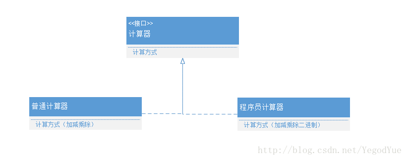

### 1.3 里氏替换（LSP）

所有使用基类的地方，都必须能透明地使用其派生类，而程序行为不变。

通俗表述：**子类可以扩展父类的功能，但不能改变父类原有的功能**。子类尽量不要重写父类的非抽象方法；如果重写后改变了前置条件、后置条件或抛出新异常，就破坏了契约。

反例：`Bird` 有 `fly()`，`Penguin` 继承后把 `fly()` 实现成抛异常——所有按 `Bird` 编写的代码都会出问题。正确做法是拆分接口（`Flyable`），这又回到 ISP。

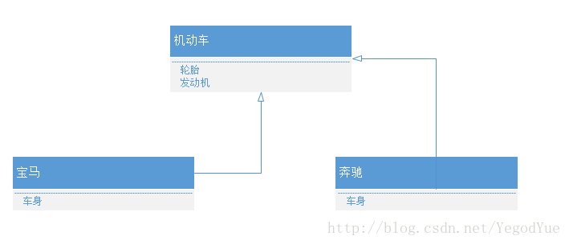

### 1.4 接口分离（ISP）

类不应依赖它不使用的接口。接口要小而专，而不是一个大而全的"胖接口"。

反例：`IMachine { print(); scan(); fax(); }`，一台只能打印的设备也必须实现 `scan`/`fax`（通常实现为空或抛异常）。拆成 `IPrinter`、`IScanner`、`IFax` 后，依赖方只知道自己需要的部分。

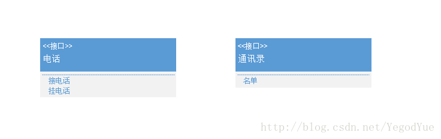

### 1.5 依赖倒置（DIP）

- 高层模块不应依赖低层模块，二者都应依赖抽象；
- 抽象不应依赖细节，细节应依赖抽象。

若类 A 持有类 B 的具体对象，则 A（高层）依赖 B（低层）。应改为 A 持有 B 的**抽象**（接口/纯虚基类），具体 B 由外部注入。

```cpp
class HardDisk { public: virtual void work() = 0; virtual ~HardDisk() {} };
class Memory   { public: virtual void work() = 0; virtual ~Memory()   {} };
class CPU      { public: virtual void work() = 0; virtual ~CPU()      {} };

class Computer {                    // 高层模块只依赖抽象
public:
    Computer(HardDisk* h, Memory* m, CPU* c)
        : m_harddisk(h), m_memory(m), m_cpu(c) {}

    void work() {
        m_harddisk->work();
        m_memory->work();
        m_cpu->work();
    }
private:
    HardDisk* m_harddisk;
    Memory*   m_memory;
    CPU*      m_cpu;
};
```

任何符合接口的硬盘/内存/CPU 都能装入 `Computer`，`Computer` 不需要为新产品改一行代码。这正是 OCP 的实现手段。

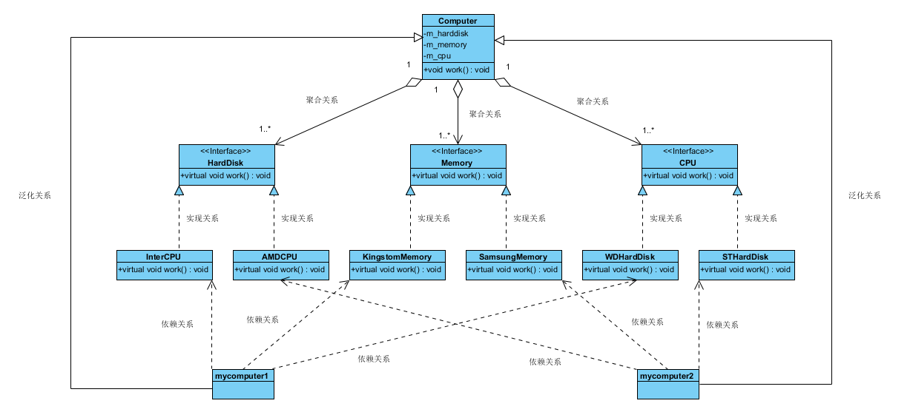

> 补充：上面的构造函数注入裸指针时，`Computer` 不拥有这些对象，释放责任在调用方。工程中更推荐 `std::unique_ptr` / 引用，把所有权表达清楚。

### 1.6 原则之间的张力

没有程序能 100% 遵守 SOLID，有些设计模式本身就违反某条原则（例如访问者模式破坏封装、单例引入全局状态）。**权衡的标准是"收益是否大于复杂度"**，而不是教条。

## 二、类间关系（UML）

"组合模式"是设计模式，"组合"是类间关系，两者不是一回事。UML 中有六种关系，强弱为：

```
组合 > 聚合 > 关联 > 依赖
```

继承与实现是纵向关系，其余四种是横向的引用关系。

### 2.1 继承（Generalization / Inheritance）

子类继承父类的功能并可增加新功能，是 **is-a** 关系。UML 用**空心三角 + 实线**，箭头指向父类。

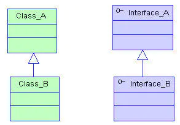

### 2.2 实现（Realization / Implementation）

类实现接口（可多个），是类与接口之间最常见的纵向关系。UML 用**空心三角 + 虚线**，箭头指向接口。

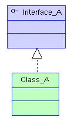

### 2.3 依赖（Dependency）

A 使用 B，但这种使用是**偶然的、临时的、弱的**；B 的变化会影响 A。

代码表现：B 作为 A 某个方法的参数、局部变量或返回值，而不是 A 的成员。UML 用**带箭头虚线**，A → B。

例：人过河要借船，人与船是依赖。

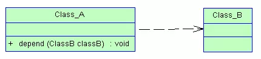

### 2.4 关联（Association）

两个类之间语义上的强依赖，通常是**长期的、平等的**，可单向或双向。

代码表现：B 以成员变量（指针/引用）形式出现在 A 中，或 A 持有指向 B 的全局引用。UML 用**带箭头实线**，两端可标角色与多重性。

例：我和我的朋友。

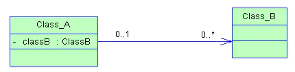

### 2.5 聚合（Aggregation）

关联的特例，体现**整体—部分（has-a）**，但整体与部分**可分离**，生命周期独立，部分可被多个整体共享。

代码上与关联无法区分，只能从语义判断。UML 用**空心菱形 + 实线**，菱形在整体一侧。

例：计算机与 CPU（CPU 可以拆下来装到别处）、公司与员工、航母编队与舰艇。

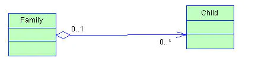

### 2.6 组合（Composition）

关联的另一种特例，体现 **contains-a**，比聚合更强：整体与部分**不可分**，整体销毁则部分随之销毁。

UML 用**实心菱形 + 实线**，菱形在整体一侧。

例：人与大脑。

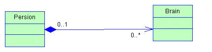

### 2.7 小结

| 关系 | 语义 | 生命周期 | UML |
|---|---|---|---|
| 继承 | is-a | — | 空心三角 + 实线 |
| 实现 | can-do | — | 空心三角 + 虚线 |
| 依赖 | 临时使用 | 不绑定 | 虚线箭头 |
| 关联 | 长期持有 | 各自独立 | 实线箭头 |
| 聚合 | has-a，可分离 | 各自独立 | 空心菱形 |
| 组合 | contains-a，不可分 | 同生共死 | 实心菱形 |

## 三、单例模式（Singleton）

目标：保证一个类只有一个实例，并提供全局访问点。

### 3.1 基本要素

1. 构造函数私有（禁止外部创建）；
2. 拷贝构造与赋值运算符删除（否则可以复制出第二个实例）；
3. 静态成员保存唯一实例；
4. 静态方法返回该实例。

### 3.2 推荐写法：Meyers Singleton（C++11 起线程安全）

```cpp
class Singleton {
public:
    static Singleton& instance() {
        static Singleton inst;   // C++11 保证局部静态变量初始化线程安全
        return inst;
    }

    Singleton(const Singleton&) = delete;
    Singleton& operator=(const Singleton&) = delete;

private:
    Singleton() = default;
    ~Singleton() = default;
};
```

优点：延迟初始化、无需显式加锁、析构由运行时负责（程序退出时自动调用）。C++11 标准明确规定：多线程同时首次进入时，只有一个线程执行初始化，其余阻塞等待（magic statics）。

### 3.3 双检锁（DCLP）的正确写法

如果必须用指针延迟创建，双检锁要注意两点：**指针必须是原子的**，且**内外两层检查都不能少**。

```cpp
#include <atomic>
#include <mutex>

class Singleton {
public:
    static Singleton* instance() {
        Singleton* p = inst_.load(std::memory_order_acquire);
        if (p == nullptr) {                       // 第一次检查：避免无竞争时加锁
            std::lock_guard<std::mutex> lock(mtx_);
            p = inst_.load(std::memory_order_relaxed);
            if (p == nullptr) {                   // 第二次检查：防止重复创建
                p = new Singleton();
                inst_.store(p, std::memory_order_release);
            }
        }
        return p;
    }

private:
    Singleton() = default;
    static std::atomic<Singleton*> inst_;
    static std::mutex mtx_;
};
```

> **修正**：原笔记的双检锁用普通 `static singleton* p`，这在 C++11 之前是**已知的错误实现**——编译器/CPU 可能把"分配内存"和"写入指针"重排，另一个线程会看到非空但未构造完成的对象。必须使用 `std::atomic`（或 C++11 之前的平台内存屏障）。原笔记中"mutex 需要在外部初始化"的注释也说明其构造函数里 `pthread_mutex_init` 的写法有问题：静态成员应在定义处初始化。
>
> 另外，原笔记在析构函数里 `delete p` 也不合理：单例通常不析构，或由 `atexit`/静态对象管理。若非要用指针，可用 `pthread_once` 或 `std::call_once`，比手写双检锁更不容易错。

### 3.4 单例的代价

- 引入全局状态，隐藏依赖，单元测试困难；
- 生命周期与程序绑定，难以注入替身；
- 多线程下若无锁保护内部状态，单例本身也不是线程安全的。

现代做法：**把单例限制在真正的"进程级唯一资源"上**（日志、配置、线程池），业务对象通过依赖注入传递，而不是到处 `Singleton::instance()`。

## 四、工厂模式（Factory）

工厂模式分三种，差异在于"谁决定创建哪个具体产品"。

### 4.1 简单工厂

一个工厂，多个产品。产品有共同虚基类，工厂根据参数 `switch` 出具体对象。

```cpp
class Product {
public:
    virtual void show() = 0;
    virtual ~Product() = default;
};

class ProductA : public Product { public: void show() override { /* A */ } };
class ProductB : public Product { public: void show() override { /* B */ } };

class Factory {
public:
    Product* create(int type) {
        switch (type) {
        case 1:  return new ProductA;
        case 2:  return new ProductB;
        default: return nullptr;      // 必须处理，否则是未定义行为
        }
    }
};
```

问题：新增产品必须修改 `create()` 的分支和参数枚举，**违反 OCP**。

> 原笔记的 `Create` 在 `default` 分支没有 `return`，函数会"掉出末尾"，是未定义行为。已补 `nullptr`。

### 4.2 工厂方法

多个工厂、多个产品，**每个产品对应一个工厂**。工厂与产品都通过虚基类构建。

```cpp
class Factory {
public:
    virtual Product* create() = 0;
    virtual ~Factory() = default;
};

class FactoryA : public Factory {
public:
    Product* create() override { return new ProductA; }
};

class FactoryB : public Factory {
public:
    Product* create() override { return new ProductB; }
};
```

新增产品时新增一个工厂类，**不修改任何已有代码**，满足 OCP。代价是类的数量翻倍。

### 4.3 抽象工厂

多个工厂、多个产品族，每个工厂能创建**同一族**的多个产品。

```cpp
class Button   { public: virtual void paint() = 0; virtual ~Button()   = default; };
class CheckBox { public: virtual void paint() = 0; virtual ~CheckBox() = default; };

class WinButton   : public Button   { public: void paint() override {} };
class WinCheckBox : public CheckBox { public: void paint() override {} };
class MacButton   : public Button   { public: void paint() override {} };
class MacCheckBox : public CheckBox { public: void paint() override {} };

class GUIFactory {
public:
    virtual Button*   createButton()   = 0;
    virtual CheckBox* createCheckBox() = 0;
    virtual ~GUIFactory() = default;
};

class WinFactory : public GUIFactory {
public:
    Button*   createButton()   override { return new WinButton; }
    CheckBox* createCheckBox() override { return new WinCheckBox; }
};

class MacFactory : public GUIFactory {
public:
    Button*   createButton()   override { return new MacButton; }
    CheckBox* createCheckBox() override { return new MacCheckBox; }
};
```

抽象工厂保证**同族产品一起替换**（换皮肤、换平台），但新增一个产品种类（如 `Slider`）需要修改所有工厂接口，这是它的固有代价。

> **修正**：原笔记的抽象工厂示例中 `FactoryA`、`FactoryB` 并没有继承 `Factory`，导致多态失效；已在上面改为继承 `GUIFactory`。同时把"型号"的说法改为更准确的"产品族"。

### 4.4 三者对比

| | 产品维度 | 工厂数量 | 新增产品 | 违反 OCP |
|---|---|---|---|---|
| 简单工厂 | 单一 | 1 | 改 switch | 是 |
| 工厂方法 | 单一 | 每产品一个 | 加工厂类 | 否 |
| 抽象工厂 | 产品族 | 每族一个 | 加族容易，加品种难 | 部分 |

## 五、反射：按类名创建对象

C++ 没有原生反射。工程上常用「字符串 → 工厂函数指针」的注册表模拟：

1. 用 `map<string, create_fn>` 保存类名到创建函数的映射；
2. 工厂单例维护该 map，提供注册与创建接口；
3. 每个类通过宏在静态初始化期自动注册。

```cpp
#include <map>
#include <string>

using CreateFn = void* (*)();

class ClassFactory {
public:
    static ClassFactory& instance() {
        static ClassFactory factory;
        return factory;
    }

    void regClass(const std::string& name, CreateFn fn) {
        creators_[name] = fn;
    }

    void* create(const std::string& name) const {
        auto it = creators_.find(name);
        if (it == creators_.end()) return nullptr;
        return it->second();
    }

private:
    ClassFactory() = default;
    std::map<std::string, CreateFn> creators_;
};
```

注册宏（利用全局对象的构造函数在 `main` 之前执行）：

```cpp
#define REGISTER_CLASS(ClassName)                                   \
    class ClassName##Helper {                                       \
    public:                                                         \
        ClassName##Helper() {                                       \
            ClassFactory::instance().regClass(                      \
                #ClassName, ClassName##Helper::create);             \
        }                                                           \
        static void* create() { return new ClassName; }             \
    };                                                              \
    static ClassName##Helper g_##ClassName##Helper;
```

使用：

```cpp
class FileItem : public Item { /* ... */ };
REGISTER_CLASS(FileItem)

Item* obj = static_cast<Item*>(ClassFactory::instance().create("FileItem"));
```

关键点：

- `#ClassName` 是**构串操作符**，把标识符变成字符串；`##` 是**拼接操作符**，用于生成唯一的辅助类名与全局变量名；
- 创建函数返回 `void*`，由调用方 `static_cast` 到实际类型——这降低了工厂对具体类型的依赖，但也放弃了类型检查；
- 注册发生在静态初始化阶段，**未注册的类无法创建**；如果链接器把未被引用的目标文件丢弃（静态库场景），注册可能失效，需要用 `--whole-archive` 或显式引用；
- 每次 `create` 都 `new` 一个新对象，调用方负责 `delete`；
- 跨 DLL 使用时，注册表在各模块中各有一份，需要注意单例的边界。

这套机制本质上就是"**注册表 + 函数指针 + 宏**"，与许多引擎（Unity、UE 的部分子系统）的序列化/工厂实现同源。

## 六、组合模式（Composite）

把一组相似对象当作单一对象处理，用树形结构表示"部分—整体"层次。

要点：

1. 用树组织对象；
2. **叶子节点与容器节点继承同一基类**，从而对调用方具有一致的处理方式；
3. 容器节点递归转发操作给子节点。

```cpp
class Node {
public:
    virtual void render() = 0;
    virtual ~Node() = default;
};

class Leaf : public Node {
public:
    void render() override { /* 绘制自身 */ }
};

class Group : public Node {
public:
    void add(Node* n) { children_.push_back(n); }
    void render() override {
        for (Node* c : children_) c->render();
    }
private:
    std::vector<Node*> children_;
};
```

调用方对 `Leaf` 和 `Group` 一视同仁，不需要 `if (isGroup)` 分支。典型应用：UI 树、场景图、文件系统、组织架构。

代价：为了让容器和叶子接口一致，叶子也不得不实现 `add/remove`（通常抛异常或空实现），这违反了 ISP——组合模式用"统一接口"换取了"透明性"。

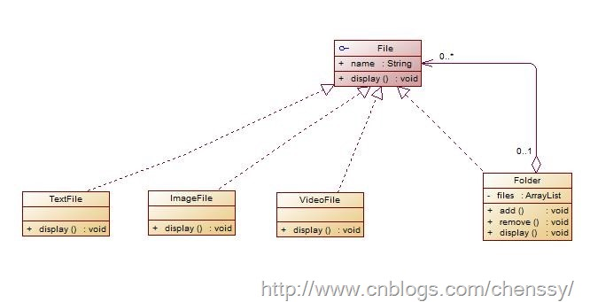

> 注意与"组合关系（Composition）"区分：前者是设计模式，后者是类间关系（整体与部分同生共死）。

## 七、访问者模式（Visitor）

把**数据结构**与**作用于其上的操作**分离：在不修改元素类的前提下，增加新的操作。

组成：

1. 一个由多个对象构成的、相对稳定的对象结构，每个元素都有 `accept(Visitor&)`；
2. 一个访问者，拥有针对不同元素类型的 `visit` 重载。

```cpp
class Circle;
class Square;

class Visitor {
public:
    virtual void visit(Circle&) = 0;
    virtual void visit(Square&) = 0;
    virtual ~Visitor() = default;
};

class Shape {
public:
    virtual void accept(Visitor& v) = 0;
    virtual ~Shape() = default;
};

class Circle : public Shape {
public:
    void accept(Visitor& v) override { v.visit(*this); }
    double radius = 1.0;
};

class Square : public Shape {
public:
    void accept(Visitor& v) override { v.visit(*this); }
    double side = 1.0;
};

class AreaVisitor : public Visitor {
public:
    void visit(Circle& c) override { area += 3.14159 * c.radius * c.radius; }
    void visit(Square& s) override { area += s.side * s.side; }
    double area = 0.0;
};
```

`accept` 里的 `v.visit(*this)` 是**双重分派**：第一次按元素的动态类型分派到 `accept`，第二次按访问者的动态类型分派到具体 `visit`。C++ 没有原生双重分派，这是用 `accept` + `visit` **两次虚调用串联**模拟出来的。

优点：

- 数据结构与操作解耦；
- 把散落在各处的同类操作集中到一个访问者类（例如"导出 JSON""计算包围盒""生成代码"各一个 visitor）；
- 增加新访问者很容易，符合 OCP。

缺点：

- **增加新的元素类型很困难**：每个访问者都要加一个 `visit` 重载；
- 破坏封装：访问者需要拿到元素内部数据，通常要友元或公开 getter。

适用：对象结构稳定、操作经常增加。典型场景：编译器 AST（语法树节点固定、pass 不断增加）、文档导出、场景遍历。

## 八、职责链模式（Chain of Responsibility）

把请求的发送者与处理者解耦：多个处理者连成一条链，请求沿链传递，直到被某个节点处理。

组成：

1. 客户端：发出请求；
2. 处理者：实现统一接口，持有后继指针，组成链表。

```cpp
class Handler {
public:
    void setNext(Handler* next) { next_ = next; }
    virtual bool handle(int request) {
        if (next_) return next_->handle(request);
        return false;                 // 无人处理
    }
    virtual ~Handler() = default;
protected:
    Handler* next_ = nullptr;
};
```

优点：

- 降低耦合：发送者只认识链头；
- 增加/调整处理者很容易（链表增删）；
- 每个处理者只关心自己能处理的请求，符合 SRP。

缺点：

- **不保证请求一定被处理**：可能走到链尾也没有节点接手，需要默认处理或显式报错；
- 请求可能穿过多个节点才被处理，有额外开销；
- 调试时调用链不直观。

适用：

- 多个对象都可能处理同一请求，具体由**运行时**决定（如模型加载：按扩展名依次尝试不同 loader）；
- 需要动态指定一组处理者；
- 事件冒泡、中间件管道、审批流。

> 原笔记把"不能保证请求一定会被处理"划掉了。这其实是职责链的**真实缺点**，不应删除；工程上一般让链尾节点返回失败或抛异常来兜底。

## 九、组件模式（Component）

面向对象在"数据组织"上有两个结构性缺陷：

1. **继承耦合强**：父类增删字段会影响所有子类和相关逻辑，面对频繁的数据结构调整很无力；
2. **无法运行时增删字段/接口**：玩家平时走路、骑坐骑后骑马，若用继承，坐骑数据必须一直挂在 `Player` 上——不骑马时内存里为什么要有马的数据？

组件模式（Entity-Component）把对象拆成可热插拔的部件：

- **一个组件 = 一份数据 + 一段逻辑**；
- 组件可增删，需要就挂上，不需要就移除；
- 类型之间依赖极少，增删组件不影响其它类型。

```cpp
class Component {
public:
    virtual void update(float dt) = 0;
    virtual ~Component() = default;
};

class Transform : public Component { /* 位置、旋转、缩放 */ };
class Health    : public Component { /* 血量 */ };
class Mount     : public Component { /* 坐骑数据，上马时挂载，下马时移除 */ };

class Entity {
public:
    template <typename T, typename... Args>
    T* add(Args&&... args) {
        auto c = std::make_unique<T>(std::forward<Args>(args)...);
        T* raw = c.get();
        components_.push_back(std::move(c));
        return raw;
    }
    void update(float dt) {
        for (auto& c : components_) c->update(dt);
    }
private:
    std::vector<std::unique_ptr<Component>> components_;
};
```

工程要点：

- 组件之间通过**消息/事件**或共享的 `Entity` 句柄通信，避免组件互相持有具体类型；
- 遍历大量实体时，组件通常按类型**连续存储**（SoA / archetype），而不是每个实体一个 `vector<unique_ptr>`，以提升 cache 命中率；
- 组件生命周期与实体绑定，移除组件要处理其它组件的引用。

代价：架构复杂度上升、组件间通信需要额外机制、调试时对象行为分散在多个组件中。

## 十、UML 时序图

时序图（Sequence Diagram）展示对象之间交互的**时间顺序**。

二维结构：纵向是时间轴（自上而下），横向是参与协作的对象。对象存在时用虚线生命线表示，过程处于激活状态时生命线变为双道线（控制焦点）。

### 10.1 基本元素

| 元素 | 表示 |
|---|---|
| 角色 Actor | 小人图标，人/外部系统 |
| 对象 Object | 顶部矩形，`对象名:类名` / `:类名` / `对象名:` |
| 生命线 Lifeline | 垂直虚线；带下划线标注的是**对象名**（`对象名:类名` 中的对象名），生命线本身始终是虚线，执行期叠加窄矩形（控制焦点） |
| 控制焦点 Activation | 生命线上的窄矩形，表示执行期 |
| 同步消息 | 实线 + 实心箭头，发送者等待 |
| 异步消息 | 实线 + 开放箭头（`>`），发送者不等待 |
| 返回消息 | 虚线 + 开放箭头，表示调用返回 |
| 自关联消息 | 半闭合矩形 + 箭头，方法自调用 |

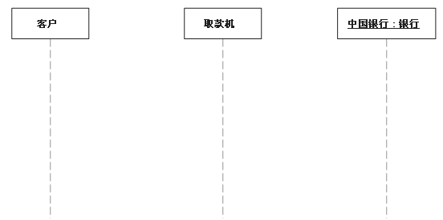

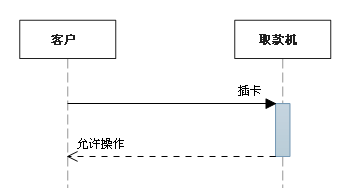

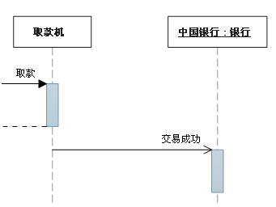

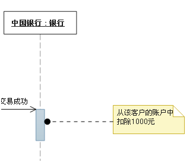

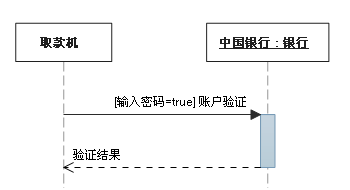

### 10.2 组合片段（Combined Fragment）

组合片段用于表达条件、循环、并行等控制结构，格式为左上角标签 + 方框。

- **Alt（抉择）**：多选一，相当于 `if / else if / else`；条件写在 `[]` 中，`[else]` 兜底。所有条件都不成立且无 `else` 时，不执行任何片段。
- **Opt（选项）**：可选，相当于 `if`（无 else）。
- **Loop（循环）**：重复，可在守卫条件（guard）中写循环条件与次数。
- **Par（并行）**：多个片段并行执行。

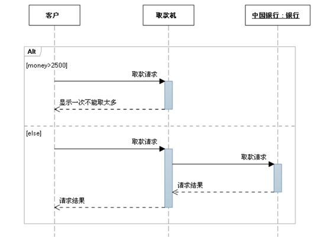

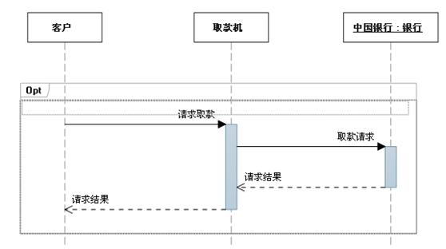

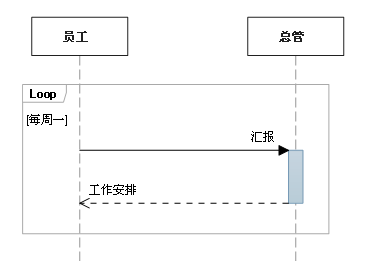

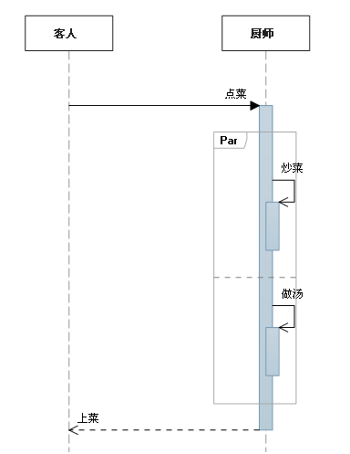

常用的片段速查（下表为原截图完整转写；表中「临界」是原书对 **guard（守卫条件）** 的旧译，与本篇正文统一称「守卫条件」；注意不要和同表的 **Critical（关键）** 片段混淆）：

| 片段类型 | 名称 | 说明 |
|---|---|---|
| Opt | 选项 | 包含一个可能发生或可能不发生的序列。可以在临界中指定序列发生的条件。 |
| Alt | 抉择 | 包含一个片段列表，这些片段包含备选消息序列。在任何场合下只发生一个序列。可以在每个片段中设置一个临界来指示该片段可以运行的条件。`else` 的临界指示其他任何临界都不为 True 时应运行的片段。如果所有临界都为 False 并且没有 `else`，则不执行任何片段。 |
| Loop | 循环 | 片段重复一定次数。可以在临界中指示片段重复的条件。Loop 组合片段具有 "Min" 和 "Max" 属性，它们指示片段可以重复的最小和最大次数。默认值是无限制。 |
| Break | 中断 | 如果执行此片段，则放弃序列的其余部分。可以使用临界来指示发生中断的条件。 |
| Par | 并行 | 并行处理。片段中的事件可以交错。 |
| Critical | 关键 | 用在 Par 或 Seq 片段中。指示此片段中的消息不得与其他消息交错。 |
| Seq | 弱顺序 | 有两个或更多操作数片段。涉及同一生命线的消息必须以片段的顺序发生。如果消息涉及的生命线不同，来自不同片段的消息可能会并行交错。 |
| Strict | 强顺序 | 有两个或更多操作数片段。这些片段必须按给定顺序发生。 |
| Consider | 考虑 | 指定此片段描述的消息列表。其他消息可发生在运行的系统中，但对此描述来说意义不大。在 "Messages" 属性中键入该列表。 |
| Ignore | 忽略 | 此片段未描述的消息列表。这些消息可发生在运行的系统中，但对此描述来说意义不大。在 "Messages" 属性中键入该列表。 |
| Assert | 断言 | 操作数片段指定唯一有效的序列。通常用在 Consider 或 Ignore 片段中。 |
| Neg | 否定 | 此片段中显示的序列不得发生。通常用在 Consider 或 Ignore 片段中。 |

### 10.3 示例：扫码支付

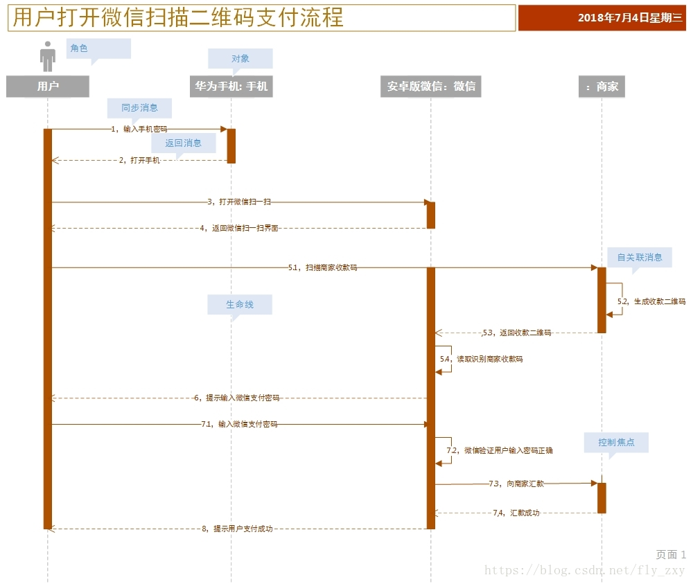

流程：

1. 用户输入手机密码并解锁；
2. 打开微信，进入扫一扫；
3. 扫描商家收款码，商家生成并返回收款二维码；
4. 客户端识别二维码，提示输入支付密码；
5. 校验密码，向商家汇款，返回结果；
6. 提示支付成功。

若要在图中体现"汇款成功/失败"两个分支，用 Alt 片段包裹 5.x 步骤：

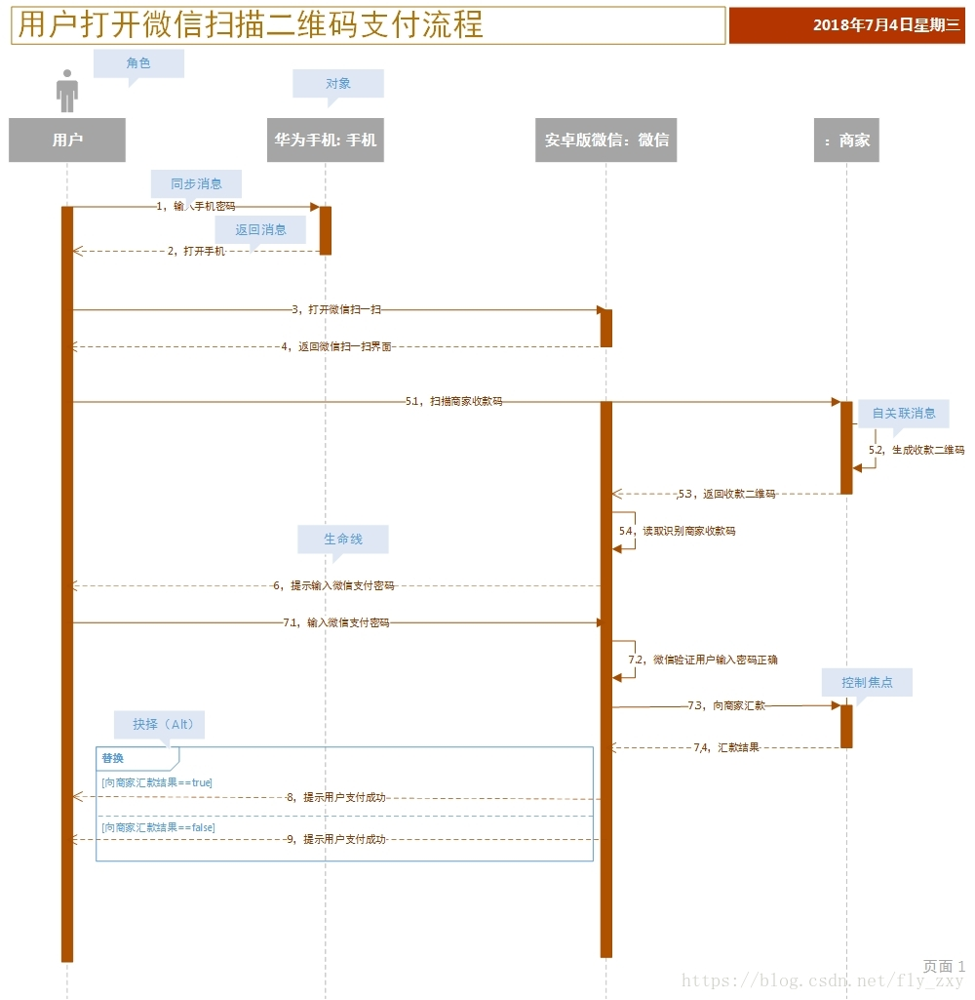

> 图中 `[向商家汇款结果==false]` 分支的步骤 9 也写成了"提示用户支付成功"，应为"提示用户支付失败"（原图有误，已更正：失败分支须返回失败提示）。

### 10.4 绘制步骤

1. **划清边界，识别语境**：确定要表达的范围（省略"商家打开微信、输入金额"等无关交互），明确前提与背景；
2. **梳理角色与对象**：谁是外部角色，哪些是系统内部对象；
3. **列出交互消息**：按时间顺序编号；
4. **从初始消息开始画**，依次展开，每条消息分配序号；
5. **角色/对象用名词，消息用动词**；
6. **角色放最左，对象按重要程度/使用频率从左到右**；
7. **控制焦点两端要用消息封顶**，不要超出消息范围。

正确与错误示范：

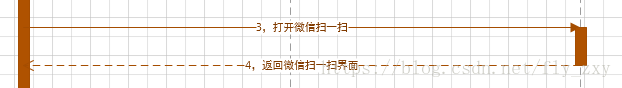

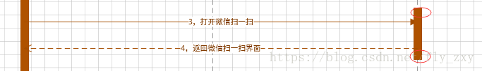

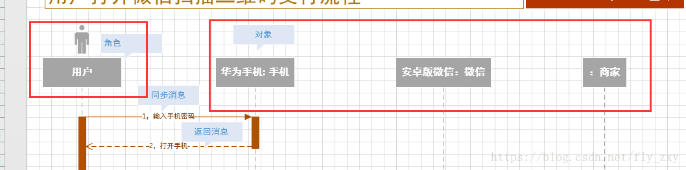

### 10.5 练习：用户登录

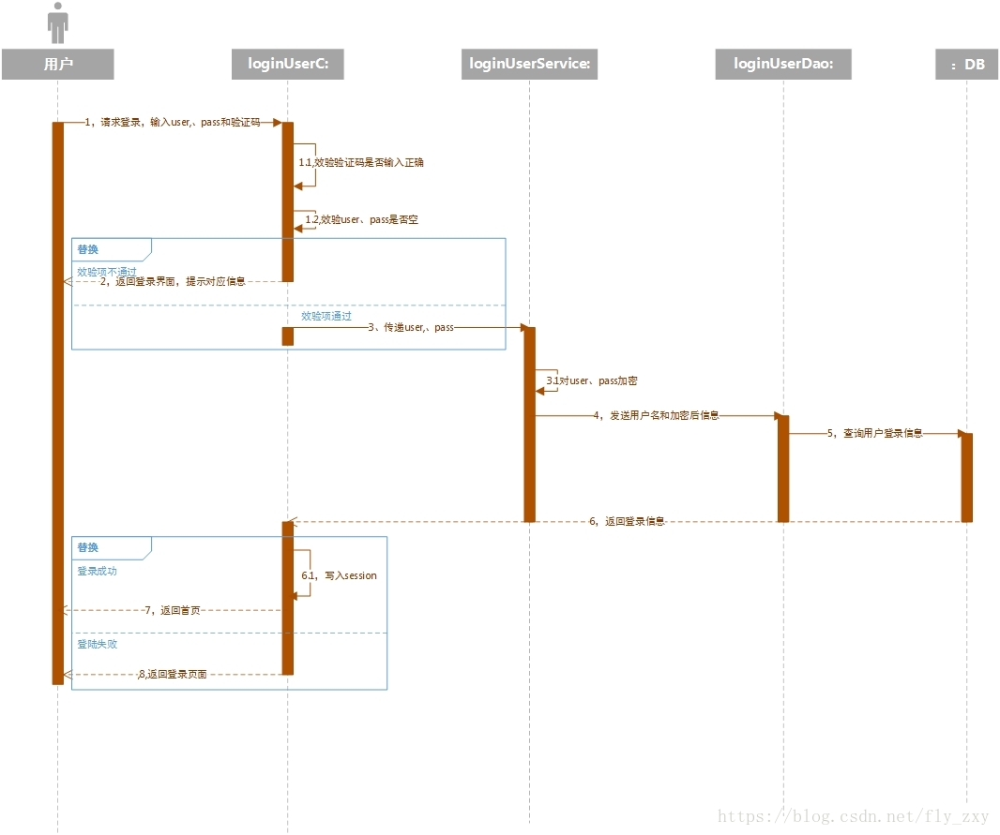

绘制工具：Visio、PlantUML、Mermaid、draw.io 均可。PlantUML/Mermaid 适合把时序图纳入版本管理。

## 原始笔记索引

- `C++/Design Mode/设计模式/S.O.L.I.D 原则.md`
- `C++/Design Mode/设计模式/类间关系.md`
- `C++/Design Mode/设计模式/单例模式.md`
- `C++/Design Mode/设计模式/工厂模式.md`
- `C++/Design Mode/设计模式/反射.md`
- `C++/Design Mode/设计模式/组合模式.md`
- `C++/Design Mode/设计模式/访问者模式.md`
- `C++/Design Mode/设计模式/职责链模式.md`
- `C++/Design Mode/设计模式/组件模式.md`
- `C++/Design Mode/UML/时序图.md`