# 算法与数据结构

> **导读**
> 这一篇把散落在 `C++/算法` 与 `C++/数据结构` 下的四十多份草稿，按“题型”而不是“文件名”重新组织：同一道题的多次推导、同一段代码的多份拷贝只保留最终结论与最简实现。
> 贯穿全篇的两条主线是**不变量**与**边界**——二分查找靠“搜索区间”的不变量统一三种模板，回溯靠“搜索起点 + 同层去重”的不变量消除重复解，动态规划靠 `dp` 数组的定义锁定状态转移。
> 文中所有代码都是 C++，均已通过 `g++ -std=c++17` 编译验证（少数承接上文的片段在注释里标注了依赖）；对原笔记里发现的错误（堆排序循环边界、416 滚动数组下标、LIS 复杂度、斐波那契复杂度等）已就地改正，并在正文标注了改了什么。
> 少数无法从残稿确认的结论标了“（待核实）”，请以实测为准。

## 题型目录

| 板块 | 内容 |
| --- | --- |
| [一、基础与排序](#一基础与排序) | 排序算法与复杂度、二分查找三模板、向上取整、斐波那契递归复杂度、字符串/数字转换、二维数组与螺旋矩阵、字典序与下一个排列、全排列、旋转数组、打印 n 位数、数学与取模 |
| [二、数据结构](#二数据结构) | 栈与队列（MinStack、出栈序列合法性）、链表（Floyd 判圈、环形链表 II、287 重复数、双向链表）、堆与 priority_queue、哈希表 |
| [三、二叉树](#三二叉树) | 层序遍历、非递归前/中序遍历、根到叶路径、由数组建完全二叉树 |
| [四、回溯](#四回溯) | 回溯模板、组合总和 39/40/216、77 组合 |
| [五、动态规划](#五动态规划) | DP 的判别、01 背包、LCS、416 分割等和、剪绳子、264 丑数 II |
| [六、其他专题](#六其他专题) | KD-Tree、50 快速幂、69 开方、数位和搜索、t3/t4/t15、位运算小结 |
| [附录](#附录a-stl-速查) | STL 速查、刷题清单、易错点清单 |

---

## 一、基础与排序

### 1.1 排序算法

#### 快速排序的复杂度

快排的代价由**划分是否均匀**决定：每层划分扫描 `O(n)`，递归深度决定层数。

| 情形 | 划分 | 递归深度 | 时间 | 空间 |
| --- | --- | --- | --- | --- |
| 最好 | 每次恰好二分 | `log₂n` | `O(n log n)` | `O(log n)` |
| 平均 | 常数比例划分 | `O(log n)` | `O(n log n)` | `O(log n)` |
| 最差 | 每次划分为 `0 : n-1`（已排序且取端点为 pivot） | `n` | `O(n²)` | `O(n)` |

设 `n` 为待排序数组中的元素个数，`T(n)` 为算法需要的时间复杂度，`D(n) = n - 1` 是一趟快排需要的比较次数，一趟快排结束后把数组分成两部分 `I₁` 和 `I₂`，则

$$
T(n)=\begin{cases}
D(1), & n \le 1\\
D(n)+T(I_1)+T(I_2), & n > 1
\end{cases}
$$

**最好情况**：每一次划分都正好将数组成长度相等的两半，即 `I₁ = I₂ = n/2`：

$$
T(n)=\begin{cases}
D(1), & n \le 1\\
D(n)+T(\tfrac{n}{2})+T(\tfrac{n}{2}), & n > 1
\end{cases}
$$

所以

$$
\begin{aligned}
T(n) &= D(n)+2T(n/2)\\
     &= D(n)+2D(n/2)+4T(n/4)\\
     &\ \ \vdots\\
     &= D(n)+2D(n/2)+\cdots+2^kD(n/2^k)\\
     &= (n-1)+2(\tfrac{n}{2}-1)+\cdots+2^k(\tfrac{n}{2^k}-1)\\
     &= (n-1)+(n-2)+(n-4)+\cdots+(n-2^k)
\end{aligned}
$$

又因 `k = log₂n`，代回得 `T(n) = n·log₂n - n + 1 ∈ O(n log₂n)`。

（原图有误，已更正：原图把通项写成 `n - 1 + n - 2 + ⋯ + n - 2^k`（漏了 `n-4` 等中间项），并给出 `nlog₂n - 2n + 1`。按 `2^i·D(n/2^i) = n - 2^i` 逐项求和，结果应为 `nlog₂n - n + 1`；以 `n = 8` 验算：`T(8) = 2T(4)+7 = 2×5+7 = 17`，`8×3-8+1 = 17`，与原图的 `24-16+1 = 9` 不符。阶仍是 `O(n log n)`。）

**最差情况**：每一次划分都将数组分成了 `0` 和 `n-1` 两部分：

$$
T(n)=\begin{cases}
D(1), & n \le 1\\
D(n)+T(0)+T(n-1), & n > 1
\end{cases}
$$

所以

$$
\begin{aligned}
T(n) &= D(n)+T(n-1)\\
     &= D(n)+D(n-1)+T(n-2)\\
     &\ \ \vdots\\
     &= D(n)+D(n-1)+\cdots+D(2)+D(1)\\
     &= (n-1)+(n-2)+\cdots+1+0\\
     &= \frac{n(n-1)}{2} \in O(n^2)
\end{aligned}
$$

要点：

- 最差情况可退化为 `O(n²)`，工程上用**随机 pivot** 或**三数取中**规避；C++ 的 `std::sort` 是内省排序（快排 + 堆排 + 插入排序），最差仍保证 `O(n log n)`。
- 快排**不稳定**；需要稳定就用 `std::stable_sort`（归并）。
- 递归实现的空间是栈深度，最差 `O(n)`；改成先递归短的一侧、长的一侧循环，可把空间压到 `O(log n)`。

#### 常见排序复杂度总表

| 算法 | 最好 | 平均 | 最差 | 额外空间 | 稳定性 |
| --- | --- | --- | --- | --- | --- |
| 冒泡 | `O(n)` | `O(n²)` | `O(n²)` | `O(1)` | 稳定 |
| 插入 | `O(n)` | `O(n²)` | `O(n²)` | `O(1)` | 稳定 |
| 选择 | `O(n²)` | `O(n²)` | `O(n²)` | `O(1)` | 不稳定 |
| 希尔 | `O(n log n)` | 依赖增量 | `O(n²)` | `O(1)` | 不稳定 |
| 归并 | `O(n log n)` | `O(n log n)` | `O(n log n)` | `O(n)` | 稳定 |
| 快速 | `O(n log n)` | `O(n log n)` | `O(n²)` | `O(log n)` | 不稳定 |
| 堆 | `O(n log n)` | `O(n log n)` | `O(n log n)` | `O(1)` | 不稳定 |
| 计数 | `O(n+k)` | `O(n+k)` | `O(n+k)` | `O(k)` | 稳定 |
| 桶 | `O(n+k)` | `O(n+k)` | `O(n²)` | `O(n+k)` | 稳定（桶内稳定时） |
| 基数 | `O(d(n+r))` | 同左 | 同左 | `O(n+r)` | 稳定 |

原图的两张复杂度表与上表一致，另标注了“排序方式”一列：冒泡、选择、插入、希尔、快速、堆为 **In-place**；归并、计数、桶、基数为 **Out-place**（归并需 `O(n)` 额外空间，不属原地排序）。

（两张原图对希尔排序的界写法不一：一张记最好 `O(n log²n)`，另一张记平均 `O(n^1.3)`。希尔排序的复杂度依赖增量序列，最坏可到 `O(n²)`，本文沿用“依赖增量”的表述。原图把基数排序的时间写成 `O(n×k)`，本文表中记作 `O(d(n+r))`；两者含义一致，`k`/`d` 为关键字位数、`r` 为基数。）

```cpp
// 快排：Lomuto 划分，取中间元素作 pivot 规避有序数组退化
#include <vector>
#include <utility>

int partitionRange(std::vector<int>& a, int left, int right) {
    int mid = left + (right - left) / 2;
    std::swap(a[mid], a[right]);          // 取中间元素作 pivot：有序输入不退化（并非随机化，对抗性输入仍可能退化）
    int pivot = a[right];
    int i = left;                          // [left, i) 均 < pivot
    for (int j = left; j < right; ++j) {
        if (a[j] < pivot) std::swap(a[i++], a[j]);
    }
    std::swap(a[i], a[right]);
    return i;
}

void quickSort(std::vector<int>& a, int left, int right) {
    while (left < right) {
        int p = partitionRange(a, left, right);
        if (p - left < right - p) {        // 先处理短的一侧，栈深度 O(log n)
            quickSort(a, left, p - 1);
            left = p + 1;
        } else {
            quickSort(a, p + 1, right);
            right = p - 1;
        }
    }
}
```

### 1.2 二分查找

三种场景（找一个数、找左边界、找右边界）的差异**只有一个源头**：初始化 `right` 时选 `n - 1` 还是 `n`，由此决定搜索区间是闭还是半开，进而决定 `while` 条件与收缩方式。记住这条因果链，就不需要背。

> 计算 `mid` 一律写 `mid = left + (right - left) / 2`，避免 `left + right` 溢出。

#### 模板一：找一个数（闭区间 `[left, right]`）

```cpp
#include <vector>

int binarySearch(const std::vector<int>& nums, int target) {
    int left = 0, right = (int)nums.size() - 1;   // 闭区间
    while (left <= right) {                        // 终止时 left == right + 1，区间为空
        int mid = left + (right - left) / 2;
        if (nums[mid] == target)      return mid;
        else if (nums[mid] < target)  left = mid + 1;
        else                          right = mid - 1;
    }
    return -1;
}
```

为什么是 `<=`：初始化 `right = n - 1` 表示区间两端都闭。`while (left <= right)` 结束时 `left = right + 1`，区间形如 `[3, 2]`，确实为空；若写成 `<`，终止时区间是 `[2, 2]`，还剩一个元素没被检查，必须补一句 `return nums[left] == target ? left : -1;`。

为什么 `mid ± 1`：`mid` 已经比较过，必须从搜索区间里剔除，否则区间不收缩。

#### 模板二：左边界（半开区间 `[left, right)`）

返回**第一个 `>= target` 的下标**（等价于 `std::lower_bound`），取值区间是 `[0, n]`，因此 `left == n` 表示比所有元素都大。

```cpp
#include <vector>

int leftBound(const std::vector<int>& nums, int target) {
    int left = 0, right = (int)nums.size();        // 半开区间
    while (left < right) {                          // 终止时 left == right，区间 [left, left) 为空
        int mid = left + (right - left) / 2;
        if (nums[mid] == target)      right = mid;  // 不返回，继续向左收缩
        else if (nums[mid] < target)  left = mid + 1;
        else                          right = mid;   // mid 已排除，区间写作 [left, mid)
    }
    // 严格只需“存在性”时补这两行
    // if (left == (int)nums.size()) return -1;
    // return nums[left] == target ? left : -1;
    return left;
}
```

关键在 `nums[mid] == target` 时 `right = mid`：不立即返回，而是把上界压到 `mid`，不断向左逼近，最终 `left` 落在最左的那个 target 上。又因为区间是 `[left, right)`，`right = mid` 恰好把 `mid` 排除在外，不会死循环。

#### 模板三：右边界

返回**最后一个 `<= target` 的下标**（等价于 `std::upper_bound - 1`）。

```cpp
#include <vector>

int rightBound(const std::vector<int>& nums, int target) {
    int left = 0, right = (int)nums.size();
    while (left < right) {
        int mid = left + (right - left) / 2;
        if (nums[mid] == target)      left = mid + 1;  // 继续向右收缩
        else if (nums[mid] < target)  left = mid + 1;
        else                          right = mid;
    }
    if (left == 0) return -1;
    return nums[left - 1] == target ? left - 1 : -1;
}
```

为什么返回 `left - 1`：循环结束时 `nums[left]` 一定 `> target`（或越界），而 `nums[left - 1]` 可能就是 target，所以右边界是 `left - 1`。


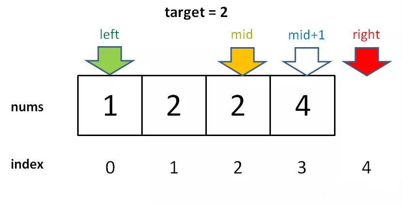

#### 一张表记住三者

| | 初始 `right` | 区间 | `while` | `==` 时 | 返回 |
| --- | --- | --- | --- | --- | --- |
| 找一个数 | `n-1` | `[l, r]` 闭 | `l <= r` | 立即 `return mid` | `mid` / `-1` |
| 左边界 | `n` | `[l, r)` 半开 | `l < r` | `r = mid` | `l` |
| 右边界 | `n` | `[l, r)` 半开 | `l < r` | `l = mid + 1` | `l - 1` |

#### 二分查找的时间复杂度

每次排除一半，第 `m` 次后剩余 `n / 2^m`；当只剩 1 个元素时循环结束：

```
n / 2^m = 1  =>  m = log₂n
```

即 `O(log n)`（`while` 的循环次数就是时间复杂度）。

#### 一个实践中的坑：目标不在数组里

采用半开区间且 target 不存在时，退出循环的 `left` 值取决于 target 落在哪一段，直觉上“不确定”：

```
nums = [1, 3]
target = 4  ->  left = 2
target = 0  ->  left = 0
target = 2  ->  left = 1
```

结论其实很干净：**`left` 就是 target 插入数组后应处的下标**（保持有序）。所以：

- 只想判断“在不在”，用**模板一（闭区间）**，最不易写错；
- 用半开区间时，先判两个端外的情况（`target < nums[0]`、`target > nums.back()`），再走循环；
- 循环结束后 `nums[left]` 指向 target 右侧的第一个元素。

### 1.3 向上取整

整型除法是**向零取整**（正整数即向下取整），向上取整用：

```
ceil(n / t) = (n + t - 1) / t      // 要求 t > 0
```

```cpp
int ceilDiv(int n, int t) {        // n >= 0, t > 0
    return (n + t - 1) / t;
}
```

- 例：`n=5,t=4 -> (5+3)/4 = 2`；`n=8,t=4 -> 11/4 = 2`。
- 注意 `n + t - 1` 可能溢出，`n` 接近 `INT_MAX` 时改用 `n / t + (n % t != 0)`。
- 负数场景下 C++ 的 `/` 是向零截断而非向下取整，本公式不适用（待核实具体语义需求）。

### 1.4 斐波那契递归法的复杂度

递归式 `T(n) = T(n-1) + T(n-2) + O(1)`，展开是一棵每层分成两支的树：

- **时间 `O(2^n)`**：节点数按指数增长。更精确的界是 `O(φ^n)`，`φ = (1+√5)/2 ≈ 1.618`，因为左子树比右子树矮，实际节点数约为 `φ^n`，说 `O(2^n)` 是上界。
- **空间 `O(n)`**：递归栈的最大深度是 `n`，不是指数。
- 大量重复子问题（`f(n-2)` 被算两次、`f(n-3)` 被算三次……），这正是 DP 的记忆化动机：存表后时间降为 `O(n)`，空间 `O(n)`；滚动变量则空间 `O(1)`；矩阵快速幂可到 `O(log n)`。

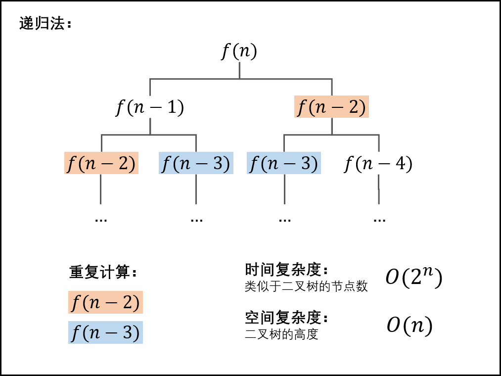

```cpp
// 自底向上，O(n) 时间 / O(1) 空间
long long fib(int n) {
    if (n < 2) return n;
    long long a = 0, b = 1;
    for (int i = 2; i <= n; ++i) {
        long long c = a + b;
        a = b;
        b = c;
    }
    return b;
}
```

### 1.5 字符串与数字转换

均定义于 `<string>`。

```cpp
#include <string>
#include <vector>

// 数字 -> 字符串（C++11 起）
std::string s1 = std::to_string(42);          // int
std::string s2 = std::to_string(3.14);        // double，固定保留 6 位小数：3.140000

// 字符串 -> 数字（C++11 起）
int         i  = std::stoi("42");             // 还有 stol / stoll / stoul / stof / stod
int         h  = std::stoi("ff", nullptr, 16);// 第三个参数是进制
// idx 参数可返回“解析停止的位置”，用于处理 "123abc"
size_t pos = 0;
int n = std::stoi("123abc", &pos);            // n == 123, pos == 3
```

- `stoi` 系列在无法转换时抛 `std::invalid_argument`，越界抛 `std::out_of_range`，需要 `try/catch`。
- 高频性能场景（大量转换）优先 `std::from_chars` / `std::to_chars`（C++17，无异常无分配）。

字符串分割：

把每个空格替换成 `"%20"`（`"we are happy."` → `"we%20are%20happy."`）。若在**原字符串上原地**做，必须**从后往前**拷贝，否则前面的写入会覆盖尚未处理的字符：

1. 先扫一遍统计空格数 `cnt`，新长度 = `length + 2 * cnt`；
2. 两个指针，一个指向原串末尾，一个指向新串末尾；
3. 从后往前逐字符复制，遇空格则倒序写入 `'0'`、`'2'`、`'%'`。

```cpp
#include <cstring>
#include <string>

// 调用方保证 str 的缓冲区至少有 newLength + 1 字节
char* replaceBlank(char* str) {
    if (!str) return nullptr;
    int length = (int)std::strlen(str);
    if (length == 0) return str;

    int cnt = 0;
    for (int i = 0; i < length; ++i)
        if (str[i] == ' ') ++cnt;
    if (cnt == 0) return str;

    int newLength = length + 2 * cnt;
    str[newLength] = '\0';                       // 原稿缺这一句，字符串没有结尾

    int p1 = length - 1, p2 = newLength - 1;
    while (p1 >= 0) {
        if (str[p1] != ' ') {
            str[p2--] = str[p1--];
        } else {
            str[p2--] = '0';                     // 倒序写入，最终读作 "%20"
            str[p2--] = '2';
            str[p2--] = '%';
            --p1;
        }
    }
    return str;
}

// 不允许原地修改时，直接用 std::string 拼接
std::string replaceBlank(const std::string& s) {
    std::string out;
    out.reserve(s.size() * 3);
    for (char c : s) {
        if (c == ' ') out += "%20";
        else          out += c;
    }
    return out;
}
```

复杂度：`O(n)` 时间、`O(1)` 额外空间（原地版）。

```cpp
#include <string>
#include <vector>

void splitString(const std::string& s, std::vector<std::string>& out, const std::string& delim) {
    if (delim.empty()) { out.push_back(s); return; }
    std::string::size_type pos1 = 0, pos2 = s.find(delim);
    while (pos2 != std::string::npos) {
        out.push_back(s.substr(pos1, pos2 - pos1));
        pos1 = pos2 + delim.size();
        pos2 = s.find(delim, pos1);
    }
    if (pos1 != s.length()) out.push_back(s.substr(pos1));  // 最后一段
}
```

### 1.6 二维数组的行和列

```cpp
#include <vector>

void matrixDemo() {
    std::vector<std::vector<int>> matrix(3);
    matrix[0] = {1, 2, 3, 4};
    matrix[1] = {1, 2, 3, 4};
    matrix[2] = {1, 2, 3, 4};
    // 3 行 4 列
    int rows = (int)matrix.size();       // 行数
    int cols = (int)matrix[0].size();    // 列数
    (void)rows; (void)cols;
}
```

做矩阵边界题时，**行数用 `size()`，列数用 `[0].size()`**，别写反：

```cpp
#include <vector>

void matrixBounds(const std::vector<std::vector<int>>& matrix) {
    int left = 0, right = (int)matrix[0].size() - 1;  // 列方向
    int top = 0,  bottom = (int)matrix.size() - 1;    // 行方向
    // 向内收缩：left++ / right-- / top++ / bottom--
    (void)left; (void)right; (void)top; (void)bottom;
}
```

#### 顺时针打印矩阵（螺旋矩阵，LC 54 / 剑指 29）

思路：四个边界限定当前未打印的矩形，**每打印一条边就收缩一个边界**；当 `left > right` 或 `top > bottom` 时退出。注意最后两条边打印前要再判一次边界，否则单行/单列矩阵会重复输出。

```cpp
#include <vector>

std::vector<int> spiralOrder(const std::vector<std::vector<int>>& matrix) {
    std::vector<int> res;
    if (matrix.empty() || matrix[0].empty()) return res;
    int left = 0, right = (int)matrix[0].size() - 1;
    int top = 0, bottom = (int)matrix.size() - 1;

    while (left <= right && top <= bottom) {
        for (int j = left; j <= right; ++j) res.push_back(matrix[top][j]);
        ++top;                                              // 上边打完，上边界下移
        for (int i = top; i <= bottom; ++i) res.push_back(matrix[i][right]);
        --right;                                            // 右边打完，右边界左移
        if (top <= bottom) {                                // 防止单行重复
            for (int j = right; j >= left; --j) res.push_back(matrix[bottom][j]);
            --bottom;
        }
        if (left <= right) {                                // 防止单列重复
            for (int i = bottom; i >= top; --i) res.push_back(matrix[i][left]);
            ++left;
        }
    }
    return res;
}
```

复杂度：`O(mn)` 时间，`O(1)` 额外空间（不计输出）。

### 1.7 字典序

**字典序比较准则**：从左往右逐字符比较，遇到第一个不同字符即定序；若一方先结束（`'\0'`），短的在前。

```cpp
// 返回 <0 / 0 / >0，语义同 strcmp
int compareStr(const char* a, const char* b) {
    while (*a && *b && *a == *b) { ++a; ++b; }
    return (unsigned char)*a - (unsigned char)*b;   // 用 unsigned char 避免有符号字符负值比较出错
}
```

**求字典序的下一个排列**（`std::next_permutation` 的手写版）：

1. 从右往左找第一个 `L[i-1] < L[i]`，记 `a = i-1`（此时 `a` 之后是**降序**的）；找不到说明整个序列非递增，已是最大排列，反转为最小排列。
2. 从右往左找第一个 `L[b] > L[a]`，记下标 `b`（因为右侧降序，第一个满足的就是“比 `L[a]` 大的最小数”）。
3. 交换 `L[a]` 与 `L[b]`。
4. 把 `a` 之后的元素（仍降序）**反转**成升序。

```cpp
#include <algorithm>

bool nextPermutationOf(int L[], int length) {
    int a = length - 2;
    while (a >= 0 && L[a] >= L[a + 1]) --a;   // 找相邻升序对
    if (a < 0) {
        std::reverse(L, L + length);          // 已是最大排列 -> 回到最小排列
        return false;
    }
    int b = length - 1;
    while (L[b] <= L[a]) --b;                 // 右侧降序，第一个大于 L[a] 的即最小的大数
    std::swap(L[a], L[b]);
    std::reverse(L + a + 1, L + length);      // 降序 -> 升序，得到最小后缀
    return true;
}
```

为什么第 4 步可以只反转、不用排序：交换后 `a` 之后仍是降序。设 `L[a]` 后面是 `6 5 3 1`，`L[a] = 4`，取 `5` 交换得 `5 6 4 3 1`——`6 > 4`、`3 < 5` 且 `3 < 4`，交换的两个值都夹在 `3` 与 `6` 之间，故后面的序列保持降序。**已知数组的单调性时，反转就够，不必 `O(n log n)` 排序**。

用字典序输出全排列（`n!` 个）：

```cpp
#include <iostream>

// 依赖上文 nextPermutationOf（或直接用 std::next_permutation）
void permuteByDictionaryOrder(int L[], int length) {
    long long total = 1;
    for (int i = 2; i <= length; ++i) total *= i;
    for (long long k = 0; k < total; ++k) {
        for (int i = 0; i < length; ++i) std::cout << L[i] << ' ';
        std::cout << '\n';
        nextPermutationOf(L, length);
    }
}
```

### 1.8 下一个排列（LC 31）

题目：把序列原地重排成字典序中**下一个更大**的排列；若不存在则重排为最小（升序）。要求原地、额外常数空间。

思路：

- 要变大，只需把某个**大数**与它左边的**小数**交换（`123456` 中交换任意一对即可变大）。
- 要“增幅尽可能小”，必须：在**尽量靠右的低位**交换；用**尽可能小的大数**去换；交换后把后缀**重置为升序**（升序即最小）。

```cpp
#include <algorithm>
#include <vector>

void nextPermutation(std::vector<int>& nums) {
    int n = (int)nums.size();
    int i = n - 2;
    while (i >= 0 && nums[i] >= nums[i + 1]) --i;   // 1. 从右找第一个相邻升序对

    if (i >= 0) {
        int j = n - 1;
        while (nums[j] <= nums[i]) --j;             // 2. 从右找第一个大于 nums[i] 的数
        std::swap(nums[i], nums[j]);                //    （右侧降序，故它就是最小的大数）
    }
    std::reverse(nums.begin() + i + 1, nums.end()); // 3. 后缀降序 -> 升序（i == -1 时整体反转）
}
```

第一版草稿的两处低效，已在此版消除：

- 用 `O(n)` 暴力搜“比 `nums[i]` 大的最小值”，并额外存 `value/idx`；实际上从右往左第一个大于 `nums[i]` 的元素就是答案（因为右侧降序）。
- 对后缀调用 `std::sort`（`O(n log n)`）；实际上后缀在交换后仍降序，`std::reverse` 即可（`O(n)`）。

复杂度：`O(n)` 时间，`O(1)` 空间。

### 1.9 全排列

交换法（递归深度 `n`，每层枚举“谁来做当前位置”）：

```cpp
#include <iostream>
#include <utility>

void arrange(int L[], int s, int t) {
    if (s == t) {
        for (int i = 0; i <= t; ++i) std::cout << L[i] << ' ';
        std::cout << '\n';
        return;
    }
    for (int i = s; i <= t; ++i) {
        std::swap(L[s], L[i]);      // 把 i 放到当前位
        arrange(L, s + 1, t);
        std::swap(L[s], L[i]);      // 回溯，恢复现场
    }
}
```

复杂度 `O(n!·n)`。**该版本不处理重复元素**（含重复值时会产生重复排列）。含重复值时（LC 47 全排列 II）需要“排序 + 同层去重”：

```cpp
#include <algorithm>
#include <vector>

void dfsUnique(std::vector<int>& nums, std::vector<bool>& used,
               std::vector<int>& path, std::vector<std::vector<int>>& res) {
    if (path.size() == nums.size()) { res.push_back(path); return; }
    for (int i = 0; i < (int)nums.size(); ++i) {
        if (used[i]) continue;
        // 同一层里，相同的数只允许用第一个：前一个相同数刚被回溯掉时跳过
        if (i > 0 && nums[i] == nums[i - 1] && !used[i - 1]) continue;
        used[i] = true;
        path.push_back(nums[i]);
        dfsUnique(nums, used, path, res);
        path.pop_back();
        used[i] = false;
    }
}

std::vector<std::vector<int>> permuteUnique(std::vector<int> nums) {
    std::sort(nums.begin(), nums.end());
    std::vector<std::vector<int>> res;
    std::vector<int> path;
    std::vector<bool> used(nums.size(), false);
    dfsUnique(nums, used, path, res);
    return res;
}
```

### 1.10 旋转数组中的查找（LC 33）

`0 1 2 3 4 5 6 7 8` 的旋转数组形如 `7 8 0 1 2 3 4 5 6`：整体无序，但**任意 `mid` 处必有一半是有序的**，据此仍可二分。

- `nums[mid] >= nums[left]`：左半段 `[left, mid]` 递增；看 target 是否落在 `[nums[left], nums[mid])`，是则收右界，否则收左界。
- 否则：右半段 `[mid, right]` 递增；看 target 是否落在 `(nums[mid], nums[right]]`，是则收左界，否则收右界。
- 有重复元素时（LC 81）额外处理 `nums[mid] == nums[left]`：无法判断哪半有序，直接 `++left` 裁剪。

```cpp
#include <vector>

int searchRotated(const std::vector<int>& nums, int target) {
    int left = 0, right = (int)nums.size() - 1;
    while (left <= right) {
        int mid = left + (right - left) / 2;
        if (nums[mid] == target) return mid;

        if (nums[mid] >= nums[left]) {                       // 左半段有序
            if (nums[left] <= target && target < nums[mid])  right = mid - 1;
            else                                             left = mid + 1;
        } else {                                             // 右半段有序
            if (nums[mid] < target && target <= nums[right]) left = mid + 1;
            else                                             right = mid - 1;
        }
    }
    return -1;
}
```

复杂度 `O(log n)` 时间、`O(1)` 空间（含重复元素的版本最差退化到 `O(n)`）。

### 1.11 打印从 1 到最大的 n 位数

输入 `n`，打印 `1, 2, ..., 10^n - 1`。当 `n` 较大时 `10^n` 超出 `long long`，本质是**大数问题**，用字符串做全排列式 DFS：

- 每一位可选 `'0'~'9'`，共 `10^n` 种；递归深度 `n`，每层 10 个分支。
- 到达 `idx == n` 即为一个叶子，输出。
- 需要**去掉前导 0**，且全 0 不输出。

```cpp
#include <cstring>
#include <iostream>

void printNumber(char* number, int length) {
    int i = 0;
    while (i < length && number[i] == '0') ++i;    // 跳过前导 0
    if (i == length) return;                        // 全 0，不打印
    std::cout << (number + i) << '\n';
}

void dfsNumber(char* number, int length, int idx) {
    if (idx == length) { printNumber(number, length); return; }
    for (int i = 0; i < 10; ++i) {
        number[idx] = (char)('0' + i);
        dfsNumber(number, length, idx + 1);
    }
}

void print1ToMaxOfNDigits(int n) {
    if (n <= 0) return;
    char* number = new char[n + 1];
    number[n] = '\0';                               // 末尾置 0，才能直接当字符串输出
    dfsNumber(number, n, 0);
    delete[] number;
}
```

复杂度：`O(10^n · n)` 时间，`O(n)` 递归栈空间。

### 1.12 数学与取模

**取模的基本性质**（`m > 0`）：

```
(a + b) % m = ((a % m) + (b % m)) % m
(a * b) % m = ((a % m) * (b % m)) % m
(a - b) % m = ((a % m) - (b % m) + m) % m     // 防止负数
```

- `a % b` 在 C++ 中结果符号跟随被除数：`-7 % 3 == -1`，需要非负结果时用 `((a % m) + m) % m`。
- `a * b` 在 `int` 上极易溢出：模数 `1e9+7` 时两个 `<1e9+7` 的数相乘可达 `1e18`，必须 `long long`。
- 幂运算要用**快速幂**（见 [6.2](#62-50_mypow-快速幂)），配合取模时每一步都取模。

```cpp
const long long MOD = 1000000007LL;

long long powMod(long long base, long long exp) {
    long long res = 1 % MOD;
    base %= MOD;
    while (exp > 0) {
        if (exp & 1) res = res * base % MOD;
        base = base * base % MOD;
        exp >>= 1;
    }
    return res;
}
```

**整数溢出**是数学题的常见坑：`mid = (l + r) / 2` 溢出、`n = -2^31` 取反溢出（见 [6.2](#62-50_mypow-快速幂)）、`sum` 累加溢出（见 [6.3](#63-69_mysqrt-开方)）。

---

## 二、数据结构

### 2.1 栈与队列

#### MinStack：`min/push/pop` 均 `O(1)`（剑指 30）

一次失败的尝试值得记住：**只用一个变量存最小值是错的**——弹出栈顶后无法还原“次小值”。用排序数组做辅助也错——`4 1 2 3` 入栈，辅助数组为 `4 3 2 1`，弹出 `3` 时把 `1` 也丢了。

正解：**辅助栈与数据栈一一对应**存“当前栈内最小值”。进一步优化：辅助栈只在 `x <= 当前最小值` 时入栈（相等也要入，否则重复最小值会被提前弹掉）。

```cpp
#include <stack>

class MinStack {
public:
    void push(int x) {
        data_.push(x);
        if (min_.empty() || x <= min_.top()) min_.push(x);
    }

    void pop() {
        if (data_.empty()) return;
        if (data_.top() == min_.top()) min_.pop();   // 弹掉的正是当前最小值
        data_.pop();
    }

    int top() const { return data_.top(); }
    int min() const { return min_.top(); }
    bool empty() const { return data_.empty(); }

private:
    std::stack<int> data_;
    std::stack<int> min_;      // 栈顶始终是 data_ 中的最小值
};
```

复杂度：三个操作均摊 `O(1)`；空间 `O(n)`。更紧凑的写法是 `stack<pair<int,int>>`（值 + 当时最小值），或把 `push` 改成每个元素自带“入栈时的最小值”。

#### 判断出栈序列是否合法（剑指 31）

给入栈序列 `pushed` 与出栈序列 `popped`（元素互不相同），判断能否由该栈得到。

模拟：按 `pushed` 顺序入栈，每入一个就尽量弹出栈顶；最后栈空即合法。

```cpp
#include <stack>
#include <vector>

bool validateStackSequences(const std::vector<int>& pushed, const std::vector<int>& popped) {
    std::stack<int> s;
    size_t i = 0;
    for (int x : pushed) {
        s.push(x);
        while (!s.empty() && i < popped.size() && s.top() == popped[i]) {
            s.pop();
            ++i;
        }
    }
    return s.empty() && i == popped.size();
}
```

`{1,2,3,4,5}` → `{4,5,3,2,1}` 返回 `true`；`{4,3,5,1,2}` 返回 `false`（`4,3` 出栈后栈顶是 `5`，`5` 出栈后栈顶是 `2`，不可能先出 `1`）。

复杂度：`O(n)` 时间、`O(n)` 空间。

### 2.2 链表

#### Floyd 判圈：环形链表 II（LC 142）

设头到入口距离 `a`，环长 `b`。快指针每次 2 步、慢指针 1 步，相遇时：

```
f = 2s          快指针走的总步数
f = s + nb      快指针比慢指针多绕了 n 圈
=> s = nb, f = 2nb
```

而从 head 走到入口的步数可写作 `k = a + mb`，恰好 `a + s = a + nb` 也是入口，故**慢指针再走 `a` 步即到入口**。于是让一个从 head 出发的新指针与慢指针同速前进，相遇点就是入口。

```cpp
struct ListNode {
    int val;
    ListNode* next;
    ListNode(int v) : val(v), next(nullptr) {}
};

ListNode* detectCycle(ListNode* head) {
    ListNode* slow = head;
    ListNode* fast = head;
    while (fast && fast->next) {
        slow = slow->next;
        fast = fast->next->next;
        if (slow == fast) {              // 相遇，说明有环
            ListNode* finder = head;
            while (finder != slow) {     // 同速前进 a 步，在入口相遇
                finder = finder->next;
                slow = slow->next;
            }
            return finder;
        }
    }
    return nullptr;
}
```

复杂度 `O(n)` 时间、`O(1)` 空间。

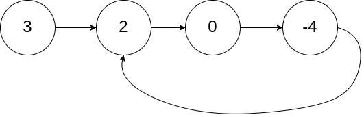
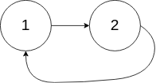
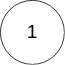
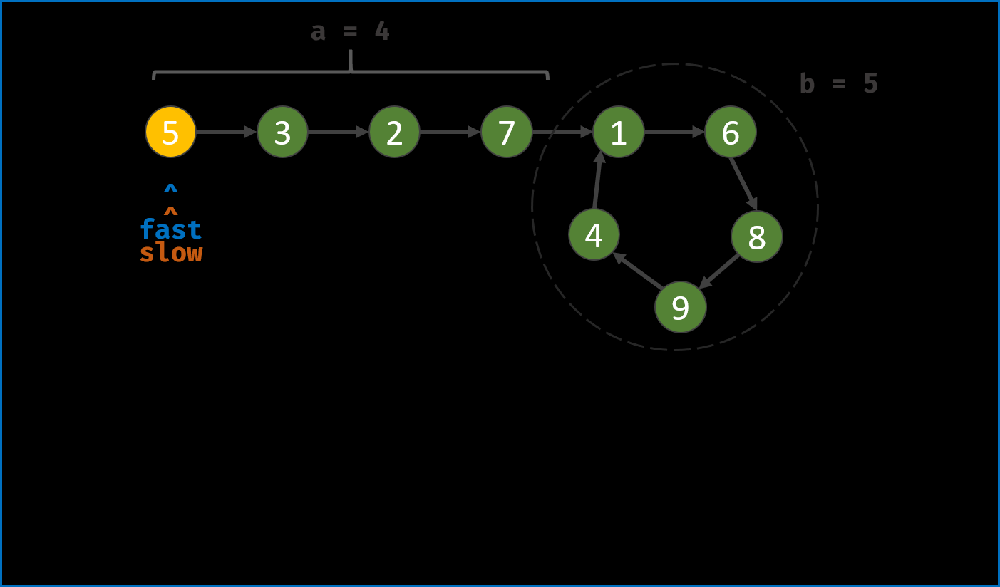

起始点的细节：若 `slow`/`fast` 从 `head` 出发，走到入口正好 `a` 步；若从**虚拟头节点**出发，则需要 `a+1` 步，公式要相应平移。两种写法都对，只是常数差一。

#### 变体：287 寻找重复数（findDuplicate）

数组长度 `n+1`，元素取值 `[1, n]`，只有一个数重复（可能重复多次），要求不改数组、`O(1)` 空间、优于 `O(n²)`。

把 `i -> nums[i]` 看成一条链表的边：**有重复值 ⇔ 有两个下标指向同一节点 ⇔ 链表有环**，且环的入口就是重复的数。于是完全复用 Floyd。

```cpp
#include <vector>

int findDuplicate(const std::vector<int>& nums) {
    int slow = 0, fast = 0;
    do {
        slow = nums[slow];               // 一步
        fast = nums[nums[fast]];         // 两步
    } while (slow != fast);

    int finder = 0;
    while (finder != slow) {             // 找环入口
        finder = nums[finder];
        slow = nums[slow];
    }
    return slow;
}
```

注意：数值范围必须是 `[1, n]`（不能含 0），否则 `0` 会成为自环、算法失效；有 3 个以上重复值时，环上只会体现其中一个入口。

#### 双向链表（LRU 的骨架，LC 146）

带**哨兵头尾**的双向链表可以把插入/删除的边界判断全部消掉，代码里不再出现 `nullptr` 特判。

```cpp
struct DLinkedNode {
    int key, value;
    DLinkedNode* prev;
    DLinkedNode* next;
    DLinkedNode() : key(0), value(0), prev(nullptr), next(nullptr) {}
    DLinkedNode(int k, int v) : key(k), value(v), prev(nullptr), next(nullptr) {}
};

// 链表拥有全部节点：构造时创建两个哨兵，析构时释放链表上的所有节点
// 使用方 new 出节点后交给链表，此后不要再自行 delete（否则析构时会二次释放）
class DLinkedList {
public:
    DLinkedList() {
        head_ = new DLinkedNode();     // 哨兵
        tail_ = new DLinkedNode();
        head_->next = tail_;
        tail_->prev = head_;
    }
    ~DLinkedList() {
        DLinkedNode* p = head_;
        while (p) { DLinkedNode* n = p->next; delete p; p = n; }
    }

    void addToHead(DLinkedNode* node) {         // 头插
        node->prev = head_;
        node->next = head_->next;
        head_->next->prev = node;
        head_->next = node;
    }

    void removeNode(DLinkedNode* node) {        // 调用方保证 node 不是哨兵
        node->prev->next = node->next;
        node->next->prev = node->prev;
    }

    void moveToHead(DLinkedNode* node) {
        removeNode(node);
        addToHead(node);
    }

    DLinkedNode* removeTail() {                 // 调用方保证链表非空
        DLinkedNode* node = tail_->prev;
        removeNode(node);
        return node;
    }

    bool empty() const { return head_->next == tail_; }

private:
    DLinkedNode* head_;
    DLinkedNode* tail_;
};
```

LRU 的完整逻辑：`unordered_map<int, DLinkedNode*>` 存 key → 节点；访问命中时 `moveToHead`；插入超容量时 `removeTail` 并同步删 map。`get`/`put` 均 `O(1)`。

### 2.3 堆

#### 定义与存储

`n` 个元素的序列 `k0, k1, …, k(n-1)`（0 起始下标）满足：

- 小顶堆：`ki <= k(2i+1)` 且 `ki <= k(2i+2)`
- 大顶堆：`ki >= k(2i+1)` 且 `ki >= k(2i+2)`

**逻辑结构是完全二叉树，存储结构是数组**（0 下标时，节点 `i` 的孩子是 `2i+1`、`2i+2`，父亲是 `(i-1)/2`）。

#### 堆调整与堆排序

```cpp
#include <algorithm>
#include <vector>

// 前提：[left+1, right] 已满足大顶堆；把 a[left] 下沉到正确位置
void heapAdjust(std::vector<int>& a, int left, int right) {
    int w = a[left];                                  // 待下沉的值
    int parent = left;
    for (int child = parent * 2 + 1; child <= right; child = parent * 2 + 1) {
        if (child + 1 <= right && a[child + 1] > a[child]) ++child;  // 取较大的孩子
        if (w < a[child]) {
            a[parent] = a[child];                     // 孩子上移
            parent = child;
        } else {
            break;                                    // 已满足堆序，提前结束
        }
    }
    a[parent] = w;
}

void heapSort(std::vector<int>& a) {
    int n = (int)a.size();
    // 1. 建堆：从最后一个非叶子节点 n/2-1 倒序下沉
    for (int i = n / 2 - 1; i >= 0; --i) heapAdjust(a, i, n - 1);
    // 2. 反复取堆顶（最大值）换到末尾，再缩小堆区间
    for (int i = n - 1; i > 0; --i) {
        std::swap(a[0], a[i]);
        heapAdjust(a, 0, i - 1);
    }
}
```

与原草稿相比修正了三处：

1. 建堆起点由 `nums.size()/2` 改为 `n/2 - 1`（最后一个**非叶子**节点；原值 `n/2` 多调整了一个叶子，虽不出错但越界风险随实现变化）。
2. 交换循环由 `for (i = n-1; i >= 0; --i)` 改为 `i > 0`。原写法在 `i == 0` 时把自己和自己交换，并对空区间调用 `heapAdjust(a, 0, -1)`，属于无意义且有越界隐患的操作。
3. 兄弟节点判断由 `if (i != right)` 改为 `if (child + 1 <= right)`。原写法在 `i == right` 时跳过比较是对的，但依赖循环变量被就地修改，可读性差；改写后语义清晰。

复杂度：建堆 `O(n)`（不是 `O(n log n)`），每次调整为 `O(log n)`，排序共 `O(n log n)`；空间 `O(1)`（原地）。

#### STL 中的堆

| 函数 | 作用 | 区间 |
| --- | --- | --- |
| `std::make_heap(first, last)` | 把区间整理成堆（默认 `less`，即大顶堆） | `[first, last)` |
| `std::push_heap(first, last)` | 把**已放到尾部**的新元素上浮 | `[first, last)` |
| `std::pop_heap(first, last)` | 把堆顶移到 `last-1`，其余重构为堆 | `[first, last)` |
| `std::sort_heap(first, last)` | 对堆排序（升序）；调用前必须已是堆 | `[first, last)` |
| `std::is_heap(first, last)` | 判断是否成堆 | `[first, last)` |

要点：区间左闭右开，有效元素是 `[first, last-1]`；`pop_heap` **不删除元素**，只把它挪到末尾，真正的删除要自己 `pop_back()`。

自己实现的 `heapAdjust` 是“在数组**前端**插入新元素”的版本（自上而下下沉）；STL 的 `push_heap` 是“在数组**尾端**追加”的版本（自下而上上浮）：

```cpp
#include <vector>

// 尾插上浮：前提 [left, right-1] 已是堆，right 是新元素
void pushBackHeap(std::vector<int>& a, int left, int right) {
    int w = a[right];
    int child = right;
    while (child > left) {
        int parent = (child - 1) / 2;
        if (a[parent] >= w) break;
        a[child] = a[parent];       // 父亲下移
        child = parent;
    }
    a[child] = w;
}
```

#### priority_queue

`priority_queue<Type, Container, Functional>`：

- `Container` 必须是数组型容器（`vector`/`deque`），不能是 `list`。
- `Functional` 默认 `less<T>`，即**大顶堆**。这一点与 `sort` 的直觉相反：

```cpp
#include <functional>
#include <queue>
#include <vector>

std::priority_queue<int>                          maxHeap;  // 默认 less，大顶堆
std::priority_queue<int, std::vector<int>, std::less<int>>    sameAsAbove;
std::priority_queue<int, std::vector<int>, std::greater<int>> minHeap;  // 小顶堆

// 记法：sort 里 less 是升序、greater 是降序；堆里“比较器表达的是优先级高低”，
// less 让大的优先出队 -> 大顶堆，greater 让小的优先出队 -> 小顶堆。
```

自定义类型三种写法：

```cpp
#include <functional>
#include <queue>
#include <vector>

struct Task { int priority; int id; };

// 1. 重载 operator<（priority_queue 默认比较器）
struct TaskA {
    int priority, id;
    bool operator<(const TaskA& rhs) const { return priority < rhs.priority; }  // 大顶堆
};

// 2. 外部比较器
struct Cmp {
    bool operator()(const Task& a, const Task& b) const { return a.priority < b.priority; }
};
void priorityQueueDemo() {
    std::priority_queue<Task, std::vector<Task>, Cmp> q2;

    // 3. lambda（C++11 起，需 decltype）
    auto cmp = [](const Task& a, const Task& b) { return a.priority < b.priority; };
    std::priority_queue<Task, std::vector<Task>, decltype(cmp)> q3(cmp);
    (void)q2; (void)q3;
}
```

### 2.4 哈希表：hash_map ≈ unordered_map

C++ 标准库最初没有 `hash_map`，各实现自行提供了非标准版本；C++11 起以 **`unordered_map`** 的名字进入标准（避开与已有代码冲突）。这个名字也更准确——它强调**元素无序**。

**原理：hashtable + bucket。** 每个 key 经哈希函数映射到某个桶号（通常是 `hash(key) % bucket_count`），冲突的元素在同一桶内以链表（或红黑树）串起来，所以“桶里可能没有元素，也可能有多个”。

插入：

1. 取 key；2. 哈希得 hash 值；3. 对桶数取模得桶号；4. 放进桶内（冲突时用相等比较处理）。

查找：

1. 取 key；2. 哈希；3. 取模得桶号；4. 桶内逐个比较 key；5. 取出相等记录的 value。

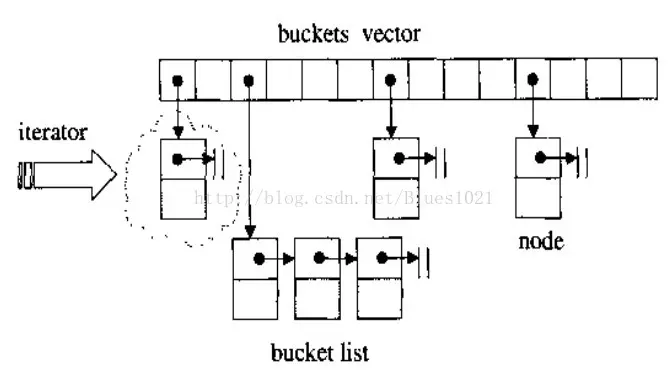

特点：

- **关联性**：通过 key 检索 value，而非绝对地址（区别于顺序容器）。
- **无序性**：内部按哈希分布，遍历顺序不确定。
- **键唯一性**：`unordered_multimap` 才允许重复 key。
- **动态内存管理**：插入触发 rehash 时会重建桶数组，迭代器全部失效。

| | `map` | `unordered_map` |
| --- | --- | --- |
| 底层 | 红黑树（自平衡 BST） | 哈希表（桶数组 + 链表/树） |
| 有序性 | 按 key 有序，中序遍历即排序结果 | 无序 |
| 查找/插入/删除 | `O(log n)`，**稳定** | 平均 `O(1)`，最差 `O(n)`（全部冲突） |
| 迭代器失效 | 仅删除的元素失效 | rehash 后全部失效 |
| 适用 | 需要有序遍历、范围查询、稳定最差性能 | 只做点查、追求平均性能 |

上表的逐项对照（原图另指出一点：`unordered_map` 的查找是**快**，Average `O(1)`、Worst Case `O(n)`；`map` 则是**恒定**的 `O(log n)`，插入/删除为 `log(n)` 加平衡二叉树所用时间，适用于“要求结果有序”的场景）：

一句话取舍：`unordered_map` 上限很高、下限很低；`map` 全程稳定。对性能敏感且 key 分布可控时选哈希，否则选红黑树。

---

## 三、二叉树

统一使用下面的节点定义：

```cpp
struct TreeNode {
    int val;
    TreeNode* left;
    TreeNode* right;
    TreeNode(int v) : val(v), left(nullptr), right(nullptr) {}
};
```

### 3.1 广度优先（层序）遍历

```cpp
#include <iostream>
#include <queue>
#include <vector>
// 依赖 §3 开头的 TreeNode 定义

void bfs(TreeNode* root) {
    if (!root) return;
    std::queue<TreeNode*> q;
    q.push(root);
    while (!q.empty()) {
        TreeNode* node = q.front();
        q.pop();
        std::cout << node->val << ' ';
        if (node->left)  q.push(node->left);
        if (node->right) q.push(node->right);
    }
}
```

需要**按层输出**时（LC 102 / 103 锯齿打印），关键技巧是**在每层开始时记录 `q.size()`**，用它把当前层一次性取完：

```cpp
#include <queue>
#include <vector>

std::vector<std::vector<int>> levelOrder(TreeNode* root) {
    std::vector<std::vector<int>> res;
    if (!root) return res;
    std::queue<TreeNode*> q;
    q.push(root);
    while (!q.empty()) {
        int levelSize = (int)q.size();       // 当前层的元素数，必须在此刻取
        std::vector<int> level;
        for (int i = 0; i < levelSize; ++i) {
            TreeNode* node = q.front();
            q.pop();
            level.push_back(node->val);
            if (node->left)  q.push(node->left);
            if (node->right) q.push(node->right);
        }
        res.push_back(level);                // 锯齿打印时对奇数层 reverse(level)
    }
    return res;
}
```

复杂度：`O(n)` 时间、`O(w)` 空间（`w` 为最大层宽）。

### 3.2 非递归前序遍历

用栈模拟递归：一路向左走、边走边访问并入栈；走到空则弹栈转向右子树。

```cpp
#include <stack>
#include <vector>

void preorderTraversal(TreeNode* root, std::vector<int>& path) {
    std::stack<TreeNode*> s;
    TreeNode* p = root;
    while (p || !s.empty()) {
        while (p) {
            path.push_back(p->val);     // 前序：入栈前访问
            s.push(p);
            p = p->left;
        }
        if (!s.empty()) {
            p = s.top();
            s.pop();
            p = p->right;
        }
    }
}
```

把 `path.push_back` 挪到 `p = s.top(); s.pop();` 之后，就是**中序**；后序需要额外记录“右子树是否已访问”（或用双栈/反转前序）。另一种更直白的前序写法是“先压右再压左”：

```cpp
#include <stack>
#include <vector>

void preorderSimple(TreeNode* root, std::vector<int>& path) {
    if (!root) return;
    std::stack<TreeNode*> s;
    s.push(root);
    while (!s.empty()) {
        TreeNode* node = s.top();
        s.pop();
        path.push_back(node->val);
        if (node->right) s.push(node->right);   // 右先入栈，后出
        if (node->left)  s.push(node->left);
    }
}
```

复杂度：`O(n)` 时间、`O(h)` 空间（`h` 为树高）。

### 3.3 根到叶的路径

统计/打印满足条件的**根到叶**路径。递归携带当前路径栈，进入时压栈、离开时弹栈（回溯）。

```cpp
#include <iostream>
#include <stack>
#include <vector>

void printPath(const std::stack<TreeNode*>& path) {
    std::vector<int> tmp;
    std::stack<TreeNode*> copy = path;
    while (!copy.empty()) {                 // 栈顶是叶子，先取出来再逆序输出
        tmp.push_back(copy.top()->val);
        copy.pop();
    }
    for (auto it = tmp.rbegin(); it != tmp.rend(); ++it) std::cout << *it << ' ';
    std::cout << '\n';
}

void findPath(TreeNode* root, int targetSum, std::stack<TreeNode*>& path) {
    if (!root) return;
    path.push(root);
    // 到达叶节点且和为目标值
    if (root->val == targetSum && !root->left && !root->right) printPath(path);
    findPath(root->left,  targetSum - root->val, path);
    findPath(root->right, targetSum - root->val, path);
    path.pop();                              // 回溯
}
```

原草稿的问题：`textout` 直接从头到尾弹栈输出，得到的是**叶子到根**的逆序；修正为取出后反转。另外原版比较的是 `root->value == value`（单个节点值），语义应为“路径和”，故改为 `targetSum - root->val` 递减。

复杂度：`O(n·h)` 最坏（每条路径都要输出），递归栈 `O(h)`。

### 3.4 由数组创建完全二叉树

数组按下标对应完全二叉树：`i` 的左孩子 `2i+1`、右孩子 `2i+2`，只需处理到最后一个非叶子节点 `n/2 - 1`。

```cpp
#include <iostream>
#include <vector>

struct BTNode {
    int value;
    BTNode* left;
    BTNode* right;
    explicit BTNode(int v) : value(v), left(nullptr), right(nullptr) {}
};

// 由数组 L[0..length-1] 建完全二叉树，返回根
BTNode* createBTree(const int L[], int length) {
    if (!L || length <= 0) return nullptr;
    std::vector<BTNode*> nodes(length);
    for (int i = 0; i < length; ++i) nodes[i] = new BTNode(L[i]);
    for (int i = 0; i <= length / 2 - 1; ++i) {
        if (i * 2 + 1 <= length - 1) nodes[i]->left  = nodes[i * 2 + 1];
        if (i * 2 + 2 <= length - 1) nodes[i]->right = nodes[i * 2 + 2];
    }
    return nodes[0];
}

void destroyBTree(BTNode* root) {
    if (!root) return;
    destroyBTree(root->left);
    destroyBTree(root->right);
    delete root;
}

void preOrder(BTNode* root) {
    if (!root) return;
    std::cout << root->value << ' ';
    preOrder(root->left);
    preOrder(root->right);
}
```

相对原稿的改动：去掉了重复的 `#if 0` 分支，`nodes` 由裸 `new BTNode*[]` 改为 `std::vector<BTNode*>`（原版 `root` 数组本身从未 `delete[]`，是内存泄漏），补了 `destroyBTree`。

复杂度：`O(n)` 时间、`O(n)` 空间。

---

## 四、回溯

### 4.1 回溯模板

```
void backtrack(路径, 选择列表, 搜索起点) {
    if (满足结束条件) { 记录结果; return; }
    for (选择 : 当前层的候选) {
        if (需要剪枝) continue/break;
        做选择;                       // path.push_back
        backtrack(路径, 选择列表, 下一层起点);
        撤销选择;                     // path.pop_back
    }
}
```

三个必须想清楚的点：

1. **搜索起点**：组合类问题传 `begin`（下一层只能从 `begin` 及之后选），排列类问题用 `used[]`。这是“去重”的第一层保障。
2. **同层去重**：数组有重复值时，同一层内相同的数只用第一个（`i > begin && a[i] == a[i-1]` 时跳过），这要求先排序。
3. **剪枝**：排序后 `a[i] > target` 直接 `break`（后面更大）；个数不足时用 `path.size() + (n - i + 1) < k` 提前返回。

复杂度一般为 `O(2^n)`～`O(n!)`，由解空间决定。

### 4.2 组合总和（LC 39）：元素可无限复用

给定无重复元素的 `candidates` 和目标 `target`，找出所有和为 `target` 的组合，同一个数可重复选取，解集不能重复。

思路：以 `target` 为根做“减法树”，减到 0 结算、减到负数剪枝。**去重的关键**是每层设置搜索起点 `begin`，下一层仍从 `begin` 开始（而不是 0），这样 `[2,3,2]`、`[3,2,2]` 这类同组合不同顺序的路径不会被重复生成。

```cpp
#include <algorithm>
#include <vector>

void dfsCombine(std::vector<int>& candidates, int target, int begin,
                std::vector<int>& path, std::vector<std::vector<int>>& res) {
    if (target == 0) { res.push_back(path); return; }
    for (int i = begin; i < (int)candidates.size(); ++i) {
        if (candidates[i] > target) break;              // 已排序，后面只会更大
        path.push_back(candidates[i]);
        dfsCombine(candidates, target - candidates[i], i, path, res);  // i 而非 i+1：可重复选
        path.pop_back();
    }
}

std::vector<std::vector<int>> combinationSum(std::vector<int> candidates, int target) {
    std::sort(candidates.begin(), candidates.end());    // 仅为剪枝，非正确性所需
    std::vector<std::vector<int>> res;
    std::vector<int> path;
    dfsCombine(candidates, target, 0, path, res);
    return res;
}
```

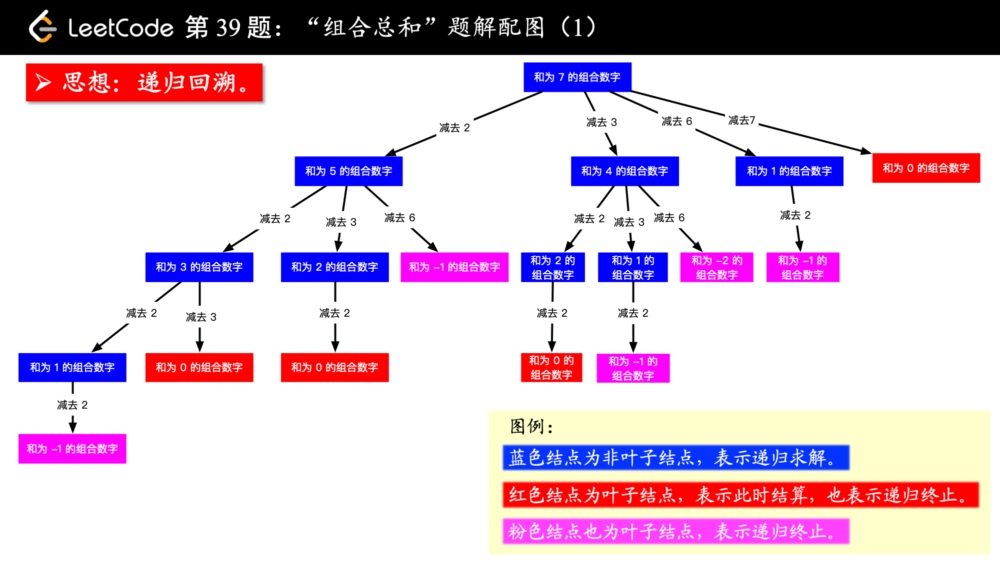
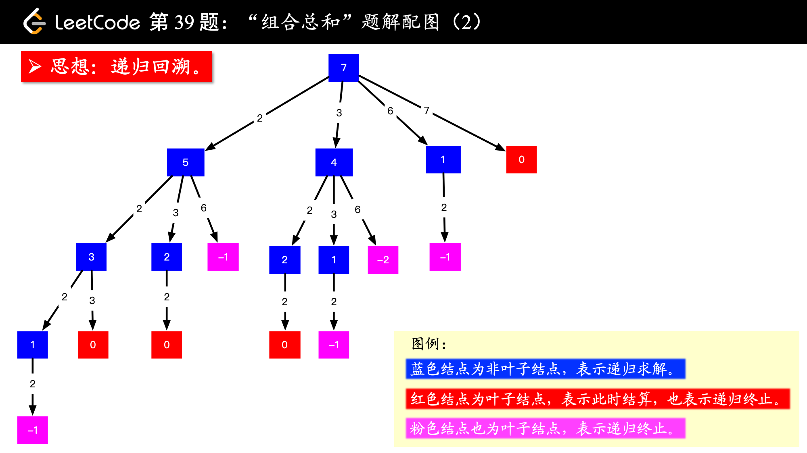
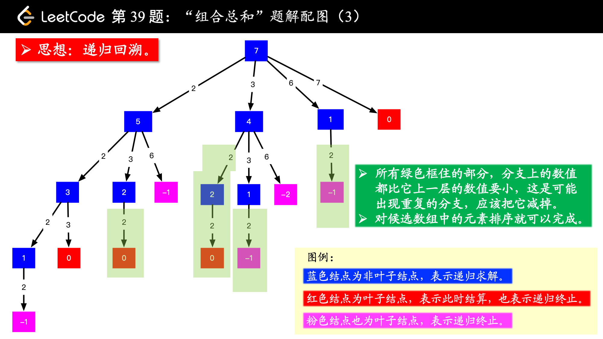

第三张图说明了重复的来源：不设 `begin` 时深层节点会重新考虑上层已考虑过的元素，得到 `[2,2,3]`、`[2,3,2]`、`[3,2,2]` 三个等价解。

### 4.3 组合总和 II（LC 40）：每个数只能用一次 + 数组含重复

两个约束对应两个动作：

- 每个元素用一次 → 下一层起点 `i + 1`；
- 解集不重复 → **同一层**跳过相同值。

```cpp
#include <algorithm>
#include <vector>

void dfsCombine2(const std::vector<int>& candidates, int target, int begin,
                 std::vector<int>& path, std::vector<std::vector<int>>& res) {
    if (target == 0) { res.push_back(path); return; }
    for (int i = begin; i < (int)candidates.size(); ++i) {
        if (candidates[i] > target) break;                              // 剪枝
        if (i > begin && candidates[i] == candidates[i - 1]) continue;  // 同层去重
        path.push_back(candidates[i]);
        dfsCombine2(candidates, target - candidates[i], i + 1, path, res);
        path.pop_back();
    }
}

std::vector<std::vector<int>> combinationSum2(std::vector<int> candidates, int target) {
    std::sort(candidates.begin(), candidates.end());
    std::vector<std::vector<int>> res;
    std::vector<int> path;
    dfsCombine2(candidates, target, 0, path, res);
    return res;
}
```

注意 `i > begin` 与 `!used[i-1]` 的区别：这里用下标判断（同层），排列题里用 `used` 判断（跨层）。写混了就会漏解或多解。

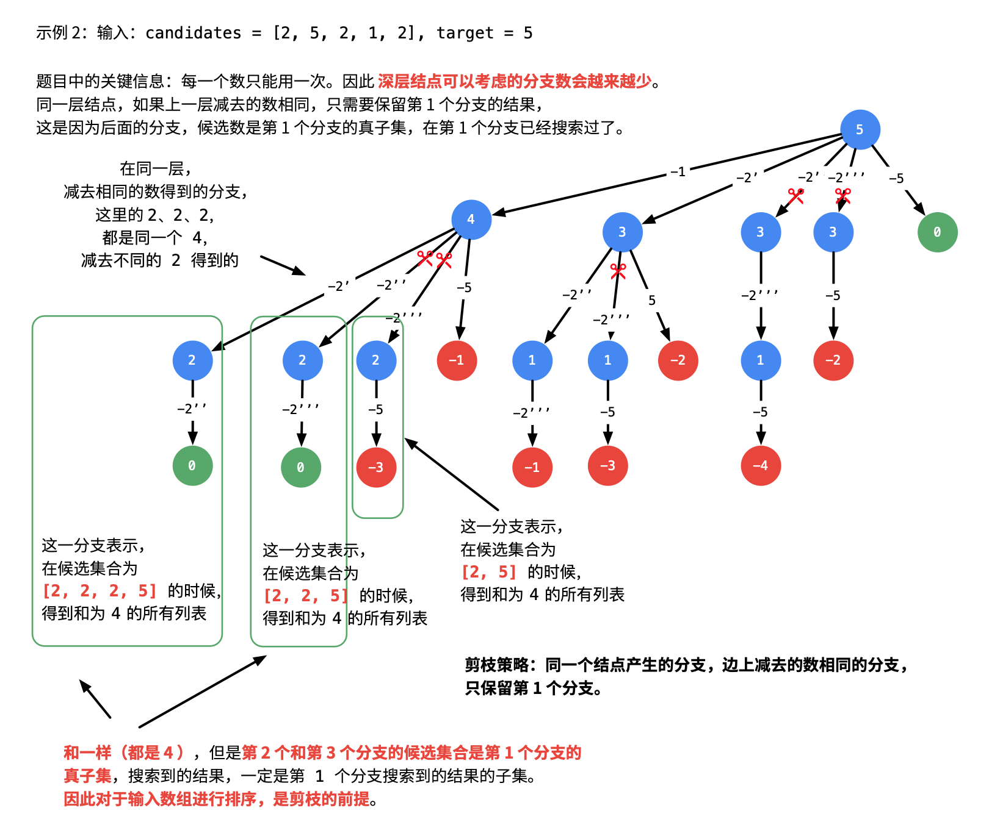

例：`candidates = [2,5,2,1,2], target = 5` → 排序为 `[1,2,2,2,5]`，输出 `[[1,2,2],[5]]`。

### 4.4 组合总和 III（LC 216）：限定个数与取值

找出和为 `n` 的 `k` 个数，只允许 `1~9`，每种组合内不重复。

- `k` 限制**递归层数**，不多不少正好 `k` 层；
- 剪枝：层数用尽时，只有 `target == 0` 才记录；`target < 0` 立即返回。

```cpp
#include <vector>

void dfsCombine3(std::vector<std::vector<int>>& res, std::vector<int>& path,
                 int begin, int k, int target) {
    if (k == 0) {
        if (target == 0) res.push_back(path);
        return;                                  // 层数用尽必须返回
    }
    if (target <= 0) return;                     // 剩下的数只会更大
    for (int i = begin; i <= 9; ++i) {
        if (i > target) break;                   // 剪枝
        path.push_back(i);
        dfsCombine3(res, path, i + 1, k - 1, target - i);
        path.pop_back();
    }
}

std::vector<std::vector<int>> combinationSum3(int k, int n) {
    std::vector<std::vector<int>> res;
    std::vector<int> path;
    dfsCombine3(res, path, 1, k, n);
    return res;
}
```

`k = 3, n = 7` → `[[1,2,4]]`。

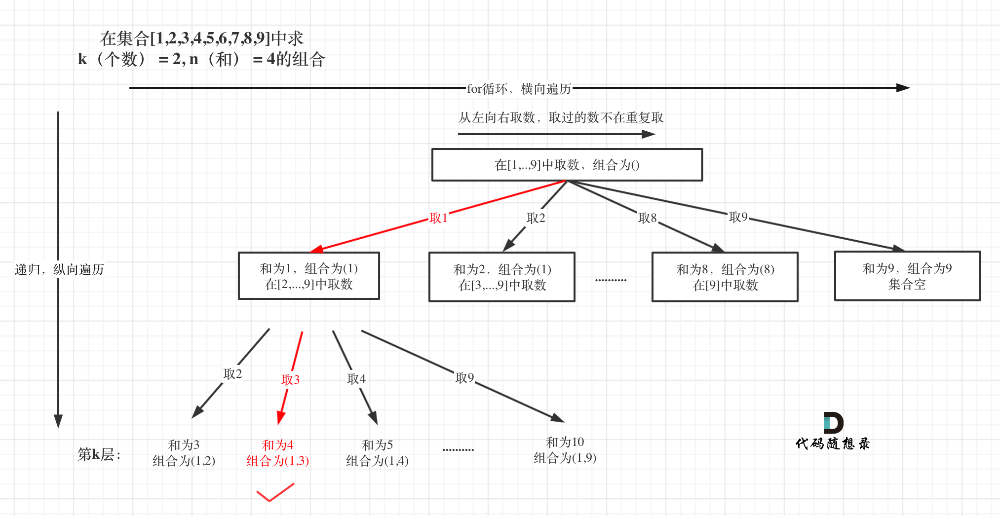

### 4.5 组合（LC 77）：1..n 中选 k 个

**方法一：按“起点”递归**，深度即 `k`。

```cpp
#include <vector>

void combineRecursive(std::vector<int>& path, int currNum, int n, int k,
                      std::vector<std::vector<int>>& res) {
    if ((int)path.size() == k) { res.push_back(path); return; }
    // 剪枝：从 i 到 n 还剩 n-i+1 个数，加上已有 path.size() 个仍不足 k，则无需继续
    for (int i = currNum; i <= n - (k - (int)path.size()) + 1; ++i) {
        path.push_back(i);
        combineRecursive(path, i + 1, n, k, res);   // 只能从 i 之后选（组合不是排列）
        path.pop_back();
    }
}
```

**方法二：每个数“选 / 不选”**，二叉决策树。

```cpp
#include <vector>

void dfsChoose(std::vector<std::vector<int>>& res, std::vector<int>& path,
               int currNum, int n, int k) {
    if (currNum > n) {                            // 所有数都决策完了
        if ((int)path.size() == k) res.push_back(path);
        return;
    }
    if ((int)path.size() + (n - currNum + 1) < k) return;   // 剩余不够，剪枝
    if ((int)path.size() > k) return;

    path.push_back(currNum);                      // 选
    dfsChoose(res, path, currNum + 1, n, k);
    path.pop_back();

    dfsChoose(res, path, currNum + 1, n, k);      // 不选
}
```

原草稿的写法用 `currNum > n + 1` 作为边界并依赖“剩余数不足”的剪枝挡住越界的 `path.push_back(n + 1)`，属于能过但脆弱的写法；这里改为标准的 `currNum > n` 边界，选与不选都在合法值域内。

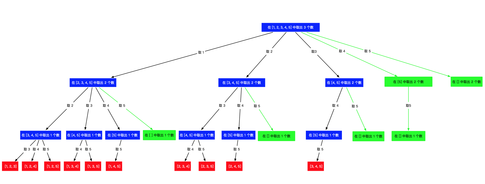
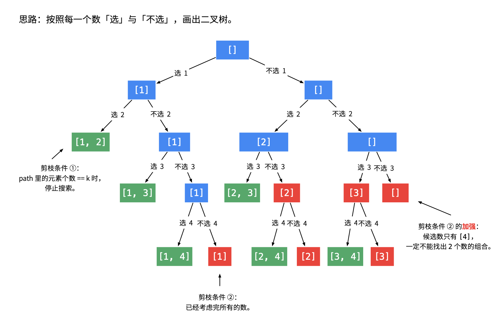

复杂度：方法一 `O(k · C(n,k))`，方法二 `O(2^n)`（剪枝后远小于此）。

---

## 五、动态规划

### 5.1 怎么判断一个问题该用 DP

把计算机看成状态机：内存里所有数据是**当前状态**，CPU 只能由当前状态算出下一状态。解题就是回答两件事——**用哪些变量表达状态**、**状态间如何转移**。由此，空间复杂度 = 需要保存的状态上限，时间复杂度 = 从初态到终态要走多少步。

按“阶段 → 状态”的转移方式分类：

| 阶段间状态转移方式 | 算法 |
| --- | --- |
| 每个阶段只有一个状态 | 递推 |
| 每个阶段的最优 = 上一阶段的最优 | 贪心 |
| 每个阶段的最优 = 之前所有阶段状态的**组合** | 搜索（指数级） |
| 每个阶段的最优可由之前**某些**阶段的状态直接得到，且不关心它是怎么来的 | 动态规划 |

后两条里出现了两个关键词：

- **最优子结构**：当前最优可由子问题最优直接得到；
- **无后效性**：一旦某个状态确定，后续演化与“如何到达该状态”无关。

迷宫最短路是反例：当前所处位置相同但走过的路径不同，后续选择就不同——**有后效性**，只能搜索。LIS 是正例：决定是否选 `A[k]` 时只需和“已选序列的末尾”比较，无需知道完整历史，于是只需记“以某元素结尾的 LIS 长度”。

三要素（另一种等价表述）：**相似子问题**、**每个子问题只解一次**、**存储子问题的解**。缺了“只解一次 + 存储”，就退化成分治或纯递归。

斐波那契记忆化前后对比：

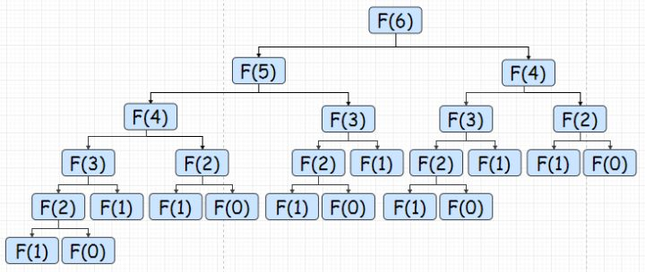
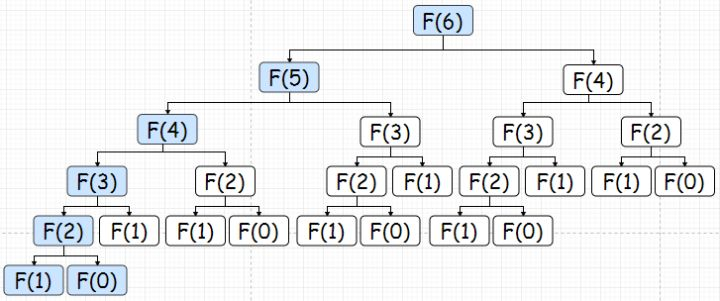
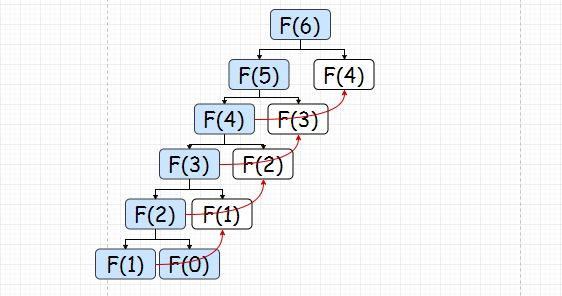
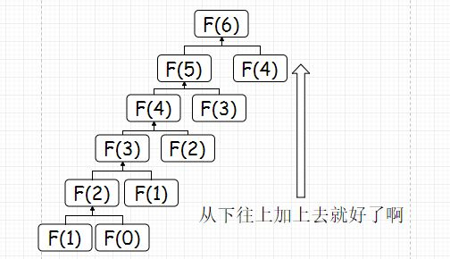

LIS 的搜索空间与 DP 优化：

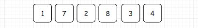
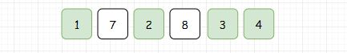
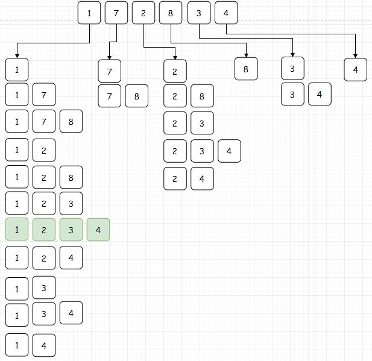
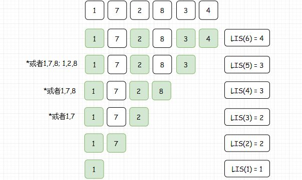
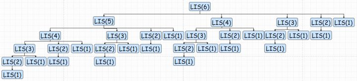
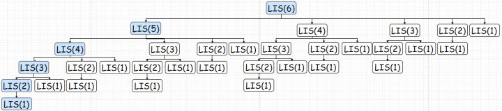
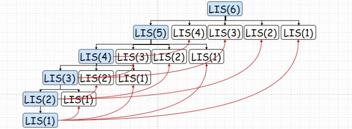

> **复杂度修正**：原稿称上述 LIS 的 DP 为 `O(n log n)`（“横轴每行求 max 是 `O(log n)`”），这是错的。该转移 `dp[i] = 1 + max{dp[j] | j < i 且 A[j] < A[i]}` 需要**线性扫描前 `i-1` 项**，每行是 `O(n)`，总计 **`O(n²)`**。真正的 `O(n log n)` 属于另一套做法——**贪心 + 二分（耐心排序）**：维护数组 `tails`，`tails[len]` 表示长度为 `len+1` 的上升子序列的最小结尾，对每个 `A[i]` 二分找第一个 `>= A[i]` 的位置替换。两套算法不要混为一谈。
> 原稿的“暴力 `O(n!)`”也只是粗略上界（枚举所有子集应为 `O(2^n · n)`）。

```cpp
#include <algorithm>
#include <vector>

// O(n^2) DP
int lisDp(const std::vector<int>& a) {
    if (a.empty()) return 0;
    std::vector<int> dp(a.size(), 1);
    int best = 1;
    for (size_t i = 1; i < a.size(); ++i) {
        for (size_t j = 0; j < i; ++j)
            if (a[j] < a[i]) dp[i] = std::max(dp[i], dp[j] + 1);
        best = std::max(best, dp[i]);
    }
    return best;
}

// O(n log n) 贪心 + 二分（只求长度，不还原序列）
int lisBinary(const std::vector<int>& a) {
    std::vector<int> tails;                       // tails 本身是递增的
    for (int x : a) {
        auto it = std::lower_bound(tails.begin(), tails.end(), x);
        if (it == tails.end()) tails.push_back(x); // 严格上升用 lower_bound
        else *it = x;                              // 非严格上升改用 upper_bound
    }
    return (int)tails.size();
}
```

### 5.2 01 背包

`N` 件物品、容量 `W`，第 `i` 件重 `w[i]`、价值 `v[i]`，每件至多取一次，求最大价值。

**状态**：`dp[i][j]` = 前 `i` 件物品在容量 `j` 下的最大价值。

**转移**（`i` 从 1 开始，对应下标 `i-1` 的物品）：

```
dp[0][j] = 0
dp[i][j] = dp[i-1][j]                                          // j < w[i-1]：装不下第 i 件，只能不装
dp[i][j] = max(dp[i-1][j], dp[i-1][j-w[i-1]] + v[i-1])         // j >= w[i-1]：不装 / 装，二选一
```

**滚动数组**：`dp[j]` 只依赖上一层的 `dp[j]` 与 `dp[j-w[i-1]]`，故可压成一维。但 `j` 必须**从大到小**枚举——这样 `dp[j-w[i-1]]` 读到的还是“上一层”的值；若正序枚举，`dp[j-w[i-1]]` 已被本层更新，等于允许同一件物品重复使用（那是完全背包）。

```cpp
#include <algorithm>
#include <vector>

int knapsack01(const std::vector<int>& w, const std::vector<int>& v, int W) {
    std::vector<int> dp(W + 1, 0);
    for (size_t i = 0; i < w.size(); ++i)
        for (int j = W; j >= w[i]; --j)                  // 逆序！
            dp[j] = std::max(dp[j], dp[j - w[i]] + v[i]);
    return dp[W];
}

// 完全背包：每件无限，内层正序即可
int knapsackComplete(const std::vector<int>& w, const std::vector<int>& v, int W) {
    std::vector<int> dp(W + 1, 0);
    for (size_t i = 0; i < w.size(); ++i)
        for (int j = w[i]; j <= W; ++j)                  // 正序
            dp[j] = std::max(dp[j], dp[j - w[i]] + v[i]);
    return dp[W];
}
```

**多重背包**（第 `i` 件有 `Mi` 个）可转化为 01 背包：第 `i` 件实际可用数量取 `min(Mi, W / w[i])`；进一步用二进制拆分（`1,2,4,...` 打包）把复杂度从 `O(W·ΣMi)` 降到 `O(W·Σlog Mi)`。

变体：求“恰好装满”时，`dp[0] = 0`、其余初始化为 `-INF`；求“方案数”时把 `max` 换成加法（注意累加取模与重复计数顺序）。

### 5.3 最长公共子序列（LCS）

`str1 = "abcde"`, `str2 = "ace"` → `3`（`"ace"`）。

**状态**：`dp[i][j]` = `s1[0..i-1]` 与 `s2[0..j-1]` 的 LCS 长度，行列 0 表示空串（base case 全 0）。

**转移**：两个指针从后往前看

```
if s1[i-1] == s2[j-1]:  dp[i][j] = dp[i-1][j-1] + 1
else:                   dp[i][j] = max(dp[i-1][j], dp[i][j-1])
```

为什么 `else` 只取两项、不用管 `dp[i-1][j-1]`：不相等时至少有一个字符不在 LCS 里，而 `dp[i-1][j-1]` 恒 `<=` 另外两者（区间更小），取 `max` 时永远轮不到它，写上去是多此一举。

```cpp
#include <algorithm>
#include <string>
#include <vector>

int longestCommonSubsequence(const std::string& s1, const std::string& s2) {
    int m = (int)s1.size(), n = (int)s2.size();
    std::vector<std::vector<int>> dp(m + 1, std::vector<int>(n + 1, 0));
    for (int i = 1; i <= m; ++i) {
        for (int j = 1; j <= n; ++j) {
            if (s1[i - 1] == s2[j - 1]) dp[i][j] = dp[i - 1][j - 1] + 1;
            else                        dp[i][j] = std::max(dp[i - 1][j], dp[i][j - 1]);
        }
    }
    return dp[m][n];
}
```

空间优化：只依赖上一行，可压成两行或一维（一维时需暂存左上角的值）。复杂度：`O(mn)` 时间，`O(mn)` / `O(min(m,n))` 空间。

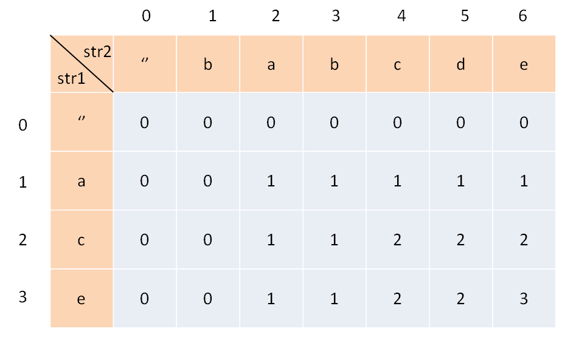
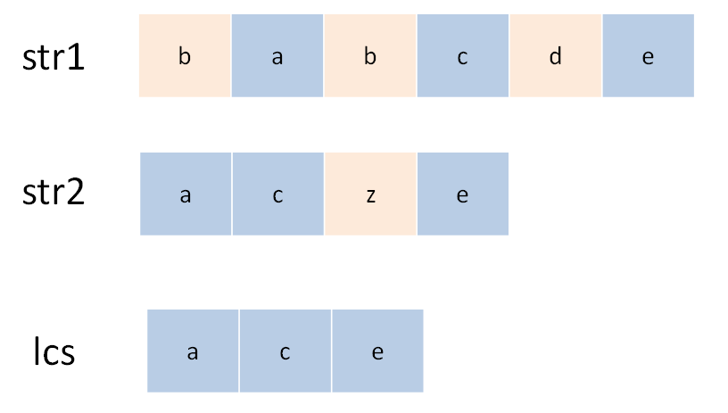
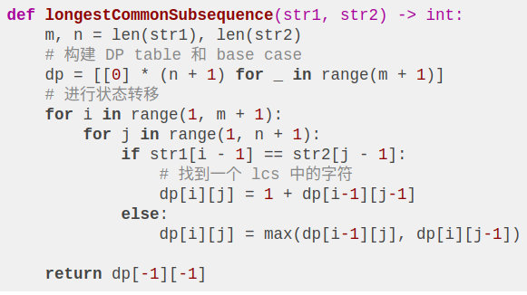
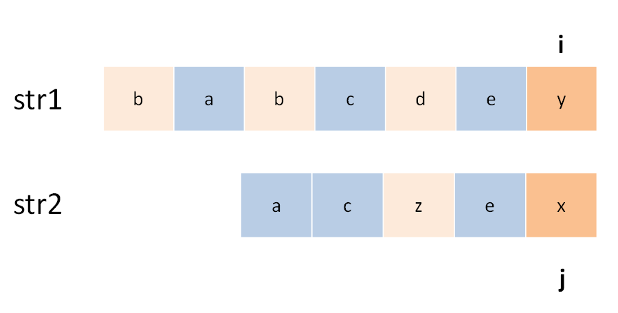
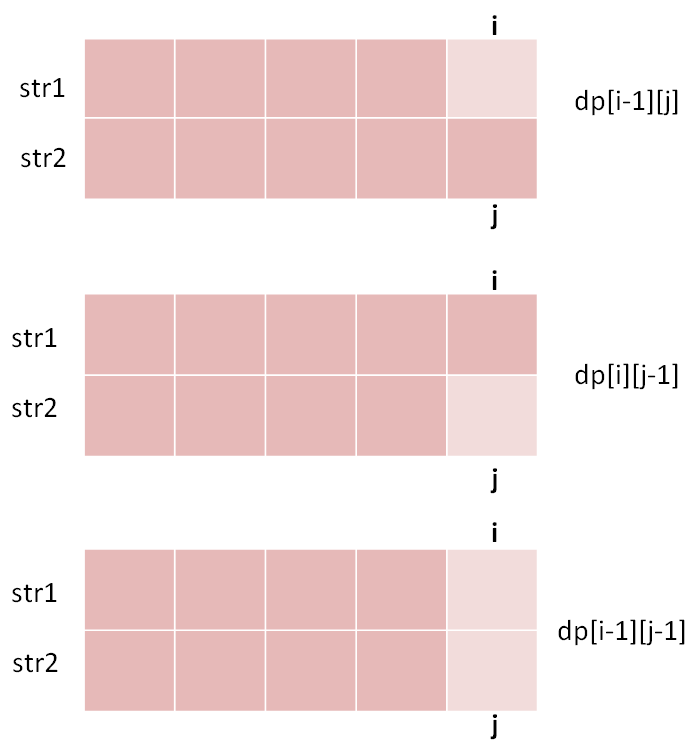
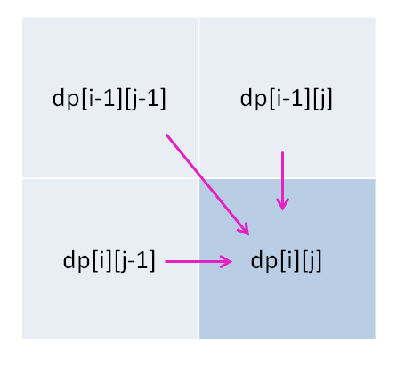

原图的两种解法（Python，作为对上文 C++ 版的对读）：

```python
def longestCommonSubsequence(str1, str2) -> int:
    def dp(i, j):
        # 空串的 base case
        if i == -1 or j == -1:
            return 0
        if str1[i] == str2[j]:
            # 这边找到一个 lcs 的元素，继续往前找
            return dp(i - 1, j - 1) + 1
        else:
            # 谁能让 lcs 最长，就听谁的
            return max(dp(i-1, j), dp(i, j-1))

    # i 和 j 初始化为最后一个索引
    return dp(len(str1)-1, len(str2)-1)
```

```python
def longestCommonSubsequence(str1, str2) -> int:
    m, n = len(str1), len(str2)
    # 构建 DP table 和 base case
    dp = [[0] * (n + 1) for _ in range(m + 1)]
    # 进行状态转移
    for i in range(1, m + 1):
        for j in range(1, n + 1):
            if str1[i - 1] == str2[j - 1]:
                # 找到一个 lcs 中的字符
                dp[i][j] = 1 + dp[i-1][j-1]
            else:
                dp[i][j] = max(dp[i-1][j], dp[i][j-1])

    return dp[-1][-1]
```

LCS 是模板题：编辑距离、最长回文子序列、最短公共超序列都是在这个表上换转移式。

### 5.4 分割等和子集（LC 416）

给定正整数数组，判断能否分成两个和相等的子集。

**转化**：两子集和相等 ⇔ 存在子集和为 `sum/2`。于是变成“每个元素选或不选，能否恰好凑出 `capacity = sum/2`”——**恰好装满的 01 背包**（元素值当容量，价值恒为 1）。

```cpp
#include <vector>

bool canPartition(const std::vector<int>& nums) {
    int sum = 0;
    for (int x : nums) sum += x;
    if (sum % 2 != 0) return false;               // 和为奇数不可能平分

    int capacity = sum / 2;
    std::vector<bool> dp(capacity + 1, false);
    dp[0] = true;                                 // 容量 0 视为已装满

    for (int x : nums)                            // 逐个物品
        for (int j = capacity; j >= x; --j)       // 逆序：保证每件只用一次
            dp[j] = dp[j] || dp[j - x];

    return dp[capacity];
}
```

原草稿的下标错误：外层写成 `for (int i = 1; i < nums.size(); i++)`、内层用 `nums[i-1]`，导致**第一个元素被完全跳过**（`i` 从 1 开始，`nums[0]` 从未参与决策）。已改为直接遍历元素值，避免“阶段号”与“元素下标”错位。

复杂度：`O(N·C)` 时间、`O(C)` 空间（`N` 为元素数，`C = sum/2`）。

还可以用 `std::bitset` 加速（位运算并行）：

```cpp
#include <bitset>
#include <vector>

bool canPartitionBitset(const std::vector<int>& nums) {
    int sum = 0;
    for (int x : nums) sum += x;
    if (sum & 1) return false;
    std::bitset<20001> dp;                        // 容量上界按题意取 200*100/2
    dp[0] = 1;
    for (int x : nums) dp |= dp << x;             // 0/1 背包的位并行写法
    return dp[sum / 2];
}
```

### 5.5 剪绳子（剑指 14）

长度 `n` 的绳子剪成 `a` 段（至少剪一刀，每段为正整数），求各段长度乘积的最大值。

**数学结论**（推导见下图）：

1. 各段长度**相等**时乘积最大（算术—几何均值不等式）；
2. 最优段长为 **3**：令 `y = x^(1/x)`，求导得驻点 `x₀ = e ≈ 2.718`，两侧整数 `2` 与 `3` 比较，`3^(1/3) ≈ 1.44 > 2^(1/2) ≈ 1.41`。

因此贪心策略：**尽量切 3**；剩下 `1` 时把 `3+1` 改切成 `2+2`（因为 `3×1 < 2×2`）；剩下 `2` 直接保留。

```cpp
#include <algorithm>
#include <vector>

// 贪心：O(n) 时间，O(1) 空间
int cuttingRopeGreedy(int n) {
    if (n <= 3) return n - 1;                     // 2->1, 3->2（必须剪一刀）
    int res = 1;
    while (n > 4) {                               // 剩余 5 时拆成 3+2 优于 3+1+1
        res *= 3;
        n -= 3;
    }
    return res * n;                               // 剩余 2/3/4
}

// DP：dp[i] 表示长度 i 的最优乘积（允许不剪，故 dp[i] >= i）
int cuttingRopeDp(int n) {
    if (n <= 3) return n - 1;
    std::vector<int> dp(n + 1, 0);
    dp[1] = 1; dp[2] = 2; dp[3] = 3;              // 段长 <=3 时“不再切”更优
    for (int i = 4; i <= n; ++i)
        for (int j = 1; j <= i / 2; ++j)          // 只需枚举到一半，避免镜像重复
            dp[i] = std::max(dp[i], dp[j] * dp[i - j]);
    return dp[n];
}
```

复杂度：贪心 `O(n)`/`O(1)`；DP `O(n²)`/`O(n)`。

大数版本（结果对 `1e9+7` 取模）只能走贪心：循环中每步 `res = res * 3 % MOD`，最后 `res * n % MOD`（用 `long long`）。

**解题思路**：设将长度为 `n` 的绳子切为 `a` 段，则 `n = n₁ + n₂ + … + nₐ`，本题等价于求解

$$\max(n_1 \times n_2 \times \cdots \times n_a)$$

以下数学推导分两步：① 当所有绳段长度相等时，乘积最大；② 最优的绳段长度为 3。

**数学推导**：下面的“算术—几何均值不等式”等号当且仅当 `n₁ = n₂ = … = nₐ` 时成立：

$$
\frac{n_1+n_2+\cdots+n_a}{a} \ \ge\ \sqrt[a]{n_1 n_2 \cdots n_a}
$$

> **推论一**：将绳子以相等的长度等分为多段，得到的乘积最大。

设将绳子按照 `x` 长度等分为 `a` 段，即 `n = ax`，则乘积为 `xᵃ`。由于 `n` 为常数，因此当 `x^(1/x)` 取最大值时，乘积达到最大值：

$$
x^a = x^{\frac{n}{x}} = \left(x^{\frac{1}{x}}\right)^{n}
$$

于是问题转化为求 `y = x^(1/x)` 的极大值，对 `x` 求导：

$$
\begin{aligned}
\ln y &= \frac{1}{x}\ln x &&\text{取对数}\\
\frac{1}{y}\dot{y} &= \frac{1}{x^2} - \frac{1}{x^2}\ln x &&\text{对 } x \text{ 求导}\\
&= \frac{1-\ln x}{x^2}\\
\dot{y} &= \frac{1-\ln x}{x^2}\,x^{\frac{1}{x}} &&\text{整理得}
\end{aligned}
$$

令 `ẏ = 0`，则 `1 - ln x = 0`，易得驻点为 `x₀ = e ≈ 2.7`；由下式可知 `x₀` 为极大值点：

$$
\dot{y}\begin{cases}
> 0, & x \in (0, e)\\
< 0, & x \in (e, +\infty)
\end{cases}
$$

由于切分长度 `x` 必须为整数，最接近 `e` 的整数为 2 或 3。代入 `x = 2` 和 `x = 3`，得出 `x = 3` 时乘积最大：

$$
y(3) = 3^{1/3} \approx 1.44,\qquad y(2) = 2^{1/2} \approx 1.41
$$

口算对比方法：给两数同时取 6 次方再比较，即 `[y(3)]⁶ = (3^(1/3))⁶ = 9`，`[y(2)]⁶ = (2^(1/2))⁶ = 8`。

> **推论二**：尽可能将绳子以长度 3 等分为多段时，乘积最大。

**切分规则**：

1. **最优：3**。把绳子尽可能切为多个长度为 3 的片段，留下的最后一段绳子的长度可能为 `0, 1, 2` 三种情况。
2. **次优：2**。若最后一段绳子长度为 2，则保留，不再拆为 `1 + 1`。
3. **最差：1**。若最后一段绳子长度为 1，则应把一份 `3 + 1` 替换为 `2 + 2`，因为 `2 × 2 > 3 × 1`。

**算法流程**：

1. 当 `n ≤ 3` 时，按照规则应不切分，但题目要求必须剪成 `m > 1` 段，因此必须剪出一段长度为 1 的绳子，即返回 `n - 1`。
2. 当 `n > 3` 时，求 `n` 除以 3 的整数部分 `a` 和余数部分 `b`（即 `n = 3a + b`），分三种情况：
   - 当 `b = 0` 时，直接返回 `3^a`；
   - 当 `b = 1` 时，要将一个 `1 + 3` 转换为 `2 + 2`，因此返回 `3^(a-1) × 4`；
   - 当 `b = 2` 时，返回 `3^a × 2`。

### 5.6 丑数 II（LC 264）

求第 `n` 个只含质因数 `2, 3, 5` 的正整数（`1` 是第一个丑数）。

**方法一：小顶堆 + 哈希去重。** 每次取堆顶 `x`（当前最小丑数），把 `2x, 3x, 5x` 压堆，用 `unordered_set` 去重。时间 `O(n log n)`，空间 `O(n)`。

```cpp
#include <queue>
#include <unordered_set>
#include <vector>

int nthUglyNumberHeap(int n) {
    std::priority_queue<long long, std::vector<long long>, std::greater<long long>> pq;
    std::unordered_set<long long> seen;
    pq.push(1);
    seen.insert(1);
    long long x = 1;
    for (int i = 0; i < n; ++i) {
        x = pq.top();
        pq.pop();
        for (long long f : {2LL, 3LL, 5LL}) {
            long long y = x * f;
            if (seen.insert(y).second) pq.push(y);
        }
    }
    return (int)x;
}
```

**方法二：三指针（本质是 DP）。** 每个丑数都由更小的丑数乘 `2/3/5` 得到，维护三个指针 `p2/p3/p5` 指向“还没被乘过的位置”，每次取三个候选的最小值；**三个 `if` 都写（不是 else-if）**，用于跳过重复值。

```cpp
#include <algorithm>
#include <vector>

int nthUglyNumber(int n) {
    std::vector<long long> dp(n);
    dp[0] = 1;
    int p2 = 0, p3 = 0, p5 = 0;
    for (int i = 1; i < n; ++i) {
        long long n2 = dp[p2] * 2, n3 = dp[p3] * 3, n5 = dp[p5] * 5;
        long long next = std::min({n2, n3, n5});
        dp[i] = next;
        if (next == n2) ++p2;          // 三个独立 if：相等时一起前进，避免重复
        if (next == n3) ++p3;
        if (next == n5) ++p5;
    }
    return (int)dp[n - 1];
}
```

复杂度：`O(n)` 时间、`O(n)` 空间。用 `long long` 中间量防止大 `n` 溢出。

**多路归并（多指针）解法**：从方法一不难发现，我们“往后产生的丑数”都是基于“已有丑数”而来（用“已有丑数”乘上质因数 2、3、5）。

因此，如果所有丑数的有序序列为 `a₁, a₂, a₃, …, aₙ`，序列中的每一个数都必然能够被以下三个序列（中的至少一个）覆盖：

- 由丑数 × 2 所得的有序序列：`1*2、2*2、3*2、4*2、5*2、6*2、8*2 …`
- 由丑数 × 3 所得的有序序列：`1*3、2*3、3*3、4*3、5*3、6*3、8*3 …`
- 由丑数 × 5 所得的有序序列：`1*5、2*5、3*5、4*5、5*5、6*5、8*5 …`

举个例子：假设需要求得 `[1,2,3,…,10,12]` 丑数序列 `arr` 的最后一位，那么该序列可以看作以下三个有序序列归并而来：

- `1*2, 2*2, 3*2, …, 10*2, 12*2`，将 2 提出，即 `arr * 2`
- `1*3, 2*3, 3*3, …, 10*3, 12*3`，将 3 提出，即 `arr * 3`
- `1*5, 2*5, 3*5, …, 10*5, 12*5`，将 5 提出，即 `arr * 5`

因此可以用三个指针指向目标序列 `arr` 的某个下标（`dp[0] = 1` 是第一个丑数，三个指针初值都为 0），用 `arr[下标] * 质因数` 代表当前使用到三个有序序列中的哪一位，同时用 `idx` 表示当前生成到 `arr` 的哪一位丑数。这正是下文三指针解法的由来。

---

## 六、其他专题

### 6.1 KD-Tree

**定义**：kd 树是对 `k` 维空间中的实例点做存储、以支持快速检索的二叉树结构。构造它相当于不断用**垂直于坐标轴**的超平面切分空间。

**动机**：`k` 维空间里 300 个点，要查距目标点最近的 `M` 个点，暴力要算 300 次距离再排序。划分成区域后，只需在当前区域和**相邻区域**内搜索。

**结构**：非叶节点就是一个超平面（某维上的分割点）。构建时轮流（或按方差最大）选择切分维度，取该维中位数作分割点，左右子树递归——这样树高 `O(log n)`。

```cpp
#include <algorithm>
#include <vector>

struct KDNode {
    std::vector<double> point;      // k 维坐标
    int axis;                       // 本节点按哪一维切分
    KDNode* left;
    KDNode* right;
    KDNode() : axis(0), left(nullptr), right(nullptr) {}
};

KDNode* buildKDTree(std::vector<std::vector<double>> pts, int depth) {
    if (pts.empty()) return nullptr;
    int k = (int)pts[0].size();
    int axis = depth % k;                                   // 轮流切分
    std::sort(pts.begin(), pts.end(),
              [axis](const std::vector<double>& a, const std::vector<double>& b) {
                  return a[axis] < b[axis];
              });
    size_t mid = pts.size() / 2;
    KDNode* node = new KDNode();
    node->point = pts[mid];
    node->axis = axis;
    node->left  = buildKDTree({pts.begin(), pts.begin() + mid}, depth + 1);
    node->right = buildKDTree({pts.begin() + mid + 1, pts.end()}, depth + 1);
    return node;
}
```

- 建树：`O(n log² n)`（每层排序；用 `nth_element` 可降到 `O(n log n)`）。
- 查询：平均 `O(log n)`，最差 `O(n)`；最近邻搜索需要回溯“另一侧可能有更近的点”，用当前最优距离与切分平面距离比较来决定是否进入兄弟子树。
- 用途：最近邻、范围查询、点云配准（ICP 中的对应点查找）。

### 6.2 50_myPow 快速幂

计算 `x^n`，`n` 为 32 位有符号整数（范围 `[-2^31, 2^31-1]`）。

**二进制分解**：以 `77 = 64 + 8 + 4 + 1` 为例，`x^77 = x^64 · x^8 · x^4 · x^1`。只需迭代 `x *= x` 得到每个比特位对应的幂，再按 `n` 的二进制位是否为 1 决定是否乘进结果。

两个必须处理的坑：

1. `n = -2^31` 取反会溢出（`int` 上界是 `2^31-1`），必须先用 `long long` 接住；
2. `x == 0` 且 `n < 0` 时无意义，直接返回。

```cpp
#include <cmath>

double myPow(double x, int n) {
    if (x == 0.0) return 0.0;

    long long e = n;                 // 用 long long 承接，避免 -2^31 取反溢出
    if (e < 0) {                     // 负指数：先取倒数，指数转正
        x = 1.0 / x;
        e = -e;
    }

    double res = 1.0;
    while (e > 0) {
        if (e & 1) res *= x;         // 当前最低位为 1，乘入结果
        x *= x;                      // 得到下一位对应的幂 x^2, x^4, x^8...
        e >>= 1;
    }
    return res;
}
```

复杂度：`O(log |n|)` 时间、`O(1)` 空间。递归写法 `pow(x, n) = pow(x*x, n/2) * (n 为奇数 ? x : 1)` 同阶，但栈深 `O(log n)`。

### 6.3 69_mySqrt 开方

求 `⌊√x⌋`，`x` 为非负整数。

**方法一：二分。** 在 `[0, x]` 上找“平方 `<= x` 的最大整数”。退出时 `right` 是“平方小于目标的最大整数”，`left` 是“平方大于目标的最小整数”，本题向下取整，返回 `right`。

```cpp
int mySqrt(int x) {
    long long left = 0, right = x;             // 用 long long 防 mid*mid 溢出
    while (left <= right) {
        long long mid = left + (right - left) / 2;
        long long square = mid * mid;
        if (square < x)       left = mid + 1;
        else if (square > x)  right = mid - 1;
        else                  return (int)mid;
    }
    return (int)right;
}
```

复杂度 `O(log x)`。也可以写成“找最后一个 `mid² <= x`”的左边界模板，避免依赖 `right` 的语义。

**方法二：牛顿迭代。** 求 `f(y) = y² - x = 0` 的零点：

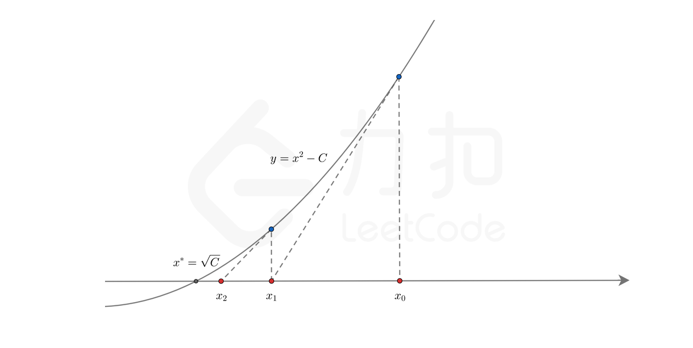

```
x_{i+1} = x_i - f(x_i)/f'(x_i) = (x_i + x / x_i) / 2
```

```cpp
#include <cmath>

// 用“迭代前后是否收敛到同一整数”作终止条件，比固定 epsilon 更稳
int mySqrtNewton(int x) {
    if (x <= 1) return x;
    long long r = x;
    while (r > x / r) {                // 等价于 r*r > x，且不溢出
        r = (r + x / r) / 2;
    }
    return (int)r;
}

// 浮点版本：注意阈值是 1e-6 而不是 1e6（原稿笔误）
int mySqrtNewtonFloat(int x) {
    if (x <= 0) return x;
    double xi = x;
    while (std::fabs(xi * xi - x) > 1e-6) {
        xi = 0.5 * (xi + x / xi);
    }
    return (int)xi;
}
```

复杂度：牛顿法二次收敛，约 `O(log log x)` 次迭代。

### 6.4 从 (0,0) 出发，数位和小于 k 的方格（剑指 13）

`m × n` 的方格，机器人从 `(0,0)` 出发，每次只能上/下/左/右移动一格，不能进入“行坐标与列坐标的**数位之和**大于 `k`”的格子。求可达格子数。

**数位和**：`123` → `1+2+3 = 6`。

```cpp
int digitSum(int x) {
    int s = 0;
    while (x != 0) { s += x % 10; x /= 10; }
    return s;
}

// 增量递推：x -> x+1，数位和先 +1；尾部每有一个 9 被进位成 0，该位再少 9
int nextDigitSum(int x, int sx) {
    int nx = x + 1;
    int s = sx + 1;
    while (nx % 10 == 0) {          // 逐位吃掉尾部连续 9（99 -> 100 要减两次 9）
        s -= 9;
        nx /= 10;
    }
    return s;
}
```

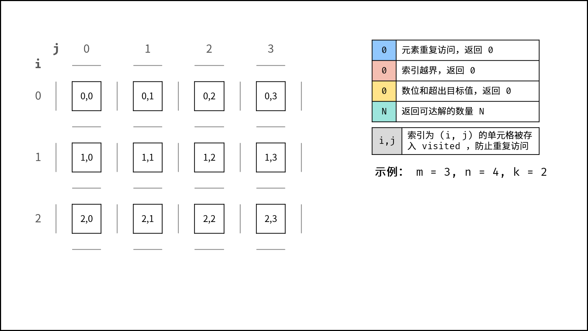
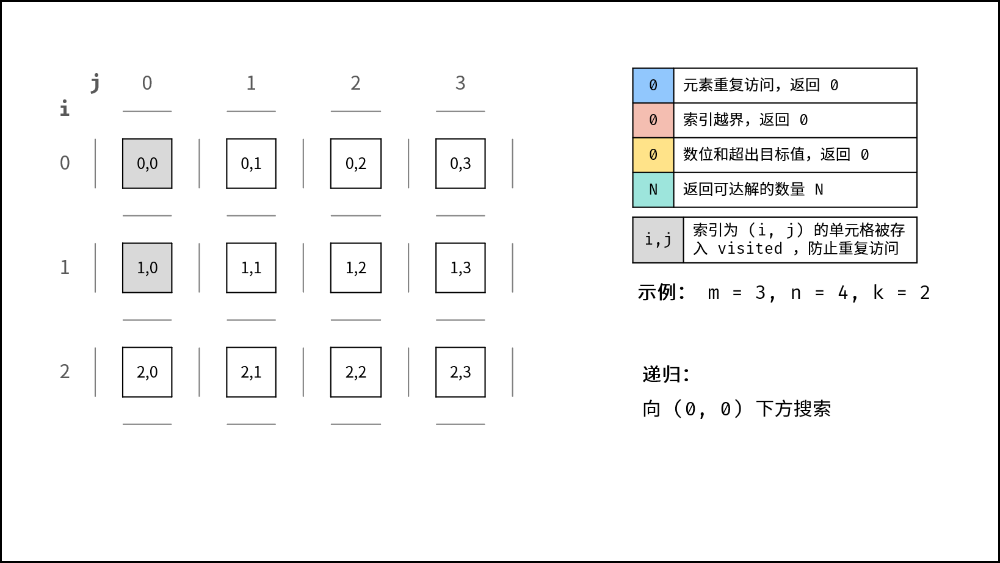

**可达性分析**：由增量公式，数位和每逢进位突变，满足条件的格子构成多个**等腰直角三角形**，直角顶点在 `0, 10, 20...` 这些突变处。三角形内部全连通，但三角形之间不一定连通，所以“满足数位和”≠“可达”。结论是：**机器人只靠向下和向右就能访问所有可达解**（因为三角形左/上边界与相邻三角形连通），因此 DFS/BFS 只需向右、向下两个方向，不必四向搜索。

```cpp
#include <vector>

// 依赖 6.4 上文的 nextDigitSum
int dfsMoving(int i, int j, int si, int sj, std::vector<std::vector<bool>>& visited,
              int m, int n, int k) {
    if (i >= m || j >= n || si + sj > k || visited[i][j]) return 0;   // 越界/超限/已访问 -> 剪枝
    visited[i][j] = true;
    int down  = dfsMoving(i + 1, j, nextDigitSum(i, si), sj, visited, m, n, k);
    int right = dfsMoving(i, j + 1, si, nextDigitSum(j, sj), visited, m, n, k);
    return 1 + right + down;
}

int movingCount(int m, int n, int k) {
    std::vector<std::vector<bool>> visited(m, std::vector<bool>(n, false));
    return dfsMoving(0, 0, 0, 0, visited, m, n, k);
}
```

复杂度：`O(mn)` 时间、`O(mn)` 空间。BFS 版本把递归换成 `queue`，visited 逻辑相同。

---

### 6.5 t3 查找数组中重复的数字（不修改数组）

长度 `n+1` 的数组，元素取值 `[1, n]`，至少一个重复；要求不修改数组。用**值域二分 + 计数**：统计落在 `[start, mid]` 的元素个数，若个数 `> mid-start+1`，说明重复值在该半区。

```cpp
int countRange(const int* L, int length, int start, int end) {
    int cnt = 0;
    for (int i = 0; i < length; ++i)
        if (L[i] >= start && L[i] <= end) ++cnt;
    return cnt;
}

int getDuplication(const int* L, int length) {
    if (!L || length <= 0) return -1;
    int start = 1, end = length - 1;                 // 值域
    while (end >= start) {
        int mid = start + (end - start) / 2;
        int cnt = countRange(L, length, start, mid);
        if (end == start) {                          // 值域缩到单点
            if (cnt > 1) return start;
            break;
        }
        if (cnt > mid - start + 1) end = mid;        // 重复在左半区
        else                       start = mid + 1;  // 重复在右半区
    }
    return -1;
}
```

复杂度：`O(n log n)` 时间、`O(1)` 空间。

> 对照：若允许改数组，可用“下标归位”（把 `L[i]` 换到 `L[L[i]]`）做到 `O(n)`/`O(1)`；若允许 `O(n)` 空间，直接哈希计数。**不能改数组 + `O(1)` 空间**的组合则用 Floyd（见 [2.2](#变体287-寻找重复数findduplicate)），可做到 `O(n)`/`O(1)`，优于本节的 `O(n log n)`。

### 6.6 t4 二维数组中的查找

行列均递增的矩阵（每行从左到右递增、每列从上到下递增），查找某值。

**思路**：从**右上角**（或左下角）出发。右上角元素 `a[r][c]` 的左边都比它小、下边都比它大，一次比较即可排除一整行或一整列——类似二分。

```
1  2  8  9
2  4  9  12
4  7  10 13
6  8  11 15      查 7：从右上 9 开始，7<9 -> c--；7<8 -> c--；7>2 -> r++；7>4 -> r++；命中
```

```cpp
bool findInMatrix(const int* L, int rows, int cols, int value) {
    if (!L || rows <= 0 || cols <= 0) return false;
    int r = 0, c = cols - 1;                 // 右上角
    while (r < rows && c >= 0) {
        int cur = L[r * cols + c];
        if (value == cur)      return true;
        else if (value < cur)  --c;          // 当前列下方都更大，排除本列
        else                   ++r;          // 当前行左侧都更小，排除本行
    }
    return false;
}
```

复杂度：`O(rows + cols)` 时间、`O(1)` 空间。

### 6.7 t15 二进制中 1 的个数

**有 bug 的写法**：`n >> 1` 对负数会算术右移、高位补 `1`，`while (n)` 永不结束。

```cpp
int numberOf1_Broken(int n) {          // 反例，勿用
    int count = 0;
    while (n) { if (n & 1) ++count; n = n >> 1; }
    return count;
}
```

**常规写法**：用无符号的 `flag` 逐位左移探测，循环固定 32 次。

```cpp
int numberOf1_Common(int n) {
    int count = 0;
    unsigned int flag = 1;
    while (flag) {
        if (n & flag) ++count;
        flag <<= 1;                     // 原稿此处误写为 flaf
    }
    return count;
}
```

**最优写法**：`n & (n-1)` 每次消掉最低位的 `1`，循环次数 = `1` 的个数。

```cpp
int numberOf1(int n) {
    int count = 0;
    while (n) { ++count; n &= (n - 1); }
    return count;
}
```

复杂度：常规 `O(32)`；最优 `O(popcount)`。

#### 位运算小结

| 表达式 | 含义 |
| --- | --- |
| `x & (x-1)` | 消掉最低位的 1 |
| `x & -x` | 取出最低位的 1（lowbit） |
| `x \| (x+1)` | 把最低位的 0 置 1 |
| `x ^ x = 0` | 异或消重（只出现一次的数） |
| `(x >> k) & 1` | 取第 k 位 |
| `x << k` / `x >> k` | 左移等价乘 `2^k`；右移对有符号负数**算术右移**，注意符号位 |

---

## 附录 A：STL 速查

### A.1 sort 与 lambda

```cpp
#include <algorithm>
#include <vector>

struct Item { int a, b; };

void sortDemo() {
    std::vector<int> arr{3, 1, 2};
    std::sort(arr.begin(), arr.end(), [](int a, int b) { return a < b; });   // 升序

    // 按第二个字段降序，相等时按第一个升序
    std::vector<Item> items;
    std::sort(items.begin(), items.end(), [](const Item& x, const Item& y) {
        if (x.b != y.b) return x.b > y.b;
        return x.a < y.a;
    });
}
```

比较函数必须是**严格弱序**（`cmp(x,x) == false`，且传递），写成 `<=` 会导致 `std::sort` 越界崩溃。

### A.2 partition / stable_partition

`std::partition(first, last, pred)` 把满足 `pred` 的元素放前段、不满足的放后段，返回**分界迭代器**（指向第一个不满足的元素）；不保证相对顺序，需要保序用 `stable_partition`。

```cpp
#include <algorithm>
#include <iostream>
#include <vector>

bool isOdd(int i) { return i % 2 == 1; }

int main() {
    std::vector<int> v;
    for (int i = 1; i < 10; ++i) v.push_back(i);       // 1..9

    auto bound = std::partition(v.begin(), v.end(), isOdd);
    std::cout << "odd:";
    for (auto it = v.begin(); it != bound; ++it) std::cout << ' ' << *it;    // 1 9 3 7 5（顺序不定）
    std::cout << "\neven:";
    for (auto it = bound; it != v.end(); ++it) std::cout << ' ' << *it;      // 6 4 8 2
    std::cout << '\n';
    return 0;
}

// 用 lambda 做原地二分划分：>18 的放前面
// std::partition(arr, arr + n, [](const int& a) { return a > 18; });
```

### A.3 常用片段

```cpp
#include <algorithm>
#include <string>
#include <vector>

void stlDemo() {
    std::string s = "abc";
    std::reverse(s.begin(), s.end());        // "cba"

    std::vector<int> v{1, 2, 3};
    bool has = std::binary_search(v.begin(), v.end(), 2);           // 需已排序
    auto lo  = std::lower_bound(v.begin(), v.end(), 2);             // 第一个 >= 2
    auto hi  = std::upper_bound(v.begin(), v.end(), 2);             // 第一个 > 2

    int mx = *std::max_element(v.begin(), v.end());
    int mn = *std::min_element(v.begin(), v.end());
    std::sort(v.begin(), v.end());
    v.erase(std::unique(v.begin(), v.end()), v.end());              // 去重（需先排序）
    (void)has; (void)lo; (void)hi; (void)mx; (void)mn;
}
```

---

## 附录 B：刷题清单与要点（原 lK 记录）

| 题目 | 关键点 |
| --- | --- |
| 47 全排列 II | 排序 + 同层去重（`!used[i-1]`），见 [1.9](#19-全排列) |
| 55 跳跃游戏 | 贪心维护“最远可达下标”，`i > maxReach` 即失败 |
| 56 合并区间 | 按左端点排序，逐个比较 `cur.start` 与 `last.end` |
| 54 螺旋矩阵 | 四边界收缩，最后两条边要再判边界，见 [1.6](#16-二维数组的行和列) |
| 57 插入区间 | 三段式：左侧无交集直接放 → 有交集合并 → 右侧直接放 |
| 62 / 63 不同路径 | 注意**初始值**（第一行/列均为 1）；63 有障碍时障碍格置 0 |
| 66 加一 | 从后往前处理进位，全 9 时需在头部插入 1 |
| 79 单词搜索 | 回溯**必须撤销 `visited`**，否则后续分支被污染 |
| 二叉树中序遍历 | 迭代版：一路向左入栈，弹出即访问，再转右 |
| 103 锯齿打印 | 按 `queue.size()` 分批取整层，奇数层反转 |
| 二分查找前 | 先判首尾（`target < nums[0]`、`target > nums.back()`），再进循环 |

```cpp
#include <algorithm>
#include <string>

void reverseStr() {
    std::string s = "abc";
    std::reverse(s.begin(), s.end());     // "cba"
}
```

> 该笔记后半部分（IBL、BRDF、Cook-Torrance、IMR/TBR/TBDR、四元数、mipmap level 计算）属于图形学内容，已归入 `03_图形学` / `04_OpenGL与Shader` 卷，本篇不重复收录。

---

## 附录 C：易错点清单

1. **二分**：`right = n` 时 `while` 必须用 `<` 且 `right = mid`；`right = n-1` 时用 `<=` 且 `right = mid-1`。混用即死循环或漏查。
2. **`mid` 溢出**：一律 `left + (right - left) / 2`。
3. **堆排序**：建堆起点 `n/2 - 1`，交换循环 `i > 0`。
4. **01 背包**：一维滚动数组内层必须**逆序**；完全背包才正序。
5. **回溯**：`path.push_back` 与 `path.pop_back` 必须成对；`visited` 要在回溯时复位；组合用 `begin`，排列用 `used`。
6. **`stoi`/`to_string`**：`to_string(double)` 固定保留 **6 位小数**（不是 6 位有效数字），极小量级会被截成 `0.000000`；精度敏感场景用 `ostringstream` 或 `to_chars`。
7. **负数右移**：`n >> 1` 是算术右移，统计 1 的个数要用 `unsigned` 或 `n & (n-1)`。
8. **`priority_queue` 比较器**：`less` 是大顶堆，与 `sort` 的直觉相反。
9. **`unordered_map` rehash**：插入可能使所有迭代器失效，遍历中不要插入。
10. **取模**：`(a-b) % m` 可能为负，补 `+m` 再 `%m`；`a*b` 用 `long long`。

---

## 原始笔记索引

以下为本文整合的源文件（均位于 `/Users/chuxu/Desktop/技术笔记/`，只读未改动）：

**`C++/算法/`（42 篇）**

| 文件 | 归入章节 |
| --- | --- |
| `C++/算法/排序算法.md` | 1.1 |
| `C++/算法/二分查找.md` | 1.2 |
| `C++/算法/二分查找时间复杂度.md` | 1.2 |
| `C++/算法/向上取整.md` | 1.3 |
| `C++/算法/斐波那契数列递归法的复杂度.md` | 1.4 |
| `C++/算法/字符串与数字转换.md` | 1.5 |
| `C++/算法/t5 替换空格.md` | 1.5（思路已并入字符串处理） |
| `C++/算法/二维数组的行和列.md` | 1.6 |
| `C++/算法/字典序.md` | 1.7 |
| `C++/算法/下一个排列.md` | 1.8 |
| `C++/算法/全排列.md` | 1.9 |
| `C++/算法/旋转数组.md` | 1.10 |
| `C++/算法/打印从1到最大的n位数.md` | 1.11 |
| `C++/算法/30_MinStack 包含min函数的栈.md` | 2.1 |
| `C++/算法/判断能否由入栈顺序得到出栈顺序.md` | 2.1 |
| `C++/算法/142. 环形链表 II.md` | 2.2 |
| `C++/算法/findDuplicate.md` | 2.2 + 6.5（对照） |
| `C++/算法/t3查找数组中重复的数.md` | 6.5 |
| `C++/算法/KD-Tree.md` | 6.1 |
| `C++/算法/二叉树广度优先搜索.md` | 3.1 |
| `C++/算法/非递归前序遍历.md` | 3.2 |
| `C++/算法/二叉树路径.md` | 3.3 |
| `C++/算法/根据数组创建完全二叉树.md` | 3.4 |
| `C++/算法/组合总和_39.md` | 4.2 |
| `C++/算法/40_combinationSum2.md` | 4.3 |
| `C++/算法/216_combinationSum3.md` | 4.4 |
| `C++/算法/77_combine.md` | 4.5 |
| `C++/算法/DP.md` | 5.1 |
| `C++/算法/DP(1).md` | 5.1 |
| `C++/算法/package.md` | 5.2 |
| `C++/算法/最长公共子序列.md` | 5.3 |
| `C++/算法/416_canPartition.md` | 5.4 |
| `C++/算法/剪绳子.md` | 5.5 |
| `C++/算法/264_丑数2.md` | 5.6 |
| `C++/算法/50_myPow.md` | 6.2 |
| `C++/算法/69_mySqrt.md` | 6.3 |
| `C++/算法/从(0, 0)开始搜索数位之和小于k的方格.md` | 6.4 |
| `C++/算法/t4.md` | 6.6 |
| `C++/算法/t15.md` | 6.7 |
| `C++/算法/STL记录.md` | 附录 A |
| `C++/算法/lK记录.md` | 附录 B（图形学部分已转出） |
| `C++/算法/httpsblog.csdn.netweixin_40953222articledetails80544928.md` | 空链接，未收录 |

**`C++/数据结构/`（3 篇）**

| 文件 | 归入章节 |
| --- | --- |
| `C++/数据结构/堆.md` | 2.3 |
| `C++/数据结构/双向链表.md` | 2.2 |
| `C++/数据结构/hash_map ≈ unordered_map.md` | 2.4 |