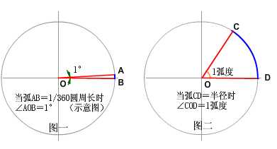

# 微积分与级数：从局部近似到频域分解

> **导读**
>
> 本篇从泰勒展开与微分出发，经梯度、散度与拉普拉斯算子的离散差分、渲染中的积分约等式与几个常用初等结论，再到傅里叶级数与变换、高斯消元及 §13 的旋度与算子恒等式，构成一条微积分主线。随后收束到两类具体工具——一阶线性微分方程的积分因子法（§14）与解析函数奇点、二阶线性齐次方程的级数解法（§15）。§3 引入的算子记号贯穿至 §13，可按同一约定阅读全篇。
>
> 符号约定：$f'(x)$、$\dfrac{df}{dx}$ 表示导数；$\partial$ 表示偏导；$\nabla$ 为梯度算子；虚数单位统一用 $j$（与信号处理一致），必要时注明 $j^{2}=-1$。

---

## 1. 泰勒级数与麦克劳林级数

### 1.1 泰勒级数

若 $f(x)$ 在 $x=x_0$ 处具有任意阶导数，则幂级数

$$
\sum_{n=0}^{\infty}\frac{f^{(n)}(x_0)}{n!}(x-x_0)^{n}
=f(x_0)+f'(x_0)(x-x_0)+\frac{f''(x_0)}{2!}(x-x_0)^{2}+\cdots
$$

称为 $f(x)$ 在 $x_0$ 处的**泰勒级数（Taylor series）**。

若进一步要求"用有限项逼近"并控制误差，则有**泰勒公式**：

$$
f(x)=\sum_{k=0}^{n}\frac{f^{(k)}(x_0)}{k!}(x-x_0)^{k}+R_n(x),
$$

其中 $R_n$ 为余项。常用的**拉格朗日余项**为

$$
R_n(x)=\frac{f^{(n+1)}(\xi)}{(n+1)!}(x-x_0)^{n+1},
\qquad \xi\ \text{介于}\ x_0\ \text{与}\ x\ \text{之间}.
$$

因此泰勒级数能否收敛到 $f$ 本身，取决于 $\lim_{n\to\infty}R_n(x)=0$。只在某点任意阶可导（$C^\infty$）并不足以保证级数收敛到原函数，还需要**解析性**。

### 1.2 麦克劳林级数

取 $x_0=0$：

$$
f(x)=\sum_{n=0}^{\infty}\frac{f^{(n)}(0)}{n!}x^{n}.
$$

称为**麦克劳林级数（Maclaurin series）**，即"在原点展开的泰勒级数"。

### 1.3 常见麦克劳林展开

$$
\begin{aligned}
e^{x}&=\sum_{n=0}^{\infty}\frac{x^{n}}{n!}, && x\in\mathbb{R},\\
\ln(1+x)&=\sum_{n=1}^{\infty}\frac{(-1)^{n+1}}{n}x^{n}, && x\in(-1,1],\\
\frac{1}{1-x}&=\sum_{n=0}^{\infty}x^{n}, && |x|<1,\\
\sin x&=\sum_{n=0}^{\infty}\frac{(-1)^{n}}{(2n+1)!}x^{2n+1}, && x\in\mathbb{R},\\
\cos x&=\sum_{n=0}^{\infty}\frac{(-1)^{n}}{(2n)!}x^{2n}, && x\in\mathbb{R},\\
\tan x&=\sum_{n=1}^{\infty}\frac{B_{2n}(-4)^{n}\bigl(1-4^{n}\bigr)}{(2n)!}x^{2n-1}, && |x|<\frac{\pi}{2},\\
(1+x)^{\alpha}&=1+\alpha x+\frac{\alpha(\alpha-1)}{2!}x^{2}+\cdots, && |x|<1,
\end{aligned}
$$

其中 $B_{2n}$ 为伯努利数。$\ln(1+x)$ 在 $x=1$ 处条件收敛（交错调和级数），在 $x=-1$ 处发散。

### 1.4 作用与局限

泰勒级数的价值：

1. **逐项求导、逐项积分**：幂级数在收敛区间内可以逐项运算，求和函数、解微分方程都方便；
2. **解析延拓**：解析函数可通过泰勒级数延拓到复平面上的更大区域，这是复分析的基本手法；
3. **数值近似**：取前几项即可高精度计算函数值，图形学中的各种快速近似（如 $e^{x}$、$\sin x$、$1/\sqrt{x}$ 的硬件近似）都源于此。

**奇点**：函数在奇点处无法展开为泰勒级数。但若把变量写成负指数幂，可在奇点外的**去心邻域**（环形区域）展开为**洛朗级数（Laurent series）**，例如

$$
e^{1/x}=\sum_{n=0}^{\infty}\frac{1}{n!\,x^{n}},\qquad x\neq0,
$$

含负幂项，故不是泰勒级数而是洛朗级数。洛朗级数的主部（负幂项）用来刻画奇点的类型（可去/极点/本性）。

**常见用途（图形学）**：

- 小角度近似：$\sin\theta\approx\theta$，$\cos\theta\approx1-\theta^{2}/2$，$\tan\theta\approx\theta$；
- 菲涅耳近似、微表面 BRDF 的展开与归一化；
- 数值方法的截断误差分析（一阶/二阶精度）。

---

## 2. 微分

### 2.1 概念

- 微分**不等同于变化本身**：它不代表具体的变化值，而是变化的**线性近似**；
- 微分可以视为一个小常量，也可以视为具有"无穷小性"的小变量；
- 通常把小量当作**小常量**处理，只有在考察其"无穷小性"时才把它当变量。

> 无穷小是量的一种**性质**，而不是一种具体的量。

### 2.2 逻辑顺序

本笔记采用的体系是：

$$
\text{极限}\ \longrightarrow\ \text{导数}\ \longrightarrow\ \text{微分}.
$$

先定义极限，再用极限定义导数

$$
f'(x)=\lim_{\Delta x\to0}\frac{f(x+\Delta x)-f(x)}{\Delta x},
$$

再用导数定义微分

$$
dy=f'(x)\,dx,
$$

其中 $dx$ 是自变量的微分（可任取的小增量），$dy$ 是函数值变化的**线性主部**。

因此 $dy$ 与真实的 $\Delta y$ 一般不等，差为高阶无穷小：

$$
\Delta y=f(x+\Delta x)-f(x)=f'(x)\Delta x+o(\Delta x)=dy+o(\Delta x).
$$

**可微与微分的定义**：设函数 $y=f(x)$ 在某区间上有定义，$x_0$ 及 $x_0+\Delta x$ 在这区间内，若函数的增量 $\Delta y=f(x_0+\Delta x)-f(x_0)$ 可表示为

$$
\Delta y=A\cdot\Delta x+o(\Delta x),
$$

其中 $A$ 为不依赖于 $\Delta x$ 的常数，而 $o(\Delta x)$ 是比 $\Delta x$ 高阶的无穷小，则称函数 $y=f(x)$ 在点 $x_0$ **可微**，$A\cdot\Delta x$ 称为 $y=f(x)$ 在点 $x_0$ 处相应于自变量增量 $\Delta x$ 的**微分**，记为 $dy$，即

$$
dy=A\cdot\Delta x .
$$

（可微时必有 $A=f'(x_0)$，故 $dy=f'(x_0)\Delta x$，与 $dx=\Delta x$ 的写法一致。）

> **注意**：当自变量的改变量很微小，即 $|\Delta x|$ 很小时，函数在某点的微分是其增量的近似值，即 $\Delta y\approx dy$。

### 2.3 多元情形

全微分：

$$
df=\frac{\partial f}{\partial x}dx+\frac{\partial f}{\partial y}dy+\frac{\partial f}{\partial z}dz
=\nabla f\cdot d\mathbf{r}.
$$

这解释了为什么梯度是"变化率最大的方向"：$df$ 是 $\nabla f$ 与位移 $d\mathbf{r}$ 的内积，位移方向与梯度同向时增长最快。

---

## 3. 梯度、散度与拉普拉斯算子

### 3.1 梯度

标量场 $f(x,y,z)$ 的**梯度**是向量场：

$$
\nabla f=\operatorname{grad} f
=\frac{\partial f}{\partial x}\mathbf{i}
+\frac{\partial f}{\partial y}\mathbf{j}
+\frac{\partial f}{\partial z}\mathbf{k}.
$$

它表示某一点在 $x,y,z$ 三个方向上的变化率，几何上指向函数增长最快的方向，模长等于该方向的方向导数。类比"山脊上某点的最陡坡度"：梯度就是坡度的方向与大小。

方向导数：

$$
D_{\mathbf{u}}f=\nabla f\cdot\mathbf{u},\qquad |\mathbf{u}|=1.
$$

梯度的性质：

- $\nabla f$ 垂直于等值面 $f=\text{const}$；
- 沿梯度方向函数增长最快，沿负梯度方向下降最快（梯度下降法）；
- $\nabla(fg)=f\nabla g+g\nabla f$。

### 3.2 散度

向量场 $\mathbf{F}=(F_x,F_y,F_z)$ 的**散度**是一个标量场：

$$
\nabla\cdot\mathbf{F}=\operatorname{div}\mathbf{F}
=\frac{\partial F_x}{\partial x}
+\frac{\partial F_y}{\partial y}
+\frac{\partial F_z}{\partial z}.
$$

物理意义：单位体积内"源"的强度（通量密度）。$\nabla\cdot\mathbf{F}>0$ 表示该点有源（流出），$<0$ 表示有汇（流入），$=0$ 表示无源场（如不可压缩流体的速度场）。

### 3.3 拉普拉斯算子

**拉普拉斯算子**是梯度的散度（即"变化率的变化率"）：

$$
\nabla^{2}f=\Delta f=\operatorname{div}(\operatorname{grad} f)
=\frac{\partial^{2}f}{\partial x^{2}}
+\frac{\partial^{2}f}{\partial y^{2}}
+\frac{\partial^{2}f}{\partial z^{2}}.
$$

对向量场则逐分量作用。

**物理意义**：对光滑场，邻域平均减去该点值 $\approx\dfrac{r^{2}}{6}\nabla^{2}f$，即拉普拉斯算子度量的是该点值与周围平均值的偏离（线性场 $\nabla^{2}f=0$，恰恰"值=平均"，不产生偏离）。$\nabla^{2}f=0$（调和函数）表示该点值恰好等于邻域平均，没有"局部源"。因此可以用它直接估测距离测试点 $\Delta$ 处某一点的物理值（速度、密度、热量等），其形式与"由加速度推位置"类似。

拉普拉斯方程 $\nabla^{2}f=0$ 与泊松方程 $\nabla^{2}f=\rho$ 是流体、热传导、静电、以及图形学中网格平滑/泊松图像编辑的核心。

### 3.4 离散化：差分形式

计算机是离散系统，通常取步长 $h=1$（或统一步长）。**一阶中心差分**：

$$
\frac{\partial f}{\partial x}\approx\frac{f(x+h)-f(x-h)}{2h},
$$

**一阶前向/后向差分**：

$$
\frac{\partial f}{\partial x}\approx\frac{f(x+h)-f(x)}{h},
\qquad
\frac{\partial f}{\partial x}\approx\frac{f(x)-f(x-h)}{h}.
$$

**二阶差分**（三点中心公式）。注意它不是"对一阶中心差分再做一次"——那样得到的是 $[f(x+2h)-2f(x)+f(x-2h)]/(4h^{2})$，截断误差是下面这个式子的 4 倍：

$$
\frac{\partial^{2}f}{\partial x^{2}}
\approx\frac{f(x+h)-2f(x)+f(x-h)}{h^{2}}.
$$

因此三维拉普拉斯的七点差分格式为

$$
\nabla^{2}f\approx
\frac{
f(x+h,y,z)+f(x-h,y,z)
+f(x,y+h,z)+f(x,y-h,z)
+f(x,y,z+h)+f(x,y,z-h)
-6f(x,y,z)}{h^{2}}.
$$

二维（图像）用五点格式：

$$
\nabla^{2}f\approx
\frac{f(x+1,y)+f(x-1,y)+f(x,y+1)+f(x,y-1)-4f(x,y)}{h^{2}}.
$$

取 $h=1$ 时，拉普拉斯就变成一个 $3\times3$（二维）或 $3\times3\times3$（三维）的卷积核：

$$
\begin{pmatrix}
0&1&0\\
1&-4&1\\
0&1&0
\end{pmatrix}.
$$

这正是图像锐化、边缘检测、网格 Laplacian 平滑里反复出现的算子。

---

## 4. 渲染中的一个积分约等式

在预计算光照（split-sum 近似、环境光照）中常用：

$$
\int_{\Omega} f(x)\,g(x)\,dx
\approx
\frac{\int_{\Omega_G} f(x)\,dx}{\int_{\Omega_G} dx}\cdot\int_{\Omega} g(x)\,dx .
$$

成立条件：

1. $g(x)$ 的**有效积分定义域很小**（能量集中在 $\Omega_G$ 附近）；
2. 在该区域内 **$f(x)$ 变化缓慢**，近似为常数。

直观解释：积分只覆盖 $\Omega_G$，所以若 $f$ 在其中近似为常数，就能把 $f$ 提到积分号外，得到下面的 $\bar f_G\int g$：

$$
\int f g\approx \bar f_{G}\int g .
$$

图形学中这就是把"BRDF 积分"拆成"预滤波环境贴图 × BRDF 查找表"的理论依据；误差来自 $f$ 并非严格常数以及有效域近似。

反向的情形（$g$ 在整个 $\Omega$ 上近似常数、$f$ 变化剧烈）给出的是镜像公式 $\int fg\approx\bar g\int f$，条件与上面这组不同，不要混用。

---

## 5. 一元二次方程的解

方程

$$
ax^{2}+bx+c=0\qquad(a\neq0)
$$

的解为

$$
x=\frac{-b\pm\sqrt{b^{2}-4ac}}{2a}.
$$

判别式 $\Delta=b^{2}-4ac$：

- $\Delta>0$：两个不相等的实根；
- $\Delta=0$：一个二重实根 $x=-\dfrac{b}{2a}$；
- $\Delta<0$：一对共轭复根。

韦达定理：

$$
x_1+x_2=-\frac{b}{a},\qquad x_1x_2=\frac{c}{a}.
$$

数值稳定写法（避免 $b$ 与 $\sqrt{\Delta}$ 相近时相减损失精度）：

$$
q=-\frac12\left(b+\operatorname{sgn}(b)\sqrt{\Delta}\right),
\qquad
x_1=\frac{q}{a},\quad x_2=\frac{c}{q}.
$$

这里约定 $\operatorname{sgn}(0)=+1$（等价于"$b\ge0$ 取 $+$、$b<0$ 取 $-$"）。若按 $\operatorname{sgn}(0)=0$ 取，则 $b=0$ 时 $q=0$，$x_2=c/q$ 会除零——例如 $x^2-1=0$ 就会踩到。

图形学里最典型的出现场景是射线与球/二次曲面求交（见《01_线性代数》§1.4），以及求点到线段最近点时解 $t$ 的二次方程。

---

## 6. 等比数列求和

设首项 $a_1$，公比 $q$，第 $n$ 项 $a_n=a_1q^{n-1}$。前 $n$ 项和：

$$
S_n=
\begin{cases}
na_1, & q=1,\\[4pt]
\dfrac{a_1(1-q^{n})}{1-q}=\dfrac{a_1(q^{n}-1)}{q-1}, & q\neq1.
\end{cases}
$$

若 $|q|<1$，令 $n\to\infty$ 得无穷级数：

$$
S=\sum_{k=0}^{\infty}a_1q^{k}=\frac{a_1}{1-q}.
$$

这是几何级数（geometric series），也是泰勒展开 $\dfrac{1}{1-x}=\sum x^n$ 的来源。在渲染中常用于：俄罗斯轮盘赌的期望、多重散射的能量级数、以及任何"每次反弹衰减 $q$"的过程求和。

---

## 7. 排列组合

**排列数**（从 $n$ 个不同元素中取 $m$ 个有序排列）：

$$
A_n^{m}=P(n,m)=\frac{n!}{(n-m)!}.
$$

**组合数**（不计顺序）：

$$
C_n^{m}=\binom{n}{m}=\frac{n!}{m!\,(n-m)!}.
$$

基本性质：

$$
0!=1,\qquad \binom{n}{0}=\binom{n}{n}=1,\qquad
\binom{n}{m}=\binom{n}{n-m},
$$

$$
\binom{n}{m}=\binom{n-1}{m-1}+\binom{n-1}{m}\quad(\text{帕斯卡公式}),
$$

$$
\sum_{m=0}^{n}\binom{n}{m}=2^{n}.
$$

全排列 $n!$；可重复排列 $n^{m}$；含重复元素的排列 $\dfrac{n!}{n_1!n_2!\cdots n_k!}$。

---

## 8. 角度、弧度与弧长

### 8.1 度的定义

两条射线从圆心射出，夹出一段弧。当这段弧长恰好等于圆周长的 $1/360$ 时，夹角为 $1$ 度。

### 8.2 弧度的定义

当夹出的弧长恰好等于半径时，夹角为 $1$ **弧度（radian）**。弧度是"弧长与半径之比"，因此是**无量纲**的。

圆周长为 $2\pi r$，故

$$
360^{\circ}=2\pi\ \text{rad},
\qquad
1^{\circ}=\frac{\pi}{180}\ \text{rad},
\qquad
1\ \text{rad}=\frac{180^{\circ}}{\pi}\approx57.2958^{\circ}.
$$



### 8.3 弧长与扇形面积

$$
s=r\theta\qquad(\theta\ \text{必须以弧度为单位}),
$$

$$
S_{\text{扇形}}=\frac12 r^{2}\theta=\frac12 rs.
$$

原笔记"半径 × 角度 = 弧长"只有在角度用弧度时成立；若角度用度，则需写成 $s=\dfrac{\pi}{180}r\theta$。

### 8.4 立体角（solid angle）

以观测点为球心作单位球面，物体在该球面上的投影面积即为它相对于观测点的**立体角**。因此立体角是"单位球面上的一块面积"，与"平面角是单位圆上的一段弧长"完全类比。

球坐标下，极小面积元为

$$
dA=r^{2}\sin\theta\,d\theta\,d\varphi,
$$

故极小立体角为

$$
d\Omega=\frac{dA}{r^{2}}=\sin\theta\,d\theta\,d\varphi,
$$

总立体角为

$$
\Omega=\iint_{\Sigma}\sin\theta\,d\theta\,d\varphi
=\frac{A}{r^{2}}.
$$

单位：**球面度**（steradian，sr）。整个球面为 $4\pi$ sr；半球为 $2\pi$ sr。非国际单位"平方度"：$1\ \text{sr}=\left(\dfrac{180}{\pi}\right)^{2}$ 平方度 $\approx3282.8$ 平方度。

> 渲染中的辐射度量（radiance/irradiance）都对立体角积分，$d\omega=\sin\theta\,d\theta\,d\varphi$ 是写对积分的关键；忘记 $\sin\theta$ 是最常见的错误。

---

## 9. 傅里叶级数与傅里叶变换（要点）

> **符号口径**：本节采用 $x(t)=a_0+\sum\cdots$（$a_0=\dfrac{1}{T}\int_T x(t)\,dt$，即直流分量本身），而《06_信号与傅里叶.md》§2.3 采用 $x(t)=\dfrac{a_0}{2}+\sum\cdots$（$a_0=\dfrac{2}{T}\int_T x(t)\,dt$）。两处的 $a_0$ 相差 2 倍，属定义口径不同，比较系数时需先换算。

傅里叶分析的核心，是把信号从**时域**换到**频域**：任何满足 Dirichlet 条件的周期函数，都可以分解为直流分量与各次谐波的叠加；非周期信号则把周期推向无穷，级数变成积分。

三角形式（周期 $T$，基频 $\omega_0=2\pi/T$）：

$$
x(t)=a_0+\sum_{n=1}^{\infty}\left(a_n\cos n\omega_0 t+b_n\sin n\omega_0 t\right)
$$

$$
a_0=\frac{1}{T}\int_T x(t)\,dt,\quad
a_n=\frac{2}{T}\int_T x(t)\cos n\omega_0 t\,dt,\quad
b_n=\frac{2}{T}\int_T x(t)\sin n\omega_0 t\,dt
$$

复指数形式更紧凑（系数含 $1/T$ 归一化）：

$$
x(t)=\sum_{n=-\infty}^{\infty}c_n e^{\,jn\omega_0 t},\qquad
c_n=\frac{1}{T}\int_T x(t)e^{-jn\omega_0 t}\,dt
$$

令 $T\to\infty$，离散谱线趋于连续谱，得到傅里叶变换对：

$$
X(\omega)=\int_{-\infty}^{\infty}x(t)e^{-j\omega t}\,dt
\quad\longleftrightarrow\quad
x(t)=\frac{1}{2\pi}\int_{-\infty}^{\infty}X(\omega)e^{j\omega t}\,d\omega
$$

要点：

- 周期信号 ↔ 离散频谱（傅里叶级数）；非周期信号 ↔ 连续频谱（傅里叶变换）。
- 时域越窄，频域越宽（不确定性原理）；时域周期化对应频域离散化。
- 卷积定理：时域卷积 ↔ 频域相乘，是滤波、采样、重建的共同基础。

> 采样定理、DFT/FFT、五种变换的统一视图、二维图像频谱与频域滤波等工程内容，见同目录《06_信号与傅里叶.md》，本篇不重复推导。

---

## 10. 数值计算：高斯消元

### 10.1 用途

高斯消元（Gaussian elimination）用于：

- 解线性方程组 $A\mathbf{x}=\mathbf{b}$；
- 求矩阵的秩；
- 求矩阵的逆（对 $[A\mid I]$ 消元）；
- 计算行列式（消元后对角元之积，注意换行变号）。

时间复杂度 $O(n^{3})$，与方程个数、未知数个数有关。

### 10.2 基本过程

本质就是手算的"加减消元 + 回代"：

1. **消元**：用第 $i$ 行消去下面各行第 $i$ 列的元素，把增广矩阵化成上三角（行阶梯形）；
2. **回代**：从最后一个方程开始，依次解出 $x_n,x_{n-1},\dots,x_1$。

以三元方程组为例：

$$
\begin{cases}
x-2y+z=0\\
2x+y-3z=5\\
-x+y+2z=3
\end{cases}
$$

增广矩阵

$$
\left(\begin{array}{ccc|c}
1&-2&1&0\\
2&1&-3&5\\
-1&1&2&3
\end{array}\right)
\xrightarrow{\ \text{消元}\ }
\left(\begin{array}{ccc|c}
1&-2&1&0\\
0&5&-5&5\\
0&-1&3&3
\end{array}\right)
\xrightarrow{\ \text{消元}\ }
\left(\begin{array}{ccc|c}
1&-2&1&0\\
0&5&-5&5\\
0&0&2&4
\end{array}\right).
$$

回代：$z=2$，$5y-10=5\Rightarrow y=3$，$x-6+2=0\Rightarrow x=4$。

### 10.3 三种解的情况

消元结束（化为行阶梯形）后：

| 情形 | 判据 | 结论 |
|---|---|---|
| 唯一解 | 每一列都有主元，$\operatorname{rank}A=\operatorname{rank}[A\mid\mathbf{b}]=n$ | 回代得唯一解 |
| 无解 | 出现 $(0,\dots,0\mid c)$ 且 $c\neq0$ | 矛盾方程 |
| 无穷多解 | 出现全零行（系数与常数都为 $0$），且 $\operatorname{rank}A=\operatorname{rank}[A\mid\mathbf{b}]<n$ | 有 $n-\operatorname{rank}A$ 个自由变量 |

自由变量可以任取，其个数等于"全零行的个数"（在方阵且相容的情形下）。

### 10.4 主元策略

- **列主元（partial pivoting）**：在第 $k$ 列的第 $k$ 行及以下，选绝对值最大的元素所在行与第 $k$ 行交换。目的是让除数尽可能大，减小舍入误差；
- **全主元（complete pivoting）**：在右下子矩阵中选绝对值最大者，同时交换行与列（需记录列交换以还原未知数顺序），更稳定但开销大；
- 浮点实现必须用容差 `EPS` 判断"是否为零"，不能直接与 $0$ 比较。

### 10.5 整数版与浮点版

**整数版**：用 LCM 通分，避免分数，适合要求精确整数解的题目。核心是

$$
\text{LCM}=\operatorname{lcm}(|a_{ik}|,|a_{kk}|),\quad
a_{ij}\leftarrow a_{ij}\cdot\frac{\text{LCM}}{|a_{ik}|}
-a_{kj}\cdot\frac{\text{LCM}}{|a_{kk}|}.
$$

异号时第二项取负（变成相加）。消元后若回代出现不能整除，则说明无整数解（解是非整数有理数，返回 $-2$）。

**浮点版**（更通用，推荐）：

```cpp
#include <cmath>
#include <algorithm>

const int N = 64;      // 最大未知数个数，按题目规模调整
const double EPS = 1e-8;

// a: m x (n+1) 增广矩阵；返回 -1 无解，>=0 为自由元个数，-2 表示唯一解已求出
int Gauss(int m, int n, double a[][N], double x[]) {
    int row = 0, col = 0;
    for (; row < m && col < n; ++col) {
        int pivot = row;
        for (int i = row + 1; i < m; ++i)
            if (fabs(a[i][col]) > fabs(a[pivot][col])) pivot = i;

        if (fabs(a[pivot][col]) < EPS) continue;   // 该列全为 0，跳过

        if (pivot != row)
            for (int j = col; j <= n; ++j) std::swap(a[row][j], a[pivot][j]);

        for (int i = row + 1; i < m; ++i) {        // 消元
            if (fabs(a[i][col]) < EPS) continue;
            double t = a[i][col] / a[row][col];
            for (int j = col; j <= n; ++j) a[i][j] -= a[row][j] * t;
            a[i][col] = 0;
        }
        ++row;
    }

    for (int i = row; i < m; ++i)                  // 无解
        if (fabs(a[i][n]) > EPS) return -1;

    if (row < n) return n - row;                   // 无穷多解，返回自由元个数

    for (int i = n - 1; i >= 0; --i) {             // 回代
        double s = a[i][n];
        for (int j = i + 1; j < n; ++j) s -= a[i][j] * x[j];
        x[i] = s / a[i][i];
    }
    return -2;
}
```

（原稿有误，已更正：整数模板的"无解"检查写成 `if (a[i][col] != 0)`——循环结束时必有 `col == var`，且此前各系数列已全部消为 $0$，检查常数项列正是完整且正确的判据，浮点版用 `a[i][n]` 与之等价；整数模板真正的隐患是 `free_x` 一数组两用（既当 `bool` 标记又当自由元下标数组 `free_x[num++] = col`，若要输出自由变量应另用 `int freeIdx[]`）与 LCM 通分时的整数溢出；无穷多解时若要给出通解，需对每个自由元回代，只返回个数则无需处理；`EPS` 取值要结合数据规模，元素可能在消元中放大，建议配合列主元。）

### 10.6 异或方程组

开关问题（每盏灯的状态是若干开关的异或）对应系数为 $0/1$ 的方程组，运算在 $\mathbb{F}_2$ 上：加法即异或，消元时

$$
a_{ij}\leftarrow a_{ij}\oplus a_{kj}.
$$

不需要乘除，也不会引入精度问题。自由元个数同样为 $n-\operatorname{rank}$。若要求"最少操作次数"，需枚举自由元的所有 $2^{k}$ 种取值（或用线性基/贪心），取满足条件的最小解。

```cpp
for (int i = row + 1; i < m; ++i)
    if (a[i][col])
        for (int j = col; j <= n; ++j) a[i][j] ^= a[row][j];
```

### 10.7 与矩阵分解的关系

- **LU 分解**：消元过程记录乘数即得 $A=LU$（带主元则为 $PA=LU$），适合"同一个 $A$、多个右端项"的场景；
- **Gauss–Jordan**：把左侧化成单位阵而不是上三角，可一次性读出 $A^{-1}$；
- **行列式**：消元后 $\det A=(-1)^{s}\prod_i u_{ii}$，$s$ 为换行次数；
- **秩**：行阶梯形的非零行数。

---

## 11. 连续型随机变量与概率密度

一维实随机变量 $X$ 的累积分布函数为

$$
F(x)=P(X\le x).
$$

若存在可测函数 $f\ge0$ 使

$$
F(x)=\int_{-\infty}^{x}f(t)\,dt,
$$

则称 $X$ 为**连续型随机变量**，$f$ 为**概率密度函数（PDF）**，且

$$
P(a<X\le b)=\int_a^b f(t)\,dt,\qquad
\int_{-\infty}^{\infty}f(t)\,dt=1.
$$

要点：

- 连续型随机变量由"满足积分关系的密度函数"定义，取值只取决于密度的**积分**；
- 密度在个别点上的取值不影响随机变量，$P(X=x_0)=0$ 对任意单点成立；
- $f(x)$ 描述的是"在 $x$ 附近取值的概率密度"，本身可以大于 $1$（$f$ 在整个实轴上的积分恒为 $1$，支撑越窄，密度值越高），**不是概率**；
- 原笔记"某个点的函数值没有意义"应表述为"单个点的密度值不决定概率"，密度值本身仍有意义（是极限意义下的概率密度）。

---

## 12. 附录：希腊字母读音

| 大写 | 小写 | 英文名 | 中文读音 |
|---|---|---|---|
| Α | α | Alpha | 阿尔法 |
| Β | β | Beta | 贝塔 |
| Γ | γ | Gamma | 伽玛 |
| Δ | δ | Delta | 德尔塔 |
| Ε | ε | Epsilon | 艾普西龙 |
| Ζ | ζ | Zeta | 捷塔 |
| Η | η | Eta | 依塔 |
| Θ | θ | Theta | 西塔 |
| Ι | ι | Iota | 艾欧塔 |
| Κ | κ | Kappa | 喀帕 |
| Λ | λ | Lambda | 拉姆达 |
| Μ | μ | Mu | 缪 |
| Ν | ν | Nu | 纽 |
| Ξ | ξ | Xi | 克西 |
| Ο | ο | Omicron | 欧麦克轮 |
| Π | π | Pi | 派 |
| Ρ | ρ | Rho | 柔 |
| Σ | σ | Sigma | 西格玛 |
| Τ | τ | Tau | 套 |
| Υ | υ | Upsilon | 宇普西龙 |
| Φ | φ | Phi | 法伊 |
| Χ | χ | Chi | 希 |
| Ψ | ψ | Psi | 普赛 |
| Ω | ω | Omega | 欧米伽 |

（原稿有误，已更正：原笔记把 $H\eta$ 误写成 $E\eta$（与 $E\epsilon$ 冲突），把 $\Lambda\lambda$ 误写成 $\wedge\lambda$，把 $\Pi\pi$ 误写成 $\prod\pi$，把 $\Sigma\sigma$ 误写成 $\sum\sigma$，Delta 拼写误作 "Delte"；上表已按标准希腊字母表更正。）

---

## 13. 向量微分算子：旋度与算子恒等式

> 本章讨论 $\nabla$ 的算子视角、旋度与常用算子恒等式；梯度、散度、拉普拉斯的基本定义见 §3.1–§3.3。

### 13.1 哈密顿算子 $\nabla$

$$
\nabla=\left(\frac{\partial}{\partial x},\frac{\partial}{\partial y},\frac{\partial}{\partial z}\right),
\qquad\text{读作 nabla}\ [\text{ˈnæblə}].
$$

$\nabla$ 本身不是一个函数，也不是一个有量纲的向量，而是一个**待作用的微分指令**：单独写出来没有意义，必须作用到标量场或向量场上。作用方式恰好对应三种乘法——与标量数乘得梯度，与向量点乘得散度，与向量叉乘得旋度，对照见 §13.2。

二阶算子 $\nabla^{2}=\Delta=\nabla\cdot\nabla$ 即拉普拉斯算子（§3.3）。

### 13.2 三种一阶算子的对照

| 算子 | 输入 | 输出 | 运算 | 直觉 | 为零时 |
|---|---|---|---|---|---|
| 梯度 $\nabla f$ | 标量场 | 向量场 | 数乘 | 最陡上升方向 | 场为常数 |
| 散度 $\nabla\cdot\mathbf{F}$ | 向量场 | 标量场 | 点乘 | 源/汇的强弱 | 无源场（如不可压缩流） |
| 旋度 $\nabla\times\mathbf{F}$ | 向量场 | 向量场 | 叉乘 | 局部旋转的强弱与转轴 | 无旋场（单连通域上才等价于保守场） |

（本表在源稿两表基础上合并，旋度列为整理时补充。）

### 13.3 旋度

设 $\mathbf{F}=(P,Q,R)$，则

$$
\nabla\times\mathbf{F}=\operatorname{curl}\mathbf{F}
=\begin{vmatrix}
\mathbf{i}&\mathbf{j}&\mathbf{k}\\[2pt]
\dfrac{\partial}{\partial x}&\dfrac{\partial}{\partial y}&\dfrac{\partial}{\partial z}\\[6pt]
P&Q&R
\end{vmatrix}
=\left(
\frac{\partial R}{\partial y}-\frac{\partial Q}{\partial z},\
\frac{\partial P}{\partial z}-\frac{\partial R}{\partial x},\
\frac{\partial Q}{\partial x}-\frac{\partial P}{\partial y}
\right).
$$

行列式只是记法，展开时按第一行做代数余子式即可，注意 $\partial/\partial y$ 作用在 $R$ 上得 $\partial R/\partial y$，不要漏掉负号。

**物理意义**：旋度是**环量面密度**。在流速场中，$\nabla\times\mathbf{F}$ 的方向是局部旋转的转轴（右手定则），模长是"单位面积环量"的极限，即一只小风车放在该点转得多快。$\nabla\times\mathbf{F}=\mathbf{0}$ 的场称为**无旋场（irrotational）**。

在**单连通**区域上，无旋等价于存在势函数 $\varphi$ 使 $\mathbf{F}=\nabla\varphi$（保守场），此时线积分与路径无关。单连通这个条件不能省：去心平面上的场

$$
\mathbf{F}=\left(-\frac{y}{x^{2}+y^{2}},\ \frac{x}{x^{2}+y^{2}},\ 0\right)
$$

处处无旋，但绕原点一圈的环量为 $2\pi\neq0$，不存在单值的势函数——这是"区域有洞"导致无旋但非保守的经典反例。

### 13.4 常用恒等式

设 $f$ 为 $C^{2}$ 标量场，$\mathbf{F}$ 为 $C^{2}$ 向量场，则

$$
\nabla\times(\nabla f)=\mathbf{0},
\qquad
\nabla\cdot(\nabla\times\mathbf{F})=0.
$$

**推导（第一式的 $x$ 分量）**：

$$
\bigl[\nabla\times(\nabla f)\bigr]_{x}
=\frac{\partial}{\partial y}\left(\frac{\partial f}{\partial z}\right)
-\frac{\partial}{\partial z}\left(\frac{\partial f}{\partial y}\right)
=\frac{\partial^{2}f}{\partial y\,\partial z}
-\frac{\partial^{2}f}{\partial z\,\partial y}
=0,
$$

其余两个分量同理，依据是混合偏导可交换（Schwarz 定理，要求 $f\in C^{2}$）。

**推导（第二式逐项展开）**：

$$
\begin{aligned}
\nabla\cdot(\nabla\times\mathbf{F})
&=\partial_{x}\bigl(\partial_{y}F_{z}-\partial_{z}F_{y}\bigr)
+\partial_{y}\bigl(\partial_{z}F_{x}-\partial_{x}F_{z}\bigr)
+\partial_{z}\bigl(\partial_{x}F_{y}-\partial_{y}F_{x}\bigr)\\[2pt]
&=\underbrace{\partial_{x}\partial_{y}F_{z}-\partial_{y}\partial_{x}F_{z}}_{=0}
+\underbrace{\partial_{y}\partial_{z}F_{x}-\partial_{z}\partial_{y}F_{x}}_{=0}
+\underbrace{\partial_{z}\partial_{x}F_{y}-\partial_{x}\partial_{z}F_{y}}_{=0}
=0 .
\end{aligned}
$$

展开后共六项，按 $(x,y)$、$(y,z)$、$(z,x)$ 三对分组，每对只差偏导次序，由 Schwarz 定理（$\mathbf{F}\in C^{2}$）相等，故两两相消。

用指标记法更清楚：记 $\partial_{i}=\partial/\partial x_{i}$，则

$$
\bigl[\nabla\cdot(\nabla\times\mathbf{F})\bigr]
=\varepsilon_{ijk}\,\partial_{i}\partial_{j}F_{k}=0,
$$

因为 $\varepsilon_{ijk}$ 对 $i,j$ 反对称，而二阶偏导 $\partial_{i}\partial_{j}$ 对 $i,j$ 对称，二者缩并必为零（重复指标求和）。这也解释了为什么只需要 $C^{2}$：对称性来自混合偏导可交换。

两式的含义：**梯度场必无旋，旋度场必无散**。反之不成立——无散场未必是某个场的旋度，无旋场也未必是某个场的梯度（还要看区域拓扑，见 §13.3 的反例）。

两个常用的乘积法则（标准恒等式）：

$$
\nabla\cdot(f\mathbf{F})=f\,\nabla\cdot\mathbf{F}+\mathbf{F}\cdot\nabla f,
\qquad
\nabla\times(f\mathbf{F})=f\,\nabla\times\mathbf{F}+\nabla f\times\mathbf{F}.
$$

### 13.5 算例

**例 1**　$f(x,y,z)=x^{2}y+yz$，求梯度。

$$
\nabla f=\left(2xy,\ x^{2}+z,\ y\right).
$$

在点 $(1,2,3)$ 处 $\nabla f=(4,4,2)$，$|\nabla f|=6$，即沿 $(2,2,1)/3$ 方向增长最快，方向导数为 $6$。

**例 2**　$\mathbf{F}=(x,y,z)$（均匀膨胀场）。

$$
\nabla\cdot\mathbf{F}=1+1+1=3,\qquad
\nabla\times\mathbf{F}=\mathbf{0}.
$$

处处有源、处处无旋：源的强度是常数 $3$，与位置无关。

**例 3**　$\mathbf{F}=(-\omega y,\ \omega x,\ 0)$（绕 $z$ 轴的刚体旋转，角速度 $\omega$）。

$$
\nabla\cdot\mathbf{F}=0,\qquad
\nabla\times\mathbf{F}=(0,0,2\omega).
$$

散度为零对应不可压缩；旋度为 $2\omega\,\mathbf{k}$，即**旋度是角速度的两倍**。这个"$2$"是旋度定义里环量密度取极限的直接结果，在流体与图形学的涡量（vorticity）里反复出现。

### 13.6 常见误区

- $\nabla\cdot\mathbf{F}$ 是标量；$\nabla\mathbf{F}$（既无点也无叉）在本书记号下不定义（严格说是并矢/雅可比矩阵），不要与梯度、散度混用；
- 散度为零只说明"无源汇"，不说明场是常向量场；旋度为零只说明"无局部旋转"，也不说明场是常向量场；
- $\Delta$ 在本书既是拉普拉斯算子（§3.3），又是二次方程的判别式（§5），看上下文区分。

---

## 14. 一阶线性微分方程的通解：积分因子法

### 14.1 标准形式

$$
\frac{dy}{dx}+P(x)y=Q(x). \tag{14.1}
$$

$Q(x)\equiv0$ 时称为**齐次（homogeneous）**，否则为**非齐次**。"线性"指方程对 $y$ 与 $y'$ 都是一次的：$y$、$y'$ 不出现在分母里，不平方，也不互相相乘。

若 $P,Q$ 在区间 $I$ 上连续，则对任意 $x_0\in I$ 与任意 $y_0$，初值问题在 $I$ 上有唯一解。

### 14.2 推导：乘一个因子把左边凑成乘积的导数

目标是让左边变成某个乘积的导数。设 $g(x)>0$，用 $g$ 乘 (14.1) 两边：

$$
g\,y'+P(x)g\,y=Q(x)g. \tag{14.2}
$$

而乘积求导给出

$$
(gy)'=g\,y'+g'\,y. \tag{14.3}
$$

比较 (14.2) 与 (14.3) 的左边：只要

$$
g'=P(x)\,g, \tag{14.4}
$$

就有 $(gy)'=Q(x)g$。(14.4) 是可分离方程：

$$
\frac{g'}{g}=P(x)
\ \Longrightarrow\
\ln g=\int P(x)\,dx
\ \Longrightarrow\
g=e^{\int P(x)\,dx}.
$$

积分因子只需**一个**非零解，所以不写积分常数（写上也只是一个常数倍，最后会被约掉）。于是

$$
(gy)'=Q(x)g
\ \Longrightarrow\
g\,y=\int Q(x)g(x)\,dx+C
\ \Longrightarrow\
y=g^{-1}\left[\int Q(x)g(x)\,dx+C\right].
$$

把 $g$ 代回：

$$
\boxed{\;
y=e^{-\int P(x)\,dx}\left[\int Q(x)\,e^{\int P(x)\,dx}\,dx+C\right]
\;}
$$

若一开始就设 $g=e^{\int P(x)dx}$（直接取齐次方程 $g'=Pg$ 的解），推导可以省去"比较 $(gy)'$ 两式"的一步，更简洁。

### 14.3 通解的结构

把上式拆成两项：

$$
y=\underbrace{C\,e^{-\int P\,dx}}_{y_h}
+\underbrace{e^{-\int P\,dx}\int Q\,e^{\int P\,dx}\,dx}_{y_p}.
$$

$y_h$ 是齐次方程 $y'+P(x)y=0$ 的通解，$y_p$ 是非齐次方程的一个特解。因此

$$
\text{非齐次通解}=\text{齐次通解}+\text{一个特解},
$$

与线性代数里"非齐次线性方程组通解 = 齐次通解 + 特解"是同一结构。

这也解释了**常数变易法**的来源：令 $y=C(x)e^{-\int Pdx}$，代入后同样得到 $y'=C'e^{-\int Pdx}-CPe^{-\int Pdx}$，于是 $y'+Py=C'e^{-\int Pdx}=Q$，即 $C'=Qe^{\int Pdx}$，积分后得到的正是同一个 $y_p$。

### 14.4 原稿的问题与更正

源笔记的思路（乘 $g$、凑 $(gy)'$、解 $g'=Pg$）是对的，但有三处需要更正：

1. **最终公式漏了负号**。原稿先写出 $y=g^{-1}\left[\int Qg\,dx+C\right]$（正确），代回 $g=e^{\int Pdx}$ 时却写成
   $$
   y=e^{\int P(x)dx}\left[\int Q(x)g\,dx+C\right],
   $$
   把 $g^{-1}$ 的逆丢掉了。（原稿有误，已更正：应为 $y=e^{-\int P(x)dx}\left[\int Q(x)e^{\int P(x)dx}dx+C\right]$。）
2. **"（6）是齐次线性微分方程，只需要求出一个特解"的说法错位**。这里的"齐次"指关于积分因子 $g$ 的方程 $g'=P(x)g$；$g=e^{\int Pdx}$ 是它的一个非零解（积分因子只取一个即可），并不是原非齐次方程的特解。原非齐次方程的特解是 §14.3 中的 $y_p$。（原稿表述有误，已更正：$g$ 是齐次方程的解，不是非齐次方程的特解。）
3. **编号与笔误**。原稿 (5)(6)(7)(8) 与实际式子的对应关系是乱的——"（5）两边积分"得到的其实是 $gy=\int Qg\,dx+C$；"将（8）打死如（7）"应为"代入"。

### 14.5 算例

求解

$$
y'+\frac{1}{x}y=x,\qquad x>0.
$$

$P=1/x$，$\int P\,dx=\ln x$，取 $g=x$。两边乘 $x$：

$$
xy'+y=x^{2}
\ \Longrightarrow\
(xy)'=x^{2}
\ \Longrightarrow\
xy=\frac{x^{3}}{3}+C
\ \Longrightarrow\
y=\frac{x^{2}}{3}+\frac{C}{x}.
$$

验算：

$$
y'=\frac{2x}{3}-\frac{C}{x^{2}},
\qquad
y'+\frac{y}{x}=\frac{2x}{3}-\frac{C}{x^{2}}+\frac{x}{3}+\frac{C}{x^{2}}=x.\ \checkmark
$$

注意 $x=0$ 是 $P$ 的间断点，解区间只能取 $(0,+\infty)$ 或 $(-\infty,0)$，不能跨过原点。

### 14.6 适用条件与注意

- $P,Q$ 在解区间上连续即可，$Q$ 不必可导，这是积分因子法比"待定系数法"强的地方；
- 积分因子 $g=e^{\int Pdx}>0$ 恒不为零，两边同乘不会引入增根、也不会丢解；
- 若把 $\int P\,dx$ 写成变上限积分 $\int_{x_0}^{x}P(t)\,dt$，公式仍成立，且代入初值 $y(x_0)=y_0$ 时可直接定出 $C=y_0$。

---

## 15. 解析函数的奇点与二阶线性齐次方程的级数解法

### 15.1 解析函数的奇点

若 $f(z)$ 在 $z_0$ 处不解析，或在该点无定义，则称 $z_0$ 为 $f(z)$ 的**奇点（singularity）**。

若存在 $r>0$，使 $f(z)$ 在**去心邻域（punctured neighborhood）**

$$
0<|z-z_0|<r
$$

内解析，则称 $z_0$ 为**孤立奇点（isolated singularity）**。定义允许 $f$ 在 $z_0$ 本身无定义——孤立奇点关心的是"周围干净"，不要求该点有值。

**奇点不一定孤立**（原稿只给了判断，未给例子，此处补充）：$f(z)=1/\sin(1/z)$ 的奇点集 $z=1/(k\pi)$（$k\in\mathbb{Z}\setminus\{0\}$）在 $z=0$ 处累积（以 $0$ 为聚点），任意小的去心邻域内都还有奇点，故 $z=0$ 是**非孤立奇点**。支点也不满足孤立奇点定义（无法在去心邻域取单值解析分支），如 $\log z$ 的 $z=0$。

孤立奇点再按洛朗展开（§1.4）主部的情形分为可去奇点、极点、本性奇点；本章只用到"孤立"与"正则"两个概念。

### 15.2 二阶线性齐次方程：正常点、奇点、正则奇点

标准形式：

$$
\frac{d^{2}u(z)}{dz^{2}}+p(z)\frac{du(z)}{dz}+q(z)u(z)=0. \tag{15.1}
$$

- **正常点（ordinary point）**：$p(z)$ 与 $q(z)$ 在该点及其某邻域内解析；
- **奇点**：不是正常点的点；
- **方程的孤立奇点**：存在去心邻域 $0<|z-z_0|<R$，使 $p(z)$、$q(z)$ 在其中解析（即 $z_0$ 至多是二者之一的奇点，不必同时发散）；
- **正则奇点（regular singular point）**：$z_0$ 是方程的奇点，且 $p(z)$ 在 $z_0$ 处**至多有一个单极点**、$q(z)$ **至多有一个二阶极点**。更便于计算的等价写法是
  $$
  (z-z_0)\,p(z),\qquad (z-z_0)^{2}\,q(z)
  $$
  都在 $z_0$ 解析。不满足该条件的奇点称为**非正则奇点（irregular singular point）**。

> 原稿写"该奇点最多为 $p(z)$ 的单极点及 $q(z)$ 的二阶极点"，意思正确；这里补上"非正则奇点"这一对照项，分类才闭合。

### 15.3 正常点邻域：泰勒级数解

> **补充（非源稿）**：本节的定理表述、收敛半径结论、系数递推与"解由初值唯一决定"均为整理时按标准教材补入；源稿只写了"解可展开为泰勒级数"一句断言，其（有问题的）推导见 §15.4。

**定理**：若 $p(z),q(z)$ 在圆域 $|z-z_0|<R$ 内解析，则 (15.1) 在该圆域内的任一解 $u(z)$ 都在 $z_0$ 解析，可展开为泰勒级数

$$
u(z)=\sum_{k=0}^{\infty}a_k(z-z_0)^{k},
$$

且收敛半径至少为 $R$（一般等于 $z_0$ 到方程最近奇点的距离）。

**系数递推**（补充）：设

$$
p(z)=\sum_{m=0}^{\infty}p_m(z-z_0)^{m},
\qquad
q(z)=\sum_{m=0}^{\infty}q_m(z-z_0)^{m},
$$

代入 (15.1)，比较 $(z-z_0)^{n}$ 的系数，得

$$
(n+2)(n+1)\,a_{n+2}
+\sum_{m=0}^{n}(n-m+1)\,a_{n-m+1}\,p_{m}
+\sum_{m=0}^{n}a_{n-m}\,q_{m}=0,
\qquad n=0,1,2,\dots
$$

其中 $a_0,a_1$ 任意（对应两个线性无关解），其余系数由它俩唯一确定。因此**在正常点处，解由 $u(z_0)$ 与 $u'(z_0)$ 唯一决定**——这正是二阶线性方程"两个初始条件定一个解"的具体形式。

### 15.4 原稿的"指标方程"推导及其问题

原稿的做法是：设解的最低次幂为 $s$，写成

$$
u(z)=\sum_{k=0}^{\infty}a_k(z-z_0)^{s+k},\qquad a_0\neq0,
$$

代入方程，要求最低次项系数为零：

$$
s(s-1)a_0=0
\ \Longrightarrow\
s(s-1)=0
\ \Longrightarrow\
s_1=0,\ s_2=1,
$$

于是"最低阶幂次不是 $0$ 就是 $1$"。

**结论是对的**（正常点处幂级数从常数项或一次项开始，仍然是泰勒级数），但推导本身有三处问题：

1. **循环论证**。该 ansatz 是 Frobenius 形式，本身预设了解可以展开成（还允许分数/负幂的）幂级数；用它来"证明"解可展成泰勒级数，前提已包含结论。正常点处解解析要靠幂级数代入法定理（§15.3）保证，不能由待证的展开式反推。
2. **$s=1$ 的含义被误读**。$s=0$ 与 $s=1$ 不是"两个解"，而是说同一个解析解的最低次项可能从常数项开始，也可能从一次项开始（后者对应常数项为 $0$、即 $u(z_0)=0$ 的解）。真正给出两个线性无关解的是泰勒系数中的 $a_0$ 与 $a_1$（即 $u(z_0)$ 与 $u'(z_0)$）这两个自由参数。
3. **排版上容易误读（漏写乘号与括号）**。原稿把 $p,q$ 的级数并到 $u'$、$u$ 后面时没有写出乘法：

   $$
   \sum_{k=0}^{\infty}(s+k)a_k(z-z_0)^{s+k-1}
   \sum_{m=0}^{\infty}p_m(z-z_0)^{m}
   $$

   两个 $\Sigma$ 分行并列，容易被读成漏乘号；建议加括号写成

   $$
   \left(\sum_{k=0}^{\infty}(s+k)a_k(z-z_0)^{s+k-1}\right)
   \left(\sum_{m=0}^{\infty}p_m(z-z_0)^{m}\right),
   $$

   这只是排版提示，不构成数学错误。

（原稿推导不严谨，已更正：结论"最低幂次为 $0$ 或 $1$"保留，但它的地位只是相容性检查，不是收敛性证明。）此外，原稿把正常点处的 $s(s-1)=0$ 称为"指标方程"属术语误用——此处沿用原稿称谓并不标准，正常点没有指标方程（指标方程是正则奇点处 Frobenius 方法的产物，见 §15.5）。

### 15.5 正则奇点：Frobenius 方法与指标方程（补充）

在正则奇点 $z_0$ 处，由 §15.2 的定义可把系数写成

$$
p(z)=\frac{\alpha}{z-z_0}+\text{解析部分},
\qquad
q(z)=\frac{\beta}{(z-z_0)^{2}}+\text{解析部分},
$$

其中 $\alpha,\beta$ 为常数（$\alpha$ 是 $(z-z_0)p(z)$ 在 $z_0$ 的解析值，$\beta$ 是 $(z-z_0)^2q(z)$ 在 $z_0$ 的解析值）。

设

$$
u(z)=(z-z_0)^{\rho}\sum_{k=0}^{\infty}a_k(z-z_0)^{k},
\qquad a_0\neq0,
$$

令最低次项 $(z-z_0)^{\rho-2}$ 的系数为零，得**指标方程（indicial equation）**

$$
\rho(\rho-1)+\alpha\,\rho+\beta=0.
$$

注意它与原稿在正常点处写出的 $s(s-1)=0$ 形式一致，但含义不同：正常点处 $p,q$ 解析、没有极点，$\alpha=\beta=0$，方程退化为 $\rho(\rho-1)=0$；反过来 $\alpha=\beta=0$ 只等价于 $p$ 解析且 $q$ 至多有一个单极点，此时 $z_0$ 仍可能是奇点（如 $u''+u/z=0$：$p\equiv0$、$q=1/z$，指标方程退化为 $\rho(\rho-1)=0$，第二解含 $\ln z$）——只有 $p,q$ 都在该点解析才是正常点。

设两根 $\rho_1,\rho_2$（取 $\operatorname{Re}\rho_1\ge\operatorname{Re}\rho_2$）：

- $\rho_1-\rho_2\notin\mathbb{Z}$：两个线性无关的 Frobenius 解，各自形如 $(z-z_0)^{\rho_i}\times$（解析函数）；
- $\rho_1=\rho_2$ 或两根之差为整数：第二个解一般含 $\ln(z-z_0)$ 项（对数解）。

**例（Bessel 方程）**：

$$
z^{2}u''+zu'+(z^{2}-\nu^{2})u=0
\ \Longrightarrow\
u''+\frac{1}{z}u'+\left(1-\frac{\nu^{2}}{z^{2}}\right)u=0 .
$$

$z=0$ 处 $\alpha=1$、$\beta=-\nu^{2}$，指标方程

$$
\rho(\rho-1)+\rho-\nu^{2}=\rho^{2}-\nu^{2}=0
\ \Longrightarrow\
\rho=\pm\nu .
$$

$\nu=0$ 时两根相同，第二解 $Y_0$ 确实含 $\ln z$，与上述判别一致。$\nu$ 非整数时两根之差 $2\nu$ 一般不是整数，得到 $J_{\nu}$ 与 $J_{-\nu}$ 两个独立解。

### 15.6 与泰勒/洛朗展开的关系（补充）

| 点的类型 | 解的形式 | 指数/系数由什么定 |
|---|---|---|
| 正常点 | 泰勒级数 $\sum a_k(z-z_0)^{k}$ | 系数递推（§15.3） |
| 正则奇点 | Frobenius 级数 $(z-z_0)^{\rho}\sum a_k(z-z_0)^{k}$ | 指标方程定 $\rho$，递推定系数 |
| 非正则奇点 | 一般无"幂级数 × 解析函数"形式 | 需渐近展开等其它方法 |

- 正常点的级数解就是 §1.1 的泰勒展开，只是系数由**方程递推**得到，不必真去求各阶导数；
- 正则奇点的解是 **Frobenius 级数** $(z-z_0)^{\rho}\times$（解析函数）；$\rho$ 为整数时它就是洛朗型展开（§1.4），$\rho$ 为非整数时则是分数幂级数，不是洛朗级数。最低幂次由指标方程给出；
- 所以"幂级数解法"的完整流程是：**先判断点是正常点/正则奇点/非正则奇点，再选对应的展开形式**。

> 原稿在给出两个公式截图后中断，"代入方程"之后的系数递推与第二个解都没有写完。（待核实：原稿是否还有后续内容未导出。）

---

## 原始笔记索引

> 傅里叶相关的三篇源笔记已归入《06_信号与傅里叶.md》，此处不再重复列出。

- `Math/泰勒级数 麦克劳林级数.md`
- `Math/微分.md`
- `Math/梯度算子 拉普拉斯算子.md`
- `根目录笔记/约等式.md`
- `Math/一元二次方程的解.md`
- `Math/等比数列的求和.md`
- `Math/排列组合公式.md`
- `Math/度与弧度.md`
- `Math/半径  角度 = 弧长.md`
- `Math/定义.md`（立体角）
- `Math/高斯消元快速入门.md`
- `Math/高斯消元模板.md`
- `Math/高斯消元法小总结和瞎总结 - 如不如此都如此的博客 - CSDN博客.md`（三篇合并为 §10）
- `Math/变量.md`
- `Math/希腊字母读音.md`
- `微分方程/梯度散度旋度.md`（定义并入 §3，旋度与算子视角见 §13）
- `微分方程/梯度与散度.md`
- `微分方程/一阶非齐次线性微分方程通解.md`（§14）
- `微分方程/数学物理方法.md`（§15；两张公式截图已转写为公式，未保留图片引用）