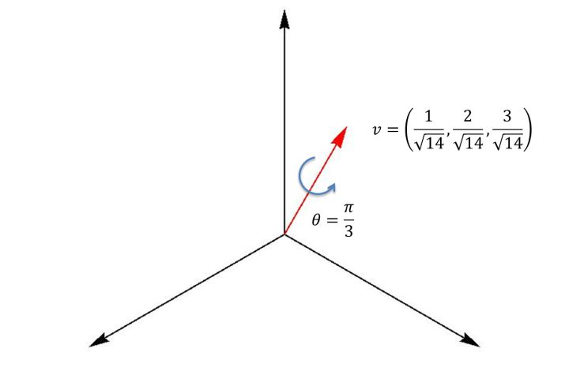

# 四元数与旋转

> **导读**
>
> 四元数（quaternion）是图形学中表示三维旋转最常用的工具：四个数、无万向锁、可平滑插值、可与矩阵互转。这篇笔记把三份材料合并成一条完整链路：
>
> 1. 定义与代数运算（乘法、共轭、模、逆）；
> 2. 用单位四元数表示"绕轴转一个角"，以及 $q\mathbf{p}q^{-1}$ 为什么能旋转向量；
> 3. 与旋转矩阵互转；
> 4. 复合、求逆、"差"、求幂；
> 5. 球面线性插值 Slerp 与样条 Squad；
> 6. 优缺点与工程注意事项。
>
> **约定**：本文采用 Hamilton 约定，四元数写成
> $$q=w+x\mathbf{i}+y\mathbf{j}+z\mathbf{k}=(w,\ \mathbf{v}),\qquad \mathbf{v}=(x,y,z),$$
> 即**实部（标量）在前**。Unity 的 `Quaternion` 在 C# 中按 `(x, y, z, w)` 存储，但数学定义仍是 $w+xi+yj+zk$；写代码时不要混淆分量顺序。旋转正方向遵循右手定则（左手系引擎的视觉方向差异见 §2.3）。

---

## 1. 定义

形如

$$
q=a\mathbf{i}+b\mathbf{j}+c\mathbf{k}+d
$$

的数称为**四元数**，其中 $a,b,c,d\in\mathbb{R}$，$\mathbf{i},\mathbf{j},\mathbf{k}$ 为虚数单位（四元数的基元）。常写作

$$
q=(d,\ a,\ b,\ c)=(w,\ \mathbf{v}),
$$

$w=d$ 为实部/标量部，$\mathbf{v}=(a,b,c)$ 为虚部/向量部。实部为零的四元数 $(0,\mathbf{v})$ 称为**纯四元数（pure quaternion）**，可用来嵌入三维向量。

四元数是复数在三维的推广：复数只有一个虚轴，四元数有三个虚轴，代价是乘法**不满足交换律**。

### 1.1 基本乘法规则

$$
\mathbf{i}^{2}=\mathbf{j}^{2}=\mathbf{k}^{2}=\mathbf{i}\mathbf{j}\mathbf{k}=-1,
$$

$$
\mathbf{i}\mathbf{j}=\mathbf{k},\quad
\mathbf{j}\mathbf{k}=\mathbf{i},\quad
\mathbf{k}\mathbf{i}=\mathbf{j},
$$

$$
\mathbf{i}\mathbf{j}=-\mathbf{j}\mathbf{i},\quad
\mathbf{j}\mathbf{k}=-\mathbf{k}\mathbf{j},\quad
\mathbf{k}\mathbf{i}=-\mathbf{i}\mathbf{k}.
$$

记忆方式：按 $\mathbf{i}\to\mathbf{j}\to\mathbf{k}\to\mathbf{i}$ 的循环顺序相乘得下一个；逆序则变号。由此 $\mathbf{i}\mathbf{j}\mathbf{k}=-1$ 与 $\mathbf{i}^{2}=\mathbf{j}^{2}=\mathbf{k}^{2}=-1$ 等价。

> **修正**：原笔记第 3 条写成 "$\mathbf{k}\mathbf{i}=-\mathbf{k}\mathbf{i}$"，应是 $\mathbf{k}\mathbf{i}=-\mathbf{i}\mathbf{k}$。

### 1.2 四元数乘法（Hamilton 积）

设 $q_1=(w_1,\mathbf{v}_1)$，$q_2=(w_2,\mathbf{v}_2)$，则

$$
q_1q_2=\bigl(w_1w_2-\mathbf{v}_1\cdot\mathbf{v}_2,\ \
w_1\mathbf{v}_2+w_2\mathbf{v}_1+\mathbf{v}_1\times\mathbf{v}_2\bigr).
$$

标量部是"实数乘积减去向量点积"，向量部是"两个数乘加一个叉积"。这正是四元数乘法与三维点积、叉积的联系。

分量展开（与上式等价）：

$$
\begin{aligned}
q_1q_2={}&(d_1d_2-a_1a_2-b_1b_2-c_1c_2)\\
&+(d_1a_2+a_1d_2+b_1c_2-c_1b_2)\mathbf{i}\\
&+(d_1b_2-a_1c_2+b_1d_2+c_1a_2)\mathbf{j}\\
&+(d_1c_2+a_1b_2-b_1a_2+c_1d_2)\mathbf{k}.
\end{aligned}
$$

运算律：

- **结合律**：$(q_1q_2)q_3=q_1(q_2q_3)$；
- **分配律**：$q_1(q_2+q_3)=q_1q_2+q_1q_3$；
- **不满足交换律**：一般 $q_1q_2\neq q_2q_1$；
- 单位元 $1=(1,\mathbf{0})$；$q\cdot1=1\cdot q=q$。

> **术语修正**：原笔记把四元数乘法称为"四元数叉乘（叉乘）"，这不准确。四元数乘法是 Hamilton 积，结果仍是四元数；"叉乘"专指三维向量的 $\times$。只是在纯四元数相乘时，结果的向量部恰好含 $\mathbf{v}_1\times\mathbf{v}_2$。

### 1.3 共轭、模、逆

**共轭**（conjugate）：虚部取负

$$
q^{*}=(w,\ -\mathbf{v})=w-x\mathbf{i}-y\mathbf{j}-z\mathbf{k}.
$$

性质：

$$
(q^{*})^{*}=q,\qquad
(q_1q_2)^{*}=q_2^{*}q_1^{*},\qquad
q q^{*}=q^{*}q=w^{2}+x^{2}+y^{2}+z^{2}.
$$

**模**（magnitude）：

$$
|q|=\sqrt{q q^{*}}=\sqrt{w^{2}+x^{2}+y^{2}+z^{2}}.
$$

有的教材把 $N(q)=w^{2}+x^{2}+y^{2}+z^{2}$ 称为"范数"（norm，实为模的平方），把 $\sqrt{N(q)}$ 称为"模"。两者关系是 $N(q)=|q|^{2}$，不要混用。

**逆**：

$$
q^{-1}=\frac{q^{*}}{|q|^{2}}=\frac{q^{*}}{N(q)}.
$$

验证：$q\cdot\dfrac{q^{*}}{|q|^{2}}=\dfrac{|q|^{2}}{|q|^{2}}=1$。

> **修正**：原笔记写 $A^{-1}=A^{*}/\|A\|$，并把 $\|A\|$ 定义为 $a^{2}+b^{2}+c^{2}+d^{2}$——这正是 $|A|^{2}$，所以该式本身是对的；容易混淆的是记号 $\|A\|$ 与模 $|A|$ 同名。若把分母读成模 $|A|$ 就错了，应是 $A^{-1}=A^{*}/|A|^{2}$；只有 $|A|=1$ 时才有 $A^{-1}=A^{*}$。

**单位四元数**：$|q|=1$，此时

$$
q^{-1}=q^{*}.
$$

**数乘**：四元数与标量相乘是逐分量缩放，

$$
kq=k[w,x,y,z]=[kw,kx,ky,kz],
$$

不改变"方向"（虚轴组合不变），只缩放模长。

**模的乘法性**：

$$
|q_1q_2|=|q_1|\,|q_2|.
$$

因此两个单位四元数相乘仍是单位四元数——这是"旋转复合仍为旋转"的代数保证。

---

## 2. 用四元数表示旋转

### 2.1 轴–角表示

设单位旋转轴 $\mathbf{n}=(n_x,n_y,n_z)$（$|\mathbf{n}|=1$），绕 $\mathbf{n}$ 按右手定则旋转 $\theta$ 角，对应的单位四元数为

$$
q=\cos\frac{\theta}{2}+\mathbf{n}\sin\frac{\theta}{2}
=\Bigl(\cos\frac{\theta}{2},\ \mathbf{n}\sin\frac{\theta}{2}\Bigr),
$$

即

$$
w=\cos\frac{\theta}{2},\qquad
x=n_x\sin\frac{\theta}{2},\qquad
y=n_y\sin\frac{\theta}{2},\qquad
z=n_z\sin\frac{\theta}{2}.
$$

**为什么是半角？** 因为旋转要通过"左乘 $q$、右乘 $q^{*}$"两次乘法实现，每次贡献 $\theta/2$，合起来才是 $\theta$。这也是四元数"双倍覆盖"的根源（见 §2.4）。

由 $|q|^{2}=\cos^{2}\frac{\theta}{2}+\sin^{2}\frac{\theta}{2}=1$，轴–角构造出的四元数自动是单位四元数（前提是 $\mathbf{n}$ 已归一化）。



**从四元数反推轴角**：

$$
\theta=2\arccos w,\qquad
\mathbf{n}=\frac{(x,y,z)}{\sqrt{1-w^{2}}}=\frac{(x,y,z)}{\sin(\theta/2)}.
$$

$w=\pm1$ 时 $\sin(\theta/2)=0$，旋转角为 $0$ 或 $2\pi$，轴无定义（任意轴均可）。

### 2.2 旋转向量：$q\mathbf{p}q^{-1}$

把三维向量 $\mathbf{p}=(p_x,p_y,p_z)$ 写成**纯四元数**

$$
p=(0,\ \mathbf{p})=0+p_x\mathbf{i}+p_y\mathbf{j}+p_z\mathbf{k},
$$

用单位四元数 $q$ 做**共轭相似变换**：

$$
p'=q\,p\,q^{-1}=q\,p\,q^{*}.
$$

结果 $p'$ 一定是纯四元数（实部为 $0$），其向量部就是旋转后的向量：

$$
p'=(0,\ \mathbf{p}').
$$

**为什么一定是纯四元数？** 设 $q=(w,\mathbf{u})$，$|q|=1$。先算 $q\,p=(w,\mathbf{u})(0,\mathbf{p})=(-\mathbf{u}\cdot\mathbf{p},\ w\mathbf{p}+\mathbf{u}\times\mathbf{p})$，再右乘 $q^{-1}=(w,-\mathbf{u})$：标量部为 $-w(\mathbf{u}\cdot\mathbf{p})+(w\mathbf{p}+\mathbf{u}\times\mathbf{p})\cdot\mathbf{u}=0$（末项 $(\mathbf{u}\times\mathbf{p})\cdot\mathbf{u}=0$），故 $p'$ 必为纯四元数；向量部直接展开得

$$
\mathbf{p}'=(w^{2}-|\mathbf{u}|^{2})\mathbf{p}
+2(\mathbf{u}\cdot\mathbf{p})\mathbf{u}
+2w(\mathbf{u}\times\mathbf{p}).
$$

利用 $w^{2}+|\mathbf{u}|^{2}=1$ 与恒等式 $\mathbf{u}\times(\mathbf{u}\times\mathbf{p})=\mathbf{u}(\mathbf{u}\cdot\mathbf{p})-|\mathbf{u}|^{2}\mathbf{p}$，可化为更常用的形式

$$
\boxed{\ \mathbf{p}'=\mathbf{p}+2w(\mathbf{u}\times\mathbf{p})+2\,\mathbf{u}\times(\mathbf{u}\times\mathbf{p})\ }.
$$

这是实际实现中最省算力的旋转公式：一次叉积、一次二重叉积，无需求逆、无需构造矩阵。它显然保持 $\mathbf{p}$ 的实部为 $0$，也直接说明旋转只依赖 $q$ 的向量部与实部。

> 逐项理解：第一项是原向量；第二项是"切向修正"（$2w(\mathbf{u}\times\mathbf{p})$ 垂直于 $\mathbf{u}$）；第三项是"绕轴的二重叉积"，负责把垂直于轴的分量转过去。当 $\mathbf{u}=\mathbf{0}$（$q=\pm1$，单位旋转）时 $\mathbf{p}'=\mathbf{p}$。

### 2.3 旋转的复合

若先做 $q_1$ 再做 $q_2$，复合旋转为

$$
q=q_2q_1.
$$

验证：

$$
(q_2q_1)\,p\,(q_2q_1)^{*}
=q_2q_1\,p\,q_1^{*}q_2^{*}
=q_2\,(q_1p q_1^{*})\,q_2^{*}.
$$

**顺序是从右向左**：写在最右边的先作用。这与矩阵乘法的习惯一致（$R_2R_1\mathbf{p}$ 表示先 $R_1$ 后 $R_2$）。有些引擎把乘法定义反过来（让书写顺序与作用顺序一致），跨库使用时必须确认约定。

**手性与乘法顺序是两件独立的事。** 就 Hamilton 积本身而言，书写顺序永远固定为"右操作数先作用"，与坐标系手性无关；Unity 的 `a * b` 同样是先作用 `b` 再作用 `a`。手性只改变"正角"在屏幕上的视觉方向：数学/OpenGL 惯例是右手系（绕轴正角为逆时针，沿轴正向朝原点看），Unity 是左手系（$X$ 右、$Y$ 上、$Z$ 前），绕 $+Y$ 转 $+90^{\circ}$ 把 `forward`($+Z$) 转到 `right`($+X$)，视觉上是顺时针（从 $+Y$ 轴向下俯视）。把旋转数据从一个手性的空间搬到另一个手性时，照抄分量会得到镜像的旋转，需要按"翻转某一基轴时，虚部中与该轴正交的两个分量取负"的规则变换（通式 $q'=(w,\ \det M\,M\mathbf{v})$；例如镜像 $Z$ 轴即 $\mathbf{v}\mapsto(x,y,-z)$，$M=\operatorname{diag}(1,1,-1)$、$\det M=-1$，得 $(w,x,y,z)\to(w,-x,-y,z)$），并核对两边的欧拉角顺序约定。（补充：源稿未涉及，按 Hamilton 积与 $R(q)$ 定义推导）

**旋转矩阵的复合**同理：

$$
R(q_2q_1)=R(q_2)R(q_1).
$$

### 2.4 双覆盖：$q$ 与 $-q$ 是同一个旋转

由轴–角公式，$q$ 对应 $(\mathbf{n},\theta)$，而

$$
-q=\Bigl(-\cos\frac{\theta}{2},\ -\mathbf{n}\sin\frac{\theta}{2}\Bigr)
=\Bigl(\cos\frac{\theta+2\pi}{2},\ \mathbf{n}\sin\frac{\theta+2\pi}{2}\Bigr),
$$

即 $-q$ 对应"绕同一轴转 $\theta+2\pi$"（等价地，绕 $-\mathbf{n}$ 转 $2\pi-\theta$），与"转 $\theta$"在几何上是同一个姿态（差一整圈）。注意不能写成 $\cos\frac{2\pi-\theta}{2}$ 配 $+\mathbf{n}\sin\frac{2\pi-\theta}{2}$：那一组的向量部符号不对，对应的是逆旋转。所以

$$
q\ \text{与}\ -q\ \text{表示同一个三维旋转}.
$$

这称为**双覆盖（double cover）**：单位四元数构成的三维球面 $S^{3}$ 到旋转群 $SO(3)$ 是二对一的映射。

工程含义：

- 判断两个四元数是否表示同一姿态，要看 $|q_1\cdot q_2|$ 是否接近 $1$，而不是逐个分量比较；
- 插值时必须先统一符号（让点积非负），否则会走"远路"（见 §5）；
- 不能把四元数当成普通四维向量做线性平均。

**"四维旋转"的正确理解**：单位四元数位于四维空间的单位球面 $S^{3}$ 上。左乘 $q$、右乘 $q^{*}$ 合起来是四维空间中的一个旋转，但这个旋转把三维超平面（纯四元数子空间）映射到自身，所以限制在三维超平面上就是一个普通的三维旋转。物理上，四元数旋转 $\theta$ 可看作"三维超平面上两次 $\theta/2$ 旋转的叠加"。原笔记的这层描述是对的，只是"四维旋转"不应理解为"物体在四维空间里转"。

---

## 3. 四元数与旋转矩阵

### 3.1 四元数 → 矩阵

设单位四元数 $q=(w,x,y,z)$，对应的旋转矩阵为

$$
R(q)=
\begin{pmatrix}
1-2(y^{2}+z^{2}) & 2(xy-wz) & 2(xz+wy)\\[4pt]
2(xy+wz) & 1-2(x^{2}+z^{2}) & 2(yz-wx)\\[4pt]
2(xz-wy) & 2(yz+wx) & 1-2(x^{2}+y^{2})
\end{pmatrix}.
$$

等价写法（用 $w^{2}+x^{2}+y^{2}+z^{2}=1$）：

$$
R=
\begin{pmatrix}
w^{2}+x^{2}-y^{2}-z^{2} & 2(xy-wz) & 2(xz+wy)\\
2(xy+wz) & w^{2}-x^{2}+y^{2}-z^{2} & 2(yz-wx)\\
2(xz-wy) & 2(yz+wx) & w^{2}-x^{2}-y^{2}+z^{2}
\end{pmatrix}.
$$

验证：绕 $z$ 轴转 $\theta$ 时 $q=(\cos\frac\theta2,0,0,\sin\frac\theta2)$，代入得

$$
R=\begin{pmatrix}
\cos\theta&-\sin\theta&0\\
\sin\theta&\cos\theta&0\\
0&0&1
\end{pmatrix},
$$

与初等旋转矩阵一致。

**注意**：$R(q)=R(-q)$，与双覆盖一致。若四元数未归一化，应先归一化再套公式，否则矩阵不是正交阵（会带缩放）。

$R(q)$ 与 $q\,p\,q^{*}$ 是同一件事的两种写法：对任意 $\mathbf{p}$，$R(q)\mathbf{p}$ 与 $q(0,\mathbf{p})q^{*}$ 的向量部逐分量相等。上式按**列向量**约定给出（$\mathbf{p}'=R\mathbf{p}$）；若代码里用行向量 $\mathbf{p}'^{\mathsf{T}}=\mathbf{p}^{\mathsf{T}}R^{\mathsf{T}}$，注意行向量版矩阵是列向量版矩阵的转置。公式本身不含手性——只要基向量与"正角"定义自洽，同一式子在手性不同的引擎下都成立，手性只影响角度在视觉上的方向（见 §2.3）。（补充：源稿未涉及，按 Hamilton 积与 $R(q)$ 定义推导）

### 3.2 矩阵 → 四元数

设 $R=(r_{ij})$ 是 $3\times3$ 旋转矩阵，$\operatorname{tr}R=r_{00}+r_{11}+r_{22}$。

**迹较大时**（数值稳定分支）：

$$
w=\frac12\sqrt{1+\operatorname{tr}R},\qquad
x=\frac{r_{21}-r_{12}}{4w},\qquad
y=\frac{r_{02}-r_{20}}{4w},\qquad
z=\frac{r_{10}-r_{01}}{4w}.
$$

**迹较小时**改用最大对角元分支，避免除以接近零的 $w$：

- 若 $r_{00}$ 最大：
  $$
  x=\frac12\sqrt{1+r_{00}-r_{11}-r_{22}},\quad
  w=\frac{r_{21}-r_{12}}{4x},\quad
  y=\frac{r_{01}+r_{10}}{4x},\quad
  z=\frac{r_{02}+r_{20}}{4x};
  $$
- 若 $r_{11}$ 最大：对 $y$ 同理；
- 若 $r_{22}$ 最大：对 $z$ 同理。

最后统一归一化并约定 $w\ge0$（消除双覆盖的符号歧义）。

### 3.3 与欧拉角、矩阵的比较

| | 四元数 | 欧拉角 | 旋转矩阵 |
|---|---|---|---|
| 存储 | 4 个数 | 3 个数 | 9 个数 |
| 万向锁 | 无 | 有 | 无 |
| 插值 | Slerp，平滑 | 易抖动/路径错误 | 不能直接插值 |
| 复合 | 16 次乘加 | 需转矩阵 | 27 次乘加 |
| 正交化 | 归一化（4 个数） | 无此概念 | Gram–Schmidt（较贵） |
| 直观性 | 差 | 好 | 中等 |
| 误差累积 | 需定期归一化 | 无 | 需定期正交化 |

---

## 4. 四元数的"差"、点乘、对数与幂

### 4.1 差（角位移）

四元数**不能做除法**，只能用乘逆实现。从方位 $q_1$ 到 $q_2$ 的角位移为

$$
q_d=q_2q_1^{-1}\quad(\text{世界坐标系}),
\qquad
q_d=q_1^{-1}q_2\quad(\text{局部坐标系}).
$$

$q_d$ 表示"在 $q_1$ 的基础上再施加什么旋转能得到 $q_2$"。两个写法差一个共轭，取决于把增量解释在世界系还是局部系。

### 4.2 点乘

$$
q_1\cdot q_2=w_1w_2+x_1x_2+y_1y_2+z_1z_2.
$$

对单位四元数，点乘等于 $\cos\Omega$，其中 $\Omega$ 是它们在 $S^{3}$ 上的夹角；若两旋转共轴，则

$$
q_1\cdot q_2=\cos\frac{\theta_1-\theta_2}{2}.
$$

点乘结果在 $[-1,1]$。**绝对值**越大，两个四元数代表的角位移越相似；$|q_1\cdot q_2|=1$ 表示同一姿态（可能差符号）。Slerp 中的"夹角"就是用点乘算出来的。

### 4.3 对数与指数

对单位四元数 $q=(\cos\frac\theta2,\ \mathbf{n}\sin\frac\theta2)$：

$$
\log q=\Bigl(0,\ \frac\theta2\mathbf{n}\Bigr),
\qquad
\exp(0,\ \mathbf{v})=\Bigl(\cos|\mathbf{v}|,\ \frac{\sin|\mathbf{v}|}{|\mathbf{v}|}\mathbf{v}\Bigr).
$$

一般四元数：

$$
\log q=\Bigl(\ln|q|,\ \mathbf{n}\arccos\frac{w}{|q|}\Bigr).
$$

### 4.4 求幂

对单位四元数，

$$
q^{t}=\exp(t\log q)
=\Bigl(\cos\frac{t\theta}{2},\ \mathbf{n}\sin\frac{t\theta}{2}\Bigr),
\qquad t\in\mathbb{R}.
$$

含义：把旋转角按比例缩放 $t$ 倍。$q^{0}=1$，$q^{1}=q$，$q^{-1}=q^{*}$，$q^{1/2}$ 是"转一半"。

**重要陷阱**：求幂用的是上一节的主值分支 $\log q=(\ln|q|,\ \mathbf n\arccos(w/|q|))$，即 $\theta=2\arccos w\in[0,2\pi)$。只要角度不发生 $2\pi$ 回绕，$(q^{a})^{b}=q^{ab}$ 是精确成立的：例如绕 $x$ 轴 $60^{\circ}$ 的 $q$，$q^{4}$ 的角是 $240^{\circ}$，$(q^{4})^{1/2}$ 恰为 $120^{\circ}=q^{2}$。

真正会破的是角度跨过 $2\pi$ 的情形：

$$
(q^{a})^{b}\neq q^{ab}
$$

一般不成立。取绕 $x$ 轴 $100^{\circ}$ 的 $q$：$q^{4/3}$ 是绕 $+x$ 转 $133.3^{\circ}$；$q^{4}$ 作为旋转等价于 $40^{\circ}$（$400^{\circ}$ 已越过 $2\pi$），但按主值 $\log$ 取到 $\theta=320^{\circ}$ 且轴为 $-x$，再取 $1/3$ 次幂得绕 $-x$ 转 $106.7^{\circ}$（$\equiv$ 绕 $+x$ 转 $253.3^{\circ}$），与 $133.3^{\circ}$ 相差 $120^{\circ}$——不是同一姿态。（$b=1/2$ 时不能当反例：$2\pi$ 回绕造成的分支差必为 $\pi$ 的整数倍，只会让结果整体取负，仍是同一旋转。）所以涉及指数的代数恒等式不能想当然地套用；需要"绕多圈"时必须显式记录圈数或改用轴–角参数。

（另需注意：若在求幂前把四元数规范到 $w\ge0$ 以强制"最短弧"，会改变 $\log$ 的分支，得到同一旋转的另一个根，而不再是原来的 $q^{ab}$。）

---

## 5. 球面线性插值（Slerp）

### 5.1 为什么不用线性插值

两个标量的插值：

$$
x=(1-t)x_0+t x_1.
$$

直接套到四元数上（Lerp）会得到非单位四元数，且**角速度不恒定**：归一化后的路径虽然在球面上，但参数 $t$ 与实际转角不成正比，动画会忽快忽慢。

欧拉角插值的问题更严重：角度回绕（$350^{\circ}$ 与 $10^{\circ}$ 的"中间"应是 $0^{\circ}$ 而不是 $180^{\circ}$）、万向锁导致的抖动与路径错误。

**Slerp（Spherical Linear Interpolation）** 在四维单位球面的大圆上按弧长均匀插值，得到恒定角速度。

### 5.2 公式

设 $q_0,q_1$ 为单位四元数，$\Omega=\arccos(q_0\cdot q_1)$ 为它们在 $S^{3}$ 上的夹角，则

$$
\operatorname{slerp}(q_0,q_1,t)
=\frac{\sin\bigl((1-t)\Omega\bigr)}{\sin\Omega}\,q_0
+\frac{\sin(t\Omega)}{\sin\Omega}\,q_1,
\qquad t\in[0,1].
$$

推导思路：在由 $q_0,q_1$ 张成的二维平面内，把 $q_0$ 旋转到 $q_1$ 的方向，用正弦定理分配两个基向量的权重，使结果始终在单位球面上且角度随 $t$ 线性变化。

**几何解释**：四元数空间中的"直线"是球面大圆的弧；Slerp 就是沿弧匀速走。由于 $q$ 与 $-q$ 是同一姿态但球面上是对径点，插值前必须选对半球。

一般线性插值为

$$
\mathbf{r}=\mathbf{P}_0+(\mathbf{P}_1-\mathbf{P}_0)t,\qquad t\in[0,1],
$$

它代表插值矢量 $\mathbf{r}$ 的末端位于**弦** $\mathbf{P}_0\mathbf{P}_1$ 上。若 $t$ 取 $1/4,2/4,3/4$，即把弦长均分为 4 等份，对应的**弧长并不相等**：靠近中间的弧长较长，靠近两端的弧长较短。这意味着当 $t$ 匀速变化时，代表姿态的矢量的**角速度并不均匀**——这正是不能直接用 Lerp 的原因。


### 5.3 两个必须处理的细节

1. **最短路径**：若 $q_0\cdot q_1<0$，说明两点在球面上相隔超过 $90^{\circ}$（对应的旋转差超过 $180^{\circ}$），直接插值会走远路。做法是把 $q_1$ 取反：
   $$
   \text{if } q_0\cdot q_1<0:\quad q_1\leftarrow -q_1,\quad \Omega\leftarrow\pi-\Omega.
   $$
   因为 $q_1$ 与 $-q_1$ 表示同一姿态，取反不改变结果，只改变路径。
2. **小角度退化**：当 $\Omega\to0$ 时 $\sin\Omega\to0$，公式出现 $0/0$。实践阈值 $\cos\Omega>0.9995$ 时退化为归一化的线性插值：
   $$
   q=\frac{(1-t)q_0+tq_1}{\|(1-t)q_0+tq_1\|}.
   $$
   小角度下 Lerp 与 Slerp 的差异低于可见阈值，且数值更稳定。

### 5.4 参考实现

```cpp
#include <cmath>

// q 采用 (w, x, y, z) 顺序；t ∈ [0,1]
void slerp(const float q0[4], const float q1_in[4], float out[4], float t)
{
    float q1[4] = {q1_in[0], q1_in[1], q1_in[2], q1_in[3]};

    float cosOmega = q0[0]*q1[0] + q0[1]*q1[1] + q0[2]*q1[2] + q0[3]*q1[3];

    // 保证走最短弧：q 与 -q 表示同一旋转
    if (cosOmega < 0.0f) {
        for (int i = 0; i < 4; ++i) q1[i] = -q1[i];
        cosOmega = -cosOmega;
    }

    float k0, k1;
    if (cosOmega > 0.9995f) {
        // 两四元数几乎重合，退化为线性插值再归一化
        k0 = 1.0f - t;
        k1 = t;
    } else {
        float sinOmega = std::sqrt(1.0f - cosOmega * cosOmega);
        float Omega    = std::atan2(sinOmega, cosOmega);
        k0 = std::sin((1.0f - t) * Omega) / sinOmega;
        k1 = std::sin(t * Omega) / sinOmega;
    }

    for (int i = 0; i < 4; ++i)
        out[i] = q0[i] * k0 + q1[i] * k1;

    // 消除浮点误差带来的模长漂移
    float len = std::sqrt(out[0]*out[0] + out[1]*out[1] + out[2]*out[2] + out[3]*out[3]);
    for (int i = 0; i < 4; ++i) out[i] /= len;
}
```

> 原笔记代码在函数内直接修改了 `ending` 数组（取反），会污染调用者的数据；上面改为拷贝到局部 `q1`。另外原代码最后没有归一化，长序列插值会累积模长误差。`cosa > 0.9995` 的判断在取反之后使用是正确的（此时 `cosa` 已为正）。

### 5.5 Squad：更平滑的样条

对一系列关键姿态 $q_0,q_1,\dots,q_n$ 逐段 Slerp，在关节处角速度不连续（只有 $C^{0}$）。**Squad（Spherical and Quadrangle）** 用二次 Slerp 构造 $C^{1}$ 连续的样条：

$$
\operatorname{squad}(q_0,q_1,s_0,s_1,t)
=\operatorname{slerp}\Bigl(
\operatorname{slerp}(q_0,q_1,t),\ 
\operatorname{slerp}(s_0,s_1,t),\ 
2t(1-t)
\Bigr),
$$

其中 $s_i$ 是中间控制四元数，由相邻关键帧计算（类似 Catmull–Rom 的切线）：

$$
s_i=q_i\exp\left(-\frac{\log\bigl(q_i^{-1}q_{i+1}\bigr)+\log\bigl(q_i^{-1}q_{i-1}\bigr)}{4}\right).
$$

两端需外插虚拟帧或令 $s_0=q_0$、$s_n=q_n$。工程上若只需两帧之间插值，Slerp 足够；整条动画曲线要平滑，用 Squad 或直接在旋转矩阵/对偶四元数上做样条。

---

## 6. 单位四元数、欧拉角与矩阵的转换

### 6.1 欧拉角 → 四元数

按指定旋转顺序（如 $ZYX$）把三个轴角分别转成四元数再相乘：

$$
q=q_z(\gamma)\,q_y(\beta)\,q_x(\alpha)
$$

（顺序取决于约定，务必与引擎一致）。每个轴角四元数为

$$
q_x(\alpha)=\Bigl(\cos\frac\alpha2,\sin\frac\alpha2,0,0\Bigr),\quad
q_y(\beta)=\Bigl(\cos\frac\beta2,0,\sin\frac\beta2,0\Bigr),\quad
q_z(\gamma)=\Bigl(\cos\frac\gamma2,0,0,\sin\frac\gamma2\Bigr).
$$

### 6.2 四元数 → 欧拉角

以 $ZYX$（先绕 $X$，再 $Y$，再 $Z$）为例，从旋转矩阵元素反解：

$$
\beta=\arcsin\bigl(-r_{20}\bigr),\qquad
\alpha=\operatorname{atan2}(r_{21},r_{22}),\qquad
\gamma=\operatorname{atan2}(r_{10},r_{00}),
$$

当 $|r_{20}|\approx1$（万向锁）时需特殊处理：令 $\alpha=0$，再解 $\gamma$。这也是欧拉角表示不可避免的退化。

### 6.3 工程建议

- 内部计算与存储统一用四元数，只在 UI/序列化时转欧拉角；
- 每次多次乘法后定期归一化：$q\leftarrow q/|q|$；
- 归一化可以省掉开方：令 $s=|q|^{2}$、$\varepsilon=s-1$（$\varepsilon$ 即模长平方的相对偏差），取 $q\leftarrow q\,(1.5-0.5s)$，这是对 $1/\sqrt{s}$ 的一次 Newton 迭代，把模长残差从 $O(\varepsilon)$ 降到 $O(\varepsilon^{2})$，直接计算得 $|q'|=1-\frac38\varepsilon^{2}+O(\varepsilon^{3})$；$s\in[0.9,1.1]$ 时已足够，只在需要精确单位化时才用 $q/|q|$。（补充：源稿未涉及，按 Hamilton 积与 $R(q)$ 定义推导）
- 比较姿态用 $|q_1\cdot q_2|$ 或夹角 $2\arccos|q_1\cdot q_2|$；
- 从外部数据读入的四元数可能是"坏数据"（未归一化、符号跳变），加载时归一化并统一 $w\ge0$；
- 插值前统一半球，否则动画会突然翻转。

---

## 7. 优缺点

**优点**

- **平滑插值**：Slerp/Squad 提供恒定角速度，无欧拉角的角度回绕与万向锁；
- **复合与求逆便宜**：一次 Hamilton 积 / 一次共轭；
- **与矩阵互转快**：构造矩阵只需 16 次乘法量级；
- **紧凑**：4 个数（矩阵要 9 个，且需正交化）；
- **数值稳定**：归一化即可修复漂移，不会像矩阵那样累积非正交性。

**缺点**

- 比欧拉角多一个数；
- **可能不合法**：浮点误差或坏输入会让模长偏离 $1$，需定期归一化；
- **不直观**：人很难从 $(w,x,y,z)$ 读出"绕哪个轴转多少度"；
- **双覆盖**：$q$ 与 $-q$ 同姿态，比较、插值、平均都要额外处理；
- **不能直接做分量线性运算**：平均多个旋转要用球面平均/特征分解，不能逐分量取平均。

---

## 8. 常见误区清单

1. **把四元数乘法当叉乘**：它是 Hamilton 积，结果仍是四元数；只有纯四元数相乘时向量部才出现叉积。
2. **逆的公式写错**：$q^{-1}=q^{*}/|q|^{2}=q^{*}/N(q)$；常见错误是写成 $q^{*}/|q|$，或把 $N(q)$（模的平方）当成模 $|q|$。
3. **忘记归一化旋转轴**：轴–角构造要求 $|\mathbf{n}|=1$，否则得到的不是单位四元数。
4. **旋转顺序搞反**：$q_2q_1$ 是先 $q_1$ 后 $q_2$；不同库的乘法定义可能相反。
5. **插值不统一半球**：$q$ 与 $-q$ 会让 Slerp 走 $360^{\circ}$ 的远路。
6. **对小角度直接用 Slerp**：$\sin\Omega\approx0$ 导致数值爆炸，应退化为 Lerp。
7. **认为 $(q^{a})^{b}=q^{ab}$**：最短弧约定破坏了这个恒等式。
8. **用四元数分量做线性平均**：多个旋转的平均没有"逐分量平均"这种简单答案。
9. **存储顺序混淆**：数学上 $(w,x,y,z)$，Unity C# 是 $(x,y,z,w)$，GLM 的 `vec4` 构造也常是 $(w,x,y,z)$；跨库必须显式确认。

---

## 原始笔记索引

- `Math/quaternion/四元数.md`
- `Math/quaternion/四元数基础.md`
- `Math/quaternion/四元数的插值.md`
- `归类/resume.md`（仅第 1049-1075 行）

三篇已合并为本文：定义与代数（§1）、旋转与矩阵（§2–§3）、差/点乘/幂（§4）、Slerp/Squad（§5）、转换与工程实践（§6–§8）。`归类/resume.md` 的对应段落只提供了"纯四元数 + 单位四元数 + 共轭左乘右乘"的构造流程与"两次半角四维旋转"的物理意义，本次只按其索引补录；另补充手性/乘法顺序、$R(q)$ 与 $qpq^{*}$ 等价、Newton 归一化三点（均在段末标注）。