# 计算几何

> **导读**：本文以"向量代数 → 位置判定 → 求交 → 剖分与网格结构 → 坐标展开"的顺序组织。所有结论都尽量给出可落地的公式或代码，并统一约定：右手坐标系；向量加粗小写（$\mathbf a$）；三角形顶点 $A,B,C$ 逆时针排列；二维叉积取 $z$ 分量作为标量。文中对原笔记里笔误与符号不一致处做了修正，无法确认的地方标注"（待核实）"。

---

## 1. 向量代数基础

### 1.1 点积（dot product）

$$
\mathbf a\cdot\mathbf b=\lvert\mathbf a\rvert\lvert\mathbf b\rvert\cos\langle\mathbf a,\mathbf b\rangle
=\sum_{i}a_i b_i .
$$

**几何应用**：

- **投影长度**：$\mathbf a$ 在 $\mathbf b$ 方向上的有符号投影为 $\dfrac{\mathbf a\cdot\mathbf b}{\lvert\mathbf b\rvert}$。
- **投影向量**：
  $$
  \operatorname{proj}_{\mathbf b}\mathbf a=\frac{\mathbf a\cdot\mathbf b}{\lvert\mathbf b\rvert^{2}}\,\mathbf b
  =\frac{\mathbf a\cdot\mathbf b}{\mathbf b\cdot\mathbf b}\,\mathbf b .
  $$
  当 $\lvert\mathbf b\rvert=1$ 时退化为 $(\mathbf a\cdot\mathbf b)\mathbf b$。
- **夹角**：$\cos\theta=\dfrac{\mathbf a\cdot\mathbf b}{\lvert\mathbf a\rvert\lvert\mathbf b\rvert}$。注意 `acos` 返回 $[0,\pi]$，只能给出无向夹角；需要判断左右时配合叉积符号。
- **垂直判定**：$\mathbf a\cdot\mathbf b=0$。
- **分配律**：$(\mathbf p-\mathbf h)\cdot(\mathbf p-\mathbf h)=r^2$ 这类"圆/球方程"的展开，全靠点积的双线性与分配律：
  $$
  (\mathbf a+t\mathbf b-\mathbf h)\cdot(\mathbf a+t\mathbf b-\mathbf h)=r^2
  $$
  令 $\mathbf d=\mathbf a-\mathbf h$，展开得
  $$
  t^2(\mathbf b\cdot\mathbf b)+2t\,\mathbf b\cdot\mathbf d+\mathbf d\cdot\mathbf d-r^2=0 .
  $$
  这是**射线与球求交**的标准二次方程。

> 量纲提醒：$\mathbf a\cdot\mathbf b$ 是有量纲的标量；只有除以 $\lvert\mathbf b\rvert$ 后才成为"长度"。

### 1.2 叉积（cross product）

三维叉积

$$
\mathbf a\times\mathbf b=
\begin{vmatrix}
\mathbf i&\mathbf j&\mathbf k\\
a_x&a_y&a_z\\
b_x&b_y&b_z
\end{vmatrix}
=(a_yb_z-a_zb_y,\ a_zb_x-a_xb_z,\ a_xb_y-a_yb_x),
$$

$$
\lvert\mathbf a\times\mathbf b\rvert=\lvert\mathbf a\rvert\lvert\mathbf b\rvert\sin\theta,
$$

方向由右手定则确定，且同时垂直于 $\mathbf a,\mathbf b$。

**二维情形**：把平面向量视为 $z=0$ 的三维向量 $\mathbf a=(x_1,y_1,0)$、$\mathbf b=(x_2,y_2,0)$，则

$$
\mathbf a\times\mathbf b=(0,\ 0,\ x_1y_2-x_2y_1).
$$

其 $z$ 分量 $x_1y_2-x_2y_1$ 是一个**有符号面积的两倍**：

$$
S_{\triangle OAB}=\frac{1}{2}(x_1y_2-x_2y_1)=\frac{1}{2}\lvert\mathbf a\times\mathbf b\rvert\ \text{（取绝对值后）}.
$$

行列式展开的逐项形式（图中记两个向量为 $\mathbf P=(P_x,P_y,P_z)$、$\mathbf Q=(Q_x,Q_y,Q_z)$）：

$$
\begin{vmatrix}
\mathbf i&\mathbf j&\mathbf k\\
P_x&P_y&P_z\\
Q_x&Q_y&Q_z
\end{vmatrix}
=\mathbf i\,(P_yQ_z-P_zQ_y)-\mathbf j\,(P_xQ_z-P_zQ_x)+\mathbf k\,(P_xQ_y-P_yQ_x).
$$

所以"二维叉积是标量"只是**丢了方向分量的说法**：完整结果是沿 $z$ 轴的法向量，标量是其有符号长度。符号的几何意义是**转向**：

- $x_1y_2-x_2y_1>0$：$\mathbf b$ 在 $\mathbf a$ 的逆时针一侧；
- $<0$：顺时针一侧；
- $=0$：共线（含反向）。

**注意**：$\lvert\mathbf a\times\mathbf b\rvert=\lvert\mathbf a\rvert\lvert\mathbf b\rvert\sin\theta$ 只在 $\theta\in[0,\pi]$ 成立；$\theta>\pi$ 时"结果取反"来自**有符号叉积**（负号不是 $\sin\theta$ 本身给出的），实质是**有向角**在起作用。用 $\arcsin$ 反推角度会丢信息：`asin` 值域为 $[-\pi/2,\pi/2]$，`acos` 为 $[0,\pi]$，都无法区分"左转 $30°$"和"右转 $30°$"，必须结合叉积符号或改用 `atan2`。

**常用恒等式**：

$$
\mathbf a\times\mathbf b=-\mathbf b\times\mathbf a,\qquad
\mathbf a\times\mathbf a=\mathbf 0,\qquad
\mathbf a\times(\mathbf b+\mathbf c)=\mathbf a\times\mathbf b+\mathbf a\times\mathbf c,
$$

$$
\lvert\mathbf a\times\mathbf b\rvert^2=\lvert\mathbf a\rvert^2\lvert\mathbf b\rvert^2-(\mathbf a\cdot\mathbf b)^2
\quad(\text{Lagrange 恒等式}).
$$

### 1.3 混合积（scalar triple product）

$$
[\mathbf a,\mathbf b,\mathbf c]=\mathbf a\cdot(\mathbf b\times\mathbf c)
=\det\begin{pmatrix}a_x&a_y&a_z\\b_x&b_y&b_z\\c_x&c_y&c_z\end{pmatrix}.
$$

几何意义是以三向量为棱的**平行六面体有向体积**；$=0$ 即三向量共面。它是平面方程、射线求交（克莱姆法则）中的核心工具。

轮换不变、交换变号：

$$
[\mathbf a,\mathbf b,\mathbf c]=[\mathbf b,\mathbf c,\mathbf a]=[\mathbf c,\mathbf a,\mathbf b],
\qquad
[\mathbf a,\mathbf b,\mathbf c]=-[\mathbf b,\mathbf a,\mathbf c].
$$

---

## 2. 平面与点面关系

### 2.1 平面方程

**点法式**：过点 $P_0=(x_0,y_0,z_0)$、法向量 $\mathbf n=(A,B,C)$ 的平面为

$$
\mathbf n\cdot(\mathbf P-P_0)=0
\;\Longleftrightarrow\;
A(x-x_0)+B(y-y_0)+C(z-z_0)=0 .
$$

展开即**一般式**

$$
Ax+By+Cz+D=0,\qquad D=-(Ax_0+By_0+Cy_0).
$$

**三点式（行列式）**：过不共线三点 $P_1,P_2,P_3$ 的平面为

$$
\begin{vmatrix}
x-x_1&y-y_1&z-z_1\\
x_2-x_1&y_2-y_1&z_2-z_1\\
x_3-x_1&y_3-y_1&z_3-z_1
\end{vmatrix}=0,
$$

等价于四阶行列式

$$
\begin{vmatrix}
x&y&z&1\\
x_1&y_1&z_1&1\\
x_2&y_2&z_2&1\\
x_3&y_3&z_3&1
\end{vmatrix}=0 .
$$

其法向量可直接由叉积给出：

$$
\mathbf n=(P_2-P_1)\times(P_3-P_1).
$$

**截距式**（三个坐标轴截距 $a,b,c$ 均非零）：

$$
\frac{x}{a}+\frac{y}{b}+\frac{z}{c}=1 .
$$

> 一致性：三点式行列式展开后 $x,y,z$ 的系数正是 $\mathbf n$ 的三个分量，常数项为 $-\mathbf n\cdot P_1$，与点法式完全一致。

### 2.2 点到平面的距离

设平面 $\pi:\ \mathbf n\cdot(\mathbf X-P_0)=0$，点 $P$。把 $P-P_0$ 分解为沿法向与切向两部分，距离就是法向分量的长度：

$$
d=\frac{\lvert\mathbf n\cdot(P-P_0)\rvert}{\lVert\mathbf n\rVert}.
$$

写成一般式 $Ax+By+Cz+D=0$：

$$
\boxed{\;d=\frac{\lvert Ax_0+By_0+Cz_0+D\rvert}{\sqrt{A^2+B^2+C^2}}\;}.
$$

逐步推导（$P(x,y,z)$ 为平面内任取的一点，$\mathbf n=(A,B,C)$，$Q=(x_0,y_0,z_0)$）：距离就是 $\overrightarrow{PQ}$ 在法向量上的投影长度，

$$
\begin{aligned}
d&=\lvert PQ\rvert\cos\theta
=\frac{\lvert\mathbf n\rvert}{\lvert\mathbf n\rvert}\lvert PQ\rvert\cos\theta
=\frac{\overrightarrow{PQ}\cdot\mathbf n}{\lvert\mathbf n\rvert}\\
&=\frac{A(x_0-x)+B(y_0-y)+C(z_0-z)}{\sqrt{A^2+B^2+C^2}}
=\frac{Ax_0+By_0+Cz_0-(Ax+By+Cz)}{\sqrt{A^2+B^2+C^2}}\\
&=\frac{Ax_0+By_0+Cz_0+D}{\sqrt{A^2+B^2+C^2}}
\qquad(P\ \text{在平面内，故}\ Ax+By+Cz=-D)\\
&=\frac{\lvert Ax_0+By_0+Cz_0+D\rvert}{\sqrt{A^2+B^2+C^2}} .
\end{aligned}
$$

**有符号距离**（判断在平面哪一侧，渲染中做裁剪/阴影偏移常用）：

$$
d_{\text{signed}}=\frac{\mathbf n\cdot(P-P_0)}{\lVert\mathbf n\rVert}
=\frac{Ax_0+By_0+Cz_0+D}{\lVert\mathbf n\rVert}.
$$

若 $\lVert\mathbf n\rVert=1$ 则分母为 1。$d_{\text{signed}}>0$ 表示 $P$ 在法向量指向的一侧。

> 常见错误：忘记对 $\mathbf n$ 归一化，导致"距离"被 $\lVert\mathbf n\rVert$ 缩放；或在三点式里把 $P_2-P_1$ 与 $P_3-P_1$ 的顺序写反，使法向朝内、有符号距离整体变号。

---

## 3. 点与三角形/多边形的位置判定

### 3.1 判断点在三角形内部

前提：点 $P$ 与三角形 $ABC$ 共面。以下三种方法等价。

**(1) 同向法（叉积符号法）**

沿 $A\to B\to C\to A$ 行走，若 $P$ 始终在每条边的同一侧（对逆时针三角形是左侧），则在内部。三维中"同一侧"用叉积与法向的点积判断：

$$
s_1=\mathbf n\cdot\big((B-A)\times(P-A)\big),\quad
s_2=\mathbf n\cdot\big((C-B)\times(P-B)\big),\quad
s_3=\mathbf n\cdot\big((A-C)\times(P-C)\big),
$$

$$
\mathbf n=(B-A)\times(C-A).
$$

$s_1,s_2,s_3$ 同号（允许为 0，表示在边上）即在内部。二维时可直接用标量叉积：

$$
(B-A)\times(P-A),\quad (C-B)\times(P-B),\quad (A-C)\times(P-C)
$$

三者同号。

**(2) 重心法（barycentric）**

$$
P=A+u(C-A)+v(B-A),
$$

$P$ 在三角形内（含边界）当且仅当

$$
u\ge0,\quad v\ge0,\quad u+v\le1 .
$$

边界对应：$(u,v)=(0,0)\to A$，$(0,1)\to B$，$(1,0)\to C$。

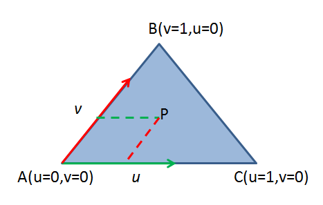

令 $\mathbf v_0=C-A$、$\mathbf v_1=B-A$、$\mathbf v_2=P-A$，则 $\mathbf v_2=u\mathbf v_0+v\mathbf v_1$。两边分别点乘 $\mathbf v_0,\mathbf v_1$：

$$
\begin{cases}
\mathbf v_2\cdot\mathbf v_0=u(\mathbf v_0\cdot\mathbf v_0)+v(\mathbf v_1\cdot\mathbf v_0),\\
\mathbf v_2\cdot\mathbf v_1=u(\mathbf v_0\cdot\mathbf v_1)+v(\mathbf v_1\cdot\mathbf v_1),
\end{cases}
$$

解得

$$
u=\frac{(\mathbf v_1\cdot\mathbf v_1)(\mathbf v_2\cdot\mathbf v_0)-(\mathbf v_1\cdot\mathbf v_0)(\mathbf v_2\cdot\mathbf v_1)}
{(\mathbf v_0\cdot\mathbf v_0)(\mathbf v_1\cdot\mathbf v_1)-(\mathbf v_0\cdot\mathbf v_1)^2},
$$

$$
v=\frac{(\mathbf v_0\cdot\mathbf v_0)(\mathbf v_2\cdot\mathbf v_1)-(\mathbf v_0\cdot\mathbf v_1)(\mathbf v_2\cdot\mathbf v_0)}
{(\mathbf v_0\cdot\mathbf v_0)(\mathbf v_1\cdot\mathbf v_1)-(\mathbf v_0\cdot\mathbf v_1)^2}.
$$

```cpp
bool PointinTriangle(Vector3 A, Vector3 B, Vector3 C, Vector3 P)
{
    Vector3 v0 = C - A;
    Vector3 v1 = B - A;
    Vector3 v2 = P - A;

    float dot00 = v0.Dot(v0);
    float dot01 = v0.Dot(v1);
    float dot02 = v0.Dot(v2);
    float dot11 = v1.Dot(v1);
    float dot12 = v1.Dot(v2);

    float inverDeno = 1 / (dot00 * dot11 - dot01 * dot01);

    float u = (dot11 * dot02 - dot01 * dot12) * inverDeno;
    if (u < 0 || u > 1) return false;

    float v = (dot00 * dot12 - dot01 * dot02) * inverDeno;
    if (v < 0 || v > 1) return false;

    return u + v <= 1;
}
```

> 该实现要求三角形不退化为一条线，否则 `inverDeno` 分母为 0。工程上应先判断 $\lvert\mathbf v_0\times\mathbf v_1\rvert$ 是否足够大。

**(3) 二维直接解（更常用，也更快）**

在二维平面内把 $\mathbf v_2=u\mathbf v_0+v\mathbf v_1$ 当作两个方程两个未知数，用克拉默法则：

$$
u=\frac{(P-A)\times(B-A)}{(C-A)\times(B-A)},\qquad
v=\frac{(C-A)\times(P-A)}{(C-A)\times(B-A)} .
$$

> 符号核对：以 $A=(0,0),B=(1,0),C=(0,1)$ 为例，$(C-A)\times(B-A)=-1$。取 $P=(0.3,0.2)$（即 $P=A+0.2(C-A)+0.3(B-A)$），则 $(P-A)\times(B-A)=-0.2$、$(C-A)\times(P-A)=-0.3$，代入得 $u=0.2$、$v=0.3$，与分解式一致。若把两个分子写反，$u,v$ 会互换。

代码里常写成权重形式：

```c
static vec3_t calculate_weights(vec2_t abc[3], vec2_t p)
{
    vec2_t a = abc[0], b = abc[1], c = abc[2];
    vec2_t ab = vec2_sub(b, a);
    vec2_t ac = vec2_sub(c, a);
    vec2_t ap = vec2_sub(p, a);
    float factor = 1 / (ab.x * ac.y - ab.y * ac.x);
    float s = (ac.y * ap.x - ac.x * ap.y) * factor;   // 对应 b 的权重
    float t = (ab.x * ap.y - ab.y * ap.x) * factor;   // 对应 c 的权重
    return vec3_new(1 - s - t, s, t);                 // (wA, wB, wC)
}
```

返回值顺序是 $(w_A,w_B,w_C)$，与入参顺序 $(a,b,c)$ 一致。

**(4) 面积法**

$$
S_{\triangle ABP}+S_{\triangle BCP}+S_{\triangle CAP}=S_{\triangle ABC}
$$

时 $P$ 在内部。这里的面积要取绝对值分别累加，**不是**有向面积（有向面积求和恒等于 $S_{ABC}$，无法区分内外）。

### 3.2 射线法判断点在多边形内

**原理**：从 $P$ 向任意方向发一条射线，与多边形边界的交点数为**奇数**则在内部，偶数则在外部（Jordan 曲线定理）。

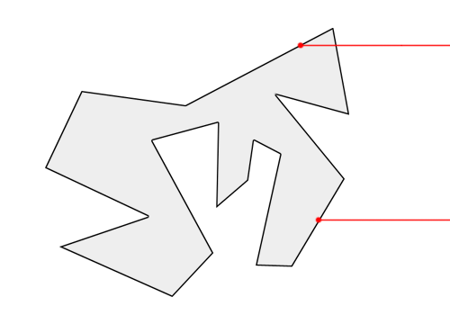

**四类特殊情况**：

1. 点在边上；
2. 点与顶点重合（第 1 类的特例）；
3. 射线穿过顶点；
4. 射线与一条边重合（第 3 类的特例，即连续穿过两个相邻顶点）。

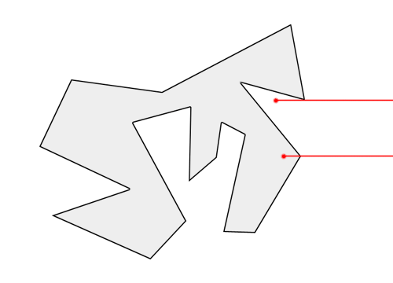

**处理原则**（原笔记的核心思想）：

- 点在边上或与顶点重合 $\Rightarrow$ 直接判为"在内部"；
- 顶点穿越的判定转化为**"线段两端点是否分居射线两侧"**。只要规定"顶点与射线同高时一律算在射线**下方**"（对应下面代码里的严格 `>`，y 相等时为 false），那么射线经过顶点时，相邻两条边中恰有一条满足"一端在上、一端不在上"，只计一次；
- 射线与边平行（水平）时忽略该边。

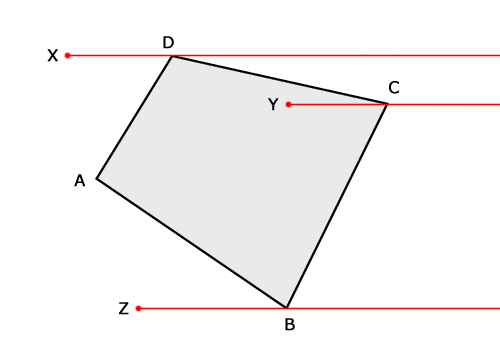

**工程上的等价写法（半开区间规则）**，比逐条罗列规则更不容易出错：

```c
bool pointInPolygon(const Point poly[], int n, Point p)
{
    bool inside = false;
    for (int i = 0, j = n - 1; i < n; j = i++) {
        // 先判点是否在边上（含端点）
        if (pointOnSegment(poly[j], poly[i], p)) return true;

        // 半开区间：只有一端严格在射线上方时才算穿越
        if ((poly[i].y > p.y) != (poly[j].y > p.y)) {
            double xCross = poly[i].x +
                (p.y - poly[i].y) * (poly[j].x - poly[i].x) /
                (poly[j].y - poly[i].y);
            if (p.x < xCross) inside = !inside;
        }
    }
    return inside;
}
```

`(y_i > p.y) != (y_j > p.y)` 就是"一端在上、一端不在上"的判定，等价于把每个顶点固定归到不算上方的那一侧（下方），从而消除顶点重复计数。**注意不能用 `>=` 与 `>` 混用**，否则顶点会被计两次或零次。

**原笔记代码中需要修正的两处**：

- 1.5 条写作"如果射线的 y 值与 p2 相等，且 p2 的 y 分量大于 **p2** 的 y 分量"，应为"大于 **p1** 的 y 分量"；
- 该实现用 `LineSeg(pt, Point(-INFINITE, pt.y))` 构造有限长线段替代射线，依赖坐标范围假设（如 $[-10000,10000]$）。这在工程上可行，但必须保证 `-INFINITE` 真的小于多边形所有顶点。

**性能优化**：先用多边形的 AABB 快速排除；再按 $y$ 分桶（每桶记录与该水平带相交的边），可把单次查询从 $O(n)$ 降到接近 $O(1)$。

**回转数法（winding number）**

回转数是闭合曲线绕过该点的总次数。把 $P$ 与各顶点连线，累加相邻顶点连线的**有向夹角**：

$$
w=\frac{1}{2\pi}\sum_{i}\Delta\theta_i,\qquad
\Delta\theta_i=\operatorname{atan2}\big((V_i-P)\times(V_{i+1}-P),\ (V_i-P)\cdot(V_{i+1}-P)\big).
$$

$w=0$ 时点在外部；$w\ne0$（通常 $\pm1$）时在内部。相比射线法，回转数对"自相交多边形"能区分绕行方向，且没有顶点退化问题，代价是每次要算 `atan2`。

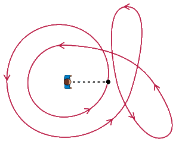

---

## 4. 面积与外接圆

### 4.1 任意多边形面积（鞋带公式）

**思路**：以任意点 $O$ 为公共顶点把多边形拆成三角形，用**有向面积**求和。凹多边形中"多算"的三角形面积为负，正好抵消。

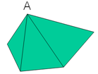

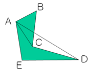

取 $O=(0,0)$，顶点 $P_i=(x_i,y_i)$，第 $i$ 个三角形 $OP_iP_{i+1}$ 的有向面积为

$$
S_i=\frac{1}{2}(x_i y_{i+1}-x_{i+1}y_i).
$$

于是

$$
\boxed{\;S=\frac{1}{2}\left\lvert\sum_{i=0}^{n-1}(x_i y_{i+1}-x_{i+1}y_i)\right\rvert\;},
\qquad P_n=P_0 .
$$

**有符号面积**（去掉绝对值）的符号给出顶点绕向：

$$
S_{\text{signed}}=\frac{1}{2}\sum_{i=0}^{n-1}(x_i y_{i+1}-x_{i+1}y_i)
\begin{cases}
>0,&\text{逆时针 (CCW)},\\
<0,&\text{顺时针 (CW)}.
\end{cases}
$$

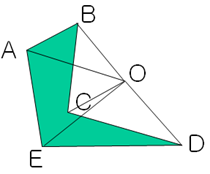

**为什么可以取任意点 $O$**：若把 $O$ 换成 $O'$，每个三角形的有向面积变化量之和为

$$
S(O')-S(O)=-\frac{1}{2}\sum_i (O'-O)\times(P_{i+1}-P_i)=0,
$$

（负号来自叉积的反交换律；反正右边为零，符号不影响结论。）因为多边形闭合，$\sum_i(P_{i+1}-P_i)=\mathbf 0$。所以有向面积与基点无关。

**判断顶点顺序**：找 $x$（或 $y$）分量最大的顶点 $P_1$（它必是凸点），取其前后邻点 $P_0,P_2$，计算

$$
(P_1-P_0)\times(P_2-P_1)
$$

的符号即可判定顺/逆时针。若最大 $x$ 上出现多个共线顶点（细分竖直边时常见），叉积为 $0$ 就无法判向：应跳过共线顶点取严格凸点，或直接用 §4.1 鞋带公式的有符号面积定号。

### 4.2 三角形外接圆圆心（二维）

外心是三条边垂直平分线的交点，等价于"到三顶点距离相等"：

$$
(x_1-x)^2+(y_1-y)^2=(x_2-x)^2+(y_2-y)^2=(x_3-x)^2+(y_3-y)^2 .
$$

两两相减消去二次项，得到**线性方程组**：

$$
\begin{cases}
2(x_2-x_1)x+2(y_2-y_1)y=x_2^2+y_2^2-x_1^2-y_1^2,\\
2(x_3-x_2)x+2(y_3-y_2)y=x_3^2+y_3^2-x_2^2-y_2^2 .
\end{cases}
$$

记

$$
A_1=2(x_2-x_1),\ B_1=2(y_2-y_1),\ C_1=x_2^2+y_2^2-x_1^2-y_1^2,
$$
$$
A_2=2(x_3-x_2),\ B_2=2(y_3-y_2),\ C_2=x_3^2+y_3^2-x_2^2-y_2^2,
$$

由克拉默法则

$$
x=\frac{C_1B_2-C_2B_1}{A_1B_2-A_2B_1},\qquad
y=\frac{A_1C_2-A_2C_1}{A_1B_2-A_2B_1}.
$$

**对称闭式**（数值上更稳健，便于直接实现）：

$$
d=2\big(x_1(y_2-y_3)+x_2(y_3-y_1)+x_3(y_1-y_2)\big),
$$

$$
u_x=\frac{(x_1^2+y_1^2)(y_2-y_3)+(x_2^2+y_2^2)(y_3-y_1)+(x_3^2+y_3^2)(y_1-y_2)}{d},
$$

$$
u_y=\frac{(x_1^2+y_1^2)(x_3-x_2)+(x_2^2+y_2^2)(x_1-x_3)+(x_3^2+y_3^2)(x_2-x_1)}{d},
$$

$$
r^2=(x_1-u_x)^2+(y_1-u_y)^2 .
$$

$d=0$ 表示三点共线，外接圆不存在。

原笔记给出的另一种写法（与之等价）：

```c
a = ((y2-y1)*(y3*y3-y1*y1+x3*x3-x1*x1)
   - (y3-y1)*(y2*y2-y1*y1+x2*x2-x1*x1))
   / (2.0*((x3-x1)*(y2-y1)-(x2-x1)*(y3-y1)));

b = ((x2-x1)*(x3*x3-x1*x1+y3*y3-y1*y1)
   - (x3-x1)*(x2*x2-x1*x1+y2*y2-y1*y1))
   / (2.0*((y3-y1)*(x2-x1)-(y2-y1)*(x3-x1)));

r2 = (x1-a)*(x1-a) + (y1-b)*(y1-b);
```

> 该写法分母与上面的 $d$ 相差一个符号约定，但分子同步变号，结果一致。使用时注意 `a` 是圆心 $x$、`b` 是圆心 $y$（变量名容易误读）。

**三维推广**：三点确定一个圆，未知数 3 个，方程 3 个（2 个到圆心等距 + 1 个共面）联立，用消元法解，属于"欠定转线性"的典型应用。

---

## 5. 射线求交

### 5.1 射线与三角形（Möller–Trumbore / Badouel）

射线参数方程

$$
R(t)=O+tD,\qquad t\ge0 .
$$

三角形（含内部）的参数方程

$$
P(u,v)=V_0+u(V_1-V_0)+v(V_2-V_0)= (1-u-v)V_0+uV_1+vV_2,
$$

其中 $u\ge0,\ v\ge0,\ u+v\le1$，$(1-u-v,u,v)$ 即重心坐标。


联立 $O+tD=V_0+uE_1+vE_2$（$E_1=V_1-V_0$、$E_2=V_2-V_0$），令 $T=O-V_0$，得

$$
\begin{pmatrix}-D&E_1&E_2\end{pmatrix}
\begin{pmatrix}t\\u\\v\end{pmatrix}=T .
$$

由克莱姆法则并用混合积改写，令

$$
P=D\times E_2,\qquad Q=T\times E_1,
$$

则

$$
t=\frac{E_2\cdot Q}{E_1\cdot P},\qquad
u=\frac{T\cdot P}{E_1\cdot P},\qquad
v=\frac{D\cdot Q}{E_1\cdot P}.
$$

只需**一次除法**（先算出行列式，再统一乘倒数），这是该算法高效的关键。注意代码中 `*u`、`*v` 在归一化前是**分子**，与 `det` 比较即可完成范围检查，避免提前除法。

```cpp
bool IntersectTriangle(const Vector3& orig, const Vector3& dir,
                       Vector3& v0, Vector3& v1, Vector3& v2,
                       float* t, float* u, float* v)
{
    Vector3 E1 = v1 - v0;
    Vector3 E2 = v2 - v0;
    Vector3 P  = dir.Cross(E2);
    float det  = E1.Dot(P);

    Vector3 T;
    if (det > 0) { T = orig - v0; }
    else         { T = v0 - orig; det = -det; }

    if (det < 0.0001f) return false;      // 射线与三角形平面平行

    *u = T.Dot(P);
    if (*u < 0.0f || *u > det) return false;

    Vector3 Q = T.Cross(E1);
    *v = dir.Dot(Q);
    if (*v < 0.0f || *u + *v > det) return false;

    *t = E2.Dot(Q);
    float fInvDet = 1.0f / det;
    *t *= fInvDet; *u *= fInvDet; *v *= fInvDet;
    if (*t < 0.0f) return false;          // 交点落在射线起点背后
    return true;
}
```

**要点与坑**：

- `det` 取绝对值后再判断，是为了让三角形正反面对射线都可见；若做背面剔除则不要取反。
- 阈值 `0.0001f` 失效的真正条件是 $\det\propto\lvert E_1\times E_2\rvert\cdot\lvert D\rvert$ 过小（小三角形、短 $\mathbf D$），与场景尺度无必然关系；应按 $\det/\lvert D\rvert$ 或三角形面积归一化后再比较。
- 上面的代码在归一化后已含 `t>=0` 检查（射线语义）；只判定"无限直线"时删去它即可，线段则再限制 $t\le t_{\max}$。没有这一步时，三角形位于起点背后也会返回 `true` 和一个负的 $t$。
- 该算法不预计算平面方程，省去一次平面构造，是 DirectX 采用的形式。

### 5.2 直线、线段、射线与平面

三者只在 $t$ 的取值范围上不同：直线 $t\in\mathbb{R}$，射线 $t\ge0$，线段 $t\in[0,1]$（以两端点参数化）。

平面用点法式 $\mathbf n\cdot(X-P_0)=0$，代入 $X=O+tD$：

$$
\mathbf n\cdot(O+tD-P_0)=0
\;\Longrightarrow\;
t=\frac{\mathbf n\cdot(P_0-O)}{\mathbf n\cdot D}.
$$

$\mathbf n\cdot D=0$ 时无交点（平行或在平面内，需再判 $O$ 是否在平面上以区分重合）。

两种等价算法：General 形式 $t=\dfrac{(p'-o)\cdot\mathbf N}{\mathbf d\cdot\mathbf N}$（3 次减法、6 次乘法、1 次除法）；若平面族垂直于某个坐标轴（slab），则退化为只看该分量 $t=\dfrac{p'_x-o_x}{d_x}$（1 次减法、1 次除法），这正是 §5.5 slab 法的由来。

### 5.3 直线与直线的位置关系

**二维**：设 $P=P_1+t\mathbf d_1$、$P=P_2+s\mathbf d_2$。

- $\mathbf d_1\times\mathbf d_2=0$：平行；再判 $P_2-P_1$ 是否与 $\mathbf d_1$ 共线，共线则重合，否则平行不重合。
- $\mathbf d_1\times\mathbf d_2\ne0$：唯一交点。

$$
t=\frac{(P_2-P_1)\times\mathbf d_2}{\mathbf d_1\times\mathbf d_2}.
$$

**三维**：两直线不一定共面。

1. 方向向量成比例 $\Rightarrow$ 平行（再判是否重合）；
2. 否则计算混合积
   $$
   [\,P_2-P_1,\ \mathbf d_1,\ \mathbf d_2\,]=0
   $$
   则两直线共面因而相交，否则为**异面直线**。

求交点：把两直线写成参数方程，任取两个坐标分量相等解出 $t,s$，再代回验证第三个分量（浮点下用容差）。

### 5.4 射线与球面

球面为 $\lvert\mathbf X-\mathbf C\rvert^2=r^2$，代入 $\mathbf X=\mathbf O+t\mathbf D$，得到关于 $t$ 的一元二次方程。这一步的展开（点积分配律）与 §1.1 中"圆/球方程展开"完全相同，只需取 $\mathbf b=\mathbf D$、$\mathbf d=\mathbf O-\mathbf C$，此处不再重复。

记 $\mathbf m=\mathbf O-\mathbf C$、$a=\mathbf D\cdot\mathbf D$、$h=\mathbf D\cdot\mathbf m$、$c=\mathbf m\cdot\mathbf m-r^2$，方程即 $at^2+2ht+c=0$。

一次项系数取半（写成 $2ht$）可省去 $4a$ 的舍入。$-h/a$ 是球心在射线上的垂足参数，故

$$
m_\perp^{2}=\mathbf m\cdot\mathbf m-\frac{h^{2}}{a},
$$

$$
\frac{\Delta}{4}=h^{2}-ac=a\big(r^{2}-m_\perp^{2}\big),\qquad
\sqrt{\frac{\Delta}{4}}=\sqrt{a\big(r^{2}-m_\perp^{2}\big)},
\qquad t_{0}=\frac{-h-\sqrt{\Delta/4}}{a},\ \ t_{1}=\frac{-h+\sqrt{\Delta/4}}{a}.
$$

> 开方要整体开：$\sqrt{\Delta/4}=a\sqrt{r^{2}-m_\perp^{2}}$ 是错的，正确形式为 $\sqrt{\Delta/4}=\sqrt{a\,(r^{2}-m_\perp^{2})}$。只有当 $\mathbf D$ 已归一化（$a=\lvert\mathbf D\rvert^{2}=1$）时才退化为 $\sqrt{r^{2}-m_\perp^{2}}$（原稿此处有误，已更正）。

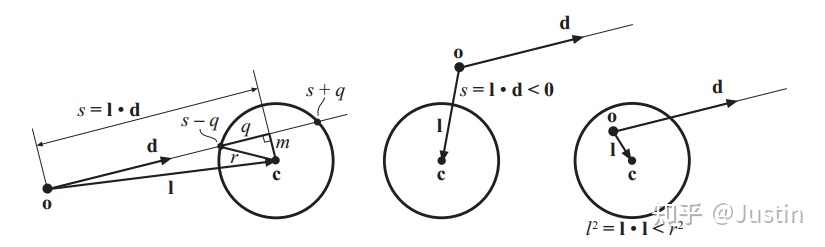

这与"投影 + 勾股"解法一致：$m_\perp>r$ 即 $\Delta/4<0$ 时不相交；两解按 $t_0\le t_1$ 排列，取舍如下。

原稿的伪代码（按截图转写，记号与上文一致：$\mathbf l=\mathbf c-\mathbf o$、$s=\mathbf l\cdot\mathbf d$，$t=s\mp q$ 中"减"对应球外、"加"对应球内）：

```text
RaySphereIntersect(o, d, c, r)
returns ({REJECT, INTERSECT}, t, p)
1:  l = c - o
2:  s = l · d
3:  l² = l · l
4:  if (s < 0 and l² > r²) return (REJECT, 0, 0);
5:  m² = l² - s²
6:  if (m² > r²) return (REJECT, 0, 0);
7:  q = sqrt(r² - m²)
8:  t = s - q
9:  if (t < 0) t = s + q
10: return (INTERSECT, t, o + t d);
```

两条早退分支的几何含义：

- 第 4 行：$\mathbf l$ 与 $\mathbf d$ 夹角大于 $90°$（球心在射线后方）且起点不在球内，整个球落在射线背后，不相交；
- 第 6 行：垂足到球心的距离平方 $m^{2}>r^{2}$，射线所在直线与球无交。

注意该伪代码假设 $\lvert\mathbf d\rvert=1$（否则 $s$ 不是长度、$m^{2}=l^{2}-s^{2}$ 也不成立），且第 8/9 行先取 near 根、若为负再改用 far 根（起点在球内、或恰在球面上朝外时 near 根为负），这等价于上面的 $t_0/t_1$ 但省掉了排序；起点恰在球面上时无论朝内朝外都返回 $t=0$。

**两解取舍**（对应原笔记"起点在球内必然相交"）：

| 情形 | 几何含义 | 取用 |
|---|---|---|
| $0\le t_0\le t_1$ | 起点在球外，或恰在球面上且朝内 | 取 $t_0$（进入点；$t_0=0$ 正是起点本身落在球面上，合法解），$t_1$ 为离开点 |
| $t_0<0<t_1$ | 起点严格在球内 | 取 $t_1$（离开点）；$t_0$ 落在射线反向，不可见 |
| $t_1\le0$ | 整个球在射线背后（$t_1=0$ 为切于起点） | 无前方交点 |

> 判据要写成 $0\le t_0\le t_1$ 而不是 $t_0>0$：起点在球面上朝内时 $t_0=0$ 是完全合法的进入点（$t_1$ 为对侧穿出）。
>
> 是否跳过 $t=0$ 的自交取决于用途：求"这条射线最先看到什么"时保留 $t_0=0$；但做阴影射线/反射射线时，起点往往就在被追踪物体表面上，$t=0$ 会与自身表面自交而误判为遮挡，此时应给下界加一个 $\varepsilon$（如 $10^{-4}$，按场景尺度取）后再比较 $t\ge\varepsilon$。

命中点法线 $\mathbf N=(\mathbf O+t\mathbf D-\mathbf C)/r$，从内部命中时需取反。

**数值稳定性**：当 $\sqrt{\Delta/4}\approx\lvert h\rvert$（即 $h^{2}\gg ac$，起点贴近球面或球很大）时，$-h$ 与 $\sqrt{\Delta/4}$ 模相近，$(-h-\sqrt{\Delta/4})$ 发生灾难性相消，$t_0$ 的有效位几乎全丢。改用下面的做法，并约定 $h=0$ 时 $\operatorname{sign}(h)=+1$（否则 $\operatorname{sign}(0)=0$ 会让 $q=0$ 而除零）：

$$
\operatorname{sign}(h)=
\begin{cases}
+1, & h\ge 0,\\
-1, & h<0,
\end{cases}
\qquad
q=-\Big(h+\operatorname{sign}(h)\sqrt{\Delta/4}\Big),
$$

$$
t_{\text{big}}=\frac{q}{a},\qquad t_{\text{small}}=\frac{c}{q}\quad(q\ne0),\qquad
t_0=\min(t_{\text{big}},t_{\text{small}}),\quad t_1=\max(t_{\text{big}},t_{\text{small}}).
$$

关键在于 $q$ 由"同号相加"得到，**没有相消**，所以 $q/a$ 是**模较大**的那个根、$c/q$ 是模较小的根（两者之积 $=c/a$）。但"大根/小根"与"near/far"的对应随 $h$ 的符号互换，不能硬编码：

| $h$ 的符号 | $q/a$ | $c/q$ |
|---|---|---|
| $h\ge0$ | $t_0$（近根，进入点） | $t_1$（远根，离开点） |
| $h<0$ | $t_1$（远根，离开点） | $t_0$（近根，进入点） |

- 若确实相切且垂足恰为起点（$h=0$ 且 $\Delta/4=0$），则 $q=0$，$c/q$ 无定义；此时是二重根 $t=-h/a=0$，直接取 $t_0=t_1=0$ 并返回。
- 相切时 $\Delta/4$ 精确为 $0$，浮点下可能略负而被误判相离。应按 $\Delta/4<-\varepsilon$ 才判无交，$\lvert\Delta/4\rvert\le\varepsilon$ 视为相切；$\varepsilon$ 取相对量级（如 $10^{-6}\max(h^{2},|ac|)$），不能用绝对常数。
- 归一化 $\mathbf D$ 后 $a=1$、$h$ 即投影长度，公式退化为 $t=-h\pm\sqrt{h^2-\lvert\mathbf m\rvert^2+r^2}$，省一次除法；但归一化本身带来误差，$\lvert\mathbf D\rvert$ 过小应先拒绝该射线。

### 5.5 射线与 AABB（slab 法）

AABB 是三个轴向**平板**（slab：$\min_i\le x_i\le\max_i$）的交集。$D_i\ne0$ 时射线与第 $i$ 个平板的两个面相交于

$$
t_{1,i}=\frac{\min_i-O_i}{D_i},\qquad t_{2,i}=\frac{\max_i-O_i}{D_i},\qquad t_{\text{near},i}=\min(t_{1,i},t_{2,i}),\quad t_{\text{far},i}=\max(t_{1,i},t_{2,i}).
$$

"在盒内"要求同时位于三个平板内，故对参数区间取交集：

$$
t_{\text{enter}}=\max_i t_{\text{near},i},\qquad t_{\text{exit}}=\min_i t_{\text{far},i},
$$

射线与盒有交当且仅当 $t_{\text{enter}}\le t_{\text{exit}}$ 且 $t_{\text{exit}}\ge0$（后者排除"盒子在射线背后"）。这就是"进入所有平面才算进入、离开任一平面就算离开"的代数形式。

（原稿有误，已更正：`t_enter < t_exit && t_exit > 0` → `t_enter <= t_exit && t_exit >= 0`）

严格不等号会把擦过棱/角的退化情形（$t_{\text{enter}}=t_{\text{exit}}$）以及"起点恰在盒面上"（$t_{\text{exit}}=0$）判为不相交。若实现刻意要剔除这种"擦边"命中以避免重复计数，可以自行改用严格不等号——这个取舍取决于具体用途，需按场景验证（待核实）。

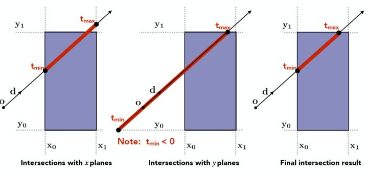

**反向射线**：$D_i<0$ 时 $t_{1,i}>t_{2,i}$，逐轴必须先交换二者（即先取 $\min/\max$），否则 $t_{\text{enter}}>t_{\text{exit}}$ 恒判不相交；等价做法是按 $D_i$ 的符号交换 $\min_i,\max_i$。

**命中点参数的选择**：起点在盒外（$t_{\text{enter}}\ge0$）取 $t_{\text{enter}}$，即进入点；起点在盒内（$t_{\text{enter}}<0\le t_{\text{exit}}$）取 $t_{\text{exit}}$，因为 $t_{\text{enter}}$ 对应射线反方向的穿出点。统一为 $t_{\text{hit}}=t_{\text{enter}}\ge0\,?\,t_{\text{enter}}:t_{\text{exit}}$，取后者前须已确认 $t_{\text{exit}}\ge0$。

命中面法线由取到 $t_{\text{enter}}$（或 $t_{\text{exit}}$）的那根轴决定：$\mathbf N=\pm\mathbf e_i$，符号取 $-\operatorname{sign}(D_i)$，朝向射线来向。

**除零与 NaN**：

- $D_i=0$：射线与平板平行。$O_i\in[\min_i,\max_i]$ 时该轴不约束 $t$（区间为 $(-\infty,+\infty)$）；否则射线整体在盒外，直接判不相交。
- 若不特判、靠 IEEE 的 $1/0=\pm\infty$ 让除法自动出界，则 $D_i=0$ **且 $O_i$ 恰在平板边界**时出现 $(0)\cdot\infty=\mathrm{NaN}$；NaN 参与比较恒为假，`std::min/max` 会原样传播它，结果依赖实现与参数顺序，不可移植。必须显式特判该轴，或改用"遇 NaN 取另一操作数"的有序比较。
- 分量极小但非零（方向近乎平行于平板）时 $t$ 极大，通常被其它轴淘汰；但若 $O_i$ 也贴近边界，两个大数相减会放大误差。应对 $\lvert\mathbf D\rvert$ 做整体下限检查，而非逐分量设阈值（后者会误杀合法的近轴射线）。
- 方向本身为零向量：三个轴全部"平行"，区间始终是 $(-\infty,+\infty)$，函数会返回 `true` 且 $t=+\infty$（即 `INFINITY`）。必须在入口整体退化检查（见下方代码首行），不能靠逐轴特判兜住。
- 预存 $\mathbf D^{-1}$ 做乘法可加速，但把上述除零问题变成 $0\times\infty$，同样要特判。

```cpp
// 依赖 <cmath>（INFINITY）、<utility>（std::swap）、<algorithm>（std::min / std::max）
// Vec3 需支持按下标读取分量 operator[](int)（并带 const 版本），本函数只读不写分量
// 返回是否相交；t 为进入点（起点在盒内时为离开点）
bool IntersectAABB(const Vec3& o, const Vec3& d, const Vec3& bmin, const Vec3& bmax, float& t)
{
    if (d[0] == 0.0f && d[1] == 0.0f && d[2] == 0.0f) return false;  // 退化方向 d=(0,0,0)
    float tEnter = -INFINITY, tExit = INFINITY;
    for (int i = 0; i < 3; ++i) {
        if (d[i] == 0.0f) {                                  // 平行于该平板
            if (o[i] < bmin[i] || o[i] > bmax[i]) return false;
            continue;                                        // 该轴不约束区间
        }
        float inv = 1.0f / d[i];
        float t1 = (bmin[i] - o[i]) * inv;
        float t2 = (bmax[i] - o[i]) * inv;
        if (t1 > t2) std::swap(t1, t2);                      // D_i < 0：反向射线
        tEnter = std::max(tEnter, t1);
        tExit  = std::min(tExit,  t2);
        if (tEnter > tExit) return false;                    // 提前剪枝
    }
    if (tExit < 0.0f) return false;                          // 盒子在射线背后
    t = (tEnter >= 0.0f) ? tEnter : tExit;
    return true;
}
```

> 与球面求交的一致性：两者都归结为"求进入/离开参数区间，再与 $t\ge0$ 取交"。$t_{\text{exit}}$ 在体积渲染、阴影射线与遮挡长度计算中同样有用，不要只返回 $t_{\text{enter}}$。

---

## 6. Delaunay 三角剖分

### 6.1 定义

**三角剖分**：设 $V$ 是二维平面上的有限点集，$E$ 是以 $V$ 中点为端点的封闭线段集合。剖分 $T=(V,E)$ 是一个平面图，满足：

1. 除端点外，边不包含 $V$ 中任何点；
2. 没有相交边；
3. 所有面都是三角面，且所有三角面的并集是 $V$ 的**凸包**。

**Delaunay 边**：边 $e=(a,b)$ 若满足"存在一个过 $a,b$ 的圆，其内部不含 $V$ 中任何其他点"（空圆特性，圆上最多三点共圆），则称为 Delaunay 边。

**Delaunay 三角剖分**：只由 Delaunay 边构成的三角剖分。

**等价判据（最实用的一条）**：剖分 $T$ 是 Delaunay 剖分，**当且仅当每个三角形的外接圆内部不含 $V$ 中任何点**。

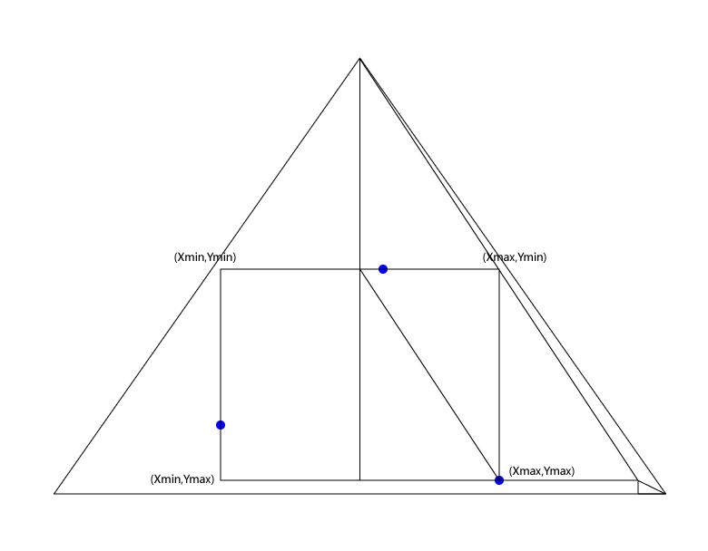

**性质**：

- 最大化最小角（max-min angle），避免狭长三角形，是有限元与地形网格的首选；
- 在一般位置下唯一；四点共圆时出现"退化"，此时可任选一条对角线，结果仍合法；
- 与 Voronoi 图互为对偶。

### 6.2 Bowyer–Watson 算法

**核心操作**：插入点 $P$ 时，所有"外接圆包含 $P$"的三角形都违反空圆性质，把它们删掉，其并集形成一个**星形多边形空腔**（cavity）；再把 $P$ 与空腔边界上的每条边连成新三角形。

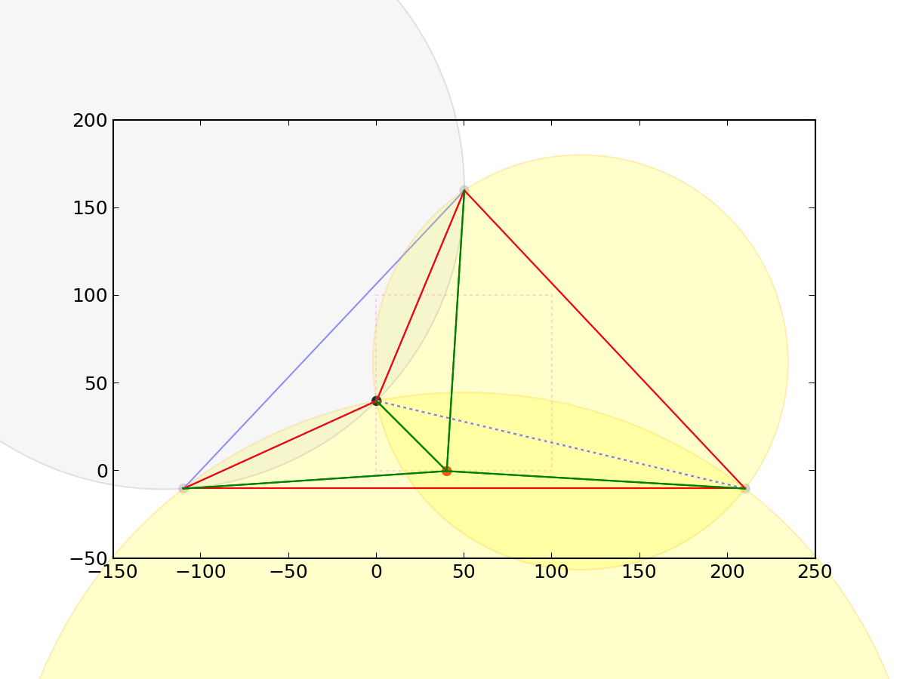

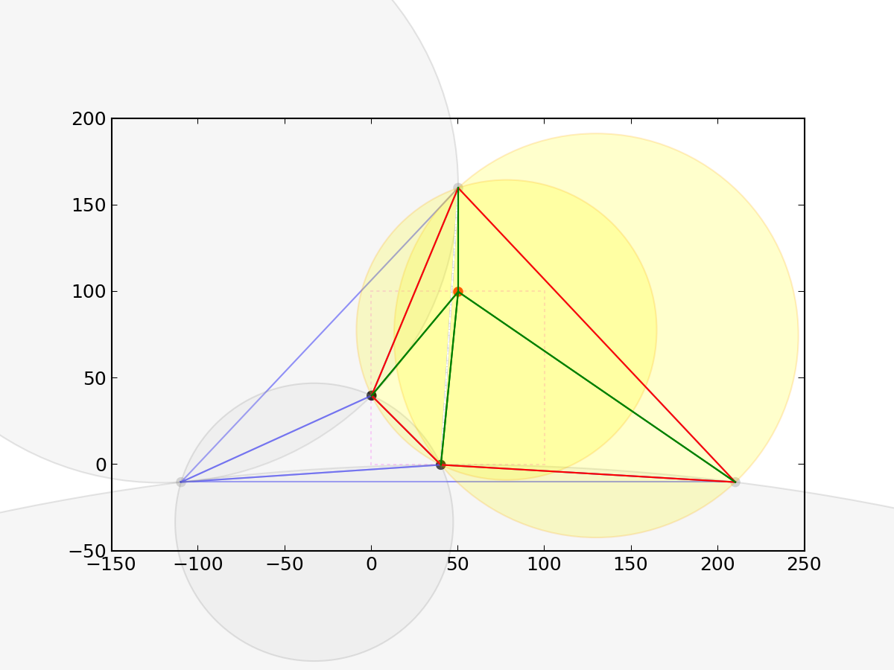

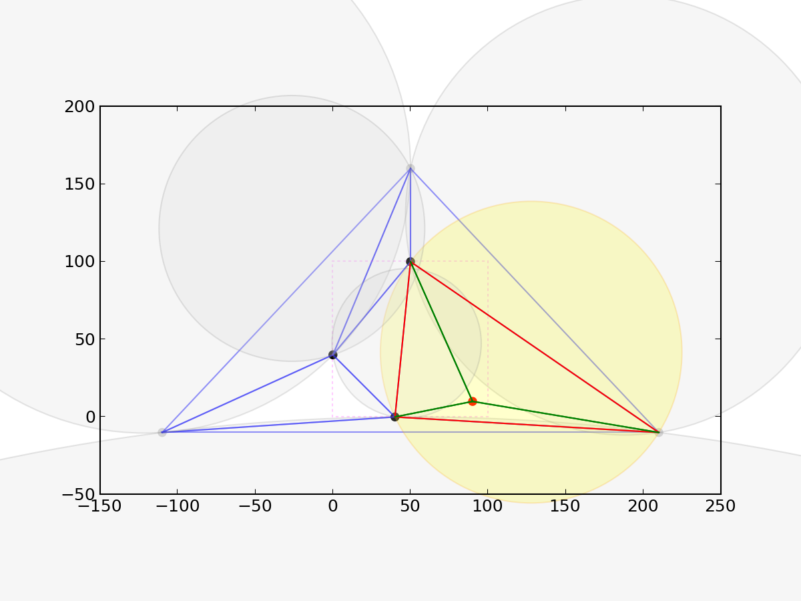

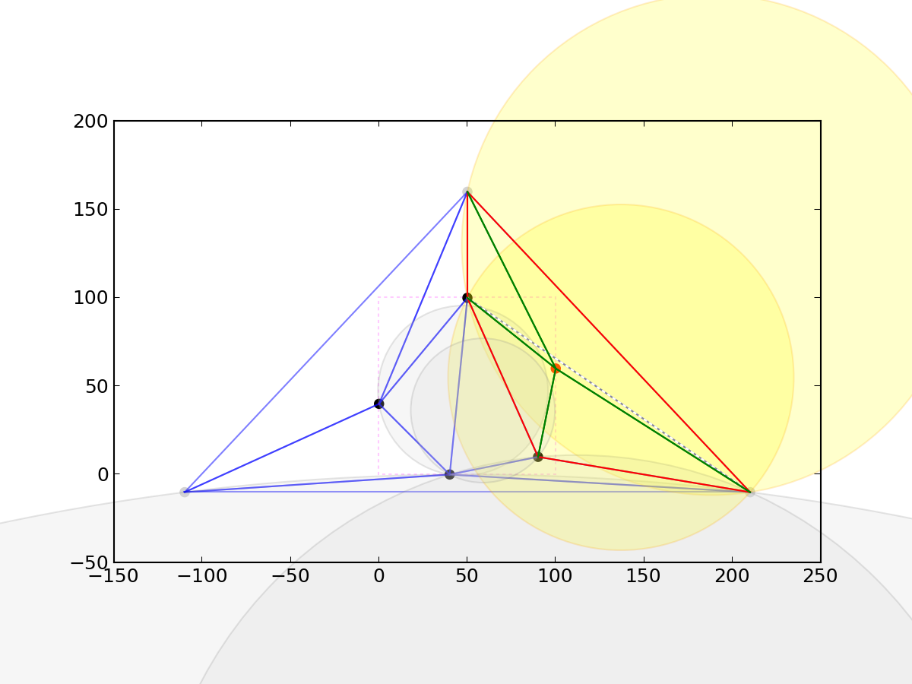

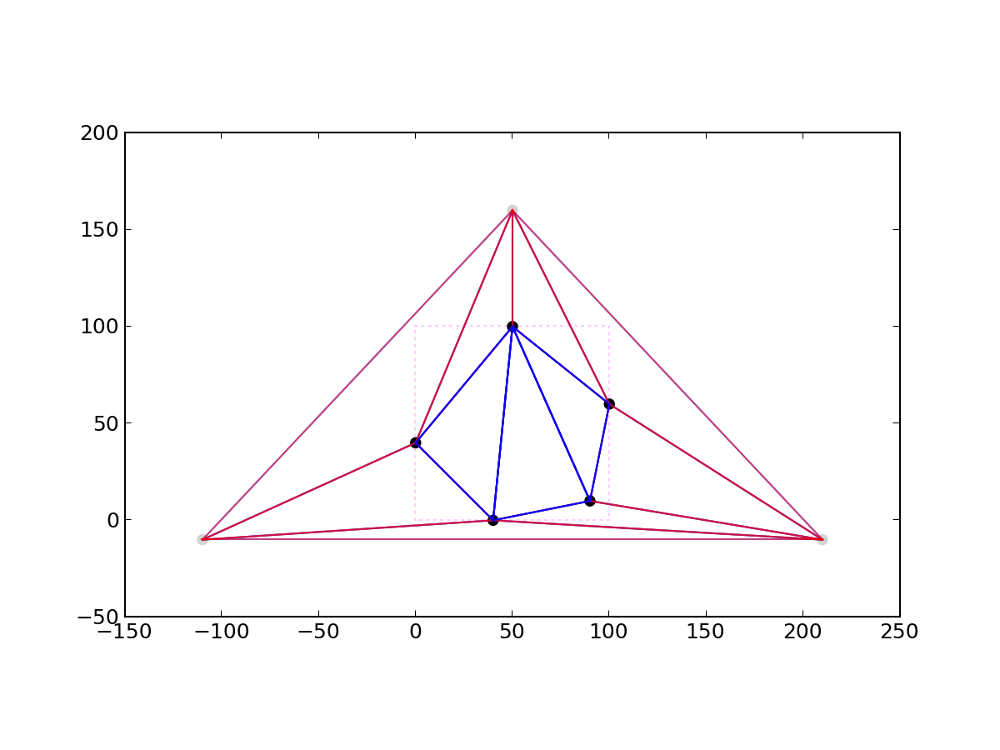

**步骤**：

1. 求点集的包围盒，构造一个包含全部点的**超级三角形**（super-triangle）；
2. 三角形列表初始化为仅含超级三角形；
3. 对每个待插入点 $P$：
   1. 遍历三角形列表，若 $P$ 落在某三角形外接圆内部，标记为 bad，并把它的三条边加入边缓存；
   2. 删除所有 bad 三角形；
   3. 对边缓存去重：**只保留出现一次的边**（出现两次的是被删三角形的公共内部边，正是要消除的）；
   4. 用保留下来的边界边与 $P$ 组成新三角形，加入列表；
4. 删除所有与超级三角形顶点相关的三角形；
5. 收集剩余三角形的边，即为结果。

```text
subroutine triangulate
input : vertex list
output: triangle list
    initialize the triangle list
    determine the supertriangle
    add supertriangle vertices to the end of the vertex list
    add the supertriangle to the triangle list
    for each sample point in the vertex list
        initialize the edge buffer
        for each triangle currently in the triangle list
            calculate the triangle circumcircle center and radius
            if the point lies in the triangle circumcircle then
                add the three triangle edges to the edge buffer
                remove the triangle from the triangle list
            endif
        endfor
        delete all doubly specified edges from the edge buffer
        add to the triangle list all triangles formed between the point
            and the edges of the enclosing polygon
    endfor
    remove any triangles that use the supertriangle vertices
    remove the supertriangle vertices from the vertex list
end
```

### 6.3 逐点插入的优化实现

原版每次都要扫描全部三角形，复杂度 $O(N^2)$。常见的两项优化：

1. **按 $x$ 排序后插入**：若点已按 $x$ 升序处理，则"新点在某三角形外接圆的右侧"意味着该三角形已最终确定，可提前移出待定列表；
2. **维护边缓存与空间索引**（网格/四叉树）加速"哪些三角形被包含"的查询。

优化后的伪代码：

```text
input : 顶点列表 vertices（可乱序）
output: 三角形列表 triangles
    创建索引数组 indices = [0,1,...,n-1]
    按顶点 x 坐标对 indices 排序
    构造超级三角形
    temp = [超级三角形]；triangles = [超级三角形]
    for idx in indices:
        edgeBuffer = []
        for tri in temp:
            计算 tri 的外接圆
            if 点在圆右侧:
                该三角形已是 Delaunay → 移入 triangles，从 temp 删除
            else if 点在圆外:
                暂时无法判定 → 保留
            else:  // 点在圆内
                三边写入 edgeBuffer，从 temp 删除
        对 edgeBuffer 去重（只保留出现一次的边）
        用 edgeBuffer 的边与当前点组合成新三角形，加入 temp
    合并 triangles 与 temp，删除含超级三角形顶点的三角形
```

**超级三角形的构造**：设包围盒中心 $C$、半宽半高的最大值 $m$，取足够大的系数 $k$（工程上常取 $k\ge10$）：

$$
V_1=(C_x-km,\ C_y-m),\quad V_2=(C_x,\ C_y+km),\quad V_3=(C_x+km,\ C_y-m).
$$

$k$ 越大越不会漏包点，但坐标绝对值变大、浮点误差也随之增大，需在"保证包含"与"数值精度"之间折中。

**退化处理**：四点共圆时"在圆内"的判定要用严格不等式 $d^2<r^2-\varepsilon$，否则会同时删除多个三角形导致空腔不连通。原笔记提到的"点在圆上称为退化"即指此。

### 6.4 其他算法

| 算法 | 思路 | 复杂度 |
|---|---|---|
| 逐点插入 / Bowyer–Watson | 每次插入一个点，重建空腔 | 朴素 $O(N^2)$，加索引可到 $O(N\log N)$ |
| 翻边（edge flip） | 从任意三角剖分出发，反复翻转违反空圆性质的边 | 通常 $O(N^2)$ 最坏 |
| 分治（divide & conquer） | 左右子集分别剖分，再合并凸包间的三角形 | $O(N\log N)$ |
| 扫描线 | 按 $x$ 推进，维护上/下凸链 | $O(N\log N)$ |

> 三维对应物是 Delaunay 四面体剖分，判据改为"外接球内无点"，实现难度显著上升（需要处理共面四点退化）。

---

## 7. 半边数据结构（half-edge）

### 7.1 基本假设

1. 模型由顶点（0 维）、边（1 维）、面片（2 维）组成；面是物体表面的多边形区域，边是相邻两面交线或面的边界，顶点是相邻边交点；
2. 每条边最多与两个面相邻（流形假设）；
3. 每个面片有确定朝向，以区分内、外侧；
4. 相邻面片朝向一致。

### 7.2 结构

半边把每条无向边拆成两条**方向相反的有向半边**，每条半边归属于它左侧（或右侧，取决于约定）的那个面。每个对象定长，内部只存指针/索引：

```text
Vertex  { position; HalfEdge* outgoing; }          // 任取一条从该点出发的半边
Face    { HalfEdge* boundary; }                    // 面上任一条半边
HalfEdge{
    Vertex*   origin;      // 起点
    HalfEdge* twin;        // 反向半边（同一对边的另一半）
    HalfEdge* next;        // 同一面内下一条半边（逆时针）
    HalfEdge* prev;        // 同一面内上一条半边
    Face*     face;        // 所属面
}
```

另一套常见的命名写法：

```cpp
struct H_edge
{
    Vertex *vert;        // 指向自身的出发点 P
    Face   *face;        // 指向自身相邻的面片 L
    H_edge *prev, *next; // 指向前/后一个半边 a 与 b
    H_edge *pair;        // 指向孪生半边 d
}; // c
struct Vertex
{
    float x, y, z;
    H_edge *edge;        // 指向一个以它为出发点的半边；有多个时任选一个
}; // P
struct Face
{
    H_edge *edge;        // 指向任意一个环绕它的半边
}; // L
```

它与上表一一对应：`H_edge::vert` = `origin`（指向自身的出发点），`H_edge::pair` = `twin`（指向孪生半边），`H_edge::prev`、`H_edge::next` 同 `prev`、`next`；`Vertex::edge` 是"以它为出发点的任一条半边"，`Face::edge` 是"任意一条环绕它的半边"。一对孪生半边方向相反，各自属于相邻的一个面。

示例（$f_1\sim f_4$ 为面，$v_1\sim v_6$ 为顶点，$e_{i,j}$ 表示第 $i$ 个顶点出发、编号 $j$ 的半边）对应的半边记录表：

| Half-edge | Origin | Twin | IncidentFace | Next | Prev |
|---|---|---|---|---|---|
| $e_{3,1}$ | $v_2$ | $e_{3,2}$ | $f_1$ | $e_{1,1}$ | $e_{2,1}$ |
| $e_{3,2}$ | $v_3$ | $e_{3,1}$ | $f_2$ | $e_{5,1}$ | $e_{4,1}$ |
| $e_{4,1}$ | $v_4$ | $e_{4,2}$ | $f_2$ | $e_{3,2}$ | $e_{5,1}$ |
| $e_{4,2}$ | $v_3$ | $e_{4,1}$ | $f_3$ | $e_{7,1}$ | $e_{6,1}$ |

> 原表照录。$e_{3,2}$ 的 next 是 $e_{5,1}$、$e_{4,1}$ 的 prev 也是 $e_{5,1}$——这不是"两条半边共享后继"（单个面环上 next 是双射，不可能共享）。实际是 $f_2$ 构成一个三点环：$e_{3,2}\to e_{5,1}\to e_{4,1}\to e_{3,2}$，$e_{5,1}$ 同时是 $e_{3,2}$ 的后继、$e_{4,1}$ 的前驱。可疑处是表头 $e_{i,j}$ 的命名规则（"第 $i$ 个顶点出发、编号 $j$"）与各行的起点不符。

**关键不变量**：

$$
\text{h.twin.twin}=\text{h},\qquad
\text{h.next.prev}=\text{h},\qquad
\text{h.twin.origin}=\text{h.next.origin}.
$$

### 7.3 常用遍历

**绕顶点一圈**（one-ring）：

```cpp
HalfEdge* h = v->outgoing;
do {
    if (!h->twin) break;            // 边界顶点：走到边界半边就停，否则空指针/死循环
    HalfEdge* hn = h->twin->next;   // 绕到相邻面
    visit(h->twin->origin);
    h = hn;
} while (h != v->outgoing);
```

> **边界顶点要补半圈**：若 `outgoing` 本身就没有 twin，上面的循环会立即 `break`，得到的是**空**一环而不是少一个邻居。此时需再沿 `prev->pair` 反向遍历另一侧，或先从 `outgoing` 沿 `prev` 退到一条非边界出边再开始。

**绕面一圈**：

```cpp
HalfEdge* h = f->boundary;
do { visit(h->origin); h = h->next; } while (h != f->boundary);
```

**边界判定**：若某半边的 `twin == nullptr`（或 `twin->face == nullptr`），则该边位于网格边界。

**邻接查询类型**（Types of adjacency queries）：

| Query | Description | 示例 |
|---|---|---|
| V:- V | Given a vertex, find all vertices that are adjacent to it. This query finds the one-ring neighbourhood of a vertex | 六边形网格中高亮中心顶点的一环邻接顶点 |
| V:- E | Given a vertex, find all outgoing half-edges from this vertex. This query may be easily modified to find all incident half-edges of the given vertex | 高亮从该顶点出发的所有半边 |
| V:- F | Find all faces that share a given vertex | 高亮共享该顶点的所有面 |
| E:- V | Given a half-edge, find its end vertices | 高亮该半边的起点与终点 |
| E:- E | Given a half-edge, find its neighbouring half-edges. The neighbouring edges are either outgoing or incoming half-edges at the vertex pointed to by the given half-edge | 高亮该半边所指顶点处的入/出半边 |
| E:- F | Find the faces that share a given edge. For a half-edge, this query generally requires only the face to which the half-edge belongs, but if required, the opposite face may also be obtained easily | 高亮该半边所属面及对侧的面 |
| F:- V | Find all vertices of a given face. This information may be directly obtained from a polygon list where each face is specified in terms of indices of its vertices | 高亮该面的全部顶点 |
| F:- E | Given a face, find all half-edges belonging to that face | 高亮该面的全部半边 |
| F:- F | Given a face, find all neighbouring faces | 高亮与该面共边的相邻面 |

统一写法：从起始半边 `e0` 出发，沿 `pair->next` 或 `prev->pair` 绕顶点、沿 `next` 绕面，循环到回到 `e0` 为止。各查询的循环体与 OpenMesh 迭代器对照如下：

| Query | 半边结构（循环体） | OpenMesh |
|---|---|---|
| V:-V (CW) | `e=e0; do{ process(e->pair->vert); e=e->pair->next; }while(e!=e0);` | `VertexVertexCWIter` / `mesh.vv_cwiter(v)` |
| V:-V (CCW) | `e=e0; do{ process(e->pair->vert); e=e->prev->pair; }while(e!=e0);` | `VertexVertexCCWIter` / `mesh.vv_ccwiter(v)` |
| V:-E (O) | `e=e0; do{ process(e); e=e->prev->pair; }while(e!=e0);` | `VertexOHalfedgeIter` / `mesh.voh_iter(v)` |
| V:-E (I) | `e=e0=v->edge->prev; do{ process(e); e=e->pair->prev; }while(e!=e0);` | `VertexIHalfedgeIter` / `mesh.vih_iter(v)` |
| V:-F | `e=e0; do{ process(e->face); e=e->prev->pair; }while(e!=e0);` | `VertexFaceIter` / `mesh.vf_iter(v)` |
| E:-V | `process(e->vert); process(e->pair->vert);` | `mesh.to_vertex_handle(e)` / `mesh.from_vertex_handle(e)` |
| E:-E | `e=e0=e->vert->edge; do{ process(e); e=e->prev->pair; }while(e!=e0);` | `mesh.voh_iter(mesh.to_vertex_handle(e))` |
| E:-F | `process(e->face); process(e->pair->face);` | `mesh.face_handle(e)` / `mesh.face_handle(mesh.opposite_halfedge_handle(e))` |
| F:-V | `e=e0; do{ process(e->vert); e=e->next; }while(e!=e0);` | `FaceVertexIter` / `mesh.fv_iter(f)` |
| F:-E | `e=e0; do{ process(e); e=e->next; }while(e!=e0);` | `FaceEdgeIter` / `mesh.fe_iter(f)` |
| F:-F | `e=e0; do{ process(e->pair->face); e=e->next; }while(e!=e0);` | `FaceFaceIter` / `mesh.ff_iter(f)` |

（`e0` 初值：V:- 类查询取 `v->edge`；V:-E (I) 取 `v->edge->prev`；E:-E 取 `e->vert->edge`；F:- 类取 `f->edge`。）

**优缺点**：

- 优点：局部查询 $O(1)$；能自然表达非流形边界；边/面/点之间的邻接无需额外表。
- 缺点：指针多、缓存不友好；每条边固定两条半边，非流形边需要特殊处理；序列化与并行构建较麻烦。

---

## 8. 常用计算几何算法清单

### 8.1 点是否在线段上

两个条件同时成立：

1. $(P-A)\times(B-A)=\mathbf 0$（共线）；
2. $P$ 落在 $AB$ 的 AABB 内，即对每个分量 $\min(A_i,B_i)\le P_i\le\max(A_i,B_i)$。

### 8.2 过两点的直线方程

点向式：已知点 $P_1$ 与方向 $\mathbf d=P_2-P_1$，

$$
\frac{x-x_1}{d_x}=\frac{y-y_1}{d_y}\quad(\text{二维}),
$$

或统一写成叉积形式 $(P-P_1)\times\mathbf d=0$，可避免分母为零的分类讨论。

### 8.3 点关于直线的对称点

1. 取直线上一点 $O$，求 $P$ 在直线上的垂足 $Q$：

$$
Q=O+\frac{(P-O)\cdot\mathbf d}{\mathbf d\cdot\mathbf d}\,\mathbf d;
$$

2. 对称点 $P'=2Q-P$。

（原笔记的"连接 $QP$ 得到方向、再按距离取点"与这是同一构造。）

### 8.4 直线与平面的交点

直线 $O+t\mathbf d$ 与平面 $\mathbf n\cdot(X-P_0)=0$：

$$
t=\frac{\mathbf n\cdot(P_0-O)}{\mathbf n\cdot\mathbf d}.
$$

直线/线段/射线的区别只在 $t$ 的取值范围。

### 8.5 平面直线相交判定

联立两条直线方程得 $2\times2$ 线性系统：

- 系数行列式 $\ne0$：唯一交点；
- 行列式为 $0$ 且增广列不成比例：平行无解；
- 行列式为 $0$ 且增广列成比例：两直线重合（无穷多解）。


> 图片文字模糊，未能完整转写。（该图是"方程组解的个数 / 位置关系 / 交点个数 / 代数条件"四列的对照表，结论与上面三条一致。）

### 8.6 空间两直线是否相交

1. 方向向量成比例 $\Rightarrow$ 平行；
2. 否则计算混合积 $[P_2-P_1,\mathbf d_1,\mathbf d_2]$：为 $0$ 则相交，否则异面。

### 8.7 两向量夹角范围

$\theta\in[0,\pi]$。若需有向角，二维用

$$
\theta=\operatorname{atan2}\big((\mathbf a\times\mathbf b)_z,\ \mathbf a\cdot\mathbf b\big)\in(-\pi,\pi]
$$

（$\mathbf a\times\mathbf b$ 取 $z$ 分量标量）；三维没有单一的转向符号，只能保留模长 $\lvert\mathbf a\times\mathbf b\rvert$，得到 $[0,\pi]$ 的无向角。

### 8.8 多边形凹凸性判定

对有公共端点的线段 $P_0P_1$、$P_1P_2$，计算

$$
(P_2-P_0)\times(P_1-P_0).
$$

- $>0$：$P_0P_1$ 在 $P_1$ 处**右拐**得到 $P_1P_2$；
- $<0$：**左拐**；
- $=0$：三点共线。

与用 $(P_2-P_1)\times(P_1-P_0)$ 判断等价，可由叉积分配律证明。遍历所有顶点，若拐向符号始终一致则为凸多边形。

> 注意原笔记此处符号与常见约定相反（取决于 $y$ 轴朝向与顶点绕向），使用时以"同一符号即凸"为准，不要死记左右。

---

## 9. UV 展开与像素坐标

### 9.1 模型展开 UV 坐标计算

以"带一个镂空孔的柱状模型"为例，说明把三维顶点映射到二维 UV 的完整流程。

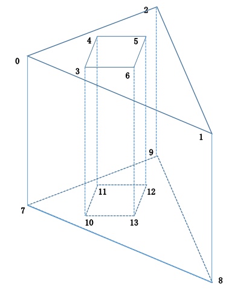

**第 1 步：确定顶点数组与接缝**

编号 0~6 为顶面顶点，7~13 为底面顶点；底面顶点在数组中**复制一遍**（7~13 与顶面一一对应但独立存储）。复制的原因：顶面与侧面在接缝处需要不同的 UV，同一个几何位置必须拆成两个顶点，否则 UV 会冲突。

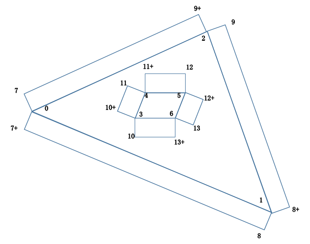

**第 2 步：给出纹理坐标数组**

顶面顶点按平面展开图的位置赋值 $(\xi,\eta)\in[0,1]^2$；底面顶点用带 `+` 的编号表示"与顶面同位置但 UV 不同"的副本。

**第 3 步：逐面三角化**

四个顶点 $0,1,7^+,8^+$ 组成的侧面矩形，三角化为

$$
(0,\ 7^+,\ 1),\qquad (1,\ 7^+,\ 8^+).
$$

外框架生成三组：

$$
(0,7^+,1),(1,7^+,8^+);\quad
(1,8^+,2),(2,8^+,9);\quad
(2,9^+,0),(0,9^+,7).
$$

内孔（绕向相反）同理，只是索引顺序反转以保持法线朝外。

```cpp
// 装配侧面多边形（生成索引数组）
void FMModel::assemblePolygon(std::vector<unsigned short> &sideindex,
                              int vOffset, unsigned int vNum)
{
    int n = vOffset;
    int startIdx = 0;
    for (; n < vOffset + vNum - 1; n++) {   // 顶面2个 + 底面2个 = 一个侧面矩形
        sideindex[startIdx]     = n;                              // 顶面
        sideindex[startIdx + 1] = sideindex[startIdx] + _vertexCount;      // 底面
        sideindex[startIdx + 2] = sideindex[startIdx] + 1;        // 顶面
        sideindex[startIdx + 3] = sideindex[startIdx + 2];        // 顶面
        sideindex[startIdx + 4] = sideindex[startIdx + 1];        // 底面
        sideindex[startIdx + 5] = sideindex[startIdx + 3] + _vertexCount; // 底面
        startIdx += 6;
    }
    // 收尾：最后一条边回到起点
    sideindex[startIdx]     = n;
    sideindex[startIdx + 1] = sideindex[startIdx] + _vertexCount;
    sideindex[startIdx + 2] = sideindex[0];
    sideindex[startIdx + 3] = sideindex[startIdx + 2];
    sideindex[startIdx + 4] = sideindex[startIdx + 1];
    sideindex[startIdx + 5] = sideindex[startIdx + 3] + _vertexCount;
}
```

> **索引偏移按 14 顶点布局取 `_vertexCount`**：本节 `_vertexCount` 是每圈顶点数（7），顶点数组为顶面 0~6 加底面副本 7~13 共两圈，故底面一律偏移 `+ _vertexCount`，`[1]/[4]` 与收尾块的 `[1]` 三处口径相同。若写成 `2 * _vertexCount`，`n` 增大后下标会越过 0~13 的数组上界；`[5] = [3] + _vertexCount` 与该布局自洽。抄代码时务必先画清楚顶点数组的分段布局。

**数学要点**：

- 侧面矩形的 UV 通常按**弧长参数化**：设外圈周长 $L$，第 $i$ 段累计弧长 $s_i$，则 $u_i=s_i/L$；$v$ 取 0（顶）与 1（底）。这样纹理不会在长边上被拉伸。
- 展开本质上是对每个 chart 找一个局部参数化 $\gamma:\Omega\to\mathbb R^3$，UV 就是 $\gamma^{-1}$ 的像。要控制畸变，需让 $\sqrt{\det(J^{\mathsf T}J)}$ 尽量接近常数（等距/保角展开）。
- 孔洞的绕向与外圈相反，这是"带洞多边形"能正确三角化的前提；三角化后法线方向由顶点绕向决定（右手定则）。

### 9.2 像素与 UV 互转

| 转换方向 | 公式 | HLSL 示例 |
|---|---|---|
| 像素 → UV | $(P+0.5)/\text{Res}$ | `uv = (p + 0.5) / _ScreenParams.xy` |
| UV → 像素 | $\lfloor UV\cdot\text{Res}\rfloor$ | `p = floor(uv * _ScreenParams.xy)` |
| Frag 输入 → 像素 | 直接取 `.xy` | `input.positionCS.xy` |

其中 Unity 的 `_ScreenParams = (W, H, 1+1/W, 1+1/H)`，`zw` 即 $(1+1/W,\ 1+1/H)$，**不是** $1/W,1/H$，不能当倒数用；像素→UV 请直接用 `xy` 做除法。

> **对原笔记的更正**：原表把像素→UV 的 HLSL 写成 `uv = p * _ScreenParams.zw - 1.0`。按 Unity 的标准定义 `zw = (1+1/W, 1+1/H)` 是"加一"而非倒数，$p=W-1$ 时 `p * zw` 约为 $W$，远超 $[0,1)$，再减 1 更是无意义的区间，且缺少取像素中心的 $+0.5$。该写法只有在 `_ScreenParams` 被工程自定义成 $(W,H,2/W,2/H)$ 且 $p$ 是整数像素坐标时才成立——此时输出是 $[-1,1)$ 的 **NDC**，还不是 UV，仍需再映射一次；按 Unity 标准定义则不成立。若无特殊上下文，应使用上表的 `(p + 0.5) / _ScreenParams.xy`（待核实原笔记的具体上下文）。

**为什么 UV→像素用 `floor` 而不是 `round`**：

1. **像素是区间而非点**。第 $k$ 个像素覆盖 $[k,k+1)$。$UV\cdot\text{Res}=0.99$ 属于第 0 个像素，`floor` 得 0 正确；`round` 得 1，跨入了下一个像素。
2. **与数组索引一致**。`round` 会让首尾像素只分到半个像素宽度，中间像素分到完整宽度，产生系统性采样偏差；`floor` 使 $[0,1)$ 均匀映射到 $0\dots N-1$。
3. **避免越界**。$UV=0.996$、$N=100$ 时 `floor` 得 99（合法），`round` 得 100（越界），需额外 `clamp`。
4. **中心与归属的区别**。像素→UV 加 0.5 是因为要取**像素中心**；UV→像素是问"这个点**属于哪个像素**"，无论落在区间左端还是右端，`floor` 都给出同一索引。

一句话：`floor` 回答"落在哪个像素范围内"，`round` 回答"离哪个像素中心最近"。读取纹理（`.Load`）或访问缓冲区时关心的是前者，因此 `floor` 是唯一与内存布局严格一致的选择。

---

## 10. 反射与折射

### 10.1 反射向量

给定单位入射向量 $\mathbf I$、单位法向量 $\mathbf N$（约定 $\mathbf I$ 指向表面、$\mathbf N$ 指向入射侧，二者夹角为钝角），反射向量

$$
\boxed{\;\mathbf R=\mathbf I-2(\mathbf I\cdot\mathbf N)\mathbf N\;}.
$$

**推导（两种等价视角）**：

*法一（对称点）*：把 $\mathbf I$ 分解为法向分量 $\mathbf I_\parallel=(\mathbf I\cdot\mathbf N)\mathbf N$ 与切向分量 $\mathbf I_\perp=\mathbf I-\mathbf I_\parallel$。反射只翻转法向分量：

$$
\mathbf R=\mathbf I_\perp-\mathbf I_\parallel=\mathbf I-2(\mathbf I\cdot\mathbf N)\mathbf N .
$$

*法二（等腰三角形）*：把 $\mathbf R$ 平移到与 $\mathbf N$ 延长线相交，因入射角等于反射角且 $\lvert\mathbf I\rvert=\lvert\mathbf R\rvert$，三角形 $ION$ 等腰，$ON=2S$，其中 $S$ 是 $-\mathbf I$ 在 $\mathbf N$ 上的投影，故 $\mathbf R=\mathbf I+2S=\mathbf I-2(\mathbf I\cdot\mathbf N)\mathbf N$。

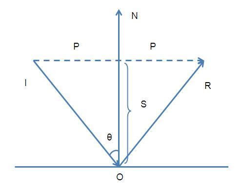

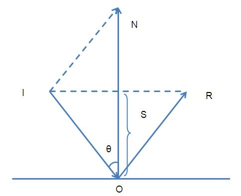

GLSL 的 `reflect(I, N)` 定义正是上式：

```glsl
vec3 reflect(vec3 I, vec3 N) { return I - 2.0 * dot(I, N) * N; }
```

**方向约定坑**：若 `light_dir` 用"片元指向光源"计算，则它指向表面外侧，与 `reflect` 期望的"入射方向指向表面"相反，需要取负：

```glsl
vec3 L = normalize(u_light_pos - v_position);      // 片元 → 光源
vec3 R = normalize(reflect(-L, normal));           // 先取反再反射
```

> 原笔记写作 `light_dir = normalize(u_light_pos - v_position)` 后"使用时取反"，与这里一致；只要保证传入 `reflect` 的向量与法线夹角为钝角即可。

### 10.2 折射向量

**斯涅尔定律**：

$$
\eta_L\sin\theta_L=\eta_T\sin\theta_T,
$$

其中 $\eta_L,\eta_T$ 分别是入射介质与折射介质的折射率，$\theta_L,\theta_T$ 为与法线的夹角。

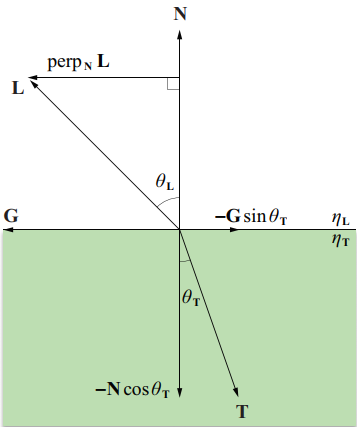

**约定（与原笔记一致）**：$\mathbf L$ 为从表面指向入射介质的单位向量（即真实入射方向的反向），$\mathbf N$ 为朝外单位法线，$\mathbf T$ 为折射方向。

把 $\mathbf T$ 分解为沿 $-\mathbf N$ 与垂直 $\mathbf N$ 的两部分：

$$
\mathbf T=a(-\mathbf N)+b\,\mathbf G,
$$

其中 $a=\cos\theta_T$，$b=\sin\theta_T$，$\mathbf G$ 是**折射方向**的切向单位向量。注意 $\mathbf L$ 指向入射介质（真实入射传播方向为 $\mathbf I=-\mathbf L$），其切向分量与折射方向相反，故 $\mathbf G$ 取负号：

$$
\mathbf G=-\frac{\mathbf L-(\mathbf L\cdot\mathbf N)\mathbf N}{\sin\theta_L},
\qquad \sin\theta_L=\sqrt{1-(\mathbf L\cdot\mathbf N)^2}.
$$

代入并用斯涅尔定律 $\sin\theta_T=\dfrac{\eta_L}{\eta_T}\sin\theta_L$：

$$
\mathbf T=-\frac{\eta_L}{\eta_T}\mathbf L
+\left(\frac{\eta_L}{\eta_T}\cos\theta_L-\cos\theta_T\right)\mathbf N,
$$

$$
\cos\theta_T=\sqrt{1-\left(\frac{\eta_L}{\eta_T}\right)^2\left(1-\cos^2\theta_L\right)} .
$$

**全反射**：当 $\dfrac{\eta_L}{\eta_T}\sin\theta_L>1$ 时根号内为负，折射不存在，必须改用反射公式。临界角满足 $\sin\theta_c=\dfrac{\eta_T}{\eta_L}$（仅当 $\eta_L>\eta_T$ 时存在）。

**另一种常见约定**（Ray Tracing in One Weekend）：$\mathbf I$ 为真实入射方向（指向表面内部），$\mathbf N$ 朝外且与 $\mathbf I$ 夹角为钝角，$\eta=\eta_1/\eta_2$：

$$
\cos\theta_i=-\mathbf I\cdot\mathbf N,\qquad
\mathbf T=\eta\,\mathbf I+\left(\eta\cos\theta_i-\sqrt{1-\eta^2(1-\cos^2\theta_i)}\right)\mathbf N .
$$

两式只差一个 $\mathbf L=-\mathbf I$ 的代换（此时两式逐项相同），实现时任选一套并保持全程一致。

```cpp
// RTiOW 风格
bool refract(const vec3& I, const vec3& N, double eta, vec3& T)
{
    double cosi = -dot(I, N);
    double k = 1.0 - eta * eta * (1.0 - cosi * cosi);
    if (k < 0.0) return false;                 // 全反射
    T = eta * I + (eta * cosi - sqrt(k)) * N;
    return true;
}
```

---

## 11. 球坐标系

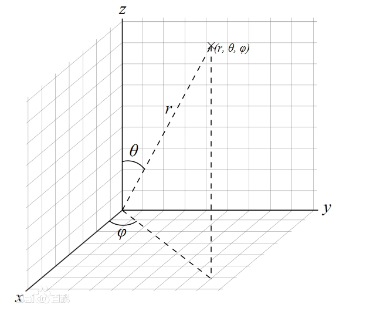

采用**物理约定**（$\theta$ 为极角，自 $+z$ 轴起算；$\varphi$ 为方位角，自 $+x$ 轴起算）：

$$
x=r\sin\theta\cos\varphi,\qquad
y=r\sin\theta\sin\varphi,\qquad
z=r\cos\theta,
$$

其中 $r\ge0$、$\theta\in[0,\pi]$、$\varphi\in[0,2\pi)$。

**反变换**：

$$
r=\sqrt{x^2+y^2+z^2},\qquad
\theta=\arccos\!\left(\frac{z}{r}\right),\qquad
\varphi=\operatorname{atan2}(y,x).
$$

用 `atan2` 而非 `acos` 求 $\varphi$，是为了保留象限信息并避免 $x=0$ 时除零。

**体积元与雅可比**：

$$
dV=r^2\sin\theta\,dr\,d\theta\,d\varphi,
\qquad
\left\lvert\det J\right\rvert=r^2\sin\theta .
$$

（若用 $\theta$ 表示仰角、从 $xy$ 平面起算的"数学约定"，则 $z=r\sin\theta$，$\sin$ 与 $\cos$ 互换；读文献时必须先确认约定。）

**与半球采样的联系**：单位球面上 $d\omega=\sin\theta\,d\theta\,d\varphi$，整球面立体角为 $4\pi$，故"按立体角均匀"对应 $p(\theta,\varphi)=\sin\theta/(4\pi)$；半球只有 $2\pi$，对应 $p(\theta,\varphi)=\sin\theta/(2\pi)$，正是 `03_概率统计与采样.md` 中 5.6 节半球采样公式的来源。

> 注意：$r=0$ 时 $\theta,\varphi$ 无定义，反变换需特判。$r<0$ 不合法。

---

## 原始笔记索引

- `Math/几何/点积.md`
- `Math/几何/二维向量的叉积.md`
- `Math/几何/二维中向量的叉积.md`
- `根目录笔记/向量叉乘运算.md`
- `Math/几何/混合积.md`
- `Math/几何/平面方程.md`
- `Math/几何/点到平面的距离.md`
- `Math/几何/判断点在三角形内部.md`
- `Math/几何/判断一个点是否在多边形内部  射线法实现.md`
- `Math/几何/任意多边形的面积.md`
- `Math/几何/求三角形外接圆圆心（二维情况）.md`
- `Math/几何/射线与三角形求交.md`
- `Math/几何/Delaunary三角剖分.md`
- `Math/几何/Delaunay三角剖分.md`
- `Math/几何/三角剖分算法：Bowyer–Watson algorithm.md`
- `Math/几何/半边数据结构.md`
- `Math/几何/常用计算几何算法.md`
- `Math/几何/模型展开UV坐标计算.md`
- `根目录笔记/像素与UV的互转.md`
- `Math/几何/求反射向量.md`
- `Math/几何/求折射向量.md`
- `Math/几何/球坐标系.md`
- `归类/resume.md（仅第 1357-1431 行）`
