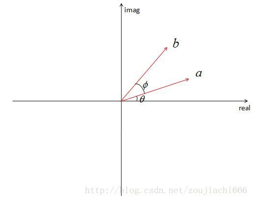
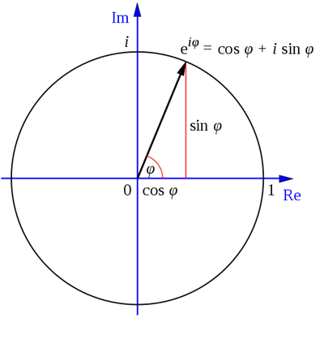

# 信号与傅里叶

> **导读**：本文从"频率"这一最基本的量出发，先厘清模拟频率、模拟角频率与数字频率的换算（§1），再用正交函数系解释傅里叶级数为什么能"筛"出各次谐波（§2），随后统一到傅里叶变换（§3）与"采样 — DTFT — DFT"的离散化框架（§4）。§5 回到工程选择，回答 FS 与 FT 何时用、容易混在哪；§6、§7 分别给出数字信号处理与数字图像处理的核心结论；§8–§11 转入二维情形，依次为二维 DFT/IDFT 的完整定义、可分离性与二维快速算法、频谱的对称性与可视化、频域滤波示例。符号约定：连续时间 $t$、离散序号 $n$；模拟角频率 $\Omega$（rad/s）、数字角频率 $\omega$（rad）；虚数单位统一用 $j$；$\omega_0=\dfrac{2\pi}{T}$ 为连续基频，$\omega_0=\dfrac{2\pi}{N}$ 为离散基频（上下文会注明）。

---

## 1. 频率的三种度量

### 1.1 模拟频率 $f$

**定义**：单位时间内完成的周期数，单位 Hz（周/秒）。正弦信号写作

$$
x(t)=A\cos(2\pi f t+\varphi).
$$

物理意义：每秒振荡 $f$ 个完整周期。

### 1.2 模拟角频率 $\Omega$

**定义**：单位时间转过的弧度，也称模拟圆频率，单位 rad/s。

$$
\boxed{\;\Omega=2\pi f\;}\qquad\Longrightarrow\qquad x(t)=A\cos(\Omega t+\varphi).
$$

一个周期对应 $2\pi$ 弧度，所以角频率 = $2\pi\times$ 频率。例：$f=100\ \mathrm{Hz}$ 时 $\Omega=200\pi\ \mathrm{rad/s}$。

### 1.3 数字角频率 $\omega$

采样后时间被离散化：$t=nT_s$，$T_s=1/f_s$ 为采样周期，$f_s$ 为采样频率。归一化相位：

$$
\Omega t=\Omega nT_s=(\Omega T_s)n=\omega n,
$$

故

$$
\boxed{\;\omega=\Omega T_s=\frac{\Omega}{f_s}=\frac{2\pi f}{f_s}\;}\qquad(\text{rad}).
$$

数字角频率是**无量纲**的"每样本弧度"，不是物理频率。其主值区间通常取 $(-\pi,\pi]$ 或 $[0,2\pi)$；$\Omega$ 则可取 $(-\infty,+\infty)$。

| 名称 | 符号 | 单位 | 关系 |
|---|---|---|---|
| 模拟频率 | $f$ | Hz | — |
| 模拟角频率 | $\Omega$ | rad/s | $\Omega=2\pi f$ |
| 数字角频率 | $\omega$ | rad（无量纲） | $\omega=\Omega T_s=\Omega/f_s$ |

**要点**：

1. $f$ 数"每秒多少个周期"，$\Omega$ 数"每秒多少弧度"，描述同一模拟信号，只是度量不同；
2. 模拟量都带时间量纲（/s），数字角频率没有；
3. 记忆：一个周期 $2\pi$ 弧度，故角频率 $=2\pi\times$ 频率。

> **混叠的根源**：$\omega$ 与 $\omega+2\pi k$ 对应同一个离散序列（因为 $e^{j(\omega+2\pi k)n}=e^{j\omega n}$）。因此离散域的高频与低频不可区分，$\omega$ 必须限制在主值区间。**结论**：**实序列**的频谱共轭对称，$[0,\pi]$ 这一个区间已含全部独立信息，其中 $\omega=\pi$ 即奈奎斯特频率 $f=f_s/2$；**复序列**的独立区间则是一个长度为 $2\pi$ 的主值区间，如 $(-\pi,\pi]$。（原稿有误，已更正：原稿称"数字频率只有 $[0,\pi]$ 有物理意义"，未区分实序列与复序列。）

---

## 2. 正交函数系与傅里叶级数

### 2.1 内积与正交

在区间 $[a,b]$ 上定义函数内积

$$
\langle f,g\rangle=\int_a^b f(t)\overline{g(t)}\,dt
$$

（实函数时共轭可去掉）。若 $\langle f,g\rangle=0$，称 $f,g$ **正交**；若一族函数两两正交且自身内积非零，则构成**正交函数系**。

**定义（函数值为实数）**：给出一组函数（有限或无限多个）$f_i(x)$（$i=1,2,\dots$），若满足

$$
\int_a^b f_i(x)f_i(x)\,dx\ne0,
$$

且当整数 $m\ne n$ 时

$$
\int_a^b f_m(x)f_n(x)\,dx=0,
$$

则这一组函数就是区间 $[a,b]$ 内的一个**正交函数系**。

这一组函数的性质可以类比矢量的正交："两个函数相乘再积分"这一步可以类比矢量的内积。两个不同的矢量正交（垂直）时内积为零；若它们的模长不为零，则一个矢量与自身的内积不为零。

特殊地，若给正交函数系中每个函数的平方进行归一化，使得

$$
\int_a^b f_i(x)f_i(x)\,dx=1,
$$

则称该正交函数系是**归一的**，其性质可统一表示为

$$
\int_a^b f_m(x)f_n(x)\,dx=\delta_{mn},
$$

其中 $\delta_{mn}$ 是克罗内克 $\delta$ 函数（Kronecker Delta Function）。

**定义（函数值为复数）**：若函数系中 $f_i(x)$ 的自变量为实数、函数值为复数，则正交的定义变为

$$
\int_a^b f_i^*(x)f_j(x)\,dx=0\qquad(i\ne j),
$$

其中星号表示复共轭。归一化的定义变为

$$
\int_a^b f_i^*(x)f_i(x)\,dx=1,
$$

正交归一条件可以统一写成

$$
\int_a^b f_i^*(x)f_j(x)\,dx=\delta_{ij}.
$$

（原稿有误，已更正：原稿把互异函数的正交条件写成"$\ne0\ (i\ne j)$"，但正交要求两两正交即内积为零，故应为 $=0$。）

**与向量空间的同构**：函数是"无穷维向量"，积分是"连续版点积"，傅里叶系数就是函数在各基函数上的**投影坐标**。这套类比是理解所有正交展开（傅里叶、勒让德、小波）的钥匙。

### 2.2 三角函数系的正交性

在长度为一个周期 $T$ 的区间上：

$$
\int_{t_0}^{t_0+T}\cos(n\omega_0 t)\cos(m\omega_0 t)\,dt=
\begin{cases}
0,&n\ne m,\\
T/2,&n=m\ne0,
\end{cases}
$$

$$
\int_{t_0}^{t_0+T}\sin(n\omega_0 t)\sin(m\omega_0 t)\,dt=
\begin{cases}
0,&n\ne m,\\
T/2,&n=m\ne0,
\end{cases}
$$

$$
\int_{t_0}^{t_0+T}\sin(n\omega_0 t)\cos(m\omega_0 t)\,dt=0\quad(\forall n,m).
$$

**复指数系**（更简洁）：

$$
\int_{t_0}^{t_0+T}e^{jn\omega_0 t}e^{-jm\omega_0 t}\,dt=
\begin{cases}
T,&n=m,\\
0,&n\ne m.
\end{cases}
$$

### 2.3 三角形式

适用于周期为 $T$ 的信号 $x(t)$，$\omega_0=\dfrac{2\pi}{T}$：

$$
x(t)=\frac{a_0}{2}+\sum_{n=1}^{\infty}\big[a_n\cos(n\omega_0 t)+b_n\sin(n\omega_0 t)\big],
$$

$$
a_n=\frac{2}{T}\int_{t_0}^{t_0+T}x(t)\cos(n\omega_0 t)\,dt,\qquad
b_n=\frac{2}{T}\int_{t_0}^{t_0+T}x(t)\sin(n\omega_0 t)\,dt .
$$

$n=0$ 时 $a_0=\dfrac{2}{T}\displaystyle\int x(t)dt$，故 $\dfrac{a_0}{2}$ 是一个周期内的平均值，即**直流分量**。

也可合并为幅度—相位形式：

$$
x(t)=\frac{A_0}{2}+\sum_{n=1}^{\infty}A_n\cos(n\omega_0 t+\varphi_n),
\qquad A_n=\sqrt{a_n^2+b_n^2}.
$$

**系数为什么长这样**：用 $\cos(n\omega_0 t)$ 乘两边再积分，由正交性，除第 $n$ 项外全部归零，于是"筛"出 $a_n$。这就是"频率筛"的严格含义。

### 2.4 复指数形式与推导

$$
\boxed{\;x(t)=\sum_{n=-\infty}^{+\infty}c_n e^{jn\omega_0 t},\qquad
c_n=\frac{1}{T}\int_{t_0}^{t_0+T}x(t)e^{-jn\omega_0 t}\,dt\;}
$$

**三步推导**：

1. 欧拉公式拆 $\cos,\sin$：
   $$
   \cos\theta=\frac{e^{j\theta}+e^{-j\theta}}{2},\qquad
   \sin\theta=\frac{e^{j\theta}-e^{-j\theta}}{2j}.
   $$
2. 代入并按 $e^{\pm jn\omega_0 t}$ 归并。利用 $\dfrac1j=-j$：
   $$
   a_n\cos(n\omega_0 t)+b_n\sin(n\omega_0 t)
   =\underbrace{\frac{a_n-jb_n}{2}}_{c_n}e^{jn\omega_0 t}
   +\underbrace{\frac{a_n+jb_n}{2}}_{c_{-n}}e^{-jn\omega_0 t}.
   $$
3. 把 $a_n,b_n$ 的积分式代回：
   $$
   c_n=\frac{a_n-jb_n}{2}
   =\frac{1}{T}\int_{t_0}^{t_0+T}x(t)\big[\cos(n\omega_0 t)-j\sin(n\omega_0 t)\big]dt
   =\frac{1}{T}\int_{t_0}^{t_0+T}x(t)e^{-jn\omega_0 t}dt .
   $$

**系数对应关系**：

| 关系 | 公式 |
|---|---|
| 直流 | $c_0=\dfrac{a_0}{2}$ |
| 正负频率 | $c_n=\dfrac{a_n-jb_n}{2},\quad c_{-n}=\dfrac{a_n+jb_n}{2}$ |
| 幅度 | $\lvert c_n\rvert=\dfrac12\sqrt{a_n^2+b_n^2}=\dfrac{A_n}{2}$ |
| 实信号 | $c_{-n}=c_n^{*}$（共轭对称） |

**负频率不是新物理成分**：一对 $c_{\pm n}e^{\pm jn\omega_0 t}$ 合起来正好还原实的 $a_n\cos+b_n\sin$，负频率只是复指数记账方式。这也解释了实信号频谱的偶对称（幅度）与奇对称（相位）。

**记号防混淆**：三角形式用 $n\ge0$ 数"第几根谱线"；复指数形式用 $k\in\mathbb{Z}$ 表示"带符号的频率坐标"。建议复指数下标改用 $k$，则 $c_{-n}$ 由 $a_n,b_n$ 生成这件事就一目了然（$k=-n$ 属于第 $n$ 根谱线），不会再去追问"$a_{-n}$ 是否存在"。

**三角形式 vs 复指数形式**：

| | 三角形式 | 复指数形式 |
|---|---|---|
| 表达式 | $\dfrac{a_0}{2}+\sum[a_n\cos(n\omega_0 t)+b_n\sin(n\omega_0 t)]$ | $\sum c_n e^{jn\omega_0 t}$ |
| 系数 | $\dfrac{2}{T}\displaystyle\int_T x(t)\cos/\sin(n\omega_0 t)\,dt$ | $\dfrac{1}{T}\displaystyle\int_T x(t)e^{-jn\omega_0 t}\,dt$ |
| 求和范围 | $n\ge0$ | $n\in\mathbb{Z}$（双边） |
| 优点 | 物理直观（实数谐波，正负频率不成对出现） | 形式统一，可直接衔接 FT/DFT |

### 2.5 收敛性（Dirichlet 条件）

若 $x(t)$ 在一个周期内满足：

1. 绝对可积 $\displaystyle\int_{t_0}^{t_0+T}\lvert x(t)\rvert dt<\infty$；
2. 只有有限个第一类间断点；
3. 只有有限个极值点；

则傅里叶级数收敛，且

$$
\text{连续点}\to x(t),\qquad
\text{间断点}\to\frac{x(t_0^+)+x(t_0^-)}{2}.
$$

### 2.6 频谱与 Gibbs 现象

周期信号的频谱是**离散线谱**，谱线只出现在 $n\omega_0$，间隔恒为 $\omega_0=\dfrac{2\pi}{T}$。

- 幅度谱 $\lvert c_n\rvert$：实信号时关于纵轴偶对称；
- 相位谱 $\angle c_n$：实信号时奇对称；
- **周期越长，谱线越密**——这是通向傅里叶变换的关键伏笔。

**方波实例**（幅度 $\pm E$、占空比 50%）：

$$
x(t)=\frac{4E}{\pi}\left[\sin\omega_0 t+\frac13\sin3\omega_0 t+\frac15\sin5\omega_0 t+\cdots\right].
$$

规律：只有奇次谐波；幅度按 $1/n$ 衰减；跳变越剧烈，高频越丰富。

**Gibbs 现象**：用有限项逼近方波时，间断点附近出现约 **9%**（8.95%，基准为跳变幅度 $2E$；相对方波幅度 $E$ 则为 17.9%）的固定过冲；项数增加只让过冲向间断点收窄，幅度不消失。这是"用光滑基函数逼近不连续函数"的固有代价，也是图像压缩振铃（ringing）的来源。

**常用性质**：

| 性质 | 结论 |
|---|---|
| 奇函数 | 只有 $\sin$ 项（$a_n=0$） |
| 偶函数 | 只有 $\cos$ 项（$b_n=0$） |
| 时移 | 只改相位谱，不改幅度谱 |
| 微分 | 各谐波乘 $jn\omega_0$（放大高频） |
| Parseval | $\dfrac1T\displaystyle\int_T\lvert x\rvert^2dt=\sum_n\lvert c_n\rvert^2$ |

---

## 3. 傅里叶变换

### 3.1 定义

适用于非周期信号：

$$
X(\omega)=\int_{-\infty}^{+\infty}x(t)e^{-j\omega t}\,dt,
\qquad
x(t)=\frac{1}{2\pi}\int_{-\infty}^{+\infty}X(\omega)e^{j\omega t}\,d\omega .
$$

$X(\omega)$ 是**频谱密度**（单位频率上的幅度），量纲为"幅度/角频率"，不是某个具体频率分量的幅度。

**存在条件**：绝对可积 $\displaystyle\int_{-\infty}^{\infty}\lvert x(t)\rvert dt<\infty$（充分条件）。周期信号不满足，需用冲激函数推广。

### 3.2 从 FS 到 FT：周期趋于无穷

$$
\omega_0=\frac{2\pi}{T}\to0
\;\Longrightarrow\;
\text{离散线谱}\longrightarrow\text{连续频谱},
$$

$$
T c_n\xrightarrow{T\to\infty}X(\omega).
$$

推导思路：$c_n=\dfrac1T\displaystyle\int_{t_0}^{t_0+T}x(t)e^{-jn\omega_0 t}dt$，令 $T\to\infty$、$\omega_0\to0$、$n\omega_0\to\omega$，即得 $X(\omega)=\displaystyle\int_{-\infty}^{\infty}x(t)e^{-j\omega t}dt$。

> **结论**：FT 是 FS 系数乘以周期 $T$ 后在 $T\to\infty$ 时的极限。

### 3.3 周期信号的冲激表示

周期信号虽不满足绝对可积，但可写成冲激串：

$$
X(\omega)=2\pi\sum_{n=-\infty}^{\infty}c_n\,\delta(\omega-n\omega_0).
$$

**为什么需要它**：FT 的整套运算规则（卷积定理、相乘定理、时移、频移）只对 FT 频谱生效；FS 的 $c_n$ 不是 $\omega$ 的函数，无法直接参与频域相乘。引入冲激后，周期信号也拥有了 FT 形式，可直接套用全部定理。

例：周期信号过线性系统，$Y(\omega)=X(\omega)H(j\omega)$，利用筛选性质 $\delta(\omega-\omega_0)H(j\omega)=H(j\omega_0)\delta(\omega-\omega_0)$：

$$
Y(\omega)=2\pi\sum_n c_n H(jn\omega_0)\,\delta(\omega-n\omega_0)
\;\Longrightarrow\;
d_n=c_nH(jn\omega_0),
$$

与逐谐波加权的 FS 结果完全一致。

> **易踩坑**：$\delta(\omega)$ 是广义函数，只在积分运算中有意义，不能理解为"频谱密度无穷大"。

### 3.4 连续时间傅里叶变换常用性质

| 性质 | 公式 |
|---|---|
| 线性 | $ax_1+bx_2\leftrightarrow aX_1+bX_2$ |
| 时移 | $x(t-t_0)\leftrightarrow X(j\Omega)e^{-j\Omega t_0}$ |
| 频移 | $x(t)e^{j\Omega_0 t}\leftrightarrow X(j(\Omega-\Omega_0))$ |
| 尺度 | $x(at)\leftrightarrow\dfrac{1}{\lvert a\rvert}X\!\left(j\dfrac{\Omega}{a}\right)$ |
| 对偶 | $X(jt)\leftrightarrow2\pi x(-\Omega)$ |
| 时域卷积 | $x_1*x_2\leftrightarrow X_1X_2$ |
| 频域卷积 | $x_1x_2\leftrightarrow\dfrac{1}{2\pi}X_1*X_2$ |
| 时域微分 | $\dfrac{dx}{dt}\leftrightarrow j\Omega X(j\Omega)$ |
| 频域微分 | $(-jt)x(t)\leftrightarrow\dfrac{dX}{d\Omega}$ |
| 时域积分 | $\displaystyle\int_{-\infty}^{t}x(\tau)d\tau\leftrightarrow\dfrac{X(j\Omega)}{j\Omega}+\pi X(0)\delta(\Omega)$ |
| Parseval | $\displaystyle\int\lvert x\rvert^2dt=\frac{1}{2\pi}\int\lvert X\rvert^2d\Omega$ |

### 3.5 常用变换对

| $x(t)$ | $X(j\Omega)$ |
|---|---|
| $\delta(t)$ | $1$ |
| $1$ | $2\pi\delta(\Omega)$ |
| $e^{j\Omega_0 t}$ | $2\pi\delta(\Omega-\Omega_0)$ |
| $\cos(\Omega_0 t)$ | $\pi[\delta(\Omega-\Omega_0)+\delta(\Omega+\Omega_0)]$ |
| $\sin(\Omega_0 t)$ | $j\pi[\delta(\Omega+\Omega_0)-\delta(\Omega-\Omega_0)]$ |
| 门函数（宽 $T$） | $T\,\mathrm{sinc}\!\left(\dfrac{\Omega T}{2}\right)$ |
| $u(t)$ | $\dfrac{1}{j\Omega}+\pi\delta(\Omega)$ |
| $\mathrm{sgn}(t)$ | $\dfrac{2}{j\Omega}$ |
| $e^{-at}u(t),\ a>0$ | $\dfrac{1}{a+j\Omega}$ |

> 注意 $\mathrm{sinc}$ 的归一化约定不唯一：本文为与上面的变换表配合，取 $\mathrm{sinc}(x)=\dfrac{\sin x}{x}$（数学/物理教材常用）；而信号处理与图像处理领域更常用 $\mathrm{sinc}(x)=\dfrac{\sin(\pi x)}{\pi x}$（Oppenheim 教材、MATLAB、`np.sinc` 都是后者）。两种约定下门函数、内插核的表达式都要相应换算。

---

## 4. 离散化：采样、DTFT、DFT

### 4.1 采样定理

采样信号

$$
x_s(t)=x(t)\sum_{n=-\infty}^{\infty}\delta(t-nT_s),\qquad \Omega_s=\frac{2\pi}{T_s}.
$$

**频谱混叠关系**：

$$
X_s(j\Omega)=\frac{1}{T_s}\sum_{k=-\infty}^{\infty}X\big(j(\Omega-k\Omega_s)\big),
$$

即原频谱以 $\Omega_s$ 为周期**复制**。

**奈奎斯特条件**（无失真重建）：

$$
\boxed{\;\Omega_s>2\Omega_{\max}\;}\qquad\Longleftrightarrow\qquad f_s>2f_{\max}.
$$

对带限于 $f_{\max}$（允许 $f_{\max}$ 处有分量）的信号，这是无失真重建的**充分条件**；$f_s=2f_{\max}$ 时，恰在 $f_s/2$ 处的分量无法重建。

**理想内插重建**：

$$
x(t)=\sum_{n=-\infty}^{\infty}x(nT_s)\,\mathrm{sinc}\!\left(\pi\frac{t-nT_s}{T_s}\right).
$$

（按本文 $\mathrm{sinc}(x)=\sin x/x$ 的约定，这里必须把 $\pi$ 显式写进核里；否则零点落在 $t=nT_s\pm k\pi T_s$ 上，连 $x(nT_s)=x_n$ 都不满足。若改用归一化 sinc，则写回 $\mathrm{sinc}\!\left(\frac{t-nT_s}{T_s}\right)$。）

> 若不满足奈奎斯特条件，高频副本叠到低频上，形成**混叠（aliasing）**——图形学里的摩尔纹、锯齿、纹理 minification 闪烁都是它的表现。抗锯齿本质上就是"先低通、再采样"。

### 4.2 五种变换的统一视图

| 名称 | 信号类型 | 正变换 | 逆变换 | 频谱特点 |
|---|---|---|---|---|
| CTFS | 连续周期 $x(t),T$ | $X_k=\dfrac1T\displaystyle\int_T x(t)e^{-jk\Omega_0 t}dt$ | $x(t)=\sum_k X_k e^{jk\Omega_0 t}$ | 离散，非周期 |
| CTFT | 连续非周期 $x(t)$ | $X(j\Omega)=\displaystyle\int_{-\infty}^{\infty}x(t)e^{-j\Omega t}dt$ | $x(t)=\dfrac{1}{2\pi}\displaystyle\int_{-\infty}^{\infty}X(j\Omega)e^{j\Omega t}d\Omega$ | 连续，非周期 |
| DTFS | 离散周期 $\tilde x[n],N$ | $\tilde X[k]=\sum_{n=0}^{N-1}\tilde x[n]e^{-j\frac{2\pi}{N}kn}$ | $\tilde x[n]=\dfrac1N\sum_{k=0}^{N-1}\tilde X[k]e^{j\frac{2\pi}{N}kn}$ | 离散，周期 |
| DTFT | 离散非周期 $x[n]$ | $X(e^{j\omega})=\sum_{n=-\infty}^{\infty}x[n]e^{-j\omega n}$ | $x[n]=\dfrac{1}{2\pi}\displaystyle\int_{-\pi}^{\pi}X(e^{j\omega})e^{j\omega n}d\omega$ | 连续，周期 |
| DFT | 有限长 $x[n],0\le n\le N-1$ | $X[k]=\sum_{n=0}^{N-1}x[n]e^{-j\frac{2\pi}{N}kn}$ | $x[n]=\dfrac1N\sum_{k=0}^{N-1}X[k]e^{j\frac{2\pi}{N}kn}$ | 离散，有限长 |

**四条关系，记住就不会混**：

1. **时域周期化 $\leftrightarrow$ 频域离散化**；
2. **时域离散化 $\leftrightarrow$ 频域周期化**；
3. DTFS 系数 = 单周期截断序列 DTFT 在 $\omega=\dfrac{2\pi k}{N}$ 处的采样：
   $$
   \tilde X[k]=X_1\!\left(e^{j\frac{2\pi k}{N}}\right);
   $$
4. DFT = DTFS 在主值区间 $0\le k\le N-1$ 的截取 = DTFT 在 $\omega=\dfrac{2\pi k}{N}$ 的等间隔采样。

**DFT 的隐含周期延拓**：DFT 把长度 $N$ 的序列视为周期 $N$ 序列的一个主周期。因此"循环卷积"对应频域相乘；要做**线性卷积**必须补零到 $N\ge N_1+N_2-1$，否则会发生时域卷绕。

**DTFS 系数约定**：国内教材常用"正变换无 $1/N$、逆变换带 $1/N$"；也有相反约定。本文统一采用前者，比较不同教材时要先核对。

### 4.3 旋转因子（twiddle factor）

$$
\boxed{\;W_N=e^{-j\frac{2\pi}{N}}\;}
$$

它是复平面单位圆上幅角为 $-\dfrac{2\pi}{N}$ 的点，即**顺时针旋转 $\dfrac{2\pi}{N}$**。





由欧拉公式

$$
W_N=e^{-j2\pi/N}=\cos\frac{2\pi}{N}-j\sin\frac{2\pi}{N}.
$$

**关键性质**：

| 性质 | 表达式 |
|---|---|
| 周期性 | $W_N^{k+N}=W_N^{k}$ |
| 半周期取反 | $W_N^{k+N/2}=-W_N^{k}$ |
| 共轭对称 | $W_N^{N-k}=\overline{W_N^{k}}$ |
| 可约性 | $W_N^{kn}=W_{N/n}^{k}$（$n\mid N$） |
| 特值 | $W_N^{0}=1,\ W_N^{N/2}=-1$ |

用旋转因子写 DFT：

$$
X[k]=\sum_{n=0}^{N-1}x[n]W_N^{kn}.
$$

**FFT 的本质**：利用 $W_N^{k+N/2}=-W_N^{k}$ 把长度 $N$ 的 DFT 拆成两个长度 $N/2$ 的 DFT（基 2 蝶形），

$$
X[k]=X_{\text{even}}[k]+W_N^{k}X_{\text{odd}}[k],\qquad
X[k+N/2]=X_{\text{even}}[k]-W_N^{k}X_{\text{odd}}[k],
$$

复杂度从 $O(N^2)$ 降到 $O(N\log N)$。

> FFT 不是一种新的变换，只是 DFT 的快速算法。

---

## 5. FS 与 FT 的选用、对比与常见误区

> 本节承接 §2–§3：§2 讲"周期信号怎么分解"，§3 讲"非周期信号怎么变换"。这里只回答两个工程问题：**什么时候用哪一个**，以及**容易混在哪里**。冲激串形式的动机与推导见 §3.3，不重复。

### 5.1 对比总表

| 对比项 | 傅里叶级数 FS | 傅里叶变换 FT |
|---|---|---|
| 适用信号 | 周期信号 | 非周期信号 |
| 频率特点 | 离散频率 $n\omega_0$ | 连续频率 $\omega$（周期信号时为冲激串） |
| 输出量 | 系数 $c_n$（离散序列） | 频谱 $X(\omega)$（连续函数） |
| 量纲 | 幅度 | 幅度密度（幅度/角频率） |
| 周期信号 | 直接可用 | 需借助冲激 $\delta(\omega)$ 才能写出 |
| 非周期信号 | 不可用 | 唯一选择 |
| 自带运算定理 | 有：周期卷积 $\leftrightarrow$ 系数相乘、时域相乘 $\leftrightarrow$ 系数序列的离散卷积 $c_k=\sum_l a_l b_{k-l}$（须按周期卷积定义） | 卷积、相乘、时移、频移、微分、积分齐备 |

两者不是两套频谱，而是**同一频率信息的两种写法**：FS 直接给出各谐波的幅度与相位，FT（周期信号情形）用冲激强度 $2\pi c_n$ 记录同一组谐波。所以"同一个信号有两个频谱"是误解。

### 5.2 选用规则

判断只看一件事：**信号在 $(-\infty,+\infty)$ 上是否无限周期重复**。

```text
信号在全部时间轴上是否无限周期重复？
├─ 是 → FS（离散谐波谱）；要做频域卷积/相乘/调制时，改写成冲激形式的 FT
└─ 否 → FT（连续频谱）
```

- 无限周期方波 → FS 给出基波、3 次、5 次……的幅值；其 FT 在 $\omega=0,\pm\omega_0,\pm3\omega_0,\dots$ 处是冲激，强度正比 $c_n$。
- 单个矩形脉冲 → 无 FS，只能 FT，得到 sinc 形连续谱。
- 只关心"有哪些频率成分" → 用 FS 最省事；要做"信号过系统、两信号相乘、频域滤波"这类运算 → 必须用带冲激的 FT（原因见 §3.3）。

### 5.3 三个常见误区

1. **截断一段周期波形 ≠ 周期信号**。只取 0–1 s 的正弦、其余置零，整体已是非周期信号，只能用 FT，频谱是 sinc 展宽而不是一根谱线。FS 要求信号在整条实轴上无限重复。
2. **频谱密度 ≠ 谐波幅度**。$c_n$ 是某个离散频率分量的幅度；$X(\omega)$ 是"单位角频率上的幅度"，量纲不同，数值不可直接比较（这正是 §3.2 中 $Tc_n\to X(\omega)$ 要乘 $T$ 的原因）。
3. **波形一变，就是新信号**。加窗、截断、补零都会改变频谱；"无限长正弦（单根谱线）"与"截断正弦（sinc 主瓣）"是两个不同信号的频谱，不是同一信号的两副面孔。

---

## 6. 数字信号处理的核心结论

1. **两种域、四条对应**。时域的周期性与离散性，分别对偶于频域的离散性与周期性。任何"采样/截断/周期延拓"操作，都能在另一域找到对应（复制/展宽/离散化）。这是所有信号处理结论的总纲。
2. **卷积定理是系统分析的核心**。时域卷积 $\leftrightarrow$ 频域相乘；因此 LTI 系统对每个频率分量只做"乘一个复数增益 $H(j\Omega)$"，不产生新频率。这解释了为什么频域设计滤波器如此方便。
3. **时域相乘 $\leftrightarrow$ 频域卷积**（加窗）。截断信号等于乘矩形窗，其频谱是原频谱与 sinc 的卷积，必然产生泄漏（leakage）与 Gibbs 振铃，无法靠增加点数消除。
4. **采样定理是连续与离散的桥**。对带限于 $f_{\max}$（允许 $f_{\max}$ 处有分量）的信号，$f_s>2f_{\max}$ 是无失真重建的充分条件（$f_s=2f_{\max}$ 时恰在 $f_s/2$ 的分量无法重建）；重建核为 sinc。不满足则混叠，且混叠后**不可逆**——必须在采样前做抗混叠低通。
5. **DFT 隐含周期延拓**。所有"循环"效应（循环卷积、频谱泄漏的离散表现、补零与分辨率的关系）都源于此。补零只提高频域采样密度（谱线更密），**不提高真实分辨率**；真实分辨率由观测时长决定（$\Delta f\approx1/T$）。
6. **稳定性与因果性是时域约束**。连续系统稳定的充要条件是 $h(t)$ 绝对可积；离散系统是 $\sum\lvert h[n]\rvert<\infty$（BIBO 稳定）。因果性要求 $h(t)=0,\ t<0$。频域上，稳定因果系统的极点必须位于左半平面/单位圆内。
7. **能量守恒（Parseval）**。时域能量等于频域能量（差一个 $2\pi$ 因子），因此"滤掉某频段"必然损失对应能量，不存在免费的降噪。
8. **线性相位与群延迟**。$H(j\Omega)=|H|e^{-j\Omega\tau}$ 的线性相位对应纯延迟 $\tau$，不产生波形失真；非线性相位会使不同频率分量延迟不同，造成相位失真。FIR 滤波器可做成严格线性相位（系数对称），IIR 一般不能。
9. **z 变换是 DTFT 的推广**。$z=e^{j\omega}$ 时 z 变换退化为 DTFT；单位圆上的极点对应临界稳定（振荡），圆内收敛。
10. **计算视角**：FFT 把 $O(N^2)$ 降到 $O(N\log N)$，使频域方法从"理论工具"变成"实时可用"。但 FFT 要求长度适合分解（基 2 需 $2^k$），否则补零或改用混合基/Bluestein。

---

## 7. 数字图像处理的核心结论

### 7.1 二维 DFT / IDFT

二维 DFT 把 $M\times N$ 的图像映射为同尺寸的复系数阵列，正变换前无系数、逆变换前置 $\dfrac{1}{MN}$；基函数可分离，故二维变换等于"行、列各做一次一维变换"（顺序可换）。完整定义、频率含义与运算性质见 §8，可分离性与快速算法见 §9。

### 7.2 对称性与中心化

实图像频谱共轭对称 $F(u,v)=F^{*}(-u,-v)$，幅度谱关于原点偶对称，独立信息只有一半；默认输出的低频在四角，工程上用 `fftshift` 或乘 $(-1)^{x+y}$ 把零频移到中心。推导与两种做法的差别见 §10.1、§10.2。

### 7.3 零频即均值与对数显示

$$
F(0,0)=\sum_x\sum_y f(x,y)=MN\cdot\bar f ,
$$

即频谱中心的亮点等于图像平均亮度乘 $MN$。低频项常比高频项大几个数量级，直接显示几乎全黑，故可视化前取

$$
L(u,v)=\log\big(1+\lvert F(u,v)\rvert\big)
$$

再做对比度拉伸（详见 §10.4；$\log(1+\cdot)$ 而非 $\log(\cdot)$，是为了 $\lvert F\rvert=0$ 处不出现 $-\infty$）。

### 7.4 边缘对应高频

图像中的平滑区域频率低，边缘、噪声、细节频率高。可由一维方波结论直接类比：跳变越陡，高频分量越丰富、衰减越慢（$1/n$）。这解释了：

- 低通滤波 = 模糊（去噪但丢细节）；
- 高通滤波 = 锐化/边缘提取（保留轮廓但放大噪声）；
- 图像压缩舍弃高频 = 块效应与振铃。

### 7.5 频域滤波 = 卷积

$g=f*h\iff G=F\,H$：频域乘掩模与空域卷积等价，区别只在边界处理——DFT 隐含周期延拓，等价于循环卷积，边界会出现**环绕伪影**，需补零或加窗缓解。滤波器类型与完整流程见 §11.1，环绕伪影与补零的取舍见 §11.5。

### 7.6 采样、混叠与分辨率

- 图像是连续场景的采样结果，采样率不足会产生混叠（摩尔纹、锯齿）。抗混叠要在采样前低通（如 mipmap、MSAA 的覆盖率滤波）。
- 图像分辨率与频谱分辨率是两件事：空间分辨率由像素数决定，频率分辨率由图像（观测窗口）尺寸决定。
- **补零不能提高真实频率分辨率**，只能让频谱曲线更平滑（插值），这与一维 DFT 的结论完全一致；补零还有"避免循环卷积环绕"的另一种用途，见 §11.5。

### 7.7 其他常用变换的关系

| 变换 | 基函数 | 典型用途 |
|---|---|---|
| DFT | 复指数 | 频域滤波、卷积加速 |
| DCT | 余弦 | JPEG 压缩（能量集中、实数、无边界不连续） |
| Walsh–Hadamard | $\pm1$ 方波 | 快速二值相关 |
| 小波 | 平移缩放母小波 | 多分辨率分析、去噪 |

> DCT 可视为 DFT 的"偶延拓"版本：通过镜像延拓消除边界不连续，因此在块压缩中比 DFT 更少边界伪影。

### 7.8 其他应用

- **图像配准：相位相关法**。由 §8.3，平移只改变相位而不改变幅度谱，因此位置信息全在相位里。取两幅图 $f_1,f_2$ 的互功率谱并做归一化（只保留相位）：

  $$
  C(u,v)=\frac{F_1(u,v)F_2^{*}(u,v)}{\big\lvert F_1(u,v)F_2^{*}(u,v)\big\rvert},
  $$

  再对 $C$ 做 IDFT，若两图只差一个平移，结果是一个近似 $\delta$ 的尖峰，尖峰坐标即相对平移量。归一化除以模，正是为了消除幅度差异、只留下相位差。
- **特征提取：纹理分析与频域特征描述**。纹理的粗细与方向性直接体现在频谱的能量分布上：能量集中在低频 → 粗糙纹理；集中在中高频 → 细密纹理；沿某方向拉长的能量带 → 该方向的条纹或织物纹。常用做法是把频谱按**环**（径向频率）与**楔**（方向角）分带，统计各带的能量、均值或方差，组成特征向量用于分类与检索。
- **卷积加速**：大核卷积在频域做乘法更快，复杂度由 $O(M^2N^2)$ 降到 $O(MN\log(MN))$（见 §9.2）。

---

## 8. 二维 DFT 与 IDFT：完整定义

> §7.1 只给结论；本节补齐定义、频率含义与运算性质，供实现时对照。

### 8.1 从二维连续傅里叶变换到二维 DFT

连续图像（看作二元连续函数 $f(x,y)$）的二维傅里叶变换对为

$$
F(u,v)=\int_{-\infty}^{+\infty}\!\!\int_{-\infty}^{+\infty}f(x,y)\,e^{-j2\pi(ux+vy)}\,dx\,dy,
$$

$$
f(x,y)=\int_{-\infty}^{+\infty}\!\!\int_{-\infty}^{+\infty}F(u,v)\,e^{j2\pi(ux+vy)}\,du\,dv .
$$

这里把 $2\pi$ 写进指数，因此正逆变换前都不出现 $\dfrac{1}{2\pi}$ 因子（与 §3.1 用 $\omega$ 的写法只是换元差别：$\omega_x=2\pi u$）。

数字图像是 $M\times N$ 的采样阵列，积分变求和：

$$
\boxed{\;F(u,v)=\sum_{x=0}^{M-1}\sum_{y=0}^{N-1}f(x,y)\,e^{-j2\pi\left(\frac{ux}{M}+\frac{vy}{N}\right)}\;}
$$

$$
\boxed{\;f(x,y)=\frac{1}{MN}\sum_{u=0}^{M-1}\sum_{v=0}^{N-1}F(u,v)\,e^{j2\pi\left(\frac{ux}{M}+\frac{vy}{N}\right)}\;}
$$

其中 $u=0,\dots,M-1$、$v=0,\dots,N-1$ 是频率域下标，$f(x,y)$ 为像素值（实数），$F(u,v)$ 为复数的频域系数。

**约定要点**：

- 正变换前无系数、逆变换前有 $\dfrac{1}{MN}$，与 §4.2 的一维 DFT 约定一致；换教材时先核对系数放在哪一侧。
- 二维 DFT 隐含**周期延拓**：$f$ 被视为周期为 $(M,N)$ 的二维周期阵列的一个主周期，因此下标按模 $M$、$N$ 计算，频域同样以 $(M,N)$ 为周期。§4.2 讲的"循环卷积"在二维完全一样。
- 索引区间取 $[0,M-1]\times[0,N-1]$ 只是主值区间的习惯取法；频率轴本质上是周期的。

### 8.2 二维频率的物理含义

基函数

$$
e^{j2\pi\left(\frac{ux}{M}+\frac{vy}{N}\right)}=e^{j2\pi\frac{ux}{M}}\cdot e^{j2\pi\frac{vy}{N}}
$$

沿 $x$ 每 $\dfrac{M}{\gcd(M,u)}$ 个像素重复一次（$u=0$ 时沿 $x$ 不变化），沿 $y$ 每 $\dfrac{N}{\gcd(N,v)}$ 个像素重复一次（$v=0$ 时沿 $y$ 不变化）。因此 $(u,v)$ 描述的是**沿两个轴向的疏密程度**，不是"某个方向的角度"：

- 在 $0\le u\le M/2$ 范围内，$u$ 越大沿 $x$ 变化越快；$u>M/2$ 的实际频率是 $u-M$（绝对值更小，变化反而更慢），故应以 $\min(u,M-u)$ 衡量；$v$ 同理（用 $\min(v,N-v)$）；
- $(u,v)=(0,0)$ 是常量基函数，对应图像均值（见 §7.3）；
- 在本文的索引约定下（本节 $x$ 为行索引、竖向），$u=0$ 这一行只沿 $y$ 变化，对应图像的竖直条纹；$v=0$ 这一列只沿 $x$ 变化，对应水平条纹；
- 沿对角线方向的高频（$\lvert u-M/2\rvert$ 与 $\lvert v-N/2\rvert$ 同时大）对应斜向纹理。

### 8.3 基本性质

设 $f(x,y)\leftrightarrow F(u,v)$，下标按模 $M,N$ 理解。

| 性质 | 表达式 |
|---|---|
| 线性 | $af_1+bf_2\leftrightarrow aF_1+bF_2$ |
| 空间平移 | $f(x-x_0,y-y_0)\leftrightarrow F(u,v)e^{-j2\pi\left(\frac{ux_0}{M}+\frac{vy_0}{N}\right)}$（只改相位） |
| 频率平移 | $f(x,y)e^{j2\pi\left(\frac{u_0x}{M}+\frac{v_0y}{N}\right)}\leftrightarrow F(u-u_0,v-v_0)$ |
| 共轭对称 | $f$ 为实值时 $F(u,v)=F^{*}(-u,-v)$ |
| 循环卷积 | $f\circledast h\leftrightarrow F\cdot H$ |
| Parseval | $\displaystyle\sum_x\sum_y\lvert f\rvert^2=\frac{1}{MN}\sum_u\sum_v\lvert F\rvert^2$ |

**为什么"平移只改相位"很重要**：它说明幅度谱对位置不敏感，因此**幅度谱不能用于配准**（两张平移后的图幅度谱完全相同）；位置信息全在相位里。这也直接支撑了 §10.3 关于相位谱的结论。

---

## 9. 可分离性与二维 FFT

### 9.1 可分离性

二维基函数是**可分离**的：

$$
e^{-j2\pi\left(\frac{ux}{M}+\frac{vy}{N}\right)}=e^{-j2\pi\frac{ux}{M}}\cdot e^{-j2\pi\frac{vy}{N}} .
$$

于是二维变换可拆成两次一维变换：

$$
F(u,v)=\sum_{x=0}^{M-1}\left[\sum_{y=0}^{N-1}f(x,y)\,e^{-j2\pi\frac{vy}{N}}\right]e^{-j2\pi\frac{ux}{M}} .
$$

分两步：

1. **行变换**（固定 $x$，沿 $y$ 做一维 DFT）：
   $$
   g(x,v)=\sum_{y=0}^{N-1}f(x,y)\,e^{-j2\pi\frac{vy}{N}} ;
   $$
2. **列变换**（固定 $v$，沿 $x$ 做一维 DFT）：
   $$
   F(u,v)=\sum_{x=0}^{M-1}g(x,v)\,e^{-j2\pi\frac{ux}{M}} .
   $$

先列后行结果完全相同（求和可交换）。这就是所有 `fft2` 实现的骨架：`fft2(f) == fft(fft(f, axis=1), axis=0)`。

> 可分离的二维变换（DFT、DCT、Walsh–Hadamard）能拆成两次一维变换，这是它们快速实现的前提，也是"先横向再纵向"这类图像处理写法合法的原因。

### 9.2 复杂度

| 方法 | 复杂度 | $512\times512$ 量级 |
|---|---|---|
| 直接按定义算二维 DFT | $O(M^2N^2)$ | 约 $6.9\times10^{10}$ 次复数乘 |
| 可分离 + 每行/列用一维 FFT | $O\big(MN(\log_2M+\log_2N)\big)$ | 约 $2.4\times10^{6}$ 次复数乘 |

由于 $\log_2M+\log_2N=\log_2(MN)$，表中两种写法恒等；$M=N$ 时进一步简写为 $O(N^2\log N)$。

按基 2 蝶形计，一维长度 $N$ 的 FFT 需 $\dfrac{N}{2}\log_2N$ 次复数乘，故二维总计

$$
\frac{MN}{2}\big(\log_2M+\log_2N\big)=\frac{MN}{2}\log_2(MN),
$$

$512\times512$ 代入得 $\dfrac{262144}{2}\times18\approx2.36\times10^{6}$，与直接法相比约快 $2.9\times10^{4}$ 倍（原稿表述为"约 3 万倍"，量级一致，只是该倍数是**按复数乘法次数**统计的口径，实际墙钟加速比受内存访问、缓存、向量化影响，通常低于此值）。

### 9.3 一维 Cooley–Tukey（基 2）

这是二维 FFT 的基石。对长度 $N$ 的 DFT

$$
X[k]=\sum_{n=0}^{N-1}x[n]W_N^{nk},\qquad W_N=e^{-j2\pi/N},
$$

按 $n$ 的奇偶拆成两个长度 $N/2$ 的子序列（偶数项 → $X_{\text{even}}$，奇数项 → $X_{\text{odd}}$），得**蝶形公式**：

$$
\begin{aligned}
X[k]&=X_{\text{even}}[k]+W_N^{k}X_{\text{odd}}[k],\\
X[k+N/2]&=X_{\text{even}}[k]-W_N^{k}X_{\text{odd}}[k],
\end{aligned}
\qquad k=0,\dots,N/2-1 .
$$

两个子问题共用同一组旋转因子 $W_N^k$，只是符号不同——一次复数乘、两次加，这就是"蝶形"名字的来历（与 §4.3 的 $W_N^{k+N/2}=-W_N^{k}$ 是同一件事）。

**递归与位反转**：

- 递归拆到长度 1；基 2 要求 $N=2^m$。
- 递归展开后，输入需按**位反转**重排。例：$N=8$，索引 $3=011_2$ 反转为 $110_2=6$，即把 $x[3]$ 放到位置 6。

**迭代实现流程**：

1. 位反转重排输入；
2. 2 点蝶形 → 4 点蝶形 → 8 点 → …… → $N$ 点蝶形，共 $\log_2N$ 级；
3. 第 $s$ 级（$s=1,\dots,\log_2N$，对应 $2^{s}$ 点蝶形）使用的旋转因子为 $W_N^{\,k\cdot 2^{m-s}}$，$k=0,\dots,2^{s-1}-1$，其中 $N=2^{m}$；每级只需"符号表"的前半段，后半段由 $W_N^{k+N/2}=-W_N^{k}$ 得到。

复杂度 $O(N\log N)$。非 2 的幂时常用补零、混合基或 Bluestein 算法。

### 9.4 实现示例

> **补充（非源笔记内容）**：下面的手写矩阵实现为便于对照"可分离性"而补写；三份源笔记中只有 `np.fft.fft2` 的调用示例。

```python
import numpy as np

def dft2_manual(img):
    """按可分离性手写二维 DFT。

    左乘 Wx 先对 axis=0（x，逐列）做一维 DFT，再右乘 Wy.T 对 axis=1（y，逐行）
    做一维 DFT —— 即"先列后行"。顺序与"先行后列"结果相同（见 §9.1）。
    """
    M, N = img.shape
    x = np.arange(M)[:, None]
    u = np.arange(M)[None, :]
    y = np.arange(N)[:, None]
    v = np.arange(N)[None, :]
    Wx = np.exp(-2j * np.pi * u * x / M)   # (M, M)
    Wy = np.exp(-2j * np.pi * v * y / N)   # (N, N)
    return Wx @ img @ Wy.T                 # 先逐列（axis=0）变换，再逐行（axis=1）变换

img = np.random.rand(64, 64)
F_manual = dft2_manual(img)
F_numpy = np.fft.fft2(img)
print(np.allclose(F_manual, F_numpy))      # True

F = np.fft.fft2(img)                       # 等价于 fft(fft(img, axis=1), axis=0)
mag = np.abs(F)                            # 幅度谱
phase = np.angle(F)                        # 相位谱
Fc = np.fft.fftshift(F)                    # 低频移到中心
mag_log = np.log1p(np.abs(Fc))             # 对数压缩后可视化
```

> `Wx @ img @ Wy.T` 只是教学写法，$O(M^2N+MN^2)$，比 `fft2` 慢得多；生产代码一律用 `np.fft.fft2` / `scipy.fft.fft2`（后者支持多线程与 `workers` 参数）。

---

## 10. 图像频谱的对称性、中心化与可视化

### 10.1 共轭对称：实图像只需一半频谱

$f(x,y)$ 为实值时

$$
F(u,v)=F^{*}(-u,-v)\quad\Longleftrightarrow\quad
\lvert F(u,v)\rvert=\lvert F(-u,-v)\rvert,\qquad
\angle F(u,v)=-\angle F(-u,-v).
$$

即**幅度谱关于原点偶对称、相位谱奇对称**（下标按模 $M,N$）。所以：

- 一个实图像的 $M\times N$ 个频域复数里，独立信息量只有 $MN$ 个实数，与空域相同——DFT 不增加信息，也不减少信息；
- 幅度谱左右、上下对称，视觉上只需看一半；
- 若对频谱做任意修改后逆变换得到复数图像，说明修改破坏了共轭对称（频域滤波必须成对处理 $(u,v)$ 与 $(-u,-v)$，见 §11.4 陷波）。

### 10.2 中心化：两种等价做法

**默认输出**：$F(0,0)$ 在左上角，低频集中在四个角，高频在中心——不利于观察和设计滤波器。

**做法一：循环移位**（`fftshift`）

$$
F_c(u,v)=F\big((u+\lceil M/2\rceil)\bmod M,\ (v+\lceil N/2\rceil)\bmod N\big),
$$

把零频搬到 $(\lfloor M/2\rfloor,\lfloor N/2\rfloor)$（$M,N$ 为偶数时就是 $(M/2,N/2)$），低频居中、高频到四角，且频谱的周期性保证移位是"环绕"的，不丢数据。

> 奇数尺寸时不能直接用 $M/2$：整数除法会向下截断，导致错位一格。`np.fft.fftshift` 对奇数长度用的是 $\lceil M/2\rceil$ 的移位量（例如 $M=7$ 时 `[0..6] → [4,5,6,0,1,2,3]`）。

**做法二：乘 $(-1)^{x+y}$**

$$
(-1)^{x+y}=e^{j\pi(x+y)}=e^{j2\pi\left(\frac{(M/2)x}{M}+\frac{(N/2)y}{N}\right)},
$$

由 §8.3 的频率平移性质，这等价于把频谱平移 $(M/2,N/2)$：

$$
f(x,y)(-1)^{x+y}\ \longleftrightarrow\ F\!\left(u-\tfrac{M}{2},\,v-\tfrac{N}{2}\right).
$$

该做法要求 $M,N$ 均为偶数（否则 $M/2$ 不是整数，平移落不到采样点上）；`fftshift` 对奇数尺寸也成立，因此工程上更通用。两种做法结果的区别仅在于是否真的发生了数组重排，滤波器设计时用哪个都可以，但**滤波后必须按相反操作还原**（`ifftshift`）。

> 注意：中心化只改变"摆放位置"，不改变任何频率内容。若忘记还原就做逆变换，重建结果会被乘上 $(-1)^{x+y}$，呈棋盘状明暗翻转（幅度谱看上去正常，但像素符号是错的）；它**不是**平移半个画幅——"平移半幅"对应的是频谱乘 $(-1)^{u+v}$，属于另一个操作。

### 10.3 幅度谱与相位谱

- **幅度谱** $\lvert F(u,v)\rvert$：各频率成分的强度，反映"有哪些频率、各占多少能量"；
- **相位谱** $\angle F(u,v)$：各频率成分的相位（空间位置关系），反映"这些频率如何对齐拼出图像"。

**经典结论**：相位比幅度携带更多结构信息。只保留相位、把幅度全部置 1 后逆变换，仍能辨认原图的大致结构（边缘、轮廓位置）；只保留幅度、把相位置零，则几乎看不出原图内容。这与 §8.3"平移只改相位"是同一件事的两面。

### 10.4 对数显示

$\lvert F(0,0)\rvert$ 往往比高频项大几个数量级（见 §7.3），直接显示时除中心一点外全是黑色。工程上取

$$
\tilde F(u,v)=\log\big(1+\lvert F(u,v)\rvert\big)
$$

再做对比度拉伸（此处 $\tilde F$ 只是显示用的变换结果，与 §11.2 的截止距离 $D$ 无关）。$\log(1+\cdot)$ 而非 $\log(\cdot)$，是为了让 $\lvert F\rvert=0$ 处不产生 $-\infty$。

---

## 11. 频域滤波示例

### 11.1 通用流程

$$
g(x,y)=\mathrm{IDFT}\big[F(u,v)\cdot H(u,v)\big],
$$

$H(u,v)$ 是**频域掩模**（滤波器传递函数）。由卷积定理，这等价于空域卷积 $g=f*h$（$h$ 为 $H$ 的逆变换），区别只在边界处理：DFT 隐含周期延拓，等价于**循环卷积**，边界处会出现环绕伪影（§11.5）。

典型用途：

| 滤波器 | 保留 | 效果 |
|---|---|---|
| 低通 LPF | 低频 | 平滑、去噪、模糊 |
| 高通 HPF | 高频 | 锐化、边缘提取 |
| 带通/带阻 | 特定频段 | 提取纹理 / 抑制条纹 |
| 陷波 Notch | 除指定窄带外全部 | 去除周期性噪声（莫尔条纹、扫描线） |

### 11.2 三种低通原型

> **补充（非源笔记内容）**：三种低通原型的传递函数与"理想低通振铃"的解释为补充内容；源笔记只给出"低通 → 平滑/去噪"这一层用途（见 §11.1 表）。

设中心化后 $D(u,v)=\sqrt{(u-M/2)^2+(v-N/2)^2}$ 为到零频的距离，$D_0$ 为截止频率。

| 类型 | $H(u,v)$ | 特点 |
|---|---|---|
| 理想低通 | $H=1\ (D\le D_0)$，否则 $0$ | 截止最"硬"，空域是 Airy（$J_1$）型核，**振铃最严重** |
| 巴特沃斯（$n$ 阶） | $\dfrac{1}{1+\left(D/D_0\right)^{2n}}$ | 通带到阻带平滑过渡，$n$ 越大越接近理想、振铃越明显 |
| 高斯 | $e^{-D^{2}/(2D_0^{2})}$ | 空域也是高斯，**无振铃**，但边缘更"糊" |

**为什么理想低通会振铃**：$H$ 是**频域**中的一个硬边圆盘（通带内为 1、带外为 0），它的逆变换是带旁瓣的 Airy（$J_1$）型核；与图像卷积后，强边缘两侧出现明暗条纹。这与 §2.6 的 Gibbs 现象同源——"频域硬截断 = 空域 sinc 卷积"。阶跃越陡，振铃越强。

### 11.3 高通与钝化掩模

> **补充（非源笔记内容）**：钝化掩模的公式与解释为补充内容；源笔记仅指出"高通 → 锐化/边缘检测"。

最简高通由低通取补：

$$
H_{\text{hp}}(u,v)=1-H_{\text{lp}}(u,v).
$$

但直接高通会丢失整体亮度感，工程上更常用**钝化掩模（unsharp masking）**：

$$
H_{\text{um}}(u,v)=1+k\,H_{\text{hp}}(u,v),\qquad k>0,
$$

即"原图 + $k$ 倍高频"，在保留低频的同时增强边缘，是锐化滤镜的频域解释。

### 11.4 陷波滤波：去除周期噪声

> **补充（非源笔记内容）**：高斯陷波的成对公式为补充内容；源笔记只提到陷波滤波器用于"去除周期性噪声（如莫尔条纹）"。

周期性噪声（莫尔条纹、电源干扰形成的扫描线）在频谱上表现为一对（或多对）**孤立的亮点**，且必成对出现（共轭对称，见 §10.1）。因此只要在每对亮点的位置各放一个窄带阻，就能精确去掉噪声而几乎不动其他内容。高斯陷波的一对形式：

$$
H(u,v)=1-\sum_{k}\left[
e^{-\frac{(u-u_k)^2+(v-v_k)^2}{2D_0^2}}
+e^{-\frac{(u+u_k)^2+(v+v_k)^2}{2D_0^2}}
\right],
$$

$D_0$ 越小，挖的洞越窄、对图像损伤越小。

### 11.5 环绕伪影与补零

频域相乘 = **循环**卷积。若 $f$ 与 $h$ 的支撑都不小，卷积结果的尾部会从一侧"绕回"另一侧，表现为图像错位、边缘出现对侧内容的幽灵。两种缓解方式：

1. **补零**：把 $f$ 补到至少 $M+P-1$、$N+Q-1$（$P\times Q$ 为核尺寸）再做变换，得到的是线性卷积；
2. **加窗**：对图像边缘做渐变（如余弦窗）压低边界不连续，代价是边缘信息变弱。

> 补零在这里的作用是"给卷积结果腾出空间"，与 §4.2、§7.6 说的"补零提高频谱采样密度、但不提高真实分辨率"是两个不同的用途，不要混淆。

### 11.6 完整示例：高斯低通 + 陷波

> **补充（非源笔记内容）**：下面的完整示例代码为补充内容，源笔记只有 `np.fft.fft2` / `fftshift` / `abs` / `angle` 的调用片段。

```python
import numpy as np

def gaussian_lowpass(shape, d0):
    M, N = shape
    u = np.arange(M) - M // 2
    v = np.arange(N) - N // 2
    D2 = u[:, None] ** 2 + v[None, :] ** 2
    return np.exp(-D2 / (2 * d0 ** 2))

def notch(shape, centers, d0):
    """centers 为噪声亮点坐标列表（中心化坐标系），函数自动补上共轭位置。"""
    M, N = shape
    u = np.arange(M) - M // 2
    v = np.arange(N) - N // 2
    H = np.ones((M, N))
    for (u0, v0) in centers:
        for (cu, cv) in [(u0, v0), (-u0, -v0)]:
            D2 = (u[:, None] - cu) ** 2 + (v[None, :] - cv) ** 2
            H -= np.exp(-D2 / (2 * d0 ** 2))
    return np.clip(H, 0, 1)

img = np.random.rand(256, 256)                 # 实际用灰度图，float32 或 float64
F = np.fft.fftshift(np.fft.fft2(img))          # 变换 + 中心化
H = gaussian_lowpass(img.shape, d0=30) * notch(img.shape, [(40, 60)], d0=6)
G = F * H
g = np.real(np.fft.ifft2(np.fft.ifftshift(G)))  # 还原中心化后再逆变换
```

要点：**滤波掩模必须建在中心化后的坐标系里**（`fftshift` 之后），逆变换前用 `ifftshift` 还原；`H` 与 $F$ 逐点相乘即可，无需卷积。

---

## 原始笔记索引

### 源文内容（来自下列笔记）

- `Math/傅里叶.md`
- `Math/傅里叶变换公式汇总.md`
- `根目录笔记/傅里叶变换.md`
- `根目录笔记/模拟频率，模拟角频率，数字频率.md`
- `Math/正交函数系.md`
- `Math/旋转因子.md`
- `Math/数字信号处理 第4版 (高西全, 丁玉美) (z-library.sk, 1lib.sk, z-lib.sk).pdf.md`（导出无正文）
- `Math/数字图像处理（第四版）Digital Image Processing，Fourth Edition (Rafael C.Gonzalez, Richard E.pdf.md`（导出无正文）

**2026-10 增量并入（`/Users/chuxu/gitee/notes/傅里叶/`）**：

- `/Users/chuxu/gitee/notes/傅里叶/傅里叶级数与傅里叶变换（整合版）.md`——**本节区采用的基准版本**。§5 的选用规则、对比总表、冲激形式动机与三个误区均由它与《傅里叶.md》去重后写入；其 $f_T(t)$ 周期延拓 + $Tc_n\to X(\omega)$ 的极限论证更完整（该论证已由 §3.2 覆盖，故未重复写入；原稿记作 $f(t)/F(\omega)$，并入时统一为本文的 $x(t)/X(\omega)$）。§2.4 末尾的"三角形式 vs 复指数形式"对比表取自其总结一节。
- `/Users/chuxu/gitee/notes/傅里叶/傅里叶.md`——**因重复只作参照**。与上一份同源（均整合自《傅里叶级数.md》与《傅里叶级数与傅里叶变换知识点总结.md》），内容为其子集，差异仅在记号与章节层级；未发现它独有的推导、例子或结论，故未单独提取。
- `/Users/chuxu/gitee/notes/傅里叶/二维DFT.md`——§8–§11 的二维 DFT/IDFT、可分离性、Cooley–Tukey、频谱中心化与频域滤波内容的来源；其"其他应用"一节（相位相关配准、频域纹理特征）写入 §7.8。原稿无本地图片引用。

### 补充内容（非源笔记内容）

以下内容在三份源笔记中**没有对应原文**，是为补全知识链而写；正文相应位置均已标注"补充（非源笔记内容）"：

- §9.4 手写 `dft2_manual` 矩阵实现（源笔记只有 `np.fft.fft2` 的调用示例）。
- §11.2 三种低通原型（理想 / 巴特沃斯 / 高斯）的传递函数与振铃比较。
- §11.3 钝化掩模（unsharp masking）公式。
- §11.4 高斯陷波的一对形式公式。
- §11.6 完整示例代码（高斯低通 + 陷波）。
- 另有对源文的推导展开（非新结论）：§9.2 的复数乘法次数与加速比估算、§9.3 迭代 FFT 各级旋转因子的具体形式。

### 过程说明（原置于 §5、§6 开头）

- `数字信号处理 第4版 (高西全, 丁玉美).pdf.md` 在导出时没有正文（仅有标题），因此 §6 的结论无法逐条标注页码，均提炼自本目录的傅里叶笔记与标准 DSP 理论。
- `数字图像处理（第四版）...pdf.md` 同样没有同步正文，§7 的结论不引用具体章节。