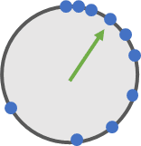
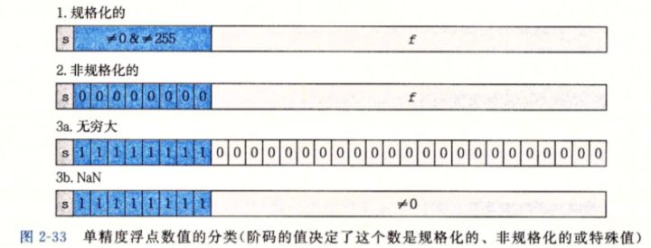

# 数值与进制

> **导读**：本文分两条线。前半是**表示**：整数与小数在计算机里怎么存，定点与浮点的取舍，IEEE 754 的位布局、间隔（ULP）以及 `FLT_EPSILON` 到底等于多少。后半是**算法**：高斯消元解线性方程组（含整数、浮点、异或三种模板与主元策略）和一元二次方程的数值稳定解法。文中标注了工程上最常见的精度陷阱，凡原笔记未给出依据的数值均重新核对。

---

## 1. 进制转换

### 1.1 十进制整数转 X 进制

**方法：除基取余，余数逆序。**

以 $N=6$ 转二进制为例：

```
6 / 2 = 3 ... 0
3 / 2 = 1 ... 1
1 / 2 = 0 ... 1
```

从最后一次余数往上读：$6_{10}=110_2$。

转十六进制同理，除以 16，余数用 $0\sim9,A\sim F$ 表示；八进制除以 8。伪代码：

```text
digits = "0123456789ABCDEF"
s = ""
while n > 0:
    s = digits[n % base] + s
    n = n / base
```

> 负数先取绝对值转换，再补符号（补码表示是另一套规则，见 2.5 节）。
> $N=0$ 要特判输出 `"0"`，否则循环一次都不执行，得到空串。

**为什么逆序**：第一次除得的余数是**最低位**（$N\bmod b$），最后一次商为 0 时的余数是最高位。按计算顺序拼接会把数字写反。

### 1.2 十进制小数转二进制

**方法：乘 2 取整，顺序读取。**

以 $0.8125$ 为例：

```
0.8125 × 2 = 1.625  → 1
0.625  × 2 = 1.25   → 1
0.25   × 2 = 0.5    → 0
0.5    × 2 = 1.0    → 1
```

顺序读取整数部分：$0.8125_{10}=0.1101_2$。验证：

$$
1\cdot2^{-1}+1\cdot2^{-2}+0\cdot2^{-3}+1\cdot2^{-4}=0.5+0.25+0.0625=0.8125 .
$$

**有限小数不一定能有限表示**。$0.1$ 的转换会进入循环：

```
0.1 × 2 = 0.2 → 0
0.2 × 2 = 0.4 → 0
0.4 × 2 = 0.8 → 0
0.8 × 2 = 1.6 → 1
0.6 × 2 = 1.2 → 1
0.2 × 2 = 0.4 → 0   ← 开始循环
```

故

$$
0.1_{10}=0.0\overline{0011}_2 .
$$

同理 $0.2_{10}=0.\overline{0011}_2$（循环节与 $0.1$ 相同，只是少一个前导 0）。这类误差会累积成 `0.1 + 0.2 != 0.3`（**双精度**；单精度的 `0.1f + 0.2f` 恰好等于 `0.3f`，是误差在加法中相互抵消的巧合，不能依赖）。这不是编译器出错，而是三个数都无法用有限二进制精确表示。

> **判据**：十进制小数 $p/q$（最简分数）能有限表示为二进制，当且仅当 $q=2^k$。所以 $0.5,0.25,0.125$ 可以，$0.1,0.2,0.3$ 不可以。

### 1.3 任意进制互转与精度

- $b$ 进制 → 十进制：按位加权 $\sum a_i b^i$。
- 十进制 → $b$ 进制：整数部分除基取余，小数部分乘基取整，两部分分别处理。
- 二/八/十六进制互转：$8=2^3$、$16=2^4$，可按 3 位/4 位一组直接替换，无需经过十进制。

**有效位数换算**：$b$ 进制下的 $d$ 位有效数字，约等价于十进制 $d\log_{10}b$ 位。例如 float 的 24 位二进制有效数字 $\approx24\times0.30103\approx7.22$ 位十进制，这就是"float 只有约 7 位有效数字"的来源。

---

## 2. 定点数与浮点数

### 2.1 定点数

**定义**：约定小数点在数中的**固定位置**，小数点前后的数字分别用二进制表示，拼接存储。

三种情形：

1. **纯整数**：小数点固定在最低位之后。例：8 bit 下 $100_{10}=01100100_2$。
2. **纯小数**：小数点固定在最高位之前。例：$0.125_{10}=0.00100000_2$。
3. **整数 + 小数**：约定小数点位置。例：8 bit 中约定"前 5 位整数、后 3 位小数"，
   $$
   1.5_{10}=00001\,100_2,\qquad 25.125_{10}=11001\,001_2 .
   $$

**固有矛盾**：

- 小数点越靠左 → 数值范围越小；
- 小数点越靠右 → 小数精度越低；
- 位宽固定时，**范围与精度不可兼得**。

例：8 bit、5 位整数 3 位小数时，整数部分最大 $11111_2=31$，小数部分最大 $0.111_2=0.875$；想表示更大范围只能加位宽或右移小数点，而右移会牺牲精度。

**因此**：现代计算机用定点数表示**整数**（整数的小数点本就在最低位，无需额外约定），用浮点数表示需要大动态范围的小数。

> 定点数的优点：加、减与整数相同（无舍入，溢出除外）；乘、除需右移截断，有量化误差（且会累积），但结果确定可复现，硬件简单。GPU 与 DSP 中大量使用定点（如 16.16 格式），就是为了确定性。

### 2.2 IEEE 754 单精度结构

32 位 float 的位布局：

```
| 1 位符号 s | 8 位指数 e | 23 位尾数 m |
```

- **符号位**：0 为正，1 为负。
- **指数字段**：8 位无符号整数，字面值 $0\sim255$，实际指数带固定偏移 **127**（bias）。字面值 127 表示实际指数 0。
- **尾数**：规格化数的首位一定是 1，故**省略不存**（hidden bit）。所以有效数字是 24 位，实际存储 23 位。

规格化数的值为

$$
\boxed{\;x=(-1)^s\times(1.m)_2\times2^{e-127}\;}
$$

以位模式 $0\,01111100\,0100\ldots0$ 为例：

$$
s=0,\qquad e=(01111100)_2=124,\qquad 1.m=(1.01)_2=1.25,
$$

$$
x=(+1)\times1.25\times2^{124-127}=1.25\times2^{-3}=0.15625 .
$$

**位段含义**（原图注记）：符号位 0 表示正数、1 表示负数；指数字段是 8 位无符号整数，字面值最大为 255，因为还要表示小于 1 的数，所以字面值要减去 127 才是真实指数；有效数位占 23 bit（原图写作"占位23bit"，已更正）。

原图另给一例 $0\,10000001\,1010\ldots0$：$e=(10000001)_2=129$，$1.m=(1.101)_2=1.625$，故 $x=1.625\times2^{2}=6.5$。

**指数范围**：字面值 0 与 255 被保留（分别表示次正规数与无穷/NaN），故规格化数的字面值范围是 $1\sim254$，对应实际指数

$$
E=e-127\in[-126,\ 127].
$$

> 注意：**不是 $-127\sim128$**。字面值 0 留给次正规数，字面值 255 留给特殊值，因此两端各少一个。这是原笔记中写对、但很多资料写错的地方。

**双精度 double**：1 位符号 + 11 位指数 + 52 位尾数，bias 1023，指数范围 $-1022\sim1023$，有效数字 53 位，$\varepsilon=2^{-52}\approx2.22\times10^{-16}$。

### 2.3 浮点数的间隔（ULP）与精度

**关键观察**：浮点数的分布不是均匀的，而是**越远离 0 越稀疏**。

以最小规格化正数 $0\,00000001\,000\dots0_2$ 为起点，每次给尾数加 1，走 $2^{23}$ 步后尾数溢出、指数进 1，到达 $0\,00000010\,000\dots0_2$。因此该区间内的间隔为

$$
\text{ULP}=\frac{2^{1}\cdot2^{-126}-2^{0}\cdot2^{-126}}{2^{23}}
=2^{-23}\cdot2^{-126}.
$$

一般地，对 $x\in[2^{e},2^{e+1})$，

$$
\boxed{\;\text{ULP}(x)=2^{e-23}\;}
$$

（float）。所以间隔随指数**翻倍增长**：

| 区间 | 间隔（ULP） |
|---|---|
| $[1,2)$ | $2^{-23}\approx1.192\times10^{-7}$ |
| $[2,4)$ | $2^{-22}\approx2.384\times10^{-7}$ |
| $[4,8)$ | $2^{-21}\approx4.768\times10^{-7}$ |
| $\cdots$ | $\cdots$ |
| $[2^{23},2^{24})$ | $1$ |
| $[2^{24},2^{25})$ | $2$ |

这就是 $2^{24}=16777216$ 之后**无法表示全部奇数**（间隔变为 2）的原因：$[2^{23},2^{24})$ 的间隔仍是 1，$8388608$、$8388609$ 都可精确表示；从 $16777216$ 起只有偶数可表示，$16777217$ 会被舍入到 $16777216$。



各区间的上下界与间隔（float）：

| 真实指数（无偏） | 偏移后指数 | 最小值 | 最大值 | 间隔 |
|---|---|---|---|---|
| $-1$ | $126$ | $0.5$ | $\approx0.999999940395$ | $\approx5.96046\times10^{-8}$ |
| $0$ | $127$ | $1$ | $\approx1.999999880791$ | $\approx1.19209\times10^{-7}$ |
| $1$ | $128$ | $2$ | $\approx3.999999761581$ | $\approx2.38419\times10^{-7}$ |
| $2$ | $129$ | $4$ | $\approx7.999999523163$ | $\approx4.76837\times10^{-7}$ |
| $10$ | $137$ | $1024$ | $\approx2047.999877930$ | $\approx1.22070\times10^{-4}$ |
| $11$ | $138$ | $2048$ | $\approx4095.999755859$ | $\approx2.44141\times10^{-4}$ |
| $23$ | $150$ | $8388608$ | $16777215$ | $1$ |
| $24$ | $151$ | $16777216$ | $33554430$ | $2$ |
| $127$ | $254$ | $\approx1.70141\times10^{38}$ | $\approx3.40282\times10^{38}$ | $\approx2.02824\times10^{31}$ |

**相对精度不变**：虽然绝对间隔在变大，但**间隔与数值之比**有界：对 $x\in[2^{e},2^{e+1})$，$\text{ULP}(x)/x=2^{e-23}/x\le2^{-23}$，即相邻可表示数之间的**相对间距不超过 $2^{-23}$**；而**就近舍入**的最大误差是间隔的一半，故舍入的相对误差不超过 $2^{-24}$。两者是不同量（间距 vs 舍入误差），不要混为一个上界。这就是浮点"浮"的意义：用固定的相对精度换取巨大的动态范围。

> 工程含义：世界坐标很大时（如 $10^6$），float 的绝对精度只有约 $0.06$，顶点会抖动、Z 值会 z-fighting。解决办法是**局部坐标原点**（camera-relative rendering）或改用 double。

### 2.4 三种状态

| 类型 | 指数位 | 尾数 | 含义 |
|---|---|---|---|
| **规格化数**（normal） | $1\sim254$ | 任意 | $(-1)^s(1.m)_2 2^{e-127}$ |
| **次正规数**（subnormal） | $0$ | $\ne0$ | $(-1)^s(0.m)_2 2^{-126}$ |
| **有符号零** | $0$ | $0$ | $\pm0$，且 $-0.0$ 严格等于 $+0.0$ |
| **无穷** | $255$ | $0$ | $\pm\infty$ |
| **NaN** | $255$ | $\ne0$ | 非数 |



**次正规数的作用**：让 0 附近平滑过渡（gradual underflow），避免"最小正数突然跳到 0"的断层。其值从 $2^{-149}$ 到约 $1.18\times10^{-38}$。

**最大值**：

$$
x_{\max}=(2-2^{-23})\times2^{127}\approx3.4028235\times10^{38}.
$$

**特殊运算规则**：

- `inf - inf = NaN`，`0 * inf = NaN`，`inf / inf = NaN`；
- 任何与 NaN 的比较（除 `!=`）都为 false，包括 `NaN == NaN`；
- `1/0 = +inf`：IEEE 754 规定此时置 **divideByZero 异常标志**，默认处理是返回 $\pm\infty$ 而不陷入（C++ 默认也不抛异常）；整数除零才是未定义行为。

> NaN 的位模式不止一个（尾数非零即可），所以判断 NaN 不能用位比较，要用 `x != x` 或 `isnan(x)`。

### 2.5 十进制浮点转二进制实例：$20.5$

1. **整数与小数分别转二进制**：
   $$
   20_{10}=10100_2,\qquad 0.5_{10}=0.1_2
   \;\Longrightarrow\;20.5_{10}=10100.1_2 .
   $$
2. **规格化**（小数点移到第一个 1 之后）：
   $$
   10100.1_2=1.01001_2\times2^{4}.
   $$
3. **指数位**：实际指数 $4$，加偏移 $127$：
   $$
   4+127=131=10000011_2 .
   $$
4. **尾数位**：省略前导 `1.`，取 `01001`，右侧补零到 23 位：
   $$
   01001000000000000000000 .
   $$
5. **拼接**：
   $$
   \underbrace{0}_{s}\ \underbrace{10000011}_{e}\ \underbrace{01001000000000000000000}_{m}
   $$

**浮点数的对称性**：因为符号位独立，正负数的间隔分布完全镜像；$+0$ 与 $-0$ 数值相等但位模式不同。

> **整数的定点表示（补码）**：$n$ 位有符号整数用最高位作符号位，负数取"按位取反加 1"。范围 $-2^{n-1}\sim2^{n-1}-1$。这与浮点的"符号 + 偏移指数"是两套完全不同的编码，不要混用位操作。

---

## 3. `FLT_EPSILON` 与浮点比较

### 3.1 定义

C99 标准：

> the difference between $1$ and the least value greater than $1$ that is representable in the given floating point type, $b^{1-p}$.

即"1 与**大于 1 的最小可表示浮点数**之间的差"。对 float（$b=2$，$p=24$）：

$$
\text{FLT\_EPSILON}=2^{1-24}=2^{-23}\approx1.192092896\times10^{-7}.
$$

`float.h` 中的定义：

```c
#define FLT_EPSILON 1.192092896e-07F  // smallest such that 1.0+FLT_EPSILON != 1.0
```

等价于 `std::numeric_limits<float>::epsilon()`。

**另一种等价算法**：在 $[2^0,2^1)=[1,2)$ 区间内，把 1 与 2 之间做 $2^{23}$ 等分（因为尾数域 23 位；连同隐含的首位 1，有效数字共 24 位），每份为

$$
\frac{2^1-2^0}{2^{23}}=2^{-23}.
$$

### 3.2 它不是"通用精度"

**关键纠正**：`FLT_EPSILON` 只是 **1 附近**的间隔。对其它数量级，间隔按 2.3 节翻倍：

$$
\varepsilon(x)\approx2^{-23}\lvert x\rvert .
$$

所以：

- 在 $x\approx1000$ 处，间隔约 $6.10\times10^{-5}$（$2^{-14}$，$x\in[2^9,2^{10})$）；
- 在 $x\approx10^6$ 处，间隔约 $0.0625$（$2^{-4}$，$x\in[2^{19},2^{20})$）；
- 在 $x\approx0.001$ 处，间隔约 $1.16\times10^{-10}$（即 $2^{-33}$；实测 `spacing(float32(1e-3))=1.1641532e-10`）。

注：$2^{-23}\lvert x\rvert$ 只是同量级的上界，实际间隔按 2 的幂分档，最多可比它小一半；具体值以上表为准。

用固定的 `FLT_EPSILON` 去比较 $10^6$ 量级的数，判据会**过严**——本来"视为相同"的两个 float 会被判为不等，差值 1 更不可能相等；去比较 $10^{-8}$ 量级的数，判据会**过松**——任何两个数都会被判为相等。两种情况都错。

### 3.3 正确的比较方式

**绝对误差**（只适用于已知量级，如"接近 0"）：

```cpp
bool nearlyZero(float a, float eps = 1e-6f) { return std::fabs(a) < eps; }
```

**相对误差**：

```cpp
bool nearlyEqualRel(float a, float b, float eps = 1e-6f) {
    float diff = std::fabs(a - b);
    float scale = std::max(std::fabs(a), std::fabs(b));
    return diff <= eps * scale;
}
```

**混合式**（推荐，兼顾 0 附近与大数）：

```cpp
bool nearlyEqual(float a, float b, float eps = 1e-5f) {
    float diff  = std::fabs(a - b);
    float scale = std::max(1.0f, std::max(std::fabs(a), std::fabs(b)));
    return diff <= eps * scale;
}
```

**ULP 比较**（最严格，适合需要精确位级一致性的场合）：把两个 float 的位模式按"同号当整数、异号做变换"映射为单调递增的整数，比较整数的差是否 $\le$ 若干 ULP。

**与 `FLT_EPSILON` 的关系**：`eps` 取 $k\cdot\text{FLT\_EPSILON}$ 时，表示"约 $k\sim2k$ 个 ULP 的误差"：容差是 $k\cdot2^{-23}\lvert b\rvert$，同一 binade 内 $\text{ULP}=2^{e-23}$，故折算成 ULP 是 $k\lvert b\rvert/2^{e}\in[k,\,2k)$——$\lvert b\rvert$ 恰为 2 的幂时取下界 $k$，接近 binade 上界时趋近 $2k$。$k=1$ 过严（一次运算就可能超），工程上常取 $k=4\sim32$。

### 3.4 常见精度陷阱

1. **大数吃小数**：`1e8f + 1.0f == 1e8f`，因为 $10^8$ 处 ULP 约为 8。
2. **灾难性抵消**：两个相近大数相减，有效位大幅丢失。例：$1.0000001-1.0000000$ 只剩 1 位有效数字（以单精度为例：1.0 附近 ULP 为 $1.19\times10^{-7}$，被减数 $1.0000001$ 被舍入到 $1+1\text{ULP}$（减数 $1.0$ 精确可表示），减法本身精确，但结果落在 $1.19\times10^{-7}$ 的格子上，相对误差约 19%；双精度下相对误差仅约 $5.8\times10^{-10}$，基本无损）。解二次方程、算方差、算法线时都要注意（见第 5、6 节的稳定化写法）。
3. **累加误差**：$10^7$ 次加法的误差按 $\sqrt{N}$ 或 $N$ 增长。对策：Kahan 求和、成对求和（pairwise）、或用 double 累加。
4. **不满足结合律**：`(a+b)+c != a+(b+c)`，并行归约的结果因此不确定。需要可复现性时用定点或固定归约顺序。
5. **整数与浮点互转**：超过 $2^{24}=16777216$ 后只有**部分**整数能被 float 精确表示（间隔依次为 2、4、8…；$2^{24}$ 以内的整数全部精确）；`float -> int` 截断而非四舍五入，且越界是未定义行为。
6. **`-ffast-math`**：允许重排、假设无 NaN/inf、把 `x/x` 化简为 1，会破坏上述所有判断，物理仿真与几何库慎用。

---

## 4. 高斯消元

### 4.1 基本思想

解 $n$ 元线性方程组 $A\mathbf x=\mathbf b$。把系数与常数写成**增广矩阵** $[A\mid\mathbf b]$，做初等行变换：

1. 交换两行；
2. 某行乘非零常数；
3. 某行加上另一行的倍数。

目标是把 $A$ 化为**上三角**（前向消元），再自下而上**回代**。

手算过程：消去 $x$ → 消去 $y$ → 得到 $z$ → 回代求 $y$ → 回代求 $x$。

三元方程组：

$$
\begin{cases}
2x+y+z=1, & \text{①}\\
6x+2y+z=-1, & \text{②}\\
-2x+2y+z=7, & \text{③}
\end{cases}
$$

消元后系数矩阵化为上三角：

$$
\begin{bmatrix}
2 & 1 & 1\\
0 & -1 & -2\\
0 & 0 & -4
\end{bmatrix}
$$

（对应增广矩阵末列为 $1,-4,-4$，回代得 $z=1,\ y=2,\ x=-1$。）

$$
[A\mid\mathbf b]\;\longrightarrow\;
\begin{bmatrix}
a_{11}&a_{12}&\cdots&a_{1n}&b_1\\
0&a'_{22}&\cdots&a'_{2n}&b'_2\\
\vdots&&\ddots&&\vdots\\
0&0&\cdots&a^{(n)}_{nn}&b^{(n)}_n
\end{bmatrix}
$$

**复杂度**：消元约 $\dfrac{n^3}{3}$ 次乘加，回代 $O(n^2)$，总体 $O(n^3)$。

### 4.2 列主元（partial pivoting）

第 $k$ 步消元要用 $a_{kk}$ 作除数。若它接近 0，误差会被放大。对策：在第 $k$ 列的 $k..n$ 行中选**绝对值最大**的元素，把它所在行换到第 $k$ 行：

$$
r=\arg\max_{i\ge k}\lvert a_{ik}\rvert,\qquad \text{swap}(\text{row}_k,\text{row}_r).
$$

这是"部分主元法"，代价仅为 $O(n^2)$ 次比较，却能把误差放大因子从任意大降到 $2^{n-1}$ 量级（实际远小于此）。**完全主元法**（同时选列）更稳但代价高，很少使用。

> 不选主元的经典反例：$A=\begin{pmatrix}10^{-20}&1\\1&1\end{pmatrix}$，直接消元会把 $1$ 消成 $-10^{20}$，结果完全失真。

### 4.3 解的判定

设消元后得到行阶梯形，非零行数为 $r=\operatorname{rank}(A)$。

| 条件 | 结论 |
|---|---|
| 存在行 $(0,\dots,0\mid c),\ c\ne0$ | **无解**（矛盾方程） |
| $r<n$ 且无矛盾行 | **无穷多解**，自由变量 $n-r$ 个 |
| $r=n$ 且无矛盾行 | **唯一解** |

**自由变量的含义**：$r<n$ 时，有 $n-r$ 个变量可以任取，其余变量由它们表出。这也是线性方程组"解空间维数 $=n-r$"的来源。

### 4.4 整数版模板（避免分数）

若系数全为整数，可用 **LCM 消元**避免浮点：对第 $i$ 行与第 $k$ 行，

$$
\text{LCM}=\operatorname{lcm}(\lvert a_{ik}\rvert,\lvert a_{kk}\rvert),\qquad
t_i=\frac{\text{LCM}}{\lvert a_{ik}\rvert},\quad t_k=\frac{\text{LCM}}{\lvert a_{kk}\rvert},
$$

$$
a_{ij}\leftarrow a_{ij}t_i-a_{kj}t_k\quad(\text{若 }a_{ik}a_{kk}<0\text{ 则 }t_k\text{ 取负}).
$$

```cpp
// 返回：-2 有浮点解无整数解；-1 无解；0 唯一解；>0 无穷解（返回自由元个数）
const int MAXN = 50;
int a[MAXN][MAXN];   // 增广矩阵，列数 var+1
int x[MAXN];
bool free_x[MAXN];
int mainCol[MAXN];   // mainCol[k] = 第 k 个主元所在列

int gcd(int a, int b) { return b ? gcd(b, a % b) : a; }
int lcm(int a, int b) { return a / gcd(a, b) * b; }   // 先除后乘防溢出

int Gauss(int equ, int var)
{
    for (int i = 0; i <= var; i++) { x[i] = 0; free_x[i] = true; }

    int col = 0, k;
    for (k = 0; k < equ && col < var; k++, col++) {
        // 1) 列主元
        int max_r = k;
        for (int i = k + 1; i < equ; i++)
            if (abs(a[i][col]) > abs(a[max_r][col])) max_r = i;
        if (max_r != k)
            for (int j = k; j < var + 1; j++) std::swap(a[k][j], a[max_r][j]);

        if (a[k][col] == 0) { k--; continue; }   // 该列下方全 0，处理下一列
        mainCol[k] = col;                        // 记录主元列，供 free_x 标记使用

        // 2) 用 LCM 消去下方各行
        for (int i = k + 1; i < equ; i++) {
            if (a[i][col] == 0) continue;
            int LCM = lcm(abs(a[i][col]), abs(a[k][col]));
            int ta = LCM / abs(a[i][col]);
            int tb = LCM / abs(a[k][col]);
            if (a[i][col] * a[k][col] < 0) tb = -tb;
            for (int j = col; j < var + 1; j++)
                a[i][j] = a[i][j] * ta - a[k][j] * tb;
        }
    }

    // 3) 无解
    for (int i = k; i < equ; i++)
        if (a[i][col] != 0) return -1;

    // 4) 无穷解：先按主元列标记 free_x，再返回自由元个数
    if (k < var) {
        std::fill(free_x, free_x + var, true);
        for (int i = 0; i < k; i++) free_x[mainCol[i]] = false;
        return var - k;
    }

    // 5) 唯一解：回代
    for (int i = var - 1; i >= 0; i--) {
        int temp = a[i][var];
        for (int j = i + 1; j < var; j++)
            if (a[i][j] != 0) temp -= a[i][j] * x[j];
        if (temp % a[i][i] != 0) return -2;   // 无整数解
        x[i] = temp / a[i][i];
    }
    return 0;
}
```

**整数版的容量限制**：LCM 会让中间值迅速膨胀，$n$ 稍大就会溢出 `int`。实用中要么用 `long long`/`__int128`，要么直接上浮点版。

### 4.5 浮点版模板

```cpp
const int N = 1010;
const double EPS = 1e-7;
double a[N][N], x[N];

int Gauss(int m, int n)   // m 个方程，n 个未知数
{
    int col = 0, k = 0;
    for (; k < m && col < n; ++k, ++col) {
        int r = k;
        for (int i = k + 1; i < m; ++i)
            if (fabs(a[i][col]) > fabs(a[r][col])) r = i;

        if (fabs(a[r][col]) < EPS) { k--; continue; }   // 该列全 0
        if (r != k)
            for (int i = col; i <= n; ++i) std::swap(a[k][i], a[r][i]);

        for (int i = k + 1; i < m; ++i)
            if (fabs(a[i][col]) > EPS) {
                double t = a[i][col] / a[k][col];
                for (int j = col; j <= n; j++) a[i][j] -= a[k][j] * t;
                a[i][col] = 0;
            }
    }

    for (int i = k; i < m; ++i)            // 无解
        if (fabs(a[i][n]) > EPS) return -1;

    if (k < n) return n - k;               // 自由元个数

    for (int i = n - 1; i >= 0; i--) {     // 回代
        double temp = a[i][n];
        for (int j = i + 1; j < n; ++j) temp -= x[j] * a[i][j];
        x[i] = temp / a[i][i];
    }
    return 0;
}
```

**`EPS` 的选择**：绝对阈值只适合系数已归一化的情况。更稳的做法是按列缩放（scaled partial pivoting），或用相对判据 `fabs(a[i][col]) < EPS * colMax`。

### 4.6 异或方程组（GF(2)）

开关问题、灯阵问题中每个变量只取 0/1，加法变为异或、乘法变为与：

$$
\bigoplus_{j} a_{ij}x_j=b_i,\qquad a_{ij},b_i\in\{0,1\}.
$$

消元时"用第 $k$ 行消第 $i$ 行"变成 `a[i][j] ^= a[k][j]`，回代变成

```cpp
x[i] = a[i][var];
for (int j = i + 1; j < var; j++)
    x[i] ^= (a[i][j] && x[j]);
```

解的结构同样由秩决定，但自由元只能取 0/1，常用**枚举自由元**求最优解：

```cpp
int fx[MAXN], nf;   // 自由元列号表

// free_x[] 是 bool 标记，不能直接拿来当下标；先转成列号表
void build_free_list()
{
    nf = 0;
    for (int j = 0; j < var; ++j)
        if (free_x[j]) fx[nf++] = j;
}

void enum_freex(int n, int &ans)   // n = 自由元个数（传入 nf）
{
    ans = 1e9 + 7;
    for (int mask = 0; mask < (1 << n); ++mask) {   // 前提 n ≤ 20（2^20 次枚举尚可接受）；n ≥ 31 时 1<<n 是未定义行为，而 §4.4 的 MAXN=50 远超此限，不可直接枚举
        int cnt = 0;
        for (int j = 0; j < n; ++j) {
            x[fx[j]] = (mask >> j) & 1;    // fx[j] 是自由元所在的列号
            cnt += x[fx[j]];
        }
        for (int k = var - n - 1; k >= 0; --k) {
            int index = k;
            while (index < var && !a[k][index]) index++;   // 找主元
            x[index] = a[k][var];
            for (int j = index + 1; j < var; ++j)
                if (a[k][j]) x[index] ^= x[j];
            cnt += x[index];
        }
        ans = std::min(ans, cnt);
    }
}
```

> 原笔记中该段内层循环写成 `for (index = k; k < var; index++)`，条件用了外层变量 `k`，会死循环/越界；上文的 `index < var` 是修正版。

**`free_x` 必须按主元列回填**：如果 `Gauss` 只在开头把 `free_x` 全部置 `true`、消元过程中不记录主元列，`free_x[j]` 就会恒等于下标 `j`，`enum_freex` 里的 `x[free_x[j]]` 下标就塌缩成 `0/1`，自由元列永远是初值 `0`，`x[0]` 还被重复计入——自由元枚举失效，求出的"最优解"可能根本不是解空间内的点。

上面的代码已在消元时记录 `mainCol[k] = col`，并在无穷解分支按主元列回填：

```cpp
std::fill(free_x, free_x + var, true);
for (int i = 0; i < k; i++) free_x[mainCol[i]] = false;   // 消元结束时的 k 即行阶梯形的非零行数
```

这样先调 `build_free_list()` 生成 `fx[]`，再以 `enum_freex(nf, ans)` 调用，枚举的才是那 $var-k$ 个自由元。

另需注意一个更隐蔽的坑：`free_x` 的类型是 `bool free_x[MAXN]`，所以 `x[free_x[j]]` 的下标只可能是 `0` 或 `1`。而这**不是"配错值"那么轻的问题**——自由元所在的那几列从头到尾都没有被赋值，`x[]` 里的自由元分量恒为初值 0，`cnt` 还会把 `x[0]` 重复计入。例如方程 `1 0 0 | 1`（`var=3`，自由元是第 1、2 列），mask 从 0 到 3 得到的是 `x=[1,0,0]/[1,0,0]/[1,1,0]/[1,1,0]`，`x[2]` 永远是 0。必须像上面那样先建立 `fx[]` 列号表。

（这类写法在内存上确实不越界——`x` 长度是 `MAXN`，`0/1` 都在界内——所以编译器不会报错，只会静默给出错误答案。）

### 4.7 数值稳定性小结

- **优先选主元**，且比较时用绝对值。
- **不要显式求逆**再乘：解 $A\mathbf x=\mathbf b$ 比算 $A^{-1}$ 稳定且快。
- **条件数** $\kappa(A)=\lVert A\rVert\lVert A^{-1}\rVert$ 衡量误差放大倍数；$\kappa$ 越大，解对输入扰动越敏感。float 下单精度有效位数约 7，若 $\log_{10}\kappa\approx7$，结果基本不可信。
- **稀疏矩阵**用专门算法（LU、Cholesky、共轭梯度），稠密高斯消元会破坏稀疏性。
- **对称正定**矩阵用 Cholesky 分解，稳定性与速度都优于通用消元。

---

## 5. 一元二次方程数值解

### 5.1 标准公式

$$
ax^2+bx+c=0,\quad a\ne0,
\qquad
\Delta=b^2-4ac,
$$

$$
x_{1,2}=\frac{-b\pm\sqrt{\Delta}}{2a}.
$$

判别式：

| $\Delta$ | 根的情况 |
|---|---|
| $>0$ | 两个不同实根 |
| $=0$ | 一个二重实根 $x=-b/(2a)$ |
| $<0$ | 一对共轭复根 $\dfrac{-b\pm j\sqrt{-\Delta}}{2a}$ |

**韦达定理**（后面稳定化要用）：

$$
x_1+x_2=-\frac{b}{a},\qquad x_1x_2=\frac{c}{a}.
$$

### 5.2 数值问题：灾难性抵消

当 $b^2\gg4ac$ 时，$\sqrt\Delta\approx\lvert b\rvert$，于是

$$
\frac{-b+\sqrt{\Delta}}{2a}
$$

的分子是两个相近的大数相减，有效数字大量丢失。例：$a=1,b=10^8,c=1$，在**单精度**下直接算会得到 $x_1=0$（真值约 $-10^{-8}$），相对误差 100%；双精度下同样的系数得到 $x_1\approx-7.5\times10^{-9}$，误差约 25%——抵消造成的有效位损失依然存在，只是没有被舍入完全吃掉。

### 5.3 稳定解法

**思路**：先算"两个根中绝对值大的那个"（同号相加，不抵消），再用韦达定理求另一个。

$$
q=-\frac{1}{2}\left(b+\operatorname{sgn}(b)\sqrt{\Delta}\right),
\qquad
x_1=\frac{q}{a},\qquad
x_2=\frac{c}{q}.
$$

- $b>0$：$q=-\frac12(b+\sqrt\Delta)$，$x_1$ 对应 $-b-\sqrt\Delta$（大根）；
- $b<0$：$q=-\frac12(b-\sqrt\Delta)=\frac{-b+\sqrt\Delta}{2}$，取到的是绝对值大的那个根；
- $b=0$：$q=-\frac12\sqrt\Delta$，两根为 $\pm\sqrt{-c/a}$，公式仍可用（取 $\operatorname{sgn}(0)=+1$）。

**代码**：

```cpp
// 返回实根个数；roots 按升序
int solveQuadratic(double a, double b, double c, double roots[2])
{
    if (fabs(a) < DBL_EPSILON * std::max(1.0, fabs(b))) {   // 退化为一次
        if (fabs(b) < DBL_EPSILON) return 0;
        roots[0] = -c / b;
        return 1;
    }
    double disc = b * b - 4.0 * a * c;
    if (disc < 0) return 0;
    double sq = sqrt(disc);
    double q  = -0.5 * (b + (b >= 0 ? sq : -sq));
    double x1 = q / a;
    double x2 = (fabs(q) > DBL_EPSILON) ? c / q : (-b / a - x1);
    roots[0] = std::min(x1, x2);
    roots[1] = std::max(x1, x2);
    return (disc == 0) ? 1 : 2;
}
```

验证 $a=1,b=10^8,c=1$：$\sqrt\Delta\approx10^8$，$q\approx-10^8$，$x_1=-10^8$，$x_2=c/q=-10^{-8}$，与真值一致。

### 5.4 其它注意事项

- **$a\approx0$**：方程退化为一次，必须特判，否则 $q/a$ 会溢出。判据用相对量 `fabs(a) < eps * max(1, fabs(b))`。
- **$\Delta\approx0$**：$\sqrt\Delta$ 的误差会被放大，重根附近解对系数极敏感（条件数 $\sim1/\sqrt\Delta$）。
- **几何来源**：射线与球求交、圆与直线求交都会归约到二次方程。球求交时用"半 $b$"形式（$b'=b/2$）可省一次乘法并减小误差：
  $$
  t=\frac{-b'\pm\sqrt{b'^2-ac}}{a}.
  $$
- **复数根**：需要时输出 $(-b/(2a),\ \pm\sqrt{-\Delta}/(2a))$，注意别把 $\Delta<0$ 当无解直接丢掉（几何上可能表示无交点，也可能需要复参数）。

---

## 6. 非线性方程数值解法

求 $f(x)=0$ 的根。线性方程（第 4 章）有直接解法，非线性方程一般没有：五次及以上多项式无根式解，含指数、对数、三角函数的方程更是如此。可行的路线只有迭代——从一个初始猜测出发，构造一串 $x_0,x_1,x_2,\dots$ 逼近根 $r$。

牛顿法与弦截法是同一思想的两端：都用一条**直线**近似曲线，把直线与 $x$ 轴的交点作为下一个迭代点。区别只在直线的取法——牛顿法取切线（需要导数），弦截法取割线（用两点函数值的差商代替导数）。

### 6.1 不动点迭代与收敛条件

把 $f(x)=0$ 改写成等价形式 $x=\varphi(x)$，然后迭代 $x_{k+1}=\varphi(x_k)$。设 $r$ 是不动点（$\varphi(r)=r$），记误差 $e_k=x_k-r$，$\varphi$ 在 $r$ 附近连续可微，则

$$
e_{k+1}=\varphi(r+e_k)-\varphi(r)=\varphi'(r)e_k+O(e_k^2).
$$

因此：

- $\lvert\varphi'(r)\rvert<1$ 时**局部收敛**，且是**线性收敛**，渐近误差比率为 $\lvert\varphi'(r)\rvert$；
- $\varphi'(r)=0$ 时收敛更快（下面会看到，牛顿法正是把 $\varphi'(r)$ 设计成 0）；
- $\lvert\varphi'(r)\rvert>1$ 时迭代发散——即使 $x_0$ 离根很近。

这条判据解释了一个常见误解："只要迭代式看着合理就会收敛"是错的。收敛性由 $\varphi$ 在根附近的导数决定，而 $\varphi$ 的构造方式（用切线还是割线）决定了这个导数的大小。

### 6.2 牛顿法

#### 6.2.1 迭代公式与几何解释

在 $x_k$ 处把 $f$ 展开成一阶泰勒式，得到切线

$$
y=f(x_k)+f'(x_k)(x-x_k).
$$

令 $y=0$ 解出 $x$，即得牛顿迭代式：

$$
\boxed{\;x_{k+1}=x_k-\frac{f(x_k)}{f'(x_k)}\;}
$$

**几何解释**：过点 $(x_k,f(x_k))$ 作曲线的切线，切线与 $x$ 轴的交点就是 $x_{k+1}$。等价说法是：用 $f$ 在 $x_k$ 处的**线性模型**代替 $f$，求这个线性模型的零点。曲线越接近直线（曲率越小），这一步就越准。


图中 $f(x)=x^3-x^2-5$，初始点 $x_0$ 在根右侧。第 1 个迭代点 $x_0$ 的切线与 $x$ 轴交于 $x_1$，第 2 个迭代点 $x_1$ 的切线与 $x$ 轴交于 $x_2$；因为 $f''>0$（曲线下凸）且 $f(x_0)>0$，迭代点从右侧单调左移逼近根。$x_k$ 在 $x_{k+1}$ 的右边，这是本图的情形，不是普遍规律——若初始点在根的左侧，方向相反。

#### 6.2.2 计算步骤（附实际算例）

原稿给出的流程：

1. 确定初始值 $x_0$ 和迭代精度 $\varepsilon$；
2. 计算 $x_1=x_0-\dfrac{f(x_0)}{f'(x_0)}$；
3. 若 $\lvert x_1-x_0\rvert<\varepsilon$，转 4；否则令 $x_0=x_1$，转 2；
4. 输出根 $x_1$。

流程本身没错，但只有公式、没有代入过程，容易在"精度怎么落地"上含糊。以图中函数 $f(x)=x^3-x^2-5$、$x_0=2$ 补上实际计算：

**第 1 步**：$f(2)=8-4-5=-1$，$f'(x)=3x^2-2x$，$f'(2)=12-4=8$，故

$$
x_1=2-\frac{-1}{8}=2.125 .
$$

**第 2 步**：$f(2.125)=9.595703125-4.515625-5=0.080078125$，$f'(2.125)=13.546875-4.25=9.296875$，故

$$
x_2=2.125-\frac{0.080078125}{9.296875}=2.125-0.008613445=2.116386555 .
$$

继续迭代（双精度计算）：

| $k$ | $x_k$ | $f(x_k)$ | $\lvert x_k-x_{k-1}\rvert$ |
|---|---|---|---|
| 0 | 2.000000000 | $-1.000000\times10^{0}$ | — |
| 1 | 2.125000000 | $8.007813\times10^{-2}$ | $1.250000\times10^{-1}$ |
| 2 | 2.116386555 | $3.981400\times10^{-4}$ | $8.613445\times10^{-3}$ |
| 3 | 2.116343300 | $1.000813\times10^{-8}$ | $4.325491\times10^{-5}$ |
| 4 | 2.116343299 | $-8.881784\times10^{-16}$ | $1.087363\times10^{-9}$ |

根为 $r\approx2.1163432986242117$。注意误差的下降节奏：$1.2\times10^{-1}\to8.6\times10^{-3}\to4.3\times10^{-5}\to1.1\times10^{-9}$，每步的有效位数大约翻倍（第 3 步到第 4 步直接从 $10^{-5}$ 跳到 $10^{-9}$），这就是下面要说的二阶收敛；到第 4 步时 $f(x_k)$ 已经是舍入噪声量级（$-8.88\times10^{-16}$），再迭代也不会变好。

#### 6.2.3 收敛阶：单根为二阶

设 $r$ 是单根（$f(r)=0$，$f'(r)\ne0$），$f$ 在 $r$ 附近二阶连续可微，记 $e_k=x_k-r$。由泰勒展开

$$
0=f(r)=f(x_k)+f'(x_k)(r-x_k)+\frac{f''(\xi_k)}{2}(r-x_k)^2
$$

即 $f(x_k)=f'(x_k)e_k-\dfrac{f''(\xi_k)}{2}e_k^2$。代入迭代式：

$$
x_{k+1}=x_k-\frac{f(x_k)}{f'(x_k)}
=x_k-e_k+\frac{f''(\xi_k)}{2f'(x_k)}e_k^2
=r+\frac{f''(\xi_k)}{2f'(x_k)}e_k^2 .
$$

所以

$$
\boxed{\;e_{k+1}\approx\frac{f''(r)}{2f'(r)}\,e_k^2\;}
\qquad\Longrightarrow\qquad
\lim_{k\to\infty}\frac{\lvert e_{k+1}\rvert}{\lvert e_k\rvert^2}=\left\lvert\frac{f''(r)}{2f'(r)}\right\rvert .
$$

即**二阶收敛（平方收敛）**：误差每步平方，有效位数翻倍。这也说明为什么初值只要"足够近"就够了——一旦进入收敛域，剩下的位数来得极快。

**收敛阶的定义**：若 $\lim_{k\to\infty}\dfrac{\lvert e_{k+1}\rvert}{\lvert e_k\rvert^{p}}=C\ne0$，称方法为 $p$ 阶收敛；$p=1$ 为线性，$1<p<2$ 为超线性，$p=2$ 为二次。

**二次收敛的代价**：要求 $f'(r)\ne0$。$f'(r)$ 越接近 0（曲线在根处越平），常数 $\lvert f''/2f'\rvert$ 越大，收敛越慢；$f'(r)=0$ 时阶数直接退化（见 6.2.6）。

#### 6.2.4 收敛性定理（充分条件）

原稿给出的定理：设 $f(x)$ 在 $[a,b]$ 上满足

1. $f(a)f(b)<0$ —— 保证区间内**存在**根（介值定理）；
2. $f'(x)\ne0$ —— $f$ 严格单调，根**唯一**；
3. $f''(x)$ 连续且**不变号** —— 曲线凹凸性不变，不会出现"切线来回穿越"的振荡；
4. 取 $x_0\in[a,b]$ 使 $f(x_0)f''(x_0)>0$ —— 初始点在"曲线凸向 $x$ 轴的那一侧"。

则由 $x_{k+1}=x_k-\dfrac{f(x_k)}{f'(x_k)}$ 确定的序列 $\{x_k\}$ 单调收敛于 $[a,b]$ 上的唯一根。

几点说明：

- 条件 3 与 4 合起来保证**迭代点始终留在 $[a,b]$ 内**且从一侧单调逼近，这正是 6.2.1 图中所画的行为；若初始点选在另一侧（$f(x_0)f''(x_0)<0$），第一个迭代点可能跳出区间，定理不再保证收敛。
- 原稿条件 4 写作 $f''(x)f(x_0)>0$，用的是 $f''(x)$ 而非 $f''(x_0)$。因条件 3 已限定 $f''$ 不变号，两者同号，条件等价；写成 $f(x_0)f''(x_0)>0$ 更便于现场判断。（原稿此处用 $f''(x)$，已统一为 $f''(x_0)$，含义不变。）
- 这是**充分**条件，不是必要。实践中很多函数不满足"$f''$ 不变号"，牛顿法照样收敛；反之满足条件也可能因舍入在最后几步抖动。定理给的是"可以放心用"的场景。

#### 6.2.5 初值敏感性：发散与循环

牛顿法的收敛是**局部**的。初值不好时，会出现四类典型失败。

**（1）两点循环**。取 $f(x)=x^3-2x+2$，$x_0=0$。$f'(x)=3x^2-2$。

$$
x_1=0-\frac{f(0)}{f'(0)}=0-\frac{2}{-2}=1,
$$

$$
x_2=1-\frac{f(1)}{f'(1)}=1-\frac{1}{1}=0 .
$$

于是 $x_3=1,\ x_4=0,\dots$，序列在 $0$ 与 $1$ 之间永久振荡，永不收敛。注意 $f$ 在这两点附近都很光滑、导数也不为零——失败纯粹来自初值落在了"坏区域"。该方程实际有一个实根 $r\approx-1.7693$，牛顿法从 $x_0=0$ 出发却永远到不了。

**（2）无界发散**。取 $f(x)=x^{1/3}$（实根 $r=0$）。$f'(x)=\frac13x^{-2/3}$，于是

$$
x_{k+1}=x_k-\frac{x_k^{1/3}}{\frac13x_k^{-2/3}}=x_k-3x_k=-2x_k .
$$

绝对值每步翻倍，$x_k=(-2)^k x_0$ 发散。原因：$f'(0)$ 不存在（趋于无穷），违反了"$f'(r)\ne0$"这一前提；而且这种发散**与初值多近无关**，只要 $x_0\ne0$ 就发散。

**（3）导数为零，迭代式直接失效**。$f(x)=x^2+1$ 无实根；若强行取 $x_0=0$，$f'(0)=0$，第一步就要除以 0。若取 $x_0\ne0$，迭代式化为 $x_{k+1}=\dfrac{x_k^2-1}{2x_k}=\dfrac12\left(x_k-\dfrac{1}{x_k}\right)$，实轴上同样不收敛。

**（4）初值过远导致"跳出去再回来"**。仍取 $f(x)=x^3-x^2-5$，但把初值换成 $x_0=1$：$f(1)=-5$，$f'(1)=1$，故 $x_1=1+5=6$，一步跳到根的另一侧且远大于根；再由 $f(6)=175$、$f'(6)=96$ 得 $x_2=6-175/96\approx4.177$。迭代仍在收敛，但前几步完全谈不上"逼近"，也说明 6.2.4 的条件一旦不满足，收敛性就失去保证，只能靠实际迭代观察。

> **工程做法**：不要无条件相信牛顿法。常见保护是"先二分、后牛顿"的混合策略——用 $f(a)f(b)<0$ 括住根，若牛顿步跳出区间 $[a,b]$ 就退回二分步。这样既保留二次收敛，又有全局收敛保证（Brent 法即在此思路上加入反二次插值）。

#### 6.2.6 重根情形

设 $r$ 是 $m$ 重根（$m\ge2$），即

$$
f(x)=(x-r)^m g(x),\qquad g(r)\ne0 .
$$

则 $f'(x)=(x-r)^{m-1}\left[mg(x)+(x-r)g'(x)\right]$，于是

$$
\frac{f(x)}{f'(x)}=\frac{(x-r)g(x)}{mg(x)+(x-r)g'(x)}
=\frac{x-r}{m}\left(1+O(x-r)\right).
$$

代入迭代式：

$$
x_{k+1}=x_k-\frac{f(x_k)}{f'(x_k)}
=r+\left(1-\frac{1}{m}\right)(x_k-r)+O\left((x_k-r)^2\right),
$$

即

$$
\boxed{\;e_{k+1}\approx\frac{m-1}{m}\,e_k\;}
$$

**二阶收敛退化为线性收敛**，比率 $(m-1)/m$：二重根 $1/2$，三重根 $2/3$，重数越高越接近 1（越难收敛）。

**算例**：$f(x)=(x-1)^2$，二重根 $r=1$。此时 $f'(x)=2(x-1)$，迭代式为

$$
x_{k+1}=x_k-\frac{(x_k-1)^2}{2(x_k-1)}=x_k-\frac{x_k-1}{2}=\frac{x_k+1}{2}.
$$

取 $x_0=3$：$3\to2\to1.5\to1.25\to1.125\to1.0625\to\cdots$，误差 $2,1,0.5,0.25,0.125,\dots$ 每步恰好减半，比率 $1/2=(2-1)/2$，与上式一致。要拿到 10 位精度约需 35 步——而同一起点对单根问题只需 4~5 步。

**补救：修改的牛顿法**。若重数 $m$ 已知，改用

$$
x_{k+1}=x_k-m\frac{f(x_k)}{f'(x_k)}
$$

可恢复二阶收敛。对上例 $m=2$：

$$
x_{k+1}=x_k-2\cdot\frac{(x_k-1)^2}{2(x_k-1)}=x_k-(x_k-1)=1,
$$

一步到位。$m$ 未知时可先估计重数。因为牛顿步长满足 $d_k=\dfrac{f(x_k)}{f'(x_k)}\approx\dfrac{e_k}{m}$，相邻两步有

$$
m\approx\frac{x_k-x_{k-1}}{d_k-d_{k-1}}
=\frac{x_k-x_{k-1}}{\dfrac{f(x_k)}{f'(x_k)}-\dfrac{f(x_{k-1})}{f'(x_{k-1})}} .
$$

仍以上例检验：$x_0=3,x_1=2$ 时 $d_0=4/4=1$、$d_1=1/2=0.5$，故 $m\approx(3-2)/(1-0.5)=2$，与真实重数一致。也可由收敛比率反推：$e_{k+1}/e_k\approx(m-1)/m$，即 $m\approx1/(1-\rho)$。若 $m$ 不便估计，只能接受线性收敛，或用更高精度的求根策略绕开重根。

**重根的判别**：若迭代显示"每步误差大致按固定比率缩小"而非"位数翻倍"，且 $f(x_k)$ 与 $f'(x_k)$ 同时趋于 0，基本可判定为重根。

#### 6.2.7 判停准则与伪代码

原稿给了两条判据：

1. **残差判据**：$\lvert f(x_k)\rvert\le\varepsilon_1$（原稿有误，已更正：原稿写作 `|f(x_k|`，漏了右括号）；
2. **误差判据**：$\lvert x_{k+1}-x_k\rvert<\varepsilon_2$（原稿有误，已更正：原稿漏了绝对值，写作 `x_{k+1} - x_k < ε2`；否则只要迭代点递减就会立刻"满足"，方向一反则永不满足）。

两条判据必须一起用，单用任一条都会误判：

- **只看步长**：$f$ 很平时，$x$ 几乎不动而离根还很远（误差约 $\lvert f\rvert/\lvert f'\rvert$），会提前停；
- **只看残差**：条件数大的问题里 $f$ 已经很小但 $x$ 仍偏得很远；反之 $f$ 的量纲很大时（如系数乘了 $10^6$）阈值 $\varepsilon_1$ 难以统一。

**原稿伪代码的问题**（原稿有误，已更正）：`float x1` 声明在 `for` 循环体内，`return x1` 在循环外，作用域不成立、无法编译；`f'(x0)` 处写成记号而非可调用对象；`abs` 作用于 `float` 会被提升/截断为整数（C++ 中应使用 `std::fabs` 或 `fabsf`）；`for(;;)` 无最大迭代次数，遇到 6.2.5 的循环情形会死循环。修正版：

```cpp
// 返回迭代次数；-1 表示失败（导数近零或超迭代上限）
int newton(double (*f)(double), double (*df)(double), double x0,
           double eps_x, double eps_f, int max_iter, double& root)
{
    double x = x0;
    for (int k = 0; k < max_iter; ++k) {
        double fx  = f(x);
        double dfx = df(x);
        if (std::fabs(dfx) < 1e-300) return -1;      // 切线水平，无法前进
        double x1 = x - fx / dfx;
        if (std::fabs(x1 - x) <= eps_x * (1.0 + std::fabs(x)) ||
            std::fabs(fx)      <= eps_f) {
            root = x1;
            return k + 1;
        }
        x = x1;
    }
    return -1;
}
```

要点：

- 步长判据写成 `eps_x * (1 + |x|)` 是**相对 + 绝对**的混合形式，避免 $x$ 很大时永远不满足、$x$ 很小时过早满足；
- 残差判据用 `|f(x)|`，量纲与 $f$ 有关，阈值要按问题定；
- 导数接近 0 时直接返回失败，而不是硬算出一个巨大的步长把迭代点抛到远处。

### 6.3 弦截法

#### 6.3.1 用差商代替导数

牛顿法每步都要算 $f'(x_k)$。若导数不存在、解析式过于复杂、或单次求值成本远高于 $f$ 本身，牛顿法就不合适。弦截法（secant method）的做法是：把导数换成**差商**

$$
f'(x_k)\approx\frac{f(x_k)-f(x_{k-1})}{x_k-x_{k-1}},
$$

即用过两点的割线斜率近似切线斜率。代入牛顿迭代式得

$$
\boxed{\;x_{k+1}=x_k-f(x_k)\cdot\frac{x_k-x_{k-1}}{f(x_k)-f(x_{k-1})}\;}
$$

（原稿有误，已更正：原稿标注 $k=2,3,4,\dots$，但初值只有 $x_0,x_1$，首个可算的是 $x_2$，对应 $k=1$；应为 $k=1,2,3,\dots$。）

原稿截图中的牛顿迭代式 $x_{k+1}=x_k-\dfrac{f(x_k)}{f'(x_k)}$ 属于公式截图，已转写为 LaTeX，不再以图片形式保留。

这是**拟牛顿法**的一维特例：用差商矩阵（一维即标量）近似导数/雅可比，避免解析求导。代价是"精度"换"通用性"——差商只是 $f'$ 的近似，收敛阶会下降（见 6.3.4）。

#### 6.3.2 几何意义


1. 取两个初始点 $P_0(x_0,f(x_0))$、$P_1(x_1,f(x_1))$；
2. 作直线 $P_0P_1$，它与 $x$ 轴的交点记为 $(x_2,0)$，得到第二个迭代点 $P_2$；
3. 丢弃 $P_0$，用 $P_1,P_2$ 作新的割线得 $x_3$；如此滚动，直到满足精度。

图中 $x_0>x_1>x_2>x_3>x_4$，迭代点从右向左单调逼近根（曲线在该段下凸、且两点都在根右侧）。原图注记"初始迭代点 $P_0$ 和 $P_1$ 算一个迭代点"，意思是：$P_0,P_1$ 只是**起点**，真正的第一次迭代产出的是 $x_2$——这与牛顿法"$x_0$ 是起点、第一次迭代产出 $x_1$"的口径不同，数迭代次数时容易差一。

**与二分法/试位法的区别**：弦截法只要求两点，**不要求异号**，所以不保证根始终被括在区间内；一旦两点落在同侧且函数弯曲，割线可能把 $x_{k+1}$ 抛到很远。试位法（regula falsi）强制保留异号端点，牺牲速度换"根始终在括号内"。

#### 6.3.3 计算步骤

原稿流程：

1. 选择初始迭代值 $x_0,x_1$ 及误差精度 $\varepsilon$；
2. 按迭代公式计算 $x_2$；
3. 如果 $\lvert x_1-x_0\rvert<\varepsilon$，转 4；否则 $x_0=x_1,\ x_1=x_2$，转 2；
4. 输出满足精度的根 $x_2$。

第 3 步的判据用的是**上一步**的步长 $\lvert x_1-x_0\rvert$，而不是刚算出的新步长 $\lvert x_2-x_1\rvert$（原稿有误，已更正：应判断新步长 $\lvert x_2-x_1\rvert<\varepsilon$）。按原写法终止会**滞后一步**：当 $\lvert x_2-x_1\rvert$ 已达标、但 $\lvert x_1-x_0\rvert$ 未达标时，会白算一轮；反之若上一步很大而新步很小，则要多迭代一次才退出。

修正后的流程：

1. 取初值 $x_0,x_1$（尽量靠近根，且 $f(x_0)\ne f(x_1)$）与精度 $\varepsilon_x,\varepsilon_f$；
2. 由 $x_0,x_1$ 算 $x_2$；
3. 若 $\lvert x_2-x_1\rvert<\varepsilon_x$ 或 $\lvert f(x_2)\rvert<\varepsilon_f$，输出 $x_2$；否则 $(x_0,x_1)\leftarrow(x_1,x_2)$，转 2（并设最大迭代次数兜底）。

**算例**：仍取 $f(x)=x^3-x^2-5$，$x_0=2$、$x_1=2.125$。

第一步：$f(x_0)=-1$，$f(x_1)=0.080078125$，差商

$$
\frac{f(x_1)-f(x_0)}{x_1-x_0}=\frac{0.080078125+1}{0.125}=8.640625,
$$

$$
x_2=2.125-\frac{0.080078125}{8.640625}=2.125-0.009267631=2.115732369 .
$$

| $k$ | $x_k$ | $f(x_k)$ |
|---|---|---|
| 0 | 2.000000000 | $-1.000000\times10^{0}$ |
| 1 | 2.125000000 | $8.007813\times10^{-2}$ |
| 2 | 2.115732369 | $-5.621026\times10^{-3}$ |
| 3 | 2.116340235 | $-2.819950\times10^{-5}$ |
| 4 | 2.116343300 | $1.001464\times10^{-8}$ |
| 5 | 2.116343299 | $-1.599\times10^{-14}$ |

根同为 $r\approx2.1163432986242117$。与 6.2.2 的牛顿表对比：牛顿法 4 步到机器精度，弦截法 5 步——但弦截法每步只新增**一次**函数求值（$f(x_k)$ 复用上一轮），牛顿法每步要一次 $f$ 加一次 $f'$。若 $f'$ 的求值代价不低于 $f$，弦截法的总计算量相当甚至更少。

#### 6.3.4 收敛阶：黄金比 $p\approx1.618$

设 $r$ 为单根，$f'(r)\ne0$。记 $e_k=x_k-r$。由泰勒式

$$
f(x_k)=f'(r)e_k+\frac{f''(r)}{2}e_k^2+O(e_k^3),
$$

差商的分母为

$$
f(x_k)-f(x_{k-1})=f'(r)(e_k-e_{k-1})+\frac{f''(r)}{2}\left(e_k^2-e_{k-1}^2\right)+O(e^3)
=(e_k-e_{k-1})\left[f'(r)+\frac{f''(r)}{2}(e_k+e_{k-1})\right]+O(e^3).
$$

于是

$$
\frac{f(x_k)(x_k-x_{k-1})}{f(x_k)-f(x_{k-1})}
=\frac{\left[f'e_k+\frac{f''}{2}e_k^2\right](e_k-e_{k-1})}{(e_k-e_{k-1})\left[f'+\frac{f''}{2}(e_k+e_{k-1})\right]}
\approx e_k\left[1+\frac{f''}{2f'}e_k-\frac{f''}{2f'}(e_k+e_{k-1})\right]
= e_k\left[1-\frac{f''}{2f'}e_{k-1}\right].
$$

代入 $x_{k+1}=x_k-\dfrac{f(x_k)(x_k-x_{k-1})}{f(x_k)-f(x_{k-1})}$：

$$
x_{k+1}=x_k-e_k+\frac{f''}{2f'}e_ke_{k-1}
=r+\frac{f''(r)}{2f'(r)}\,e_k e_{k-1}+O(e^3),
$$

即

$$
\boxed{\;e_{k+1}\approx C\,e_k e_{k-1},\qquad C=\frac{f''(r)}{2f'(r)}\;}
$$

**求阶数**：设 $\lvert e_{k+1}\rvert\approx K\lvert e_k\rvert^{p}$，则 $\lvert e_k\rvert\approx K\lvert e_{k-1}\rvert^{p}$，从而

$$
\lvert e_{k+1}\rvert\approx K\left(K\lvert e_{k-1}\rvert^{p}\right)^{p}
=K^{1+p}\lvert e_{k-1}\rvert^{p^2}.
$$

另一方面由误差递推 $\lvert e_{k+1}\rvert\approx C\lvert e_k\rvert\lvert e_{k-1}\rvert\approx CK\lvert e_{k-1}\rvert^{p+1}$，两式指数必须相同：

$$
p^2=p+1\qquad\Longrightarrow\qquad p=\frac{1+\sqrt5}{2}\approx1.618 .
$$

所以弦截法是 **$p\approx1.618$ 阶超线性收敛**，慢于牛顿法的二阶，但明显快于线性。

> 记忆点：牛顿法每步把误差**平方**，弦截法每步把误差乘以"前两步误差的乘积"，因此阶数满足 $p^2=p+1$。每步新增信息量不同——牛顿法多用了导数信息，弦截法只用两个函数值。

#### 6.3.5 实现细节与停止条件

**（1）分母保护**。迭代式的分母是 $f(x_k)-f(x_{k-1})$。当两点函数值几乎相同（$f$ 在该段近水平，或 $x_k$ 已非常接近 $x_{k-1}$）时，差商失真甚至除零。必须显式检查：

```cpp
if (std::fabs(f1 - f0) <= 1e-300) return -1;   // 或改用退化处理
```

**（2）两个初值不能重合**，且 $f(x_0)\ne f(x_1)$。若 $x_0=x_1$，第一步就除零；若 $f(x_0)=f(x_1)$ 但 $x_0\ne x_1$（如对称的两点），差商为 0，迭代式同样失效。

**（3）判停三件套**：步长、残差、迭代上限。与牛顿法一致，且步长建议用相对形式。弦截法**不保证误差单调下降**，所以判停不能依赖"连续两次都变小"。

**（4）收敛后的精度极限**。$e_{k+1}\approx Ce_ke_{k-1}$ 只是渐近关系，真正让迭代停下来的是**舍入**：迭代点进入真根的约一个 ULP（双精度约 $10^{-16}$ 量级）后，误差不再下降，继续迭代也只在真根附近抖动。这里提到的 $\sqrt{\varepsilon_{\text{mach}}}\approx10^{-8}$ 只适用于**$f$ 的求值本身带噪声**的情形——若单次求值的噪声水平为 $\delta$，由误差递推可分辨的误差下限约为 $\sqrt{\delta}$；纯双精度、$f$ 可精确计算时，弦截法通常 4~5 步就到真根，表格里看到的 $10^{-9}$ 是真实步长（$x_4$ 与 $x_5$ 之差 $1.09\times10^{-9}$），说明仍在收敛（$x_5$ 距真根约 $2\times10^{-15}$），不是停滞。若要更高精度，最后几步换成牛顿步（若有导数）或用更高精度类型。

**（5）原稿伪代码的问题**（原稿有误，已更正）：`x2` 声明在 `while` 块内却在循环外 `return x2`，作用域不成立；`x1` 从未赋初值就被使用（原注释只写了 input: x0, f(x)）；`abs` 用于浮点应改 `std::fabs`；每轮重新计算 `f(x0)`、`f(x1)`，浪费了一半求值（应滚动保存）；`while` 条件在进入时若已满足会直接返回未初始化的 `x2`。修正版：

```cpp
// 返回迭代次数；-1 表示失败
int secant(double (*f)(double), double x0, double x1,
           double eps_x, double eps_f, int max_iter, double& root)
{
    double f0 = f(x0), f1 = f(x1);
    for (int k = 1; k <= max_iter; ++k) {
        double denom = f1 - f0;                       // 差商分母
        if (std::fabs(denom) < 1e-300) return -1;     // 两点函数值几乎相同
        double x2 = x1 - f1 * (x1 - x0) / denom;
        double f2 = f(x2);
        if (std::fabs(x2 - x1) <= eps_x * (1.0 + std::fabs(x1)) ||
            std::fabs(f2)      <= eps_f) {
            root = x2;
            return k;
        }
        x0 = x1; f0 = f1;                              // 滚动，复用函数值
        x1 = x2; f1 = f2;
    }
    return -1;
}
```

**（6）实用变体**。工业生产中很少直接用裸弦截法，而是用带保护的混合法：Brent 法在"反二次插值 / 弦截 / 二分"之间选择，兼顾速度与必收敛。若问题允许括根（已知 $f(a)f(b)<0$），优先用这类"有保证"的算法。

### 6.4 牛顿法与弦截法对比

| 项目 | 牛顿法 | 弦截法 |
|---|---|---|
| 迭代式 | $x_{k+1}=x_k-\dfrac{f(x_k)}{f'(x_k)}$ | $x_{k+1}=x_k-f(x_k)\dfrac{x_k-x_{k-1}}{f(x_k)-f(x_{k-1})}$ |
| 几何图像 | 切线与 $x$ 轴交点 | 割线与 $x$ 轴交点 |
| 初始值个数 | 1 个 | 2 个 |
| 每步所需信息 | $f(x_k)$ 与 $f'(x_k)$ | 只需 $f$（复用上一轮的 $f(x_{k-1})$） |
| 每步新增函数求值 | 2 次（$f$、$f'$） | 1 次 |
| 收敛阶（单根） | $p=2$（二次） | $p=\dfrac{1+\sqrt5}{2}\approx1.618$（超线性） |
| 误差递推 | $e_{k+1}\approx\dfrac{f''}{2f'}e_k^2$ | $e_{k+1}\approx\dfrac{f''}{2f'}e_ke_{k-1}$ |
| 收敛类型 | 局部收敛（条件见 6.2.4） | 局部收敛，且不存在 $f'=0$ 导致的失效 |
| 重根 | 退化为线性，比率 $\dfrac{m-1}{m}$ | 同样退化为线性附近，具体阶数与重数的关系（待核实） |
| 主要失效模式 | 初值差导致发散/循环；$f'(x_k)\approx0$ | 分母 $f(x_k)-f(x_{k-1})\approx0$；初值重合 |
| 是否保证根在括号内 | 否 | 否（试位法才保证） |
| 适用场景 | 导数易求且便宜；需要极限精度 | 导数不存在/极贵；$f$ 求值便宜 |

**关于"弦截法更快"的说法**：原稿写"如果函数比较复杂，则弦截法通常要快于牛顿法"。更准确的表述是（原稿表述不严谨，已补充）：弦截法**单次迭代更便宜**，但**迭代次数更多**（约 $1.6$ 阶 vs $2$ 阶，同等精度下多 1~2 步）；总耗时谁更短，取决于 $f'$ 的求值成本相对 $f$ 的倍数。若 $f'$ 与 $f$ 同价，两者总代价接近；若 $f'$ 昂贵或不存在（如黑箱仿真、分段定义函数），弦截法明显占优；若导数解析可得且便宜，牛顿法更快且精度更高。

> **一句话选择**：能写导数、初值可控 → 牛顿法；导数拿不到、$f$ 是黑箱 → 弦截法；要求万无一失 → 带括号保护的混合法（Brent）。

---

## 原始笔记索引

- `Math/十进制转X进制.md`
- `C++/操作系统/十进制转二进制.md`
- `C++/操作系统/定点数和浮点数.md`（仅保留数学视角，位运算/C++ 细节归入 C++ 篇）
- `C++/操作系统/FLT_EPSILON.md`
- `Math/高斯消元快速入门.md`
- `Math/高斯消元模板.md`
- `Math/高斯消元法小总结和瞎总结 - 如不如此都如此的博客 - CSDN博客.md`
- `Math/一元二次方程的解.md`
- `非线性方程数值解法/牛顿法.md`
- `非线性方程数值解法/弦截法.md`