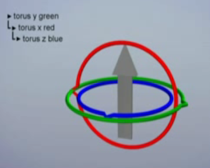
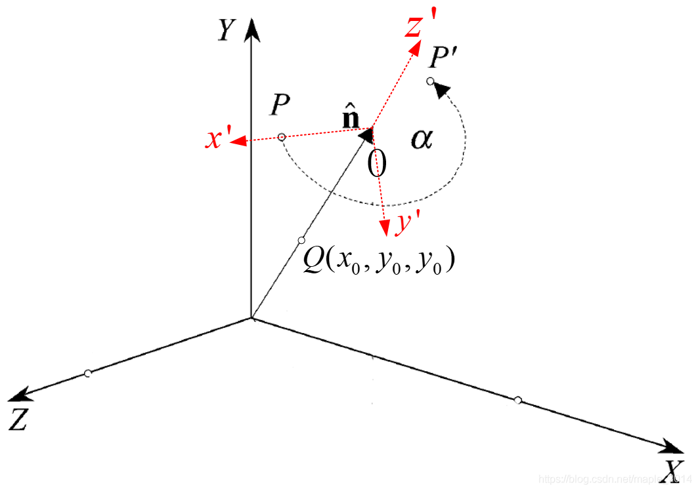
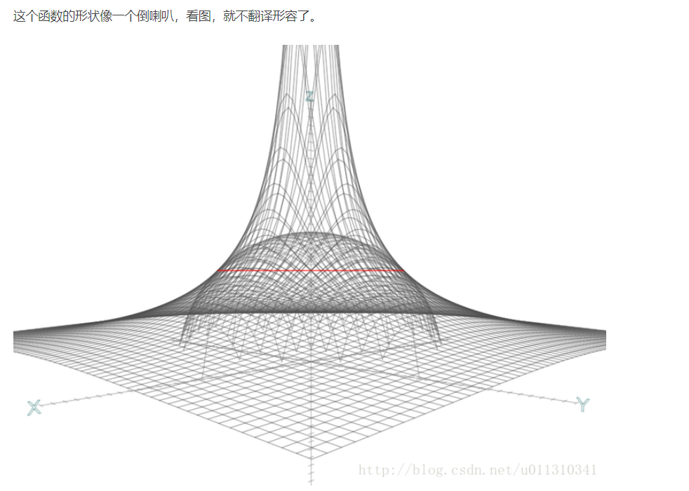

# 旋转表示：欧拉角、轴角与轨迹球

> 本文梳理三维旋转的几种表示方式及其转换：欧拉角与万向锁、绕任意轴旋转（Rodrigues 公式）、从变换矩阵中分解 TRS，以及用 ArcBall 交互式构造旋转。四元数本身的定义与插值见《04_四元数与旋转》。

## 欧拉角

欧拉角用三个角度描述物体分别绕三个坐标轴的旋转。**本文的轴序字符串按"施加顺序"书写**：`YXZ` 表示先绕 Y、再绕 X、最后绕 Z；按本文采用的**内旋（随体轴）**基准，其复合矩阵为乘积 $R_yR_xR_z$（内旋下先施加的在最左）。这与《04_四元数与旋转》按"矩阵乘积顺序"书写的记法相反（那边 `ZYX` 才表示先 X 再 Y 再 Z），跨篇阅读时请注意对照。

按旋转轴是否随物体运动，分为两类：

- **静态欧拉角（extrinsic / 固定轴）**：绕世界坐标系的固定轴旋转，坐标轴在旋转过程中保持不动。
- **动态欧拉角（intrinsic / 随体轴）**：绕物体自身的坐标轴旋转，坐标轴随物体一起转动。

两者用不同的轴序可以表示同一组旋转：intrinsic 的 `XYZ` 与 extrinsic 的 `ZYX` 展开后是同一条乘积式，只是轴序反转，**奇异面（万向锁）完全相同**。所以不存在"动态旋转更容易出现万向锁"——是否撞上奇异面取决于轴序与运动方向（中间轴是否会被转到 ±90°），而不是静态/动态这个分类。

### 万向锁（Gimbal Lock）

欧拉角的三个旋转是**有层级、有固定顺序**的：先绕第一个轴转，再绕第二个轴转，最后绕第三个轴转，前面的旋转会带着后面的旋转轴一起动。

当**中间轴**旋转到 ±90° 时，第三个旋转轴会与第一个旋转轴重合，两个轴控制同一个自由度，于是三个角度只剩两个独立自由度——这就是万向锁。此时继续调整第一/第三个角只会产生同一种旋转，无法再绕丢失的那个方向旋转。

以 `YXZ` 为例：绕 X 转 90° 后，Z 轴落到 $-Y$ 方向，与首轴（Y）**反向共线**，第三轴与第一轴控制同一个自由度，Y 与 Z 的旋转效果退化为同一种（绕同一条直线、方向相反）。

避免方式：

1. 使用四元数或旋转矩阵表示和累乘旋转；
2. 若必须用欧拉角，避免中间轴接近 ±90°，或改用轴序使关键运动不落在中间轴上；
3. 插值时对欧拉角做特殊处理（如展开角度、选择最短路径），但无法从根本消除奇异性。

## 绕任意轴旋转

设旋转轴为单位向量 $\mathbf{k}=(k_x,k_y,k_z)$，旋转角为 $\theta$，待旋转向量为 $\mathbf{v}$。Rodrigues 旋转公式：

$$
\mathbf{v}' = \mathbf{v}\cos\theta + (\mathbf{k}\times\mathbf{v})\sin\theta + \mathbf{k}(\mathbf{k}\cdot\mathbf{v})(1-\cos\theta)
$$

其中第二项是垂直于轴的分量旋转 90° 的结果，第三项把平行于轴的分量保持不变。

写成矩阵形式（列向量约定）：

$$
R(\mathbf{k},\theta) =
\begin{bmatrix}
c+k_x^2(1-c) & k_xk_y(1-c)-k_z s & k_xk_z(1-c)+k_y s \\
k_yk_x(1-c)+k_z s & c+k_y^2(1-c) & k_yk_z(1-c)-k_x s \\
k_zk_x(1-c)-k_y s & k_zk_y(1-c)+k_x s & c+k_z^2(1-c)
\end{bmatrix},
\quad
\begin{aligned}
c &= \cos\theta\\
s &= \sin\theta
\end{aligned}
$$

这就是 OpenGL `glRotate(angle, x, y, z)` 内部构造的矩阵。

### 问题描述与几何推导

**问题描述**

对于三维空间任意一点 $P(p_x,p_y,p_z)$，求绕任意轴线旋转角度 $\alpha$ 得到新的点 $P'(p'_x,p'_y,p'_z)$。轴线的单位方向向量为 $\hat{\mathbf{n}}$（$n_x^2+n_y^2+n_z^2=1$），且过点 $Q(x_0,y_0,z_0)$。

*图：轴线 $\hat{\mathbf{n}}$ 过点 $Q(x_0,y_0,z_0)$，点 $P$ 绕轴旋转 $\alpha$ 得到 $P'$；红色虚线为随轴建立的局部坐标系 $x'y'z'$。*

**推导步骤**

轴线 $\hat{\mathbf{n}}$ 在坐标系 $XYZ$ 下的直线方程为：

$$
\begin{cases}
x = x_0 + n_x t\\
y = y_0 + n_y t\\
z = z_0 + n_z t
\end{cases}
\tag{1}
$$

弧 $PP'$ 所在平面在坐标系 $XYZ$ 下的平面方程为：

$$
n_x(x-p_x) + n_y(y-p_y) + n_z(z-p_z) = 0
\tag{2}
$$

根据式 (1) 和式 (2)，且 $n_x^2+n_y^2+n_z^2=1$，可以求得：

$$
t_0 = n_x(p_x-x_0) + n_y(p_y-y_0) + n_z(p_z-z_0)
\tag{3}
$$

设弧 $PP'$ 的圆心在坐标系 $XYZ$ 下的坐标为 $(x_c,y_c,z_c)$，将 $t_0$ 代入式 (1)，得圆心坐标：

$$
\begin{cases}
x_c = x_0 + n_x t_0\\
y_c = y_0 + n_y t_0\\
z_c = z_0 + n_z t_0
\end{cases}
\tag{4}
$$

圆半径 $r$：

$$
r = \sqrt{(p_x-x_c)^2 + (p_y-y_c)^2 + (p_z-z_c)^2}
\tag{5}
$$

向量 $CP$（圆心 $C$ 指向点 $P$）：

$$
CP = [\,p_x-x_c \quad p_y-y_c \quad p_z-z_c\,]^{T} / r
\tag{6}
$$

如上图，建立坐标系 $x'y'z'$，根据右手法则：

$$
y' = [\,n_x \quad n_y \quad n_z\,]^{T} \times CP
\tag{7}
$$

坐标系 $x'y'z'$ 与坐标系 $XYZ$ 的旋转变换矩阵为：

$$
R_{3\times3} = [\,CP \quad y' \quad \hat{\mathbf{n}}\,]
\tag{8}
$$

点 $P'$ 在坐标系 $x'y'z'$ 的坐标为：

$$
\begin{cases}
x_{temp} = r\cos(\alpha)\\
y_{temp} = r\sin(\alpha)\\
z_{temp} = 0
\end{cases}
\tag{9}
$$

使用要点：

1. 旋转轴必须先**单位化**，否则矩阵不再正交：既引入剪切、又使整体缩放，实际转角也不再等于 $\theta$。
2. 旋转是围绕**过原点的轴**进行的；若要绕空间中任意一条轴（不经过原点）旋转，必须先把顶点平移到以轴上一点为原点的坐标系，旋转后再平移回去：

$$
\mathbf{v}' = T(\mathbf{p})\,R(\mathbf{k},\theta)\,T(-\mathbf{p})\,\mathbf{v}
$$

3. 多个旋转按矩阵左乘/右乘的顺序复合，注意列向量约定下“先施加的变换在右边”——这条对**外旋（固定轴）**成立；**内旋（随体轴）**正相反，先施加的在最左。

## 从变换矩阵中提取平移、旋转、缩放

设 $M=T\,R\,S$（先缩放、再旋转、最后平移），在列向量约定下：

$$
M=\begin{bmatrix}
R\,S & \mathbf{t}\\
\mathbf{0}^T & 1
\end{bmatrix}
$$

各分量的提取顺序与规则：

1. **平移**：取第 4 列的 $x,y,z$，即 $\mathbf{t}=(m_{03},m_{13},m_{23})$。（本节下标按自然顺序，$m_{ij}$ 中 $i$ 为行号、$j$ 为列号；后文「补充：变换顺序与矩阵元素提取」一节的矩阵沿用原图的列主序写法 $m_{ij}$ 中 $i$ 为列号、$j$ 为行号，同一分量写作 $m_{30},m_{31},m_{32}$。）
2. **缩放**：取三个基向量（第 0/1/2 列）的模长：

$$
s_x=\|\mathbf{c}_0\|,\quad s_y=\|\mathbf{c}_1\|,\quad s_z=\|\mathbf{c}_2\|
$$

其中 $\mathbf{c}_i$ 为矩阵第 $i$ 列的前三个分量。
3. **旋转**：把三列分别除以对应缩放，得到正交基：

$$
\mathbf{r}_i=\frac{\mathbf{c}_i}{s_i}
$$

若存在剪切或数值误差，三列不一定严格正交，需要用 Gram-Schmidt 正交化（或对矩阵做极分解）修正。
4. **负缩放/镜像**：当 $\det(M)<0$ 时，通常把负号归到某一个轴上（常见做法是令 $s_x$ 为负），并在旋转矩阵中补偿，否则提取出的“旋转”含反射，不再是纯旋转。
5. **剪切（shear）**：若 $M$ 含剪切，TRS 分解不唯一，需要先做 QR/极分解，或明确约定把剪切归入某一轴。

### 补充：变换顺序与矩阵元素提取（OpenGL 示例）

**矩阵知识**

矩阵变换：$M \times P$。

以点 $P(1,1,0,1)$ 为例，对它进行平移、旋转、缩放操作，现在讨论这三种变换的先后顺序的问题，下面的讨论以 OpenGL 中的坐标系统及矩阵为基础。

设平移为分别沿 $x,y$ 轴方向移动 -1 单位，平移矩阵

$$
T=\begin{bmatrix}
1 & 0 & 0 & -1\\
0 & 1 & 0 & -1\\
0 & 0 & 1 & 0\\
0 & 0 & 0 & 1
\end{bmatrix}
$$

设旋转为绕 $z$ 轴顺时针旋转 45°，旋转矩阵

$$
R=\begin{bmatrix}
\frac{\sqrt{2}}{2} & \frac{\sqrt{2}}{2} & 0 & 0\\
-\frac{\sqrt{2}}{2} & \frac{\sqrt{2}}{2} & 0 & 0\\
0 & 0 & 1 & 0\\
0 & 0 & 0 & 1
\end{bmatrix}
$$

设缩放在 $x,y$ 轴方向上的因子为 2，$z$ 的为 1，缩放矩阵为

$$
S=\begin{bmatrix}
2 & 0 & 0 & 0\\
0 & 2 & 0 & 0\\
0 & 0 & 1 & 0\\
0 & 0 & 0 & 1
\end{bmatrix}
$$

**A. 讨论平移与旋转的顺序**

a. 先旋转后平移

$$
M = T \times R =
\begin{bmatrix}
\frac{\sqrt{2}}{2} & \frac{\sqrt{2}}{2} & 0 & -1\\
-\frac{\sqrt{2}}{2} & \frac{\sqrt{2}}{2} & 0 & -1\\
0 & 0 & 1 & 0\\
0 & 0 & 0 & 1
\end{bmatrix}
$$

由上矩阵相乘的结果可知，在这种情况下，矩阵连乘后的结果各变换系数不变。

b. 先平移后旋转

$$
M = R \times T =
\begin{bmatrix}
\frac{\sqrt{2}}{2} & \frac{\sqrt{2}}{2} & 0 & -\sqrt{2}\\
-\frac{\sqrt{2}}{2} & \frac{\sqrt{2}}{2} & 0 & 0\\
0 & 0 & 1 & 0\\
0 & 0 & 0 & 1
\end{bmatrix}
$$

在这种情况下，矩阵连乘后的结果平移变换系数改变了，那么，假如我把它当成是先旋转后平移的结果，那么旋转矩阵 $R$ 不变，$T$ 变为仅沿 $x$ 轴移动 $-\sqrt{2}$ 个单位，即

$$
T'=\begin{bmatrix}
1 & 0 & 0 & -\sqrt{2}\\
0 & 1 & 0 & 0\\
0 & 0 & 1 & 0\\
0 & 0 & 0 & 1
\end{bmatrix},\qquad M = R \times T = T' \times R
$$

通过矩阵运算可知，这两个连乘的矩阵对 $P(1,1,0,1)$ 所做的变换结果是一样的，变换后的点坐标为 $P(0,0,0,1)$。

综上，我们可以得出的一个结论是，在一个由平移矩阵和旋转矩阵连乘得到的结果矩阵

$$
m=\begin{bmatrix}
m_{00} & m_{10} & m_{20} & m_{30}\\
m_{01} & m_{11} & m_{21} & m_{31}\\
m_{02} & m_{12} & m_{22} & m_{32}\\
0 & 0 & 0 & 1
\end{bmatrix}
$$

中，我们可以直接从中提取出旋转矩阵

$$
r=\begin{bmatrix}
m_{00} & m_{10} & m_{20}\\
m_{01} & m_{11} & m_{21}\\
m_{02} & m_{12} & m_{22}
\end{bmatrix}
$$

和平移矩阵

$$
t=\begin{bmatrix}
1 & 0 & 0 & m_{30}\\
0 & 1 & 0 & m_{31}\\
0 & 0 & 1 & m_{32}\\
0 & 0 & 0 & 1
\end{bmatrix}
$$

但是遵循的一个规则是，先进行的旋转变换，再进行的平移变换，也即 $m = t \times r$。

（原图的下标为列主序写法：$m_{ij}$ 中 $i$ 为列号、$j$ 为行号，故第一行写作 $m_{00}\,m_{10}\,m_{20}\,m_{30}$。）

**B. 讨论平移与缩放**

a. 先缩放后平移

$$
M = T \times S =
\begin{bmatrix}
2 & 0 & 0 & -1\\
0 & 2 & 0 & -1\\
0 & 0 & 1 & 0\\
0 & 0 & 0 & 1
\end{bmatrix}
$$

从这个连乘结果矩阵可以看出，在这种情况下，缩放系数和平移系数都没有改变，相当于照搬上去的。

b. 先平移后缩放

$$
M = S \times T =
\begin{bmatrix}
2 & 0 & 0 & -2\\
0 & 2 & 0 & -2\\
0 & 0 & 1 & 0\\
0 & 0 & 0 & 1
\end{bmatrix}
$$

在这种情况下，平移变换系数改变了，那么，假如我把它当成是先缩放后平移的结果，那么缩放矩阵 $S$ 不变，$T$ 变为分别沿 $x,y$ 轴移动 -2 个单位，即

$$
T'=\begin{bmatrix}
1 & 0 & 0 & -2\\
0 & 1 & 0 & -2\\
0 & 0 & 1 & 0\\
0 & 0 & 0 & 1
\end{bmatrix},\qquad M = S \times T = T' \times S
$$

（原图有误，已更正：原文写作 $M = R \times T = T' \times R$，本节讨论缩放，应为 $M = S \times T = T' \times S$。）

通过矩阵运算可知，这两个连乘的矩阵对 $P(1,1,0,1)$ 所做的变换结果是一样的，变换后的点坐标为 $P(0,0,0,1)$。

综上，我们可以得出的一个结论是，在一个由平移矩阵和缩放矩阵连乘得到的结果矩阵

$$
m=\begin{bmatrix}
m_{00} & 0 & 0 & m_{30}\\
0 & m_{11} & 0 & m_{31}\\
0 & 0 & m_{22} & m_{32}\\
0 & 0 & 0 & 1
\end{bmatrix}
$$

中，我们可以直接从中提取出缩放矩阵

$$
s=\begin{bmatrix}
m_{00} & 0 & 0\\
0 & m_{11} & 0\\
0 & 0 & m_{22}
\end{bmatrix}
$$

和平移矩阵

$$
t=\begin{bmatrix}
1 & 0 & 0 & m_{30}\\
0 & 1 & 0 & m_{31}\\
0 & 0 & 1 & m_{32}\\
0 & 0 & 0 & 1
\end{bmatrix}
$$

但是遵循的一个规则是，先进行的缩放变换，再进行的平移变换，也即 $m = t \times s$。

（原图有误，已更正：原文写作 $m = t \times r$，本节为缩放，应为 $m = t \times s$。）

**C. 讨论缩放和旋转**

a. 先缩放后旋转

$$
M = R \times S =
\begin{bmatrix}
\sqrt{2} & \sqrt{2} & 0 & 0\\
-\sqrt{2} & \sqrt{2} & 0 & 0\\
0 & 0 & 1 & 0\\
0 & 0 & 0 & 1
\end{bmatrix}
$$

从这个结果可以看出，缩放量直接乘进了旋转矩阵中，即 $x$ 轴上的缩放因子乘进了旋转矩阵的第一列，$y$ 轴上的缩放因子乘进了旋转矩阵的第二列，$z$ 轴上的缩放因子乘进了旋转矩阵的第三列。

b. 先旋转后缩放

$$
M = S \times R =
\begin{bmatrix}
\sqrt{2} & \sqrt{2} & 0 & 0\\
-\sqrt{2} & \sqrt{2} & 0 & 0\\
0 & 0 & 1 & 0\\
0 & 0 & 0 & 1
\end{bmatrix}
$$

（原图有误，已更正：原文此处同样写作 $M = R \times S$，按「先旋转后缩放」的语义应为 $M = S \times R$。）

从结果看出，与 a 情况一样。

综上，先缩放后旋转和先旋转后缩放的效果是一样的，缩放量直接乘进了旋转矩阵中。注意方向：**右乘** $S$（$M=R S$）时缩放乘进各**列**；**左乘** $S$（$M=S R$）时缩放乘进各**行**。本例 $S=\mathrm{diag}(2,2,1)$ 与绕 $z$ 的旋转可交换，两种写法的数值恰好相同，容易把"按行缩放"误记成"按列缩放"。

（注：「效果一样」仅因本例中 $S=\mathrm{diag}(2,2,1)$ 与绕 $z$ 轴的旋转可交换；一般情形 $SR \neq RS$。）

**总结**

根据矩阵的结合律，在一个可能由平移、旋转、和缩放变换结合作用得到的结果矩阵

$$
M=\begin{bmatrix}
m_{00} & m_{10} & m_{20} & m_{30}\\
m_{01} & m_{11} & m_{21} & m_{31}\\
m_{02} & m_{12} & m_{22} & m_{32}\\
0 & 0 & 0 & 1
\end{bmatrix}
$$

设矩阵第 0 列、第 1 列和第 2 列所构成的向量的长度分别为 $l_0,l_1,l_2$，那么可从中分别提取出平移矩阵 $T$、旋转矩阵 $R$ 和缩放矩阵 $S$，结果如下：

$$
T=\begin{bmatrix}
1 & 0 & 0 & m_{30}\\
0 & 1 & 0 & m_{31}\\
0 & 0 & 1 & m_{32}\\
0 & 0 & 0 & 1
\end{bmatrix},\quad
R=\begin{bmatrix}
\frac{m_{00}}{l_0} & \frac{m_{10}}{l_1} & \frac{m_{20}}{l_2} & 0\\
\frac{m_{01}}{l_0} & \frac{m_{11}}{l_1} & \frac{m_{21}}{l_2} & 0\\
\frac{m_{02}}{l_0} & \frac{m_{12}}{l_1} & \frac{m_{22}}{l_2} & 0\\
0 & 0 & 0 & 1
\end{bmatrix},\quad
S=\begin{bmatrix}
l_0 & 0 & 0 & 0\\
0 & l_1 & 0 & 0\\
0 & 0 & l_2 & 0\\
0 & 0 & 0 & 1
\end{bmatrix}
$$

$$
M = T \times R \times S = T \times S \times R
$$

（注：后一个等号当 $S$ 在垂直于旋转轴的平面内各向同性时成立（均匀缩放 $l_0=l_1=l_2$ 只是其特例）；一般情形 $RS \neq SR$。）

## ArcBall 轨迹球

ArcBall 用鼠标拖拽交互式地旋转物体：把屏幕上的二维拖拽映射成球面上的两个方向，再由这两个方向构造旋转。

算法步骤：

1. **视口坐标 → NDC**：把鼠标点 $(x,y)$ 从视口坐标映射到 $[-1,1]$，并翻转 Y 轴以匹配数学坐标。
2. **投影到球（或球与双曲面的拼接）**：设球心在视口中心、球半径为 1（下记 $r=1$），记球心到鼠标点的平面距离平方 $\rho^2=x^2+y^2$。这一步有多种约定，**本文下面"映射推导"采用的是"半球面 + 双曲面"拼接**：
   - 内区 $\rho^2\le 1/2$：取 $z=\sqrt{1-\rho^2}$，点落在球面上；
   - 外区 $\rho^2>1/2$：取双曲面 $z=\dfrac{1/2}{\sqrt{x^2+y^2}}$（$r$ 取 1 时的写法），它与球面在 $\rho^2=1/2$ 处相接，从而覆盖整个屏幕且 $z$ 连续、不出现开根号为负。
   - 另外两种常见**替代**（与下文推导不同，不要混用）：把球外的点缩回球面（$r>1$ 时先归一化 $x,y$），或采用赤道投影（$z=0$、只用 $(x,y)$ 方向）。
3. **构造旋转**：得到拖拽起点和终点的单位方向 $\mathbf{v}_0,\mathbf{v}_1$ 后：
   - 旋转轴 $\mathbf{k}=\mathbf{v}_0\times\mathbf{v}_1$（归一化）；当 $\|\mathbf{v}_0\times\mathbf{v}_1\|<\varepsilon$ 时轴不唯一，需单独分支：两点几乎重合则视为不旋转，恰好相差 180° 则任取一条垂直于 $\mathbf{v}_0$ 的轴；
   - 旋转角 $\theta=\arccos(\mathbf{v}_0\cdot\mathbf{v}_1)$；
   - 转成四元数 $q=(\cos\frac{\theta}{2},\ \mathbf{k}\sin\frac{\theta}{2})$；
   - 多次拖拽时用四元数乘法累乘 $q_{\text{new}}=q_{\Delta}\,q_{\text{old}}$，最后转回旋转矩阵。
4. **应用**：把旋转矩阵作用到模型矩阵上（注意左乘/右乘与是否绕物体中心旋转）。

### 映射推导

定义一个轨迹球，首先你要定义一个球。定义一个球心在原点的球：

$$
x^2+y^2+z^2=r^2
$$

其中，$r$ 是球的半径。

接着，我们需要将球的中心放到我们想要旋转的物体上。需要将物体的中心映射到屏幕空间。设 $(O_x,O_y)$ 是物体中心**相对视口中心 $C$ 的偏移**（即已经扣掉 $C$ 之后的量）。因此，球的方程变成了

$$
(x-O_x)^2+(y-O_y)^2+z^2=r^2
$$

在 OpenGL 中，默认的屏幕空间的原点是左下角。我们可以将原点设置在屏幕中间，通过在 $x,y$ 方向的平移 1/2 的屏幕尺寸来实现，设为 $C$。最终的球面方程就是

$$
(x-C_x-O_x)^2+(y-C_y-O_y)^2+z^2=r^2
$$

这里**口径必须统一**：$O$ 只能是相对视口中心的偏移，减 $C$ 才是把视口坐标换算到"以中心为原点"。若 $O$ 取的是视口坐标下的绝对位置（例如 800×600 视口中物体在屏幕正中，$O=(400,300)$），再减一次 $C$ 就是**重复平移**，球心会落到 $C+O=(800,600)$，跑出屏幕，整个映射随之失效。

鼠标在屏幕上的移动轨迹映射到球面就是一条曲线。这条曲线上的每一个点和球的中心构成一个向量，然后任何两个连续的向量和球心都构成一个平面。这个平面的法向量就是我们的旋转轴，鼠标移动的两点距离决定了旋转的角度。（论立体几何的重要性）

更详细一点说，当鼠标在屏幕上移动，我们首先需要将屏幕上的点映射到球体上，就根据之前得到的球体公式

$$
(x-C_x-O_x)^2+(y-C_y-O_y)^2+z^2=r^2,
$$

还有鼠标的位置 $x,y$ 可以很容易得到。

这里有个问题，屏幕是矩形，球体映射到屏幕平面是一个圆，同时视锥体裁剪限制了球体必须有一部分是可见的，那么就会有落在这个圆形区域外的点，这样应该怎么映射呢？

需要由双曲面覆盖的区域（按平面距离）可以表示为 $x'^2+y'^2>r^2/2$。（原图写的是 $>r^2$；但按下文的分支，$r^2/2<x'^2+y'^2\le r^2$ 的点已落在双曲面上，故阈值应为 $r^2/2$。）

解决方法就是使用另一个曲面将球体没有覆盖的区域与球体拼接起来。这里使用的是

$$
z(x,y)=\frac{r^2/2}{\sqrt{x'^2+y'^2}}
$$

这个函数的形状像一个倒喇叭，看图，就不翻译形容了。

可以看到它几乎把轨迹球面没有覆盖到的 $x,y$ 区域都覆盖了，这样映射到屏幕就可以覆盖屏幕所有位置了。求这两个曲面相交位置的曲线，得到

$$
x'^2+y'^2=\frac{r^2}{2}
$$

不想翻译了。。直接给公式了吧。。。

$$
z(x,y)=
\begin{cases}
\sqrt{r^2-(x^2+y^2)}, & \text{if } x^2+y^2 \le \dfrac{r^2}{2}\\[6pt]
\dfrac{r^2/2}{\sqrt{x'^2+y'^2}}, & \text{if } x'^2+y'^2 > \dfrac{r^2}{2}
\end{cases}
$$

（原图有误，已更正：原图第二分支未标出条件，按上下文应为 $x'^2+y'^2>r^2/2$。）

$$
V_1=\frac{(x_1,\ y_1,\ z(x_1,y_1))}{\left|(x_1,\ y_1,\ z(x_1,y_1))\right|}
$$

$$
V_2=\frac{(x_2,\ y_2,\ z(x_2,y_2))}{\left|(x_2,\ y_2,\ z(x_2,y_2))\right|}
$$

$V_1$、$V_2$ 是将屏幕上的点映射到球面上与球心形成的单位化后的向量。

$$
N=V_1\times V_2
$$

$$
\theta=\arccos(V_1\cdot V_2)
$$

鼠标从 $V_1$ 移动到 $V_2$，$N$ 是旋转轴，$\theta$ 是旋转角度。

参考：Khronos OpenGL Wiki, *Object Mouse Trackball*。

## 原始笔记索引

- `Graphics/3D view/欧拉角万向锁.md`
- `Graphics/3D view/欧拉角万向节死锁.md`
- `Graphics/3D view/绕任意轴旋转.md`
- `Graphics/3D view/空间中绕任意轴旋转.md`
- `Graphics/3D view/从矩阵中提取平移、旋转、缩放矩阵.md`
- `Graphics/3D view/ArcBall 轨迹球(1).md`