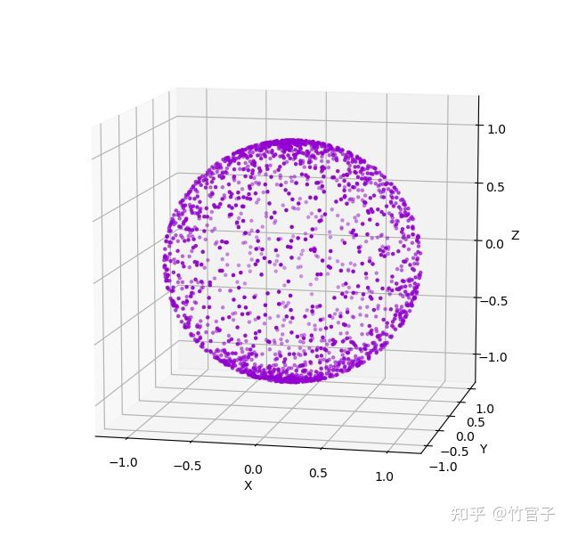
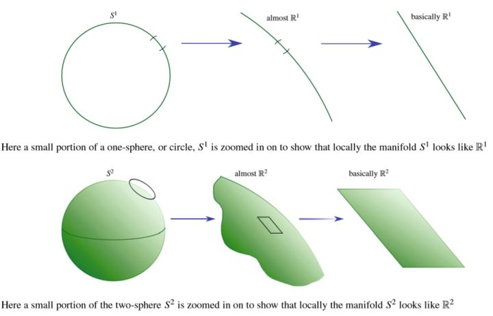
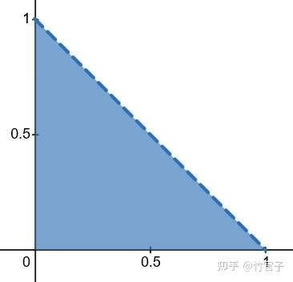

# 流形上的均匀采样

> **导读**：本文解决一个问题——如何在曲线、曲面、曲空间上"按长度/面积/体积"均匀取点。核心是把"参数域均匀"正确地换算成"流形上按测度均匀"，工具是**概率分布变换 + 雅可比行列式 + 格拉姆行列式**。全文依次给出通用公式，再逐个推导球面、球体、半球面、椭圆盘、三角形、曲线六个实例，最后收敛为可直接实现的采样流程；逆变换采样与拒绝采样的通用步骤见母文档《概率统计与采样》§5.2、§8，那里只保留了半球采样的实现代码与 TBN/余弦加权要点。

---

## 1. 动机：参数均匀 $\ne$ 面积均匀

以球坐标参数化的单位球面为例：

$$
x=\sin\theta\cos\varphi,\qquad y=\sin\theta\sin\varphi,\qquad z=\cos\theta .
$$

若直接在 $\theta\in(0,\pi)$、$\varphi\in(0,2\pi)$ 上均匀采样，样本在**两极处密集、赤道附近稀疏**：



原因很直接：面积微元 $dS=\sin\theta\,d\theta\,d\varphi$ 在极点附近被压扁，同样大小的 $(\theta,\varphi)$ 方块在极区对应的球面面积更小。若仍然除以"以为的均匀 PDF"$\dfrac{1}{4\pi}$ 做蒙特卡罗积分，得到的估计就是**有偏的**（biased）——不是方差大，而是期望就错了。

## 2. 流形与流形上的均匀分布

**流形（manifold）**：局部具有 $\mathbb{R}^d$ 性质的空间或对象。地球表面局部像平面 $\mathbb{R}^2$，是二维流形；平面中的光滑曲线放大后局部像直线 $\mathbb{R}$，是一维流形。$d$ 维流形即局部同胚于 $\mathbb{R}^d$ 的空间。



- 流形与欧氏空间没有必然关系，数学家关心它**内蕴**的性质；
- 但它可以嵌入欧氏空间，$\mathbb{R}^n$ 中的曲线、曲面、曲空间统称 $\mathbb{R}^n$ 中的子流形。

**流形上的均匀分布**：样本空间是整个子流形，**等测度的区域概率相等**。这里的"测度"（measure）是广义体积：曲面是面积，曲线是长度，曲空间是体积。于是 $d$ 维流形 $M$ 上的均匀密度为

$$
f_M(X)=\frac{1}{\displaystyle\int_M 1\,dS},
$$

分母就是流形的总测度（球面 $4\pi r^2$、半球 $2\pi r^2$、球体 $\dfrac{4}{3}\pi r^3$、椭圆盘 $\pi ab$）。

> 为什么渲染里要这个：曲面上算通量时积分对象是面积微元 $dA$，蒙特卡罗自然要按面积均匀取点，再除以对应的 PDF。按错误的 PDF 采点，误差不会随样本增加而消失。

## 3. 概率分布的变换：面积比即雅可比行列式

考虑二维变量变换 $\dbinom{W}{Z}=g\dbinom{X}{Y}$，$(X,Y)$ 有联合密度 $f_{X,Y}$。变换后空间中一点 $(w,z)$ 附近的微小面积记为 $dA_{w,z}$，其概率密度为 $P_{w,z}$。面积足够小时可视为平面，故这块面积上的概率为 $P_{w,z}\,dA_{w,z}$。

**概率守恒**：找到变换前对应的那块面积 $dA_{x,y}$ 及其概率 $P_{x,y}\,dA_{x,y}$，令二者相等：

$$
P_{w,z}\,dA_{w,z}=P_{x,y}\,dA_{x,y}
\;\Longrightarrow\;
f_{W,Z}(w,z)=\frac{1}{dA_{w,z}/dA_{x,y}}\,f_{X,Y}(x,y).
$$

即**新密度 = 旧密度 ÷ （变换后与变换前的面积之比）**。这个面积比就是**雅可比行列式**：矩阵的行列式代表线性变换前后的面积比，而映射在一点的雅可比矩阵正是该点附近的局部线性变换。由于行列式可正可负（负号表示翻转），统一取绝对值：

$$
f_{W,Z}(w,z)=\frac{1}{\left|\det J_g\big(g^{-1}(w,z)\big)\right|}\,f_{X,Y}\big(g^{-1}(w,z)\big).
$$

推广到 $n$ 维、$Y=g(X)$ 且 $g$ 为一一映射：

$$
f_Y(y)=\frac{1}{\left|\det J_g\big(g^{-1}(y)\big)\right|}\,f_X\big(g^{-1}(y)\big).
$$

## 4. 升维参数化：雅可比不是方阵，改用格拉姆行列式

参数化本身就是一个一一映射。$\mathbb{R}^3$ 中的三角形（重心坐标）

$$
\mathbf p=u\,\mathbf v_0+v\,\mathbf v_1+(1-u-v)\,\mathbf v_2,\qquad u>0,\ v>0,\ u+v<1,
$$

$\mathbb{R}^3$ 中的球面（$r$ 固定）

$$
\begin{pmatrix}r\sin\theta\cos\varphi\\ r\sin\theta\sin\varphi\\ r\cos\theta\end{pmatrix},
\qquad \theta\in(0,\pi),\ \varphi\in(0,2\pi),
$$

$\mathbb{R}^3$ 中的球体（$r$ 也变）

$$
\begin{pmatrix}r\sin\theta\cos\varphi\\ r\sin\theta\sin\varphi\\ r\cos\theta\end{pmatrix},
\qquad r\in(0,+\infty),\ \theta\in(0,\pi),\ \varphi\in(0,2\pi).
$$

有了参数化，就可以用上面的方法由"流形上的密度"得到"参数空间的密度"。

> **务必区分变换前后**：**参数空间是变换前**，欧氏空间（流形所在空间）是**变换后**。

**处理步骤**：

1. 在参数空间找到一块微小 $d$ 维体积 $dV_x$ 及其密度 $f_x$；
2. 在流形 $M$ 上找到对应的 $dV_m$ 及其密度 $f_m$；
3. 由概率相等列式：$f_x\,dV_x=f_m\,dV_m$；
4. 变形求出所需的密度表达式；
5. 关键一步：计算变形前后的 **$d$ 维体积之比**。

**这里碰到的问题**：对 $\mathbb{R}^n$ 中的 $n$ 维流形（同维变换），体积比就是 $|\det J|$；但对 $\mathbb{R}^n$ 中的 $d$ 维流形（$n>d$，升维参数化），雅可比矩阵**不是方阵，没有行列式**（$n=d$ 时是方阵，退化为 $\sqrt{\det(J^{\mathsf T}J)}=|\det J|$）。例如球面的

$$
J_\gamma=
\begin{pmatrix}
\dfrac{\partial\gamma_x}{\partial\theta} & \dfrac{\partial\gamma_x}{\partial\varphi}\\[6pt]
\dfrac{\partial\gamma_y}{\partial\theta} & \dfrac{\partial\gamma_y}{\partial\varphi}\\[6pt]
\dfrac{\partial\gamma_z}{\partial\theta} & \dfrac{\partial\gamma_z}{\partial\varphi}
\end{pmatrix}
$$

是 $3\times2$ 矩阵。解决办法是**格拉姆行列式的平方根**。

## 5. 格拉姆（Gram）行列式

**定义**：向量 $v_1,\dots,v_d$ 的格拉姆矩阵 $G$ 满足 $G_{ij}=\langle v_i,v_j\rangle$。

**几何意义**：格拉姆行列式 = 这组向量张成的 $d$ 维平行体体积的**平方**。二维情形

$$
\begin{vmatrix}
\langle v_1,v_1\rangle & \langle v_1,v_2\rangle\\
\langle v_2,v_1\rangle & \langle v_2,v_2\rangle
\end{vmatrix}
$$

是 $\mathbb{R}^3$ 中 $v_1,v_2$ 张成的平行四边形面积的**平方**；三维情形同理是平行六面体体积的平方。

**矩阵写法**：

$$
\det G=\det\!\left(A^{\mathsf T}A\right),
\qquad A=(v_1\,|\,\cdots\,|\,v_d)\in\mathbb{R}^{n\times d},
$$

于是 $n\ge d$ 时这 $d$ 个向量张成的 $d$ 维体积为

$$
\sqrt{\det\!\left(A^{\mathsf T}A\right)} .
$$

**两条性质的自检**（用三维中的 $v_1,v_2$ 验证）：

- 把 $v_1$ 变成 $a v_1$：格拉姆矩阵的第一行与第一列整体乘 $a$（所以 $G_{11}$ 得 $a^2$），开根号后整体乘 $|a|$，平行四边形面积变为 $|a|$ 倍（$a<0$ 时也非负）✓；
- 把 $v_1$ 沿 $v_2$ 方向斜切 $a v_2$：面积不变。行列式上表现为先"第 1 列减 $a$ 倍第 2 列"、再"第 1 行减 $a$ 倍第 2 行"，值不变（行列式性质：一行/列乘数加到另一行/列，行列式不变）✓。

把 $v_1$ 换成 $v_1+av_2$ 后逐步行列式化简（先第 1 列减 $a$ 倍第 2 列，再第 1 行减 $a$ 倍第 2 行，值不变）：

$$
\begin{aligned}
\sqrt{\det G(v_1+av_2,\,v_2)}
&=\sqrt{\begin{vmatrix}\langle v_1+av_2,\ v_1+av_2\rangle & \langle v_1+av_2,\ v_2\rangle\\ \langle v_2,\ v_1+av_2\rangle & \langle v_2,\ v_2\rangle\end{vmatrix}}\\[2pt]
&=\sqrt{\begin{vmatrix}\langle v_1+av_2,\ v_1\rangle & \langle v_1+av_2,\ v_2\rangle\\ \langle v_2,\ v_1\rangle & \langle v_2,\ v_2\rangle\end{vmatrix}}\\[2pt]
&=\sqrt{\begin{vmatrix}\langle v_1,\ v_1\rangle & \langle v_1,\ v_2\rangle\\ \langle v_2,\ v_1\rangle & \langle v_2,\ v_2\rangle\end{vmatrix}}
=\sqrt{\det\!\left(A^{\mathsf T}A\right)} .
\end{aligned}
$$

即斜切前后面积不变。

**与体积比的联系**：$\det A$ 有两重含义——线性变换的面积/体积缩放比，以及列向量张成的体积；$\sqrt{\det(A^{\mathsf T}A)}$ 同样有两重含义——$n\times d$ 矩阵列向量张成的 $d$ 维体积，以及该矩阵所代表的 $\mathbb{R}^d\to\mathbb{R}^n$ **升维线性变换**的 $d$ 维体积缩放比。把 $\gamma$ 的雅可比矩阵代入 $A$，即得

$$
\sqrt{\det\!\left(J_\gamma^{\mathsf T}J_\gamma\right)}
$$

= 升维映射 $\gamma$ **局部的 $d$ 维体积缩放倍数**。特别地，当 $d=n$ 时它退化为 $|\det J_\gamma|$。

> **为什么强调"局部"**：流形的定义就是"局部同胚于欧氏空间"，只有逐点的切空间上才有线性映射与体积缩放；全局并不存在一个统一的线性 $J$。

## 6. 参数空间密度的通用公式

$$
f_X(x)=\frac{dV_m}{dV_x}P_m
=\frac{\sqrt{\det\!\left(J_\gamma^{\mathsf T}(x)J_\gamma(x)\right)}}{\displaystyle\int_\Omega\sqrt{\det\!\left(J_\gamma^{\mathsf T}J_\gamma\right)}\,dx^d},
\qquad x\in\Omega,
$$

其中 $\Omega$ 是参数空间，积分是 $d$ 重（$dx^d$，不是 $dx^n$；原稿误作 $dx^n$，已更正——参数只有 $d$ 个）。同时得到第一类（对弧长/面积的）积分的通式：

$$
\int_M \rho\,dS=\int_\Omega \rho(x)\,\sqrt{\det\!\left(J_\gamma^{\mathsf T}J_\gamma\right)}\,dx^d,
$$

$\rho\equiv1$ 时即为流形的测度。**这解释了"参数域均匀 → 流形不均匀"的定量来源**：参数空间均匀的密度是 $1/|\Omega|$，映射到流形上要乘上局部体积缩放因子 $\sqrt{\det(J^{\mathsf T}J)}$，而该因子随位置变化。

得到联合 PDF 后，剩下的就是：求各参数的条件 PDF → 求条件 CDF → 用逆变换/拒绝采样生成样本（见母文档 §5.2、§8）。

## 7. 实例一：球面 $S^2$

$$
\gamma(\theta,\varphi)=
\begin{pmatrix}r\sin\theta\cos\varphi\\ r\sin\theta\sin\varphi\\ r\cos\theta\end{pmatrix},
\qquad \theta\in(0,\pi),\ \varphi\in(0,2\pi).
$$

$S^2$ 的面积是 $4\pi r^2$（无需积分）。不直接套公式，按 §4 的步骤走一遍：

1. 参数空间中 $(\theta,\varphi)$ 处的微元 $dS_{\theta,\varphi}$ 与密度 $P_{\theta,\varphi}$；
2. 流形上对应微元 $dS_{S^2}$ 与密度 $P_{S^2}=\dfrac{1}{4\pi r^2}$；
3. 概率相等：$P_{\theta,\varphi}\,dS_{\theta,\varphi}=P_{S^2}\,dS_{S^2}$，故

   $$
   f_{\Theta,\Phi}(\theta,\varphi)=\frac{dS_{S^2}}{dS_{\theta,\varphi}}\cdot\frac{1}{4\pi r^2};
   $$

4. 面积比为 $\sqrt{\det(J_\gamma^{\mathsf T}J_\gamma)}$。先算雅可比

   $$
   J_\gamma=
   \begin{pmatrix}
   r\cos\theta\cos\varphi & -r\sin\theta\sin\varphi\\
   r\cos\theta\sin\varphi & r\sin\theta\cos\varphi\\
   -r\sin\theta & 0
   \end{pmatrix},
   $$

   于是

   $$
   J_\gamma^{\mathsf T}J_\gamma=
   \begin{pmatrix}
   r^2 & 0\\
   0 & r^2\sin^2\theta
   \end{pmatrix},
   \qquad
   \sqrt{\det\!\left(J_\gamma^{\mathsf T}J_\gamma\right)}=r^2\sin\theta .
   $$

   代入得联合密度

   $$
   f_{\Theta,\Phi}(\theta,\varphi)=\frac{r^2\sin\theta}{4\pi r^2}=\frac{\sin\theta}{4\pi},
   \qquad \theta\in(0,\pi),\ \varphi\in(0,2\pi).
   $$

5. $\Theta,\Phi$ **相互独立**，直接积分掉另一个变量得边缘密度：

   $$
   f_\Theta(\theta)=\int_0^{2\pi}\frac{\sin\theta}{4\pi}\,d\varphi=\frac{\sin\theta}{2},
   \qquad
   f_\Phi(\varphi)=\int_0^{\pi}\frac{\sin\theta}{4\pi}\,d\theta=\frac{1}{2\pi};
   $$

6. CDF：

   $$
   F_\Theta(\theta)=\int_0^{\theta}\frac{\sin\alpha}{2}\,d\alpha=\frac{1-\cos\theta}{2},
   \qquad
   F_\Phi(\varphi)=\frac{\varphi}{2\pi};
   $$

7. 令 $F=\xi$（$\xi_1,\xi_2\sim U(0,1)$）：

   $$
   \frac{1-\cos\theta}{2}=\xi_1,\qquad \frac{\varphi}{2\pi}=\xi_2
   \;\Longrightarrow\;
   \theta=\arccos(1-2\xi_1),\qquad \varphi=2\pi\xi_2;
   $$

8. 代回参数方程。因为 $\sin\theta=\sqrt{1-(1-2\xi_1)^2}=2\sqrt{\xi_1(1-\xi_1)}$，

   $$
   \begin{cases}
   x=2r\cos(2\pi\xi_2)\sqrt{\xi_1(1-\xi_1)}\\
   y=2r\sin(2\pi\xi_2)\sqrt{\xi_1(1-\xi_1)}\\
   z=r(1-2\xi_1)
   \end{cases}
   $$

   等价写法：$z=1-2\xi_1$，半径方向 $=\sqrt{1-z^2}$，方位角 $2\pi\xi_2$。这是"球面按面积均匀"的标准结果。

> **与球体的对照**：球面用 $\theta=\arccos(1-2\xi_1)$，球体（§8）的 $\theta$ 变换与之**完全相同**；两者的 $\Theta$ 边缘密度都是 $\sin\theta/2$、$\theta$ 的参数变换也完全一样，差别只在 $r$（球体多一个立方根）。半球（§9）用的是另一条公式 $\cos\theta=\xi_1$，源文并未把它与球面并列对比。

> **源笔记此处有一处笔误**（原稿有误，已更正）：**开篇的动机举例**把球面的极角写成 $(\theta,\varphi)\in(0,\pi/2)\times(0,2\pi)$，但球面的极角范围是 $(0,\pi)$，$(0,\pi/2)$ 对应的是**半球面**（见 §9）。本节步骤 1 本身并未给出极角区间；后面的积分与结果均按 $(0,\pi)$ 计算，故以 $(0,\pi)$ 为准。

## 8. 实例二：球体 $B_a$

$\mathbb{R}^3$ 中的三维球是 $\mathbb{R}^3$ 中的**三维流形**（与所在空间同维），本质是普通的三维随机变量变换，雅可比是方阵。

$$
\gamma(r,\theta,\varphi)=
\begin{pmatrix}r\sin\theta\cos\varphi\\ r\sin\theta\sin\varphi\\ r\cos\theta\end{pmatrix},
\qquad r\in(0,a),\ \theta\in(0,\pi),\ \varphi\in(0,2\pi).
$$

体积 $\dfrac{4}{3}\pi a^3$，故流形上的均匀密度为其倒数 $\dfrac{3}{4\pi a^3}$。雅可比

$$
J_\gamma=
\begin{pmatrix}
\sin\theta\cos\varphi & r\cos\theta\cos\varphi & -r\sin\theta\sin\varphi\\
\sin\theta\sin\varphi & r\cos\theta\sin\varphi & r\sin\theta\cos\varphi\\
\cos\theta & -r\sin\theta & 0
\end{pmatrix},
\qquad
\det J_\gamma=r^2\sin\theta,
$$

（方阵，故 $\sqrt{\det(J^{\mathsf T}J)}=|\det J|=r^2\sin\theta$）。参数空间密度

$$
f_{R,\Theta,\Phi}(r,\theta,\varphi)=\frac{3r^2\sin\theta}{4\pi a^3},
\qquad r\in(0,a),\ \theta\in(0,\pi),\ \varphi\in(0,2\pi).
$$

三个变量独立，边缘密度为

$$
f_R(r)=\frac{3r^2}{a^3},\qquad
f_\Theta(\theta)=\frac{\sin\theta}{2},\qquad
f_\Phi(\varphi)=\frac{1}{2\pi},
$$

CDF：

$$
F_R(r)=\frac{r^3}{a^3},\qquad
F_\Theta(\theta)=\frac{1-\cos\theta}{2},\qquad
F_\Phi(\varphi)=\frac{\varphi}{2\pi}.
$$

令 CDF 分别等于 $\xi_1,\xi_2,\xi_3$：

$$
r=a\sqrt[3]{\xi_1},\qquad
\theta=\arccos(1-2\xi_2),\qquad
\varphi=2\pi\xi_3,
$$

代回得

$$
\begin{cases}
x=2a\sqrt[3]{\xi_1}\sqrt{\xi_2(1-\xi_2)}\cos(2\pi\xi_3)\\
y=2a\sqrt[3]{\xi_1}\sqrt{\xi_2(1-\xi_2)}\sin(2\pi\xi_3)\\
z=a\sqrt[3]{\xi_1}(1-2\xi_2)
\end{cases}
$$

**对照球面结果**：$\theta,\varphi$ 的变换完全相同，只有 $r$ 多了**立方根**。这正说明"按 $r$ 均匀"会在球心附近堆积——半径 $r$ 处的球壳面积 $\propto r^2$，同样的 $dr$ 在外层对应更大的体积，所以必须用 $r\propto\xi^{1/3}$ 把样本推向外层。

## 9. 实例三：半球面 $H^2$

$$
\gamma(\theta,\varphi)=
\begin{pmatrix}r\sin\theta\cos\varphi\\ r\sin\theta\sin\varphi\\ r\cos\theta\end{pmatrix},
\qquad \theta\in\left(0,\frac{\pi}{2}\right),\ \varphi\in(0,2\pi).
$$

与球面的唯一区别是极角范围。半球面积 $2\pi r^2$，于是

$$
f_{\Theta,\Phi}(\theta,\varphi)=\frac{r^2\sin\theta}{2\pi r^2}=\frac{\sin\theta}{2\pi},
\qquad
f_\Theta(\theta)=\sin\theta,\qquad
f_\Phi(\varphi)=\frac{1}{2\pi},
$$

$$
F_\Theta(\theta)=1-\cos\theta,\qquad F_\Phi(\varphi)=\frac{\varphi}{2\pi}.
$$

令 $F=\xi$：$1-\cos\theta=\xi_1\Rightarrow\cos\theta=1-\xi_1$。由于 $1-\xi_1$ 与 $\xi_1$ 同为 $U(0,1)$，可写成 $\cos\theta=\xi_1$，即**源笔记的 $\theta=\arccos(\xi_1)$ 与 $\cos\theta=1-\xi_1$ 等价**（不是笔误）。最终

$$
x=r\cos(2\pi\xi_2)\sqrt{1-\xi_1^2},\qquad
y=r\sin(2\pi\xi_2)\sqrt{1-\xi_1^2},\qquad
z=r\xi_1 .
$$

这正是母文档 §5.6 中 $\cos\theta=\xi_1$、$\varphi=2\pi\xi_2$ 的公式——**半球采样公式的来源就是这里的 $f_\Theta=\sin\theta$**；与球面式的换算关系是"把 $\theta$ 限制到 $[0,\pi/2]$ 后把归一化常数由 $4\pi$ 换成 $2\pi$"。

## 10. 实例四：椭圆盘（含圆盘）内部

椭圆盘是 $\mathbb{R}^2$ 中与空间同维的区域（二维流形带边界），因此是普通二维变量变换。参数化取"归一化半径 + 角度"：

$$
\gamma(k,\theta)=
\begin{pmatrix}ka\cos\theta\\ kb\sin\theta\end{pmatrix},
\qquad k\in(0,1),\ \theta\in(0,2\pi).
$$

面积 $\pi ab$，PDF 为 $\dfrac{1}{\pi ab}$。雅可比

$$
J_\gamma=
\begin{pmatrix}
a\cos\theta & -ka\sin\theta\\
b\sin\theta & kb\cos\theta
\end{pmatrix},
\qquad
\det J_\gamma=kab\left(\cos^2\theta+\sin^2\theta\right)=kab .
$$

故

$$
f_{K,\Theta}(k,\theta)=\frac{kab}{\pi ab}=\frac{k}{\pi},
\qquad
f_K(k)=2k,\qquad f_\Theta(\theta)=\frac{1}{2\pi},
$$

$$
F_K(k)=k^2,\qquad F_\Theta(\theta)=\frac{\theta}{2\pi}
\;\Longrightarrow\;
k=\sqrt{\xi_1},\qquad \theta=2\pi\xi_2,
$$

$$
x=a\sqrt{\xi_1}\cos(2\pi\xi_2),\qquad
y=b\sqrt{\xi_1}\sin(2\pi\xi_2).
$$

$a=b=R$ 时即圆盘内部均匀采样：$x=R\sqrt{\xi_1}\cos(2\pi\xi_2)$。**注意 $\sqrt{\xi_1}$ 而不是 $\xi_1$**——直接用 $\xi_1$ 会让样本向圆心聚集（面积 $\propto r^2$ 的同一个道理）。参数 $k$ 与长短轴 $a,b$ 无关，故该结论对任意离心率都成立。

## 11. 实例五：任意维欧氏空间中的三角形

三角形是 $\mathbb{R}^3$ 中的**二维**流形（$n$ 维空间里同理是二维流形）。正因如此它的雅可比是 $n\times2$ 非方阵，才必须用格拉姆行列式（$n=2$ 时是 $2\times2$ 方阵，$\sqrt{\det(J^{\mathsf T}J)}=|\det J|$，同样等于 $2S$）。下面的结果对任意 $n\ge2$ 的 $\mathbb{R}^n$ 中的三角形都成立。

重心坐标参数化：

$$
\gamma(u,v)=u\vec A+v\vec B+(1-u-v)\vec C,
\qquad u>0,\ v>0,\ u+v<1,
$$

$\vec A,\vec B,\vec C$ 是 $\mathbb{R}^n$ 中的顶点。由于不知道 $n$ 的具体值，用矩阵分块处理：$\gamma$ 的第 $i$ 个坐标是 $uA_i+vB_i+(1-u-v)C_i$，对 $u$、$v$ 求偏导得

$$
\frac{\partial\gamma}{\partial u}=\vec A-\vec C=\overrightarrow{CA},
\qquad
\frac{\partial\gamma}{\partial v}=\vec B-\vec C=\overrightarrow{CB},
$$

$$
J_\gamma=\left(\overrightarrow{CA}\ \ \overrightarrow{CB}\right)\in\mathbb{R}^{n\times2},
\qquad
J_\gamma^{\mathsf T}J_\gamma=
\begin{pmatrix}
\overrightarrow{CA}\cdot\overrightarrow{CA} & \overrightarrow{CA}\cdot\overrightarrow{CB}\\
\overrightarrow{CB}\cdot\overrightarrow{CA} & \overrightarrow{CB}\cdot\overrightarrow{CB}
\end{pmatrix}.
$$

行列式

$$
\det\!\left(J_\gamma^{\mathsf T}J_\gamma\right)
=\|\overrightarrow{CA}\|^2\|\overrightarrow{CB}\|^2-\left(\overrightarrow{CA}\cdot\overrightarrow{CB}\right)^2 .
$$

记三边 $a=|\overrightarrow{CB}|$、$b=|\overrightarrow{CA}|$、夹角 $C$，则 $\overrightarrow{CA}\cdot\overrightarrow{CB}=ab\cos C$，故

$$
\det\!\left(J_\gamma^{\mathsf T}J_\gamma\right)
=a^2b^2-a^2b^2\cos^2C=a^2b^2\sin^2C
=\left(2\cdot\frac{1}{2}ab\sin C\right)^2=(2S)^2 ,
$$

$$
\sqrt{\det\!\left(J_\gamma^{\mathsf T}J_\gamma\right)}=2S .
$$

于是

$$
f_{U,V}(u,v)=\frac{2S}{S}=2,
\qquad u>0,\ v>0,\ u+v<1 .
$$

**参数域上的密度是常数 2**。这里的 $S$ 是三角形在 $\mathbb{R}^n$ 中的面积：体积缩放因子为 $2S$、流形上的均匀密度为 $1/S$，两者相乘得 $2S\cdot\frac{1}{S}=2$（源图正是这样写的 $2S/S=2$），$S$ 被直接约掉，**结果与 $S$ 的具体取值无关**。注意不能把它读成"三角形面积为 $1/2$，故 $1/S=2$"——$S$ 是流形上三角形的面积（任意值），与参数域 $(u,v)$ 三角形的面积 $1/2$ 是两回事；常数 2 只是约分后的结果。于是 $(u,v)$ 在参数三角形内均匀，这正是"三角形上均匀采样 = 参数域均匀"的原因。

参数域 $\Omega=\{(u,v):u>0,v>0,u+v<1\}$ 是由坐标轴与 $u+v=1$ 围成的三角形：



**注意：$U,V$ 不独立**（受 $u+v<1$ 约束），必须先求一个的 CDF，再求另一个的**条件** CDF。

$U$ 的边缘密度：

$$
f_U(u)=\int_0^{1-u}2\,dv=2(1-u),\qquad u\in(0,1),
\qquad
F_U(u)=2u-u^2 .
$$

令 $2u-u^2=\xi_1$，即 $u^2-2u+\xi_1=0$，解得 $u=1\pm\sqrt{1-\xi_1}$。因 $u\in(0,1)$，取

$$
u=1-\sqrt{1-\xi_1}\ \overset{d}{=}\ 1-\sqrt{\xi_1}
$$

（$1-\xi_1$ 与 $\xi_1$ 同分布，故两种写法等价）。

$V$ 的条件密度：$f_{V\mid U}(v\mid u)=\dfrac{2}{2(1-u)}=\dfrac{1}{1-u}$，$v\in(0,1-u)$，条件 CDF 为 $\dfrac{v}{1-u}$。令其等于 $\xi_2$：

$$
v=\xi_2(1-u)=\xi_2\sqrt{\xi_1}.
$$

最终

$$
u=1-\sqrt{\xi_1},\qquad
v=\xi_2\sqrt{\xi_1},\qquad
1-u-v=\sqrt{\xi_1}\,(1-\xi_2),
$$

$$
\mathbf p=u\vec A+v\vec B+(1-u-v)\vec C .
$$

三个重心权重之和恒为 1，且分布对三个顶点对称（这是均匀性的直观体现）。该推导不依赖 $n$，故对任意维欧氏空间中的三角形都适用。

## 12. 实例六：曲线（自交点有限的情形）

空间中不自交的光滑曲线基本就是 $\mathbb{R}^n$ 中的一维流形（圆周、Bezier 曲线）。**自交曲线严格来说不是流形**：在自交点无论放大多少倍，交叉仍然存在，无法与一维欧氏空间建立局部同胚。

但只要奇点足够"好"（自交点有限），仍可用同一套方法：可数个点的**一维测度为 0**，不影响概率，也不会把自交点"重复计数"——$L$ 是对参数的积分，同一个点即便来自两个参数值，点集本身测度仍为 0。一维情形的体积缩放因子就是**导数的模长**：

$$
\sqrt{\det\!\left(J_\gamma^{\mathsf T}J_\gamma\right)}=\left\|\gamma'(t)\right\|,
$$

故

$$
f_T(t)=\frac{\left\|\gamma'(t)\right\|}{\displaystyle\int\left\|\gamma'(t)\right\|dt}=\frac{\left\|\gamma'(t)\right\|}{L},
$$

其中 $L=\int\|\gamma'(t)\|dt$ 是曲线长度。很多曲线的 $L$ 只有数值解（例如被积函数为 $\sqrt{1+\cos^2 t}$ 时为椭圆积分），实践中用数值积分或预先打表。

本例改用**拒绝采样**的理由是 **$F_T$ 的 CDF 没有闭式**：$L=\int\|\gamma'\|dt$ 是椭圆积分，$F_T(t)=\dfrac{1}{L}\int_{t_0}^{t}\|\gamma'\|d\tau$ 也要逐点数值积分，逆变换采样不便；而拒绝采样只需要 $L$ 的一个数值积分来定上界。取建议分布 $g(t)=U[0,2\pi]$，令

$$
c=\frac{\max_t f_T(t)}{1/(2\pi)}=2\pi\cdot\frac{\max_t\|\gamma'(t)\|}{L},
$$

从 $g$ 采样 $t$、从 $U(0,1)$ 采样 $u$，接受当且仅当 $u\le\dfrac{f_T(t)}{c\,g(t)}=\dfrac{\|\gamma'(t)\|}{\max\|\gamma'\|}$。接受率 $=1/c=\dfrac{L}{2\pi\max\|\gamma'\|}$；曲线越接近"等速参数化"，接受率越高。

**源算例的具体曲线**：源笔记给的参数曲线为

$$
\gamma(t)=\left(\cos^2 t,\ \ \sin t\cos t,\ \ \sin t\right),
\qquad t\in(0,2\pi),
$$

> **该算例的几何形状**：它的 $xy$ 投影 $(\cos^2 t,\ \sin t\cos t)$ 是圆（圆心 $(1/2,0)$、半径 $1/2$），$z=\sin t$ 把这条圆提升成上下两层（$t\in(0,\pi)$ 时 $z>0$，$t\in(\pi,2\pi)$ 时 $z<0$）；两层只在 $z=0$ 的**唯一**一点 $(1,0,0)$ 相遇——$t=\pi$ 与 $t=0/2\pi$ 给出同一点，两条分支在该点的切向分别为 $(0,1,-1)$ 与 $(0,1,1)$。也就是说它只有**一个二重点**，不是双纽线那种多点交叉的自交曲线；本节开头关于自交曲线的讨论只是适用范围说明，下面的采样公式与数值都不受影响。

> **写法说明（$\cos t^2$ 的歧义）**：源图写作 $\cos(t)^2$，即 $(\cos t)^2$，**不是** $\cos(t^2)$——只有按 $(\cos t)^2$ 理解，导数模长才恰好等于源图给出的 $\sqrt{1+\cos(t)^2}$。截图里 $\cos t^2$ 的括号位置容易误读成 $\cos(t^2)$（那会得到 $\|\gamma'\|=\sqrt{4t^2\sin^2 t^2+\cos^2 2t+\cos^2 t}$，与源 $f_T$ 的分子对不上），本文一律取 $(\cos t)^2$。下文记为 $\cos^2 t$ 以免混淆。

它的导数为

$$
\gamma'(t)=\left(-\sin 2t,\ \ \cos 2t,\ \ \cos t\right),
\qquad
\left\|\gamma'(t)\right\|=\sqrt{\sin^2 2t+\cos^2 2t+\cos^2 t}=\sqrt{1+\cos^2 t},
$$

与源图 $f_T(t)=\dfrac{\sqrt{1+\cos(t)^2}}{\int_0^{2\pi}\sqrt{1+\cos(t)^2}\,dt}$ 的分子**完全一致**。四个数为：

- $\max_{t\in(0,2\pi)}\|\gamma'(t)\|=\sqrt2\approx1.4142$；
- $L=\int_0^{2\pi}\sqrt{1+\cos^2 t}\,dt\approx7.6404$（$=4E(m=-1)=4\sqrt2\,E(k=1/\sqrt2)$，前者为参数约定 $m=k^2$、后者为模数约定；第二类完全椭圆积分，无初等闭式）；
- $c=2\pi\cdot\dfrac{\max\|\gamma'\|}{L}=2\pi\cdot\dfrac{\sqrt2}{7.6404}\approx1.163$；
- 接受率 $=\dfrac{1}{c}=\dfrac{L}{2\pi\sqrt2}\approx0.860$（验算 $c\times$ 接受率 $=1$）。

源判据 `sqrt(2)*rand() < sqrt(1+cos(t)^2)` 正是 $u<\dfrac{\|\gamma'(t)\|}{\max\|\gamma'\|}$（令 $u=\text{rand}()$、$\max\|\gamma'\|=\sqrt2$），与本节公式一致——**源算例本身是自洽的，可直接沿用**。

```csharp
// 一维曲线按弧长均匀采样：拒绝采样版本（伪代码）
// 判据 u < ‖γ'(t)‖ / M，M = max‖γ'‖ = √2 ≈ 1.4142（t∈(0,2π)）
// attempts 是"尝试次数"，不是"产出点数"：每次尝试独立接受，
// 期望产出 ≈ 0.860 × attempts。若要固定产出 N 个点，改用 while (results.Count < N)。
float maxSpeed = Mathf.Sqrt(2f);                    // M = max‖γ'‖ = √2（不要写 1.4142f，它略小于 √2）
var results = new List<Vector3>();
for (int i = 0; i < attempts; i++)
{
    float t = 2.0f * Mathf.PI * Random.value;       // 建议分布 U[0, 2π]
    if (Random.value * maxSpeed < Speed(t))         // u·M < ‖γ'(t)‖
    {
        results.Add(Curve(t));                      // Curve(t) = (cos²t, sin t·cos t, sin t)
    }
}
```

其中 `Speed(t) = Mathf.Sqrt(1f + Mathf.Cos(t) * Mathf.Cos(t))`，`Curve(t) = new Vector3(Mathf.Cos(t)*Mathf.Cos(t), Mathf.Sin(t)*Mathf.Cos(t), Mathf.Sin(t))`。取 $M=maxSpeed=\sqrt2$ 即可，无需打表；总接受率约 $0.860$。

## 13. 小结：通用流程与三条注意

**步骤**（$\mathbb{R}^n$ 中 $d$ 维子流形按测度均匀采样）：

1. 找到一一参数化 $\gamma:\Omega\subset\mathbb{R}^d\to M\subset\mathbb{R}^n$；
2. 求流形测度 $V=\int_\Omega\sqrt{\det(J_\gamma^{\mathsf T}J_\gamma)}\,dx^d$；
3. 得参数空间联合 PDF（通用式见 §6，把分母写成上一步的 $V$ 即可）：
   $f_{\vec X}(\vec x)=\dfrac{\sqrt{\det\left(J_\gamma^{\mathsf T}J_\gamma\right)}}{V}$；
4. 由联合 PDF 求各参数的条件 PDF；
5. 求条件 CDF；
6. 用逆变换采样、拒绝采样等逐分量生成样本。

**三条注意**：

1. $\sqrt{\det(J_\gamma^{\mathsf T}J_\gamma)}$ 表示**局部**线性变换前后体积的缩放倍数，是通用表达，由格拉姆行列式推导而来；它能表示**升维**变换（球面只需 $(\theta,\varphi)$ 两个参数映射到 $\mathbb{R}^3$）。
2. 格拉姆行列式是体积缩放倍数的**平方**，必须开根号。
3. 若变换不升维（$d=n$），体积缩放倍数就是 $|\det J_\gamma|$，退化为普通雅可比。

**体积是广义的**：二维为面积，三维为狭义体积，$d$ 维为 $d$ 维向量张成的体积；曲线用长度。

> **未展开的实例**：源笔记的实例清单还列有"环面上的均匀采样""函数图像上的均匀采样"两项，但原文只有标题、没有正文，故本文未收录（如需补充，可直接套用本节上面的六步流程）。

---

## 原始笔记索引

- `光源采样/流形上的均匀采样.md`（本文全部内容的来源；公式截图已转录为 LaTeX，示意图保留原图引用。原文"环面""函数图像"两项只有标题无正文。）