# 光照模型与 BRDF

> 本文整合了经验光照模型（Phong / Blinn-Phong）、辐射度量学、BRDF 理论、微平面理论、Cook-Torrance 模型（D/F/G）、Fresnel 与 IOR、能量守恒，以及 PBR 系列文章的推导结论。公式统一使用 $\omega_i$（入射方向）、$\omega_o$（出射/观察方向）、$n$（宏观法线）、$h$（半程向量）、$l$（指向光源的单位向量）、$v$（指向视点的单位向量）。

---

## 1. 从经验光照模型开始

### 1.1 Phong 着色

Phong 着色把最终颜色拆成三项叠加：环境光（ambient）、漫反射（diffuse）、镜面反射（specular）。

$$
L = k_a I_a + k_d I_l \max(n\cdot l,\,0) + k_s I_l \left[\max(r\cdot v,\,0)\right]^{p}
$$

其中 $r = \mathrm{reflect}(-l, n) = 2(n\cdot l)n - l$ 为反射方向，$p$ 为高光指数（gloss）。

```glsl
vec3 ambient  = k_a * lightColor;
vec3 diffuse  = k_d * max(dot(lightDir, normal), 0.0) * lightColor;
vec3 specular = k_s * pow(max(dot(reflectDir, viewDir), 0.0), gloss) * lightColor;
vec3 result   = (ambient + diffuse + specular) * baseColor;
```

几点性质与注意：

- 环境光项被当作常数处理，不参与方向计算——这是经验模型最"假"的地方。
- 漫反射项与 $n\cdot l$ 成正比，即 Lambert 余弦定律。
- 高光指数 $p$ 越大，高光越集中、越小；$p$ 与微平面 NDF 的"粗糙度"是同一件事的两种说法（见 5.2）。
- 最后统一乘 `baseColor` 是一种工程上的简写：严格来说环境光与镜面项不应被 albedo 整体缩放（金属的镜面颜色才与 albedo 相关），这也是经验模型与基于物理模型的差异之一。

### 1.2 逐像素光照与片元法线

Phong 着色的关键前提是**逐像素（per-fragment）计算**：顶点着色器只输出位置与法线，光栅化时对法线做插值，每个片元用自己的法线参与一次完整的光照计算。若把光照放在顶点着色器里算（Gouraud 着色），高光会被顶点密度"抹平"，大三角形上几乎看不到高光。

没有法线属性时，可以用屏幕空间导数重建面法线：

```glsl
vec3 getNormal()
{
    vec3 n;
    if (u_HasNormal)
    {
        n = v_Normal;
    }
    else
    {
        vec3 pos_dx = dFdx(v_Position); // 屏幕 x 增加 1 像素时 v_Position 各分量的变化
        vec3 pos_dy = dFdy(v_Position);
        n = cross(pos_dx, pos_dy);
    }
    return n;
}
```

由 $\mathrm{cross}(\partial_x p, \partial_y p)$ 得到的是面法线方向，其长度与屏幕空间面积相关，参与光照前需要 `normalize`。符号取决于屏幕坐标系的手性（`dFdy` 的 $y$ 方向随 API 而变）：若结果整体反向，受光面会变黑，此时改用 `normalize(cross(pos_dy, pos_dx))`，或按平台统一翻转。

### 1.3 Blinn-Phong

Blinn-Phong 用"半程向量"代替反射向量：

$$
h = \frac{l + v}{\lVert l+v \rVert}, \qquad
L_{spec} = k_s I_l \max(n\cdot h,\,0)^{p}
$$

- 计算更便宜：省去一次 `reflect`，且 $n\cdot h$ 在掠射角下行为更稳定。
- Phong 的镜面叶瓣本身是**可逆**的（$r\cdot v=2(n\cdot l)(n\cdot v)-l\cdot v$ 对 $l,v$ 对称）；它真正缺的是归一化常数与能量守恒。Blinn-Phong 换成半程向量形式后同样需要归一化。
- Blinn-Phong 高光指数与 Phong 指数之间只是近似对应关系（约 $p_{Blinn} \approx 4p_{Phong}$，随角度变化），二者不能精确互换（待核实具体换算系数在极端角度下的适用性）。

归一化后的 Blinn-Phong 也可以写成一个合法的 NDF（见 5.3）：

$$
D_{Blinn}(h) = \frac{\alpha_p + 2}{2\pi}(n\cdot h)^{\alpha_p}
$$

---

## 2. 辐射度量学基础

要用物理量而不是"0~255 的 RGB"描述光，需要一套度量系统。

### 2.1 立体角

立体角是弧度在球面上的推广，定义为球面面积微元与半径平方之比：

$$
d\omega = \frac{dA}{r^2} = \sin\theta\, d\theta\, d\phi
$$

其中 $\theta$ 为极角（与 $n$ 的夹角），$\phi$ 为方位角。整个球面的立体角为 $4\pi$，半球为 $2\pi$。单位是球面度 sr。

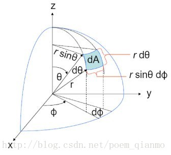

### 2.2 五个核心量

| 物理量 | 符号 | 定义 | 单位 |
| --- | --- | --- | --- |
| 辐射能量 Radiant energy | $Q$ | 辐射出的电磁能量 | J |
| 辐射通量/功率 Radiant flux | $\Phi = dQ/dt$ | 单位时间的能量 | W |
| 辐射强度 Radiant intensity | $I = d\Phi/d\omega$ | 单位立体角的通量（点光源方向亮度） | W/sr |
| 辐照度 Irradiance | $E = d\Phi/dA$ | 单位**照射面积**接收到的通量 | W/m² |
| 辐射率 Radiance | $L = \dfrac{d^2\Phi}{dA^\perp d\omega} = \dfrac{dE}{d\omega\cos\theta}$ | 单位立体角、单位**垂直投影面积**的通量 | W/(sr·m²) |

要点：

- Irradiance 的分母是"接收面"面积，radiance 的分母是"垂直于传播方向"的投影面积，所以后者沿光线传播不变，是描述一条光线亮度的正确量。
- Lambert 定律（$E \propto \cos\theta$）与点光源的距离平方衰减（$E \propto 1/r^2$）都可以由 irradiance 的定义直接解释：功率不变，被照面积变大，单位面积功率就变小。
- 早期笔记中"光亮度单位是 W/m²"是错的，正确单位是 W/(sr·m²)。

### 2.3 BRDF 的度量学定义

BRDF 描述"某个入射方向的光，被表面分配到某个出射方向的比例"，定义为出射 radiance 的微分与入射 irradiance 的微分之比：

$$
f_r(\omega_i, \omega_o) = \frac{dL_o(\omega_o)}{dE_i(\omega_i)} = \frac{dL_o(\omega_o)}{L_i(\omega_i)\,(n\cdot\omega_i)\,d\omega_i}
$$

单位是 $\mathrm{sr}^{-1}$。因为不同波长的反射率不同，实际实现中 $f_r$ 是一个 RGB 三元组，三个通道各自独立。

写成 $l,v$ 记法的同一式子为

$$
f(l,v) = \frac{dL_o(v)}{dE(l)}
$$

其中 $f$ 就是 BRDF，$l$ 是入射光方向，$v$ 是观察方向，也就是我们关心的反射光方向。

- $dL_o(v)$ 是表面反射到 $v$ 方向的反射光的**微分辐射率**。表面反射到 $v$ 方向的反射光的辐射率为 $L_o(v)$，来自于表面上半球所有方向的入射光线的贡献；而微分辐射率 $dL_o(v)$ 特指来自方向 $l$ 的入射光贡献的反射辐射率。
- $dE(l)$ 是表面上来自入射光方向 $l$ 的**微分辐照度**。表面接收到的辐照度为 $E$，来自上半球所有方向的入射光线的贡献；而微分辐照度 $dE(l)$ 特指来自于方向 $l$ 的入射光。

---

## 3. BRDF 的性质与分类

### 3.1 性质

1. **可逆性（reciprocity）**：交换入射与出射方向，BRDF 值不变。

$$
f_r(\omega_i \to \omega_o) = f_r(\omega_o \to \omega_i)
$$

2. **能量守恒**：出射总能量不超过入射总能量。写成 BRDF 的约束是

$$
\int_{\Omega} f_r(\omega_i,\omega_o)\,(n\cdot\omega_i)\,d\omega_i \le 1 \quad \forall \omega_o
$$

（更一般的能量收支是 $Q_{in} = Q_{reflected} + Q_{absorbed} + Q_{transmitted}$。）

3. **线性**：多个光源的贡献可以直接叠加（$L_o$ 对 $L_i$ 线性）。

可逆性写成 $l,v$ 记法即

$$
f(l,v) = f(v,l)
$$

### 3.2 分类

- **经验模型**：Lambert、Phong、Blinn-Phong、快速 Phong、可逆 Phong。公式简单、可快速估计，但不保证能量守恒与可逆性。
- **基于物理的模型**：Cook-Torrance、Ward。由表面几何（微平面）与光学属性（Fresnel）推导，天然满足可逆性与能量守恒。
- **数据驱动模型**：按实测 BRDF 建查找表（MERL 之类），精度最高但存储与插值代价大。

### 3.3 Lambert：最基础的漫反射

Lambert 假设入射光被均匀反射到半球各方向，因此 BRDF 是常数：

$$
f_d = \frac{c}{\pi}, \qquad L_o = \frac{c}{\pi}\int_\Omega L_i \cos\theta_i\, d\omega_i
$$

其中 $c$ 为 albedo（反射率），除以 $\pi$ 是归一化因子——这是"经验模型"与"基于物理模型"最直观的差别：老 Phong 的漫反射项漏掉了这个 $1/\pi$，导致能量不守恒。

albedo 的严格定义是"反射的辐射通量与入射辐射通量之比"，是一个无量纲的 0~1（每通道）系数，而不是"反射辉度与入射辉度之比"。

---

## 4. 光与物质的交互

### 4.1 三种行为

光与物质交互只有三种基本方式：**吸收（absorption）**、**散射（scattering）**、**自发光（emission）**。

- 均匀介质（homogeneous media）：内部折射率处处相同，光沿直线传播，只有随距离的强度衰减（吸收），方向与颜色关系由吸收谱决定。
- 非均匀介质（heterogeneous media）：折射率突变处发生散射，光被分配到多个方向，但总能量不变。

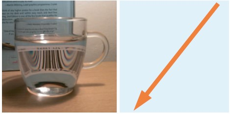
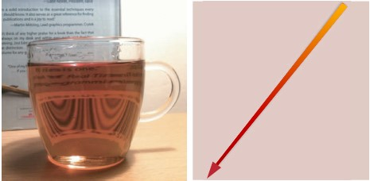
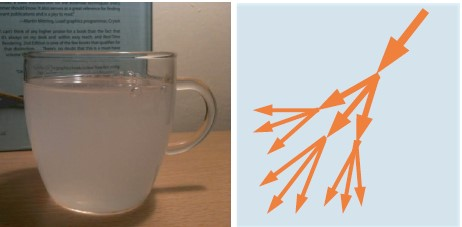

### 4.2 光与表面的交互

光到达表面时分为两部分：**反射（specular）** 与 **折射（进入介质内部）**。

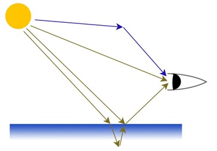
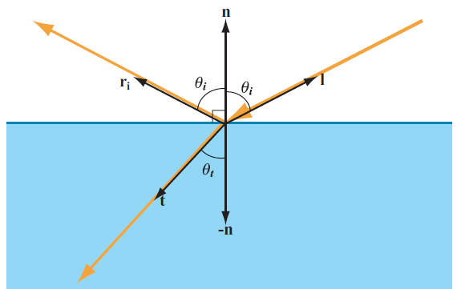

- 折射进入内部的光，一部分被吸收转化为热，一部分在内部多次散射后从表面重新射出——这部分宏观上表现为 **diffuse**，其颜色就是 albedo。
- 直接在表面反射的部分表现为 **specular**。

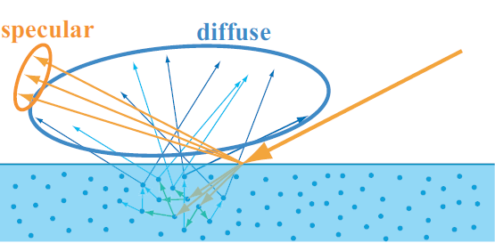
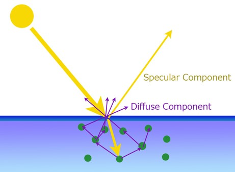

### 4.3 光学平面与微几何体

只有理想的光学平面（镜子、镜头表面）才服从镜面反射定律。真实表面是 **microgeometry**：起伏尺度大于可见光波长、又小于一个像素，因此把它建模为"大量微小光学平面的集合"，可见光反射是这些微平面各自反射的统计结果。

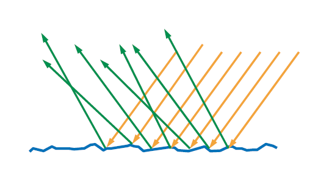

表面越平滑，微平面朝向变化越小，反射方向越集中（清晰反射）；表面越粗糙，朝向分布越宽，反射被扩散（模糊反射）。

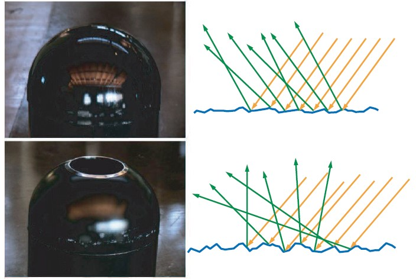

### 4.4 金属与电介质（绝缘体）

- **金属（导体）**：折射进入内部的光被自由电子立即吸收，**没有 diffuse**；反射率很高，且反射带有颜色（金、铜、黄铜）。
- **非金属（电介质/绝缘体）**：折射光在内部吸收与散射，一部分重新射出形成 diffuse；反射基本无色（本色由 diffuse 体现）。
- 半导体在渲染中出现频率低，通常直接并入"非金属"处理。

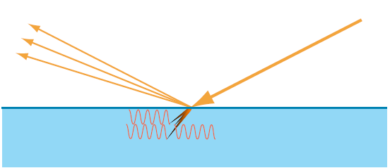
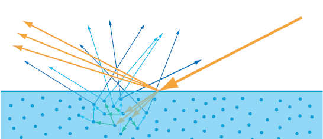

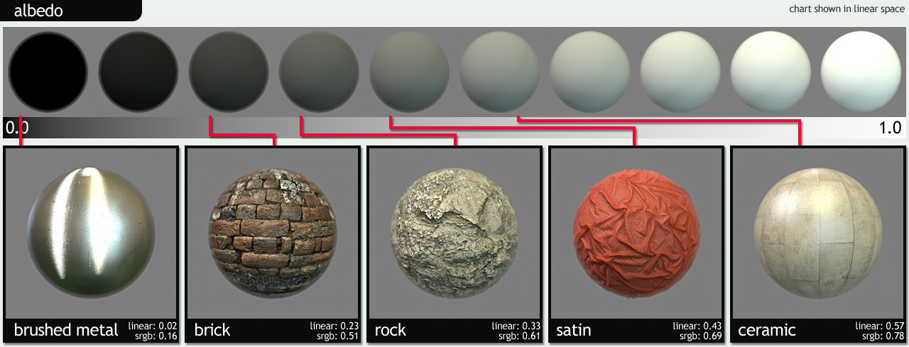

> 修正：早期笔记写"金属反射率 60%~90%，绝缘体 0%~20%"，这组数字应理解为 **F0（垂直入射反射率）**：导体约 0.5~1.0（部分金属更高），电介质约 0.02~0.08，个别材料（晶体、半导体）可到 0.15~0.5。不是"总反射率"。

### 4.5 次级表面散射（Subsurface Scattering）

折射后的散射光从不同于入射点的位置射出。是否把它当作"漫反射"，取决于**散射距离与像素尺寸的关系**：

- 像素尺寸 ≫ 散射距离：出射点可认为与入射点重合 → 就是普通 diffuse。
- 像素尺寸 ≪ 散射距离：一个像素的着色会受到邻近点入射光的影响 → 需要专门的 SSS 技术。

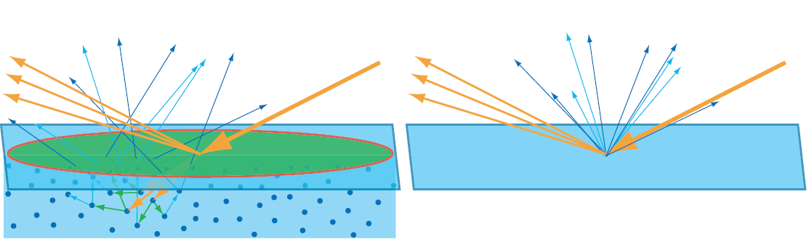
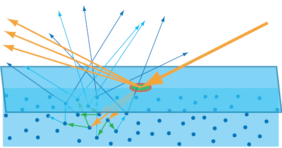

两者是同一物理现象的不同尺度近似：远看皮肤是 diffuse，近看皮肤是 SSS。

---

## 5. 微平面理论与 Cook-Torrance

### 5.1 微平面假设

1. 表面由大量微小、光学平坦的镜面微平面组成；
2. 微平面尺度远大于可见光波长（因此可用几何光学，忽略衍射/波动光学）；
3. 只有法线恰好等于半程向量 $h$ 的微平面，才能把 $l$ 反射进 $v$，即

$$
m = h = \frac{\omega_i + \omega_o}{\lVert \omega_i + \omega_o \rVert}
$$

4. 微平面之间存在互相遮挡（shadowing / masking）；
5. 只考虑单次散射，多次散射与相干效应被忽略。

Cook-Torrance 的完整形式为

$$
f_r(\omega_i,\omega_o) = \frac{D(h)\,F(\omega_i,h)\,G(\omega_i,\omega_o)}{4\,(n\cdot\omega_i)(n\cdot\omega_o)}
$$

$$
f(\mathbf{l},\mathbf{v}) = \frac{F(\mathbf{l},\mathbf{h})\,G(\mathbf{l},\mathbf{v},\mathbf{h})\,D(\mathbf{h})}{4(\mathbf{n}\cdot\mathbf{l})(\mathbf{n}\cdot\mathbf{v})}
= \frac{D\cdot F\cdot G}{4\,(n\cdot l)(n\cdot v)}
$$

分母 $4(n\cdot\omega_i)(n\cdot\omega_o)$ 来自"微平面面积 → 宏观面积"的雅可比变换（立体角与投影面积的两次换算）。$D$、$G$ 为标量，$F$ 为 RGB。

### 5.2 法线分布函数 D（NDF）

**定义**：单位宏观面积、单位立体角内，法线朝向 $h$ 的微平面面积。

$$
d^2A(h) = D(h)\,d\omega_h\,dA
$$

因此 NDF 是一个"密度"，单位为 $\mathrm{sr}^{-1}$，它**不是**概率密度函数（PDF 要求在整个定义域上积分为 1，NDF 不是）。

**归一化约束**：把微平面面积投影回宏观平面，必须等于宏观面积（约定为 1），即 $\int_{\Omega} D(m)\,(n\cdot m)\,d\omega_m=1$。完整的推导、推广到任意方向 $v$ 的形式（$\int D(m)(v\cdot m)d\omega_m=v\cdot n$）与四条基本性质见 **§11.1–11.2**，此处不再重复。

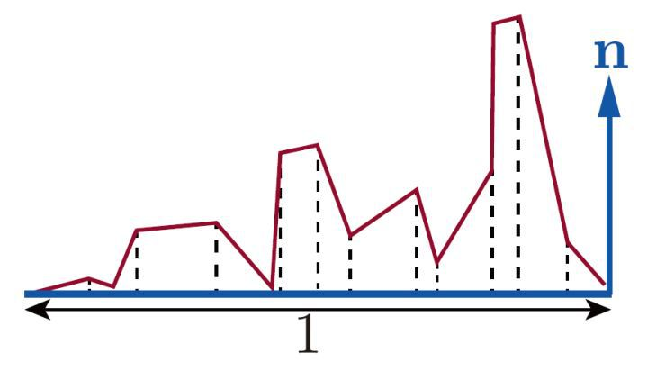

**常见 NDF**（$\alpha$ 为粗糙度参数，$n\cdot h$ 记为 $\cos\theta_h$）：

| 模型 | 公式 | 特点 |
| --- | --- | --- |
| Beckmann [1963] | $D = \dfrac{1}{\pi\alpha^2\cos^4\theta_h}\exp\!\left(\dfrac{\cos^2\theta_h-1}{\alpha^2\cos^2\theta_h}\right)$ | 光学业界 origin，具备形状不变性 |
| Blinn-Phong [1977] | $D = \dfrac{\alpha_p+2}{2\pi}\cos^{\alpha_p}\theta_h$ | 高光锐利，**不具备**形状不变性 |
| GGX / Trowbridge-Reitz [1975] | $D = \dfrac{\alpha^2}{\pi\left(\cos^2\theta_h(\alpha^2-1)+1\right)^2}$ | 拖尾最长，具备形状不变性，业界主流 |
| GTR | $D = \dfrac{c_\gamma}{\left(1+\cos^2\theta_h(\alpha^2-1)\right)^\gamma}$ | $\gamma=1$ 为 Berry，$\gamma=2$ 为 GGX；**不具备**形状不变性 |

GTR 行的 $c_\gamma$ 是归一化常数（不是 §11.4 里表示 $\cos\theta_h$ 的 $c$）：

$$
c_\gamma=\frac{(\alpha^2-1)(1-\gamma)}{\pi\left(\alpha^{2(1-\gamma)}-1\right)}
$$

$\gamma=1$ 时取极限得 $c_1=\dfrac{\alpha^2-1}{\pi\ln\alpha^2}$（即代码 `D_GTR1` 的分子分母），$\gamma=2$ 时退化为 $\alpha^2/\pi$（即 GGX）。

GGX 的 $\alpha$ 映射（Disney 约定，UE4/Unity 都采用）：

$$
\alpha = r^2,\quad r \in [0,1] \text{ 为美术可见的 roughness}
$$

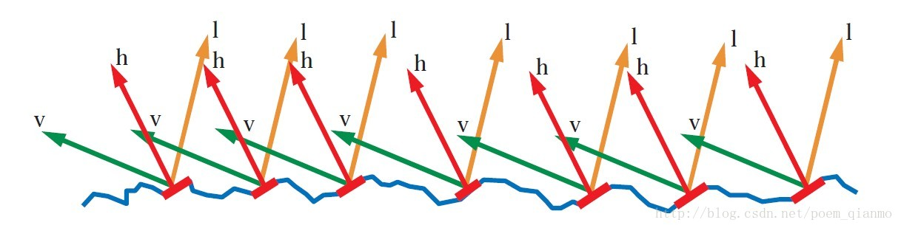

$$
D(n,h,\alpha) = \frac{\alpha^2}{\pi\left((n\cdot h)^2(\alpha^2-1)+1\right)^2}
$$

其中：

- $n$：表面的法向向量
- $h$：half 向量，该向量可以通过 $\dfrac{l+v}{\lVert l+v\rVert}$ 计算得到
- $\alpha$：表面的粗糙值，通过表面的 Roughness 属性计算得来

```glsl
// GGX / Trowbridge-Reitz  [Walter et al. 2007]
float D_GGX(float a2, float NoH)
{
    float d = (NoH * a2 - NoH) * NoH + 1.0;   // = NoH^2 (a2-1) + 1
    return a2 / (PI * d * d);
}

// 另一种等价写法（输入 perceptual roughness r，而非 a2 = α²）
float DistributionGGX(vec3 N, vec3 H, float rough)
{
    float a      = rough*rough;   // α = r²
    float a2     = a*a;           // α²
    float NdotH  = max(dot(N, H), 0.0);
    float NdotH2 = NdotH*NdotH;
    float nom    = a2;
    float denom  = (NdotH2 * (a2 - 1.0) + 1.0);
    denom        = PI * denom * denom;
    return nom / denom;
}

// Beckmann
float D_Beckmann(float a2, float NoH)
{
    float NoH2 = NoH * NoH;
    return exp((NoH2 - 1) / (a2 * NoH2)) / (PI * a2 * NoH2 * NoH2);
}

// Blinn-Phong（UE4 实现，n = 2/a2 - 2）
float D_Blinn(float a2, float NoH)
{
    float n = 2 / a2 - 2;
    return (n + 2) / (2 * PI) * pow(NoH, n);
}

// GTR
float D_GTR1(float alpha, float NoH)
{
    float a2 = alpha * alpha;
    float c2 = NoH * NoH;
    float den = (1.0 + (a2 - 1.0) * c2);
    return (a2 - 1.0) / (PI * log(a2) * den);
}

float D_GTR2(float alpha, float NoH)
{
    float a2 = alpha * alpha;
    float c2 = NoH * NoH;
    float den = (1.0 + (a2 - 1.0) * c2);
    return a2 / (PI * den * den);
}
```

> 命名陷阱：不同实现里 `a` / `alpha` 的含义不一致。有的实现先算 `alpha = roughness*roughness` 再直接代入 $\alpha$；有的（如上面的 `DistributionGGX`）把 perceptual roughness 直接当参数传进去、内部平方两次得到 $\alpha^2$。只要保证"公式里的 $\alpha$ 等于 roughness$^2$"就一致；若把 roughness 传进一个假定参数已是 $\alpha$ 的函数（或反过来），会多/少一次平方，高光会整体过锐或过糊。


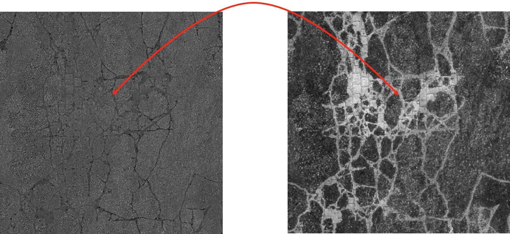

> 主流 NDF 在形状控制、粗粒度微观结构与单次散射上的三条局限，统一放在 **§11.6** 讨论。

### 5.3 几何项 G（Shadowing-Masking）

微平面之间的相互遮挡分两种：

- **几何障碍（obstruction / masking in）**：入射光在到达目标微平面前被别的微平面挡住；
- **几何遮蔽（shadowing / masking out）**：反射光在离开表面前被别的微平面挡住。

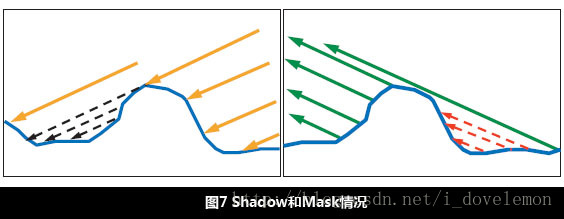

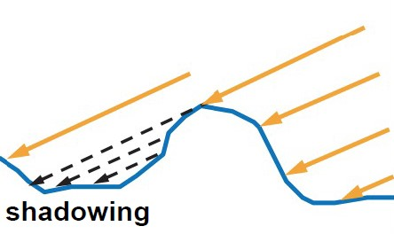
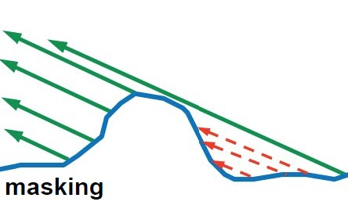

$G$ 输出 0~1：0 表示完全遮挡，1 表示完全无遮挡。Smith 方法把两个方向的遮蔽拆成独立的一维函数：

$$
G(\omega_i,\omega_o) = G_1(\omega_i)\,G_1(\omega_o)
$$

配合 Schlick-GGX 近似：

$$
G_1(x) = \frac{n\cdot x}{(n\cdot x)(1-k) + k},\qquad
k = \begin{cases}
\dfrac{(\alpha+1)^2}{8}=\dfrac{(r^2+1)^2}{8} & \text{直接光照，}\alpha=r^2\text{，}r\text{ 为感知粗糙度（即美术参数 roughness）}\\[4pt]
\dfrac{\alpha}{2}=\dfrac{r^2}{2} & \text{IBL / 环境光照}
\end{cases}
$$

$$
G_{SchlickGGX}(n,v,\alpha) = \frac{n\cdot v}{(n\cdot v)(1-k)+k}
$$

$$
G(n,v,l,\alpha) = G_{SchlickGGX}(n,v,\alpha)\cdot G_{SchlickGGX}(n,l,\alpha)
$$

```glsl
float GeometrySchlickGGX(float NdotX, float k)
{
    return NdotX / (NdotX * (1.0 - k) + k);
}

float GeometrySmith(vec3 N, vec3 V, vec3 L, float k)
{
    float NdotV = max(dot(N, V), 0.0);
    float NdotL = max(dot(N, L), 0.0);
    return GeometrySchlickGGX(NdotV, k) * GeometrySchlickGGX(NdotL, k);
}
```

使用 Disney 重映射 $\alpha = r^2$ 时，直接光照的 $k$ 可写成

```cpp
float alpha = roughness * roughness;              // roughness 是感知粗糙度 r，alpha = r^2
float k = (alpha + 1.0) * (alpha + 1.0) / 8.0;    // 直接光照：k=(alpha+1)^2/8=(r^2+1)^2/8
```

> 这里最容易混的是记号：**直接光照用 $k=\dfrac{(\alpha+1)^2}{8}=\dfrac{(r^2+1)^2}{8}$，其中 $r$ 是感知粗糙度**（美术滑块值本身，$r=0.5$ 时 $k=0.1953$）；**IBL 用 $k=\alpha/2=r^2/2$**（$r=0.5$ 时 $k=0.125$）。若把 $r$ 直接当成 $\alpha$ 代入 $(r+1)^2/8$，$r=0.5$ 会得 0.28125（偏大约 44%）。注意 $G_1$ 随 $k$ 减小而增大，所以 $k$ 偏小会让 $G_1$ 偏大，掠射角高光反而偏亮（遮蔽不足），而不是压暗。反过来把 IBL 也按直接光的 $\alpha$ 形式算，环境反射的边缘会明显偏暗。两个 $k$ 不是同一个量的两种写法。

---

## 6. Fresnel、IOR 与导体/电介质

### 6.1 Fresnel 效应

反射率随入射角变化：垂直入射时反射最小，掠射（grazing）时反射趋近 100%。水面近处看见水底（折射为主）、远处只见倒影（反射为主），就是 Fresnel 效应，它只与视角有关。

$$
F(F_0,\theta_i) = F_0 + (1-F_0)(1-\cos\theta_i)^5
$$

$$
F_0 = \left(\frac{\eta_1-\eta_2}{\eta_1+\eta_2}\right)^2 = \left(\frac{\eta-1}{\eta+1}\right)^2
$$


### 6.2 折射率 IOR

折射率 $n$ 是光在真空与介质中速度之比：

$$
n = \frac{c}{v}
$$

常见值：空气 1.000277（标准温压 15 °C、101.325 kPa；近似常写作 1.0003）、水 1.333、玻璃约 1.5、钻石 2.42。介质越"密"，光越慢，进入时向法线偏折，离开时远离法线。复数折射率的实部决定速度，虚部决定吸收（金属的消光系数）。

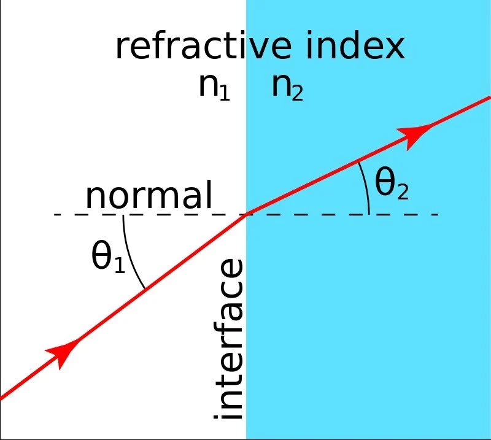

式中 $c$ 为真空中的光速（speed of light in vacuum），$v$ 为光在该介质中的相速度（phase velocity of light in the medium）。

| Material | Index of Refraction (n) |
| --- | --- |
| Vacuum | 1.000 |
| Air | 1.000277 |
| Water | 1.333333 |
| Ice | 1.31 |
| Glass | About 1.5 |
| Diamond | 2.417 |

### 6.3 F0：垂直入射反射率

由 Fresnel 公式，垂直入射（$\theta_i = 0$）时的反射率为

$$
F_0 = \left(\frac{n_1 - n_2}{n_1 + n_2}\right)^2
$$

对空气（$n_1=1$）与 IOR 为 $n$ 的电介质：

$$
F_0 = \left(\frac{n-1}{n+1}\right)^2
$$

$n=1.5$ 时 $F_0 \approx 0.04$，这正是"电介质 F0 取 0.04"的来源。**这是一个由 IOR 推导出的值，不是凭空的经验常数**；改变 IOR 就是在改变 $F_0$。

Schlick 近似（RGB 版本）：

$$
F(\theta) = F_0 + (1-F_0)(1-\cos\theta)^5,\qquad \cos\theta = n\cdot v \ (\text{或 } v\cdot h)
$$

$$
F_{Schlick}(n,v,F_0) = F_0 + (1-F_0)\left(1-(n\cdot v)\right)^5
$$

其中：

- $n$：表面的法向向量
- $v$：观察向量
- $F_0$：表面的基本反射属性

```glsl
vec3 fresnelSchlick(float cosTheta, vec3 F0)
{
    return F0 + (1.0 - F0) * pow(1.0 - cosTheta, 5.0);
}
```

### 6.4 电介质 / 导体 / 金属工作流

| | F0 数值 | F0 是否带颜色 | 是否有 diffuse |
| --- | --- | --- | --- |
| 电介质（绝缘体） | 0.02 ~ 0.08（约 0.04） | 否（灰/白） | 有 |
| 导体（金属） | 0.5 ~ 1.0 | 是（金/铜/银各异） | 基本没有 |

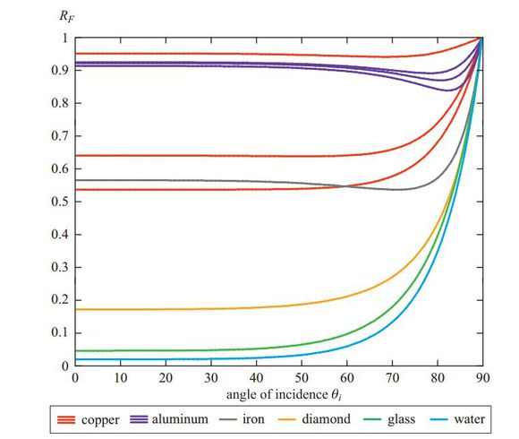
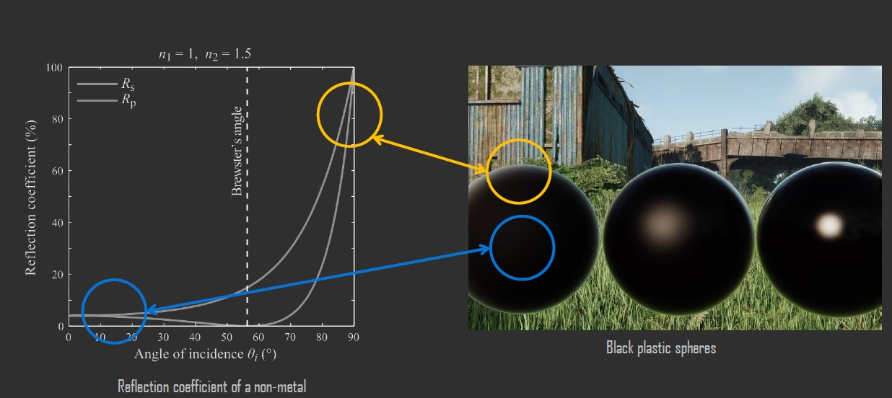
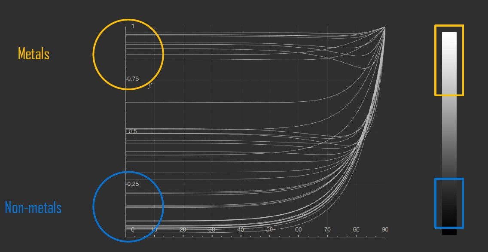

下表给出不同材质垂直入射（$0^\circ$）时的 $F_0$（线性值与 sRGB 编码值；原图另有 Color 色块列，略）：

| Material | $F(0^\circ)$ (Linear) | $F(0^\circ)$ (sRGB) |
| --- | --- | --- |
| Water | 0.02, 0.02, 0.02 | 0.15, 0.15, 0.15 |
| Plastic / Glass (Low) | 0.03, 0.03, 0.03 | 0.19, 0.19, 0.19 |
| Plastic High | 0.05, 0.05, 0.05 | 0.25, 0.25, 0.25 |
| Glass (High) / Ruby | 0.08, 0.08, 0.08 | 0.31, 0.31, 0.31 |
| Diamond | 0.17, 0.17, 0.17 | 0.45, 0.45, 0.45 |
| Iron | 0.56, 0.57, 0.58 | 0.77, 0.78, 0.78 |
| Copper | 0.95, 0.64, 0.54 | 0.98, 0.82, 0.76 |
| Gold | 1.00, 0.71, 0.29 | 1.00, 0.86, 0.57 |
| Aluminum | 0.91, 0.92, 0.92 | 0.96, 0.96, 0.97 |
| Silver | 0.95, 0.93, 0.88 | 0.98, 0.97, 0.95 |

工程上的统一写法是用 metallic 在两者之间插值：

```glsl
vec3 F0 = vec3(0.04);
F0 = mix(F0, albedo, metallic);   // albedo 在金属时承担 F0 的角色
```

> 常见错误：把 $F_0$ 说成"表面颜色"或"反射颜色"。$F_0$ 是**垂直入射的反射率**；只有金属的 $F_0$ 才有颜色（因为金属的反射率随波长变化）。

### 6.5 电介质与 IOR 的物理背景

电介质即绝缘体，内部正负电荷被束缚，自由电子极少；空气、纯水、玻璃、树脂都是电介质，真空也可视为理想电介质。渲染中"电介质 ≈ 非金属"是工程近似（有例外，如某些半导体、金属氧化物）。

---

## 7. 能量守恒

### 7.1 基本约束

出射光不能多于入射光：

$$
k_d + k_s \le 1
$$

specular 与 diffuse 是互斥的分配关系，specular 占比越高，diffuse 必须越低。PBR 用 Fresnel 项来分配：

$$
k_s = F,\qquad k_d = (1 - F)(1 - \text{metallic})
$$

```glsl
vec3 F  = fresnelSchlick(max(dot(N, V), 0.0), F0);
vec3 kS = F;
vec3 kD = (vec3(1.0) - kS) * (1.0 - metallic);
```

> 早期笔记里写的 $C_d + C_s \le 1$（"反射率 + 反照率 ≤ 1"）方向是对的，但严格形式是"**按方向积分的 BRDF 能量**不超过 1"，而不是两个颜色常量简单相加。

### 7.2 高光归一化（Energy Preserving Specular）

只把高光变亮、不按粗糙度归一化，会导致粗糙表面反射的总能量凭空增加。做法是在 BRDF 中加入归一化因子，使 $D$ 满足 5.2 的积分约束。直观结果：粗糙度升高时高光范围扩大、峰值降低，总能量不变——"高光半径放大 10 倍，亮度大约降到 1/100"。

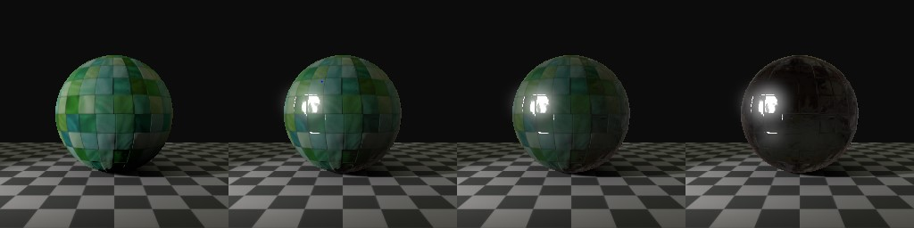
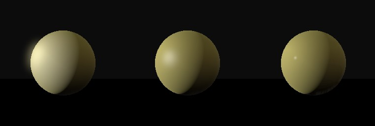
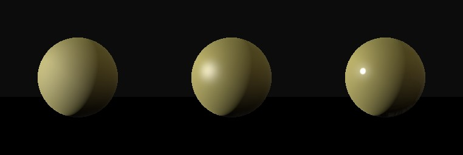
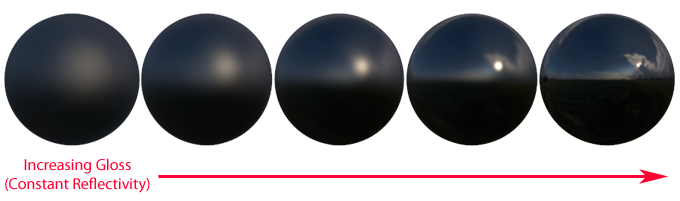
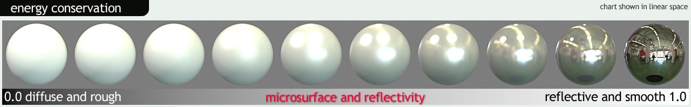

$G$ 项也是能量守恒的基础之一：它让被遮挡的反射光不会计入出射能量。

---

## 8. 渲染方程

### 8.1 定义

$$
L_o(p,\omega_o) = L_e(p,\omega_o) + \int_{\Omega} f_r(p,\omega_i,\omega_o)\,L_i(p,\omega_i)\,(n\cdot\omega_i)\,d\omega_i
$$

各项含义：

- $L_o(p,\omega_o)$：经过着色之后，从 $\omega_o$ 方向观察点 $p$ 时的颜色。
- $L_e(p,\omega_o)$：自发光项。
- $f_r(p,\omega_i,\omega_o)$：点 $p$ 上，从 $\omega_o$ 方向反射出去的光照与从 $\omega_i$ 方向入射的光照之比，该函数称为 BRDF（Bidirectional Reflection Distribution Function）。
- $L_i(p,\omega_i)$：从 $\omega_i$ 方向入射到 $p$ 点上的光照；它本身又可能来自其他表面的 $L_o$，所以方程是递归的（这就是全局光照）。
- $n\cdot\omega_i$：反射强度与光照方向、接收光照表面法线方向之间夹角的关系，即 Lambert 定律（式中用它代替 $\cos\theta_i$）。
- $\int_\Omega \cdots d\omega_i$：在以 $n$ 为中心的上半球 $\Omega$ 上，对所有入射光线方向积分。

> 记号提示：公式中所有光线方向向量均指向外侧（背离表面），因此 $n\cdot\omega_i$ 本身就是 $\cos\theta_i$，不必再取绝对值。

只考虑直接光照（解析光源）时，积分退化为求和：

$$
L_o = L_e + \sum_{k} f_r(\omega_{i,k},\omega_o)\,L_{i,k}\,(n\cdot\omega_{i,k})
$$

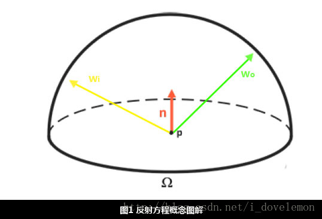

### 8.2 从点光源到面光源到场景

- 一个点光源：无积分，只有一个方向有 $L_i$；
- 多个点光源：逐光源求和；
- 面光源：对光源所张立体角积分；
- 场景中其他物体：同样视为"面光源"，只是只有少数方向有非零 $L_i$。


### 8.3 算子形式与物理意义

把渲染方程写成 $L = E + K L$（$E$ 为自发光，$K$ 为反射算子），形式解为

$$
L = (I-K)^{-1}E = E + KE + K^2E + K^3E + \cdots
$$

即"光源 + 一次弹射 + 二次弹射 + …"，这正是路径追踪的 Neumann 级数展开，也解释了为什么反弹次数越多越接近真实。

级数中每一项的物理意义：

- $E$：光源直接发射的光（emission directly from light sources）；
- $KE$：表面上的直接光照（direct illumination on surfaces）；
- $K^2E$：一次弹射的间接光照（one bounce indirect），如镜面/折射带来的二次可见；
- $K^3E$：两次弹射的间接光照（two bounce indirect illumination）。

光栅化着色的能力边界恰好落在第二项：它只能算出 $E + KE$（自发光 + 直接光照），间接光照必须靠 GI / 探针等技术补足。

下图依次是同一场景的**直接光照**、**一次弹射全局光照**（direct + indirect）与**两次弹射全局光照**的渲染结果：

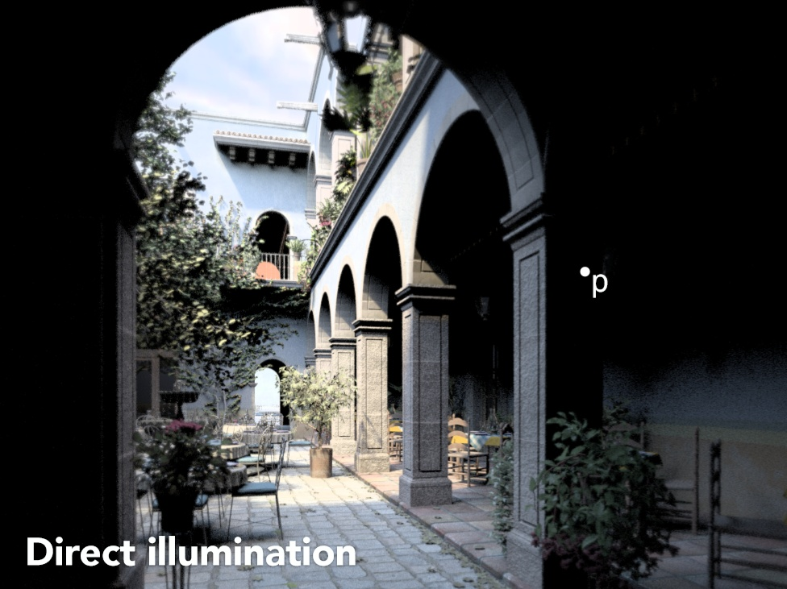
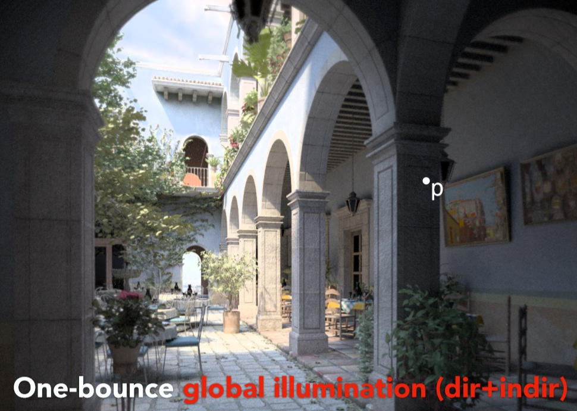
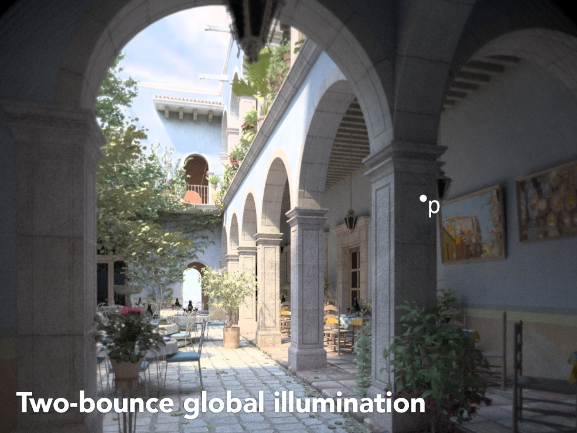

---

## 9. 直接光照的完整实现

把 5~7 节拼起来，单个解析光源的直接光照为

$$
L_o = \left[ k_d \frac{c}{\pi} + \frac{D F G}{4(n\cdot l)(n\cdot v)} \right] L_i\,(n\cdot l)
$$

```glsl
const float PI = 3.1415927;

vec3 calc_fresnel(vec3 n, vec3 v, vec3 F0)
{
    float ndotv = max(dot(n, v), 0.0);
    return F0 + (vec3(1.0) - F0) * pow(1.0 - ndotv, 5.0);
}

float calc_NDF_GGX(vec3 n, vec3 h, float roughness)
{
    float a  = roughness * roughness;   // alpha
    float a2 = a * a;
    float ndoth  = max(dot(n, h), 0.0);
    float ndoth2 = ndoth * ndoth;
    float t  = ndoth2 * (a2 - 1.0) + 1.0;
    return a2 / (PI * t * t);
}

float calc_Geometry_GGX(float costheta, float roughness)
{
    float a  = roughness * roughness;       // alpha = r^2
    float k  = (a + 1.0) * (a + 1.0) / 8.0; // 直接光照：k=(alpha+1)^2/8，r 为感知粗糙度
    return costheta / (costheta * (1.0 - k) + k);
}

float calc_Geometry_Smith(vec3 n, vec3 v, vec3 l, float roughness)
{
    float ndotv = max(dot(n, v), 0.0);
    float ndotl = max(dot(n, l), 0.0);
    return calc_Geometry_GGX(ndotv, roughness) * calc_Geometry_GGX(ndotl, roughness);
}

vec3 calc_lighting_direct(vec3 n, vec3 v, vec3 l, vec3 h,
                          vec3 albedo, float roughness, float metalic, vec3 light)
{
    vec3 F0 = mix(vec3(0.04), albedo, metalic);
    vec3 F  = calc_fresnel(h, v, F0);   // 微表面下用 h 而非 n

    vec3 kD = (vec3(1.0) - F) * (1.0 - metalic);

    float D = calc_NDF_GGX(n, h, roughness);
    float G = calc_Geometry_Smith(n, v, l, roughness);

    vec3 Diffuse  = kD * albedo * (1.0 / PI);
    float t       = 4.0 * max(dot(n, v), 0.0) * max(dot(n, l), 0.0) + 0.001;
    vec3 Specular = D * F * G / t;

    float ndotl = max(dot(n, l), 0.0);
    return (Diffuse + Specular) * light * ndotl;
}
```

要点：

- Fresnel 用 $v\cdot h$ 而不是 $v\cdot n$：微平面模型下"有效法线"是 $h$，只有 $h$ 对齐的微平面对出射有贡献。
- 分母加一个极小值避免 $n\cdot l$ 或 $n\cdot v$ 为 0 时除零。
- 金属的 $k_d$ 必须为 0，否则会出现"金属也有漫反射"的错误外观。
- 输出前需要 tone mapping 与 gamma 编码（见《10_色彩空间与色调映射》）。

### 9.1 PBR 系列文章的推导脉络

1. **光与物质的交互**：吸收 / 散射 / 自发光；均匀介质 vs 非均匀介质；折射率实部管速度（折射）、虚部管吸收。
2. **光与平面的交互**：表面交互分反射（specular）与折射（进入内部后重新射出 = diffuse）；真实表面是 microgeometry；粗糙度决定反射清晰度。
3. **次级表面散射与 Fresnel**：SSS 与 diffuse 是同一现象的不同尺度；Fresnel 无处不在，掠射角下任何光滑表面都趋近完美镜面。
4. **D 与 G**：表面反射细节主要由 specular 承担，D 决定高光大小/亮度/形状，G 决定可见度（0~1）并保证能量守恒。
5. **能量守恒**：diffuse 与 specular 互斥，$k_d + k_s \le 1$；高光需要归一化因子。

---

## 10. 几点容易混淆的结论

1. **Phong 的镜面项不是 BRDF 的正确形式**：它没有归一化常数（缺 $1/\pi$ 那一类因子），不能直接放进渲染方程做能量守恒的积分；但它的镜面叶瓣本身是可逆的，缺的是能量归一化而不是可逆性。
2. **"高光颜色 = 光源颜色"只在电介质近似成立**；金属的高光被 $F_0$（即 albedo）着色。
3. **法线贴图与几何精度不能替代微平面模型**：微表面的粗糙度是像素级以下的统计属性；即便把模型面数堆到千万级，着色仍需 D/F/G 描述"像素内"的分布，几何加密解决的是轮廓与视差，不是微表面反射。
4. **$F_0 = 0.04$ 只对 IOR≈1.5 的电介质成立**，不要把它套到金属或水（$F_0\approx0.02$）上。
5. **$D$ 的归一化是"投影面积"归一化**，不是"立体角上积分为 1"，所以 $D$ 不是 PDF。

---

## 11. NDF（法线分布函数）详解

> §5.2 已给出 $D$ 的物理含义、归一化约束与四种常见 NDF 的公式表。本章只补它没展开的部分：定义里"单位立体角"为何不可省、归一化常数如何积出来（含 GGX 分母的逐项验证）、各向异性版本如何由各向同性"拉伸"得到，以及 $D$ 与可见法线分布的区别。

### 11.1 定义：两个限定缺一不可

"单位面积、单位立体角内，法线落在 $h$ 方向的微平面面积"，两个限定各管一件事：

1. **单位面积**——$D$ 描述的是一个着色点（微分面积元 $dA$）内的统计，不是整张表面；
2. **单位立体角**——微平面法线是连续分布的，取到某个精确方向 $h$ 的微平面几乎不存在（连续型随机变量取单点概率为 0），必须给一个立体角元，密度才有意义。

于是有 Walter 等人在 *Microfacet Models for Refraction through Rough Surfaces* 中的定义

$$
d^2A(h)=D(h)\,d\omega_h\,dA
$$

$d^2A(h)$ 是 $A$ 内法线落在 $d\omega_h$ 内的微平面面积之和；面积量纲上下抵消，$D$ 的单位是 $\mathrm{sr}^{-1}$。它是密度而非概率密度（§5.2、§10 第 5 条）。

### 11.2 归一化：由"投影面积相等"推出 $\int D\cos\theta_h\,d\omega_h=1$

微平面投影回宏观平面，投影面积之和必须等于宏观面积：

$$
dA=\int_{\Omega}\cos\theta_h\,d^2A(h)=\int_{\Omega}\cos\theta_h\,D(h)\,d\omega_h\,dA
\quad\Longrightarrow\quad
\int_{H^2}\cos\theta_h\,D(\omega_h)\,d\omega_h=1
$$

换成任意方向 $v$，约束推广为

$$
\int_{\Omega}D(m)\,(v\cdot m)\,d\omega_m=v\cdot n
$$

这里的点积**不**钳制为非负：背面微平面的负投影恰好抵消侧向微平面的重叠，这一条是 Smith 遮蔽与 VNDF（11.7）的出发点。由此得四条性质：$D\ge0$ 且有界；$\int D\,d\omega_m\ge1$（微平面倾斜，总面积大于宏观面积）；任意方向投影面积等于宏观投影面积；$v=n$ 时可归一化为 1。

### 11.3 形状不变性与斜率空间 $P^{22}$

若各向同性 NDF 可写成

$$
D(\omega_h)=\frac{1}{\alpha^2\cos^4\theta_h}\,g\!\left(\frac{\tan\theta_h}{\alpha}\right)
$$

其中 $g$ 只决定形状、与 $\alpha$ 无关，则称其**形状不变**（源笔记以图片给出该式及等价写法）。把 NDF 看成二维斜率 $(\tilde m_x,\tilde m_y)=\tan\theta_h(\cos\phi_h,\sin\phi_h)$ 的分布 $P^{22}$，则

$$
D(\omega_h)=\frac{P^{22}(\tilde m)}{\cos^4\theta_h}
$$

（其中的 $\cos^3$ 是"法线立体角 → 斜率面积"的雅可比，多出的一个 $\cos$ 来自 $P^{22}$ 按投影面积归一；斜率符号取决于切线基手性。）在斜率空间里缩放 $\alpha$ 等于把分布**线性拉伸**，微观几何形状不变、只被倒数缩放——这就是名字的来历。

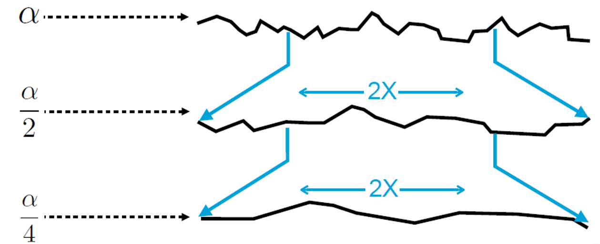

好处有三：可直接推出归一化的**各向异性版本**（11.5）；可推出配套 Smith $G_1$，并用低维函数或表格覆盖所有粗糙度与各向异性；可基于 NDF 或可见法线分布推导重要性采样（第 12 章）。按此分类：GGX 与 Beckmann 具备形状不变性；Phong、Blinn-Phong、GTR 不具备（GTR 在 $\gamma=2$ 时退化为 GGX，$\gamma\ne2$ 即失去该性质，这也是它"控制更强却未普及"的深层原因）。

### 11.4 三种 $D$ 的归一化验证

统一算 $\int_{H^2}D\cos\theta_h\,d\omega_h$，记 $c=\cos\theta_h$、$s=\sin\theta_h$、$d\omega_h=s\,d\theta\,d\phi$，方位角给出 $2\pi$。

**Beckmann。** $D=\dfrac{1}{\pi\alpha^2c^4}e^{-\tan^2\theta_h/\alpha^2}$，令 $t=\tan\theta$（$dt=d\theta/c^2$，$\frac{s}{c^3}d\theta=t\,dt$）：

$$
\int_{H^2}D\cos\theta_h\,d\omega_h=\frac{2}{\alpha^2}\int_0^{\infty}t\,e^{-t^2/\alpha^2}dt=\frac{2}{\alpha^2}\cdot\frac{\alpha^2}{2}=1
$$

**Blinn-Phong。** $D=\dfrac{\alpha_p+2}{2\pi}c^{\alpha_p}$：

$$
\int_{H^2}D\cos\theta_h\,d\omega_h=(\alpha_p+2)\int_0^{\pi/2}c^{\alpha_p+1}s\,d\theta=\frac{\alpha_p+2}{\alpha_p+2}=1
$$

**GGX（验证分母）。** $D=\dfrac{\alpha^2}{\pi\left((\alpha^2-1)c^2+1\right)^2}$，令 $u=c^2$（$du=-2c\,s\,d\theta$，区间 $1\to0$）：

$$
\begin{aligned}
\int_{H^2}D\cos\theta_h\,d\omega_h
&=2\alpha^2\int_0^{\pi/2}\frac{c\,s}{\left((\alpha^2-1)c^2+1\right)^2}d\theta
=\alpha^2\int_0^{1}\frac{du}{\left((\alpha^2-1)u+1\right)^2}\\
&=\alpha^2\left[-\frac{1}{(\alpha^2-1)\left((\alpha^2-1)u+1\right)}\right]_0^1
=\frac{\alpha^2}{\alpha^2-1}\left(1-\frac{1}{\alpha^2}\right)=1
\end{aligned}
$$

所以 GGX 分母 $\pi\left(\cos^2\theta_h(\alpha^2-1)+1\right)^2$ 是**恰好**归一化的，前面的 $\alpha^2$ 不多不少。改写成斜率形式更清楚：

$$
D_{GGX}=\frac{\alpha^2}{\pi(\alpha^2c^2+s^2)^2}
=\frac{1}{\pi\alpha^2c^4}\cdot\frac{1}{\left(1+\tan^2\theta_h/\alpha^2\right)^2}
$$

正是 11.3 的形式，$g(t)=\dfrac{1}{\pi(1+t^2)^2}$。大角度下 $\tan\theta_h\gg\alpha$ 时 $(\alpha^2c^2+s^2)^2\approx s^4$，故 $D_{GGX}\approx\dfrac{\alpha^2}{\pi\sin^4\theta_h}$；$\theta_h\to90^\circ$ 时 $s\to1$，GGX 趋于 $\alpha^2/\pi$（非零），Beckmann 与 Blinn-Phong 趋于 0（前者高斯型超指数衰减）。注意 $1/t^4$ 是对**斜率空间**分布 $P^{22}$ 的刻画：$P^{22}\sim\dfrac{\alpha^2}{\pi t^4}$（$t=\tan\theta_h$），不是 $D$ 自身按 $1/\theta^4$ 衰减的写法。

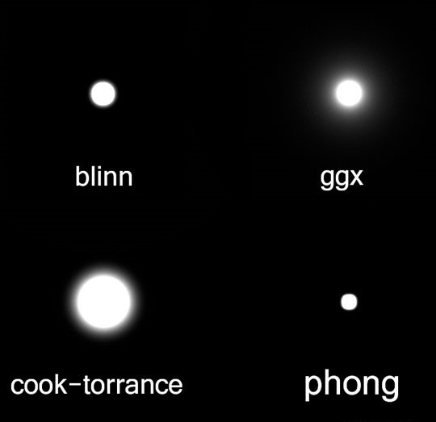

| | 归一化常数的来源 | 尾部 | $\theta_h=90^\circ$ | 形状不变 |
| --- | --- | --- | --- | --- |
| Beckmann | $\frac{2}{\alpha^2}\int_0^\infty t e^{-t^2/\alpha^2}dt=1$ | 高斯 | 0 | 是 |
| Blinn-Phong | $\int_0^{\pi/2}c^{\alpha_p+1}s\,d\theta=\frac{1}{\alpha_p+2}$ | 幂律 $c^{\alpha_p}$ | 0 | 否 |
| GGX | $\frac{\alpha^2}{\alpha^2-1}\left(1-\frac{1}{\alpha^2}\right)=1$ | 斜率空间 $P^{22}\sim\alpha^2/(\pi t^4)$，$D\sim\alpha^2/(\pi\sin^4\theta_h)$ | $\alpha^2/\pi$ | 是 |

两个极限可作自检：Blinn-Phong 的 $\alpha_p=0$ 时 $D=1/\pi$，即均匀 NDF（微平面朝向完全随机）；$\alpha_p=\infty$ 时分布退化为 $h=n$ 上的 $\delta$，即完美镜面。

**补充（源笔记以图片给出、正文未展开）：** Blinn-Phong 的指数 $\alpha_p$ 无法直接由美术参数线性映射——视觉变化极不均匀。常见做法是指数映射 $\alpha_p=m^{s}$，$s\in[0,1]$ 为界面值、$m$ 为上限（《使命召唤：黑色行动》取 $m=8192）；UE4 则用内置映射 $\alpha_p=\dfrac{2}{\alpha^2}-2$，即代码里的 `n = 2/a2 - 2`。（原稿有误，已更正：`αp=ms` → $\alpha_p=m^{s}$；若按乘法 $ms$ 解释，$s=1$ 时上限只有 $m$，与"$\alpha_p$ 可任意高、镜面时 $\alpha_p=\infty$"矛盾。）

### 11.5 各向异性 NDF：在斜率空间做非等比拉伸

具备形状不变性时，各向异性版本不需要重新推导，只需把斜率空间沿两轴按 $\alpha_x,\alpha_y$ 拉伸：

$$
D_{aniso}(\omega_h)=\frac{1}{\alpha_x\alpha_y\cos^4\theta_h}\,
g\!\left(\sqrt{\frac{\tan^2\theta_h\cos^2\phi_h}{\alpha_x^2}+\frac{\tan^2\theta_h\sin^2\phi_h}{\alpha_y^2}}\right)
$$

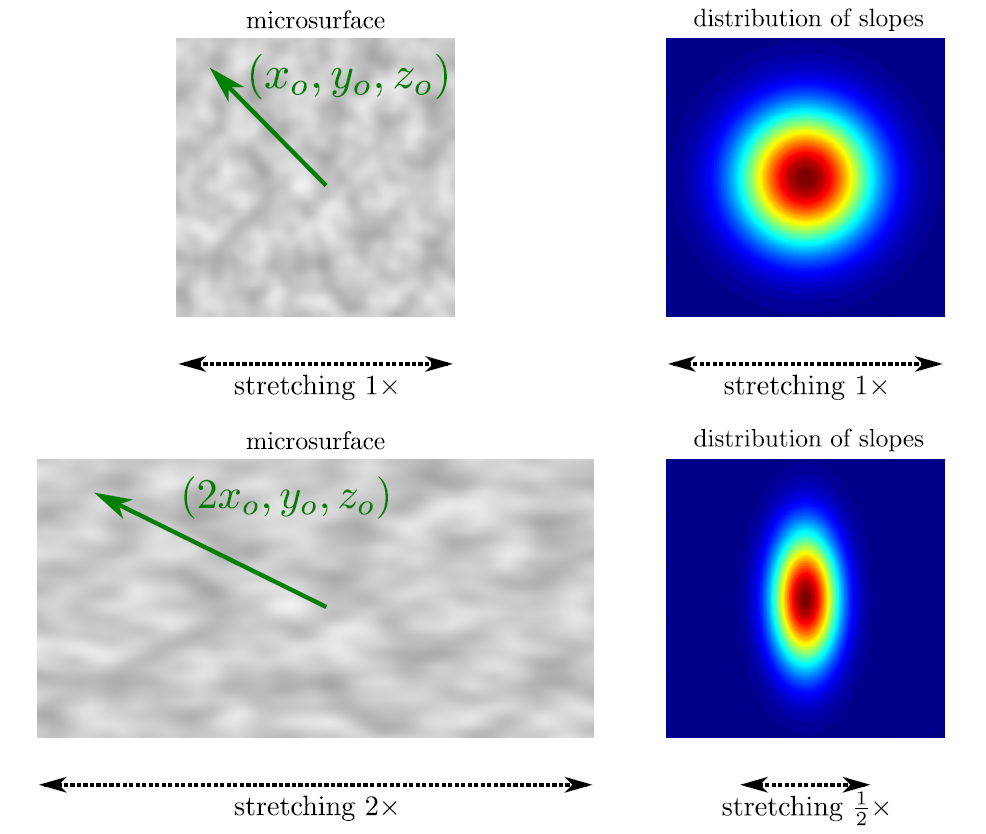

代入 Beckmann 的 $g(t)=\frac{1}{\pi}e^{-t^2}$ 得 $D=\dfrac{1}{\pi\alpha_x\alpha_yc^4}\exp\!\left[-\tan^2\theta_h\left(\dfrac{\cos^2\phi_h}{\alpha_x^2}+\dfrac{\sin^2\phi_h}{\alpha_y^2}\right)\right]$；代入 GGX 的 $g(t)=\frac{1}{\pi(1+t^2)^2}$ 得

$$
D_{GGX,aniso}=\frac{1}{\pi\alpha_x\alpha_yc^4\left(1+\tan^2\theta_h\left(\frac{\cos^2\phi_h}{\alpha_x^2}+\frac{\sin^2\phi_h}{\alpha_y^2}\right)\right)^2}
=\frac{1}{\pi\alpha_x\alpha_y\left(\frac{(h\cdot x)^2}{\alpha_x^2}+\frac{(h\cdot y)^2}{\alpha_y^2}+(h\cdot z)^2\right)^2}
$$

（两式等价：代入 $\tan\theta_h\cos\phi_h=\frac{h\cdot x}{h\cdot z}$ 等、再同乘 $(h\cdot z)^4$ 即得。）

> 易错点（$\alpha_x/\alpha_y$ 的位置）：两个轴的粗糙度必须出现在**分母**、且各自配自己轴的分量。写成 $\alpha_x^2(h\cdot x)^2+\alpha_y^2(h\cdot y)^2$ 会让"越粗糙越尖锐"，并把各向异性方向一并翻转；把 $\alpha_x$ 配给 $h\cdot y$ 只是把拉伸方向转了 90°。公式对称、写错不报错，只能靠拉丝高光的方向发现。

反过来也成立（但只在 NDF 具备形状不变性时，见 11.3）：任一形状不变的各向异性 NDF 配置都可以通过同样的斜率空间变换映射回一个各向同性的配置（源笔记：*任何具有各向异性分布的配置都可以转换回具有各向同性分布的配置*），这也是各向异性版本只需一套各向同性求值代码的原因；形状可变的 NDF（如 $\gamma\ne2$ 的 GTR、Phong）没有这个对应关系。

Disney 映射（$r$ 为美术可见 roughness，$a\in[-1,1]$ 为各向异性强度；源笔记未含此映射，出自 Disney 2012）：

$$
\text{aspect}=\sqrt{1-0.9a},\qquad \alpha_x=\frac{r^2}{\text{aspect}},\qquad \alpha_y=r^2\cdot\text{aspect}
$$

$a=0$ 时 aspect$=1$，退化为各向同性；$a\to1$ 时 aspect$\approx0.316$、$\alpha_x/\alpha_y\approx10$，高光沿切线拉成细长条。系数 $0.9$ 的作用是让 aspect 不趋近 0，从而 $\alpha_x$ 不发散。

### 11.6 主流 NDF 的局限

1. **形状控制不足**：主流 NDF 只有一个（各向同性）或两个（各向异性）参数，无法独立控制峰值尖锐度与尾部长度；GTR 补上了尾部控制，却因失去形状不变性而难以工程化。
2. **无法表示粗粒度微观结构**：一个像素覆盖数万个微元时统计描述成立；只覆盖几十个微元时外观是"复杂而闪烁"，而非各向异性——此时平滑的 $D$ 根本不成立。
3. **只有单次散射**：Cook-Torrance 是最简单的模型——单层微平面的单次散射，不含多次散射、衍射与波动光学；多次散射缺失正是粗糙金属/电介质掠射角偏暗的主因。这是单次散射模型自身的局限，与 §7.2 的"高光能量归一化"是两个层面的问题。

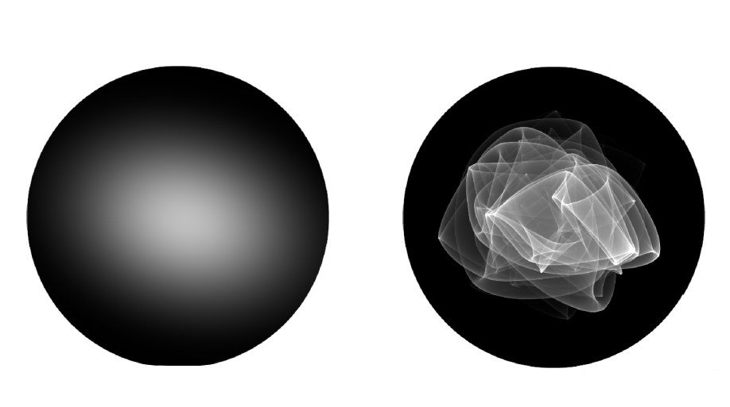
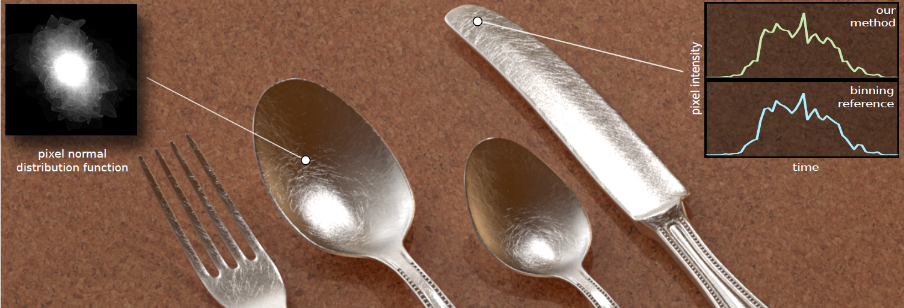

### 11.7 $D$ 与可见法线分布（VNDF）的区别

$D(m)$ 统计**所有**微平面，不区分在当前视角下是否可见；而能把 $l$ 反射进 $v$ 的，只有既朝向 $h$ 又没被视线遮挡的那些。计入可见性后得到

$$
D_{\omega_o}(m)=\frac{G_1(\omega_o)\,(\omega_o\cdot m)\,D(m)}{\omega_o\cdot n}
$$

- 权重由 $D$ 采样用的 $(n\cdot m)$ 换成 $(\omega_o\cdot m)$，再乘 Smith 遮蔽 $G_1(\omega_o)$；
- $D_{\omega_o}$ 是关于立体角的**概率密度**（半球上积分为 1），$D$ 不是。

$v=n$ 时两者的一致性、以及有效样本率随视角的退化，属于采样效率问题，统一放在 **§12.8** 讨论；VNDF 的闭式解（Heitz 2018 的椭圆截面 + 斜率空间变换）不在源材料内，此处只给定义与关系。

---

## 12. BRDF 重要性采样

> 本章把第 8 章的渲染方程落到"怎么抽方向"：五套采样公式与 PDF 的推导链，以及半程向量采样到入射方向的那次立体角换算。

### 12.1 估计量与三类采样策略

蒙特卡洛积分是**无偏**估计：

$$
\int_\Omega f(x)\,dx\approx\frac{1}{N}\sum_{i=1}^{N}\frac{f(x_i)}{p(x_i)},\qquad x_i\sim p
$$

代入渲染方程，单样本贡献为 $\dfrac{f_r(\omega_i,\omega_o)\,L_i(\omega_i)\,(n\cdot\omega_i)}{p(\omega_i)}$。$p$ 越接近被积函数（$L_i$、$\cos$、BRDF 三部分），方差越小；$p$ 必须在支撑域上非零，否则会系统性漏能量（"只用 NDF 采样做直接光、却打不中小光源"的根源）。

三类可选 $p$：① **按光源能量** $p\propto L_i$——IBL 假设光源在无穷远，所有像素共用同一环境光分布；Unity 的 Lightmap 烘焙用"遍历 cubemap 求 globalMaxMetric / envmapIntegral + 接受-拒绝"，累积亮度时以**像素立体角**为权重，样本记录 intensity、方向与 $1/p$ 权重。② **按余弦项**（12.2）。③ **按 BRDF，具体说是按 NDF**（12.3–12.7）。

### 12.2 余弦加权半球采样

要求 $p\propto\cos\theta$，由规范性定常数：

$$
\int_{\Omega^+}c\cos\theta\,d\omega=c\int_0^{2\pi}\!\!\int_0^{\pi/2}\cos\theta\sin\theta\,d\theta\,d\phi=c\pi=1
\;\Longrightarrow\;c=\frac{1}{\pi},
\qquad p(\theta,\phi)=\frac{\cos\theta\sin\theta}{\pi}
$$

边缘密度与条件密度、CDF：

$$
p(\theta)=\int_0^{2\pi}p(\theta,\phi)\,d\phi=\sin2\theta,\qquad
p(\phi\mid\theta)=\frac{1}{2\pi},\qquad
F(\theta)=1-\cos^2\theta,\qquad
F(\phi\mid\theta)=\frac{\phi}{2\pi}
$$

逆变换采样（$\xi_1,\xi_2\sim U[0,1]$）与笛卡尔形式（$z$ 轴为 $n$）：

$$
\theta=\arccos\sqrt{1-\xi_1},\quad \phi=2\pi\xi_2;
\qquad
x=\cos(2\pi\xi_2)\sqrt{\xi_1},\quad y=\sin(2\pi\xi_2)\sqrt{\xi_1},\quad z=\sqrt{1-\xi_1}
$$

即"圆盘上均匀取点再抬到半球"。好处是估计量退化：

$$
\frac{f_d\,L_i\,(n\cdot\omega_i)}{p}=\frac{(c/\pi)L_i\cos\theta}{\cos\theta/\pi}=c\,L_i
$$

与 $\theta$ 无关，方差极小。这不是因为"光在物理上按余弦分布"，而是因为 $p$ 与 $f\cos$ 同形。

### 12.3 Blinn-Phong 采样

$D=\dfrac{\alpha_p+2}{2\pi}\cos^{\alpha_p}\theta_h$（归一化见 11.4）。半程向量的立体角密度与球坐标密度为

$$
p_h(\omega_h)=D\cos\theta_h=\frac{\alpha_p+2}{2\pi}\cos^{\alpha_p+1}\theta_h,
\qquad
p_h(\theta,\phi)=\frac{\alpha_p+2}{2\pi}\cos^{\alpha_p+1}\theta\sin\theta
$$

$p_h(\phi)=\frac{1}{2\pi}$，故条件密度与 CDF：

$$
p_h(\theta\mid\phi)=(\alpha_p+2)\cos^{\alpha_p+1}\theta\sin\theta,
\qquad
P_h(\theta)=1-\cos^{\alpha_p+2}\theta
$$

$$
\cos\theta_h=\xi_0^{\,1/(\alpha_p+2)},\qquad \phi_h=2\pi\xi_1
$$

> 幂次之辨：$\xi_0$ 与 $1-\xi_0$ 同为 $U[0,1]$，两种写法等价。但 pbrt-v2 的 Phong 与 Mitsuba 的 `phong.cpp` 用的是 $\cos\theta=\xi^{1/(\alpha_p+1)}$（pbrt-v3 已无 Blinn-Phong 实现；Mitsuba 该处的叶瓣轴是反射方向），比严格解少一次幂——因为它们把采样密度定义成**在立体角上归一化**的 $\frac{\alpha_p+1}{2\pi}\cos^{\alpha_p}\theta$（丢掉投影因子 $\cos\theta_h$），PDF 与实际抽样密度自洽、估计仍无偏，只是分布与真正的 NDF 差一个 $\cos\theta_h$。**PDF 必须与采样公式配对**：用 $1/(\alpha_p+2)$ 就配 $p=D\cos\theta_h$，用 $1/(\alpha_p+1)$ 就配 $\frac{\alpha_p+1}{2\pi}\cos^{\alpha_p}$，混用会带来亮度偏差。（待核实：该近似的实际视觉影响，源笔记只注明"来源不明"。）

### 12.4 归一化 Phong 采样

源笔记从峰值出发归一化：$l\parallel n$ 时 $r=\omega_r=n$、$n\cdot l=\cos\theta_i=1$（而 $n\cdot v=\cos\theta_o$ 是观测量，一般 $\ne1$），反射能量取最大；归一化常数则由能量约束 $\int f_r\cos\theta\,d\omega=1$ 定出。$\cos^\alpha$ 叶瓣在半球上的积分为

$$
\int_{\Omega}\cos^{\alpha}\theta\,d\omega
=\int_0^{2\pi}\!\!\int_0^{\pi/2}\cos^{\alpha}\theta\sin\theta\,d\theta\,d\phi=\frac{2\pi}{\alpha+1}
$$

注意幂次：能量约束里多一个投影因子 $\cos\theta$，被积函数变成 $\cos^{\alpha+1}$，

$$
\int_{\Omega}\cos^{\alpha+1}\theta\,d\omega=\frac{2\pi}{\alpha+2}
\;\Longrightarrow\;
\int f_r\cos\theta\,d\omega=k_s\,C\cdot\frac{2\pi}{\alpha+2}=1
\;\Longrightarrow\;C=\frac{\alpha+2}{2\pi}
$$

所以归一化因子是 $(\alpha+2)/(2\pi)$：

$$
f_r(p,\omega_i,\omega_o)=k_s\frac{\alpha+2}{2\pi}\,(\omega_r\cdot\omega_o)^{\alpha}
$$

（点积需钳制 $\max(0,\cdot)$。严格说是"能量归一化"而非"按最大值归一化"，两种说法在此给出同一常数。**但要注意：这里的推导默认叶瓣轴与法线重合（$\omega_r=\mathbf n$）**。斜入射时叶瓣有一部分落到表面以下，被半球积分截掉，上式不再精确等于 1——$\alpha=20$ 时轴偏 $30^\circ/60^\circ/75^\circ$ 分别只有约 $0.87/0.50/0.27$；$\alpha=1$、偏 $60^\circ$ 约 $0.61$。若要严格归一化，需要乘一个与入射方向相关的因子；这也正是该简单归一化不满足互易性的原因。）

采样该 $\cos^\alpha$ 叶瓣时，密度要带投影因子才能在立体角上归一：

$$
p(\omega_o)=\frac{\alpha+2}{2\pi}\cos^{\alpha+1}\theta_r
\qquad\left(\int p\,d\omega=(\alpha+2)\int_0^{\pi/2}\cos^{\alpha+1}\theta\sin\theta\,d\theta=1\right)
$$

（绕 $\omega_r$ 的半角。写成 $\cos^\alpha$ 会让半球积分为 $(\alpha+2)/(\alpha+1)\neq1$，也与下面的 CDF 不自洽。同样地，$\int p\,d\omega=1$ 只在 $\omega_r=\mathbf n$ 时成立。）CDF 与采样为

$$
P(\theta_r)=1-\cos^{\alpha+2}\theta_r,
\qquad
\theta_r=\arccos\left(\xi_0^{\,1/(\alpha+2)}\right),\quad \phi=2\pi\xi_1
$$

> 与 12.3 的差别不在"$\cos$ 的个数"：两处 PDF 都是 NDF 的投影密度 $D\cos\theta$。真正的差别在采样对象——Blinn 采的是半程向量，$p_h$ 必须再除以 $4(v\cdot h)$ 才能用于 $\omega_i$（12.6）；Phong 直接采出射（反射）方向，得到的已是 $\omega_o$ 上的 PDF，无需换算。把 Blinn 的 $p_h$ 直接当 $p_i$、或给 Phong 再除一次 $4(v\cdot h)$，都会带来随视角变化的亮度偏差，掠射角尤甚。

### 12.5 Beckmann 采样

$D=\dfrac{1}{\pi\alpha^2\cos^4\theta_h}e^{-\tan^2\theta_h/\alpha^2}$ 属高斯族，其不定积分不能用初等函数表示——但带 $\sin\theta\cos\theta$ 权重的积分可以，这正是采样可行的原因。由 $p(\omega_h)=D\cos\theta_h$：

$$
p(\theta_h,\phi_h)=\frac{\sin\theta_h}{\pi\alpha^2\cos^3\theta_h}e^{-\tan^2\theta_h/\alpha^2}
\;\Longrightarrow\;
p(\theta_h)=\frac{2\sin\theta_h}{\alpha^2\cos^3\theta_h}e^{-\tan^2\theta_h/\alpha^2}
$$

（$\theta_h,\phi_h$ 独立，$p(\phi_h)=1/2\pi$。）令 $t=\tan\theta$，$dt=d\theta/\cos^2\theta$：

$$
\int\frac{2\sin\theta}{\alpha^2\cos^3\theta}e^{-\tan^2\theta/\alpha^2}d\theta=-e^{-\tan^2\theta/\alpha^2}+C
\;\Longrightarrow\;
P(\theta_h)=1-e^{-\tan^2\theta_h/\alpha^2}
$$

$$
\tan^2\theta_h=-\alpha^2\ln(1-\xi_0),\qquad \phi_h=2\pi\xi_1
$$

```cpp
// 各向同性 / 各向异性 Beckmann  [PBRT]
Float tan2Theta, phi;
if (alphax == alphay) {
    Float logSample = std::log(1 - u[0]);
    if (std::isinf(logSample)) logSample = 0;      // u[0] == 1 保护
    tan2Theta = -alphax * alphax * logSample;
    phi = u[1] * 2 * Pi;
} else {
    // 各向异性：在斜率空间做椭圆拉伸
    Float logSample = std::log(1 - u[0]);   // pbrt-v3 两个分支都用 log(1-u[0])
    phi = std::atan(alphay / alphax * std::tan(2 * Pi * u[1] + 0.5f * Pi));
    if (u[1] > 0.5f) phi += Pi;
    Float sinPhi = std::sin(phi), cosPhi = std::cos(phi);
    tan2Theta = -logSample /
        (cosPhi * cosPhi / (alphax * alphax) + sinPhi * sinPhi / (alphay * alphay));
}
Float cosTheta = 1 / std::sqrt(1 + tan2Theta);
Float sinTheta = std::sqrt(std::max((Float)0, 1 - cosTheta * cosTheta));
Vector3f wh = SphericalDirection(sinTheta, cosTheta, phi);
if (!SameHemisphere(wo, wh)) wh = -wh;             // 折返到与 wo 同侧
```

pbrt-v3 两个分支用的都是 $\ln(1-u_0)$（换成 $\ln u_0$ 也行：$u_0$ 与 $1-u_0$ 同分布，结果无差别）。**Beckmann 里 $\xi$ 只出现一次所以互换安全，GGX 的公式里 $\xi$ 出现两次——但由 12.7 的推导，那也只是等价重参数化，真正致命的是分子分母用了独立随机数、或漏掉雅可比**。各向异性分支的 $\tan^2\theta$ 分母为 $\cos^2\phi/\alpha_x^2+\sin^2\phi/\alpha_y^2$，与 11.5 的"$\alpha$ 在分母"一致；末尾 `SameHemisphere` 折返是廉价近似，严格做法是重采样或按 $D_{\omega_o}$ 采样（12.8）。

### 12.6 从半程向量到入射方向：$1/(4\,(v\cdot h))$ 的来历

上述 NDF 采样给出的是**半程向量**密度 $p_h$，而渲染方程的积分变量是**入射方向** $\omega_i$，二者差一个反射映射的雅可比。固定 $v$，以 $v$ 为极轴：$h$ 的球坐标为 $(1,\theta_h,\phi)$，$l=2(v\cdot h)h-v$ 的坐标为 $(1,2\theta_h,\phi)$，于是

$$
d\omega_h=\sin\theta_h\,d\theta_h\,d\phi,\qquad
d\omega_i=4\sin\theta_h\cos\theta_h\,d\theta_h\,d\phi
\quad\Longrightarrow\quad
\boxed{\frac{d\omega_h}{d\omega_i}=\frac{1}{4\cos\theta_h}=\frac{1}{4\,(v\cdot h)}}
$$

密度按雅可比的倒数变换：

$$
\boxed{p_i(\omega_i)=\frac{p_h(\omega_h)}{4\,(v\cdot h)}}
$$

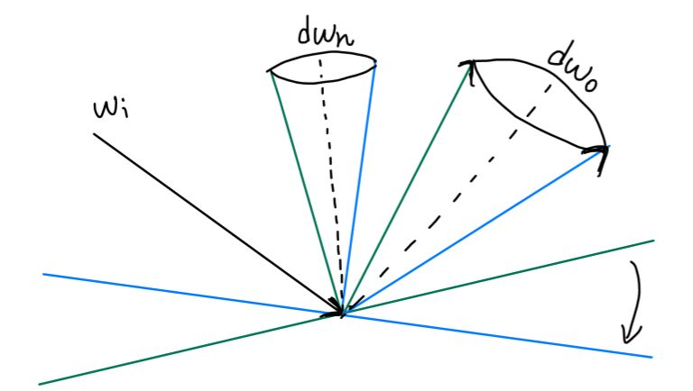

**通量守恒的推导链**（源笔记 `NDF/BRDF镜面反射.md`）：法线为 $h$ 的微平面面积是 $D\,d\omega_h\,dA$，沿入射方向的投影为 $\cos\theta_h D\,d\omega_h\,dA$，故

$$
d^3\Phi_i=L_i(\omega_i)\cos\theta_h\,D(\omega_h)\,d\omega_i\,d\omega_h\,dA
$$

令 $F=G=1$（无菲涅尔损失、无自遮挡），微平面镜面反射满足 $d^3\Phi_o=d^3\Phi_i$；再由 $dL_o=d^3\Phi_o/(d\omega_o\cos\theta_o\,dA)$ 与 BRDF 定义 $f=dL_o/(L_i\cos\theta_i\,d\omega_i)$，代入上面的 $d\omega_h/d\omega_o=1/(4\cos\theta_h)$，$\cos\theta_h$ 被约掉，落到

$$
f(\omega_i,\omega_o)=\frac{D(\omega_h)}{4\cos\theta_i\cos\theta_o}
$$

补回 $F$、$G$ 即 Cook-Torrance。这条链说明 §5.1 的分母与 $1/(4(v\cdot h))$ 出自同一份几何，但作用在两端：前者归一化 BRDF，后者换算采样测度。

三点必须分清：① 点积是**视线与半程向量**，不是 $n\cdot l$ 或 $n\cdot v$；② 它和 Cook-Torrance 分母的 $4(n\cdot l)(n\cdot v)$ **不是同一个东西**（前者是采样测度换算，后者是"微平面面积 → 宏观面积"的 BRDF 归一化），两者同时出现不算重复计算；③ 漏乘等于把入射方向 PDF 高估 $4(v\cdot h)$ 倍，高光随视角明显偏暗，掠射角尤甚。

### 12.7 GGX 采样

$$
p_h(\omega_h)=D\cos\theta_h=\frac{\alpha^2\cos\theta_h}{\pi\left((\alpha^2-1)\cos^2\theta_h+1\right)^2},
\qquad
p_h(\theta\mid\phi)=\frac{2\alpha^2\cos\theta\sin\theta}{\left((\alpha^2-1)\cos^2\theta+1\right)^2}
$$

CDF（令 $u=\cos^2t$，$du=-2\cos t\sin t\,dt$，$A=\alpha^2-1$，区间 $1\to\cos^2\theta$）：

$$
\begin{aligned}
P_h(\theta)&=\alpha^2\int_{\cos^2\theta}^{1}\frac{du}{(Au+1)^2}
=\frac{\alpha^2}{A}\left(\frac{1}{A\cos^2\theta+1}-\frac{1}{\alpha^2}\right)
=\frac{\alpha^2}{A^2\cos^2\theta+A}-\frac{1}{A}
\end{aligned}
$$

令 $P_h(\theta)=\xi_0$ 解出：$A\cos^2\theta+1=\frac{\alpha^2}{A\xi_0+1}$，故 $\cos^2\theta=\frac{1-\xi_0}{\xi_0(\alpha^2-1)+1}$，即

$$
\boxed{\cos\theta_h=\sqrt{\frac{1-\xi_0}{\xi_0(\alpha^2-1)+1}}}
\qquad\text{或等价地}\qquad
\boxed{\tan\theta_h=\alpha\sqrt{\frac{\xi_0}{1-\xi_0}}},
\qquad \phi_h=2\pi\xi_1
$$

（由 $\tan^2\theta=\frac{1-\cos^2\theta}{\cos^2\theta}=\frac{\alpha^2\xi_0}{1-\xi_0}$ 可互推。）

> 易错点（$1-u_1$ 的位置）：$\xi_0$ 确实同时出现在分子与分母，但这**不意味着**互换会改变分布。把 $\xi_0$ 换成 $1-\xi_0$ 得到的式子恰好等于原式在 $1-\xi_0$ 处的取值：$c_{\text{swap}}(\xi)=c(1-\xi)$，而 $\xi$ 与 $1-\xi$ 同为 $U[0,1]$，所以两者是**同一分布的重参数化**，采样结果完全等价。
>
> 以 $\alpha^2=0.25$、$\xi_0=0.1$ 为例：正确式给 $\cos^2\theta=0.9/0.925\approx0.973$；把 $1-\xi_0=0.9$ 代进去得到 $0.308$——这两个数不是"对与错"，而是同一条 CDF 的两端（$c(0.1)$ 与 $c(0.9)$）。
>
> 真正会毁掉结果的是：分子与分母各用**独立**的随机数，或采样方向后漏掉 $4(\mathbf v\cdot\mathbf h)$ 的雅可比。自检仍可用：$\xi_0\to0$ 时 $\cos\theta\to1$。

（§12.5 的 Beckmann 里 $\xi$ 只出现一次，互换同样无害。）

```glsl
// 输入: v(指向视点, 单位向量), n, alpha; u1,u2 ∈ [0,1)
// 输出: l(入射方向), pdf(ω_i 上的 PDF); 返回 false 表示样本无效，调用方需跳过
bool sampleGGX(vec3 n, vec3 v, float alpha, float u1, float u2,
               out vec3 l, out float pdf)
{
    float a2 = alpha * alpha;
    float phi      = 2.0 * PI * u1;
    float cosTheta = sqrt((1.0 - u2) / (1.0 + (a2 - 1.0) * u2));  // 1-u2 在分子
    float sinTheta = sqrt(max(0.0, 1.0 - cosTheta * cosTheta));

    vec3 up = abs(n.z) < 0.999 ? vec3(0, 0, 1) : vec3(1, 0, 0);
    vec3 tx = normalize(cross(up, n));
    vec3 ty = cross(n, tx);
    vec3 h  = tx * (sinTheta * cos(phi)) + ty * (sinTheta * sin(phi)) + n * cosTheta;

    if (dot(v, h) <= 0.0)                     // 不可见法线：丢弃或重采样
    {
        l   = vec3(0.0);
        pdf = 0.0;
        return false;
    }
    l = reflect(-v, h);

    float D = a2 / (PI * pow(cosTheta * cosTheta * (a2 - 1.0) + 1.0, 2.0));
    pdf = D * cosTheta / (4.0 * dot(v, h));   // ← 别漏 4(v·h)
    return true;
}
```

**PDF 的最终形式**（最常被漏掉的一步）：

$$
p(\omega_i)=\frac{D(h)\,(n\cdot h)}{4\,(v\cdot h)}
$$

一致性检验——代回单样本估计量，$D$ 应被完全约掉：

$$
\frac{f_r\,L_i\,(n\cdot l)}{p}
=\frac{\dfrac{D F G}{4(n\cdot l)(n\cdot v)}\,L_i\,(n\cdot l)}{\dfrac{D\,(n\cdot h)}{4(v\cdot h)}}
=\frac{F\,G\,(v\cdot h)}{(n\cdot v)(n\cdot h)}\,L_i
$$

这既是"按 NDF 采样"的定义性结果（$D$ 的方差从估计量中消失），也是检查 $1/(4(v\cdot h))$ 有无漏乘的最好办法：漏乘时 $D$ 约不干净。

### 12.8 NDF 采样与 VNDF 的关系

| | 采样密度 | 抽的是 | 归一化 |
| --- | --- | --- | --- |
| NDF 采样 | $p_h\propto D(m)(n\cdot m)$ | 任意朝向的微平面 | $p_h$ 对立体角；$D$ 自身按投影面积归一 |
| VNDF 采样 | $p_h\propto D(m)(v\cdot m)G_1(v)$ | 从 $v$ 看得见的微平面 | $p_h$ 对立体角，半球积分为 1 |

1. **$v=n$ 时两者完全一致**（$G_1(n)=1$，$n\cdot m=v\cdot m$），垂直观察时 NDF 采样已最优，差距只在掠射角。
2. **NDF 采样在掠射角的有效样本率明显下降，但显著高于 $G_1(v)$**（实测 $\alpha=0.5$、85° 时约 0.586，而 $G_1=0.294$）：抽到的 $h$ 有相当比例满足 $v\cdot h\le0$，只能丢弃或置零，表现为高光边缘噪点多、spp 需求高；$G_1$ 只在中低角度可作粗略参考。
3. **"NDF 采样 + 丢弃背面"不等于 VNDF**：截断后是 $D(m)(n\cdot m)\mathbb{1}[v\cdot m>0]$ 再归一化，形状与按 $(v\cdot m)$ 加权的分布不同。要做对，要么按 $D_{\omega_o}$ 直接采样（Heitz 2018 的 GGX VNDF 闭式解），要么做权重修正。
4. **形状不变性是桥梁**：GGX/Beckmann 在斜率空间线性可拉伸（11.3），各向异性 VNDF 可直接由各向同性版本拉伸斜率空间得到——这正是源笔记把"便于基于 NDF 或可见法线分布推导重要性采样"列为形状不变性好处的实际含义。
5. **PDF 换算两步都要做**：VNDF 的密度同样定义在半程向量上，最终仍要乘 $\frac{1}{4(v\cdot h)}$（12.6），只是 $p_h$ 换成 $D_{\omega_o}$。

### 12.9 在渲染方程里的用法与 PDF 汇总

直接光与间接光用不同的 $p$：小立体角光源按光源立体角采样（BRDF 采样几乎打不中，贡献为 0）；间接光与 IBL 按 $D$ + 余弦采样，环境亮度差异大时再叠加按亮度的重要性采样（12.1 的接受-拒绝）；漫反射主导用余弦采样（估计量退化为 $cL_i$）；高光主导用 NDF/VNDF 采样。两类结果按多重重要性采样（MIS）合并——MIS 不在源笔记范围内，此处只指出去向。

| 分布 | 采样（$\xi_0,\xi_1\sim U[0,1]$） | PDF | 换算到 $\omega_i$ |
| --- | --- | --- | --- |
| 余弦半球 | $\theta=\arccos\sqrt{1-\xi_0}$ | $p(\omega_i)=\cos\theta/\pi$（直接是 $\omega_i$ 的 PDF） | 无 |
| 归一化 Phong | $\theta_r=\arccos\left(\xi_0^{1/(\alpha+2)}\right)$ | $p(\omega_o)=\frac{\alpha+2}{2\pi}\cos^{\alpha+1}\theta_r$（绕 $\omega_r$，已含投影因子 $\cos\theta_r$） | 无 |
| Blinn-Phong | $\theta_h=\arccos\left(\xi_0^{1/(\alpha_p+2)}\right)$ | $D\cos\theta_h=\frac{\alpha_p+2}{2\pi}\cos^{\alpha_p+1}\theta_h$ | $\div\,4(v\cdot h)$ |
| Beckmann | $\tan^2\theta_h=-\alpha^2\ln(1-\xi_0)$ | $D\cos\theta_h$，$D=\frac{e^{-\tan^2\theta_h/\alpha^2}}{\pi\alpha^2\cos^4\theta_h}$ | $\div\,4(v\cdot h)$ |
| GGX | $\cos\theta_h=\sqrt{\frac{1-\xi_0}{\xi_0(\alpha^2-1)+1}}$ | $D\cos\theta_h$，$D=\frac{\alpha^2}{\pi\left((\alpha^2-1)\cos^2\theta_h+1\right)^2}$ | $\div\,4(v\cdot h)$ |

最后一列是本章最容易漏的东西：**凡以半程向量为采样对象的分布，PDF 都必须除以 $4(v\cdot h)$ 才能用于 $\omega_i$ 上的估计量。**

---

## 原始笔记索引

- `Graphics/phong着色.md`
- `Graphics/BRDF.md`
- `Graphics/BaseColor.md`
- `Graphics/PBR/BRDF理论.md`
- `Graphics/PBR/PBR.md`
- `Graphics/PBR/PBR白皮书.md`
- `Graphics/PBR/菲涅尔.md`
- `Graphics/PBR/电介质.md`
- `Graphics/PBR/IOR   # Index of refraction.md`
- `Graphics/PBR(1) 光与物质的交互.md`
- `Graphics/PBR(2) 光与平面的交互.md`
- `Graphics/PBR(3) 次级表面散射与Fresnel反射.md`
- `Graphics/PBR(4).md`
- `Graphics/PBR(5) 能量守恒.md`
- `Graphics/PBR/基于物理的着色系统（Physical based shading）-直接光照.md`
- `Graphics/PBR/计算机图形学十四：基于物理渲染的基础知识(辐射度量学，BRDF和渲染方程) - 知乎.md`
- `Graphics/PBR/蒙特卡罗尔积分.md`
- `Graphics/PBR/NDF/NDF.md`
- `Graphics/PBR/NDF/Normal distribution function.md`
- `根目录笔记/NDF.md`
- `Graphics/随记/微平面理论.md`
- `Graphics/随记/高模渲染难点.md`（仅取与光照/几何精度相关的结论）
- `Graphics/PBR/Normal Mapping.md`（法线贴图与逐像素光照背景）
- `NDF/NDF.md`（§11.1–11.4、§11.6）
- `NDF/各向异性NDF.md`（§11.3、§11.5）
- `NDF/BRDF镜面反射.md`（§12.6）
- `BRDF采样/Cos.md`（§12.2）
- `BRDF采样/Blinn.md`（§12.3）
- `BRDF采样/归一化 Phong BRDF.md`（§12.4）
- `BRDF采样/Beckmann.md`（§12.5）
- `BRDF采样/GGX.md`（§12.7）
- `归类/采样.md`（§12.1 重要性采样与光源采样）
- `归类/resume.md`（50–71 辐射度量学，72–222 渲染方程/BRDF，223–282 NDF，469–582 蒙特卡罗与重要性采样）