# 阴影：Shadow Mapping 及其工程实践

> 本文从 Shadow Map 的基本两遍结构出发，推导自遮挡（shadow acne）的几何模型与 Shadow Bias 的精确公式，再展开 PCF / PCSS / VSM / VSSM 这条软阴影演进路线，最后落到级联阴影、高分辨率阴影、屏幕空间阴影以及 Unity/URP 的具体实现与工程坑。深度缓冲本身的机制见《02_光栅化与深度可见性》。

## Shadow Mapping 基础

两遍结构：

1. **Shadow Caster**：把光源当作相机（方向光用正交投影，聚光灯用透视投影）渲染场景，只写深度，得到 shadowmap。shadowmap 中每个 texel 存的是"从光源看，该方向最近的遮挡物距离"。
2. **Shadow Receiver**：正常渲染时，把片元世界坐标变换到光源相机空间，得到 shadowCoord（uv + 深度），与 shadowmap 中采样的深度比较：片元深度更大（离光源更远）则在阴影中。

$$
S(\mathbf{p})=\begin{cases}
0, & d(\mathbf{p}) > D\big(u(\mathbf{p}),v(\mathbf{p})\big)+\text{bias}\\[2pt]
1, & \text{otherwise}
\end{cases}
$$

其中 $D$ 是 shadowmap 深度，$d$ 是片元在光源空间的深度。$S$ 直接作为光照衰减（attenuation）。

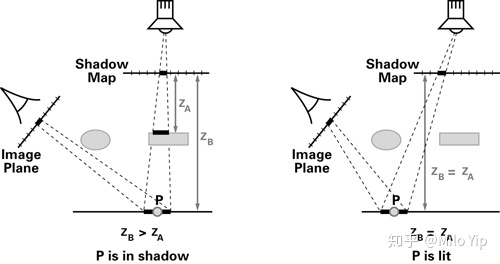

注意 $Z_A,Z_B$ 是光源空间的深度，而不是欧式距离（后文记遮挡深度为 $d_o$、接收深度为 $d$，对应此处的 $Z_A$ 与 $Z_B$），所以题目图中的线有误导成分。

数学上的原理就是把像素的世界空间的坐标转换成光源空间的坐标 $(X_B,Y_B,Z_B)$，然后以 $(X_B,Y_B)$ 作为纹素坐标采样出深度 $Z_A$，与 $Z_B$ 比较。

### Shadowmap 为什么没有 mipmap

1. mipmap 是对阴影图做低通滤波，而阴影图存的是**深度阈值**；对深度取平均后再比较，结果仍然非 0 即 1，起不到平滑阴影边界的作用（平均深度甚至可能不属于场景中任何物体）；
2. mipmap 是用来解决"采样率下降导致频谱混叠"的，其 level 选择依赖**与视点的距离**（相邻像素的欧式距离变化率）；而 shadowmap 与视点无关，它只是一张暂存深度信息的浮点二维数组，不是"被观察的纹理"。

因此 shadowmap 通常只有 level 0，并配 clamp 采样与硬件比较。

### 硬件比较采样

```hlsl
// 一次采样 = 4 个 texel 各自比较 + 双线性混合（即天然的 PCF 1×1）
float atten = SAMPLE_TEXTURE2D_SHADOW(ShadowMap, sampler_ShadowMap, shadowCoord.xyz);
// 等价写法：
float atten2 = ShadowMap.SampleCmpLevelZero(sampler_ShadowMap, uv, compareValue);
```

语义要点：

- 只在 mip level 0 上采样，把采样结果与 `compareValue` 逐点比较，再对 4 个比较结果做双线性插值；
- 返回 1 表示"片元比 shadowmap 更靠近光源"（不在阴影），返回 0 表示在阴影；
- 因此返回值本身就是衰减系数，可直接乘到光照上；
- 因为采样器在插值**之前**执行比较，阴影边缘会被相邻 texel 混合，天然带一点软化。

## 自遮挡（Shadow Acne）的成因与几何模型

产生自遮挡需要同时满足两个条件：

1. shadowmap 分辨率有限（一个 texel 覆盖场景中一片区域）；
2. 光线方向与表面法线不平行。

在 Caster 阶段，该区域内的点最终汇集到同一个 texel，得到**一个**深度值（对平面而言，它恰好等于区域中心点的深度）；在 Receiver 阶段，区域内的点投影回这个 texel 做比较，一半点的深度大于它、一半小于它，于是出现亮暗条纹——这就是 shadow acne。

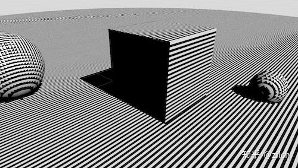

用一个 Shadow Debug Pass 把 shadowmap 的 texel 网格投到场景里，可以看到条纹周期与 texel 尺寸完全一致：

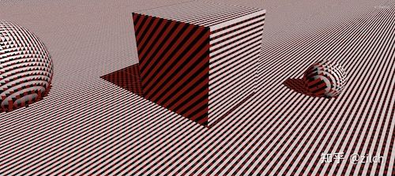

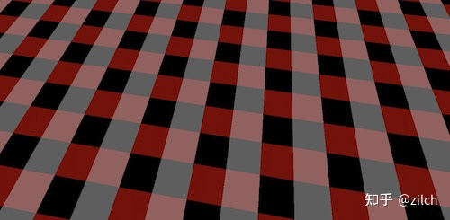

（平行光以 45° 照射时网格呈 1:2 的长方形；一个分辨率格子内正好包含黑白条纹各一条。）

### 几何模型

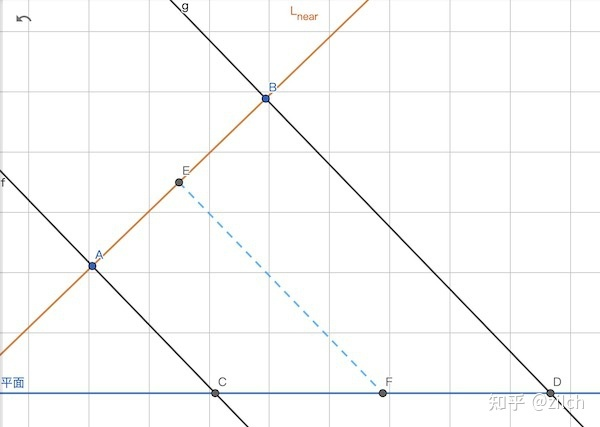

- 橙色线：平行光视角的近平面 $L$，最终映射为 shadowmap；
- 蓝色线：接受光照的平面；
- 设光源正交矩阵的宽高相同（URP 中就是这样），记为 `frustumSize`；shadowmap 尺寸为 `shadowMapSize`。

线段 $AB$ 是 shadowmap 上**一个 texel** 在 $L$ 上对应的尺寸：

$$
|AB|=\frac{\text{frustumSize}}{\text{shadowMapSize}}
$$

从 $AB$ 作垂线交接收面于 $C,D$，则 $CD$ 范围内的所有点都投影到 $AB$。该 texel 存的深度是 $CD$ 中点 $F$ 到 $L$ 的距离 $|FE|$。于是 $CF$ 段判定为亮、$DF$ 段判定为暗，**acne 以 $|CD|$ 为周期循环**——这就是"条纹周期 = texel 投影尺寸"的原因。

### Depth Bias 的精确值

过 $F$ 作 $L$ 的平行线 $p$，只要把 $CD$ 内的点沿光线方向平移到 $GH$ 即可修正误差。考察误差最大的 $D$ 点，$\theta$ 为光线与平面法线的夹角：

$$
|DG|=|FG|\tan\theta=\frac{|AB|}{2}\tan\theta
$$

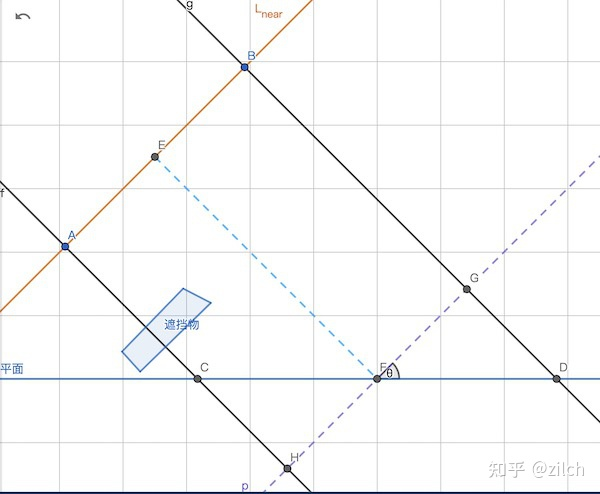

即

$$
\boxed{\;\text{DepthBias}=\frac{\text{frustumSize}\cdot\tan\theta}{2\cdot \text{shadowMapSize}}\;}
$$

推导链：

$$
\text{DepthBias}(D)=|DG|=|FG|\cdot\tan\theta=\frac{|AB|}{2}\cdot\tan\theta=\frac{\text{frustumSize}\cdot\tan\theta}{2\cdot\text{shadowMapSize}}
$$

对 $CD$ 上任一点 $X$，严格的做法是按比例缩放：

```hlsl
shadowUV = shadowProj(X);
percent  = (frac(shadowUV) - 0.5) / 0.5;   // [-1, 1]
DepthBias_X = DepthBias_D * percent;
```

但绝大多数引擎直接对**所有点**用 $D$ 点的 bias（毕竟是最大误差），简单且足以消除 acne。

同一几何关系下，Normal Bias（沿法线把接收面整体外推）为

$$
\boxed{\;\text{NormalBias}=\frac{\text{frustumSize}\cdot\sin\theta}{2\cdot \text{shadowMapSize}}\;}
$$

推导链：

$$
\text{NormalBias}(X)=|GM|=|GF|\cdot\sin\theta=\frac{\text{frustumSize}\cdot\sin\theta}{2\cdot\text{shadowMapSize}}
$$

## Shadow Bias 详解

### 理论 vs 工程实现

| | 理论做法 | Unity/URP 的实现 |
|:--|:--|:--|
| 执行阶段 | Shadow Receiver（着色时） | Shadow Caster（写 shadowmap 时） |
| 粒度 | 逐片元（per-fragment） | 逐顶点（per-vertex） |
| Depth Bias 方向 | 片元朝**光源方向推近**一段距离 | 顶点朝**远离光源方向推远**一段距离 |
| Normal Bias 方向 | 沿表面法线**外扩** | 沿顶点法线**向内收缩** |
| 距离上限 | Depth Bias 可到 $+\infty$；Normal Bias 上限 $\text{frustumSize}/(2\,\text{shadowMapSize})$ | 同左（受 `Light.shadowNormalBias` 为单位 texel 尺寸所限） |

两种"反向偏移"在深度比较上近似等价，但**不完全等价**（见 SCVBB 一节）。

### Depth Bias 的两个问题

**漏光（light leaking）**：若 $C$ 点前方有遮挡物，$C$ 本应在阴影中；但 depth bias 把 $C$ 向光源推了近 $|DG|$，于是跑到了遮挡物前面。


**bias 趋于无穷**：当光线与平面夹角趋于 0（$\theta\to 90°$）时

$$
\tan\theta\to\infty\quad\Longrightarrow\quad \text{DepthBias}\to\infty
$$

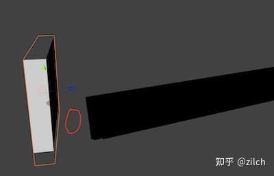

不能对像素施加过大的偏移，否则漏光严重；因此固定尺度的 depth bias 在掠射角下必然失效。

### Normal Bias

既然沿光线偏移有这些问题，就改为沿法线方向偏移——把接收面 $CD$ 沿法线平移到 $C'D'$，平移量取 $G$ 到 $CD$ 的距离 $|GM|$：

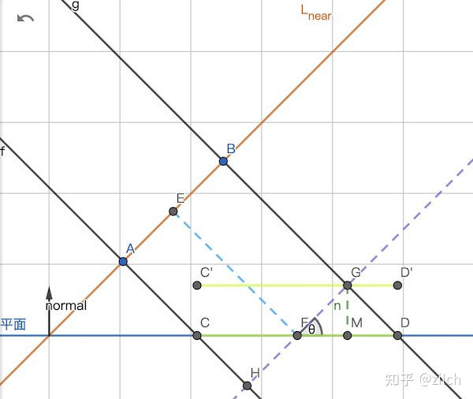

- $C'G$ 段的深度都小于 $|EF|$，判定为亮；
- $D'G$ 段移动到了相邻 texel 的区间，深度也小于相邻 texel 的值，同样为亮。

于是 acne 被消除。与 depth bias 相比，最大的优势是**有界**：

$$
\text{NormalBias}_{\max}=\frac{\text{frustumSize}}{2\cdot\text{shadowMapSize}}
$$

$\theta\to90°$ 时 normal bias 趋于该上限而非无穷，且上限只与 shadowmap 分辨率有关（提高分辨率即可压低）。

**Normal Bias 的漏光**：它是"两头漏光"。本该被遮挡的 $CD$ 区域被移到 $C'D'$ 后，左侧少部分跑到遮挡物上方（漏光），右侧 $GD'$ 又侵入了隔壁 texel 的地盘（再次漏光）。好在最大值可控，实际并不严重。

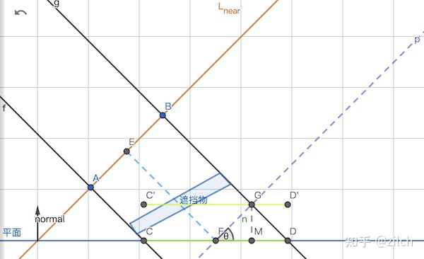

### Normal Bias 的接缝问题

shadowmap 分辨率较低时，两个面片以一定夹角相接，提高 Normal Bias 会让投影出现**缝隙**（面片沿各自法线收缩，接缝处裂开）。

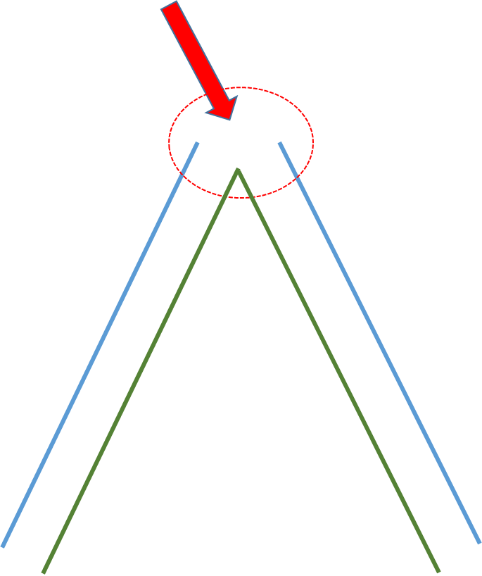

两种修法：

1. 两个面的公用顶点位置一致，**法线也必须一致**（焊接法线）；
2. 在接缝处对法线做平滑过渡（不要硬边）。

工作日志记录同现象，修法相同。

### 级联阴影（CSM）对 Bias 的影响

影响最大 bias 的两个因素是 shadowmap 分辨率和光线入射角。CSM 把视锥按距离切成多级，每级分辨率不同，因此：

- 必须按片元所属的 `cascadeIndex` 取该级的 `shadowMapSize` 重新算 bias；
- 若全场景用同一个固定 bias：近处 acne 消失了，远处仍然有；为照顾最远级而加大 bias，近处又会漏光。

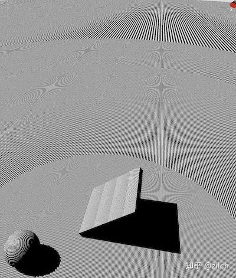

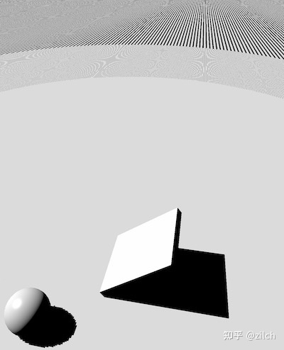

### PCF 对 Bias 的影响

PCF 会采样一个范围内的多个 texel，必须保证**范围内离光源最近的那个 texel** 也不产生 acne。

以 PCF 1×1（4 tap，覆盖 2×2 texel）为例：计算 $CF$ 区间的阴影时，除了采样 $AB$ 还会采样到相邻的 $AN$，此时取 $|GD|$ 已不够，必须让偏移后的点到 $L$ 的距离小于 $|OP|$——所需 bias 是 $2|GD|$。

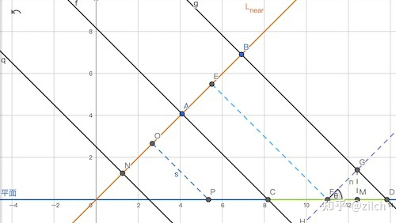

推广到任意核宽 $N$（单位：texel，$N=2R$ 时 $R$ 为半宽）：

$$
\text{DepthBias}=N\cdot\frac{\text{frustumSize}\cdot\tan\theta}{2\cdot\text{shadowMapSize}}
$$

$$
\text{NormalBias}=N\cdot\frac{\text{frustumSize}\cdot\sin\theta}{2\cdot\text{shadowMapSize}}
$$

> **易错点**：bias 随核半径是**线性**增长（系数等于核宽 $N$，不是 $N^2$）。推导：核宽 $N$、texel 尺寸 $\delta$ 时，离采样点最远的 texel 边缘在 $\frac{N}{2}\delta$ 处，而 $|GD|=\frac{\delta}{2}\tan\theta$，故系数为 $N$。据此 2×2→2（即"取 $2|GD|$"）、3×3→3、5×5→5。
>
> 若把 $R$ 定义成"半宽"，系数就是 $2R$；旧式 $1+\lceil R\rceil$ 只在 $N=2,3$ 时巧合正确，对 $N\ge 4$ 都少算（$N=5$ 时它会给出 4，少了 1）。

### Shadow Caster Vertex Based Bias（SCVBB）

URP 采用的是反向思路：不在 Receiver 阶段偏移，而在 **Caster 阶段**让遮蔽物反向偏移，并且是逐顶点的。

Unity 文档原文：

- `Light.shadowBias`（depth bias）：*Shadow caster surfaces are pushed by this world-space amount away from the light.*
- `Light.shadowNormalBias`：*Shadow caster surfaces are pushed inwards along their normals by this amount.* 单位是 shadowmap texel 尺寸，常用 0.3~0.7。

优点：计算廉价（逐顶点）。缺点有两个：

1. **精度**：bias 的真值依赖光线与法线夹角，SCVBB 只看顶点处法线，整体偏移有误差（多数情况可接受）；
2. **不等价**：Caster 的反向 normal bias 不完全等价于 Receiver 的外扩。考虑 $AH$ 区域因 shadowmap 精度被判为阴影：Receiver 阶段做 normal bias 会把 $AH$ 平移到 $A'H'$ 从而消除；但 Caster 阶段要让 $AB$ 面右移超过 $H$ 才能不遮挡 $AH$，当光线与 $AD$ 接近平行时这个距离趋于无穷，瑕疵无法消除。

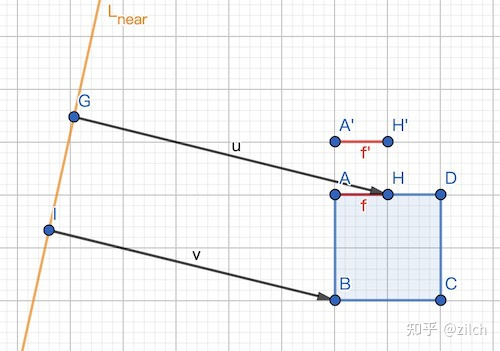

URP 中实测（Distance 10、关闭 Cascades、开启 Soft Shadows、方向光旋转 (2,30,0)）从侧面打一个 Cube：

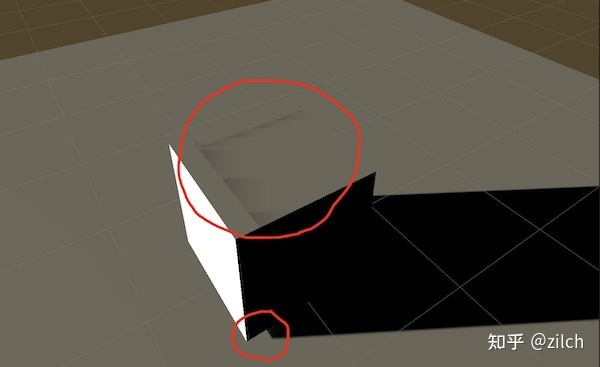

顶部出现无法消除的瑕疵（把 Depth/Normal Bias 都拉到最大只是把瑕疵往里挪，底部同时漏光）。这也是"为了省 Fragment 阶段一点 bias 计算而用 Caster Bias 是否值得"的疑问来源。

### 工程优化：避免三角函数的 bias 公式

理论上的 $\tan\theta$ 在 $\theta\to90°$ 时无界（$\sin\theta\le 1$ 本身有界，normal bias 有上限正源于此），工程上会改用一个只依赖法线与光线的有界 proxy：

$$
A=N\cdot\frac{\text{frustumSize}}{\text{shadowMapSize}},\qquad
B=1-\text{saturate}(\text{dot}(L,N))=1-\text{saturate}(\cos\theta)
$$

$$
\text{NormalBias}=C_{normal}\cdot A\cdot B
$$

其中 $N$ 是 PCF 核宽（texel，与上文一致）。$A$ 可在 CPU 端算好（只与分辨率、相机视锥和核宽有关），GPU 端只剩一次 dot 与乘加。

**$B$ 只是 proxy，不是 $\tan\theta$ / $\sin\theta$ 的近似**：$\theta<90°$ 时 $1-\cos\theta=2\sin^2(\theta/2)\approx\theta^2/2$，而 $\tan\theta,\sin\theta\approx\theta$，两者量纲趋势都不同；并且 $B=1-\text{saturate}(\text{dot}(L,N))\in[0,1]$（$\theta\ge90°$ 后 $\text{dot}\le 0$，$B$ 钳在 1），不可能逼近 $\theta\to90°$ 时的无穷大。它能用的原因是 normal bias 本身**有界**（上限 $\text{frustumSize}/(2\cdot\text{shadowMapSize})$）：$B$ 从 0 单调升到 1，正好给出"正对光线时偏移最小、掠射时到上限"的单调过渡，属于有界的经验拟合，系数 $C_{normal}$ 需要实测定标。

**depth bias 不能乘 $B$**：它需要的是随 $\tan\theta$ 增长、在掠射角趋于无穷的量，乘一个有界的 $B$ 反而把最关键的大角度区间压住了。URP 的做法更直接——`Light.shadowBias` 是沿光方向的世界空间定值推远，完全不乘视角项；`shadowBias` 与 `shadowNormalBias` 都按 texel 尺寸缩放，区别只在 normal bias 额外乘 $B$。因此上式只适用于 normal bias；若项目里仍要用逐片元 depth bias，必须单独算 $\tan\theta$ 并自行截断上限。

## PCF（Percentage Closer Filtering）

### 不能对 shadowmap 做低通滤波

对深度图做 3×3 均值有两个根本问题：

1. 平均深度没有意义（物体边界处会得到不属于任何物体的深度）；
2. 拿平均值去比较，结果仍是 0/1，无法平滑。

正确做法：**对阴影测试的结果做滤波**——在片元周围取多个样本各自做深度比较，得到若干个 0/1，再加权平均，输出 $[0,1]$，等效于"该片元对一块区域做了采样"。

$$
S_{PCF}(\mathbf{p})=\sum_{i} w_i\,S(\mathbf{p}_i)
$$

错误做法——先对深度做低通滤波再比较，与 PCF 不等价：

$$
V_x \ne \chi^{+}\big\{[w \otimes D_{SM}](q)-D_{scene}(x)\big\}
$$

正确做法——先逐 texel 比较、再对比较结果滤波：

$$
V_x = w \otimes \chi^{+}\big[D_{SM}(q)-D_{scene}(x)\big]
$$

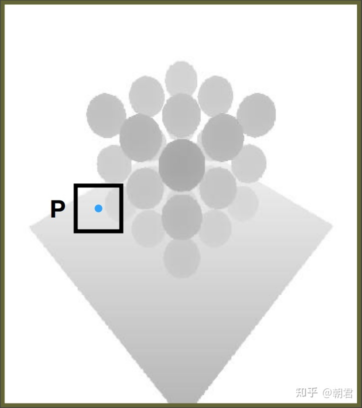

核的范围要权衡质量与性能；核的权重设计直接决定过渡是否平滑。

### PCF 1×1（硬阴影的默认实现）

给定 uv，采样其四周 4 个 texel，双线性混合——就是硬件 `SampleCmpLevelZero` 的行为，一次采样即可。

### PCF 3×3：离散 Tent Filter

把 uv 向 4 个对角方向各偏移 0.5 个 texel，做 4 次 `SampleCmpLevelZero` 再平均：

```hlsl
float SampleShadowPCF3x3_4Tap_Fast(float3 uvd)
{
    float offsetX = _ShadowMapSize.x * 0.5;
    float offsetY = _ShadowMapSize.y * 0.5;
    float4 result;
    result.x = SampleShadowPCF(float3(uvd.x - offsetX, uvd.y - offsetY, uvd.z));
    result.y = SampleShadowPCF(float3(uvd.x + offsetX, uvd.y - offsetY, uvd.z));
    result.z = SampleShadowPCF(float3(uvd.x - offsetX, uvd.y + offsetY, uvd.z));
    result.w = SampleShadowPCF(float3(uvd.x + offsetX, uvd.y + offsetY, uvd.z));
    return dot(result, 0.25);
}
```

4 次采样各覆盖 4 个 texel，共覆盖 9 个 texel，权重为

$$
\begin{matrix}1&2&1\\2&4&2\\1&2&1\end{matrix}
$$

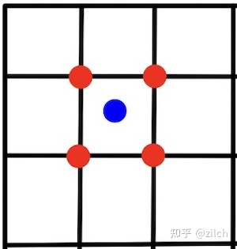

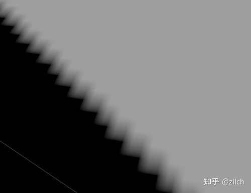

结果渐变范围变大，但**渐变之间存在明显的分界线**。原因：双线性插值只是一阶连续，其导数不连续。

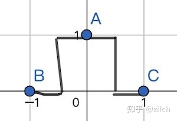

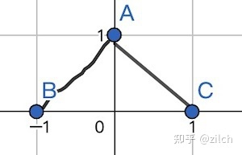

进一步说，Bilinear 本质是一个**离散的 Tent Filter**：它把 texel 当成点，只算点的权重，而不是"面积占比"。所以即使扩大核，分界线依然存在。采样成本上，$N\times N$ 的核朴素需要 $N^{2}$ 次点采样；改用连续 tent 后可以降到 $((N+1)/2)^{2}$ 次（3×3→4、5×5→9、7×7→16，与下表的"采样指令"列对应）。

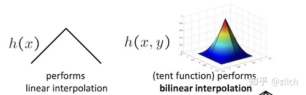

### 连续的 Tent Filter

用连续的 Tent 卷积代替点采样。tent 核的解析式为

$$
f_w(x)=\begin{cases}
0, & x\in(-\infty,-1.5)\\
x+1.5, & x\in[-1.5,0]\\
-x+1.5, & x\in[0,1.5]\\
0, & x\in(1.5,+\infty)
\end{cases}
$$

（原图有误，已更正：图中区间端点处的 `\infin` 是未渲染的 LaTeX 命令，应为 $+\infty$。）

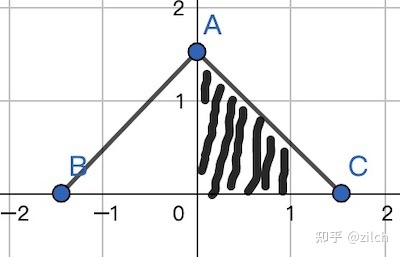

一个 texel 的权重 = tent 函数在该 texel 区间上的**积分**（上图中阴影面积即 $[0,1]$ 区间的权重）。

对硬边界阴影函数做卷积并归一化后，得到分段连续的过渡。其中硬边界阴影函数为

$$
f_{shadow}(x)=\begin{cases}1, & x\ge 0\\ 0, & x<0\end{cases}
$$

归一化因子与滤波结果为

$$
W=\int f_w(x)\,dx
$$

$$
G_{shadow}(x)=\frac{1}{W}\int f_w(t)\,f_{shadow}(x-t)\,dt
$$

（这里是 $f_w$ 与阶跃函数 $f_{shadow}$ 的**卷积**，平移量 $x-t$ 不能省——写成 $f_w(x)f_{shadow}(x)$ 的逐点相乘，积分结果只是一个常数，得不到过渡曲线。注意 $[0,1.5]$ 等区间的积分上限是变量 $x$，结果含常数 $C$；用 $x=1.5$ 时函数值为 1 的边界条件定出 $C$。）

解出的分段表达式为

$$
G_{shadow}(x)=\begin{cases}
1, & x>1.5\\[2pt]
-\dfrac{2x^2}{9}+\dfrac{2x}{3}+\dfrac{1}{2}, & 0<x\le1.5\\[4pt]
\dfrac{2x^2}{9}+\dfrac{2x}{3}+\dfrac{1}{2}, & -1.5\le x\le0\\[4pt]
0, & x<-1.5
\end{cases}
$$

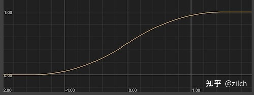

于是阴影边缘非常柔和，且导数连续。

### 采样数优化

命名约定：`Tent_3x3` 是 4 阶 tent，`Tent_5x5` 是 6 阶，`Tent_7x7` 是 8 阶。

朴素做法：4 阶核即使用硬件"一次取样 4 texel"的指令，也需 9 次采样。

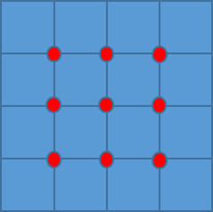

优化后只需 4 次采样：

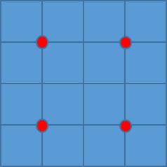

一般地，$n$ 阶滤波器从 $(n-1)^2$ 次采样降到 $(n/2)^2$ 次。

思路：蓝点是待求 uv，红点是 4 个采样点。以离蓝点最近的整数 texel 为原点建立坐标系，红点位置**不是固定偏移**，而是由 4 个 texel 各自的权重按双线性规则**反推**出来的。

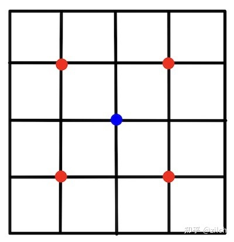

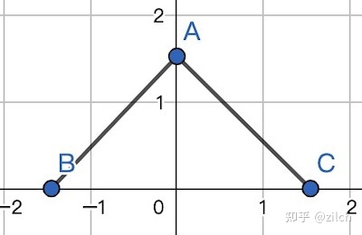

步骤：

1. 计算核覆盖的每个 texel 的权重（横向、纵向分别算再相乘）；
2. 每个红点覆盖 4 个 texel，把这 4 个权重相加即该红点的权重；
3. 由这 4 个 texel 的权重按双线性插值规则**逆推**采样坐标；
4. 按该权重累加采样结果。

```hlsl
static float4 GetTent3Weights(float kernelOffset)
{
    float a = 0.5 - kernelOffset;
    float b = 0.5 + kernelOffset;
    float c = max(0, -kernelOffset);
    float d = max(0,  kernelOffset);
    float w1 = a * a * 0.5;
    float w2 = (1 + a) * (1 + a) * 0.5 - w1 - c * c;
    float w4 = b * b * 0.5;
    float w3 = (1 + b) * (1 + b) * 0.5 - w4 - d * d;
    return float4(w1, w2, w3, w4);
}

static float2 GetGroupTapUV(float2 weightsX, float2 weightsY)
{
    float offsetX = weightsX.y / (weightsX.x + weightsX.y);
    float offsetY = weightsY.y / (weightsY.x + weightsY.y);
    return float2(offsetX, offsetY);
}
```

`GetTent3Weights` 求的是 $[-2,-1],[-1,0],[0,1],[1,2]$ 四个区间的面积（tent 核下每个 texel 的权重）。

> Unity 实现里对等腰三角形中间两个 texel 的面积用的是 $h-0.5$ 而不是常规三角形面积公式——这是一个针对该核形状的化简（待核实：不同版本/分支的实现细节可能不同）。

最终阴影强度由 4 次采样按各自权重累加得到：

$$
\text{ShadowStrength}(P)=w_1\cdot\text{Sample}(P_1)+w_2\cdot\text{Sample}(P_2)+w_3\cdot\text{Sample}(P_3)+w_4\cdot\text{Sample}(P_4)
$$

## PCSS（Percentage Closer Soft Shadows）

物理直觉：遮挡物离接收物越近，阴影越硬；越远越软。也就是说**滤波核尺寸与（接收物到遮挡物的距离）成正比**。

三步：

1. **Blocker Search**：在 shadowmap 上取一个区域，逐 texel 与片元深度比较，把"深度小于片元深度"的 texel 视为遮挡物，求其平均深度 $d_{Blocker}$；
2. **Penumbra Estimation**：由平均遮挡深度估算核尺寸
$$
w_{Penumbra}=\frac{d_{Receiver}-d_{Blocker}}{d_{Blocker}}\,w_{Light}
$$
3. **Filtering**：用尺寸 $w_{Penumbra}$ 做 PCF。

### Blocker Search 的范围

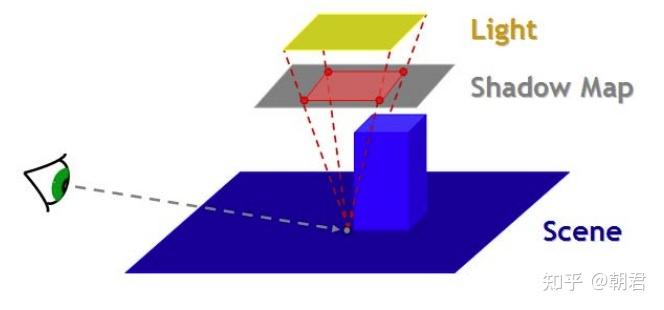

设光源是矩形面光源，四个顶点到片元的连线与 shadowmap 的交点构成 blocker 范围。笔记给出的核宽度公式为

$$
W_{kernel}=\frac{D_{frag}-\text{nearPlane}}{D_{frag}-\text{LightPos}.z}*W_{Light}
$$

该推导假设光源、遮挡物、接收物都是平行平面。

### 问题

第 1、3 步都要对纹理做大量采样，且第 3 步"越软采样越多"，形成显存带宽瓶颈。工业界的常见解法是**稀疏采样 + 降噪**（图像域滤波或时域累积），因为降噪手段足够强，可以接受有噪声的结果；纯 VSSM 那条"大量近似"的路线反而用得更少。

## PCF 补充：核的覆盖范围与采样成本

前文已给出 tent 核的权重推导与 4 次采样的逆推方法，这里补一张与 URP 实现对应的速查表。

### 各级核的覆盖范围与采样成本

| 级别 | 权重 | 覆盖 texel | 采样指令（每次比较 2×2） |
|:--|:--|:--|:--|
| PCF 1×1 | 单点，硬阴影 | $2\times2=4$ | 1 |
| PCF 3×3（4-tap） | 双线性后等价 $1{:}2{:}1$ 可分离 tent | $3\times3$ 起，实际 9–12 | 4 |
| `Tent_5x5` | $5\times5$ tent | $5\times5$ 起，实际 25–36 | 9 |
| `Tent_7x7` | $7\times7$ tent | $7\times7$ 起，实际 49–64 | 16 |

读法：硬件一次 `SampleCmpLevelZero` 完成 2×2 个 texel 的比较再做双线性混合。4-tap 版本在 uv 的四个对角方向各偏移 0.5 个 texel，逐轴的双线性权重就是 $(1,2,1)/4$，两轴相乘即前文那组 $1{:}2{:}1$ 的 3×3 权重，所以它至少覆盖 3×3 个 texel、只用 4 条指令。

注意"覆盖 texel"列给的是**最小**覆盖数：tent 的支撑跨过若干 texel 边界，实际参与双线性混合的 texel 数会随 uv 落在 texel 内的位置变化（URP 源码注释写明 3×3 base 覆盖 9 到 12 个、5×5 覆盖 25 到 36 个、7×7 覆盖 49 到 64 个）。只有 uv 正好落在 texel 中心时才是 9 个、权重才恰为 $1{:}2{:}1/16$。

URP 中更高级的软阴影直接以核尺寸命名：`SampleShadow_ComputeSamples_Tent_5x5`（9 次采样覆盖 5×5，即每轴 3 个 tap）与 `SampleShadow_ComputeSamples_Tent_7x7`（16 次采样覆盖 7×7，即每轴 4 个 tap）。采样点位置不是固定偏移，而是先算出 tent 核在各 texel 区间上的积分权重，再由双线性规则逆推得到（逆推方法见前文《采样数优化》一节）。

### 权重由 tent 核积分给出

每一级核的权重都是同一个 tent 函数在 texel 区间上的积分，因此横向、纵向可分离，一维权重表算一次即可复用。核尺寸变大只是 tent 支撑区间变宽，过渡曲线在核边界处仍然一阶连续，这正是前文"离散 tent 有分界线、连续 tent 才平滑"的另一种说法。

### 移动端的 dither 软阴影与 shader 分级

工作日志里的一条移动端实践：

- **dither 半调软阴影**的开启条件只跟 `soft_shadow` 相关，与 `ULTRA_HIGH` 无关；
- 软阴影的 level 收敛到只有 **5×5** 一档，避免多档核尺寸带来额外的变体与分支；
- 分级链路：把宏写进 shader 模板 → `shader_feature` 改成 `multi_compile`（运行时才能切换）→ `ULTRA_HIGH` 档固定走 5×5 软阴影，同时保留原有的点光源镜面反射等极高品质开关；
- 附带修掉了 cascade 参数设置接口的 BUG（`cascade = 1` 时阴影显示异常）。

### PCSS 的两个前提

- **光源必须是面光源**：点光源没有面积，半影宽度为 0，PCSS 直接退化成 PCF；核尺寸公式里的 $w_{Light}$ 就是光源尺寸。
- **采样成本随半影尺寸变化**：滤波核尺寸由遮挡距离动态决定，因此单帧内的采样次数不可预知、且往往很大，"越软越贵"。所以工业实现通常用稀疏采样 + 降噪（图像域或时域），或者干脆用 VSM/VSSM 这类方差方法替换第 3 步。

## VSM（Variance Shadow Mapping）

目标：用概率分布代替 PCSS 第 3 步的精确查询。

关键观察：我们并不需要知道区域内每个 texel 的深度，只需要知道**区域内有多少比例的深度大于片元深度**。例如片元深度 3.5，区域深度为 $\{1..9\}$，则期望得到 $6/9=0.667$。

VSM 用切比雪夫不等式近似这个比例。把 filter 区域内的遮挡深度记为随机变量 $d_o$，片元（接收）深度记为 $d$：

$$
P(d_o\ge d)\ \le\ \frac{\sigma^2}{\sigma^2+(d-\mu)^2}
$$

其中 $\mu=E[d_o]$、$\sigma^2=E[d_o^2]-\mu^2$。

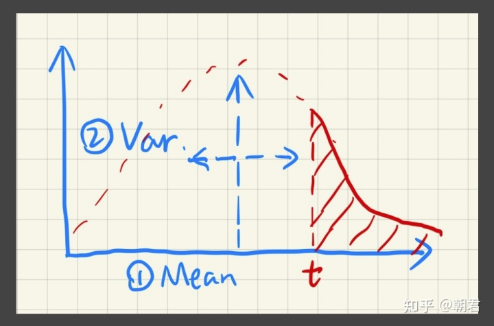

（图中三个要素：均值 $\mu$、方差 $\sigma^2$，以及尾部概率——$t$ 右侧的阴影面积即 $P(d_o\ge t)$ 的上界来源。）

数据准备：shadowmap 渲染时同时输出两张图（$d_o$ 与 $d_o^2$，或用 RG 通道）。求区域内的 $\mu$ 与 $\sigma^2$ 有两条路线：

1. **VSM 原始做法（预 blur）**：对 $[d_o,d_o^2]$ 纹理先做一遍 box 或 Gaussian 模糊，得到 $[E(d_o),E(d_o^2)]$，再代入切比雪夫不等式。模糊核就是滤波核——相当于把"范围查询"在渲染前固化进纹理，代价是核尺寸写死、物体边缘被拉伸。
2. **范围查询做法（VSSM 及后续方法采用）**：保留未模糊的两张图，着色时按需要的矩形区域实时查询，核尺寸可随片元变化（PCSS/VSSM 正需要这一点）。范围查询可用 mipmap 或 SAT（Summed Area Tables）：SAT 需两遍（先行后列）扫描得到二维前缀和，任意矩形区间和由 4 次查表做二维四项容斥得到，100% 准确；mipmap 只对方形区域、且需要层间插值，结果有偏差。

两条路线的取舍、SAT 的生成与精度问题见本文《VSM 补充推导：矩估计、SAT 范围查询与漏光分析》一节。

### 条件与漏光

单边切比雪夫不等式成立的条件是 $d>\mu$（片元深度大于区域平均深度）。当 $d<\mu$ 时不等式不成立，VSM 的常规做法是直接认为"不在阴影中"，于是产生**漏光**：

例如片元深度 $d$，区域深度 $\{1,2,3,4,5,6,7,100,100\}$。设 $d=6.5$（真实遮挡比例 $6/9=0.667$ 只在 $d\in(6,7)$ 时成立），此时 $\mu=25.33>d$，VSM 直接返回 1（全亮）。

## VSSM（Variance Soft Shadow Mapping）

VSSM 把切比雪夫不等式进一步用到 PCSS 第 1 步（Blocker Search），并处理 $d<\mu$ 的失效情形。

### 求平均遮挡深度

记深度 $\ge d$ 的像素平均值为 $z_{unocc}$，$<d$ 的为 $z_{occ}$；区域内采样 $N$ 个，其中 $N_1$ 个 $\ge d$、$N_2$ 个 $<d$：

$$
\frac{N_1}{N}z_{unocc}+\frac{N_2}{N}z_{occ}=z_{avg}
$$

其中 $z_{avg}=\mu$，$N_1/N$、$N_2/N$ 都可由切比雪夫不等式求出，于是

$$
z_{occ}=\frac{z_{avg}-P(z_i>d)\,z_{unocc}}{1-P(z_i>d)}
$$

**Key idea**：VSSM 大胆假设所有非遮挡物的深度都等于着色点深度，即 $z_{unocc}:=d$。于是只靠 $\mu$、$\sigma^2$ 就能算出 $z_{occ}$，无需真正遍历 texel。

### 处理 $d<\mu$

思路很直接：当前 filter 不满足单边条件，就**细分**，对每个 sub-kernel 重新判断：

- 满足条件 → 用切比雪夫算；
- 不满足 → 继续细分，直到小于阈值后回退到 PCF 直接采样。

两种划分：

1. **Uniform subdivision**：均匀切成子块（红线第一次、蓝线第二次）。对满足条件的绿色块 $w_{cj}$ 统计
$$
\mu=\frac{\sum_j E(x)_{cj}T_{cj}}{\sum_j T_{cj}},\qquad
\sigma^2=\frac{\sum_j E(x^2)_{cj}T_{cj}}{\sum_j T_{cj}}-\mu^2
$$
   满足条件部分算 $d_1$，不满足部分用 PCF 采样算 $d_2$，按 kernel 尺寸加权得整体 blocker 深度；阴影测试阶段同理加权。
2. **Adaptive subdivision**：用四叉树记录划分，只对不满足条件的 sub-kernel 继续细分（满足 $d>\mu$ 的区域无需再分），其余计算与上面一致。


（外链图，离线可能不可见）


（外链图，离线可能不可见）

范围查询同样用 SAT（或 mipmap），需要同时维护 $z$ 与 $z^2$ 两张表。

### 缺点

仍受切比雪夫不等式限制：上界本身对任意分布都成立，**仅在单峰分布下足够紧致**。树杈这类近似高斯的分布尚可，复杂多峰分布下上界会明显偏大而出现错误。


（外链图，离线可能不可见）

本质是一个拟合问题：用单峰分布去拟合真实场景的深度分布并不总合适，必要时得用更高阶矩来描述深度分布的 CDF。

## VSM 补充推导：矩估计、SAT 范围查询与漏光分析

前文《VSM（Variance Shadow Mapping）》一节给出了结论与近似公式。本节补足它没有展开的部分：遮挡比例为什么能写成一个概率分布函数、矩是怎么在纹理上算出来的、SAT 的两遍累加与区域查询怎么落地，以及漏光的第二种解释和它的工程补丁。重复的定义不再重写。

### 遮挡比例是一个生存函数

记 $d_o$ 为遮挡物在光源空间的深度，$d$ 为接收者在光源空间的深度。给定 $d$，

$$
f(d)=P(d_o\ge d)
$$

就是"该片元没有被遮挡的概率"。注意它同时是遮挡深度分布的**生存函数**（$1-\text{CDF}$）：只要知道 $d_o$ 的分布，任意 $d$ 的 $f$ 都能直接查出来。

只要求出前两阶矩（定义见前文《VSM》一节），就足以计算这个上界；VSM 再额外假设分布近似单峰，只是为了让上界更紧。

矩是对整张 shadowmap 的积分：

$$
E(x)=\int x\,p(x)\,dx,\qquad E(x^2)=\int x^2 p(x)\,dx
$$

所以"算矩"本质上就是对 shadowmap 做一次滤波（box filter 或 Gaussian filter）。离散化后是权重和为 1 的加权求和：

$$
E[d_o]\approx\sum_i w_i d_i,\qquad E[d_o^2]\approx\sum_i w_i d_i^2
$$

这也给出了"两个矩 ⇔ 两个通道"的对应：shadowmap 必须**同时写 $d_o$ 与 $d_o^2$**，一次滤波才能同时产出两个矩，两个量就必须都在纹理里。

### 黑、红、蓝三个特征点


| 点 | 所在区域 | 统计量 | 切比雪夫上界 | 判定 |
|:--|:--|:--|:--|:--|
| 黑点 | 完全被遮挡物覆盖 | $\sigma^2=0$，$\mu<d$ | $p_{max}\approx 0$ | 全阴影，正确 |
| 红点 | 部分被遮挡（半影） | $\sigma^2>0$，$\mu<d$ | $0<p_{max}<1$；$d$ 越接近 $\mu$，$p_{max}$ 越接近 1 | 软阴影，合理 |
| 蓝点 | 完全无遮挡 | $\sigma^2=0$，$\mu=d$ | 切比雪夫式 $0/0$ 无定义，实际由 $d\le\mu$ 分支返回 1 | 全亮，正确 |

三种情形的差别只体现在 $\sigma^2$ 是否为 0、以及 $\mu$ 与 $d$ 的先后——这正是"两矩足以算出该上界"的直观含义。切比雪夫不等式本身不假设分布形状；单峰/近似高斯的假设只用来让上界更紧，并不构成"两个矩等价于整个分布"。

### 两步滤波：blur 版实现

原始 VSM 论文的做法不是范围查询，而是**预先模糊**：

1. Caster 阶段：在光源坐标系渲染场景，同时写 $d_o$ 与 $d_o^2$（两个通道）；
2. 对这张 $[d_o,d_o^2]$ 纹理做一次 blur（box 或 Gaussian），得到 $[E(d_o),E(d_o^2)]$；
3. Receiver 阶段：把片元的光源空间深度代入切比雪夫不等式，得到"未被遮挡的最大概率"，直接当作阴影测试结果。

blur 的核同时就是后续的滤波核——**一次模糊把"范围查询"固化进了纹理**。代价是核尺寸写死、边缘区域被拉伸。后文的 mipmap / SAT 做法则是把"模糊"换成"查询"，核尺寸可以在着色时任意选（PCSS/VSSM 需要这一点）。

### ChebyshevUpperBound 的实现细节

```hlsl
float ChebyshevUpperBound(float2 moments,          // moments = (E[d_o], E[d_o^2])
                          float  d,                // 接收深度 d
                          float  minVariance,      // 方差下限，防止除零
                          float  lightBleedingReduction)
{
    float variance = moments.y - (moments.x * moments.x);
    variance = max(variance, minVariance);         // 防止 0 除，同时限制上界不超过 1

    float delta = d - moments.x;                   // delta = d - mu
    float p_max = variance / (variance + delta * delta);

    p_max = ReduceLightBleeding(p_max, lightBleedingReduction);

    // 单边切比雪夫：只有 d > mu 时上界才有意义
    return (d <= moments.x ? 1.0f : p_max);
}
```

两个偏置参数的分工：

- `minVariance`：理论上方差非负，但两张图是分别滤波、分别量化的，$E[d_o^2]-E[d_o]^2$ 完全可能算出负数（尤其 $\sigma^2\to0$ 的平坦区域）。取一个下限既避免 $0/0$，也把 $p_{max}$ 压回 $[0,1]$；
- `lightBleedingReduction`：见后文《减弱漏光》一节。

### SAT：两遍累加与前缀和查询


**生成**：前缀和表 $S$ 满足"表里任一元素 = 从左上角累加到该元素"，构造只需两遍扫描：

1. 逐行做行内累加，得到每行的前缀和；
2. 再逐列累加，把行前缀和变成二维前缀和。

$d_o$ 与 $d_o^2$ 各生成一张表（也可以打包成 RG 一次做完）。查询时矩形区域的四个角都取前缀和：

$$
\sum_{R} d_o=S(x_1,y_1)-S(x_0-1,y_1)-S(x_1,y_0-1)+S(x_0-1,y_0-1)
$$

即 4 次查表完成一次区域求和（一维退化时才只做两次相减）。于是均值与方差为

$$
\mu=\frac{1}{|R|}\sum_{R} d_o,\qquad
E[d_o^2]=\frac{1}{|R|}\sum_{R} d_o^2,\qquad
\sigma^2=E[d_o^2]-\mu^2
$$

其中 $|R|$ 是区域内的像素数（面积）。

工程上要注意：SAT 里存的是累加和，量级随区域面积线性增长（同分辨率下远大于单个深度值），因此需要比 shadowmap 更高的位宽。常见做法是 32 位浮点/整型，但这**以深度范围受限为前提**：$2048^2$ 个像素、深度值在 [0,1000] 量级时，总和可达 $4\times10^{9}$，已超过 32 位有符号整型上限 $2^{31}\approx2.1\times10^{9}$，浮点也会在大数上丢失低位精度。工程上的应对是分块 SAT（块内求和 + 块间再求和）、改用 64 位/双通道累加，或先把深度归一化到 [0,1] 再累加。否则大分辨率下会溢出，精度损失在"大而平"的区域会直接表现为方差失真、软阴影发灰。

### 漏光的第二种解释：只记住了"最近一层"

前文给出的漏光是"$d<\mu$ 时不满足单边条件，VSM 直接判为可见"。还有第二种、更隐蔽的漏光：**方差里混进了与当前接收面无关的遮挡层**。


设滤波区域内只有 A、B 两层遮挡物，深度分别为 $a,b$（$a<b$），深度为 $c$ 的 C 完全被这两层挡住、本应全黑。两个矩为

$$
M_1=\frac{a+b}{2},\qquad M_2=\frac{a^2+b^2}{2}
$$

（原稿有误，已更正：原稿把方差写成 $M_2^2-M_1^2$，应为 $M_2-M_1^2$，即"二阶矩减一阶矩的平方"。）

$$
\mu=\frac{a+b}{2},\qquad
\sigma^2=M_2-M_1^2=\frac{(a^2+b^2)}{2}-\frac{(a+b)^2}{4}=\frac{(a-b)^2}{4}
$$

令 $\Delta x=b-a$、$\Delta y=c-b$，则接收面与原均值的偏差为

$$
d-\mu=c-\frac{a+b}{2}=\Delta y+\frac{\Delta x}{2}
$$

代入单边切比雪夫不等式：

$$
p=\frac{\frac14\Delta x^2}{\frac14\Delta x^2+\left(\Delta y+\frac12\Delta x\right)^2}
=\frac{1}{2+4\dfrac{\Delta y}{\Delta x}+4\left(\dfrac{\Delta y}{\Delta x}\right)^2}
$$


只考虑 $\Delta y/\Delta x>0$ 的一侧：随着 $\Delta y/\Delta x\to 0$，$p\to 1/2$。也就是说，C 明明被两层遮挡物完全挡住，VSM 却返回了约 0.5 的亮度——**半亮漏光**。

物理上，$\Delta y/\Delta x$ 越小意味着"遮挡层间距 $\Delta x$ 相对遮挡到接收面的距离 $\Delta y$ 越大"，方差越大；但方差大并不代表该点被照到，这只是切比雪夫界用一个数概括整段分布时的固有误差。**层数越多、层间距越大，漏光越严重**，且 A、B 的方差会被原样套用到 C 上。

### 减弱漏光：把低概率区间截断

办法很直接：把 $p_{max}$ 中低于某个阈值 $amount\in[0,1]$ 的部分直接归零，再把 $[amount,1]$ 线性重映射回 $[0,1]$。

```hlsl
float Linstep(float a, float b, float v)
{
    return saturate((v - a) / (b - a));
}

// [0, amount] 归零，把 (amount, 1] 重映射到 (0, 1]
float ReduceLightBleeding(float pMax, float amount)
{
    return Linstep(amount, 1.0f, pMax);
}
```

代价是半影被削窄、边界变硬：阈值越高越不亮，但软阴影的过渡也随之丢失。实践中 $amount$ 取一个较小的值（0.2~0.3 量级）并做成可调参数，具体默认值随引擎/项目而异。

### 和其他方差方法的定位

- VSM 仅用二阶矩：切比雪夫上界本身不假设分布，二阶矩足以算出它；把分布近似为单峰（近高斯）只是提高上界的紧致度，并不是"等价于"某种分布；树枝这类纵横交错、分布相对集中的阴影效果不错；
- 多峰分布（例如远处密集的栅栏、树叶）拟合误差大，前文 VSSM 一节的细分 + PCF 回退就是针对这一点；
- MSM（Moment Shadow Mapping）把阶数提到 4 阶，即维护 $E[x],E[x^2],E[x^3],E[x^4]$ 四组统计量（四张表 / 四通道 SAT），能拟合更复杂的 CDF，代价是存储与带宽成倍增长。

## EVSSM

EVSSM 的定义性特征是 **Exponential VSM**：对深度做指数 warp（同时存 $e^{cx}$ 与 $-e^{-cx}$ 两套矩，约 4 个通道），把深度的方差压低，从而显著抑制 VSM 的漏光。mipmap 只是它做范围查询的一种实现方式，不是与 VSSM 的本质差异。原始笔记只留下"mipmap 生成"一句，具体算法细节缺失（待核实）。

## 级联阴影（Cascade Shadow Map）

基础 shadow mapping 在大场景下的两个问题：

1. 用整个主相机视锥生成一张阴影图，单个物体占图比例太小，采样精度不足（多个像素采一个 texel）→ 锯齿；换更大的阴影图会吃内存；
2. 近端与远端采样精度相同，近端不够用、远端浪费。

CSM 把视锥按远近划分成若干级，每级单独一张（或一张图的一块）阴影图，显示时按片元所在级采样对应的图。

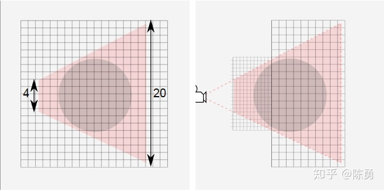

（左：整个视锥用一张 20 单位宽的阴影图，球体只占约 4 单位，纹素被浪费；右：把阴影相机收紧到近处，同样的图只覆盖近端一小块，球体占据的纹素大幅增加。）

工程要点：

- 每个 cascade 有自己的 `shadowResolution`、视图/投影矩阵、在图集中的 offset；
- bias 必须按 cascade 分辨率逐级计算（见前文）；
- 级间要做混合（cascade blending）否则能看到清晰的分界线；
- 阴影相机的 near/far 要足够包住"视锥外但仍能投影进视锥"的物体，否则会出现阴影突然消失。

## HighResolutionShadow（聚焦阴影）

影响阴影分辨率的两个因素：**shadowmap 分辨率**与**关心区域在 shadowmap 中的占比**。前者可以"大力出奇迹"，但分辨率不可能无限高；后者的做法是把阴影相机视锥聚焦到关心的区域，充分利用现有分辨率——代价是别处没有阴影（适合角色特写、过场）。

步骤：

1. 计算关心物体的包围球，得到中心 `center` 与半径 `radius`；
2. 由平行光欧拉角算方向向量；
3. **View 矩阵**：eye = center 沿光方向反向偏移 `radius + nearZ`；target = center；up 取 Y；`LookAt`；
4. **Proj 矩阵**：正交投影，`right = top = radius`，`left = bottom = -radius`；`nearZ` 取一个很小的值（如 0.1），`farZ = radius*2 + nearZ`。

```csharp
Vector3 direction = Matrix4x4.Rotate(Quaternion.Euler(DirLight.transform.localEulerAngles)) * Vector3.forward;
Vector3 shadowCameraPos = aabbCenter - Vector3.Normalize(direction) * (aabbRadius + nearZ);
GLLookAt(ref viewMatrix, shadowCameraPos, aabbCenter);

float right = aabbRadius;
float left  = -right;
float top   = right;
float bottom = -top;
float farZ  = nearZ + aabbRadius * 2f;
projectMatrix = Matrix4x4.Ortho(left, right, bottom, top, nearZ, farZ);
```

### 大条纹问题（深度分辨率不足）

最初设 near=0.1、far=100.1（单位米），看似正常，但：

- 正交投影的深度是**线性**映射到 NDC 的，精度在 near~far 之间均匀分布；
- 头部的包围球直径只有约 0.2，在 100 的深度范围里只占很小一段，量化后皮肤上的微小起伏无法区分 → 出现大条纹（当时为 16 位深度：约 1.5 mm/级，肉眼可见；24 位只有约 6 μm/级，解释不了这一现象）。

修法：把 far 收紧到刚好包住物体（`radius*2 + nearZ`）。

> 但要记住：阴影相机 frustum 之外仍可能有物体投影**进来**，所以 near/far 不能只按被聚焦物体卡死，要按场景留余量——这是"精度"与"漏影"的权衡。

## 屏幕空间阴影（Screen Space Shadow）

### 动机

Forward 渲染在着色时同步做阴影计算，存在 overdraw：被遮挡的片元的阴影计算全被浪费。Deferred 渲染的阴影是在屏幕空间算的，天然只算可见像素。**Forward 也可以借用这个思路**。

### 四个步骤

1. 眼点相机渲染**深度纹理**（延迟渲染本来就有；前向需一次 pre-Z）；
2. 光源相机渲染**shadowmap**；
3. 屏幕空间做一次**阴影收集**：由深度重建世界坐标 → 转到光源空间 → 采样 shadowmap → 得到逐像素阴影值，写入一张屏幕空间阴影纹理；
4. 正常着色时，按片元的屏幕 UV 采样这张阴影纹理。

### Pass 1：眼点相机 Pre-Z

```csharp
_depthCamera = CreateDepthCamera();
_depthCamera.RenderWithShader(shadowCasterMat.shader, "");
```

```hlsl
// 只输出深度的 pass
float4 frag (v2f i) : COLOR
{
    float depth = i.depth.x / i.depth.y;
#if defined(SHADER_API_GLES) || defined(SHADER_API_GLES3)
    depth = depth * 0.5 + 0.5;   // (-1,1) -> (0,1)
#elif defined (UNITY_REVERSED_Z)
    depth = 1 - depth;           // (1,0) -> (0,1)
#endif
    return depth;
}
```

### Pass 2：光源相机渲染 Shadowmap

正交相机、`orthographicSize` 覆盖场景、`nearClipPlane`/`farClipPlane` 收紧到刚好。着色器同上。

### Pass 3：阴影收集

```csharp
Matrix4x4 proj = GL.GetGPUProjectionMatrix(Camera.main.projectionMatrix, false);
Shader.SetGlobalMatrix("_inverseVP", Matrix4x4.Inverse(proj * Camera.main.worldToCameraMatrix));

Shader.SetGlobalMatrix("_WorldToShadow",
    GL.GetGPUProjectionMatrix(_lightCamera.projectionMatrix, false) * _lightCamera.worldToCameraMatrix);

Graphics.Blit(depthTexture, screenSpaceShadowTexture, shadowCollectorMat);
```

```hlsl
// Collector：ZTest Off / ZWrite Off / Cull Back
fixed4 frag(Output i) : SV_TARGET
{
    half depth_ = tex2D(_CameraDepthTex, i.uv).r;
#if defined (SHADER_TARGET_GLSL)
    depth_ = depth_ * 2 - 1;      // (0,1) -> (-1,1)
#elif defined (UNITY_REVERSED_Z)
    depth_ = 1 - depth_;          // (0,1) -> (1,0)
#endif
    float4 clipPos;
    clipPos.xy = i.uv * 2 - 1;
    clipPos.z  = depth_;
    clipPos.w  = 1;
    float4 posWorld = mul(_inverseVP, clipPos);
    posWorld /= posWorld.w;

    half4 shadowCoord = mul(_WorldToShadow, posWorld);
    half2 uv = shadowCoord.xy * 0.5 + 0.5;
    half depth = shadowCoord.z / shadowCoord.w;
#if defined(SHADER_API_GLES) || defined(SHADER_API_GLES3)
    depth = depth * 0.5 + 0.5;
#elif defined (UNITY_REVERSED_Z)
    depth = 1 - depth;
#endif
    half sampleDepth = tex2D(_LightDepthTex, uv).r;
    half shadow = (sampleDepth < depth - 0.05) ? 0.1 : 1;
    return shadow;
}
```

（原稿有误，已更正：原代码对 `shadowCoord.xy` 未除 $w$、只对 `z` 除了 $w$，即采样坐标仍停留在裁剪空间。对**正交**光源相机 $w\equiv1$，两者等价，所以结果看起来没问题；若换成聚光灯（透视投影），xy 也必须除 $w$，否则采样位置整体偏移。）

### Pass 4：应用

```hlsl
i.screenPos.xy = i.screenPos.xy / i.screenPos.w;         // clip -> NDC
float2 sceneUVs = i.screenPos.xy * 0.5 + 0.5;             // NDC -> [0,1]
#if UNITY_UV_STARTS_AT_TOP
    sceneUVs.y = _ProjectionParams.x < 0 ? 1 - sceneUVs.y : sceneUVs.y;
#endif
half shadow = tex2D(_ScreenSpaceShadowTexture, sceneUVs).r;
```

### 优点

继承了延迟渲染的思想：**复杂度与场景几何量无关**，只需一次全屏 pass；在深度图已经存在的情况下效率优势明显。

局限：屏幕外的物体投不进阴影（屏幕空间方法的通病）；透明物体的阴影需要额外处理。

## Unity / URP 中的真实实现

### 阴影投射（Caster）

`MainLightShadowCasterPass.cs` 中 `ExtractDirectionalLightMatrix` 负责取出每个级联的 `shadowSliceData`：级联在图集中的 offset、`shadowResolution`、光源相机的 view/proj 矩阵，以及由二者算出的 `worldToShadow`。

```csharp
static Matrix4x4 GetShadowTransform(Matrix4x4 proj, Matrix4x4 view)
{
    if (SystemInfo.usesReversedZBuffer)
    {
        proj.m20 = -proj.m20; proj.m21 = -proj.m21;
        proj.m22 = -proj.m22; proj.m23 = -proj.m23;
    }
    Matrix4x4 worldToShadow = proj * view;

    // 齐次坐标 xyz: [-w, w] -> [0, w]，省掉 shader 里的 MAD
    var s = Matrix4x4.identity;
    s.m00 = s.m11 = s.m22 = 0.5f;
    s.m03 = s.m13 = s.m23 = 0.5f;

    return s * worldToShadow;   // 直接得到 shadowmap 的 uv + 深度
}
```

- 正交光源 $w=1$，传入 FS 后不需要除 $w$；
- 聚光灯（透视）必须在 FS 中除 $w$，才能把 $[0,w]$ 归一化到 $[0,1]$。

投射 pass 就是标准的 `LightMode = ShadowCaster`：

```hlsl
Pass
{
    Name "ShadowCaster"
    Tags { "LightMode" = "ShadowCaster" }
    // ...
    v2f vert(appdata_base v)
    {
        v2f o;
        UNITY_SETUP_INSTANCE_ID(v);
        UNITY_INITIALIZE_VERTEX_OUTPUT_STEREO(o);
        TRANSFER_SHADOW_CASTER_NORMALOFFSET(o)   // 这里施加 SCVBB
        return o;
    }
    float4 frag(v2f i) : SV_Target { SHADOW_CASTER_FRAGMENT(i) }
}
```

`TRANSFER_SHADOW_CASTER_NORMALOFFSET` 就是把顶点按 `shadowBias`（沿光方向推远）与 `shadowNormalBias`（沿法线内缩）做偏移的地方。

### 阴影接收（Receiver）

```hlsl
float4x4 _MainLightWorldToShadow[MAX_SHADOW_CASCADES + 1];

float4 shadowCoord = mul(_MainLightWorldToShadow[cascadeIndex], float4(positionWS, 1.0));

real SampleShadowmap(TEXTURE2D_SHADOW_PARAM(ShadowMap, sampler_ShadowMap),
                     float4 shadowCoord, ShadowSamplingData samplingData,
                     half4 shadowParams, bool isPerspectiveProjection = true)
{
    if (isPerspectiveProjection)
        shadowCoord.xyz /= shadowCoord.w;

    real attenuation;
    real shadowStrength = shadowParams.x;
#ifdef _SHADOWS_SOFT
    attenuation = SampleShadowmapFiltered(ShadowMap, sampler_ShadowMap, shadowCoord, samplingData);
#else
    attenuation = SAMPLE_TEXTURE2D_SHADOW(ShadowMap, sampler_ShadowMap, shadowCoord.xyz);
#endif
    attenuation = LerpWhiteTo(attenuation, shadowStrength);
    return BEYOND_SHADOW_FAR(shadowCoord) ? 1.0 : attenuation;
}
```

要点：

- 必须传入 `shadowCoord.xyz` 三分量（含比较深度），返回的是比较结果而非纹理值；
- `BEYOND_SHADOW_FAR` 之外的区域强制为 1（无阴影），否则边缘会出现"黑框"；
- `LerpWhiteTo(attenuation, shadowStrength)` 用 `shadowStrength` 控制阴影浓淡。

**采样坐标越界**：`SampleShadowmap` 只用 `shadowCoord.z` 参与比较，代码本身不检查 xy 是否落在 $[0,1]$ 内。级联边缘、光源相机视锥之外、或 projective 投影把片元投到图集之外的区域都可能产生越界的 uv。但 URP 的阴影纹理采样器是 `TextureWrapMode.Clamp`，越界的 uv 不会"采样失败返回 0"，而是被 **clamp 到边缘 texel** 上：此时比较用的仍是合法深度，只是取到了图集/相邻 cascade 边缘那一圈 texel 的深度，于是可能出现错误的阴影（边缘条带、错误的半影或突然的硬边），而不是整块变黑。

按语义更稳妥的处理是在采样前把 uv 限幅到本级的 tile 内部（或像 `BEYOND_SHADOW_FAR` 那样对级联外区域直接返回 1）。具体行为（clamp 之外是否还有额外 fade）随 URP 版本而异，需按实际版本核对。

### 三种阴影的叠加

Baked Shadowmask、Realtime Shadowmap、Z shadow（屏幕空间/AO 之类）同时存在时：有 shadowmask 混合的分支取各自的 attenuation 的**最小值**（即最暗的那个）；URP 默认路径不是取 min，而是按 shadowFade 在实时阴影与烘焙阴影之间**插值**；AO 另行单独相乘。

### 阴影贴图格式与采样

`SAMPLE_TEXTURE2D_SHADOW` 的参数是（纹理、采样器、shadowCoord.xyz）。纹理必须是带比较采样器的深度格式——URP 中 `_MainLightShadowmapTexture` 声明为 `TEXTURE2D_SHADOW`、配套 `SAMPLER_CMP`，而不是普通的 `Texture2D` 加线性采样器，比较由采样器在硬件里完成。

至于"4 个 texel 各自比较 + 双线性混合、返回 1/0、比较发生在插值之前"这组语义，见前文《硬件比较采样》一节，此处不再重复。

## Shadow Decal（投影贴花）

用深度图把片元的**物体空间坐标**求出来，在物体空间里做盒体裁剪与形状映射，从而把一张"阴影贴花"精确贴在角色脚下的地面上。

```hlsl
float3 get_os_position(float3 ray, float4 screenUV)
{
    float depth = ArkSampleDepthTexture(screenUV.xy / screenUV.w);
    depth = LinearEyeDepth(depth, _ZBufferParams);      // [near, far] 线性
    float3 vpos = ray * (depth / -ray.z);               // 视空间位置（z 为负）
    float3 wpos = mul(unity_CameraToWorld, float4(vpos, 1)).xyz;
    return mul(UNITY_MATRIX_I_M, float4(wpos, 1)).xyz;  // 物体空间
}

half4 frag(v2f i) : SV_Target
{
    float3 uv = get_os_position(i.ray, i.screenUV);
    clip(float3(0.5, 0.5, 0.5) - abs(uv.xyz));           // 超出盒子就丢弃
    ...
}
```

Shader 状态：`Queue = Transparent+200`、`Cull Front`、`ZWrite Off`、`ZTest Off`、`Blend SrcAlpha OneMinusSrcAlpha`，并设置 `ForceNoShadowCasting` / `IgnoreProjector`。

要点：

- `q = 深度 / (-ray.z)` 把"沿射线的参数"换算成视空间位置——这是射线法重建位置的通用写法；
- 用 `clip` 在物体空间做盒体裁剪，等价于一个廉价的有向包围盒测试；
- 因为 `ZTest Off`，它必须在所有不透明物体之后绘制（靠 RenderQueue 保证）。

## Shadow with dissolve（消融与阴影同步）

角色消融时，如果只在主 pass 里 `clip`，**阴影仍然完整**——因为 ShadowCaster pass 不知道该物体已经"消失"了一部分。必须让两个 pass 用同一张消融图与同一个阈值：

```hlsl
// 主 pass
float4 dissolveCol = _DissolveTex.Sample(sampler_DissolveTex, i.uv);
clip(dissolveCol.r - _Clip);

// ShadowCaster pass（同样要 clip）
float4 dissolveCol = _DissolveTex.Sample(sampler_DissolveTex, i.uv);
clip(dissolveCol.r - _Clip);
return 0;
```

这是"多 pass 材质"的普遍规律：**任何影响可见性的裁剪（discard/alpha test）都必须在 ShadowCaster、DepthOnly、DepthNormals 等所有 pass 中重复一遍**，否则阴影、深度纹理、SSAO 都会与主画面不一致。

## 阴影相关工程问题清单

| 现象 | 成因 | 处理 |
|:--|:--|:--|
| 条纹状自遮挡（acne） | 有限分辨率 + 光线斜射，texel 深度取的是区域中心 | Depth/Normal Bias，按 $\theta$、分辨率、PCF 半径计算 |
| 阴影与物体分离（peter-panning） | bias 过大 | 减小 bias、提高分辨率、改用 normal bias |
| 边缘漏光（light leaking） | bias 把接收点推出遮挡物 | 减小 bias、缩小核、CSM 分级 bias |
| 接缝出现裂缝 | normal bias 沿各自法线收缩 | 焊接法线 / 平滑法线过渡 |
| 掠射角下阴影错误 | $\tan\theta\to\infty$，depth bias 失效；SCVBB 反向偏移趋无穷 | 改用 normal bias / 限制最大 bias |
| 远处阴影糊、近处锯齿 | 单张 shadowmap 分辨率分配不均 | CSM，逐级 bias |
| 大范围条纹（正交阴影相机） | near/far 过大，正交深度精度被摊薄 | 收紧 near/far（并留出投影余量） |
| 阴影边缘锯齿 | 二值比较 | PCF（连续 tent）、PCSS |
| 阴影边缘出现分界台阶 | 离散 tent 导数不连续 | 面积权重（连续 tent） |
| 软阴影漏光（$d<\mu$） | 单边切比雪夫失效：$d<\mu$ 时直接判为可见，单峰近似在该侧过估可见性 | VSSM 细分 + PCF 回退 |
| 软阴影漏光（多遮挡层） | 方差混入与接收面无关的遮挡层，上界偏大（两层遮挡可到约 0.5 半亮） | `ReduceLightBleeding` 截断低概率区间，代价是半影变硬 |
| 消融后仍有阴影 | ShadowCaster pass 未同步 clip | 所有 pass 重复裁剪 |
| 屏幕空间阴影在屏幕外失效 | 屏幕空间方法只覆盖可见像素 | 回退到 shadowmap / 扩大收集范围 |
| 阴影闪烁（阴影相机抖动） | 阴影相机随主相机移动导致 texel 对不齐 | 按 texel 尺寸对齐阴影相机（snap） |
| 移动端阴影开销大 | 采样次数 × 分辨率 × 级联数 | 降低分辨率/级联数、改硬阴影、用阴影距离裁剪 |

## 切线空间（TBN）与阴影中的法线

与阴影只有一处关联：**normal bias 的方向来源**。SCVBB 在 ShadowCaster pass 的 VS 阶段沿**顶点法线**偏移，而 TBN 在 VS 中构建、经光栅化线性插值后已不再严格正交，FS 里实际着色用的是经法线贴图扰动后的法线。两者不是同一个向量，因此：

- 法线贴图的高频凹凸不参与偏移，偏移量只由几何面朝向决定；
- 若改用扰动后的法线做偏移，方向更贴合着色点，但会把逐顶点操作退化成逐片元，丢掉 SCVBB 唯一的性能优势（见前文《Shadow Caster Vertex Based Bias》一节）。

TBN 的构建、正交化与重建细节见《07_纹理与法线》。

## 球谐光照（SH）的重建

与阴影只有一处关联：SH 负责的是**间接漫反射**这类低频光照，它不参与阴影贴图的比较，也不被屏幕空间阴影遮挡——间接光的可见性通常由烘焙或 AO 近似，而不是实时 shadowmap。重建本身的阶数、逐顶点/逐片元/混合三种形式以及 Light Probe 的系数来源见《15_球谐光照》。

## 与 Unity 的差异：交叉引用

正文已覆盖 depth/normal bias 与级联包围球两部分，此处只给入口，不重复推导：

- depth bias / normal bias 的"外扩转内收、逐片元转逐顶点"以及光线掠射时反向偏移趋于无穷的不等价性 —— 见前文《Shadow Bias 详解》一节中的《Shadow Caster Vertex Based Bias（SCVBB）》；
- 每级 cascade 由包围球确定光源相机的投影矩阵，以及包围球"改远裁剪会变、改近裁剪不触发、平移不触发而旋转触发"的更新规则 —— 见本文附录 B《2022 年调试记录：包围球的更新时机与 CloseUpShadow》。

## 附录 A：工作日志中的补充记录

本节收录工作日志中未进入正文的技术片段：贴花的另一种实现路线、为提升阴影分辨率而"推近相机但保持画面不变"的做法、阴影相机包围球的来源，以及 shader 分级与 RT 管理这类工程结论。正文已覆盖的内容只做交叉引用，不重复展开；2022 年的级联阴影调试记录篇幅较长，单列为附录 B。

### 贴花阴影：另一种实现路线

正文《Shadow Decal》一节用物体空间盒体裁剪（`clip(0.5 - abs(osPos))`）限定贴花范围；工作日志里记录的是同一条"深度重建 → 局部空间 → 衰减"链路的另一版写法，区别在于**用局部坐标直接算衰减**，而不是做盒体裁剪。

渲染状态：

| 状态 | 取值 | 作用 |
|:--|:--|:--|
| 剔除 | `Cull Front` | 只画立方体背面 |
| 深度写入 | `ZWrite Off` | 不污染场景深度 |
| 深度测试 | `ZTest Off` | 不做遮挡比较，靠绘制顺序保证盖在地面上 |
| Alpha 测试 | 关闭（`AlphaTest Off`） | 不做 alpha 裁剪 |
| 混合 | 开启（`Blend SrcAlpha OneMinusSrcAlpha`） | 阴影以半透明方式叠加到地面 |

数据流：

1. **VS** 输出两类 varying：
   - 顶点在**相机空间**的坐标——插值后得到每个片元"从视点出发、穿过该片元"的射线；
   - 顶点在**裁剪空间**的坐标，把 `xy` 缩放到 `[0, w]` 作为 `screenUV`——插值后用 `screenUV.xy / screenUV.w` 得到采样屏幕深度图的纹理坐标。
2. **FS** 用该纹理坐标采样 `_CameraDepthTexture`，得到原始/窗口深度；
3. NDC 深度 → 相机空间**线性**深度（Reversed-Z 平台要按 `UNITY_REVERSED_Z` 走对应分支）；
4. 用线性深度按 `depth / (-ray.z)` 缩放插值来的射线，重建相机空间坐标，再转到世界空间、最后转到**物体空间**；
5. 取局部坐标的 `xyz` 分量计算阴影衰减并输出颜色。

与正文的差别只在第 5 步：正文用局部坐标做盒体裁剪，这里用局部坐标算衰减。两者都以"深度图 + 射线重建"为基础，重建公式一致（$q=\text{depth}/(-\text{ray}.z)$）。

### 用"推近主相机"换取阴影分辨率（保持画面不变）

目标：画面构图不变，但提高头发等细节处的阴影分辨率。

关键约束是**最终 PV 矩阵必须保持一致**，这样推近相机不会改变画面：

$$
P_1V_1=P_2V_2
\;\Longrightarrow\;
P_2=P_1V_1V_2^{-1}
$$

推导：把 $P_1V_1$ 写成 $P_1V_1V_2^{-1}V_2$，即得 $P_2=P_1V_1V_2^{-1}$（要求 $V_2$ 可逆，相机没有退化）。

做法：把主相机向角色推近（$V_2$），同时把投影矩阵改成上式的 $P_2$，画面像素位置与之前一致；再配合降低阴影的 `maxDistance`，缩短主相机视锥在 z 方向的长度，级联的包围球随之变小，光源正交视锥的宽高也随之收窄，于是同样的 shadowmap 上有效纹素占比提高。

整条链路是：主相机视锥 z 长度 ↓ → 视锥包围球半径 ↓ → 包围球更贴合投影物 → 光源相机正交视锥 x/y 尺寸 ↓ → shadowmap 中有效纹素占比 ↑ → 最终阴影分辨率 ↑。

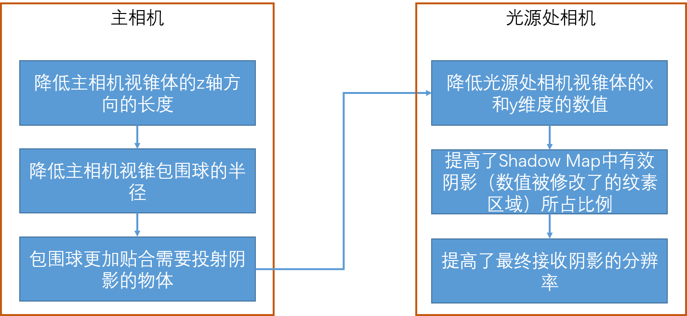

推近相机后的光源正交视锥，以及四级级联的示意：

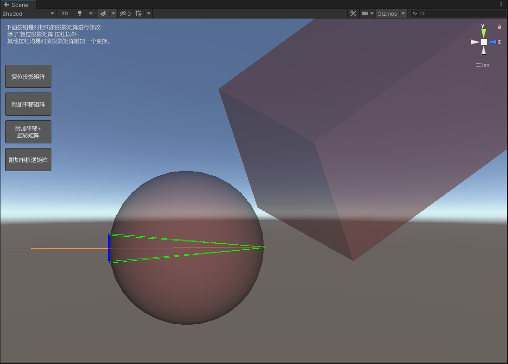

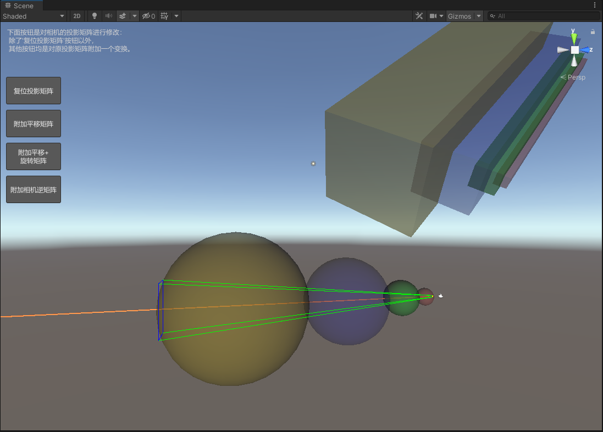

观察：级联的视锥包围球**既不是内切球也不是外接球**，半径介于两者之间（见下一节）。

### 阴影相机包围球的来源：由视锥 8 顶点计算

一个常见误解是"shadowcaster 视锥会按 culling 结果再扩充包围盒"。实际（Unity 4.3.1 源码）是**用视锥的 8 个顶点算包围球**，而参与计算的视锥 z 长度取主相机远裁剪面与阴影 `maxDistance` 的较小者：

$$
\text{zLength}=\min(\text{farClip},\ \text{maxDistance})
$$

即 `maxDistance` 把视锥截断在阴影距离处，参与包围球计算的视锥 $z$ 长度由这条被截断后的视锥决定（这是视锥的 $z$ 长度，不是包围球半径；半径由下面的 8 顶点算法给出）：

```cpp
void CalculateBoundingSphereFromFrustumPoints(const Vector3f points[8],
                                             Vector3f& outCenter, float& outRadius)
{
    // 只取 4 个角点：0/3/5/7
    Vector3f spherePoints[4];
    spherePoints[0] = points[0];
    spherePoints[1] = points[3];
    spherePoints[2] = points[5];
    spherePoints[3] = points[7];

    // 先试远平面，再试近平面：取两个角点连线的中点作候选球心（配对按 points[] 索引顺序推断，待核实）
    for (int plane = 1; plane >= 0; --plane)
    {
        Vector3f pointA = spherePoints[plane * 2];
        Vector3f pointB = spherePoints[plane * 2 + 1];
        Vector3f center = (pointA + pointB) * 0.5f;
        float radius2 = SqrMagnitude(pointA - center);
        Vector3f pointC = spherePoints[(1 - plane) * 2];
        Vector3f pointD = spherePoints[(1 - plane) * 2 + 1];

        // 另一平面的两个角点是否也在球内
        if (SqrMagnitude(pointC - center) <= radius2 &&
            SqrMagnitude(pointD - center) <= radius2)
        {
            outCenter = center;
            outRadius = sqrt(radius2);
            return;
        }
    }

    // 都不满足时，用 4 点求球（球面过全部四个角点）
    CalculateSphereFrom4Points(spherePoints, outCenter, outRadius);
}
```

要点：

- 先尝试"取某一平面上两个角点连线的中点作球心、两点距离的一半作半径"的球，另一平面的两个角点若也在球内就采用；"哪个平面对应哪两个点"是按 `points[]` 索引顺序推断出来的（待核实），否则退化为过 4 点的球；
- 实测观察：半径介于内外切之间，与经验观察一致；
- 调试时若看到 `ShadowCasterBounds` 的数值异常巨大（如 Center `4.87e14, 2.15e32, -2.56e25`），疑似无效/未初始化值，勿当作包围球（待核实）。

### 为什么只用一级级联

实测阴影分辨率提升有上限：把一级级联调到较好状态后，多级级联很难带来明显收益；而多级会让 `ShadowCaster` pass 的数量按级联数倍增（×N）。因此在"效果提示不明显"的场景里，单级级联 + 收窄视锥（上一节）比多级更划算。

> 这与正文 CSM 一节的适用条件并不矛盾：CSM 解决的是**大场景远近精度分配**；当视锥已被收窄到单个角色附近时，远近差异本身就不存在了。

### 用 DXBC 指令数给 shader 功能分级

- 方法：从 RenderDoc 反编译 fragment shader，得到 **DXBC**（DirectX Bytecode，HLSL 编译后的中间表示），统计指令数与纹理采样数，作为"某功能能否下放到低级别 shader"的依据。
- 局限：各功能之间存在公用指令，无法精确拆分出单个功能的开销，只能按功能递增顺序统计**增量**。
- 结论：实时渲染更接近"效果组合"，分级应基于实测增量，而不是按功能列表理论估算。

### 屏幕空间阴影的 RT 管理

ScreenSpaceShadow 接入统一的 RT 管理（复用/池化），避免为阴影收集每帧单独分配 RT；属于性能优化，不改变收集算法本身（待核实：具体复用粒度原文未记录）。

## 附录 B：2022 年调试记录——包围球的更新时机与 CloseUpShadow

在建角场景（主相机视场角仅 10°）里调头发阴影时，遇到的现象是：主相机**不旋转**，无论怎么提高 shadow map 分辨率、怎么改级联划分，都拿不到清晰的阴影；把主相机绕 Y 轴转 180° 之后反而清晰——因为 $\sin 180°$ 不是一个精确的 0，而是一个极小的非零值。由此怀疑问题不在采样，而在"投影矩阵 → 主相机视锥 → 视锥包围球"这条链上更新不及时。下面只保留可复用的因果链与结论。

### 包围球的更新规则

- 改变投影矩阵**会**触发主相机视锥的更新，但**不一定**触发视锥包围球（球心与半径）的更新；
- 只有两种情况会导致球心更新：
  1. 修改**远**裁剪面——且这种更新只会让包围球变大，不会让它变小；修改**近**裁剪面不触发更新；
  2. 投影矩阵中含有**旋转**分量；含**平移**分量不触发。
- 欧拉角为 0° 或 180° 时，旋转矩阵的非对角项为 0：$R_y(\theta)=\begin{pmatrix}\cos\theta&0&\sin\theta\\0&1&0\\-\sin\theta&0&\cos\theta\end{pmatrix}$，$\theta=180°$ 时是 $\operatorname{diag}(-1,1,-1)$（$\sin\theta$ 只是极小非零值）。此时相机变换矩阵等效于"不含旋转分量"，即便用逆矩阵去反推投影矩阵，也无法促使包围球更新；旋转到 181° 就会更新。
- 单纯平移相机永远不触发更新，除非在平移之外附加一个微小的旋转分量。

### 相机 transform 的旋转与投影矩阵补偿

CloseUpShadow 的矩阵链见本文附录 A《用"推近主相机"换取阴影分辨率》一节，即 $P_2=P_1V_1V_2^{-1}$，它只保证 $P_2V_2=P_1V_1$、画面不变；包围球是否刷新是另一件独立的事，判据是**相机 transform 的旋转是否真的变化**（欧拉角是否离开 0°/180° 附近），而不是投影矩阵里有没有旋转分量。

- 若相机只是被推近：$V_2$ 相对 $V_1$ 只多一个平移，$P_2$ 由 $P_1V_1V_2^{-1}$ 算出，但相机 transform 的旋转没变，包围球不重算，仍停留在旧位置与大小，明显大于真实视锥。URP 用这个偏大的球去确定光源相机的正交视锥，其 $x/y$ 尺寸随之变大，同一张 shadow map 中有效纹素占比下降，**最终阴影分辨率比改动前更低**。
- 若 $V_2$ 中同时含旋转（相机真的转了）：包围球按新视锥重算（本次变换不含缩放），光源相机视锥尺寸恢复正常，阴影分辨率与改动前一致。

所以"往投影矩阵里塞一个旋转项"并不解决问题：$P_2$ 本来就是从 $V_1,V_2$ 反推出来的补偿项，修改它不会改变相机 transform。要触发更新只能让相机真的转向（哪怕很小），再按 $P_2=P_1V_1V_2^{-1}$ 重新补偿投影矩阵。这也解释了为什么"只平移不触发、带旋转才触发"。

### 视锥长度与有效阴影占比

链路与推导见本文附录 A《用"推近主相机"换取阴影分辨率》一节（视锥 $z$ 长度 → 包围球半径 → 光源正交视锥 $x/y$ → 有效纹素占比）。这里只补两条与 `nearClip` 相关的细节。

10° 视场角下视锥在 $x/y$ 方向本来就很窄，可调的只有 $z$ 方向，因此缩短视锥长度是当时唯一可用的手段。

另外，`nearClip` 还会沿另一条路径影响级联：`Camera::GetProjectionNear()` 的值被写入 `cullData.projectionNear`，`SetupDirectionalLightShadowCamera` 再据此算级联的起始距离

```cpp
float nearZ = cullData.projectionNear;
outCascade.minViewDistance = nearZ + nearSplit * (cameraFarZ - nearZ);
```

但近裁剪面的修改本身并不触发球心更新；原记录里提到"若增加近裁剪面间接引起了球心更新，可能需要在当前 `maxDistance` 基础上再加上 `minDistance`"（待核实：这条经验值未给出推导）。

### 为什么 Cascade Count 设为 1

与本文附录 A《为什么只用一级级联》一节是同一个结论（当时正是由此定下来的），此处不重复。

### 最终的规避办法

1. 相机初始欧拉角不要停在 0° 或 180°——这两个角度下 $R_y$ 的非对角项为 0（$\sin\theta\approx0$），等效于"不含旋转分量"，容易落入不更新的分支；
2. 确实需要 0°/180° 时，**在设置投影矩阵之前**强制刷新一次欧拉角：

   ```csharp
   Vector3 eulerAngle = camera.transform.eulerAngles;
   camera.transform.eulerAngles = eulerAngle;   // 促使裁剪面与包围球重算
   ```

   必须在赋值投影矩阵**之前**调用；放在之后只能等下一帧生效。

3. 另一个连带问题：一旦直接给 `camera.projectionMatrix` 赋值，Unity 就不再随视口变化自动更新投影矩阵——之后修改 FOV、aspect 或宽高比，都要自己重新计算并再次赋值。

### 当时封装的三个调试接口

```csharp
// 动态控制级联数目与各级边界（单位：米）
public void SetShadowDistance(int cascadeCount, Vector4 cascadeSplit);
// 保持最终画面不变地把相机推近；offset 为相机位置的偏移量
public void CloseUpShadow(Vector3 offset);
// 与 CloseUpShadow 配对，恢复投影矩阵
public void ResetShadow();
```

`cascadeSplit` 各分量的含义随 `cascadeCount` 变化：`cascadeCount = 3` 时 $x,y,z$ 分别是第 1、2 级的边界与 `shadowDistance`；`cascadeCount = 1` 时只有 $x$ 有意义。

`CloseUpShadow` 内部只有一行——即前文 $P_2=P_1V_1V_2^{-1}$ 的直接实现：

```csharp
camera.projectionMatrix = originalProjectViewMatrix * camera.cameraToWorldMatrix;
```

这也是它天然踩中"平移不触发包围球更新"这个坑的原因：`cameraToWorldMatrix` 即 $V_2^{-1}$，只含平移时相机 transform 的旋转没有变化，包围球不更新。

## 原始笔记索引

- `Graphics/Shadow/Shadowmap.md`
- `Graphics/Shadow/Shadow Bias.md`
- `Graphics/Shadow/PCF.md`
- `Graphics/Shadow/PCF PCSS VSM.md`
- `Graphics/Shadow/VSSM.md`
- `Graphics/Shadow/Cascade Shadow.md`
- `Graphics/Shadow/HighResolutionShadow.md`
- `Graphics/Shadow/屏幕空间阴影.md`
- `Graphics/Shadow/Real shadow in Unity.md`
- `Graphics/Shadow/Shadow Decal.md`
- `Graphics/Shadow/Shadow with dissolve.md`
- `根目录笔记/EVSSM.md`
- `Log/PWRD/日志.md`（贴花阴影、推近相机提分辨率、为什么只用一级级联、normal bias 接缝、DXBC 指令数分级）
- `Log/日志0619.md`（阴影视锥包围球 8 顶点计算）
- `Log/杂记/日志1217.md`（ScreenSpaceShadow 接入 RT 管理）
- `归类/VSM.md`（VSM 矩估计、SAT 两遍累加与区域查询、漏光的 A/B/C 推导、Linstep 去漏光、MSM 定位）
- `杂项/virtual world.md`（2022 年级联阴影调试记录：包围球更新时机、相机旋转与投影矩阵补偿、CloseUpShadow、Cascade Count=1 的取舍、规避办法，以及 dither 软阴影与 5×5 分级）
- `归类/resume.md`（第 669–845 行：PCF 各级核的覆盖范围与采样成本、PCSS 前提、VSM 与 SAT 结论；第 1611–1666 行：depth/normal bias 与 Unity 的差异、SampleShadow 的 xy 越界、TBN、球谐重建）
