# 抗锯齿与采样重建

本文整合采样与重建理论、重建滤波核、FSAA/SSAA/MSAA、后处理 AA（FXAA/SMAA）、时域 AA（TAA/CoD 动态 TAA/TXAA）、FSR2，以及 Mipmap 与纹理过滤的内容。

---

## 采样与重建

采样（sampling）把连续信号离散化为采样信号；重建（reconstruction）把采样信号经滤波器恢复为重建信号。

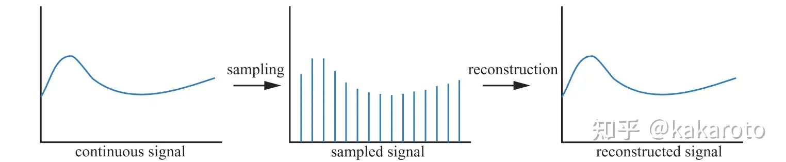

采样频率过低时，重建出的信号与原始信号不符，即走样（aliasing）。下图第一张是过低采样率恢复出一个低频信号，第二张则把曲线恢复成了一条直线。

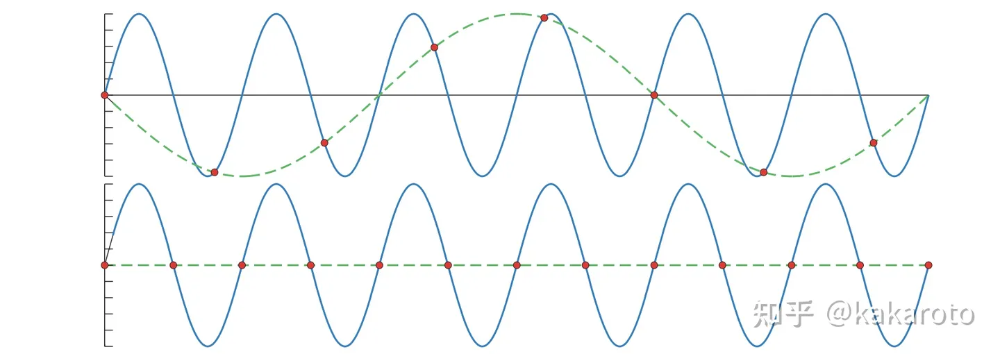

采样定理要求采样频率大于带限信号最高频率的两倍：这个采样率下限 $2f_{\max}$ 称为 Nyquist 率，而 Nyquist 频率指采样率的一半（即 $f_{\max}$）。但 3D 场景几乎不存在严格 band-limited 的信号：三角形边缘、阴影边界等都是不连续信号，频谱无限，因此**理论上走样不可能被完全消除**，抗锯齿只是"让误差落在人眼不敏感的频段/空间位置"。

### 重建滤波器

讨论前提是信号带限。重建必须使用滤波器，且**滤波器的积分（离散情形下是权重和）必须为 1**，否则重建信号的亮度会整体放大或缩小。

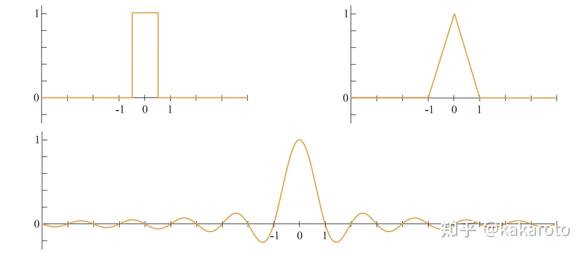

- **Box filter**：用最近点重建，结果是阶梯状不连续信号。
- **Tent filter**（三角滤波器）：在相邻采样点之间线性插值，结果连续；但采样点处导数突变，平滑度差，说明仍有高频残留。
- **Sinc filter**：理想低通。频域是一个门函数，与信号频谱相乘即截断门宽以外的频率，再变换回时域就是原信号。它重建最平滑，但支撑无限长且邻域取负值，实际不可用（只能近似，或截断成 Lanczos 之类的窗函数）。

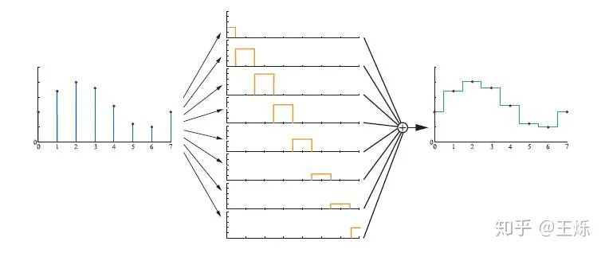

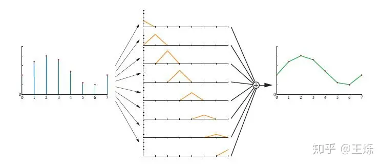

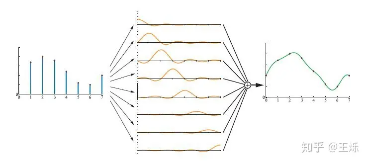

频域相乘对应空域卷积：

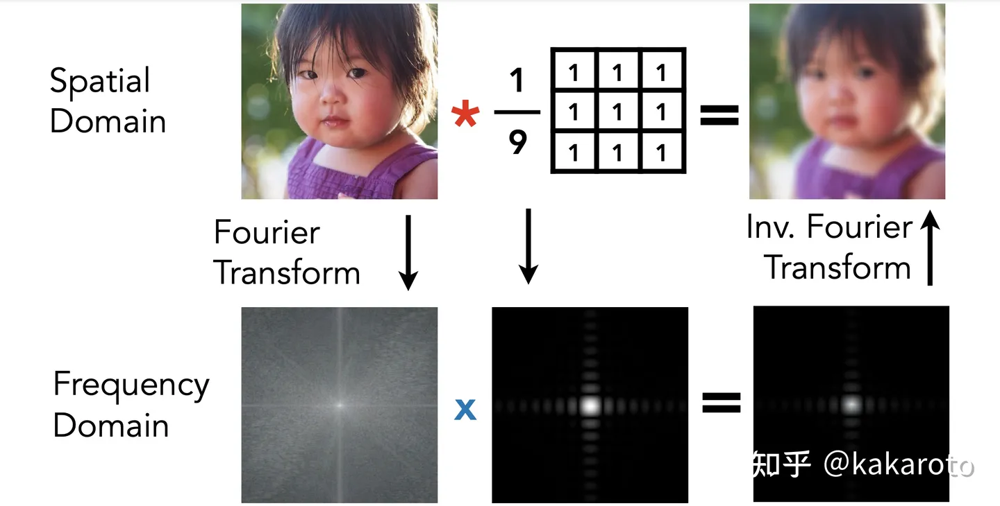

先在**采样前**做低通滤波再采样（即先积分一个像素覆盖的面积），得到的结果锯齿明显更少——这也是 box filter resolve、MSAA coverage 平均、mipmap 降采样的共同理论基础。

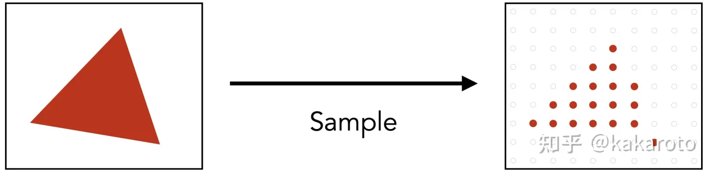

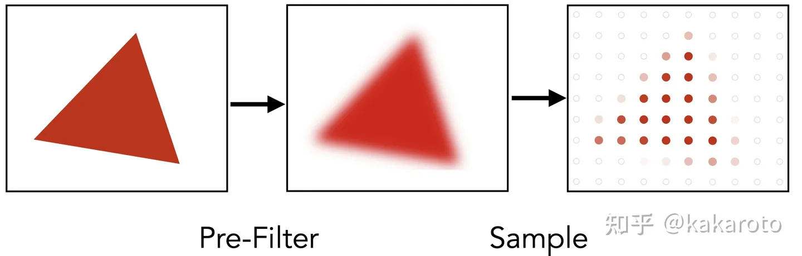

---

## 滤波核

三种常见核的形状与一维定义（$x$ 以像素为单位）：

**Box**

$$k(x)=\begin{cases}1, & |x|<0.5\\ 0, & \text{otherwise}\end{cases}$$

二维 5×5 形式：

$$\mathbf{K}=\frac{1}{5\times5}\begin{bmatrix}1&1&1&1&1\\1&1&1&1&1\\1&1&1&1&1\\1&1&1&1&1\\1&1&1&1&1\end{bmatrix}$$

**Tent（三角形）**

$$k(x)=\max(0,\ 1-|x|)$$

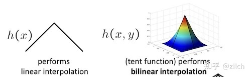

**Lanczos（窗化 sinc）**

$$k(x)=\mathrm{sinc}(x)\,\mathrm{sinc}(x/a)=\frac{\sin(\pi x)}{\pi x}\cdot\frac{\sin(\pi x/a)}{\pi x/a},\qquad |x|<a$$

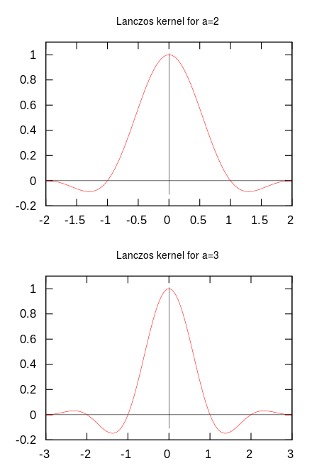

**Bicubic（三次卷积）**

$$W(x)=\begin{cases}(a+2)|x|^{3}-(a+3)|x|^{2}+1, & |x|\le 1\\[4pt] a|x|^{3}-5a|x|^{2}+8a|x|-4a, & 1<|x|<2\\[4pt] 0, & \text{otherwise}\end{cases}\qquad a=-0.5$$

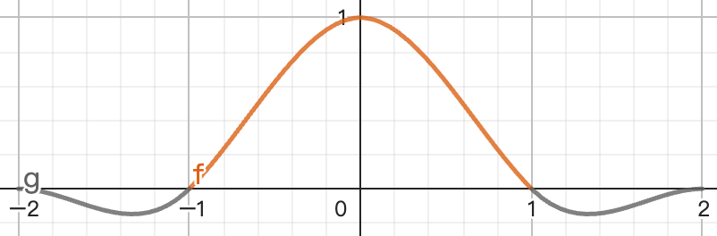

### 与 sinc 的关系

对离散样本，理论最优的反走样滤波器是 sinc，但它有无限长的拖尾；工程上只能逼近它，并接受逼近带来的 artifact。

下图中 tent 比 box 更接近 sinc 的形状。

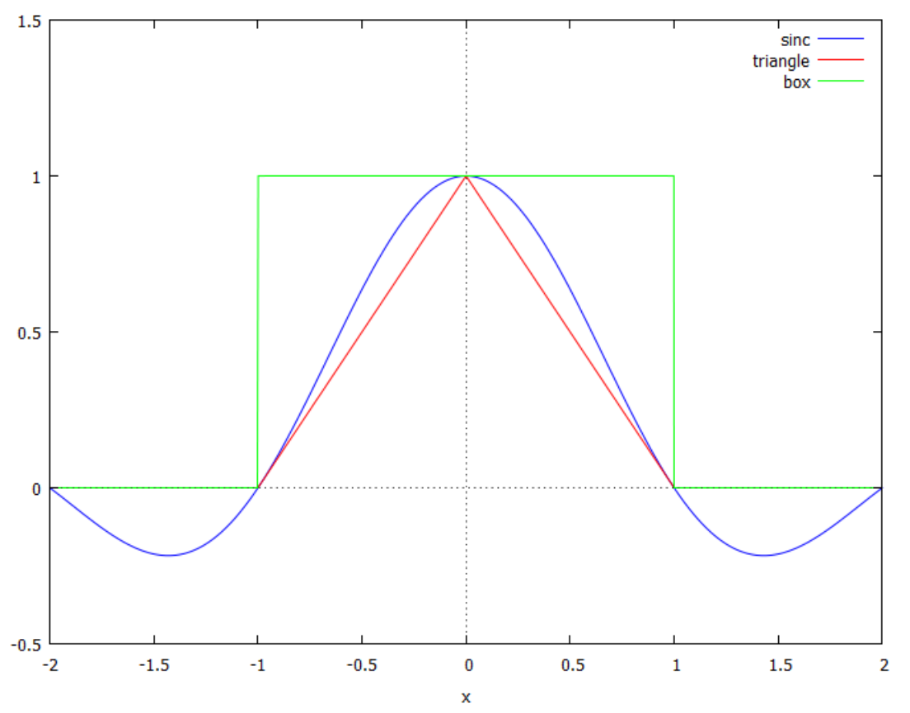

bicubic 可以更接近 sinc 的形状，它的第一对旁瓣和 sinc 一样是负的。

但工程上滤波器的选择并不是"尽可能逼近 sinc"：不同"非理想"滤波器会产生不同种类的 artifact——**混叠、过度模糊、振铃**，三者只能权衡。

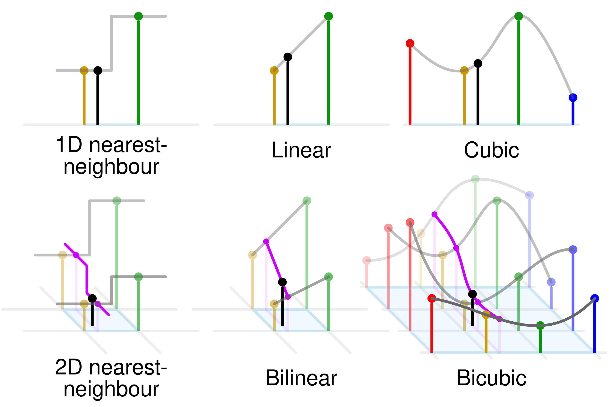

### 振铃效应（Ringing / Gibbs）

信号在突变点附近出现剧烈震荡，像击钟的回声，称振铃（ringing artifacts），数学上是吉布斯现象（Gibbs phenomenon）。

时域描述不连续信号需要无穷多频率成分；任何实际采集/重建系统只能保留有限带宽，频率截断就会在时域产生振铃。因此**任何阶跃/突变信号经带限滤波后都会出现振铃**。

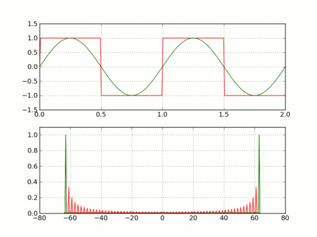

> 随正弦项数增加，吉布斯过冲比例不变（约 9%），只是震荡范围收窄。

在图像上表现为边界两侧的"鬼影环"：颜色突变两侧出现过冲、第一环、第二环。

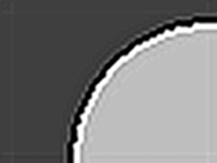

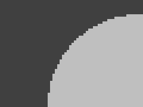

振铃的成因可归纳为：

1. 重建/复原时损失高频信息；
2. 滤波器的频域响应变化过于陡峭；
3. 理想低通在频域是门函数，时域是 sinc。频域相乘 = 时域卷积，等于把 sinc 搬移到每个采样点上叠加；sinc 本身是无限长振荡函数，叠加后就会污染邻域点，形成振铃。

### Lanczos 滤波

#### 窗口与瓣数

$$L(x)=\begin{cases}\mathrm{sinc}(x)\,\mathrm{sinc}(x/a), & -a<x<a\\[4pt] 0, & \text{otherwise}\end{cases}$$

等价写法：

$$L(x)=\begin{cases}1, & x=0\\[4pt] \dfrac{a\,\sin(\pi x)\sin(\pi x/a)}{\pi^2 x^2}, & -a\le x<a\ \text{and}\ x\ne 0\\[4pt] 0, & \text{otherwise}\end{cases}$$

$a$ 是核半径（正整数），控制锐度；波形共有 $2a-1$ 个瓣：

- $a=2$：3 个瓣 = 主瓣 + 2 个负旁瓣；
- $a=3$：5 个瓣 = 主瓣 + 2 个负旁瓣 + 2 个正旁瓣。

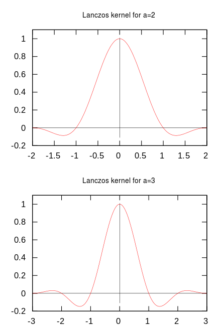

#### 一维插值

$$S(x)=\sum_{i=\lfloor x\rfloor-a+1}^{\lfloor x\rfloor+a} s_i\,L(x-i)$$

上式为未归一化的形式；由于负旁瓣会使权重和偏离 1，实际使用时要除以权重和：

$$S(x)=\frac{\sum_i s_i\,k(x-i)}{\sum_i k(x-i)}$$

其中 $x$ 为采样点坐标，$i$ 为邻域像素中心到采样点的偏移，$s_i$ 为该像素值。$a=2$ 时 $i\in\{\lfloor x\rfloor-1,\lfloor x\rfloor,\lfloor x\rfloor+1,\lfloor x\rfloor+2\}$，共 4 个 tap。

**注意**：权重必须除以权重和做归一化。负旁瓣会让权重和偏离 1，不归一化会导致亮度偏差。

#### 工程实现三问

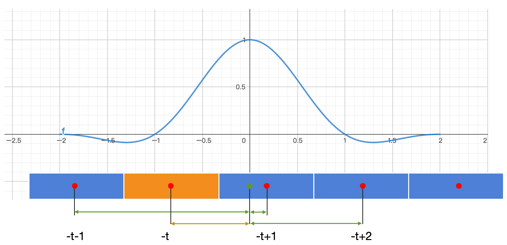

1. 如何找到需要的样本像素坐标；
2. 如何计算对应权重；
3. 如何执行加权平均（先横向 4 次，再纵向 1 次）。

**基准像素的选取**：不能取采样点"落脚"的像素（那样采样点左侧只有 1 个像素、右侧有 3 个，邻域不对称），而要让采样点落在中间两个像素中心之间。即用

```hlsl
float2 fPxSample = fUvSample * iTextureSize - 0.5;   // 转到以像素中心为整数的坐标系
fPxSample = clamp(fPxSample, 0, iTextureSize - 1);
int2   iPxSample = floor(fPxSample);                 // 基准像素（在采样点左侧）
float2 fPxFrac   = frac(fPxSample);                  // 基准像素到采样点的距离, [0,1)
```

各 tap 到采样点的距离（`floor` 使基准点向左取整，权重计算也要左移）：

| Pixel Coord | `iPxSample-1` | `iPxSample` | `iPxSample+1` | `iPxSample+2` |
|---|---|---|---|---|
| Offset To Sample | `-fPxFrac-1` | `-fPxFrac` | `-fPxFrac+1` | `-fPxFrac+2` |

#### 振铃与去环（deringing）

Lanczos 的负旁瓣会产生振铃。常用处理是把插值结果 clamp 到参与插值的最近 4 个像素的 min/max 之间：

```hlsl
fColorXY = clamp(fColorXY, fDeringingMin, fDeringingMax);
```

#### 参考实现（FSR2 风格）

```hlsl
FfxFloat32 Lanczos2NoClamp(FfxFloat32 x)
{
    const FfxFloat32 PI = 3.141592653589793f;
    // x -> 0 时 sin(x)/x 的极限为 1，但离散系统除以 0 会出错，故用 epsilon 兜底
    return abs(x) < FSR2_EPSILON ? 1.f
         : (sin(PI * x) / (PI * x)) * (sin(0.5f * PI * x) / (0.5f * PI * x));
}

FfxFloat32 Lanczos2(FfxFloat32 x)          // 截断到 |x|<=2
{
    x = ffxMin(abs(x), 2.0f);
    return Lanczos2NoClamp(x);
}

FfxFloat32x4 Lanczos2(FfxFloat32x4 c0, FfxFloat32x4 c1,
                      FfxFloat32x4 c2, FfxFloat32x4 c3, FfxFloat32 t)
{
    // 减 t 是因为 floor(fPxSample) 使中心点左移
    FfxFloat32 w0 = Lanczos2(-1.f - t);
    FfxFloat32 w1 = Lanczos2(-0.f - t);
    FfxFloat32 w2 = Lanczos2(+1.f - t);
    FfxFloat32 w3 = Lanczos2(+2.f - t);
    return (w0 * c0 + w1 * c1 + w2 * c2 + w3 * c3) / (w0 + w1 + w2 + w3);
}
```

二维是"横向 4 次 + 纵向 1 次"，共 16 个样本（4×4 区域）。

为了省 ALU，工程上常把 $k(x)$ 在 $[0,2]$ 上 32 等分做成 LUT 再线性插值：

```hlsl
static const FfxFloat32 k_Lanczos2Lut[32] = {
     1.0,        0.9914681,  0.9661899,  0.9251017,  0.8697127,  0.8020314,
     0.7244681,  0.6397197,  0.5506425,  0.4601209,  0.3709378,  0.285656,
     0.2065136,  0.1353409,  0.07350191, 0.02186239,-0.01921498,-0.04984907,
    -0.07059446,-0.08237662,-0.08641095,-0.08411288,-0.0770037, -0.06661837,
    -0.05442061,-0.04172935,-0.02966093,-0.01908834,-0.01061979,-0.004595432,
    -0.00110163,-7.743716E-16 };

FfxFloat32 Lanczos2_HardCode(FfxFloat32 uv)   // uv in [0,1]
{
    float idx   = saturate(uv) * 31;             // LUT 按 x = 2i/31 采样，uv∈[0,1] 对应 idx∈[0,31]
    int   ibase = min(int(floor(idx)), 30);      // 保证 ibase 与 ibase+1 都落在 [0,31] 内
    float t     = idx - float(ibase);            // t∈[0,1)
    return lerp(k_Lanczos2Lut[ibase], k_Lanczos2Lut[ibase + 1], t);
}
```

### Bicubic 多 tap 与少 tap 优化

缩放图像时的常用重建：Point / Bi-Linear / Bi-Cubic。

- **Bi-Linear**：2×2 邻域，单轴权重 $w_0=1-x,\ w_1=x$。
- **Bi-Cubic**：4×4 邻域，单轴权重是三次多项式 $w=ax^3+bx^2+cx+d$。常见三次核有 B-Spline、Catmull-Rom（Lanczos 是 sinc 窗化核，没有多项式表达式，并不属于三次核）。

双层线性插值（$w,h$ 分别是两个轴上的插值参数，$Q_{11},Q_{21},Q_{12},Q_{22}$ 为 2×2 邻域四个像素）：

$$f(x,y)\approx(1-w)(1-h)f(Q_{11})+w(1-h)f(Q_{21})+(1-w)h\,f(Q_{12})+wh\,f(Q_{22})$$

双三次插值是 4×4 邻域上的双变量三次多项式（共 16 个系数）：

$$f(x,y)=\sum_{i=0}^{3}\sum_{j=0}^{3}a_{ij}\,x^{i}y^{j}$$

#### 4 个 tap 的坐标与距离

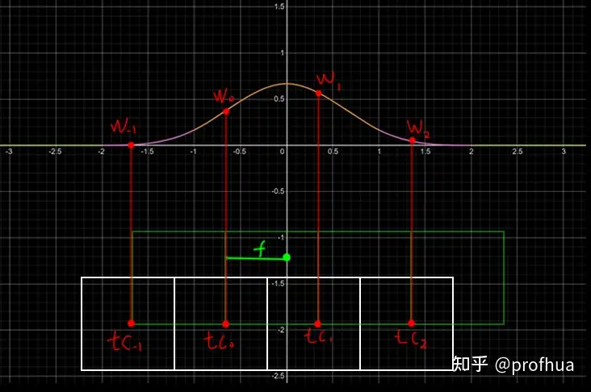

```hlsl
float2 fSample = uv * texSize - 0.5;
fSample = clamp(fSample, 0, texSize);
int2   iPx = floor(fSample);
float2 f   = frac(fSample);        // 基准像素中心到采样点的距离, [0,1)

// 4 个像素中心（归一化前）
float2 tc0 = (iPx - 1) + 0.5;
float2 tc1 = (iPx    ) + 0.5;
float2 tc2 = (iPx + 1) + 0.5;
float2 tc3 = (iPx + 2) + 0.5;
```

单轴距离：

$$x_{-1}=1+f,\qquad x_0=f,\qquad x_1=1-f,\qquad x_2=2-f$$

#### 原生实现：16 次采样

```hlsl
Texture2D g_Tex;  SamplerState g_Lin;

float4 ps_main(float2 iTc : TEXCOORD0)
{
    float2 texSize; g_Tex.GetDimensions(texSize.x, texSize.y);
    iTc *= texSize;
    float2 tc = floor(iTc - 0.5) + 0.5;   // 最近的 texel 中心（向下取整）
    float2 f  = iTc - tc;
    float2 f2 = f * f, f3 = f2 * f;

    float2 w0, w1, w2, w3;                 // 单轴 4 个权重，见下节
    float2 tc0 = tc - 1, tc1 = tc, tc2 = tc + 1, tc3 = tc + 2;

    float2 inv = 1.0 / texSize;
    tc0 *= inv; tc1 *= inv; tc2 *= inv; tc3 *= inv;
    // 16 次 Sample 的加权和，权重为 w_i.x * w_j.y
}
```

#### 硬件 bilinear 优化：16 tap → 4 tap

把同一侧两个 tap 合并成一次硬件双线性采样：

```hlsl
float2 s0 = w0 + w1;          // 左边两个 tap 的总权重
float2 s1 = w2 + w3;          // 右边两个 tap 的总权重
float2 f0 = w1 / (w0 + w1);   // w1 在左侧两 tap 中的比例 → 双线性采样位置
float2 f1 = w3 / (w2 + w3);
float2 t0 = tc - 1 + f0;      // 左侧合并采样点
float2 t1 = tc + 1 + f1;      // 右侧合并采样点
t0 *= inv; t1 *= inv;

return g_Tex.Sample(g_Lin, float2(t0.x, t0.y)) * s0.x * s0.y
     + g_Tex.Sample(g_Lin, float2(t1.x, t0.y)) * s1.x * s0.y
     + g_Tex.Sample(g_Lin, float2(t0.x, t1.y)) * s0.x * s1.y
     + g_Tex.Sample(g_Lin, float2(t1.x, t1.y)) * s1.x * s1.y;
```

> 前提：$f_0,f_1$ 必须落在 $[0,1]$ 内（即两 tap 权重同号），否则硬件双线性采样的位置会跑出两 tap 区间，结果错误。**这就是带负旁瓣的核（Catmull-Rom / Lanczos）不能直接做 4-tap 合并的原因。**

#### 常见三次核

**B-Spline**（无负值，权重和恒为 1，最平滑但偏糊）

$$k(x)=\begin{cases}\dfrac{1}{6}\left(4-6x^2+3|x|^3\right), & |x|<1\\[4pt] \dfrac{1}{6}\left(2-|x|\right)^3, & 1\le|x|<2\\[4pt] 0, & \text{otherwise}\end{cases}$$

由于 4 个 tap 权重和为 1，可只算 3 个，第 4 个用 $1-\sum$ 得到。

把 4 个 tap 到采样点的距离（$|x|=1+f,\ f,\ 1-f,\ 2-f$，$f\in[0,1]$）代入上式，即得单轴 4 个权重随 $f$ 变化的解析式：

$$w_0=\tfrac16(1-f)^3,\quad w_1=\tfrac16\left(4+3f^3-6f^2\right),\quad w_2=\tfrac16\left(4+3(1-f)^3-6(1-f)^2\right),\quad w_3=\tfrac16 f^3$$

**Catmull-Rom**（有负值，锐利，会振铃）

$$k(x)=\begin{cases}1.5|x|^3-2.5|x|^2+1, & |x|\le 1\\[4pt] -0.5|x|^3+2.5|x|^2-4|x|+2, & 1<|x|<2\\[4pt] 0, & \text{otherwise}\end{cases}$$

把 $|x|=1+f,\ f,\ 1-f,\ 2-f$ 代入上式，得到单轴 4 个权重：

$$w_{-1}=\tfrac16\left(-3f^{3}+6f^{2}-3f\right)$$
$$w_{0}=\tfrac16\left(9f^{3}-15f^{2}+6\right)$$
$$w_{1}=\tfrac16\left(-9f^{3}+12f^{2}+3f\right)$$
$$w_{2}=\tfrac16\left(3f^{3}-3f^{2}\right)$$

由于旁瓣含负值分段，权重比例可能落在 $[0,1]$ 之外，**无法用硬件 bilinear 把 16 tap 压到 4 tap**：

$$\frac{w_0}{w_{-1}+w_0}\notin[0,1],\qquad \frac{w_{+2}}{w_{+1}+w_{+2}}\notin[0,1]\qquad (0\le f\le 1)$$

可行布局是拆成 9 个采样点：

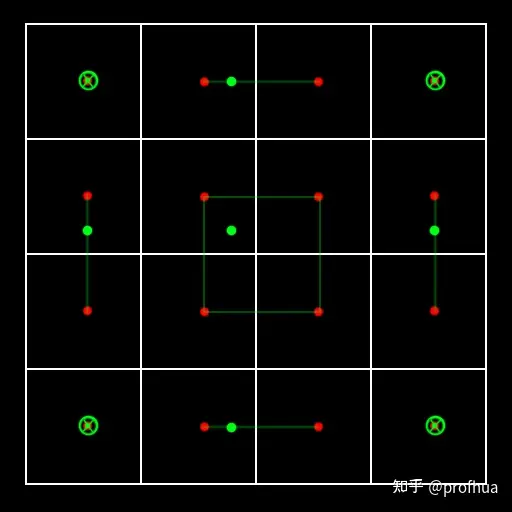

- 中间 4 个 tap 在横向和纵向都处于正值区 → 合并为 1 次采样；
- 4 个角 tap 在两个轴都是负值区 → 只能单独点采样；
- 4 条边的中点各在一个轴为负、另一轴为正 → 可合并（负值同一轴内数值相同，不影响比例）。

UE/URP 常用的进一步优化是**丢弃 4 个角 tap 并把权重重新分配**，只剩 5 次采样。可行性来自角 tap 权重极小：真实最大约占 $1.6\%$（$0.074$ 是单轴角权重的极小值，$0.074\times0.074\times4\approx2.19\%$ 是把两轴的极值同时取到，只是一个上界），影响可忽略。

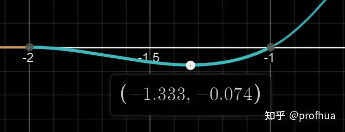

**URP 的 5-tap Catmull-Rom 实现**

```hlsl
half3 SampleBicubic5TapHalf(TEXTURE2D_X(sourceTexture), float2 UV, float4 sourceTexture_TexelSize)
{
    const float2 sourceTextureSize = sourceTexture_TexelSize.zw;
    const float2 sourceTexelSize  = sourceTexture_TexelSize.xy;

    float2 samplePos = UV * sourceTextureSize;
    float2 tc1 = floor(samplePos - 0.5) + 0.5;   // 像素中心
    half2  f = samplePos - tc1, f2 = f * f, f3 = f * f2;
    half   c = 0.5;

    // Catmull-Rom 的 4 个单轴权重（把 x=1+f, f, 1-f, 2-f 代入分段多项式化简的结果）
    half2 w0 = -c         * f3 +  2.0 * c        * f2 - c * f;
    half2 w1 =  (2.0 - c) * f3 - (3.0 - c)       * f2          + 1.0;
    half2 w2 = -(2.0 - c) * f3 + (3.0 - 2.0 * c) * f2 + c * f;
    half2 w3 =  c         * f3 -  c              * f2;

    half2  w12 = w1 + w2;
    float2 tc0  = sourceTexelSize * (tc1 - 1.0);
    float2 tc3  = sourceTexelSize * (tc1 + 2.0);
    float2 tc12 = sourceTexelSize * (tc1 + w2 / w12);   // 中间 4 tap 合并点

    half3 s0 = SceneToWorkingSpace(SAMPLE_TEXTURE2D_X(sourceTexture, sampler_LinearClamp, float2(tc12.x, tc0.y)).xyz);
    half3 s1 = SceneToWorkingSpace(SAMPLE_TEXTURE2D_X(sourceTexture, sampler_LinearClamp, float2(tc0.x, tc12.y)).xyz);
    half3 s2 = SceneToWorkingSpace(SAMPLE_TEXTURE2D_X(sourceTexture, sampler_LinearClamp, float2(tc12.x, tc12.y)).xyz);
    half3 s3 = SceneToWorkingSpace(SAMPLE_TEXTURE2D_X(sourceTexture, sampler_LinearClamp, float2(tc3.x, tc12.y)).xyz);
    half3 s4 = SceneToWorkingSpace(SAMPLE_TEXTURE2D_X(sourceTexture, sampler_LinearClamp, float2(tc12.x, tc3.y)).xyz);

    half cw0 = w12.x * w0.y;
    half cw1 = w0.x  * w12.y;
    half cw2 = w12.x * w12.y;
    half cw3 = w3.x  * w12.y;
    half cw4 = w12.x * w3.y;

    half3 filtered = s0 * cw0 + s1 * cw1 + s2 * cw2 + s3 * cw3 + s4 * cw4;
    // 丢掉了 4 个角 tap，权重和不再为 1，必须归一化
    return filtered * rcp(cw0 + cw1 + cw2 + cw3 + cw4);
}
```

**Lanczos 的 5-tap 近似**

```hlsl
float3 FastLanczos5Sample(float2 uv)
{
    float2 src_pos    = uv * _MainTex_TexelSize.zw;
    float2 src_centre = floor(src_pos - 0.5f) + 0.5f;
    float4 f;
    f.zw = 1. - (f.xy = src_pos - src_centre);   // f.xy 左/下，f.zw 右/上

    // Lanczos2 核的三次分片近似
    float4 l2_w0_o3 = ((1.5672 * f - 2.6445) * f + 0.0837) * f + 0.9976;
    float4 l2_w1_o3 = ((-0.7389 * f + 1.3652) * f - 0.6295) * f - 0.0004;

    float4 w1_2 = l2_w0_o3;
    float2 w12  = w1_2.xy + w1_2.zw;
    float4 wedge = l2_w1_o3.xyzw * w12.yxyx;

    float2 tc12 = _MainTex_TexelSize.xy * (src_centre + w1_2.zw / w12);
    float2 tc0  = _MainTex_TexelSize.xy * (src_centre - 1.);
    float2 tc3  = _MainTex_TexelSize.xy * (src_centre + 2.);

    float sum = wedge.x + wedge.y + wedge.z + wedge.w + w12.x * w12.y;

    float3 fSamples[5];
    fSamples[0] = _MainTex.SampleLevel(sampler_LinearClamp, float2(tc12.x, tc0.y), 0).rgb;
    fSamples[1] = _MainTex.SampleLevel(sampler_LinearClamp, float2(tc0.x, tc12.y), 0).rgb;
    fSamples[2] = _MainTex.SampleLevel(sampler_LinearClamp, tc12.xy, 0).rgb;
    fSamples[3] = _MainTex.SampleLevel(sampler_LinearClamp, float2(tc3.x, tc12.y), 0).rgb;
    fSamples[4] = _MainTex.SampleLevel(sampler_LinearClamp, float2(tc12.x, tc3.y), 0).rgb;

    float3 col = fSamples[0] * wedge.y + fSamples[1] * wedge.x +
                 fSamples[2] * (w12.x * w12.y) +
                 fSamples[3] * wedge.z + fSamples[4] * wedge.w;
    return col / sum;
}
```

### 归一化与亮度约束

- B-Spline 这类权重和恒为 1 的核可以省算一个 tap；有负旁瓣的核必须全部算出再归一化。
- 先累加分子分母再一次性相除，或先归一化权重再乘，二者**数学等价**（`Σwc/Σw ≡ Σ((w/Σw)c)`），只差浮点舍入；关键是所有 tap 共用同一个权重和，不要逐 tap 重新归一化。
- 任何负旁瓣核都要考虑振铃：要么 deringing（clamp 到邻域 min/max），要么换无负值核。

---

## 锐化与保边滤波（重建的补充工具）

### Unsharp Mask / 锐化卷积核

直觉上"高通滤波 = 锐化"是错的。高通滤波只留下低频被移除的部分（边缘轮廓），结果看起来不像锐化后的图：

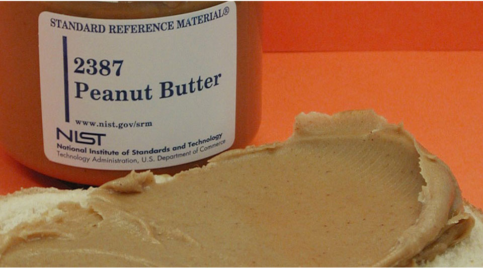

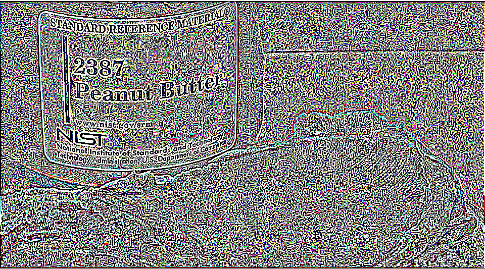

真正的锐化是 **unsharp mask**：把高通细节加回原图。

$$I_{\text{sharp}}=I+(I-I_{\text{blur}})=2I-I_{\text{blur}}$$

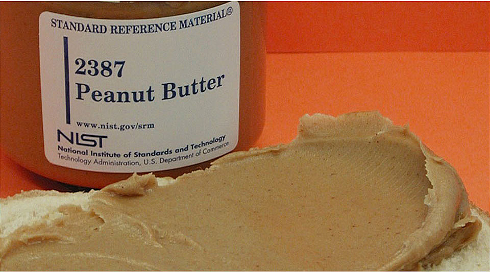

对应卷积核就是 $2\cdot \text{identity}-\text{blur}$。以 3×3 box blur 为例：

$$2*\begin{bmatrix}0&0&0\\0&1&0\\0&0&0\end{bmatrix}-\begin{bmatrix}1&1&1\\1&1&1\\1&1&1\end{bmatrix}*\frac{1}{9}=\begin{bmatrix}-1&-1&-1\\-1&17&-1\\-1&-1&-1\end{bmatrix}*\frac{1}{9}$$

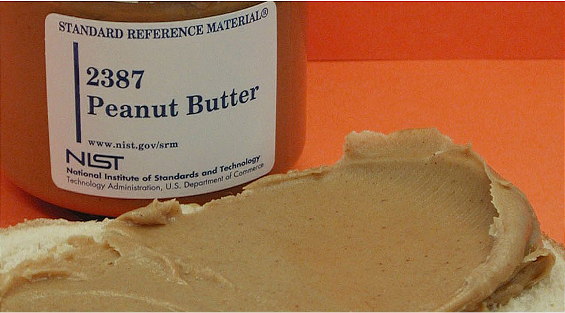

用 $\sigma\approx0.41$ 的 Gaussian 核（已归一化）同理（下方 3×3 系数为手调近似，无法由任何单一 $\sigma$ 的可分离高斯同时给出）：

$$2*\begin{bmatrix}0&0&0\\0&1&0\\0&0&0\end{bmatrix}-\begin{bmatrix}0.0023&0.0432&0.0023\\0.0432&0.8180&0.0432\\0.0023&0.0432&0.0023\end{bmatrix}=\begin{bmatrix}-0.0023&-0.0432&-0.0023\\-0.0432&1.182&-0.0432\\-0.0023&-0.0432&-0.0023\end{bmatrix}$$


要点：

- 模糊核的权重和 = 图像的亮度乘数。和为 1 才是纯模糊，和不为 1 会顺带改变亮度。
- 若 blur 和为 1，identity 和为 1，则 $2\times1-1=1$，锐化核和为 1，不会改变整体亮度。
- 锐化核同时含**负值**和**大于 1** 的值，输出可能溢出 $[0,1]$，必须 clamp 或重新映射（tone mapping）。负旁瓣低通（Lanczos）也有同样问题。
- 低通核和为 1（保留 DC），高通核和为 0（滤掉 DC）——核的和就是该滤波器对常量信号的响应。

$$\begin{bmatrix}2/9&2/9&2/9\\2/9&2/9&2/9\\2/9&2/9&2/9\end{bmatrix}$$

该核权重和为 $9\times\frac{2}{9}=2$，对常量信号的响应是原来的 2 倍（整体亮度翻倍）——即一个未归一化的低通核。

TAA/FSR 的收尾锐化（RCAS、CAS）本质就是这类自适应对比度锐化：局部对比度越高（越接近裁剪边界），允许的锐化幅度**越小**；平坦低对比区才取到上限 `FSR_RCAS_LIMIT`=0.1875，并对噪声做抑制。按 FSR1 代码逐项实算锐化 lobe：完全平坦的 0.5 → −0.1875（最大）、中对比 (.3/.7) → −0.107、高对比 (0/1) → 0.0000。`ffx_fsr1.h` 的注释亦写明「RCAS solves for 'w' by seeing where the signal might clip out of the {0 to 1} input range」。

### 双边滤波（Bilateral Filter）

双边滤波是非线性保边滤波器，用邻域像素的加权平均计算当前像素：

$$I_p=\frac{1}{W_p}\sum_{q\in\Omega} G_{\sigma_s}(\|p-q\|)\;G_{\sigma_r}(|I_p-I_q|)\;I_q$$

$$W_p=\sum_{q\in\Omega} G_{\sigma_s}(\|p-q\|)\;G_{\sigma_r}(|I_p-I_q|)$$

- 定义域核 $G_{\sigma_s}$（空间距离）与高斯模糊相同；
- 值域核 $G_{\sigma_r}$（像素值差异）是唯一新增项，**依赖邻域像素数值，因此每个像素的核都不同**。

定义域核单独作用时就是普通高斯模糊：

$$GB[I]_{\mathbf p}=\sum_{\mathbf q\in S}G_{\sigma}(\|\mathbf p-\mathbf q\|)\,I_{\mathbf q}$$

$$G_{\sigma}(x)=\frac{1}{2\pi\sigma^{2}}\exp\left(-\frac{x^{2}}{2\sigma^{2}}\right)$$

（该归一化系数 $1/(2\pi\sigma^2)$ 对应二维高斯，此处 $x$ 为空间距离 $\|\mathbf p-\mathbf q\|$；若作一维核使用，系数应改为 $1/(\sqrt{2\pi}\,\sigma)$。）

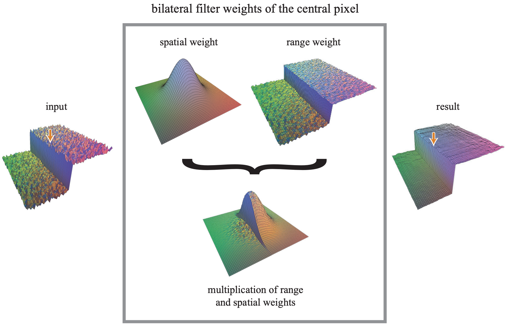

核心思想：模糊来自对跨越边缘像素的平均；双边滤波给跨边缘的样本极小的值域权重，因此不平滑边缘。

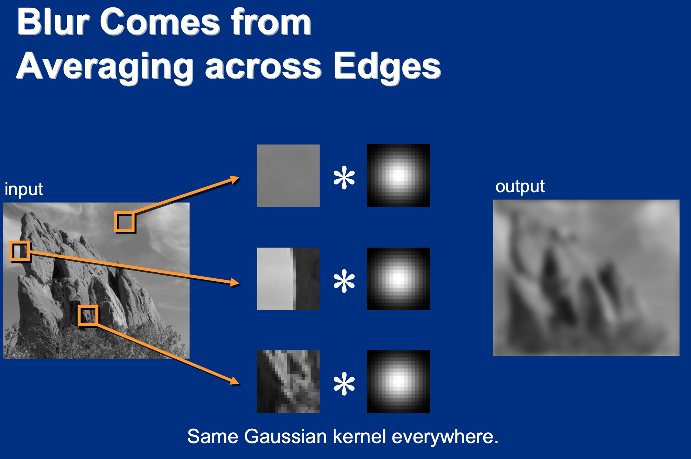

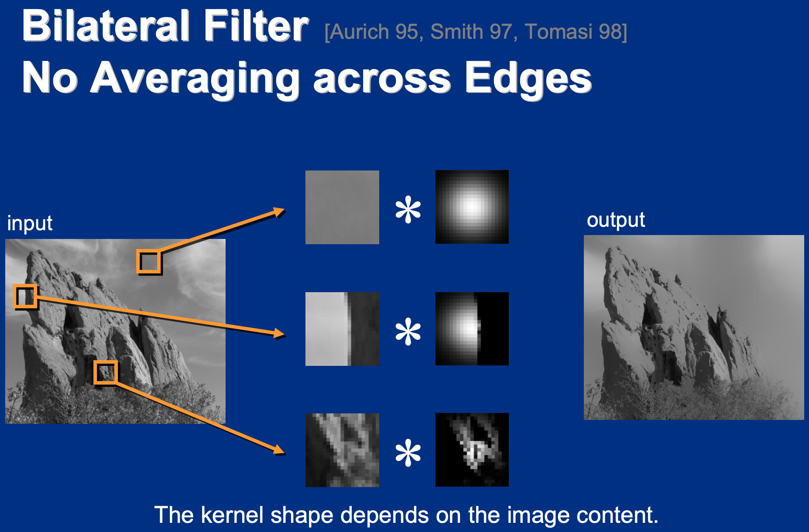

局限：保留了过多高频信息，彩色图像中的高频噪声滤不干净，只对低频噪声有效。实时渲染中 $\sigma_s$ 通常只取 1–3 个像素。

---

## FSAA（Full Scene Anti-Aliasing）

FSAA 是对**整个画面**做抗锯齿，与之相对的是 edge AA（只处理图元边缘）。

### 为什么需要：取样前缺少低通

电脑图形用有限像点表示连续场景，取样是"在像点中心取一个颜色"。三角面直接取样会得到锯齿：


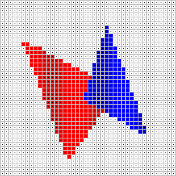

原因就是在取样前少了一个低通滤波。若在像点覆盖范围内对信号取平均（box filter 就是一种低通），再取样：

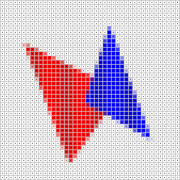

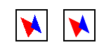

这也符合人眼：感光细胞收集其感光范围内的总能量，本身就是一个 box filter。

> 当显示分辨率远超人眼分辨极限（约 300 DPI 的彩色点）时，几何抗锯齿的收益会消失；但**贴图 filtering 不同，任何分辨率下都需要**。

### Edge AA 的局限

让光栅化直接输出三角形对像素的"占有率"，像素颜色乘以该比例（edge AA），问题是：

- 两个三角面重叠时只能知道被覆盖者的占有率，不知道它占了哪些部分；
- 三角面相交时覆盖率由 Z buffer 决定，无法正确计算；
- 只有图元已排序并切割过才可用，实时管线做不到。

线框绘制（CAD/CAM）因为很少有交叉/重叠，edge AA 反而很适用。

### OGSS / RGSS

**OGSS（Ordered Grid Super-Sampling）**：直接把分辨率放大，再用 box filter 缩小。4 sample 的 FSAA 就是把 640×480 渲染到 1280×960，再降采样。子采样点排成正方形网格：

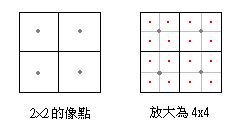

**OGSS 的缺陷**：接近垂直/水平的边只能命中 2 个子采样点，与 2x 相比几乎无改善；而 45° 边本就不易出现锯齿。角度与锯齿程度的关系：

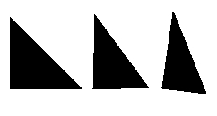

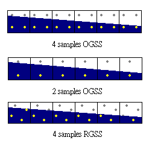

**RGSS（Rotated Grid Super-Sampling）**：把子采样点旋转一个角度，让接近垂直/水平的边"看起来"像 45°，各方向响应更均匀。实现上不提高分辨率，而是把整个场景画 N 次、每次把几何平移少量（小于一个像素），再累加平均：

- 传统做法用 accumulation buffer：需要高精度 + 大量带宽（每帧两次读一次写）；
- 3dfx T-Buffer / DX8 起的 multisample buffer：保留 N 个 frame buffer，由 RAMDAC 或 resolve 阶段平均，不需要高精度累加缓冲。

---

## SSAA（Super Sampling AA）

以 4xSSAA 为例：输出 800×600 时，先渲染到 1600×1200 的 buffer，再降采样回 800×600。

- 数学上最完美：几何、着色、纹理走样一起解决（每个子采样点都完整着色）；
- 代价：光栅化 + 着色 4 倍计算，RT 4 倍显存/带宽。

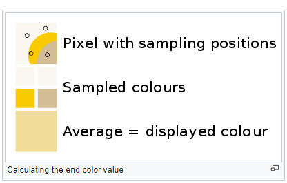

## MSAA（Multi-Sampling AA）

### 三类走样

1. **几何走样**：几何边缘锯齿，对几何边缘采样不足。
2. **着色走样**：对着色方程（BRDF）采样不足，典型表现是高光闪烁（高频法线贴图 + 高频高光）。
3. **时间走样**：对高速运动采样不足，动画跳变/车轮倒转。

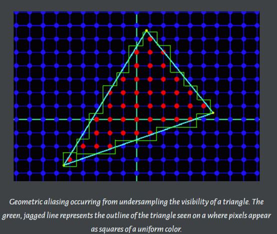

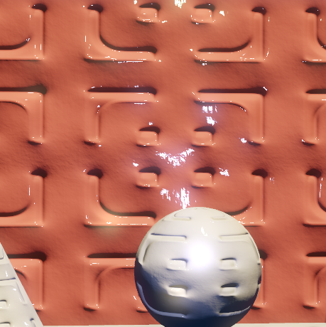

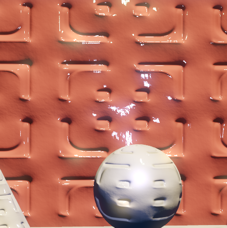

### 核心思想

MSAA 在 SSAA 基础上把"每 sample 着色"降为"每 pixel 着色一次"：

- 光栅化仍按 n 个子采样点做**覆盖（coverage）**和**遮挡（occlusion/depth）**判断；
- 片元着色器只在像素中心（或某个被覆盖的 sample）执行一次；
- 把该颜色复制给所有通过深度/模板测试且 coverage 为 1 的 sample；
- 最后 resolve（降到单采样）得到输出。

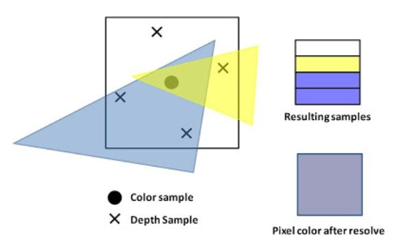

对比 SSAA（4x）：

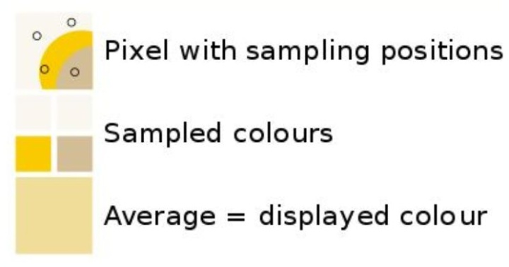

### 4xMSAA 的完整流程（前向渲染）

1. **光栅化**：对 4 个 sample 位置做三角形覆盖判断，写入 4 bit coverage mask。采样位置由**硬件固定图案**给出（D3D/Vulkan 的标准 4x 是旋转网格 $(6,2)(14,6)(2,10)(10,14)/16$），不是 Halton/Poisson；只有可编程采样位置（`VK_EXT_sample_locations` 等）才能自定义。
2. **像素着色**：在像素中心执行 PS，位置/深度/法线/UV 由三角形重心插值得到，得到颜色 $C$。
3. **深度/模板测试**：对 4 个 sample 分别测试，每个 sample 有自己的深度（同样重心插值）。通过的 sample 写入 n 倍大小的深度/模板缓冲。
4. **颜色写入**：通过测试且**被当前三角形覆盖**的 sample 得到颜色 $C$；未被覆盖的 sample 保留原值（背景）。
5. 依次绘制后续三角形，重复上述过程（后画的三角形只写入自己覆盖且通过深度测试的 sample）。
6. **Resolve**：对每个像素的 4 个 sample 颜色求平均（box filter），得到最终像素色。

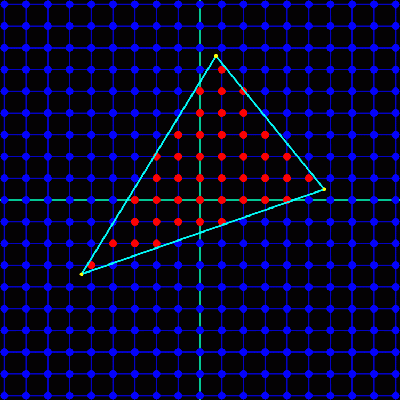

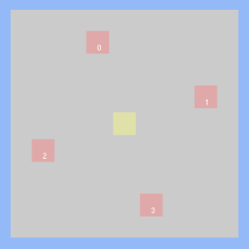

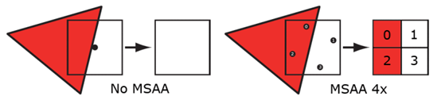

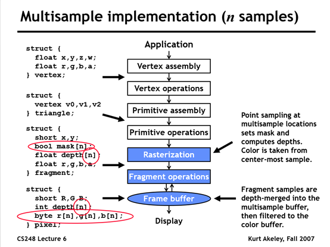

该实现中按 sample 存储的数据结构（$n$ 为 sample 数，`vertex`/`triangle` 为几何输入，`fragment` 为光栅化产出的片元，`pixel` 为多采样缓冲中的像素）：

```cpp
struct {
    float x,y,z,w;
    float r,g,b,a;
} vertex;

struct {
    vertex v0,v1,v2;
} triangle;

struct {
    short x,y;
    bool  mask[n];          // 每个 sample 是否被三角形覆盖
    float depth[n];         // 每个 sample 的深度
    float r,g,b,a;          // 每个像素一份颜色（像素中心着色）
} fragment;

struct {
    short R,G,B;
    int   depth[n];
    byte  r[n],g[n],b[n];   // 每个 sample 各一份颜色
} pixel;
```

要点：

- 若把第 4 步改成"每个 sample 跑一次 PS"，MSAA 就退化成 SSAA。
- 三角形没盖住像素中心时，硬件会把着色位置挪到最近的、被覆盖的 sample（或按 `Centroid` 插值规则选点），避免外插（outerpolate）。
- 每个 sample 都有独立的颜色/深度/**模板**值，且**每个 sample 都要做深度-模板测试**——这一步常被忽略。
- MSAA 的额外开销集中在：n 倍的 sample 存储（多采样附件）、边缘处多出的片元、resolve 带宽。像素级 G-Buffer（若未开 MSAA）本身不变大。

### MSAA 与延迟渲染

延迟渲染分 GBuffer Pass 与 Lighting Pass。光照阶段读 GBuffer，此时几何信息（图元归属）已丢失。若用单倍 GBuffer，无法判定子 sample 覆盖；若用 n 倍 GBuffer，又无法从 4 个 sample 反插值出"中心像素"的深度/法线（不同 sample 可能属于不同三角形）。

正确做法：**只在 GBuffer 阶段（写 BaseColor 的那一步）开 MSAA**，因为 MSAA 本质是几何抗锯齿，对光照没有抗锯齿作用（并未计算额外光照信息）。

历史上"延迟渲染不支持硬件 AA"的说法源于 DX9 时代 **MRT 不支持 MSAA**；D3D10.0 已支持 MRT + MSAA（要求所有 RTV 采样数一致），10.1 追加的是逐 sample 深度访问：


工程上的困境：MRT 要求所有 RT 使用相同 sample 数，无法只给 BaseColor 开小灶。要么拆出单独 Pass 只画 BaseColor（多一个 Pass），要么让所有 RT 都多采样（则深度/法线被插值，结果错误）。权衡下来通常不如直接 SSAA，因此现代主流是 TAA + SSAA/上采样，MSAA 反而少见。

### Pixel Frequency 与 Sample Frequency

| 项目 | 默认（Pixel Frequency） | Sample Frequency |
|---|---|---|
| PS 执行次数 | 每像素 1 次 | 每 sample 1 次 |
| 插值 | per-pixel | per-sample（`sample` 限定符 / `glMinSampleShading`） |
| 深度/模板 | 始终 per-sample | 始终 per-sample |
| 代价 | 低 | n 倍着色 + n 倍属性存储 |

> **纠错**：有资料称"开启 MSAA 后驱动默认使用 per-sample 模式"，这是错的。MSAA 的默认与本质是 **per-pixel shading**；per-sample shading 必须显式开启（`glMinSampleShading(1.0)`、`SV_SampleIndex`、或 `sample` 修饰符），开启后其实已接近 SSAA。

OpenGL 侧的相关能力：

```glsl
#version 450 core
sample in vec4 color;   // 只对该变量做 per-sample 插值
in vec4 normal;         // 其余仍 per-pixel

void main() { /* ... */ }
```

```glsl
// 逐 sample 取值
uniform sampler2DMS tex;
fColor = 0.5 * color + 0.5 * texelFetch(tex, texCoord, gl_SampleID);
```

多重采样 FBO 的两种用法：

```cpp
// 1) 离屏 MSAA texture + blit resolve
glBindTexture(GL_TEXTURE_2D_MULTISAMPLE, tex);
glTexStorage2DMultisample(GL_TEXTURE_2D_MULTISAMPLE, num_samples, GL_RGBA8, w, h, false);
glFramebufferTexture2D(GL_FRAMEBUFFER, GL_COLOR_ATTACHMENT0, GL_TEXTURE_2D_MULTISAMPLE, tex, 0);
rendering();
glBindFramebuffer(GL_DRAW_FRAMEBUFFER, 0);
glBindFramebuffer(GL_READ_FRAMEBUFFER, fbo);
glBlitFramebuffer(0, 0, w, h, 0, 0, w, h, GL_COLOR_BUFFER_BIT, GL_NEAREST);

// 2) 默认帧缓冲直接开多重采样（系统自动 resolve）
glutInitDisplayMode(GLUT_DOUBLE | GLUT_RGBA | GLUT_MULTISAMPLE);
```

MSAA texture 的内容无法用 `TexImage2D` 上传初始化，只能由渲染产生。

### Resolve 与 AA 质量

最早的 resolve 由固定硬件完成，通常就是一像素宽的 box filter：

- 完全覆盖的像素结果与不开 MSAA 相同（不模糊）；
- 边缘像素得到 n 级渐变；
- box filter 会引入 post-aliasing。

厂商可自定义（如 NVIDIA Quincunx），现代也可用自定义 shader 做 resolve。

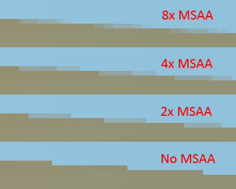

### Alpha Test / Alpha to Coverage

- 轻量级 MSAA（仅 coverage）对 **alpha-tested 透明**（如树叶、草）无效：alpha 裁剪发生在 PS 内部，不产生几何边缘 coverage，边缘仍是硬切。这类场景需要 per-sample shading 或 SSAA。
- **Alpha to Coverage（A2C）**：把 alpha 转成 coverage mask（与原有 mask 相与），本质是 **sample 级的 alpha test**。
  - 顺序无关（因为不混合，只做 mask 比较），无需排序；
  - 因此可以在 MSAA 下得到近似半透明的平滑边缘。
  - Alpha Test：顺序无关，边缘差；Alpha Blend：边缘好，但必须严格排序。

### 平台与架构差异

| 版本 | 支持 MSAA | 自定义 Shader Resolve | 需要额外颜色/深度缓冲 |
|---|---|---|---|
| D3D9 | 是 | 否 | 需要 |
| D3D11 / D3D12 | 是 | 是 | 需要 |
| GLES 2.0 | 上下文创建后不可切换；多重采样纹理需 `GL_EXT_multisampled_render_to_texture` / `APPLE_framebuffer_multisample` / EGL | 否 | 依架构：TBR/TBDR 不需要，IMR 需要 |
| GLES 3.0 | 是（`BlitFramebuffer` 显式 resolve；`sampler2DMS` 可采样多重采样纹理） | 是（用 `texelFetch` 逐 sample 读出后自行 resolve，不依赖硬件 resolve） | 系统 FBO 同 2.0；自建 FBO 视硬件 |
| GLES 3.1 | 是 | 是 | 同上 |

**IMR（Immediate Mode Rendering）**：PC 主流。提交即执行，与"已画/将画"关系很小（Early-Z 除外）。

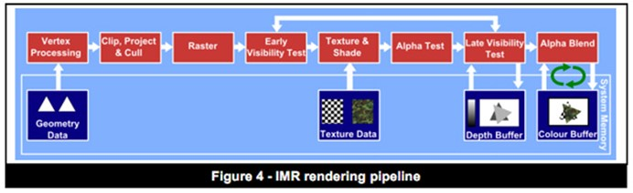

**TBR（Tile Based Rendering）**：屏幕分块，块内颜色/深度放 on-chip，显著减少系统内存带宽与功耗。

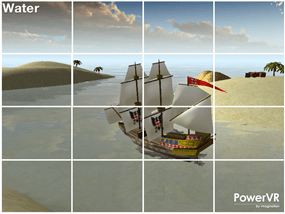

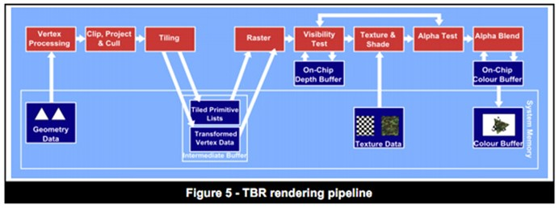

**TBDR（Tile Based Deferred Rendering）**：TBR + 延迟 + 隐藏面剔除（HSR），把纹理与着色推迟到块内可见性确定之后，只对最终可见的像素消耗资源。

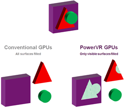


移动端 MSAA 的两个代价：

1. n 倍 MSAA 需要 n 倍的 tile buffer；片上内存昂贵，硬件会缩小 tile 尺寸（例如 32×32 → 32×16 → 16×16），tile 数变多会抬高顶点阶段开销。缩小一半不等于性能减半。
2. 物体边缘产生更多片元（两个相邻三角形都要着色边缘像素），额外片元开销与场景边缘密度相关，经验值约 10%。


厂商细节：

- **Mali**：硬件支持 on-tile resolve，无带宽损失。最简单用法是直接渲染到 window surface 并设 `EGL_SAMPLES=4`，全流程在寄存器内完成，只 flush resolve 后的 buffer，几乎零额外开销（但不暴露 sample buffer，也不需要显式 resolve）。
- **Adreno 4xx**：每像素 2 或 4 个 sample，每个 sample 有独立 color/depth/stencil，直到显示前才 resolve。
- **PowerVR**：MSAA 全程 on-chip；tile 尺寸按 sample 数四等分（16×16 → 8×8）。ISP 为所有 sample 做 HSR 与深度测试，并用 1 bit "edge flag" 优化 blending：无边缘时混合一次共享给所有可见 sample；有边缘时逐 sample 混合（贵，且"粘性"——一旦某像素被标记，后续混合都走慢路径）。因此应**先提交所有不透明几何**，尽量让像素保持 off-edge。2x MSAA 在 Rogue 之后几乎免费，4x 起明显掉性能。


---

## 后处理抗锯齿：FXAA / SMAA / TXAA

本节的 FXAA/SMAA 不依赖硬件 MSAA，纯图像处理，可能额外依赖 motion vector、上一帧颜色、相机矩阵等；TXAA 是 MSAA + 时域的混合方案，严格说不属于纯后处理 AA，下文单独注明。


**FXAA**（Fast Approximate AA）：在亮度域做边缘检测，估计边缘方向，沿垂直边缘方向做定向模糊，并按对比度自适应混合。极便宜、单 pass、不依赖 MSAA/几何信息；缺点是会模糊细节/文字，对高频着色走样无效，且"为什么 work"缺乏严格理论解释——工程调参成分很大。


**TXAA**：NVIDIA 的方案，MSAA 采样 + 时域累积 + 一个 filmic 风格的 reconstruction filter，需要引擎提供 motion vector 与 jitter。（具体滤波器权重与实现未公开，细节待核实。）

### SMAA（Enhanced Subpixel Morphological AA）

三个 pass：

1. **Edge detection** — 边缘检测；
2. **Blend weights** — 计算混合系数；
3. **Neighborhood blending** — 邻域混合。

针对以往形态学 AA 的五个问题分别处理：

1. 多数边缘检测只看像素数值差，忽略了"边缘周围上下文也影响人对边缘的感知"；
2. 物体原始形状常常没有被保留；
3. 多数方法只处理水平/垂直模式，忽略对角线模式；
4. 真正的子像素特征与子像素运动处理不好；
5. 高光与着色走样没有被完全消除，尤其是子像素级别时。

对应手段：

- 扩展边缘图案的数量与类型，在支持对角线的同时保持尖锐的几何特征；
- 在形态 AA 中加入多/超采样与时域重投影，重建真实子像素特征、处理子像素运动；
- 引入鲁棒的边缘检测（利用局部对比 + 加速但精确的距离搜索）以更准确地做模式分类。

由于模块化，可按场景与硬件选择四种模式：从最简单的后处理滤波，到空间/时间超采样。

---

## TAA（Temporal Anti-Aliasing）

### 基本原理

TAA 用 motion vector 找到上一帧对应像素，把当前帧与历史帧混合；同时对投影矩阵做亚像素抖动（jitter），使每帧采样点落在像素内不同位置，多帧累积等效于超采样。

```
颜色 = lerp(historyColor, currentColor, α)     // α 常取 0.05~0.1
```

### 静态场景（Static Scene）

- **Jittering**：每帧偏移投影矩阵（常用 Halton(2,3) 序列），振幅在 1 像素以内。
- **Sample pattern**：抖动序列决定长期收敛到的采样分布。均匀分布的 Halton 比纯随机收敛更快、更稳。
- **Moving average**：$N$ 帧的算术平均，收敛慢、需要大缓冲。
- **Exponential smoothing**：$c_t=(1-\alpha)c_{t-1}+\alpha s_t$，只需一张历史纹理，等效窗口 $1/\alpha$。**必须注意颜色空间**：TAA 一般在线性 HDR 域累积——亮度可加、能量守恒；代价是极亮离群点在指数平滑里衰减很慢，容易出现拖尾与闪烁。
- **Relationship with tone mapping**：`先 tonemap 再混合`并不是"错"，而是另一种取舍——它压缩动态范围、抑制离群高光，画面更稳，但混合变成非线性、亮度不再守恒。两种做法的失败模式不同：线性域保能量但怕离群点，tonemap 域稳但亮度不可加。FSR2 有意选择后者（见下文）。

### 动态场景：重投影

- **Reprojection**：用 motion vector 把历史帧采样位置反推到当前帧 UV。
- **Velocity accuracy**：motion vector 必须与 jitter 一致（相机 jitter 造成的位移要计入或抵消），否则每帧都在"抖"。
- **Motion on edges（轮廓失 AA）**：物体内部重投影很好，AA 能正确累积；但物体周围的抗锯齿边缘（fringe）通常落在物体渲染的 velocity 之外，运动时边缘退化成"带锯齿的 mask"。解决办法是 **dilate velocity**：用 X 形 5 个采样的最近者（最靠前/最近相机的 velocity）膨胀覆盖 fringe。经验上要膨胀 **2 像素**而不是 1 像素，因为滤波核更宽。


### Ghosting（拖影）

历史帧失效 → 拖影。三个来源：遮挡（disocclusion）、着色突变（shading change）、motion vector 无效（半透明、粒子、UV 动画、反射、阴影/高光）。

**Neighborhood clamping / clipping**：假设颜色在空间上低频，用当前帧 3×3 邻域的颜色范围构造包围盒，把历史颜色裁剪进去。

```hlsl
// YCoCg 空间求 3x3 邻域 min/max（对色度更宽容，避免过度裁剪）
void minmax(float2 uv, out float3 cmin, out float3 cmax)
{
    float2 du = float2(_MainTex_TexelSize.x, 0);
    float2 dv = float2(0, _MainTex_TexelSize.y);

    float3 ctl = RGB2YCoCg(SAMPLE_TEXTURE2D_X(_MainTex, sampler_LinearClamp, uv - dv - du).rgb);
    /* ... 其余 8 个邻域 ... */
    float3 cbr = RGB2YCoCg(SAMPLE_TEXTURE2D_X(_MainTex, sampler_LinearClamp, uv + dv + du).rgb);

    cmin = min(ctl, min(ctc, min(ctr, min(cml, min(cmc, min(cmr, min(cbl, min(cbc, cbr))))))));
    cmax = max(ctl, max(ctc, max(ctr, max(cml, max(cmc, max(cmr, max(cbl, max(cbc, cbr))))))));

    // 与 5 邻域结果再平均一次，抑制单点噪声造成的包围盒外扩
    float3 cmin5 = min(ctc, min(cml, min(cmc, min(cmr, cbc))));
    float3 cmax5 = max(ctc, max(cml, max(cmc, max(cmr, cbc))));
    cmin = 0.5 * (cmin + cmin5);
    cmax = 0.5 * (cmax + cmax5);
}

// 把历史色沿中心方向投影到 AABB 表面（clip 而非逐分量 clamp）
float3 clip_aabb(float3 aabb_min, float3 aabb_max, float3 prevSample)
{
    float3 p_clip = 0.5 * (aabb_max + aabb_min);
    float3 e_clip = 0.5 * (aabb_max - aabb_min);
    float3 v_clip = prevSample - p_clip;
    float3 v_unit = v_clip / e_clip;
    float3 a_unit = abs(v_unit);
    float ma_unit = max(a_unit.x, max(a_unit.y, a_unit.z));
    if (ma_unit > 1.0) return p_clip + v_clip / ma_unit;
    return prevSample;
}

float3 ClipAABB(float2 uv, float3 historyColor)
{
    float3 aabbMin, aabbMax;
    minmax(uv, aabbMin, aabbMax);
    float3 extent = aabbMax - aabbMin;
    float3 center = (aabbMin + aabbMax) * 0.5;
    aabbMin = center - extent * _VarianceClipGamma * 0.5;
    aabbMax = center + extent * _VarianceClipGamma * 0.5;
    return clip_aabb(aabbMin, aabbMax, historyColor);
}
```

**方差包围盒**（更抗噪，用均值 ± γ·标准差代替 min/max）：

$$ \mu=\frac{1}{N}\sum_i c_i,\qquad \sigma=\sqrt{\left|\frac{1}{N}\sum_i c_i^2-\mu^2\right|} $$
$$ \text{AABB}=[\mu-\gamma\sigma,\ \mu+\gamma\sigma] $$

```hlsl
float3 ClipVarianceAABB(float2 uv, float3 historyColor)
{
    float2 uvPerPixel = _MainTex_TexelSize.xy;
    float3 m1 = 0, m2 = 0;
    const int N = 9;
    UNITY_UNROLL
    for (int k = 0; k < N; k++)
    {
        float2 duv = kOffsets3x3[k].xy * uvPerPixel;
        float3 c = RGB2YCoCg(SAMPLE_TEXTURE2D_X(_MainTex, sampler_PointClamp, uv + duv).rgb);
        m1 += c;  m2 += c * c;
    }
    float3 mu    = m1 / N;
    float3 sigma = sqrt(abs(m2 / N - mu * mu));
    float3 aabbMin = mu - _VarianceClipGamma * sigma;
    float3 aabbMax = mu + _VarianceClipGamma * sigma;
    /* 同 clip_aabb */
}
```

**Clip vs Clamp**：逐分量 clamp 会把历史色拉向包围盒的角/棱，产生偏色；clip（沿中心方向投影到盒面）保持色相，视觉更自然。

**包围盒的尺度是主要调节旋钮**：

- 盒子大 → clip 得少 → 拖影残留多，闪烁少；
- 盒子小 → clip 得多 → 闪烁多，拖影少。

### Flickering（静止画面闪烁）

相机静止，但部分像素持续闪烁。成因：

- 缺失的子像素特征（例如只有 1 像素宽的竖线）不在 3×3 邻域中 → 其历史被 clamp 掉，像"消失"了；
- 由于 jitter 是相干（coherent）的，这类缺失常表现为水平或竖直的周期结构；
- clamp 是一个瞬时冲激，等效于对历史做"锯齿波"调制 → 表现为闪烁（亮度以固定频率上下跳）。

这是 neighborhood 假设的反作用：特征足够小、邻域 9 个像素中一个都没有时，它的历史必然被当成"消失了"。

缓解手段：

1. **Bias towards impulse frame**：提高当前帧权重峰值（缩小波形振幅）；
2. **降低指数平滑系数**：加快从冲激中恢复，但会损失收敛性；
3. **只在需要的地方做**：全局做会整体变糊。


早期尝试：在 alpha 通道存历史方差/记录 clamp 事件，之后逐步恢复混合系数。问题是响应性差，容易引入拖影或模糊，也可能把结果偏回"有锯齿"的形态。

### TAA 工具箱

- **Current Frame Filtering**：当前帧的重建滤波（box/tent/bicubic），直接影响锐度与振铃。
- **Rectify History**：历史帧矫正（clip/clamp/variance）。
- **Reactive mask**：告诉 TAA 哪些区域必须更多依赖当前帧（半透明、粒子、UV 动画、反射）。

### Blurring（模糊）与锐化

1. **Mipmap bias all textures**：TAA 的 jitter 使得导数（ddx/ddy）不再对应稳定采样间隔，纹理会选到过高的 mip 而闪烁/走样；实践中给所有纹理加负 mip bias（如 -0.5 ~ -1）换取锐度，属于"技术上仍有走样但看起来没问题"。
2. **低对比时缩小滤波核**：平坦区域不需要大核，缩小可减少模糊。
3. **加后处理锐化**：如 Mitchell 4.0 的负旁瓣位于 1 像素以外，可与 TAA 的模糊互补。
4. **增强细节**：把当前帧的高频细节（当前帧 - 模糊后的当前帧）加回结果。

### 实践结论

- 调整 jitter 序列（Halton 基、长度）；
- 调整 jitter 幅度（0.5 / 0.8 / 1.0 像素）；
- 调整 clip 包围盒大小（大 → 少闪烁多拖影；小 → 少拖影多闪烁）。

三者与"锐度"一起构成四难：**鬼影、闪烁、模糊、抖动**互相掣肘，只能按场景取舍。

---

## CoD 的动态时域抗锯齿与上采样

核心主张：把 dynamic resolution 升级为 **dynamic antialiasing**；提出时空域统一的**差分混合算子（differential blend operator）**；提出**单次采样达到 bicubic 质量**的重采样技术；并讨论补偿性能尖峰（performance spike）的引擎特性。


该方案构建在 Filmic SMAA 之上：TU2X / TU4X 是 **Temporal Resolve（上采样）**部分，之后仍需 TAA 做时域平滑。

### TU2X

- 采用**水平 jitter**样式：当前帧与前一帧合成输出，两帧的分辨率宽度小于输出宽度，高度一致。
- 限制：需要能只改宽度而不改高度，否则宽高比变化。很多引擎（含 URP 管线）宽高比与 FOV 由上层下发，无法直接套用。
- 只适用于**小于 1 像素/帧**的运动；超过这个量，子像素抖动失去意义。
- 用 velocity 保证前后帧像素对应。

### TU4X 与 Checkerboard Rendering

- 两张**四分之一分辨率**（宽高各除 2）、**2×MSAA** 的 color/depth RT，奇偶帧 ping-pong。
- Unity 中需 `bindTextureMS = true` 才能在 HLSL/Compute 里逐样本访问 `Texture2DMS`。
- **奇偶帧抖动**：每帧把相机投影/视口偏移 1 个**全分辨率像素**（对应 1/4 分辨率 RT 是半像素），保证两帧样本"拼满"全分辨率网格——这是 CBR 的核心。偶数帧投影不偏移，奇数帧投影矩阵右移一像素（画面内容左移）。
- 重建时需要逐像素反推到 N-1 帧取样。
- **遮挡检测（CSO/ASO）**：比较当前帧邻域深度均值与上一帧对应像素深度，超过阈值判为"历史失真/被遮挡"，回退到当前帧邻域插值，避免拖影。


实现细节与坑：

- MSAA×2 的子像素可以独立运行和采样（已验证）；用 1/4 分辨率 RT 绘制一半像素也可行，但 MSAA 子像素中心与像素中心有偏移，**不能完全对应**。
- 索引奇偶性：`(id.x & 1) ^ (id.y & 1) = 1 - parity`，用于判断某全分辨率像素属于当前帧还是前一帧的样本格。
- parity=1 时当前帧右移了一个像素，采样前一帧要额外加一个像素的水平偏移（full-res 的 (0,1) 实际对应 parity=0 帧的 (1,1)）。
- 2×MSAA 的 sample 0 为右上角，sample 1 为左下角。
- **Velocity 问题**：奇偶帧投影矩阵不同且交替，velocity 必须按 `currVP * worldPos - prevVP * worldPos` 用对应帧的 VP 计算，否则每帧差一个像素。

---

## FSR2（FidelityFX Super Resolution 2）

### 六个阶段

1. **Compute luminance pyramid** — 计算亮度金字塔；
2. **Reconstruct and dilate** — 重建深度、膨胀运动矢量；
3. **Depth clip** — 生成遮挡 mask；
4. **Create lock** — 锁定细线特征像素；
5. **Reproject and accumulate** — 重投影与累积；
6. **RCAS** — 锐化（Robust Contrast Adaptive Sharpening）。


### Step 1: Compute luminance pyramid

生成亮度金字塔以检测 shading 变化程度，并生成 1×1 曝光纹理供后续使用。

- 输入：render 分辨率 Color buffer、可选 Exposure（1×1）；
- 输出：Exposure mips（亮度金字塔）、Exposure（1×1）。

### Step 2: Reconstruct and dilate

在 render 分辨率下：重建深度、重建运动矢量、计算人眼感知 luma。

- 输入：`r_input_color_jittered`、`r_input_depth`、`r_input_motion_vectors`、`r_input_exposure`；
- 输出：
  - `ReconstructedPrevNearestDepth`：按 motion vector 取上一帧 UV，双线性取 4 点权重，权重大于阈值（0.01）才写入当前 UV 处深度；写入前与已有值比较取更近者，且需**原子操作**；
  - `Dilated depth`：3×3 内取最近深度；
  - `Dilated motion vectors`：3×3 内取最接近相机的像素的 motion vector；
  - `Lock input luma`：感知 luma 图。

### Step 3: Depth clip

Temporal 算法产生鬼影的两大原因：

1. **Disocclusion**：当前像素上一帧被遮挡，无历史；
2. **Shading change**：两帧着色差异大，历史不可信。

先用两帧**线性深度差**计算 mask，值编码到 $[0,1]$，使用 **Ksep（Akeley separation value）** 抑制 Z 精度问题：


- 输入：color、未膨胀 motion vectors、膨胀 motion vectors、Exposure、Reactive mask、Transparency & Composition mask、`r_dilatedDepth`、`r_reconstructed_previous_nearest_depth`；
- 输出：`rw_prepared_input_color`（RGB=YCoCg，A=DisocclusionMask 0/1）、膨胀后的 reactive mask。

关键实现（`ComputeDepthClip`）：

1. 用上一帧 DilatedUV 双线性取 4 个 `reconstructed_previous_nearest_depth`；
2. 分别计算与当前深度的 **view space 线性差**；
3. 用 K-separation 判定 disocclusion，写入 `prepared_input_color.w`。

> 注意：不是"深度更远就丢历史"，而是在 view space 下用 K-separation 判断是否**不在同一三角形上**才丢。当前帧深度先做 dilation（取周围更靠近近裁剪面的深度），相当于给低分辨率深度做一次简单抗锯齿，边缘抖动时大概率采到前景几何。

### Step 4: Create lock

用亮度检测**细线特征**：若当前像素亮度落在周围 3×3 亮度范围内，但又无法与相似像素组成 2×2 连续块，则认为是细线，写入 Display 分辨率的 `rw_new_locks`。

- 检测在 render 分辨率，写锁在 display 分辨率；
- 被锁的像素在颜色矫正时拥有更大的裁剪宽容度。


### Step 5: Reproject and accumulate（开销最大）

运行在 display 分辨率。步骤：

1. 用 Lanczos 对当前帧颜色缓冲上采样；
2. 重映射上一帧的 output color 与 lock status；
3. 清理历史颜色（disocclusion、shading change、reactive）；
4. 计算 luma 不稳定性；
5. 累积。

**上采样**：以 display 分辨率样本 $S$ 为中心，对 5×5 网格的 render 分辨率抖动样本做 Lanczos(2) 加权。概念上是 5×5，实现上只有 4×4 真正采样（最外圈权重为 0）。Lanczos 核实现因 GPU 而异：RDNA2 上用 LUT 编码 sinc，平衡 ALU 压力与内存占用。既然已取 5×5 邻域，顺手构造 YCoCg 包围盒（实际是 3 维：Y、Co、Cg）。


**重映射**：用膨胀后的 motion vector 平移上一帧输出，再对平移后的位置做 5×5 Lanczos 重采样。同步重映射 lock（`ReprojectHistoryLockStatus`：采样 `rw_new_locks` 判断新锁，双线性采样上一帧 `r_lock_status`）。

**锁的更新与可信度**：把当前帧亮度写入重映射 lock 纹理的 g 通道；再比较当前亮度邻域差异，差异过大则**不信任**该锁。

**颜色矫正**：历史颜色的最终权重受两件事控制：

1. disocclusion mask（降低解除遮挡区域的历史影响）；
2. 上采样时算出的颜色包围盒（降低离群历史样本的影响）。

**累积**：默认用较低的历史/当前混合比（当前帧信息占比小），可由 reactive mask 调整。

锁的生命周期（`UpdateLockStatus`）：剩余生命由 `fReactiveFactor`、`fAccumulationMask`、`fDepthClipFactor` 调制；贡献由 `fLifetimeContribution`（剩余生命）与 `fShadingChangeContribution`（历史亮度 vs mip5 亮度的 min/max 比）合成。

**解锁条件**：

- 每帧锁都重映射，细线特征消失则移除；
- 锁未更新会随时间衰减（长时间保留会导致鬼影）；
- Disocclusion / depth clip mask；
- Shading change detection（局部低频亮度比较）；
- Reactive masks；
- 空间与时域 motion divergence。

### Step 6: RCAS

RCAS 源自 FSR1，是 CAS（Contrast Adaptive Sharpening）的衍生：

- CAS 用简化机制把局部对比度映射为可变锐度；
- RCAS 用更精确的方式，在裁剪前求解可能的最大局部锐度；
- 内置的噪声抑制由 `FSR_RCAS_DENOISE` 开关控制（默认关闭），并非无条件生效；
- 不支持缩放（这是 CAS 有的），因此**必须在 display 分辨率运行**；
- 使用"十"字排布的 5-tap 滤波。

"十"字布局中，中心样本记为 $s_m$，四邻域记为 $s_n,s_e,s_s,s_w$，对应的两个权重为：

$$w_0=\frac{-s_m}{s_n+s_e+s_s+s_w},\qquad w_1=\frac{1-s_m}{\left(s_n+s_e+s_s+s_w\right)-4}$$

> 注：上式是理想化（未加保护）的写法——四邻域全为 1 时分母为 0。真实实现改用 $4\cdot\max(s_n,s_e,s_s,s_w)$ 与 $4\cdot\min(s_n,s_e,s_s,s_w)$ 作分母，并对 $w$ 限幅。

（"十"字布局：中心 $s_m$，四邻域 $s_n,s_e,s_s,s_w$。）

### Temporal Upscaling 的三个问题

鬼影 / 闪烁 / 模糊互相排斥，解决一个往往恶化另一个。

**鬼影**（累积无效历史）→ 三个手段：

1. **Disocclusion 检测**（view space + K-separation）；深度先 dilation；4 个邻域的拒绝权重再双线性采样（不是先插值深度再比较）；
2. **Neighborhood clamping**（假设颜色空间低频）；覆盖 motion vector 失效与 shading change；
3. **motion vector 权重**：当前帧与上一帧 velocity 差异越大，写入 reactive mask 越大，历史权重越低。

**闪烁**（抗鬼影的副作用，高频细节/shading 剧烈处）→ **像素锁**：

- 找细线特征（亮度在邻域范围内但组不成 2×2）写入 lock buffer；
- 锁参与 neighborhood clamping 权重计算；
- 锁像素不是绝对不裁，只是允许更大的宽容度，超过阈值仍解锁。

**Depth Clip 主要函数**：

- `ComputeDepthClip`：上一帧 DilatedUV + 当前 DilatedDepth → 4 个历史深度 → view space 线性差 → K-separation → `prepared_input_color.w`；
- `ComputePreparedInputColor`：RGB→YCoCg 写 xyz；
- `ComputeMotionDivergence`：3×3 未膨胀 velocity 的 divergence；
- `ComputeTemporalMotionDivergence`：用膨胀后的 velocity。

**Accumulate 主要函数**：

- `ReprojectHistoryColor`：display 分辨率 4×4=16 样本，Lanczos2 滤波；
- `ReprojectHistoryLockStatus`：新锁 + 双线性历史锁状态；
- `UpdateLockStatus` / `RectifyHistory`：`fHistoryContribution = max(fLockContributionThisFrame, fLumaInstabilityFactor)`；
- `ComputeThinFeatureConfidence`：邻域像素与中心比较 min/max 比值，比值 ∈ (0, 1.05) 视为相似；无相似像素（中心亮度过低/过高）不用锁；相似像素能组成 2×2 也不用锁；否则 `rw_new_locks[iPxPos] = 1`。

### 历史颜色与裁剪盒的生成顺序

**存在历史样本**：

1. `ReprojectHistoryColor`：Lanczos2 采样 display 分辨率 4×4 历史 → `fHistoryColor`；`PrepareRgb` 做曝光校正；`RGBToYCoCg`；
2. `RectifyHistory`：盒外 `fHistoryColor` → `fClampedHistoryColor`；再与原始历史按 `fHistoryContribution` 线性插值；
3. `Accumulate`：YCoCg→RGB → Tonemap → RGB→YCoCg → 按 `fAlpha = fUpsampledColorAndWeight.w / fAccumulation` 与当前帧插值 → YCoCg→RGB → InverseTonemap；
4. `UnprepareRgb` 反曝光校正 → 写 `rw_internal_upscaled_color`。

> 注意：累积发生在 **tonemap 之后**（HDR→LDR→混合→反 tonemap）。这是 FSR2 与"在线性域累积"的 TAA 的一个**有意取舍**：tonemap 域压缩了动态范围，离群高光不易残留（画面更稳），代价是混合非线性、亮度不守恒；线性域则相反。不是某一方写错了。

**无历史样本**：上采样颜色直接 RGB→YCoCg，`UnprepareRgb` 后写入。

**裁剪盒**：`ComputeUpsampledColorAndWeight`（3×3 样本 + Lanczos 权重 → aabbMin/Max、center、vec、variance）先算方差盒，但**不直接使用**，而与其他参数合成：

```c
FfxFloat32 fScaleFactorInfluence = ffxMin(20.0f, ffxPow(FfxFloat32(1.0f / length(DownscaleFactor().x * DownscaleFactor().y)), 3.0f));

const FfxFloat32 fVecolityFactor = ffxSaturate(params.fHrVelocity / 20.0f);
const FfxFloat32 fBoxScaleT = ffxMax(params.fDepthClipFactor, ffxMax(0.0f, fVecolityFactor));
FfxFloat32 fBoxScale = ffxLerp(fScaleFactorInfluence, 1.0f, fBoxScaleT);

FfxFloat32x3 fScaledBoxVec = clippingBox.boxVec * fBoxScale;
FfxFloat32x3 boxMin = clippingBox.boxCenter - fScaledBoxVec;
FfxFloat32x3 boxMax = clippingBox.boxCenter + fScaledBoxVec;

boxMin = ffxMax(clippingBox.aabbMin, boxMin);
boxMax = ffxMin(clippingBox.aabbMax, boxMax);
```

工程实测结论（可复用）：

- 原版用 4 个参数算 extent，静止时有闪烁；
- 去掉邻域 min/max、只用 `fBoxScale` 可消闪烁但轻微鬼影（其数值为 20）；
- 直接硬编码 5 即可得到较好效果。

> 这是"参数化裁剪盒"的典型权衡实例：盒子随缩放比、画面速度、遮挡程度放大，速度越快/遮挡越强 → 盒子越大 → 裁剪触发越少 → **越多保留历史帧**（闪烁更少，但鬼影残留更多）。

### Reactive mask

指导哪些区域应降低对历史的依赖：

```c
FfxFloat32 ComputeTemporalReactiveFactor(const AccumulationPassCommonParams params, FfxFloat32 fTemporalReactiveFactor)
{
    FfxFloat32 fNewFactor = ffxMin(0.99f, fTemporalReactiveFactor);
    fNewFactor = ffxMax(fNewFactor, ffxLerp(fNewFactor, 0.4f, ffxSaturate(params.fHrVelocity)));
    fNewFactor = ffxMax(fNewFactor * fNewFactor, ffxMax(params.fDepthClipFactor * 0.1f, params.fDilatedReactiveFactor));
    fNewFactor = params.bIsNewSample ? 1.0f : fNewFactor;          // 新样本强制 reactive
    if (ffxSaturate(params.fHrVelocity * 10.0f) >= 1.0f)
        fNewFactor = ffxMax(FSR2_EPSILON, fNewFactor) * -1.0f;     // 负值标记"高速度"
    return fNewFactor;
}
```

reactive factor 存在 `internal_upscaled_color.w`，历史帧该通道绝对值即 temporal reactive factor。

### Jitter

使用 base 2 与 3 的 Halton 序列；循环周期与分辨率缩放比相关，balanced 预设周期为 23（取前 23 对）。

### 工程移植要点（URP）

1. 关闭 URP 自带后处理（尤其 tonemap/AA），补 skybox；
2. 开启 **Prev-Z**（FSR2 需要上一帧深度做 disocclusion）；
3. 添加 `Fsr2RendererFeature` + `FinalBlitRendererFeature` + `Fsr2Ctrl`，并**禁用 URP 的 FinalBlitPass**；
4. 若涉及手势/自定义投影，需关联 `AdditionalMatrix`；
5. 性能参考：静态场景下 PS 执行次数降至 35%（1503×693 → 2556×1179），目标 GPU 时间 ~8 ms；
6. 代码风格：多用内置函数（`Clamp`）；除数未知的除法尽量移到 CPU（如 `/ RenderSize()`）。

---

## YCoCg（在抗锯齿中的用途）

YCoCg 与 YCbCr 类似，用亮度 $Y$、绿色偏移色度 $Cg$、橙色偏移色度 $Co$ 表示。

### RGB → YCoCg

$$Y=\tfrac14 R+\tfrac12 G+\tfrac14 B,\qquad Cg=-\tfrac14 R+\tfrac12 G-\tfrac14 B,\qquad Co=\tfrac12 R-\tfrac12 B$$

$Y\in[0,1]$，$Cg,Co\in[-0.5,0.5]$。例：纯红 $(1,0,0)\to(Y,Cg,Co)=(0.25,-0.25,0.5)$。

### YCoCg → RGB

$$\begin{bmatrix}R\\ G\\ B\end{bmatrix}=\begin{bmatrix}1 & -1 & 1\\ 1 & 1 & 0\\ 1 & -1 & -1\end{bmatrix}\cdot\begin{bmatrix}Y\\ Cg\\ Co\end{bmatrix}$$

逆变换只需整数加减（无乘除、无舍入误差）：

```
temp := Y - Cg
R    := temp + Co
G    := Y + Cg
B    := temp - Co
```

### 优点

1. 与 RGB 在实数域可**无损**互转，算法简单、复杂度低；整数实现则要求正向**扩位**（$Y$ 多 2 bit、$Co/Cg$ 各多 1 bit），否则同精度下往返不可逆，或改用 YCoCg-R 的 lifting 形式；
2. 避免浮点互转的舍入误差，降低颜色失真；
3. 更好地去除颜色分量间的相关性，提高压缩性能（H.264/AVC 支持 YCoCg）。

### 为什么抗锯齿要用它

TAA/FSR 在 **YCoCg 空间**做邻域 min/max 或方差包围盒：亮度与色度分离后，对色度可以给更宽的容差，避免因色度高频（彩色细边、色噪）而过度裁剪历史，从而在"少拖影"和"少闪烁"之间取得更好的折中。历史裁剪的距离度量也应在该空间进行（否则 RGB 各通道相关性会让包围盒形状失真）。

---

## Mipmap 与纹理过滤

### 为什么需要 Mipmap

贴图是**重采样（resampling）**过程：贴图本身已是采样结果，把它映射到屏幕像素时，采样点几乎不会重合，于是出现二次采样。


左格与屏幕像素对齐（可看作放大后的像点），右格是贴图在三角面上的实际取样点分布——间距变化很大，且透视投影使间距不固定。


两类问题：

- **放大（magnification）**：采样点间距 < 原贴图采样间距 → 需要重建；
- **缩小（minification）**：采样点间距 > 原贴图采样间距 → 采样率不足，必须先低通。

### 放大：nearest / bilinear / bicubic

- **Point/nearest**：取最近点，等价于零次多项式逼近，会有块状失真。
- **Bilinear**：一次多项式（线性）逼近，2×2 采样，效果与开销的平衡点，**3D 硬件普遍采用**。
- **Bicubic**：三次多项式，4×4 采样，更平滑但硬件很少直接支持。


### 缩小：必须先低通


原图高频成分未超出采样率一半，不失真；直接降采样一半就出现原本不存在的圆环。用 3×3 Gaussian 会好些；adaptive box filter 几乎消除失真但有过度模糊。

矛盾：能消失真的滤波器通常过糊；能保持清晰的滤波器消不掉失真。

计算量问题更致命：缩小 2 倍需要 2×2 box，缩小 4 倍需要 4×4 box…… 缩得越多核越大，实时不可行。

### MIP map 的提出

Lance Williams, 1983, *Pyramidal Parametrics*：预先用各种尺寸的滤波器生成一系列逐级缩小的贴图，缩小时只选合适的一级，使滤波永远不超过 2×2。

MIP = 拉丁文 *multum in parvo*（many things in a small place）。

例：256×256 预生成 128×128、64×64、…、2×2、1×1。需要缩小 5 倍时取 64×64 即可，无需 5×5 filter。空间开销最多增加约 1/3。

LOD 选择（OpenGL 公式）：

$$\rho=\max\left(\sqrt{\left(\frac{\partial u}{\partial x}\right)^2+\left(\frac{\partial v}{\partial x}\right)^2},\ \sqrt{\left(\frac{\partial u}{\partial y}\right)^2+\left(\frac{\partial v}{\partial y}\right)^2}\right),\qquad \lambda=\log_2\rho$$

其中 $u,v$ 是 texel 坐标（非归一化 UV），$x,y$ 是屏幕坐标。

### Trilinear 与接缝

只选一级会有明显问题：


出现**过度模糊**和**级间接缝**（不同距离需要不同级别，切换不连续）。

在两相邻 mip 之间再做线性插值即 **trilinear filtering**：


接缝消失，但过度模糊仍在。


### 各向异性 footprint

斜视平面上的像素在纹理空间的 footprint 是狭长矩形（长宽比 4:1 或更大）。硬件按最大边长选 mip，于是"一个方向刚好，另一个方向过糊"。

补救方案与其局限：

1. **LOD bias**：强制用更高分辨率一级。可减轻模糊，但重新引入失真（黄色斜纹又出现摩尔环），且只适用特定情形。


2. **预先把贴图做扁**：若已知 footprint 总在 4:1 左右，直接做 4:1 拉伸的贴图。对固定视角（赛车跑道）非常好；视角变化大（FPS、飞行模拟）时近处会过糊。


3. **各向异性过滤**（正解）：按 footprint 的形状取多个 texel。详见《07_纹理与法线》。


### mipmap 内存：为什么多占 1/3

以 1024×1024 为例，各级新增像素：512²、256²、…、1²，总和 349525；相对 1024²=1048576 约为 0.3333。

一般推导：设原始大小为 1，则

$$S=1+\frac14+\frac1{16}+\frac1{64}+\cdots=\frac{1}{1-1/4}=\frac43$$

（错位相减：$S-\frac14S=1\Rightarrow S=\frac43$。）

因此 mipmap 总占用是原始的 $4/3$，**新增 1/3（33%）**。

原图对**新增部分**单独求和（此处 $S$ 指新增像素总量，而非上面的总占用）：

$$S=\frac14+\frac1{16}+\frac1{64}+\cdots+\frac1{4^{n}}$$

$$4S=1+\frac14+\frac1{16}+\cdots+\frac1{4^{\,n-1}}$$

$$4S-S=3S=1-\frac1{4^{n}}$$

$$\lim_{n\to\infty}3S=\lim_{n\to\infty}\left(1-\frac1{4^{n}}\right)=1$$

$$\lim_{n\to\infty}S=\frac13$$

即新增部分收敛到 $1/3$（与总占用 $4/3=1+1/3$ 一致）。

**适用条件与修正**：该 $1/3$ 结论成立的前提是宽高为 2 的幂、正方形、且完整生成到 1×1。对非 2 次幂或长宽差异大的纹理，实际比例会偏离 1/3（通常略小），应按逐级尺寸实测。磁盘上是否增加取决于格式，未压缩纹理与显存一致；块压缩格式（BC/ETC/ASTC）因每级仍需至少一个块，小级别占比会略有不同。

Mipmap 的价值与代价：

- 加速渲染（更少的采样点、更好的缓存局部性）、显著减少 minification 走样；
- 磁盘与内存 +33%；
- 若纹理永远 1:1 显示（不缩放的 UI），mipmap 毫无收益。

### Mip bias

GPU 有全局 mip bias；每张纹理可再加自己的 bias，shader 中也能对单次采样指定。

- point/linear 采样时，bias 改变"选择哪一级"的阈值（bias = -2：Mip3 → Mip1）；
- trilinear 时，bias 改变两级之间的混合比例（原 0.5 → 加 0.2 得 0.7，即 70%/30%）。

```hlsl
// HLSL
tex2Dlod(tex, float4(uv, 0, lod));
tex2dbias(tex, float4(uv, 0, 0, bias));   // w = bias
```

```hlsl
// 手动 LOD（等价于 OpenGL 的 rho/log2）
float dx = ddx(uv), dy = ddy(uv);              // 每像素的 UV 增量（UV 单位，不是纹素）
float2 texSize = float2(width, height);        // 纹理分辨率本身，不是它的倒数
float2 px = texSize * dx;
float2 py = texSize * dy;
float lod = 0.5 * log2(max(dot(px, px), dot(py, py)));
```

> 注意 `0.5 * log2(max(dot(px,px), dot(py,py)))` 等价于 $\log_2(\max(|\vec p_x|,|\vec p_y|))$，与 OpenGL 的 $\lambda=\log_2\rho$ 一致。

### mipmap level 计算的几何解释

OpenGL 的缩放系数（spec 形式，即上文 LOD 选择中的 $\rho$ 定义式）：

对屏幕像素 $P$，取其水平方向两点

$$P_0=(x,\ y),\qquad P_1=(x+1,\ y)$$

对应贴图上的两点

$$\mathbf r_0=\langle u(x,y),\ v(x,y)\rangle,\qquad \mathbf r_1=\langle u(x+1,y),\ v(x+1,y)\rangle$$

计算 $r_0,r_1$：

$$r_0r_{1x}=u(x+1,y)-u(x,y)\approx\frac{\partial u}{\partial x},\qquad r_0r_{1y}=v(x+1,y)-v(x,y)\approx\frac{\partial v}{\partial x}$$

$$\|r_0r_1\|\approx\sqrt{\left(\frac{\partial u}{\partial x}\right)^{2}+\left(\frac{\partial v}{\partial x}\right)^{2}}$$

可见 OpenGL 的公式本质是"贴图上对应多边形的两个边长 / 屏幕像素边长"的比值（贴图上的多边形严格来说不一定是平行四边形，但近似按平行四边形处理）。

**进一步**：$r_0,r_1$ 分别是两个方向的 texel/像素比；取 max 就是"按变化最快的方向选 mip"，这正是斜视过模糊的根源——另一方向的细节被牺牲掉了。

### 早期实现的一个简化算法（移动/嵌入式参考）

mipmapping 三步：选下采样方法 → 计算缩小比率 $d$ → 选级。

1. 下采样通常用 box filter（每级 2×2 平均）。
2. 按"像素是正方形"的假设：

$$d=\sqrt{\max\left(U_x^2+V_x^2,\ U_y^2+V_y^2\right)}$$

为省乘法和开方可近似为 $d=\max(U_x+V_x,\ U_y+V_y)$（它是 $\rho$ 的上界，最多偏大 $\sqrt{2}$ 倍，故只是保守近似，并不等于 spec 的 $\rho$）。为省时间，$d$ 可对整个三角形只算一次，内层循环仅做透视修正。
3. 选级：
   - `LINEAR_MIPMAP_NEAREST`：$\text{level}=\lfloor\log_2 d+0.5\rfloor$（四舍五入在 log 域内完成，不能写成 $\log_2(d+0.5)$）；
   - `LINEAR_MIPMAP_LINEAR`：$\text{level}=\lfloor\log_2 d\rfloor$，$\text{fraction}=\operatorname{frac}(\log_2 d)$（级间混合量取 $\log_2 d$ 的小数部分，而不是 $d$ 的小数部分，否则量纲不一致）。

实测：与 OpenGL 结果基本一致；`GL_LINEAR_MIPMAP_NEAREST` 约降 10% 性能，`GL_LINEAR_MIPMAP_LINEAR` 约降 17%。NEAREST 在级切换时能看到明显的"跳变"；LINEAR 无跳变但更慢。box filter 仍会带来过度模糊。

---

## 各方法对比小结

| 方法 | 解决几何走样 | 解决着色走样 | 时域稳定 | 相对开销 | 主要缺陷 |
|---|---|---|---|---|---|
| SSAA | 是 | 是 | 否 | 极高（n 倍着色+显存） | 成本 |
| MSAA | 是 | 否 | 否 | 中（n 倍 sample 存储/带宽） | 不解决着色/alpha-test 边缘 |
| FSAA(OGSS/RGSS) | 是 | 是 | 否 | 高（多帧绘制/多 buffer） | 成本、OGSS 方向偏置 |
| FXAA | 部分 | 否 | 否 | 极低 | 模糊细节、无理论保证 |
| SMAA | 部分（含对角线） | 部分 | 否 | 低 | 形态学模式误判 |
| TAA | 是（累积） | 是（累积） | 是 | 中 | 鬼影/闪烁/模糊三难 |
| FSR2 | 是 | 是 | 是 | 中（在低分辨率渲染） | 参数敏感、需 motion vector/Prev-Z |
| Mipmap | 否（纹理走样） | 否 | — | 低（+33% 内存） | 仅纹理，斜视过糊 |

---

## 附录：工作日志中的补充记录

> 本附录只收录工作日志中与本文主题相关、且正文未展开的实现细节、参数面板、性能数字与踩坑记录；与正文重复处只做交叉引用。

### TAA 的分级实现与前置滤波

项目分支（TAA0422）与 URP 自带 TAA 相比有两点差异：

1. **shader 按步骤分级**：`clampQuality`（历史矫正的邻域采样方式：Cross 5 taps / 3×3 9 taps / Variance+MinMax / Variance Clipping）、`motionQuality`（motion vector 采样数）、`historyQuality`（历史帧重采样方式）、`centralFiltering`（当前帧中心滤波）四组参数各自独立选择，再组合成 VeryLow → VeryHigh 五档；对应正文《TAA › Ghosting》里的"包围盒尺度"与 clip/clamp 取舍（属概念对应，档位枚举里并没有单独的 clip/clamp 开关）。
2. **URP 自带 TAA 多了前置滤波**：对当前帧做 Blackman-Harris 滤波、对历史帧做 Catmull-Rom 滤波。窗函数与卷积核的定义见本文《滤波核》；Catmull-Rom 有负旁瓣，属于"锐利但会振铃"的一类，所以历史帧一侧的滤波本身也带振铃风险（待核实具体 tap 数与 deringing 处理）。

代码中的档位注释（`DoURPTAA(v2f i, int clampQuality, int motionQuality, int historyQuality, int centralFiltering)`；**来源为代码注释，工作日志中未记录该函数与档位枚举**）：

```hlsl
// clampQuality:
//   0: Cross (5 taps)
//   1: 3x3 (9 taps)
//   2: Variance + MinMax 3x3 (9 taps)
//   3: Variance Clipping
// motionQuality:
//   0: None      1: 5 taps      2: 9 taps
// historyQuality:
//   0: Bilinear
//   1: Bilinear + discard history for UVs out of buffer
//   2: Bicubic (5 taps)
// centralFiltering:
//   0: Point sample current frame
//   1: use Blackman-Harris filter for current frame
half4 DoURPTAA(v2f i, int clampQuality, int motionQuality,
               int historyQuality, int centralFiltering)
```

> 原日志写作"Blackman 滤波"；**据代码注释**实为 **Blackman-Harris**，它是低旁瓣余弦和窗（多个余弦项叠加而成），并非常见的高斯窗。（原稿有误，已更正：Blackman → Blackman-Harris）

`historyQuality = 1` 的 "discard history for UVs out of buffer" 值得注意：重投影 UV 越界时必须丢弃历史，否则会采到边缘被 clamp 的像素，产生拉丝。

合并后的 RendererFeature 面板（`TimeDomainFilter`，TAA/FSR2 二选一）暴露的参数：

| 参数 | 截图取值（默认值未记录） | 含义 |
|---|---|---|
| Filter Mode | TAA / FSR2 | 选择时域滤波器实现 |
| TAA Material / Motion Vector Material | 材质引用 | 对应 shader |
| Use Closest Depth | 关 | 用周围深度最浅像素的 UV 计算 velocity |
| Motion State Judgment | 开 | 运动时裁剪历史帧，静止时不裁剪 |
| Use Variance AABB | 开 | 用方差包围盒代替 min/max |
| Anti-Ghosting | 1 | 抗鬼影强度 |
| Jitter Cycle Count | 8 | jitter 序列循环长度 |
| Per Camera State | Camera 0–6 | 逐相机开关（后处理本身是逐相机开关） |

jitter 的两个坑：

- 投影矩阵抖动与 shader 内"像素中心偏移"必须用同一序列，否则画面不收敛；曾出现 `jitterOffset` 导致画面无法收敛的 BUG（修复后 dev 分支可收敛）。
- 日志中"`UpdateCameraJitter` 的计算频率与相机渲染频率不同步会导致抖动序列紊乱"一条被作者自己判为错误：jitter 序列每帧都会重新设置，不会因频率不同步而错位。（原稿有误，已更正：该条已标注"这条应该是错的"）

### TimeDomainFilter：FSR2 与 TAA 合并后的结构

- FSR2 与 TAA 合并进同一个 `TimeDomainFilter` RendererFeature，用 Filter Mode 切换；因为后处理是逐相机开关，FSR 也必须逐相机开关（管线里只能拿到 camera，拿不到稳定的 index，所以字典 key 用 camera 而不是 index）。
- FSR 目前**嵌在后处理 pass 内、StopNan 之后**执行，与后处理耦合很紧、不便维护；若要长期使用建议拆成独立 pass。
- 若 FSR2 的执行时机需要落在 UberPost 中间，必须先把 UberPost 拆开——UberPost 是一个把色差、Bloom、暗角、调色、颗粒、抖色串在一起的大 pass（顺序见《08_后处理》附录）。

### FSR2 的实现细节与上采样开销

- **先 tonemap 再混合、平均后再 inverse tonemap** 的动机是：避免画面里过亮的高光在时域累积时闪烁。累积顺序本身见正文《FSR2 › 历史颜色与裁剪盒的生成顺序》，此处只补动机。
- **反射物体无法精确计算 motion vector**：反射高光随视角变化而移动，当前像素落在高光里，重投影到上一帧不一定还在高光里，于是历史失败、出现鬼影。这是"motion vector 无效"一类，只能靠 reactive mask / 邻域裁剪兜底（待核实：是否同时适用于屏幕空间反射与探针反射）。
- **luma 纹理**：`R8G8_UNorm`，r 通道存当前帧 luma，g 通道存上一帧 luma，供 luma 不稳定性与锁判断使用；同时深度也做了抖动。
- **Lanczos 上采样耗时**（测量口径未记录：分辨率、GPU 型号、测量工具与计时区间均未记录，只能做相对比较）：

| 方案 | 耗时 |
|---|---|
| 原版 | 16.86 / 16.95 / 17.82 ms |
| Fast Lanczos 5 Sample | 9.75–9.89 ms |
| Fast Lanczos 5 Sample + pass2/3 改半精度 | 9.65–9.78 ms |
| point sample 128（硬编码权重表） | 11.30–12.13 ms |
| linear sample history | 8.96–9.24 ms |
| lanczos kernel 3x3 + 去掉 lumaInstability | 9.29–9.89 ms |
| 仅去掉 lanczos sample（该组基准 total 18.03 ms） | 9.33 ms |

  可见上采样的采样方式（point / linear / 5-tap 近似）是主要杠杆；**半精度的收益只在旧路径上明显，在 fast-lanczos 路径约 0.1 ms**；`ComputeUpsampledColorAndWeight` 不能近似替换，因为 AABB 必须采样周围 9 个像素颜色；`GetUpsampleLanczosWeight` 默认走 approximate 实现。正文中的 32 项 LUT 与 5-tap 近似即对应这类优化。

### MSAA 的存储代价与重复 Resolve

- 4x MSAA 的存储账：**颜色附件为 4 份**（每 sample 一份）；**深度/模板在多数架构上是同一个 packed 资源**（如 D24S8），同样 ×4；**coverage 通常随 sample 一起存放，不是独立缓冲**。因此总占用约为非 MSAA 的 **4 倍**。

  > 日志原文写作"颜色 RT 不变"，指的是颜色 RT 的分辨率/逻辑尺寸不变，不代表显存占用不变；多采样附件的颜色仍是每 sample 一份（见正文 4xMSAA 流程里的 `pixel` 结构与"n 倍的 sample 存储"）。
- 能力边界：只抗**几何边缘**，不抗亮度（着色）锯齿；对应正文《三类走样》中的着色走样需靠 TAA/SSAA。
- **重复 Resolve 是实际开销大头**：URP 中 `SetRenderTarget` 切换 RT 时，被切走的 RT 若开了 MSAA，会自动执行一次 `ResolveColorPass`。若同一张 MSAA RT 被两个相邻 pass 当作 shader resource，两个 pass 都会各触发一次 Resolve，第二次完全多余：

  

  规避手段：让下游 pass 复用已 resolve 的纹理，或调整 pass 顺序使 resolve 只发生一次。

### mipmap 边缘污染与 Replicate Border

mipmap 逐级折半时，边缘像素会与内部像素混合，级别越高，边缘颜色被"污染"得越明显（图集里的箭头/图标边缘出现脏色）。解决办法是在纹理导入设置里勾选 **Replicate Border**，让边缘像素在生成 mip 时复制而不是与外部采样混合。

该次排查使用的导入设置（Advanced 分组）：

| 选项 | 值 |
|---|---|
| Generate Mipmaps | 开 |
| Use Mipmap Limits | 开 |
| Mipmap Limit Group | None (Use Global Mipmap Limit) |
| Mipmap Filtering | Box |
| Replicate Border | **开**（问题修复项） |
| Fadeout to Gray | 关 |
| Wrap Mode / Filter Mode | Repeat / Bilinear |
| Aniso Level | 1 |

关联正文《Mipmap 与纹理过滤》：这是 mip 生成阶段的问题，与运行时 LOD 选择、各向异性过滤无关。

### 着色走样与 SMAA 的能力边界

- 几何走样的边缘呈**锯齿但仍连续**；着色走样是"对空间亮度高频区域采样不足"，表现为闪烁、噪点，项目里表现为**断线**。
- 断线属于着色走样。SMAA 无论用 luminance、色度还是深度做边缘检测，都检测不出正确边缘，因此对断线的改善非常有限；FSR2 专门用"锁"（create lock，检测无法组成 2×2 的细线亮度特征）来处理这类问题，见正文《FSR2 › Step 4》。
- 结论：SMAA 负责几何边缘的形态学重建，不负责着色走样；后者只能靠时域累积（TAA/FSR2）在时间上补采样。

### 像素中心与 UV 的坐标系（与 jitter、重建相关）

深度纹理应在相机 jitter pass **之前**生成，否则逐像素重建出的世界坐标会跟着抖动，SSAO/SSR 等依赖世界坐标的 pass 会整体抖动。这一点与本文 TAA 的"velocity 必须与 jitter 一致"是同一类约束。

## 原始笔记索引

- `Graphics/Anti-Aliasing/采样与重建.md`
- `Graphics/Anti-Aliasing/滤波核.md`
- `Graphics/Anti-Aliasing/振铃效应.md`
- `Graphics/Anti-Aliasing/Lanczos Filter.md`
- `Graphics/Anti-Aliasing/Bicubic Filtering in Fewer Taps.md`
- `Graphics/Anti-Aliasing/MSAA的原理.md`
- `Graphics/Anti-Aliasing/深入剖析MSAA.md`
- `Graphics/Anti-Aliasing/图形学 - 深入理解多重采样(Multisampling) - yunchao的专栏： HTML5／Chromium／Web, Graphics, Android - CSDN博客.md`
- `Graphics/MSAA SSAA FXAA TXAA.md`
- `Graphics/随记/FSAA 簡介.md`
- `Graphics/Anti-Aliasing/SMAA.md`
- `Graphics/Anti-Aliasing/TAA.md`
- `Graphics/Anti-Aliasing/TemporalAA.pdf.md`（原文 PDF 未同步到本地，仅有占位；相关内容以 TAA.md 与 CoD 文章为准）
- `根目录笔记/Dynamic Temporal Antialiasing and Upsampling in Call of Duty.md`
- `Graphics/Anti-Aliasing/FSR2.md`
- `Graphics/Anti-Aliasing/YCoCg.md`
- `Graphics/Mipmap/Mipmaps introduction.md`
- `Graphics/Mipmap/为什么mipmap会多占三分之一的内存.md`
- `Graphics/Mipmap/mipmap level 计算.md`
- `Graphics/Anti-Aliasing/貼圖 filtering 與 MIP map 簡介.md`
- `根目录笔记/Bilateral Filter.md`
- `根目录笔记/Image Sharpening Convolution Kernels.md`
- `Log/2026年02月07日_记录.md`（MSAA 存储与能力边界）
- `Log/日志 05010.md`（TAA 分级与前置滤波、FSR2 细节、Lanczos 上采样开销、SMAA 与着色走样）
- `Log/日志0802.md`（TimeDomainFilter、jitter 与 UberPost）
- `Log/杂记/日志.md`（MSAA 重复 Resolve、mipmap 边缘污染）