# 纹理与法线

本文整合纹理与材质的概念、纹理格式与压缩、各向异性过滤与 mipmap、切线空间与法线贴图、法线变换、由深度重建法线、视差映射、Cubemap 坐标转换与立体角，以及纹理相关的工程问题（对齐、2 的幂、图像深度）。

---

## 纹理（Texture）与材质（Material）

一句话：**纹理偏向"图"，材质偏向"属性"**。

对同一个立方体：

- 加**纹理**是贴图，例如木纹图、大理石纹图；
- 加**材质**是给表面赋属性，例如反射率、折射率、粗糙度、金属度。

从另一个角度：加了纹理的模型是"静态的、表面的"，不随环境变化；加了材质的模型是"动态的、本质的"，环境（光照）变化时会做出相应响应。因此可以做出"有木头光泽的大理石"或"有大理石光泽的木头"——"什么光泽"是材质，"什么模型/花纹"是纹理。

更准确的说法：

- CG 中 **Material** 指的是颜色，具体说是物体表面对入射色光各 RGB 分量的**反射率**。常见成分有环境光、漫射光、镜面光、自发光，这些项描述的就是对不同方向、不同颜色光线的反射程度。
- **Texture** 是位图。把图贴到表面，本质是在"逐像素地指定漫射材质"。材质通常只能按顶点指定，无法为平面上的每个像素单独指定属性——纹理正是用来做这件事的。

所以两者最终都落到"颜色"上：我们看到树叶是绿的，是因为它反射 G 强、吸收 R/B；颜色不是物体本身的属性，**对 RGB 的反射率才是**。纹理模拟的是物体在白光漫射照明下各点的反射率；材质描述的是在环境光/漫射/直射/自发光下的反射率。

> 工程上的区分：Texture 是可采样的数据资源（含采样状态），Material 是把这些数据与着色模型、渲染状态绑定起来的概念。PBR 中一张 BaseColor 纹理通常只是 Material 的一个输入。

---

## 纹理格式与压缩

### 三个层次的"格式"

1. **文件格式**：jpg、png 等，存于硬盘，**GPU 不能直接使用**。
2. **纹理格式（未压缩）**：R8G8B8、A8R8G8B8、R5G6B5 等，GPU 可直接使用。
3. **压缩纹理格式**：GPU 可直接采样，硬件实时解码。

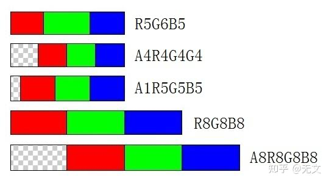

### 压缩纹理格式的价值

- 不需要在 CPU 解压，也不需要 GPU 对**整张图**解压（按块解码）；
- 解决带宽问题：CPU→GPU 传输数据量显著下降；
- 降低包体大小（打进包的已是目标格式）；
- 降低内存与显存占用。

### 打包与导入流程

1. 资源导入时执行文件格式解码（jpg/png → 原始像素）；
2. 打 bundle 时执行**目标平台配套的纹理格式转换**；
3. 最终进入游戏包/bundle 的是已转换好的压缩格式。

这也是**不同平台的 bundle 不能通用**的原因。GPU 对压缩纹理格式是硬件实时解码，性能影响极小。

### 解码时机（以 ETC 为例）

- **解码发生在渲染阶段**，不是加载阶段。纹理以压缩状态从磁盘加载到显存，保持压缩。
- Shader 采样时，GPU 从显存读取压缩数据，**按需解码局部纹理块**（如 4×4 像素块），而非一次性解压整张纹理。
- 移动 GPU（Adreno、Mali、PowerVR）内置 ETC 解码单元，解码与渲染并行，延迟极低。
- 收益量级：1024×1024 的 ETC2（4bpp）约 0.5 MB；若解压为 RGBA8888 则约 4 MB。
- **ETC1**：不支持 alpha，兼容性极广（GLES 2.0+）；**ETC2**：支持 alpha 与更高质量，需 GLES 3.0+/Vulkan，解码机制与 ETC1 类似。
- **ASTC**：同为硬件压缩格式，块尺寸更灵活（如 4×4 ~ 12×12），压缩率与质量可调。
- 对比 PNG/JPG：需在加载时由 CPU 解压为 RGBA 再上传 GPU，内存占用高、加载时间长。

### 浮点数编码到 RGBA8

当平台不支持渲染到 float16/float32 纹理（或需要兼容旧平台）时，可用 RGBA8 打包高精度标量。典型场景：pre-depth 把 32 bit 深度编码进 RGBA8。

```hlsl
inline float4 EncodeFloatRGBA(float v)      // v in [0,1)
{
    float4 enc = float4(1.0, 255.0, 65025.0, 16581375.0) * v;
    enc = frac(enc);
    enc -= enc.yzww * float4(1.0/255.0, 1.0/255.0, 1.0/255.0, 0.0);
    return enc;
}

inline float DecodeFloatRGBA(float4 rgba)
{
    return dot(rgba, float4(1.0, 1/255.0, 1/65025.0, 1/16581375.0));
}
```

原理：$255^0,255^1,255^2,255^3$ 构成 8 bit 进制位权，`frac` 逐位提取，减去进位项（`enc.yzww`）消除相邻通道的量化污染。精度约 $1/255^4\approx2.3\times10^{-10}$，实际受 8 bit 量化与滤波影响，**不要对该纹理开启 bilinear**（插值会破坏编码）。

编码的推导（设 $RGBA\in[0,1]$）：

$$k=\left[1,\ \frac{1}{255},\ \frac{1}{255^2},\ \frac{1}{255^3}\right],\qquad c=[r,g,b,a]$$

$$d=c\cdot k=r+\frac{g}{255}+\frac{b}{255^2}+\frac{a}{255^3}$$

再乘以位权向量 $k_1=[1,255,255^2,255^3]$：

$$d_1=d\cdot k_1=[d,\ 255d,\ 255^2d,\ 255^3d]$$

$$=\left[r+\frac{g}{255}+\frac{b}{255^2}+\frac{a}{255^3},\quad 255r+g+\frac{b}{255}+\frac{a}{255^2},\quad 255^2r+255g+b+\frac{a}{255},\quad 255^3r+255^2g+255b+a\right]$$

对 $d_1$ 取小数部分（`frac`）：

$$d_1=\operatorname{frac}(d_1)=\left[r+\frac{g}{255}+\frac{b}{255^2}+\frac{a}{255^3},\quad g+\frac{b}{255}+\frac{a}{255^2},\quad b+\frac{a}{255},\quad a\right]$$

减去进位项：

$$d_2=\left[\frac{d_1.y}{255},\ \frac{d_1.z}{255},\ \frac{d_1.w}{255},\ \frac{d_1.w}{255}\right]=\left[\frac{g}{255}+\frac{b}{255^2}+\frac{a}{255^3},\quad \frac{b}{255}+\frac{a}{255^2},\quad \frac{a}{255},\quad \frac{a}{255}\right]$$

$$d_3=d_1-d_2=\left[r,\ g,\ b,\ a-\frac{a}{255}\right]\approx[r,g,b,a]$$

$d_3$ 即为编码后的 RGBA 值。（原图第 4 分量用 $d_1.w/255$ 相减，与代码中 `enc -= enc.yzww * float4(1/255, 1/255, 1/255, 0)` 的第 4 个权重为 0 不一致；按代码应为 $d_3=[r,g,b,a]$，图中用 $\approx$ 近似，数值差异小于 $1/255$。）

---

## 各向异性过滤（Anisotropic Filtering）

同一张贴图在关闭/开启各向异性下的对比（注意远处地面沿深度方向的细节）：


### 问题来源（EXT_texture_filter_anisotropic 原文要点）

OpenGL 现有 mipmap 过滤模式假设：像素滤波 footprint 投影到纹理空间是**正方形（各向同性，isotropic）**。实际 footprint 往往又长又窄（各向异性），因此对于斜视表面，mipmap 过滤会**严重模糊**。

> 一句话概括根因：**mip 只按最大方向选级**，短轴方向被过度降采样。下面把它展开成几何。

### 像素足迹：正方形假设错在哪

把屏幕上一个像素经 $(u,v)=F(x,y)$ 映到纹理空间，一阶近似是它的雅可比矩阵：

$$J=\begin{bmatrix}\dfrac{\partial u}{\partial x}&\dfrac{\partial u}{\partial y}\\[2mm]\dfrac{\partial v}{\partial x}&\dfrac{\partial v}{\partial y}\end{bmatrix}$$

严格的足迹是像素这个正方形在 $J$ 下的像；为了能用奇异值描述，**这里统一用单位圆近似像素足迹**（只差一个常数因子，面积比仍是 $|\det J|$）。屏幕上任意单位方向 $\hat d$ 映到纹理空间是 $J\hat d$，因此**像素足迹 ≈ 单位圆在 $J$ 下的像**，一般是个椭圆；长半轴 $a$、短半轴 $b$ 就是 $J$ 的两个奇异值。

两个量决定了后面的全部讨论：

- $ab=|\det J|$（面积比）：椭圆面积为 $\pi ab$，就是该像素实际覆盖的纹素面积。各向同性选级却按 $P_{\max}^2$ 算，即用一个边长为 $P_{\max}$ 的正方形代替椭圆，面积是椭圆面积的 $r/\pi$ 倍——多出来的那部分正是不该被平均掉的细节。
- $a/b$：**各向异性度**（anisotropy ratio）。正视表面时 $a/b\approx1$；贴近地面掠射时可到 10~20。

mipmap 的失效点因此可以一句话说清：它只用一个标量 $\rho=\max(P_x,P_y)$ 选级，等于**保住长轴、丢掉短轴**。选出的级别让长轴方向恰好不欠采样，短轴方向就被过度降采样 $a/b$ 倍——画面上表现为沿短轴方向的细节被抹平，也就是斜视表面"糊成一条"。

> 严格说，spec 里的 $P_x,P_y$ 是 $J$ 两个**列向量**的长度，只有在两列正交（$\partial u/\partial x\,\partial u/\partial y+\partial v/\partial x\,\partial v/\partial y=0$，即 UV 无切变）时才等于奇异值。这就是 spec 允许实现用满足两条约束的 $F_x,F_y$ **近似** $P_x,P_y$ 的原因：它只需要一个"连续、单调、夹在 $\max$ 与 $\sum$ 之间"的尺度估计，并不要求精确的 SVD。

同样的椭圆图景也解释了为什么 **UV 缩放本身就会伪造各向异性**：给模型一段非等比 UV（例如地形把 $v$ 拉长 8 倍），即使表面完全正对相机，足迹也是 8:1 的长条。

### 采样方向与"轴"的近似

$N$ 个 tap 要沿**长轴**排开。纹理空间里的长轴方向，就是屏幕某个方向的像：

$$\hat d=\frac{1}{P_x}\left(\frac{\partial u}{\partial x},\frac{\partial v}{\partial x}\right)\quad(P_x>P_y)$$

spec 正是用"$P_x>P_y$ 就沿 $x$ 变，否则沿 $y$ 变"来选方向的：**取屏幕 $x$（或 $y$）方向在纹理空间的像，当作长轴的代用品**。

这里有一个规范自己承认的近似：$P_x,P_y$ 是**屏幕 $x/y$ 单位向量在纹理空间的像长**（共轭半轴），不等于椭圆的长短轴（奇异值）；只有 $J$ 的两列正交且等长时二者才相同。椭圆相对屏幕轴旋转时，误差很直观：

- 当长轴正好落在屏幕 **45°** 方向时，$P_x=P_y=\sqrt{(a^2+b^2)/2}$，算法判定"各向同性"（$N=1$），**完全漏掉**本该做的各向异性采样——哪怕真实长短轴比很大；
- 夹角越接近 0°/90°，估计越准。

所以：真实长短轴比 $a/b$ 与朝向无关，但**估计值 $r=P_{\max}/P_{\min}$ 依赖足迹相对屏幕 $x/y$ 的方向**（45° 时退化），而"往哪个方向补采样"更是直接用屏幕轴近似的。实现完全可以自己求 $J$ 的奇异值/主轴做得更准——扩展只要求结果合理，不约束算法。

### 手工实现的方向性采样（参考）

把上面的公式直接翻成 shader，可以看清"自适应"到底省在哪：正对相机的片元 $N=1$，与普通采样完全一样；只有 $r>1$ 的片元才多取 tap。

```glsl
vec4 sampleAniso(vec2 uv, float maxAniso)
{
    vec2  dx  = dFdx(uv);
    vec2  dy  = dFdy(uv);
    float px  = length(dx);
    float py  = length(dy);
    float pmax = max(px, py);
    float pmin = min(px, py);

    // 各向异性度 → tap 数（这里只示范 1/2/4 档）
    float n = clamp(ceil(pmax / max(pmin, 1e-6)), 1.0, maxAniso);
    if (n <= 1.0)
        return texture(tex, uv);                    // 完全退化为普通采样

    // dFdx 给的是 UV/像素，lod 的单位是 mip 级，故需乘纹理宽度换算到纹素
    // （与 §LOD 的计算 中 λ = log2(ρW) 一致）
    float  lod = log2(pmax / n * float(textureSize(tex, 0).x));   // 按短轴选级
    vec2   dir = (px > py) ? dx / px : dy / py;     // 长轴方向（已归一化）
    float  len = pmax;                              // 足迹总长
    vec4   sum = vec4(0.0);

    for (int i = 0; i < int(n); ++i)
    {
        float t = (float(i) + 0.5) / n - 0.5;       // [-0.5, 0.5)
        sum += textureLod(tex, uv + dir * (t * len), lod);
    }
    return sum / n;
}
```

要点：`textureLod` 用的是**手动算出的** `lod`——因为 UV 被我们人为偏移了，硬件的自动 LOD 会按偏移后的足迹重新估计，结果既不准又会随 tap 抖动。这也是"手工 AF"通常比硬件慢的原因：多 tap + 手动 LOD + 无法利用硬件的各向异性过滤单元。

> 这只是一个教学实现：真实硬件还会对 $N$ 向上取整到 2 的幂、在 tap 之间共享双线性权重、并把两级 mip 的混合合并进采样器，所以同样的画质只需更少的 texel 读取。

### 扩展定位

1. **不新增 filter mode**：只加一个 texture object 状态 `TEXTURE_MAX_ANISOTROPY_EXT`（$\ge 1.0$，默认 $1.0$），表示"愿意处理的最大各向异性度"；
2. **与 min/mag filter 正交**：实现可结合现有 filter 决定方案（`NEAREST` + maxAniso=2 即 2-tap 方向性采样），也被允许忽略 min/mag；
3. **质量与速率都不保证**：提高各向异性度可能改善质量、也可能显著降低过滤速率；实现还可 clamp 到 `MAX_TEXTURE_MAX_ANISOTROPY_EXT`（最小 2.0）。

```c
glTexParameterf(GL_TEXTURE_2D, GL_TEXTURE_MAX_ANISOTROPY_EXT, 16.0f);   // 0x84FE
glGetFloatv(GL_MAX_TEXTURE_MAX_ANISOTROPY_EXT, &maxAniso);              // 0x84FF
// 支持 sampler object 时也可由 glSamplerParameterf 设置，并覆盖 texture 上的值
```

状态语义、mip 级访问范围与 sampler object 优先级等细节见下节。

### API 行为细节

扩展**没有引入任何新函数**，只加了一个状态项和一个查询项，两者都走已有的 `TexParameter*` / `Get*`：

| 项 | token | 类型 | 初值 / 下限 | 查询方式 |
|---|---|---|---|---|
| `TEXTURE_MAX_ANISOTROPY_EXT` | `0x84FE` | float，合法值 $\ge 1.0$ | 初值 `1.0`，属性为 texture | `GetTexParameterfv` |
| `MAX_TEXTURE_MAX_ANISOTROPY_EXT` | `0x84FF` | float | 最小 `2.0` | `GetFloatv` |

几条容易踩的实现约定：

1. **它是纹理对象状态，不是 filter mode**。设置各向异性不会改变 `TEXTURE_MIN_FILTER`/`MAG_FILTER` 的取值，两者可以任意顺序设置，互不覆盖。
2. **实际生效值是两者取小**：$\text{maxAniso}=\min(\text{TEXTURE\_MAX\_ANISOTROPY\_EXT},\ \text{MAX\_TEXTURE\_MAX\_ANISOTROPY\_EXT})$。写入超过硬件上限的值**不报错**，由实现静默 clamp，所以想要确定行为必须自己 query 上限。
3. **`MAX_...` 的下限是 2.0**，即任何声称支持该扩展的实现至少支持 2:1。spec 同时明确提醒：**上限高不代表质量高、也不代表快**——它只说明"最多允许请求多少"。
4. **与 min/mag filter 正交**：实现可以用你设的 filter 去决定具体方案（`NEAREST` + aniso=2 可以被实现成 2-tap 方向性采样），也**被允许忽略** min/mag 直接实现它认为最高的质量。
5. **只有 min filter 需要 mipmap 时，各向异性方案才会访问 mip 级**；访问范围限于 `TEXTURE_BASE_LEVEL`~`TEXTURE_MAX_LEVEL`（含端点），并建议尊重 `TEXTURE_MIN_LOD`/`TEXTURE_MAX_LOD`。换言之：`MIN_FILTER = LINEAR`（不带 mipmap）时，各向异性退化成"多 tap 的双线性"，不会帮你选级。
6. **sampler object 优先级更高**：支持 sampler object 的实现中，`glSamplerParameterf` 设的值会**覆盖** texture object 上的同项状态（2018-05-23 修订专门澄清了这点，与 `ARB_sampler_objects` 的行为一致）。
7. **GLES 侧是同一个扩展**（OpenGL ES Extension #41），token 与语义相同；移动端同样没有专用函数。
8. 回读得到的只是**状态值**，实现实际用了几个 tap、几级 mip，API 不暴露。
9. **3D 纹理各向异性 spec 明示未定**：Issues 第 4 条只问"2D 的示例能否直接推广到 3D"，**没有给出 resolution**，所以对 3D 纹理（`TEXTURE_3D`）该状态如何生效规范没有承诺。

追求最高质量时 spec 的建议是：`LINEAR_MIPMAP_LINEAR` min filter + `LINEAR` mag filter + 较大的 maxAniso。

> 原文中的 `TEXTURE_MAX_ANISOTROPHY_EXT`（多一个 `H`）是 spec 正文里的拼写错误，token 名以 `TEXTURE_MAX_ANISOTROPY_EXT` 为准。

### 参考算法（2D）

原先只有一个缩放因子 $P$，现在按两个方向分别计算：

$$P_x=\sqrt{\left(\frac{\partial u}{\partial x}\right)^2+\left(\frac{\partial v}{\partial x}\right)^2},\qquad P_y=\sqrt{\left(\frac{\partial u}{\partial y}\right)^2+\left(\frac{\partial v}{\partial y}\right)^2}$$

$$P_{\max}=\max(P_x,P_y),\qquad P_{\min}=\min(P_x,P_y)$$

$$N=\min\left(\left\lceil\frac{P_{\max}}{P_{\min}}\right\rceil,\ \text{maxAniso}\right)$$

$$\lambda'=\log_2\frac{P_{\max}}{N}$$

即：沿长轴方向取 $N$ 个采样点、把 LOD 降低到 $\lambda'$，使每个采样点在长轴方向的覆盖与短轴方向匹配。

于是在 mip 级 $\lambda'$ 上、在像素的纹理 footprint 内取 $N$ 个位置（而非 1 个）：

$$\tau_{\text{aniso}}=\frac{1}{N}\sum_{i=1}^{N}\tau\left(u\left(x-\tfrac12+\tfrac{i}{N+1},y\right),\ v\left(x-\tfrac12+\tfrac{i}{N+1},y\right)\right),\quad P_x>P_y$$

$P_y\ge P_x$ 时沿 $y$ 方向取。等间距近似：

$$\tau_{\text{aniso}}=\frac{1}{N}\sum_{i=1}^{N}\tau\left(u+\frac{\partial u}{\partial x}\left(\tfrac{i}{N+1}-\tfrac12\right),\ v+\frac{\partial v}{\partial x}\left(\tfrac{i}{N+1}-\tfrac12\right)\right)$$

实现允许：把 $N$ 向上取整到支持的采样率（如只支持 2 的幂）；用满足以下条件的 $F_x,F_y$ 近似 $P_x,P_y$：

1. $F_x$ 对 $|du/dx|,|dv/dx|$ 连续且单调递增，$F_y$ 同理；
2. $\max(|du/dx|,|dv/dx|)\le F_x\le|du/dx|+|dv/dx|$，$F_y$ 同理。

### LOD 与各向异性度的关系

设 $r=P_{\max}/P_{\min}$ 为足迹的长短轴比。两个式子其实是在做同一件事：**把"一个覆盖 $P_{\max}\times P_{\min}$ 的椭圆"近似成"$N$ 个边长 $P_{\max}/N$ 的正方形"**。

- 各向同性（$N=1$）时，mip 级 $\lambda=\log_2 P_{\max}$，一个 texel 恰好铺满长轴；
- 取 $N=\lceil r\rceil$ 个 tap，每个 tap 只承担长轴的 $1/N$，于是要求

$$2^{\lambda'}=\frac{P_{\max}}{N}\ \Longrightarrow\ \lambda'=\log_2\frac{P_{\max}}{N}$$

$N=r$ 时 $\lambda'=\log_2 P_{\min}$，即**mip 级别按短轴选、长轴用 $N$ 个 tap 补回来**。这就是各向异性过滤的本质：不是"更清晰的 mip"，而是**换了一根轴来选级**。

近似的面积是

$$N\cdot\left(2^{\lambda'}\right)^2=N\cdot\left(\frac{P_{\max}}{N}\right)^2=\frac{P_{\max}^2}{N}$$

只有在 $N$ 取到 $r=P_{\max}/P_{\min}$ 时才等于 $P_{\max}P_{\min}=ab$；被 maxAniso 截断（$N<r$）时面积偏大（近似面积 $\frac{P_{\max}^2}{N}$ 已超过 $P_{\max}P_{\min}$），短轴细节被多平均掉，对应下文推论 3 的残余模糊。

与椭圆面积 $ab$ 同量级（$P_{\max}P_{\min}$ 就是 $\pi ab$ 里的 $ab$），所以**不会带来整体亮度偏差**，只改变细节在各方向上的保留程度。

几个直接推论：

1. **$r=1$（正视）时 $N=1$**，整套机制退化为普通 mipmap。各向异性只在斜视时有意义，正对相机的表面一个 tap 都不多花。
2. **$N$ 随 $r$ 线性增长**，即**开销随 $r$ 线性增长**（具体量级见下节"代价"），而画面收益是递减的。
3. **被 maxAniso 截断后仍有残余模糊**。若 $r>A$（$A$ 为 maxAniso），则 $N=A$、$\lambda'=\log_2(P_{\max}/A)$，短轴方向仍有

$$\frac{P_{\min}}{2^{\lambda'}}=\frac{A}{r}<1$$

即每个 texel 的跨度已是短轴足迹的 $r/A$ 倍（比值 $A/r<1$），也就是**过度降采样**，表现为**残余模糊倍数 $r/A$**——这是上限存在的意义，也是"再往上加倍数收益很小"的原因。
4. **$\lambda'$ 一般不是整数**，最后一级的取整/层间插值由 min filter 决定：`..._MIPMAP_NEAREST` 直接取最近级，会有可见的级间跳变；trilinear 在 $\lfloor\lambda'\rfloor$ 与 $\lceil\lambda'\rceil$ 之间混合，跳变消失但采样数翻倍。

### 代价

- 采样数随各向异性度线性增长。按 spec 的 $N$ 点采样，16x + trilinear 约需 $16\times2=32$ 次采样；若每个 tap 仍使用硬件双线性（4 texel）再叠加两级 mip 混合，最坏可到 $16\times4\times2=128$ 次 texel 读取——这正是高倍各向异性在带宽上昂贵的原因。
- 早期硬件能力有限，例如 GeForce 256 / GeForce 2 只支持 2:1（待核实：这两代是否支持 AF、以及具体是否为 2:1，不同资料说法不一）。
- 长宽比超过 maxAniso 的部分只能接受过度模糊。

### 厂商给出的量级

高通（Qualcomm）对采样成本的描述，按"每次采样多少 cycle"计价：

> 32 位 2D 纹理的一次双线性采样是 **1 个 cycle**；加上三线性过滤翻倍到 **2 个 cycle**；mipmap clamping 有时能把它降回双线性的成本，所以真实场景的平均值通常低于 2 个 cycle。再叠各向异性会**乘以各向异性度**：16x 各向异性的一次采样可能比普通的各向同性采样慢 **16 倍**。但各向异性是**自适应**的，这个代价只落在真正需要它的片元上——可能是全部片元里很小的一部分。经验法则是：真实场景里各向异性的平均代价**不到各向同性时的两倍**。

ARM 的结论更直接：

> 用 **2x bilinear AF 替代 trilinear**，画质更好，性能也更好。继续提高 max anisotropy 能进一步提升画质，但要以性能为代价。

把两段话合起来，可以提炼出四条可用的工程结论：

1. **平均值与峰值差一个数量级**。16x 的 16 倍是"最坏片元"的成本，不是整帧成本。按最坏值做预算会严重高估；按平均值做预算又会在贴地视角下掉帧。真正该测的是**最坏视角**（贴地看跑道、俯视长走廊）。
2. **"多 tap、少 mip"有时比"单 tap、多 mip"更划算**。ARM 明确说 2x AF 同时赢过 trilinear——因为 trilinear 是无条件对**每个**被缩小采样的片元翻倍，而 2x AF 只在 $r>1$ 的片元上多取一个 tap，且省掉了层间混合。这解释了为什么移动端常见配置是"关闭 trilinear + 开 2x/4x AF"。
3. **代价是视角相关的**。同一场景转身 90° 后帧率变化，通常来自斜视面积变化，不是 bug。
4. **AF 与分辨率、MSAA、透明叠加是乘性关系**。带宽受限时，4K + 16x AF + 大量透明粒子的组合最先爆的是带宽而不是算力。

### maxAnisotropy 该设多少

| 取值 | 适用 | 说明 |
|---|---|---|
| 1 | 关闭 | 退化为普通 mipmap，斜视糊 |
| 2 | 轻度斜视 | 移动端性价比最高档；可替代 trilinear |
| 4 | 通用默认 | 覆盖大多数第三人称地面/墙面 |
| 8 | 斜视较多的场景 | 赛车、跑道、长走廊 |
| 16 | 极端掠射 | 桌面默认上限；再高收益极小 |

实践要点：

- **必须 query 上限再设**。桌面常见上限 16（部分实现更高，待核实具体驱动），超设会被静默 clamp。
- **实现可能把 $N$ 上取整到 2 的幂**（spec 允许），所以 3x 实际按 4x 执行，12x 与 16x 可能同效（待核实各驱动的取整策略）。
- **Unity**：`Texture.anisoLevel` 取值 0~16，`0` 表示关闭；全局开关是 `QualitySettings.anisotropicFiltering` 的三档 `Disable` / `Enable` / `ForceEnable`——`Enable` 尊重每张纹理的 `anisoLevel`，`ForceEnable` 强制全开。UI 图集、纯 2D Sprite 开 AF 没有收益，保持 0/1 可以省采样。
- **UE**：纹理资产上的 `Max Anisotropy` 逐纹理设置，全局 `r.MaxAnisotropy` 作为上限（默认值随版本变化，待核实）。
- 各向异性度由 UV 导数决定，**非等比 UV 会伪造出各向异性**，这类资产开高 AF 只是白付代价。

### 与 LOD bias 的对比

| 手段 | 效果 | 副作用 |
|---|---|---|
| LOD bias = -1 | 相当于 2:1 各向异性，减少远处模糊 | 重新引入摩尔纹/环状失真 |
| 各向异性 2x | 同样的清晰度提升 | **不产生**环状失真 |
| 各向异性 16x | 几乎消除所有失真与模糊 | 带宽/性能开销大 |

### 保守各向异性的替代做法

- 预先把贴图沿一个方向拉伸（4:1），只适合视角固定（赛车跑道）；
- 视角变化大时（FPS、飞行模拟）近处过糊，不通用。

### 实践清单与常见误区

1. **AF 必须与 mipmap 一起开**。`MIN_FILTER` 不带 mipmap 时各向异性只剩"多 tap 双线性"，远处照样闪烁；反过来只开 mipmap 不开 AF，就是"糊成一条"。两者是配套关系，不是二选一。
2. **AF 不改变 min filter**。设完 `TEXTURE_MAX_ANISOTROPY_EXT` 不要以为过滤模式也变了；`NEAREST` + AF 仍然是点采样，只是沿长轴多取几个点。
3. **不要用负 LOD bias 代替 AF**。负 bias 对各向同性方向同样生效，长轴是清晰了，短轴却被推回欠采样区，抖动/摩尔纹随之而来（见上表）。真实项目里负 bias 与 AF 同时用，会得到"双重过锐"的观感。
4. **各向异性度由 UV 导数决定**。非等比 UV、过小的 UV 重复次数、把整张图塞进图集的一小块，都会改变 $r$；排查"某资产特别糊"时先看 UV，而不是先调 AF 倍数。
5. **图集需要 padding**。AF 的高阶 tap 会取到相邻格子的内容，边缘会串色；这与 mipmap 边缘污染是同一类问题（见附录 B.3）。
6. **三角形边界的导数会跳变**。`dFdx/dFdy` 在三角形共享边两侧可能取到不同邻域，足迹估计不连续，细看可能出现一条接缝（待核实：具体表现依赖硬件与驱动）。
7. **各向异性不能修复几何问题**。UV 未按世界尺度展开（例如大地面只铺了 2×2 次重复）时，任何 AF 倍数都救不回细节。

---

## Mipmap（LOD 选择）

mipmap 是一张纹理的**逐级折半副本链**（$1/2,1/4,1/8\dots$），级别数

$$L=\left\lfloor\log_2\max(w,h)\right\rfloor+1$$

用途有两个：远处/斜视时按像素覆盖范围取级，抑制摩尔纹；同时让采样局部化，提升缓存命中率、降低带宽。

### LOD 的计算

对每个方向求 $(u,v)$ 变化率的**模长**，取两者最大值，再取以 2 为底的对数：

$$\rho_x=\sqrt{\left(\frac{\partial u}{\partial x}\right)^2+\left(\frac{\partial v}{\partial x}\right)^2},\qquad \rho_y=\sqrt{\left(\frac{\partial u}{\partial y}\right)^2+\left(\frac{\partial v}{\partial y}\right)^2}$$

$$\lambda=\log_2\max(\rho_x,\rho_y)$$

两个方向各取 $(du,dv)$ 的**模长**后取大者，不能在 $u,v$ 分量之间取最大。

（另注：若 $\rho$ 以 UV 为单位，严格写法是 $\lambda=\log_2(\rho W)$，$W$ 为纹理宽度；下文按"以纹素为单位"省略 $W$，不影响推导。）

取 $\max$ 是**保守**选择：宁可多降采样（糊），也不要少降采样（闪烁）。代价正是短轴方向的过度模糊——这就是各向异性过滤要修的东西。

### 三种缩小过滤

| `MIN_FILTER` | 级内 | 级间 | 采样数 |
|---|---|---|---|
| `NEAREST_MIPMAP_NEAREST` | 最近 texel | 最近级 | 1 |
| `LINEAR_MIPMAP_NEAREST` | 双线性 | 最近级 | 4 |
| `LINEAR_MIPMAP_LINEAR`（trilinear） | 双线性 | 两级线性混合 | 8 |

级间不做混合时，$\lambda$ 跨过整数会出现**整块区域的清晰度突变**（mip 跳变），移动时表现为"纹理分层闪烁"。trilinear 用 8 次 texel 读取换掉这个跳变。

### LOD 偏置（LOD bias）

$$\lambda'=\lambda+\text{bias}$$

```c
glTexParameterf(GL_TEXTURE_2D, GL_TEXTURE_LOD_BIAS, -0.5f);
```

- **负 bias**：用**更低**（更精细）的 mip 级，画面更锐，代价是重新引入摩尔纹、远处闪烁；
- **正 bias**：用**更高**（更模糊）的 mip 级，更稳，常用于压低远处噪点或配合 TAA 抑制闪烁；
- bias 是**各向同性**的：它把长短轴一起推，所以推清晰长轴的同时必然把短轴推进欠采样区。这是它与 AF 最本质的区别（AF 只动短轴）。

数学上，AF 用 $N$ 个 tap 把 LOD 降了 $\log_2 N$，与 bias $=-\log_2 N$ 的"选级效果"相同，但采样形状完全不同：前者是沿长轴的 $N$ 个正方形，后者是**一个**更大的正方形。所以"用 bias 模拟 AF"只在长轴方向看起来像，短轴方向会过锐并抖动。

### 盒式过滤的过度模糊

mip 链的生成通常用 2×2 盒式平均（box filter）逐级下采样。$n$ 级纹素等效于在原图上做宽度约 $2^n$ 的低通（逐级 2×2 平均对应的核是二项式 / B 样条，**不是平坦的盒核**；下式是把它按理想盒核近似时的响应）：

$$H(f_x,f_y)=\operatorname{sinc}(2^n f_x)\cdot\operatorname{sinc}(2^n f_y)$$

这个核有两个先天问题，叠起来就是"远处又糊又灰"：

- **旁瓣衰减太慢**（理想盒核 / $\operatorname{sinc}$ 的第一旁瓣约 $-13\ \mathrm{dB}$ 量级；实际逐级 B 样条核的旁瓣更低）：超过 Nyquist 的高频没有被压干净，会以低频形式折叠回来，表现为轻微块状/环状结构与闪烁残留；
- **主瓣对中频衰减过强**：相当于用一个比理想低通更"钝"的窗，中频细节的对比度被整体压低。逐级累乘后，高层 mip 的方差明显低于原分辨率下同一区域的方差——纹理越糊越"平"、越"发灰"，就是这个原因。

要注意**过度模糊的主因不是 box 本身，而是选级**：各向同性按 $P_{\max}$ 选级，短轴方向多降了 $r$ 倍（这才是 AF 要修的）；再把 box 的频响衰减叠上去，才形成观感上的"糊成一片"。所以先确认 AF/选级，再考虑换滤波器。

改进方向是换窗函数（Kaiser、高斯、Lanczos）或做能量守恒的加权，代价是生成时间与边缘处理复杂度（具体实现随引擎/工具而异，待核实）。工业界的常规做法是 Kaiser 窗 + 可调 $\alpha$，在"锐度"和"振铃"之间取舍。

对法线贴图还有额外问题：平均后向量长度 $<1$，直接采样会让光照整体变暗，需要重建 $z$ 或重新归一化（见"法线贴图原理 → 使用中的问题清单"第 5 条）。

### 与各向异性过滤的分工

- mipmap 解决**缩小采样的欠采样**（一个标量尺度）；
- AF 解决**足迹形状不是正方形**（方向性）；
- 两者叠加才是"远处既清晰又不闪"。AF 只在 min filter 需要 mip 时才能访问 mip 级，且受 `BASE_LEVEL`/`MAX_LEVEL`/`MIN_LOD`/`MAX_LOD` 约束，所以 mip 链的生成质量直接决定 AF 的上限。

---

## 切线空间（Tangent Space）

### 定义

切线空间定义在**每个顶点**（以及光栅化后的**每个片元**）上，由纹理空间的 $U$、$V$ 方向与法线 $N$ 构成，通常记作 $T$、$B$、$N$。

使用法线贴图的两个要点：

1. **TBN 矩阵**；
2. **变换后的法线属于哪个空间**。

### TBN 的计算步骤

1. 用顶点 UV 与三角形中过该顶点的两条边计算 $T$：

$$T=\frac{E_1\cdot\Delta v_2-E_2\cdot\Delta v_1}{\Delta u_1\Delta v_2-\Delta u_2\Delta v_1}$$

$$E_1=\Delta U_1\,T+\Delta V_1\,B,\qquad E_2=\Delta U_2\,T+\Delta V_2\,B$$

（$E_1,E_2$ 为位置差向量；这是 Gram 形式前的原始切线。）

设三角形三个顶点为 $p_1,p_2,p_3$，两条边即 $E_1=p_2-p_1$、$E_2=p_3-p_1$。它们可以用 $U,V$ 的线性组合表示，且 $T,B$ 分别平行于 $U,V$，所以也可以用 $T,B$ 的线性组合表示：

$$\vec{E_1}=t_1\vec{T}+b_1\vec{B},\qquad \vec{E_2}=t_2\vec{T}+b_2\vec{B}$$

$$t_1=p_2.u-p_1.u,\quad b_1=p_2.v-p_1.v,\quad t_2=p_3.u-p_1.u,\quad b_2=p_3.v-p_1.v$$

写成矩阵形式：

$$\begin{bmatrix}E_1\\E_2\end{bmatrix}=\begin{bmatrix}t_1&b_1\\t_2&b_2\end{bmatrix}\begin{bmatrix}T\\B\end{bmatrix}$$

于是 $T,B$ 为：

$$\begin{bmatrix}T\\B\end{bmatrix}=\begin{bmatrix}t_1&b_1\\t_2&b_2\end{bmatrix}^{-1}\begin{bmatrix}E_1\\E_2\end{bmatrix}=\frac{1}{t_1b_2-t_2b_1}\begin{bmatrix}b_2&-b_1\\-t_2&t_1\end{bmatrix}\begin{bmatrix}E_1\\E_2\end{bmatrix}$$

取第一行即得 $T=\dfrac{b_2E_1-b_1E_2}{t_1b_2-t_2b_1}$，与上面的 $T$ 公式一致（$t_1=\Delta u_1,\ b_1=\Delta v_1,\ t_2=\Delta u_2,\ b_2=\Delta v_2$）。

2. 用顶点法线对 $T$ 做**正交化**（Gram-Schmidt）：

$$T'=\text{normalize}\left(T-N(N\cdot T)\right)$$

正交化后 $T$ 不再严格平行 $U$，$B$ 不再严格平行 $V$，甚至 $TB$ 平面也不再平行 $UV$ 平面（取决于可自由编辑的法线 $N$）。

$$t_\perp=\text{nrm}\left(t-(t\cdot n)n\right)$$

$$b_\perp=\text{nrm}\left(b-(b\cdot n)n-(b\cdot t_\perp)t_\perp\right)$$

副切线随后可等价地写成叉乘形式 $b_\perp=\sigma\,(n\times t_\perp)$，其中 $\sigma=\pm1$ 为手性符号。

3. 用 $T'$ 与 $N$ 叉乘求 $B$，构造 TBN：

$$B=\pm\,(N\times T')$$

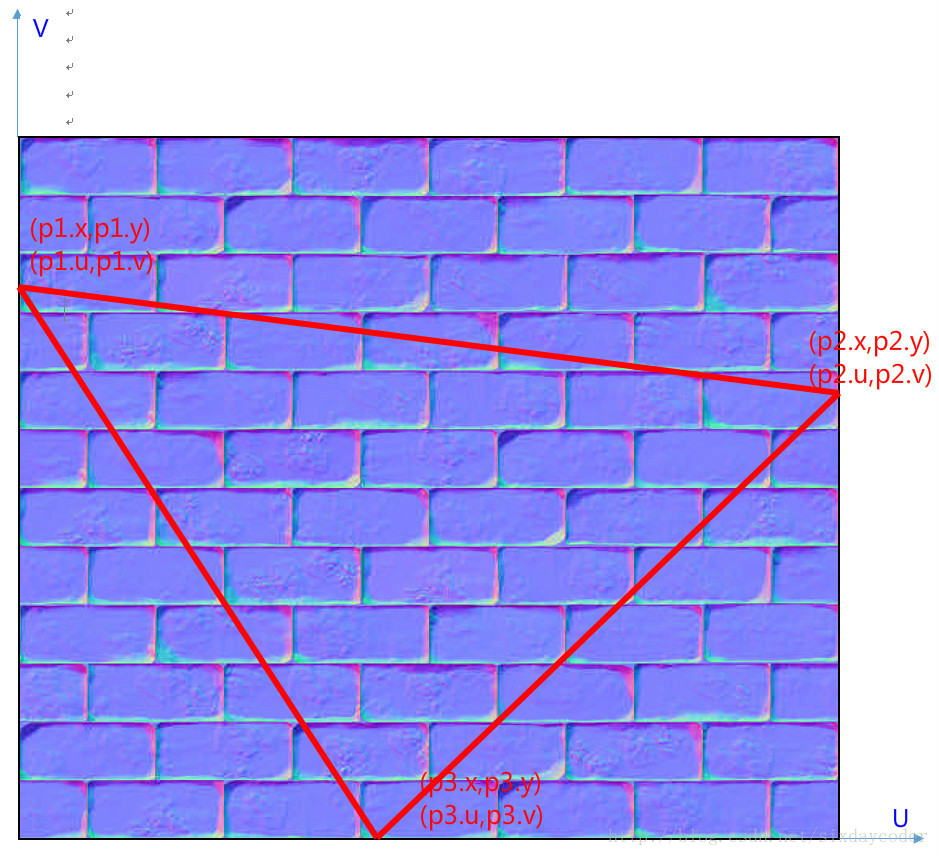

### 从片元导数推导 TBN（无法线数据时）

```glsl
vec3 getNormal()
{
#ifndef HAS_TANGENTS
    vec3 pos_dx = dFdx(v_Position);
    vec3 pos_dy = dFdy(v_Position);
    vec3 tex_dx = dFdx(vec3(v_UV, 0.0));   // .s=du1 .t=dv1
    vec3 tex_dy = dFdy(vec3(v_UV, 0.0));   // .s=du2 .t=dv2

    // 解 [E1 E2] = [T B] * [du1 du2; dv1 dv2] 得到 T
    vec3 t = (pos_dx * tex_dy.t - pos_dy * tex_dx.t)
           / (tex_dx.s * tex_dy.t - tex_dy.s * tex_dx.t);
    // 等价写法：t = (E1*dv2 - E2*dv1) / (du1*dv2 - du2*dv1)

#ifdef HAS_NORMALS
    vec3 ng = normalize(v_Normal);
#else
    // 必须归一化：|cross(dFdx, dFdy)| ≈ 每像素世界位移的平方（1080p 下 ~1e-6）。
    // 不归一化时 mat3(t, b, ng) 的第三列被同比例缩小，tbn * nTS 的 z 分量随之塌缩，
    // 法线被压进 T/B 平面；Gram-Schmidt 也要求 |ng| = 1，否则几乎不正交化。
    vec3 ng = normalize(cross(pos_dx, pos_dy));
#endif

    t = normalize(t - ng * dot(ng, t));   // 对 n 正交化
    // UV 镜像时 det 变号，B 必须跟着翻；否则法线 y 反号，凹凸会颠倒
    float handedness = sign(tex_dx.s * tex_dy.t - tex_dy.s * tex_dx.t);
    vec3 b = normalize(cross(ng, t)) * handedness;
    mat3 tbn = mat3(t, b, ng);
#else
    mat3 tbn = v_TBN;
#endif

#ifdef HAS_NORMALMAP
    vec3 n = texture2D(u_NormalSampler, v_UV).rgb;
    // 贴图存的是 (n+1)/2，需要还原到 [-1,1]
    n = normalize(tbn * ((2.0 * n - 1.0) * vec3(u_NormalScale, u_NormalScale, 1.0)));
#else
    vec3 n = normalize(tbn[2].xyz);       // 插值后需重新归一化
#endif
    return n;
}
```

### Unity 中的实现与手性

```hlsl
// Vertex Shader
#ifdef UNIFORM_SCALING
    float3 normalWS = (float3x3)UNITY_MATRIX_M * normalOS;      // 一致缩放：可直接用 M
#else
    float3 normalWS = normalOS * (float3x3)UNITY_MATRIX_I_M;    // 非一致缩放：逆转置（交换乘序等价于转置）
#endif

float3 tangentWS = (float3x3)UNITY_MATRIX_M * tangentOS;

// 副切线符号：平台 UV 手性 × 模型是否发生镜像
float sign = tangentOS.w * GetOddNegativeScale();   // unity_WorldTransformParams.w >= 0 ? 1 : -1
float3 bitangentWS = cross(normalWS, tangentWS) * sign;
```

```hlsl
// Fragment Shader
float4 bump = SAMPLE_TEXTURE2D(_BumpMap, sampler_BumpMap, i.uv);
float3 normalTS = UnpackNormal(bump);

// float3x3 按行填充：第一行 = tangentWS
float3x3 TBN = float3x3(i.tangentWS, i.bitangentWS, i.normalWS);
float3 normal = SafeNormalize(mul(normalTS, TBN));   // 行向量左乘 = 列向量右乘 TBN^T
```

**为什么 $\text{normalTS}\cdot M_{\text{TBN}}$（左乘）等于 $M_{\text{TBN}}^T\cdot\text{normalTS}$？**

$M_{\text{TBN}}$ 由 $T,B,N$ 三个**列**向量组成，$M\cdot v$ 把切线空间坐标变到 $T/B/N$ 所在空间。行主序构造 + 行向量左乘，等价于转置后做列向量乘法，二者结果相同。这也是为什么代码注释强调"交换乘号两边变量起到转置的作用"。

**副切线为何需要符号**：$B$ 由 $N\times T$ 得到，但方向可能需要取反，取决于两点：

1. **`v.tangent.w`**：由**源网格自身的 UV 手性**决定（mikktspace / 导出工具在建模阶段算好），不随渲染平台改变。Unity 导入时按 `dot(N×T, B)` 的符号把它写入 `tangent.w`（值恒为 ±1）。
2. **`unity_WorldTransformParams.w`**：模型缩放若含**奇数个负号**，三角形发生镜像、手性翻转。法线/切线是存储值不变，只能让 bitangent 反向来保持结果正确。（偶数个负号可分解为全正 scale × 旋转，无需翻转。）

```cpp
// ImportMeshUtil.cpp -> OrthogonalizeTangent
float dp = Dot(Cross(normalf, tangentf), binormalf);
if (dp > 0.0F) outputTangent.w =  1.0F;   // UV 未镜像 → +1
else           outputTangent.w = -1.0F;   // UV 镜像 → -1
```

UV 约定差异：

- OpenGL：U 水平向右，V 垂直向上（+Y）；
- DirectX：U 水平向右，V 垂直向下（−Y）。

Unity 遵循 OpenGL 的 UV 走向（导入时 V 向上）。但要注意：**网格的切线基与图形 API 无关**——在 Windows 上跑 D3D 并不会让 $B$ 反向，D3D 与 GL 的差异只体现在纹理 V 原点、渲染纹理采样与投影矩阵上。真正会翻转手性的是模型的**奇数个负缩放**，由 `unity_WorldTransformParams.w` 处理。

### 为什么 TBN 用列向量，而相机矩阵用行向量？

设 $A$ 为 $r\times n$、$B$ 为 $n\times m$、$C=A B$ 为 $r\times m$。其物理意义是：**$A$ 的线性无关行向量构成一组基，$C$ 的每一列是 $B$ 对应列在该基下的坐标**。

- 相机矩阵：把标准基 $[1,0,0],[0,1,0],[0,0,1]$ 下的坐标变换到 $UVN$ 坐标系 → 基在"行"上。
- TBN 矩阵：把 $T,B,N$ 基下的坐标变换到标准基 → 基在"列"上。

两者是相反的变换。TBN 又是正交矩阵（$M^{-1}=M^T$），所以 "T/B/N 作列组成矩阵" 就是把切线空间变到世界空间：

$$v_{\text{world}} = xT+yB+zN$$

其中 $[x,y,z]$ 是法线贴图中读到的切线空间系数。**关键认知：变换结果所属的空间由 $T,B,N$ 本身所属的空间决定**——$T,B,N$ 在世界空间，结果就是世界空间；在物体空间就是物体空间。

因此：

$$N_{\text{world}}=M\cdot N_{\text{obj}}=M\cdot M_{\text{TBN,obj}}\cdot n_{\text{TS}}=M_{\text{TBN,world}}\cdot n_{\text{TS}}$$

### 在切线空间还是世界空间算光照

两种做法：

1. 把光照/视线/顶点位置变换到切线空间，在切线空间算光照（需要 $TBN^{-1}=TBN^T$）；
2. 采样法线后变换到物体/世界空间算光照（每个片元多做一次矩阵乘）。

工程上通常选 1：在 **Vertex Shader** 里算 $TBN^T$ 并把 light/view/pos 变换到切线空间，VS 调用次数远少于 FS，剩下的插值几乎免费。

```glsl
mat3 TBN = transpose(mat3(T, B, N));   // 正交矩阵，转置即逆
vs_out.tangentLightPos = TBN * lightPos;
vs_out.tangentViewPos  = TBN * viewPos;
vs_out.tangentPos      = TBN * vs_out.worldPos;
```

> Unity 的 URP 走的是路线 2（TBN 到世界空间），因为需要与全局光照、反射探针等的世界空间向量统一。

### 两个容易忽略的问题

1. **TBN 应属于三角形，而顶点被多个三角形共享**：法线被平均后，同一三角形三个顶点的法线并不指向面法线，因此逐顶点的 TBN 只是近似。
2. **插值后 TBN 不再正交**：$T,B,N$ 在 VS 中正交，插值到 FS 后不正交。可以在 FS 重新正交化，但误差通常很小，Unity 官方也没有做。若要重新归一化，至少应 normalize $N$ 与 $T$，再用叉乘重建 $B$。

### 总结

- 切线空间定义于每个顶点与每个片元；
- 可用位置与 UV 的偏导数求 $T$，对 $N$ 正交化后叉乘得 $B$；
- TBN 能把法线贴图中的法线从切线空间变到 $T/B/N$ 所在空间（Unity 中是世界空间）；
- 精度要求不高时可在 VS 算、FS 插值；
- 顶点用三角形另两顶点算 TBN，片元用 `dFdx/dFdy` 算。

---

## 法线贴图原理

### 存储与解码

法线是单位向量，分量范围 $[-1,1]$；常规贴图只能存 $[0,1]$，因此编码为

$$\text{pixel}=\frac{n+1}{2},\qquad n=2\cdot\text{pixel}-1$$

（`UnpackNormal` 还会处理平台差异：DXT5nm 只存 X 与 Y（存在 A 与 G 通道），Z 由 $z=\sqrt{1-x^2-y^2}$ 重建并保证 $z>0$。）

### 法线贴图存放的空间

**模型空间（Object Space）**

- 实现简单：不需要构造 TBN，直接用模型矩阵把法线变到世界空间，或把光线变到模型空间；
- **边界平滑**：同一模型坐标系下的法线，边界采样时用双线性插值能得到平滑过渡。切线空间法线图各自处于不同切线空间，二次插值会在边缘/尖角出现缝隙。

**切线空间（Tangent Space）**

- 适合**骨骼动画**：存储相对切线空间的法线，蒙皮后仍准确；模型空间法线在形变后失效。
- **复用度高**：同一张砖块法线图可用于六个面，也可用于其他模型；模型空间法线图必须为每个朝向单独提供大图。
- **支持 UV 动画**：水流、岩浆通过 UV 偏移扰动法线；模型空间法线图偏移后会采到背面法线（被翻转），必然出错。
- **可压缩**：$z$ 恒为正，只需存 $xy$，$z=\sqrt{1-x^2-y^2}$。

| | 模型空间 | 切线空间 |
|---|---|---|
| 是否需 TBN | 否 | 是 |
| 边界接缝 | 平滑 | 可能出现缝隙 |
| 骨骼动画 | 失效 | 正确 |
| 复用 | 差 | 好 |
| UV 动画 | 不可用 | 可用 |
| 压缩 | 需 3 分量 | 可只存 2 分量 |

### 使用中的问题清单

1. **UV 手性/镜像**：网格 UV 被镜像（`tangent.w = -1`）、或法线图 green 通道约定相反时，副切线方向需翻转 → 光照出现"凹变凸"。解决：按 `tangent.w` 构造 TBN，或翻转 `NormalScale.y`；这是资产/切线基的手性问题，与图形 API 无关（见上文"切线基与图形 API 无关"）。
2. **非一致缩放**：法线必须用逆转置矩阵变换（见下节），否则法线不再垂直表面。
3. **法线贴图强度（NormalScale）**：只应缩放 $xy$，$z$ 保持 1，否则法线长度失真；缩放后必须重新归一化。
4. **插值后不归一化**：片元法线长度小于 1，会整体压暗光照，必须 `normalize`。
5. **mipmap 与法线**：常规 mip 平均会让法线长度衰减（平均后向量变短），应在生成 mip 后重新归一化，或使用专门的 normal map mip 生成方式。
6. **sRGB**：法线贴图是数据纹理，必须为 **linear**，不能按 sRGB 采样。
7. **压缩格式**：BC5/两通道格式只存 $xy$，质量优于 BC1/BC3；DXT5nm 把 $x$ 放 A、$y$ 放 G，是为了让 $x$ 获得更好的插值精度。
8. **镜像 UV / 负缩放模型**：同 1，需要翻转 $B$；否则法线凹凸方向反了。

---

## 视差效果（Parallax Mapping）

视差映射是法线映射的增强版：**不增加任何图元**，在平坦多边形上做出"有厚度、有凹凸遮挡"的 3D 细节。法线贴图只改光照方向，轮廓和遮挡关系仍然是平的；视差映射额外用一张**高度图**去偏移 UV，让高处的纹素在斜视时"挡住"低处的纹素。

高度图每个像素表示该点"表面到底面"的**深度** $d\in[0,1]$：$d=0$ 在表面，$d=1$ 在底面。文献里也常反向存成"高度" $h=1-d$，两种写法等价，但**符号必须先确认**——接反了会出现"凸起变凹陷"且视差方向相反。

### 为什么在切线空间算

偏移量必须是**沿表面**的位移，所以视线要先变到切线空间：

$$\vec V_{ts}=M_{\text{TBN}}^{T}\,\vec V_{ws}$$

$M_{\text{TBN}}$ 正交，转置即逆。之后所有计算都在 $uv$ 平面上做二维位移，与表面的世界朝向无关——同一张深度图可以用在任意朝向的面上（与切线空间法线贴图复用性的理由相同）。

设深度缩放为 $s$（把 $[0,1]$ 的深度映射成 UV 单位的位移量）。视线每向下深入 $\Delta d$（世界厚度 $s\Delta d$），水平方向前进

$$\Delta\vec u=s\,\Delta d\,\tan\theta\,\hat e_{xy},\qquad \tan\theta=\frac{|\vec V_{ts}.xy|}{|\vec V_{ts}.z|}$$

$\hat e_{xy}$ 取 $\vec V_{ts}.xy$ 的方向。于是从表面走到深度 $d$ 处的总位移是

$$\vec\delta=\frac{\vec V_{ts}.xy}{\vec V_{ts}.z}\,s\,d\ \Big|_{d=1}=\frac{\vec V_{ts}.xy}{\vec V_{ts}.z}\,s$$

$\vec V_{ts}.z$ 越小（视线越掠射），$\tan\theta$ 越大，同样的深度会平移得越远——掠射时视差最强，也最容易失真。

### 简单视差映射（Parallax Mapping）

只迭代一次：直接假设"视线在该 UV 处穿透的深度"就是该点采样到的深度。


$$uv'=uv-\vec\delta\cdot d(uv)$$

```glsl
vec2 parallaxSimple(vec2 uv, vec3 viewDirTS)
{
    float d = texture(uDepthMap, uv).r;              // 深度，[0,1]
    vec2  p = viewDirTS.xy / viewDirTS.z * (d * uDepthScale);
    return uv - p;
}
```

（原稿代码中的变量名 `depthMap`/`height_scale` 保留语义，此处统一为 `uDepthMap`/`uDepthScale`：这张图存的是"表面到底面"的深度，不是场景深度缓冲。）

问题很明显：$d(uv)$ 是"错位置"上的深度，用它去算位移是自指。结果在**陡峭视角和高频深度**处出现拉伸、涂抹，物体"看起来在滑动"。实践上必须把位移夹住：

$$\left|\vec\delta\,d(uv)\right|\le 0.5\ \text{(UV 单位，即半个纹理范围)}$$

注意这里的单位是 **UV**，不是 texel。"钳到 1/2 texel"并不是通行做法——那会把偏移压到万分之一量级，视差效果基本消失。通行做法是：按高度尺度与 $v_{xy}/v_z$ 缩放偏移量，再把结果 UV 用 `saturate`/`frac`（或依赖 clamp/wrap 采样器）限制在纹理范围内；也可以只钳偏移幅度，避免斜视时整张图被拉出边界。

或者用 offset limiting：$\vec\delta\leftarrow\vec\delta\cdot\min\left(1,\ \dfrac{|\vec V_{ts}.z|}{s}\right)$，牺牲陡峭处的视差换取稳定。（比值以 $|\vec V_{ts}.z|/s$ 为上界：正视时 $|\vec V_{ts}.z|\approx1$ 不抑制，掠射时 $|\vec V_{ts}.z|\to0$ 才把偏移压到 0。）

### 陡峭视差映射（Steep Parallax Mapping）

把深度区间 $[0,1]$ 均分成 $N$ 层，沿视线逐层步进，直到"当前射线位置已经落到表面之下"——交点就在相邻两层之间。


层深度与对应的 UV：

$$d_i=\frac{i}{N},\qquad uv_i=uv-\vec\delta\,d_i,\qquad i=0,1,\dots,N$$

判定：找到最小的 $i$ 使 $d(uv_i)\le d_i$（该处的真实表面比射线位置更浅，说明射线已经穿过去了）。

```glsl
// 在层高 step=1/N 的网格上沿视线线性步进，直到射线落到表面之下。
// curDepth / sampled 返回最后一个采样位置：sampled > curDepth 表示全程未穿透。
vec2 parallaxLinearSearch(vec2 uv, vec2 delta, int N, out float curDepth, out float sampled)
{
    float step = 1.0 / float(N);
    vec2  curUV = uv;
    curDepth = 0.0;                              // 从表面（d=0）往下走
    sampled  = texture(uDepthMap, curUV).r;

    for (int i = 0; i < N && sampled > curDepth; ++i)
    {
        curDepth += step;                        // 下一层
        curUV    -= delta * step;                // 沿视线水平推进
        sampled   = texture(uDepthMap, curUV).r;
    }
    return curUV;
}

vec2 parallaxSteep(vec2 uv, vec3 viewDirTS, out float hitDepth)
{
    const int N = 32;
    vec2  delta = viewDirTS.xy / viewDirTS.z * uDepthScale;
    float sampled;
    return parallaxLinearSearch(uv, delta, N, hitDepth, sampled);
}
```

层数越多越准，代价是线性增长：$N=32$ 就是 32 次纹理采样（每次还可能是独立的 cache 访问）。常见折中是 8~16 层。

### 视差遮蔽映射（Parallax Occlusion Mapping, POM）

陡峭视差的精度受层数限制（层与层之间整段近似）。POM 在**线性搜索之后再二分细化**：在最后两层之间对深度参数二分，逼近 $d(uv_t)=t$ 的真实解。

得到上下界 $t_0<t_1$（$t_0$ 时仍在表面之上、$t_1$ 时已在表面之下）后，每次取中点：

$$t_{m}=\frac{t_0+t_1}{2},\qquad
\begin{cases}
d(uv_{t_m})>t_m & \Rightarrow\ t_0=t_m\ \text{（仍在表面上方）}\\[1mm]
d(uv_{t_m})\le t_m & \Rightarrow\ t_1=t_m\ \text{（已穿到表面下方）}
\end{cases}$$

迭代 $k$ 次后区间缩小 $2^k$ 倍：$k=5$ 即 $1/32$ 层精度，等效于把层数提高 32 倍而只多 5 次采样。

线性搜索部分与陡峭视差完全相同，抽成 `parallaxLinearSearch` 复用，下面只写二分部分。另外，视线沿整个深度区间都**没有**穿透表面时（`sampled > curDepth`），搜索返回的只是区间底端的"伪交点"，二分细化没有意义，应直接放弃位移。

```glsl
vec2 parallaxPOM(vec2 uv, vec3 viewDirTS, out float hitDepth)
{
    const int N = 16;                    // 线性搜索层数
    const int K = 5;                     // 二分细化次数
    float step  = 1.0 / float(N);
    vec2  delta = viewDirTS.xy / viewDirTS.z * uDepthScale;

    float sampled;
    float curDepth;
    parallaxLinearSearch(uv, delta, N, curDepth, sampled);

    // 全程未穿透（视线没打到表面）：此时 curDepth 已在最大深度处，
    // 再二分只会得到一个"伪交点"，应直接退回原 UV 不再位移。
    if (sampled > curDepth)
    {
        hitDepth = 0.0;
        return uv;
    }

    float lo = curDepth - step;          // 在表面之上
    float hi = curDepth;                 // 已在表面之下
    for (int j = 0; j < K; ++j)
    {
        float mid = 0.5 * (lo + hi);
        float dm  = texture(uDepthMap, uv - delta * mid).r;
        if (dm > mid) lo = mid; else hi = mid;
    }

    hitDepth = 0.5 * (lo + hi);
    return uv - delta * hitDepth;
}
```

**视差遮蔽（occlusion / self-shadow）**：找到交点后，再从交点向表面回走一遍，若中途某个位置的纹素比射线更浅，说明该点被遮挡；按被挡的步数做衰减：

$$S=\frac{1}{N_s}\sum_{j=1}^{N_s}\mathbb{1}\left[d\left(uv-\vec\delta\,t_j\right)<t_j\right],\qquad t_j=d_{\text{hit}}\frac{j}{N_s}$$

$S$ 直接乘到 diffuse（或与 AO 取最小）上即得到接触阴影。与 AO 贴图叠加时注意不要重复压暗。

### 工程要点与局限

- **必须在切线空间**。用世界空间做二维位移没有意义；`viewDirTS` 一般由 `mul(viewDirWS, (float3x3)TBN)` 得到（行向量左乘 = 乘 $TBN^T$）。
- **深度缩放 $s$ 是世界尺度与 UV 尺度的比值**。同一张图铺在不同大小的面上，$s$ 要跟着缩放，否则"厚度"不一致；$s$ 过大是拉伸的主要来源（待核实：具体换算系数依材质规范而定）。
- **层数/二分次数要按平台分档**：桌面 32~64 层，移动端 8~16 层，并可用距离衰减层数。
- **无法表现轮廓外凸起**。视差只在 UV 平面内位移，几何轮廓仍是平的，侧看会"切边"；这是与真实位移（tessellation/displacement）的本质差别。
- **与 mipmap/AF 冲突**：偏移后的 UV 在高频区域内跳动，会放大 mip 选择的误差，出现闪烁；常用于地面/砖墙这类近景资产，远处应淡出。
- **导数不可用**：视差后的 UV 已是非线性映射，若在 `dFdx` 之后做偏移，硬件算出的 LOD 与真实足迹不符，需手动 `textureGrad` 或用偏移前的导数（待核实具体 API 支持）。

---

## 法线变换（Normal Transformation）

### 为什么不能直接用模型矩阵

顶点位置乘矩阵即可，但**法线不行**。下图是一个三角面及其法线、切线：

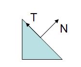

应用含**非一致缩放**（non-uniform scale）的模型视图矩阵后：

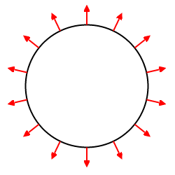

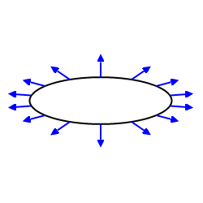

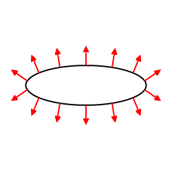

法线不再垂直于表面（切线之间的夹角也被改变了）。

若缩放是**一致**的，法线方向不变，只是长度变化，归一化即可修正。

### 推导：法线矩阵 = 逆转置

设：

- 切线 $T$，变换后 $T'$；
- 法线 $N$，变换后 $N'$；
- 顶点变换矩阵 $M$（左上 3×3），法线矩阵 $G$。

切线由两个顶点之差得到，所以用顶点矩阵变换：$T'=MT$。
法线用待定矩阵：$N'=GN$。

要求变换后仍垂直：

$$T'\cdot N'=0$$

写成点乘（内积）的矩阵形式。注意 $(MT)^T N' = T^T M^T G N$：

$$T'^T N'=(MT)^T(GN)=T^T M^T G N = 0$$

由于 $T$ 是切向量，满足 $T\cdot N=0$。取 $G=\left(M^{-1}\right)^{T}$ 时

$$N^{T}G^{T}MT=N^{T}\left(M^{-1}M\right)T=N^{T}T=0$$

对任意切线都恒成立，说明该取法满足要求。完整推导链：

$$N'\cdot T'=(GN)\cdot(MT)=0$$

$$(GN)\cdot(MT)=(GN)^{T}(MT)=N^{T}G^{T}MT$$

$$G^{T}M=I\ \Longrightarrow\ G=\left(M^{-1}\right)^{T}$$

即**法线矩阵是模型（视图）矩阵左上 3×3 的逆矩阵的转置**。

（原稿此处写作 $M^{T}G=0$；该式只能推出 $G=0$，已按图中的 $G^{T}M=I$ 更正。）

OpenGL 固定管线把这个矩阵放在 `gl_NormalMatrix` 中（它是 modelview 左上 3×3 的逆转置）。

### 何时可用模型矩阵直接变换法线

若 $M$ 的左上 3×3 子矩阵**正交**，则

$$(M^{-1})^T=(M^T)^T=M$$

即可以直接用模型矩阵变换法线。正交矩阵的行/列都是单位向量且互相正交，是保角变换：夹角与长度都不变，法线自然保持垂直。什么时候 $M$ 正交？把几何变换限制为**旋转 + 平移**（只用 `glRotate`/`glTranslate`，不用 `glScale`）时成立；`gluLookAt` 也建立正交矩阵。旋转矩阵必为多个旋转的乘积，而 $(R_1R_2\cdots R_n)^T=R_n^T\cdots R_1^T$，故 $RR^T=I$，乘积仍正交。

更一般地，"从模型矩阵**抽出旋转**再归一化"这个做法只在两种情况下成立：

1. $M$ 的左上 3×3 是**正交阵**（纯旋转，可含平移）；
2. $M$ 是**等比缩放 + 旋转**，即 $M=sR$（$s$ 为标量）。

此时

$$(M^{-1})^T=\left((sR)^{-1}\right)^T=\tfrac{1}{s}\left(R^{-1}\right)^T=\tfrac{1}{s}R$$

与 $R$ 只差一个正标量因子，归一化后方向一致，所以"提取旋转 + 归一化"合法。

**但实际建模常含非一致缩放**：非等比缩放或含切变时上式不成立，$(M^{-1})^T$ 会把法线拉向与旋转分量不同的方向，归一化只能修正长度、修不了方向，必须直接用 $(M^{-1})^T$ 变换法线。

### 法线归一化

```glsl
normal = normalize(gl_NormalMatrix * gl_Normal);
```

- 若 `gl_NormalMatrix` 正交，变换后长度不变，VS 中可省去归一化（前提是顶点法线已是单位向量）。
- **片元着色器必须重新归一化**：插值后的法线方向正确但长度小于 1。

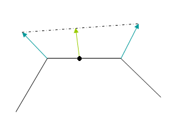

插值法线（绿色）都落在黑色点划线上，模长小于单位长度的顶点法线（蓝色）。

> 若顶点法线本身没有单位化，插值得到的方向也是错的。因此即使某个顶点法线在 VS 中"用不到"，也可能需要归一化。

例外：所有顶点法线方向相同且已归一化（如平面），插值后仍是单位长度，可省。

---

## 由深度重建法线

无法线数据时（延迟渲染只有 depth、或需要法线做后处理），可由深度图重建法线。质量不如模型自带法线，酌情使用。

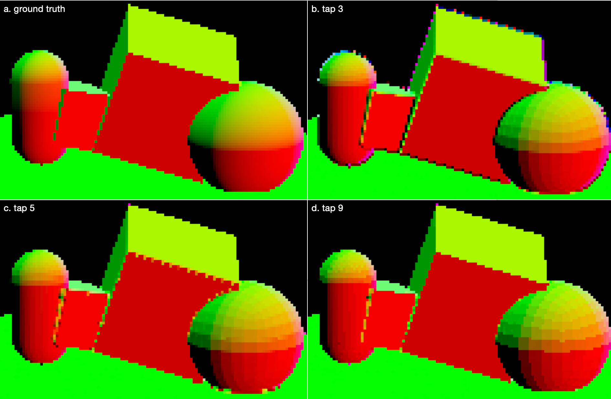

对比图含义：

- (a) 模型自带法线，作为基准；
- (b) tap 3，用 center/right/up 三个深度样本；
- (c) tap 5，用 center/left/right/up/down 五个样本，水平与垂直方向各比较深度差，取深度差小的方向求 cross；
- (d) tap 9，用 9 个深度样本做更精确的深度比较。

> tap 9 与 tap 5 的区别：采样 9 个深度点做比较，但重建世界坐标仍只用 5 次。

### Tap 3

开销最小。可直接用屏幕空间导数：

```hlsl
float3 normalWS = normalize(cross(ddx(posWS), ddy(posWS)));
```

> 严格说这是"tap 1"（只采一次深度，导数由硬件 quad 提供）。

也可以显式采 right/up 两个相邻像素并重建世界坐标：

```hlsl
float3 worldPos[3];
worldPos[0] = GetPosWS(LoadSceneDepth(i.positionCS.xy),               i.rayWS[0]);
worldPos[1] = GetPosWS(LoadSceneDepth(i.positionCS.xy + float2(1, 0)), i.rayWS[1]);
worldPos[2] = GetPosWS(LoadSceneDepth(i.positionCS.xy + float2(0, 1)), i.rayWS[2]);

float3 hDeriv = worldPos[1] - worldPos[0];    // +float2(1, 0)
float3 vDeriv = worldPos[2] - worldPos[0];    // +float2(0, 1)：屏幕 y 向下，即 ddy
float3 worldNormal = SafeNormalize(cross(hDeriv, vDeriv));
```

同样三个样本，显式重建比 `ddx/ddy(posWS)` 效果好（后者在深度不连续处会跨越两个面）。

> **Y 轴约定**：本节统一以 `positionCS.xy + float2(0,1)`（`SV_Position` 的 y 向下方向，即 D3D/Unity 的 `ddy`）为 `+v`，tap 3 与 tap 5 都写 `cross(hDeriv, vDeriv)`，等价于 `cross(ddx, ddy)`；tap 9 的 `centerPos - downPos` 与 `upPos - centerPos` 都是 `-ddy`，所以它的 `cross(vDerivative, hDerivative)` 与上式同向。若改为用 uv 取邻域，uv.y 的指向取决于 `UNITY_UV_STARTS_AT_TOP` 与目标 API 的视口原点；uv.y 向上时必须把 v 方向与叉乘次序**同时**翻转，否则法线整体反向。

### Tap 5

tap 3 在 mesh 边界会出错：所选的相邻像素与当前像素不在同一三角面上。

tap 5 增加一次深度比较来选正确的邻居：以 $c$ 为例，比较 $|b-c|$ 与 $|d-c|$，认为深度差小者与当前像素共面。

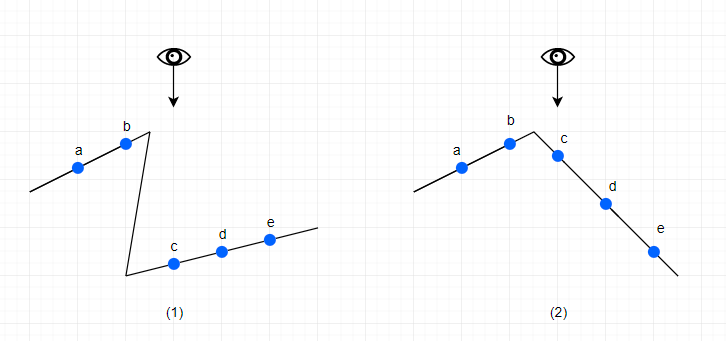

```hlsl
float3 ddxLeft  = centerPos - leftPos;
float3 ddxRight = rightPos - centerPos;
float3 ddyDown  = downPos - centerPos;    // +float2(0, 1)
float3 ddyUp    = centerPos - upPos;      // up = y-1，故取反后同样是 ddy

// 原始深度非线性但是单调，可直接比较，不必转线性深度
float3 hDeriv = abs(l - c) < abs(r - c) ? ddxLeft : ddxRight;
float3 vDeriv = abs(d - c) < abs(u - c) ? ddyDown : ddyUp;
float3 normalWS = SafeNormalize(cross(hDeriv, vDeriv));
```

tap 5 解决了左侧情形，右侧（单侧多条边）仍会出错。

### Tap 9

用 9 个深度样本、重建 5 个世界坐标。根据 $a,b$ 推算 $c_1$，根据 $d,e$ 推算 $c_2$，再比较 $|c_1-c|$ 与 $|c_2-c|$ 选正确的邻居。

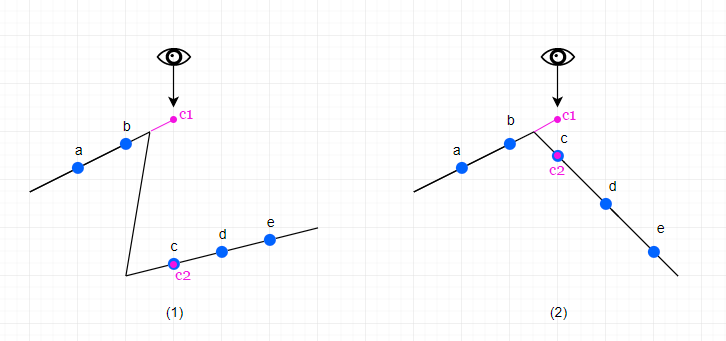

推算借助梯形中线：上底 $c$、下底 $a$、中线 $b$ 满足 $2b=c+a$，故

$$c_1=2b-a,\qquad c_2=2d-e$$

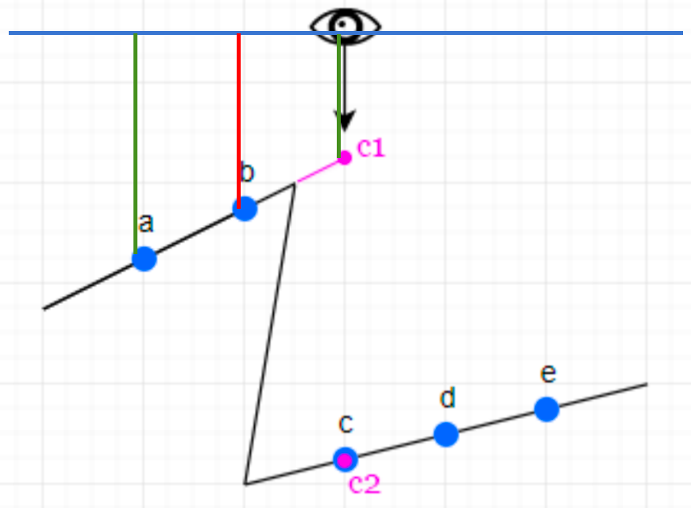

```hlsl
float2 he = abs((2.0 * H.xy - H.zw) - c);   // H = (l, r, l2, r2)
float2 ve = abs((2.0 * V.xy - V.zw) - c);   // V = (d, u, d2, u2)

float3 hDerivative = he.x < he.y ? centerPos - leftPos : rightPos - centerPos;
float3 vDerivative = ve.x < ve.y ? centerPos - downPos : upPos   - centerPos;
float3 worldNormal = SafeNormalize(cross(vDerivative, hDerivative));
```

结果对比：tap 3 在 a、b 两处都有 artifact；tap 5 改善了 a；tap 9 两处都改善。

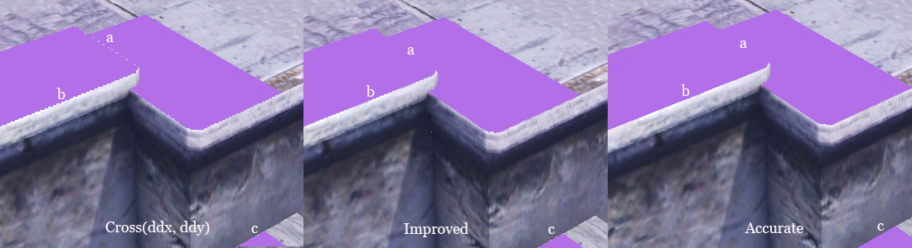

### 世界坐标重建（配套代码）

```hlsl
float3 CreateRayWS(float2 uv)
{
#if UNITY_UV_STARTS_AT_TOP
    uv.y = 1.0f - uv.y;
#endif
    float4 clipPos = float4(uv * 2 - 1, UNITY_RAW_FAR_CLIP_VALUE, 1);
    float4 worldPos = mul(UNITY_MATRIX_I_VP, clipPos);
    return worldPos.xyz / worldPos.w - _WorldSpaceCameraPos;
}

float3 GetPosWS(float rawDepth, float3 rayWS)
{
    float mask = rawDepth != UNITY_RAW_FAR_CLIP_VALUE ? 1.0 : 0.0;
    float linearDepth01 = Linear01Depth(rawDepth, _ZBufferParams);
    return (_WorldSpaceCameraPos + rayWS * linearDepth01) * mask;
}
```

要点：

- 全屏三角形的 UV 与 `UNITY_UV_STARTS_AT_TOP` 相关，射线必须用**左下为原点**的坐标系构造；
- 天空/远平面像素用 mask 归零，避免参与法线计算；
- 视空间法线转世界法线用 `mul((float3x3)unity_CameraToWorld, normalVS)`；`UNITY_MATRIX_I_V` 与它本质相同，两者都可，关键是转成 `float3x3` 去掉平移。

### 三种 tap 的取舍

| 方案 | 深度采样 | 世界坐标重建 | 质量 | 适用 |
|---|---|---|---|---|
| tap 3 | 3（或 1 + 导数） | 3 | 边缘有 artifact | 低预算、远景 |
| tap 5 | 5 | 5 | 单侧边缘仍错 | 通用 |
| tap 9 | 9 | 5 | 两侧边缘均改善 | 高质量后处理 |

---

## Cubemap 纹理坐标与方向向量

### 方向向量 → 纹理坐标（Unity，左手系）

以分量绝对值最大者为主轴选面，另两分量除以主轴长度归一化到 $[-1,1]$，再映射到 $[0,1]$。

```csharp
if (absX > absY && absX > absZ) {
    if (x > 0) { u = -z/absX; v = -y/absX; face = +X; }
    else       { u =  z/absX; v = -y/absX; face = -X; }
} else if (absY > absZ) {
    if (y > 0) { u =  x/absY; v =  z/absY; face = +Y; }
    else       { u =  x/absY; v = -z/absY; face = -Y; }
} else {
    if (z > 0) { u =  x/absZ; v = -y/absZ; face = +Z; }
    else       { u = -x/absZ; v = -y/absZ; face = -Z; }
}
u = u * 0.5f + 0.5f;
v = v * 0.5f + 0.5f;
```

**为什么 +X 面是 $u=-z/|x|,\ v=-y/|x|$？**

- $z$ 从 $-1$ 到 $+1$ 在 +X 面上是**从右向左**，而 $u$ 需要从左向右 → 取负号；
- $y$ 从 $-1$ 到 $+1$ 是从下向上，而图像坐标的 $v$ 是**向下递增**；从 +X 面外侧看，屏幕下方对应 $-Y$，所以 $v=-y$。这里不需要任何"Unity 上下翻转"的假设，GL/D3D 规范的 cubemap 面映射本来就是这一组式子（$+Y$ 面 $v=+z$、$-Y$ 面 $v=-z$，也不存在统一的翻转）。

完整表格（Unity 左手系，$u,v$ 已映射到 $[0,1]$）：

| Face | $u$ | $v$ |
|---|---|---|
| +X | $-z/\lvert x\rvert$ | $-y/\lvert x\rvert$ |
| −X | $+z/\lvert x\rvert$ | $-y/\lvert x\rvert$ |
| +Y | $+x/\lvert y\rvert$ | $+z/\lvert y\rvert$ |
| −Y | $+x/\lvert y\rvert$ | $-z/\lvert y\rvert$ |
| +Z | $+x/\lvert z\rvert$ | $-y/\lvert z\rvert$ |
| −Z | $-x/\lvert z\rvert$ | $-y/\lvert z\rvert$ |

> **待核实**：原始笔记中另给出一个"OpenGL 右手系"版本（+X: $sc=z,\ tc=y$；−X: $sc=-z,\ tc=y$；+Z: $sc=-x,\ tc=y$）。该版本与 GL 规范的 cubemap 面映射（+X: $s=-z,\ t=-y$；−Z: $s=-x,\ t=-y$，等等）符号不一致，疑为特定自研渲染器的面布局，使用前需按目标 API 实测。

面内采样需自己实现双线性（`Sample2D`）：UV 映射到 $[0,size-1]$ 后取 floor/ceil 四点，按小数部分 lerp。

### 纹理坐标 → 方向向量（以 Cubemap 生成 SH 为例）

面的分辨率为 $size\times size$，方向分量范围 $[-1,1]$，需要建立 $[0,size-1]\to[-1,1]$ 的映射。由于希望方向指向**像素中心**，实际映射区间是 $[-1+1/size,\ 1-1/size]$：

$$\text{coord}=pixel\cdot\frac{2}{size}+\left(-1+\frac1{size}\right)$$

```cpp
const int size = img.GetWidth();
const float coordBias  = -1.f + 1.f / size;
const float coordScale = 2.f / size;

for (int y = 0; y < size; ++y) {
    float fy = y * coordScale + coordBias;
    for (int x = 0; x < size; ++x) {
        float fx = x * coordScale + coordBias;
        // 方向 = basisZ + basisX*fx + basisY*fy（再归一化）
        Vector3f dir = Normalize(basisZ + basisX * fx + basisY * fy);

        // 立体角权重：dω = 4 / (sqrt(1+fx²+fy²) * (1+fx²+fy²))
        // 此处为中心点微分近似；精确权重见下节四角闭式
        float ftmp = 1.0f + fx * fx + fy * fy;
        float linearWeight = 4.0f / (Sqrt(ftmp) * ftmp);

        float r = pixel[1] * pixelToFloat;   // Unity 的 ARGB32 原始内存序是 A,R,G,B，故索引 1/2/3 为 R/G/B
        /* 累加到 SH 系数，权重乘 linearWeight，weightSum 累加 */
    }
}
```

要点：

- 纹理左上角为 $(0,0)$，$u$ 从左向右递增，$v$ 从上向下递增（Unity 对图像 $v$ 方向做了上下翻转）；
- 每面单独积分后除以 6，再做 SH 归一化（`kNormalizationConstants`）；
- 立体角权重 $4/(\sqrt{1+x^2+y^2}\,(1+x^2+y^2))$ 是 cubemap 面元到球面立体角的雅可比，不可省略，否则面中心与角落的权重会失衡。

### 纹素的立体角与闭式积分

上面代码里的 `linearWeight` 是**微分形式**的立体角；做 irradiance / SH 这类"对整个半球积分"的计算时，逐纹素用微分近似会在大面元上产生偏差，更稳的做法是对纹素**四角做闭式积分再相减**。

**为什么必须加权**：cubemap 每个面是正方形的，但它映射到球面上的像不是等面积的——面中心的纹素对应较大的立体角，越靠角落立体角越小（既倾斜又更远）。若把 6 个面、每面 $size^2$ 个纹素当成等权样本，等于给球面加了一个"中心疏、边缘密"的错误权重：边缘纹素的贡献被系统性高估，irradiance 与 SH 都会偏离正确值（低阶项受影响相对小，高阶项更明显）。

**面积元**：以 +Z 面为例，把面参数化为

$$p(s,t)=\frac{(s,t,1)}{\sqrt{1+s^2+t^2}},\qquad (s,t)\in[-1,1]^2$$

两个偏导叉乘的模就是面元到球面的雅可比：

$$\left\|\frac{\partial p}{\partial s}\times\frac{\partial p}{\partial t}\right\|=\frac{1}{(1+s^2+t^2)^{3/2}}$$

$$\mathrm{d}\omega=\frac{\mathrm{d}s\,\mathrm{d}t}{(1+s^2+t^2)^{3/2}}$$

于是某个纹素（四角 $A,B,C,D$）的立体角是

$$\Omega=\int_{s_0}^{s_1}\!\!\int_{t_0}^{t_1}\frac{\mathrm{d}s\,\mathrm{d}t}{(1+s^2+t^2)^{3/2}}=F(A)+F(C)-F(B)-F(D)$$

其中

$$F(s,t)=\arctan\frac{st}{\sqrt{1+s^2+t^2}}$$

$A=(s_0,t_0),\ B=(s_1,t_0),\ C=(s_1,t_1),\ D=(s_0,t_1)$ 按逆时针取角，正是二维积分的容斥展开 $F(s_1,t_1)-F(s_0,t_1)-F(s_1,t_0)+F(s_0,t_0)$。

**自检**：取单面的四个角 $(\pm1,\pm1)$，$\Omega=4\arctan(1/\sqrt3)=4\cdot\frac{\pi}{6}=\frac{2\pi}{3}$；六面合计 $6\cdot\frac{2\pi}{3}=4\pi$，与整球立体角吻合。

**两种形式的关系**：相邻两角的坐标差 $\Delta s=\Delta t=2/size$，所以

$$\Omega\approx\frac{(2/size)^2}{(1+s^2+t^2)^{3/2}}$$

归一化（$\sum\Omega$ 或 $1/6$ 平均）时只约掉 $1/size^2$，分子 $4$ 保留（即 $2^2$），于是权重写成 $4/(1+s^2+t^2)^{3/2}$——这就是代码里 `4.0f / (Sqrt(ftmp) * ftmp)` 的来历。两者差别只在**大面元/低分辨率**时显著；$size\ge128$ 时微分近似已足够，但闭式解没有额外成本，优先用它。

**其他面**：其余五面同理，取该面的两个切向轴做参数化即可（$|n|$ 分量恒为 1，不需要额外的 $\cos\theta$ 因子——它已经包含在雅可比里）。符号随面的朝向翻转，最终每个纹素的 $\Omega$ 恒为正，可直接用于权重。

```cpp
// 单面单纹素的立体角：四角闭式积分
inline float AreaElement(float x, float y)
{
    return atan2f(x * y, sqrtf(x * x + y * y + 1.0f));
}

float TexelSolidAngle(float s0, float t0, float s1, float t1)
{
    return AreaElement(s1, t1) - AreaElement(s0, t1)
         - AreaElement(s1, t0) + AreaElement(s0, t0);   // 恒为正
}
```

> 实现细节：$s,t$ 必须取到**纹素边界**（而不是纹素中心）。若沿用"像素中心"映射 `coordBias = -1 + 1/size`，则四角应各加减半个 texel 步长 `1/size`，否则每个纹素都少算了一圈。

> 反射类效果把 RT 当纹理采样的部分（SSR / SSPR 的算法、固有问题与对比）见《03_图形学/08_后处理》§SSR/SSPR。

---

## 图像深度（Bit Depth）

图像深度指存储每个像素所用的位数，也用于度量色彩分辨率。它决定彩色图像每像素可能的颜色数，或灰度图像的最大灰度级数。

- 单色 8 bit → 最大灰度数 $2^8=256$；
- 彩色 RGB 各 4/4/2 bit → 颜色数 $2^{4+4+2}=1024$，即像素深度 10 bit。

OpenCV 的深度显示范围（定义深度后，像素灰度值需落在该范围内才能正确显示，否则要转换）：

```text
double            : 0.0 ~ 1.0        IPL_DEPTH_64F
float             : 0.0 ~ 1.0        IPL_DEPTH_32F
long              : -2147483648 ~ 2147483647  IPL_DEPTH_32S
short int         : -32768 ~ 32767   IPL_DEPTH_16S
unsigned short int: 0 ~ 65535        IPL_DEPTH_16U
char              : -128 ~ 127       IPL_DEPTH_8S
unsigned char     : 0 ~ 255          IPL_DEPTH_8U
```

### HDR 图像

- 通常用 `.exr` / `.hdr` 存储；
- 每像素可有多个通道，每通道**可超过 1.0**；
- 普通 LDR 纹理采样后值被归一化到 $[0,1]$，HDR 纹理不会；
- 因此 HDR 环境贴图、lightmap、Bloom 前置缓冲都应使用浮点格式（R16G16B16A16F / R11G11B10F 等）。

---

## 纹理倾斜（行对齐问题）

用 OpenGL 绘制某些纹理时图片会"倾斜/错位"：

原图：

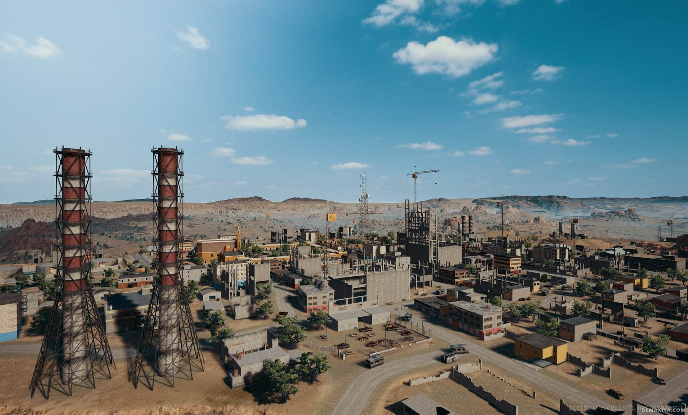

绘制结果：

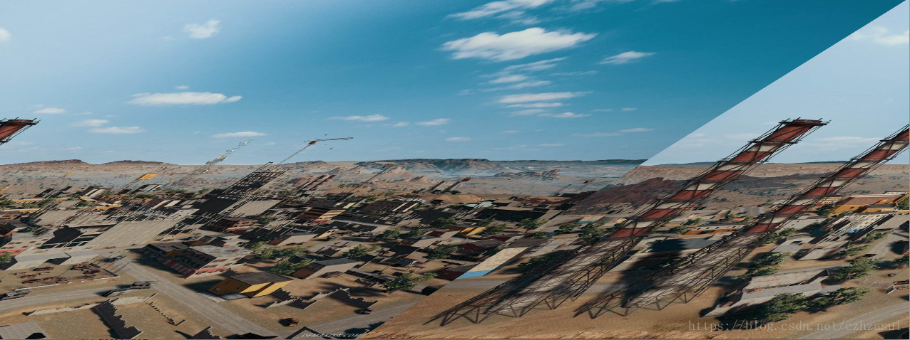

原因：**OpenGL 默认要求每行像素按 4 字节对齐**（`GL_UNPACK_ALIGNMENT` 默认 4）。多数纹素为 4 字节或宽度为 4 的倍数时不会出问题；这张 jpg 宽高都不是 4 的倍数，GL 按 4 字节对齐**推算**每行行首（认为每行有 padding），而数据实际是紧排的，于是每行都被多跳过若干字节、逐行累积偏移，形成倾斜。

解决：

```c
glPixelStorei(GL_UNPACK_ALIGNMENT, 1);   // 上传前设置
```

（等价地，可把宽度补齐到 4 的倍数，或在加载时自行 repack。注意该状态是**全局**的，设置后应复位，否则会影响后续上传。）

---

## 纹理尺寸的 2 的 n 次方限制

老 GPU / GLES 2.0 要求纹理宽高为 2 的幂（POT）。动态"满足"该限制的常见做法：申请一个 POT 大小的纹理，把原图用 `glTexSubImage2D` 写入左下角，其余留空，并在采样时用缩放系数把 UV 限制到实际内容区域。

```c
inline int next_p2(int a)
{
    int rval = 1;
    while (rval < a) rval <<= 1;
    return rval;
}

int nWidthPowerOfTwo  = next_p2(tex.nWidth);
int nHeightPowerOfTwo = next_p2(tex.nHeight);

if (tex.nWidth == nWidthPowerOfTwo && tex.nHeight == nHeightPowerOfTwo)
{
    glTexImage2D(GL_TEXTURE_2D, 0, GL_RGBA,
                 nWidthPowerOfTwo, nHeightPowerOfTwo, 0,
                 ilGetInteger(IL_IMAGE_FORMAT), GL_UNSIGNED_BYTE, ilGetData());
    tex.fScaleX = tex.fScaleY = 1.0f;
}
else
{
    // 先分配空白 POT 纹理
    glTexImage2D(GL_TEXTURE_2D, 0, GL_RGBA,
                 nWidthPowerOfTwo, nHeightPowerOfTwo, 0,
                 ilGetInteger(IL_IMAGE_FORMAT), GL_UNSIGNED_BYTE, NULL);
    // 再把原图写入左下角
    glTexSubImage2D(GL_TEXTURE_2D, 0, 0, 0, tex.nWidth, tex.nHeight,
                    ilGetInteger(IL_IMAGE_FORMAT), GL_UNSIGNED_BYTE, ilGetData());
    // 采样时把 UV 缩到有效区域
    tex.fScaleX = (float)tex.nWidth  / (float)nWidthPowerOfTwo;
    tex.fScaleY = (float)tex.nHeight / (float)nHeightPowerOfTwo;
}
```

配套采样：

```glsl
vec2 uv2 = vUV * vec2(fScaleX, fScaleY);
```

要点与代价：

- 显存浪费（最坏接近 4 倍面积）；
- 双线性采样在内容边界可能采到空白区，需要 clamp 或额外留 1 像素边缘；
- **mipmap 会污染**：POT 纹理的 mip 链包含空白区域，低级别会混入黑边/透明边。解决：手动只生成内容区域的 mip，或用 `GL_TEXTURE_MAX_LEVEL` 限制，或直接放弃 POT（现代 API 与 GLES 3.0+ 都支持 NPOT，仅要求部分 wrap 模式与 mipmap 组合受限）；
- 现代做法：能用 NPOT 就用 NPOT，`glPixelStorei(GL_UNPACK_ALIGNMENT, 1)` 解决对齐。

---

## 附录：工作日志中的补充记录

> 摘自 `Log/` 下的工作日志，只保留纹理、法线与纹理采样相关的技术结论（通道分配依据、解包实现的出处、合并流程中的法线约束、mipmap 采样设置），已删去日期、任务名、进度、截图调试记录与个人内容。与正文重复的条目不复述，只做交叉引用。

### B.1 DXT5nm：为什么把 $x$ 放 A、$y$ 放 G

Unity 对法线贴图采用的压缩方案称 **DXT5nm**（DXT5 的变体），其通道分配是：

- **A 通道存 $x$**（8 bit，精度最高）；
- **G 通道存 $y$**（6 bit，次高）；
- $z$ **不存**，由单位向量约束重建。

**依据是各通道的有效（端点）精度**：DXT5 一个块内各通道的有效精度约为 **R5G6B5A8**（R/G/B 的端点分别用 5/6/5 位插值编码，A 为 8 位），整块仍是 **8 bpp** 的压缩格式，不能理解成"每像素 5+6+5+8 = 24 bit"。R、B 的端点精度最低（5 bit），误差最大；所以要丢掉两个分量时，丢掉 R、B，把精度敏感的两个分量放进 A（8 bit）和 G（6 bit）。这就是"DXT5nm 用 A/G 存 xy"的由来，而不是随便挑的两个通道。

$z$ 的重建：法线是单位向量，故

$$z=\sqrt{1-x^2-y^2}=\sqrt{1-(x^2+y^2)},\qquad z\ge 0$$

取正号是因为切线空间法线贴图约定法线位于 $+z$ 半球（背离表面的一侧）。$x^2+y^2>1$ 时（压缩误差导致），用 `saturate` 夹住再开方，并给一个极小值下限避免除零。

解包实现见《05_Unity/02_Shader与材质》§8.5，此处不重复。唯一需要额外记住的一条：**要做混合/累加/缩放时不能走这条 `UnpackNormalAG` 路径**——归一化会破坏线性叠加的可加性，此时应改用 **`UnpackDerivativeNormalAG`**（HDRP 的做法），用导数形式表示法线，它可以正确混合、累加、缩放。

> 与正文的关系：正文"法线贴图原理 → 存储与解码"只提到"DXT5nm 只存 X 与 Y（存在 A 与 G 通道），Z 由 $z=\sqrt{1-x^2-y^2}$ 重建"；"使用中的问题清单"第 7 条只解释为"让 $x$ 获得更好的插值精度"。此处补上**通道有效精度 R5G6B5A8** 这一更准确的依据，以及 `UnpackDerivativeNormalAG` 的适用边界。
> 另需注意：解包后 $z$ 恒为正，所以 DXT5nm **无法表示法线朝下的半空间**——这是格式本身的限制，不是实现缺陷。

### B.2 合并 mesh 时的法线处理

**场景**：一个模型由多个子 mesh 组成，各有自己的 transform 矩阵；合并时把顶点位置乘上各自的矩阵烘焙到统一空间后，法线方向出错。

结论一句话就够了：**顶点与法线必须进入同一空间、各自只变换一次——位置用 $M$，法线用 $(M^{-1})^{T}$ 后再归一化**。推导、`localToWorldMatrix` 与 `TRS` 的辨析、以及合并时的 UV/材质处理，见《03_图形学/11_网格与几何处理》§7.1 与附录 A.1，此处不重复。

### B.3 mipmap 边缘污染与 Replicate Border

- **mipmap 定义见正文《Mipmap（LOD 选择）》**，此处只记边缘污染的结论。
- **问题**：级别增大时，**边缘像素会逐渐与内部像素产生关联**（低级别 texel 是由包含"边缘 + 内部"的更大区域平均出来的），于是边缘颜色被内部颜色**污染**。表现为图案边缘发暗、串色、出现半透明镶边，透明背景的 UI/图标尤其明显。
- **处理**：勾选 **Replicate Border**——生成 mip 时把最外圈像素向外**复制一圈**再降采样，使每一级的边缘都保持原来的颜色，不再与内部混合。日志中的对照即"未勾选 → 边缘被污染；勾选后 → 边缘保留"。

（待核实：该选项在不同工具的 UI 名称不同——Unity 的纹理导入设置里对应 `Border Mip Maps`（`TextureImporter.borderMipmap`），部分 DCC/压缩工具里直接叫 `Replicate Border`；不同引擎版本位置与命名可能变化。）

> 交叉引用：正文"纹理尺寸的 2 的 n 次方限制"小节里提到的"POT 空白区把 mip 链污染"是同一类问题的另一个来源——那里是**空白区**混入，这里是**内部像素**混入，解法都是限制 mip 生成范围或显式复制边缘。

### B.4 未重复收录的条目

- **切线空间的定义、由 position/UV 偏导求 $T$ 再正交化叉乘得 $B$、TBN 为 3×3 正交矩阵故逆=转置**：日志与正文"切线空间"章完全一致，正文已给出推导与 shader 实现，不重复。
- **DXT5nm 的"只存 $xy$、$z$ 重建"**：正文已有，此处仅补通道有效精度依据（见 B.1）。
- 同批日志中的 **mesh 合并的工程细节**（用 uv1 通道存各材质纹理映射参数、纹理拆分为多张以保持 $[0,1]$ UV、相机 RT 颜色空间、渲染顺序调试等）：属工程记录而非纹理/法线的通用结论，未收录。

---

## 原始笔记索引

- `Graphics/Texture/Texture(纹理贴图)和Material(材质）概念上的区别.md`
- `Unity/纹理压缩格式.md`
- `Unity/浮点数编码到RGBA8.md`
- `OpenGL/EXT_texture_filter_anisotropic.md`
- `Graphics/Anti-Aliasing/貼圖 filtering 與 MIP map 簡介.md`（各向异性部分）
- `Graphics/Texture/切线空间.md`
- `Unity/法线贴图使用中的问题.md`
- `Graphics/Normal Transformation(法线变换).md`
- `Graphics/法线矩阵.md`
- `OpenGL/OpenGL Normal Vector Transformation.md`
- `根目录笔记/重建法线.md`
- `Graphics/Texture/Cubemap纹理坐标与方向向量的转换.md`
- `Unity/Unity中的Cubemap实现.md`
- `根目录笔记/反射.md`（纹理采样相关部分）
- `Graphics/Texture/图像深度.md`
- `OpenGL/openGL纹理倾斜.md`
- `OpenGL/OpenGL动态执行2n次方图像限制.md`
- `Log/日志0619.md`（DXT5nm 通道分配与 UnpackNormalAG；合并 mesh 的法线/矩阵问题）
- `Log/杂记/日志.md`（mipmap 边缘污染与 Replicate Border，仅取该条）
- `Log/随记.md`（切线空间条目，与正文已有内容重复，仅交叉核对）
- `归类/各向异性过滤.md`（EXT_texture_filter_anisotropic 原文、高通/ARM 的采样成本结论）
- `归类/resume.md`（仅取指定行段：「Cubemap 纹素的立体角」916–949 行、「切线空间与 TBN 矩阵」1123–1159 行、「各向异性」1160–1163 行〔该段为空标题〕、「mipmap」1164–1175 行、「视差效果」1176–1212 行）
