# 后处理：Bloom、模糊、景深、AO 与屏幕空间反射

> 本文整理屏幕空间后处理（post-processing）的常见家族：Bloom、Blur（盒式/高斯/降采样/双边）、图像锐化、Depth of Field、SSAO/HBAO、SSR/SSPR。重点保留算法步骤、公式、可运行代码片段与性能结论；Unity 专属的管线挂载点与参数面板主体不展开，管线相关结论集中在附录。渲染管线与深度可见性见《01_渲染管线》，抗锯齿与采样重建见《06_抗锯齿与采样重建》，阴影见《05_阴影》。

## 后处理在管线中的位置

后处理消费的是已经渲染好的颜色缓冲，通常还消费深度（depth）与法线/粗糙度（G-buffer）。因此它的成本模型与场景几何复杂度基本无关，而与**屏幕分辨率、pass 数量、每像素采样数、带宽**成正比：

$$
\text{cost} \approx \text{pixels} \times \text{passes} \times \left( \text{ALU} + \text{texture samples} \right) + \text{bandwidth}
$$

典型的 HDR 后处理顺序（不唯一，取决于管线）：

```text
Depth Prepass → Opaque → (SSAO) → (SSR) → Transparent
→ DOF → Bloom → Color Grading → Tonemap → FXAA/TAA → Present
```

> 调色在 tonemap 之前：URP 的 Color Grading 由 3D LUT 完成，tonemapping 被烘进 LUT 的**末尾**，所以"Color Grading → Tonemap"是同一个 pass 内的两步，而不是两个可随意交换的独立 pass。

两条工程原则：

1. **尽量在半分辨率或 1/4 分辨率上做模糊类效果**，最后上采样。AO、Bloom、DOF 都属于低频信号，全分辨率收益很低。
2. **合并 pass**。能在一个 fullscreen pass 里完成的（例如 bloom 的 upsample + 合成）就不要拆成多个 pass，每次 fullscreen pass 都是一次全屏读写。

---

## Bloom（泛光）

### 为什么需要 Bloom

常见图片格式（jpg/png）只能记录 $[0,1]$ 的 RGB，称为 LDR；真实世界与 HDR 渲染目标的亮度可以远大于 1。显示器、相机传感器最终仍是 LDR，所以超出范围的部分在成像时被"曝"成纯色。

Bloom 模拟的是**光线在镜头/感光元件/眼内散射后向外溢出**的物理现象：

- 曝光时间越长，进入镜头的光子越多，溢出越明显；
- 光斑形状由光圈形状决定（圆形光圈得到圆形光斑，六边形光圈得到六边形光斑）；
- 眼睛本身也有散射（瞳孔边缘、玻璃体），所以直视强光会看到放射状光晕。

在实时渲染里，Bloom 是"把 HDR 亮度信息重新分配到邻域"的近似：没有它，100 强度的自发光体在屏幕上也只是纯白；有了它，才能看出"到底溢出了多少光"。技能特效、霓虹、车灯几乎完全依赖 Bloom 成立。

Unity Post-processing Stack 暴露的效果清单（原截图内容，菜单按字母序排列）：

- Ambient Occlusion
- Auto Exposure
- Bloom
- Chromatic Aberration
- Color Grading
- Depth of Field
- Grain
- Lens Distortion
- Motion Blur
- Panini Projection
- Screen-space reflections
- Vignette

### 工程实现

标准链路（bright pass → 降采样模糊链 → 上采样叠加）：

1. **亮度提取（bright pass / prefilter）**
   以阈值 $T$ 与软膝（soft knee）$K$ 提取高亮部分，避免阈值处出现硬边：

   ```hlsl
   half3 Prefilter(half3 c)
   {
       half brightness = max(c.r, max(c.g, c.b));
       half soft = brightness - _Threshold + _Knee;
       soft = clamp(soft, 0.0, 2.0 * _Knee);
       soft = soft * soft / (4.0 * _Knee + 1e-5);
       half contribution = max(soft, brightness - _Threshold) / max(brightness, 1e-5);
       return c * contribution;
   }
   ```

2. **降采样链**：通常做 4~6 级，每级 2× 降采样并做一次小核模糊（4-tap 双线性 + tent 滤波即可）。使用 $2\times2$ 双线性采样等价于一次 4-tap box，是"白嫖"模糊的常用手段。
3. **上采样叠加**：从最小一级往回流，逐级 `add` 到上一级；上采样时用 4-tap tent 滤波抑制块状感。合并后的结果乘强度系数叠加到原图。
4. **能量归一化**：每级模糊核必须归一化，否则 bloom 强度会随 mip 数变化。

参数只有三类：**阈值/软膝**（哪些算高光）、**强度**（叠加多少）、**半径/散射**（模糊链延伸到第几级）。

> 早期实现会先做一次全分辨率高斯再叠加，成本远高于 mip 链；现代实现基本都用降采样链。Karis average（首次降采样时按亮度加权，抑制 fireflies）属于常见优化，具体权重各引擎不同（待核实目标管线的实现）。

---

## Blur（模糊）

### 盒式滤波（Box Filter）

思路：在顶点着色器输出齐次裁剪坐标下的屏幕坐标，片元里除以 $w$ 得到 $[0,1]$ 的 UV，再对 $(2r+1)^2$ 邻域求平均。

```hlsl
// vertex shader
o.screenUV = ComputeScreenPos(o.pos);
```

```hlsl
// fragment shader
TEXTURE2D(_CameraOpaqueTexture); SAMPLER(sampler_CameraOpaqueTexture);
int  _HalfKernelSize;   // 半径 r，单位：像素
half _BlurIntensity;    // 采样步长缩放

half3 BoxFilter(v2f i)
{
    // _ScreenParams = (w, h, 1 + 1/w, 1 + 1/h)，故 z-1 / w-1 即 1/w、1/h
    half2 uvPerPixel = half2(_ScreenParams.z - 1, _ScreenParams.w - 1);

    i.screenUV.xy /= i.screenUV.w;                 // 齐次 → [0,1]

    half kernelSize = 2 * _HalfKernelSize + 1;
    half weight     = rcp(kernelSize * kernelSize); // 盒式核归一化

    half3 color = half3(0, 0, 0);
    for (int r = -_HalfKernelSize; r <= _HalfKernelSize; ++r)
    {
        for (int c = -_HalfKernelSize; c <= _HalfKernelSize; ++c)
        {
            half2 uv = i.screenUV.xy + _BlurIntensity * uvPerPixel * half2(r, c);
            color += SAMPLE_TEXTURE2D(_CameraOpaqueTexture, sampler_CameraOpaqueTexture, uv).rgb * weight;
        }
    }
    return color;
}
```

复杂度 $O(r^2)$ 次采样（$r=10$ 就是 441 次）。工程上必须做**可分离（separable）优化**：

- 二维盒式/高斯核可以拆成水平、垂直两趟，复杂度从 $O(r^2)$ 降到 $O(2r)$；
- 盒式滤波还可以用**滑动窗口/前缀和**做到每像素 $O(1)$（两趟扫描，每趟每像素加一减一）。

### 高斯模糊

二维高斯核：

$$
G_\sigma(x,y) = \frac{1}{2\pi\sigma^2}\exp\left(-\frac{x^2+y^2}{2\sigma^2}\right)
$$

可分离性来自 $G_\sigma(x,y)=G_\sigma(x)G_\sigma(y)$。实践参数：

- 半径取 $3\sigma$ 可覆盖约 **98.9%** 的能量（二维核：$1-e^{-4.5}$；99.7% 是一维的 $\pm3\sigma$ 值，别混用）；
- 权重在 CPU 端预计算并归一化，shader 里只做加权和；
- 利用双线性采样可以把相邻两个 tap 合并成一次采样（线性采样优化），tap 数近似减半。

### 降采样模糊（Downsample Blur）

后处理模糊的主流做法，不是"在原分辨率上开大核"，而是"缩小图像 + 小核"：

1. 每级 2× 降采样，同时用一个 4-tap tent（或 $2\times2$ 双线性）做低通，防止走样；
2. 在低分辨率上做 3×3~5×5 的小核模糊；
3. 逐级上采样并混合。

等价于在低分辨率上获得大半径模糊，成本降到约 $1/4$、$1/16$。Bloom、DOF、SSAO 的去噪、SSR 的粗糙反射都走这条路。

### 噪声伪模糊

不追求物理正确、只要"糊"的观感时，可以对 UV 施加随机扰动，并做两次抖动来降低颗粒感：

```hlsl
half rand(half2 n)
{
    return frac(sin(dot(n, half2(12.9898, 78.233))) * 43758.5453);
}

half3 FuzzyColor(half4 screenUV)
{
    screenUV.xy /= screenUV.w;
    half2 uvPerPixel = half2(_ScreenParams.z - 1, _ScreenParams.w - 1) * _SampleStep;

    half2 disturbUV = screenUV.xy;
    half3 fuzzy = 0;

    disturbUV = uvPerPixel * (rand(disturbUV) - 0.5);
    fuzzy += SAMPLE_TEXTURE2D_LOD(_CameraOpaqueTexture, sampler_CameraOpaqueTexture,
                                  screenUV.xy + disturbUV, 0).rgb * 0.5;
    disturbUV = uvPerPixel * (rand(disturbUV) - 0.5);
    fuzzy += SAMPLE_TEXTURE2D_LOD(_CameraOpaqueTexture, sampler_CameraOpaqueTexture,
                                  screenUV.xy + disturbUV, 0).rgb * 0.5;
    return fuzzy;
}
```

这是"抖屏"式的假模糊，稳定性和能量守恒都不如降采样模糊，优点是极便宜。用于 UI 背景、风格化效果尚可。

---

## Bilateral Filter（双边滤波）

双边滤波是保边（edge-preserving）的非线性滤波器。它仍然是邻域加权平均，但权重由两个高斯核相乘：

$$
BF[I]_p = \frac{1}{W_p}\sum_{q\in S} G_{\sigma_s}\!\left(\lVert p-q\rVert\right)\, G_{\sigma_r}\!\left(\lvert I_p-I_q\rvert\right) I_q
$$

$$
W_p = \sum_{q\in S} G_{\sigma_s}\!\left(\lVert p-q\rVert\right) G_{\sigma_r}\!\left(\lvert I_p-I_q\rvert\right)
$$

- **定义域核（spatial / domain）** $G_{\sigma_s}$：只看像素间欧氏距离，与普通高斯相同；
- **值域核（range）** $G_{\sigma_r}$：看像素值的差异，是双边滤波与高斯滤波唯一的区别；
- 因为值域核依赖邻域像素值，**每个像素的权重都不同**，所以不能像高斯那样预计算一个固定卷积核。

效果：跨越边缘的像素值差异大，值域权重趋近 0，因此不会把边缘两侧平均掉；平坦区域则近似高斯平滑。代价是会把彩色图像中的高对比噪声当成"边缘"保留下来，因此对**高幅度**（高对比）的噪声无效——限制来自噪声的幅度，而不是频率。

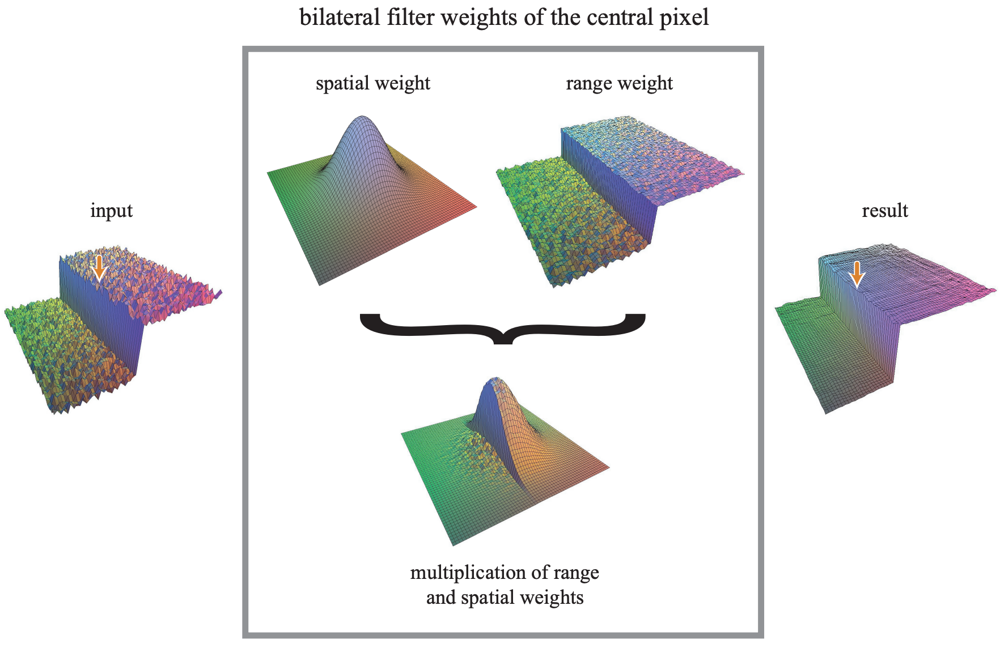

上图是同一组权重的可视化：输入信号（左侧台阶）→ 定义域核 $G_{\sigma_s}$（中间左，标准高斯）与值域核 $G_{\sigma_r}$（中间右，只在同侧台阶内非零）逐点相乘 → 得到实际的加权核（下方），中心的尖峰只沿台阶内部延伸；右图是滤波结果，台阶边缘（橙色箭头处）保持陡峭而未被平均。

在实时渲染中的两类用法：

1. **深度感知去噪**：AO/SSR/DOF 的半分辨率结果上采样时，用"颜色相似度 + 深度相似度"做权重，避免边缘渗色（cross bilateral）。
2. **保边上采样（joint bilateral upsampling）**：低分辨率结果用高分辨率颜色/深度作引导。

---

## 图像锐化（Sharpen）

### 高通滤波不等于锐化

高斯/盒式模糊是低通滤波，会去掉高频。直觉上"高通滤波 = 锐化"，其实不是：高通滤波的结果**只剩**高频（边缘的浮雕感），并不叠加回原图。

真正的锐化是 **Unsharp Mask**：

1. 对原图做模糊（Box / Tent / Gaussian 均可）得到 $B$；
2. 原图减去模糊图，得到高频细节 $I-B$；
3. 把高频细节加回原图：

$$
I' = I + (I - B) = 2I - B
$$

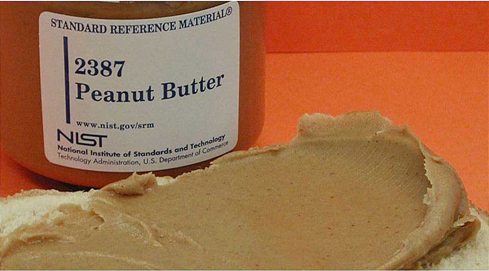

### 从模糊核直接构造锐化核

卷积是线性的，因此"$2\times$ 原图减模糊"可以直接写成一个卷积核：

$$
K_{\text{sharp}} = 2 \cdot K_{\text{identity}} - K_{\text{blur}}
$$

以 $3\times3$ 盒式模糊为例（每项 $1/9$），中心为 $2 - 1/9 = 17/9$，其余 8 项为 $-1/9$，核对角和为 1：

$$
K=\frac{1}{9}
\begin{bmatrix}
-1 & -1 & -1\\
-1 & 17 & -1\\
-1 & -1 & -1
\end{bmatrix}
$$

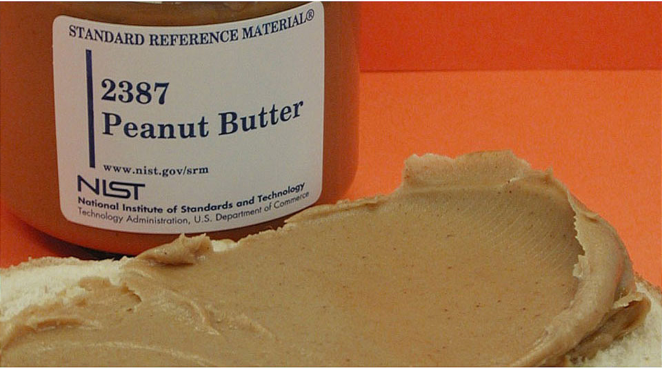

若模糊核是 $\sigma=0.3$ 的归一化高斯，同样可以机械地算出锐化核。

### 两个必须注意的点

1. **核的和 = 滤波器对常数信号的响应**。低通核和为 1（保留 DC）；高通核和为 0（滤掉 DC）。锐化核由 $2I-B$ 构造，若 $B$ 归一化，则锐化核和也为 1，不会整体变亮/变暗。想让锐化同时提亮，把核乘一个常数即可（和随之变为该常数）。
2. **输出会越界**。锐化核含负值且中心大于 1，对 $[0,1]$ 的输入做卷积后可能小于 0 或大于 1，必须 clamp 或做重映射（tone mapping），否则在 HDR/后处理链里会产生负色或溢出色。

> 工程上的"CAS（Contrast Adaptive Sharpening）"会在锐化时按局部对比度自适应降低强度以抑制振铃；本文源笔记只覆盖线性 unsharp mask。

---

## Depth of Field（景深）

### 针孔相机与透镜相机

- **针孔相机**：光沿直线穿过小孔成像。没有镜头，因此**景深无限**，也不需要聚焦；缺点是进光量极少，曝光时间极长。
- **透镜相机**：用凸透镜汇聚光线。平行光经过凸透镜汇聚于**焦点（focal point）**，焦点到透镜的距离是**焦距（focal length）**。

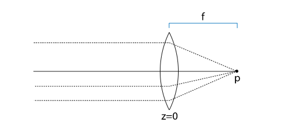

当成像面（胶片/传感器）不在该物点对应的**像平面**上时，物点成像不是一个点，而是一个圆——**弥散圆（circle of confusion, CoC）**。光圈越大、焦距越长、物距越偏离对焦距离，弥散圆越大，图像越模糊。

实践中不需要完美对焦：只要弥散圆直径小于传感器像素尺寸，就认为合焦。能合焦的物距范围就是**景深（depth of field）**。

### CoC 的计算

记号：

| 符号 | 含义 |
|:--|:--|
| $A$ | 光圈直径（aperture diameter） |
| $F$ | 焦距（focal length），镜头固有属性 |
| $P$ | 对焦距离（物距），镜头与成像面确定后为常数 |
| $z$ | 当前物体到镜头的距离 |
| $I$ | 成像面到镜头的距离 |

薄透镜公式：

$$
\frac{1}{F}=\frac{1}{P}+\frac{1}{I},\qquad
\frac{1}{F}=\frac{1}{z}+\frac{1}{I_z}
$$

由相似三角形，弥散圆直径为：

$$
c(z) = A\,\frac{\lvert I-I_z\rvert}{I_z}
     = \frac{A\,F\,\lvert z-P\rvert}{z\,(P-F)}
$$

用 f-number $N=F/A$ 改写：

$$
c(z)=\frac{F^2}{N}\cdot\frac{\lvert z-P\rvert}{z\,(P-F)}
$$

按 Siggraph 2018《Advances in Real-Time Rendering》课件的写法（Potmesil81 的记号），把上式归并成"背景最大弥散圆"加一个随距离变化的因子：

$$
\text{MaxBgdCoC}=\frac{A\,F}{P-F},\qquad
\text{CoC}(z)=\left(1-\frac{P}{z}\right)\text{MaxBgdCoC}
$$

课件同时给出 $\text{CoC}$–$z$ 曲线：以 $z$ 为横轴，$z=P$ 处为 0；$z<P$（前景）取负值，$z>P$（背景）取正值并向右渐近于 $\text{MaxBgdCoC}$ 的水平线。去掉绝对值、保留符号正是为了在后处理里区分 near field / far field。

性质：

- $z=P$ 时 $c=0$（严格合焦）；
- $c$ 与光圈直径 $A$ 成正比，与 f-number $N$ 成反比；
- $z\to\infty$ 时 $c\to \dfrac{F^2}{N(P-F)}$，趋于常数（远景不会无限模糊）；
- $z<P$（前景）时模糊增长比背景更快，这是"前景虚化更明显"的原因。

转到屏幕像素半径：

$$
r_{\text{px}} = \frac{c(z)}{h_{\text{sensor}}}\cdot H_{\text{screen}}
$$

实际引擎还会给 CoC 设一个最大半径上限，避免大光圈时采样核爆炸。

### 光线追踪中的 DOF

针孔模型下每个像素只有一条射线。加景深只需两步：

1. 射线**终点不变**（仍在焦平面上）；
2. 射线**起点在光圈圆盘内随机采样**。

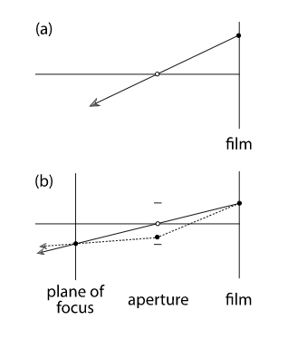

参数只有对焦距离与光圈大小。这也是离线渲染验证实时 DOF 的基准。

### 实时渲染中的 DOF

**方法一：多相机平均**。保持对焦距离，在镜头周围抖动相机渲染多帧求平均。物理正确但成本 ×N，只用于验证。

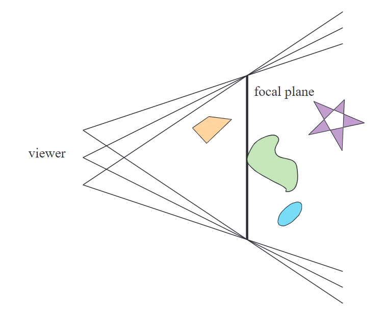

**方法二：后处理 gather**。GPU 的 pixel shader 很难做"向外扩散"（scatter），所以反过来做：计算当前像素颜色时，从周围像素**收集（gather）**颜色——只要邻域像素的弥散圆覆盖到当前像素，就按权重累加。

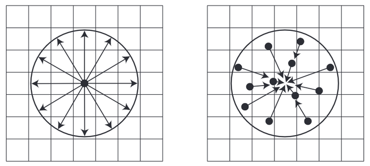

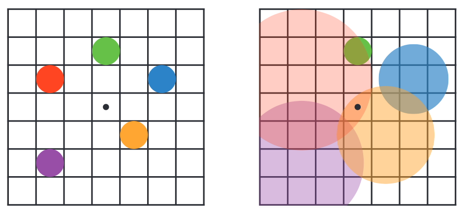

上图中红/蓝点在近处、黄/紫点在远处、绿点合焦。右侧每个点的圆是它的 CoC 范围；中心黑点同时被两个弥散圆覆盖，因此它的颜色是二者混合的结果。

完整链路：

```text
渲染场景 + 深度
→ 计算每像素 CoC（可由深度重建，也可由单独 pass 写 CoC）
→ 半分辨率降采样 + 散景（bokeh）模糊
→ 用 CoC 做深度感知的合成/上采样（避免前景糊到背景上）
```

工程要点：

- **半分辨率**做模糊，全分辨率只做合成；前景/背景分离（near/far field）可以避免"前景边缘被背景吃掉"；
- 高光在散景中应呈**多边形/环形光斑**（bokeh），需要对高亮像素做特殊加权，否则只会得到高斯糊；
- CoC 在物体边缘不连续，必须做深度测试/Alpha 混合，否则边缘会出现"描边"；
- 常见 artifact：前景边缘渗色（color bleeding）、CoC 跳变导致的硬边、半分辨率导致的锯齿。

> 本文合并了两篇同名笔记：`Depth Of Field.md` 有完整正文；`图形学基础_景深效果（Depth of Field：DOF）_dof 景深-CSDN博客.pdf.md` 是从网页导出的空壳（正文未同步），故只保留前者的内容。

---

## SSAO 与 HBAO

### SSAO 的定位

- SSAO（Screen Space Ambient Occlusion）是**屏幕空间**的近似环境光遮蔽，直接消费 G-buffer，属于延迟渲染的天然搭档。
- 基于物理的 AO 需要对半球做大量射线求交，实时不可行；SSAO 用"深度缓冲里的局部几何"代替真实场景。
- AO 的结果**只乘到环境光/间接光**上，不遮蔽直接光照（常规约定/推断：源日志的表述是"SSAO 属于间接光遮挡，**理应**作用于环境光的权重"，属判断而非实测结论）。

流程：

1. **几何阶段**：场景渲染到 G-buffer。位置与法线通常定义在**相机空间**，深度需要转成线性深度；G-buffer 绑定多个 MRT。
2. **AO pass**：画一个全屏四边形，读取深度/法线，输出单通道灰度 AO 纹理。
3. **光照阶段**：采样 AO 纹理，把遮蔽因子乘到环境光项上。

### 半球采样

在切线空间构造采样核，再变换到法线所在空间。**均匀半球采样**：

$$
\begin{aligned}
u_1,u_2 &\sim U[0,1)\\
\theta &= 2\pi u_2\\
z &= u_1\\
r &= \sqrt{1-z^2}\\
\vec{s} &= (r\cos\theta,\; r\sin\theta,\; z)
\end{aligned}
$$

**余弦加权半球采样**（更符合 AO 积分中的 $\cos\theta$ 项，样本更集中于法线方向）：

$$
z=\sqrt{1-u_1},\qquad r=\sqrt{u_1}
$$

源笔记中的代码属于均匀半球采样，并给 $z$ 加了一个微小偏移以避免样本落在切平面上：

```csharp
float Xi1 = randGenerator.GetFloat();
float Xi2 = randGenerator.GetFloat();
float phi = Xi2 * Mathf.PI * 2.0f;
float a   = Mathf.Sqrt(1.0f - Xi1 * Xi1);
Vector3 v = new Vector3(Mathf.Cos(phi) * a, Mathf.Sin(phi) * a, Xi1 + offsetDirN);
// v = tbn[0] * v.x + tbn[1] * v.y + tbn[2] * v.z;
```

注意：

- `Xi1 + offsetDirN` 会让 $|v|>1$，使用前应 `normalize`；`offsetDirN` 的作用是让样本略微向法线聚拢，避免退化。
- TBN 必须由**逐像素法线**构造；TBN 是正交矩阵，`mul(n, TBN)` 与 `mul(transpose(TBN), n)` 等价。
- 若法线与 up 向量平行，`cross(up, N)` 为零向量，需要换一个 up 轴。
- 每个像素再乘一个随机旋转矩阵（按像素 hash 得到角度），把固定采样图案打散，否则会出现明显的 banding。

### 深度重建与遮蔽判断

由深度重建相机空间位置（透视投影，相机朝 $-Z$）：

$$
P_{\text{view}} =
\begin{pmatrix}
(2u-1)\cdot\tan\dfrac{\text{fovY}}{2}\cdot\text{aspect}\cdot d\\[6pt]
(2v-1)\cdot\tan\dfrac{\text{fovY}}{2}\cdot d\\
-d
\end{pmatrix},
\qquad d=\text{LinearEyeDepth}(\text{depth})
$$

或直接用逆投影矩阵变换 NDC 坐标。Reverse-Z 管线中深度 0 表示远平面/天空，必须先判断天空再重建。

遮蔽判断（经典 SSAO）：

1. 采样点 $S = P + \vec{k}\cdot R$（$R$ 为采样半径）；
2. 把 $S$ 投影回屏幕得到 uv，采样深度并重建该处的相机空间位置 $S'$；
3. 用**正值的线性深度**比较：若 $d(S') < d(S) - \text{bias}$，说明该方向上真实几何比采样点更靠近相机，采样点被遮挡，累计遮蔽；
4. 归一化后得到 $[0,1]$ 的 AO。

改进版（HBAO/SSAO 常用）改用**水平角（horizon angle）**而不是点对点比较，可以减少自遮蔽与厚度假设带来的错误。

### HBAO

#### 理论

AO 有两种常见定义。第一种带余弦权重，追踪法线半球内的多条射线：

$$
A_1 = 1-\frac{1}{\pi}\int_{\Omega} V(\omega)\,(\omega\cdot n)\,d\omega
$$

其中 $V(\omega)$ 是可见性函数（射线在半径 $R$ 内与遮挡物相交返回 1，否则 0），$d\omega$ 是半球 $\Omega$ 上的单位立体角。$\omega\cdot n$ 可看作把单位立体角投影到底面单位圆，单位圆面积为 $\pi$。

第二种不含余弦项：

$$
A_2 = 1-\frac{1}{2\pi}\int_{\Omega} V(\omega)\,d\omega
$$

HBAO 采用第二种，并加入按距离衰减的权重 $W(\omega)$（软化遮挡边缘）：

$$
A = 1-\frac{1}{2\pi}\int_{\Omega} V(\omega)\,W(\omega)\,d\omega
$$

#### 逐像素法线

顶点法线经光栅化线性插值会变平滑。HBAO 更希望在 pixel shader 里用**相机空间位置的偏导**计算逐像素法线，这样折痕与细节处的 AO 才准确。

#### 方向与抖动

对每个角度 $\theta$，沿一条射线采样深度图。相机空间的半径 $R$ 投影到图像空间，再等分为 $N_s$ 步。以当前像素为起点，在 2D 高度图空间均匀发射 $N_d$ 条射线；为避免 banding，施加逐像素随机旋转，并对每条射线的样本做抖动：

$$
\text{uv}(S_i) = \text{uv}(P) + (\beta+i)\,(\Delta u,\Delta v)\,R(\alpha)
$$

- $P$：中心像素；$S_i$：第 $i$ 个样本；
- $\beta\in[0,1]$：随机偏移；
- $R(\alpha)$：随机角度旋转矩阵；
- $(\Delta u,\Delta v)$：沿 $\theta$ 方向的步长。

这个分布偏向中心点，但积分公式并不要求均匀分布；让更多样本靠近中心反而能提升质量。

**像素对齐（pixel snapping）**：需要 snap 每个样本的 uv 到像素中心。高效做法是 snap 初始样本 $S_0$，再 snap 步长，保证后续样本始终落在像素中心。

#### 步长

设相机空间圆半径为 $R$，像素的线性深度为 $P.z>0$。由相似三角形，$R$ 投影到投影平面：

$$
R' = \frac{f}{P.z}R
$$

把近裁剪面高度设为 2 时（便于直接换算到 uv）：

$$
f=\frac{1}{\tan(\text{fovY}/2)}=\cot\frac{\text{fovY}}{2}
$$

投影平面高度 2 对应 uv 的 1，因此：

$$
R_{uv}=\frac{R'}{2}
$$

沿一条射线采样 $N_s$ 个点，则每步 uv 长度：

$$
(\Delta u,\Delta v)=\frac{R_{uv}}{N_s+1}
=\frac{\cot(\text{fovY}/2)\cdot R}{2\,P.z\,(N_s+1)}
$$

通常要换算成像素单位，并保证每步至少 1 个像素。注意 $R$ 只是相机空间长度，$(\Delta u,\Delta v)$ 是 uv 长度；用 x 轴或 y 轴推导得到的 uv 步长不同，但换算成像素后一致。

#### 相机空间切向量

用射线方向的偏导（差分）求 $P$ 点的切线。$P'$ 为相邻像素，则：

$$
\Delta P = \Delta u\cdot \frac{dP}{du} + \Delta v\cdot \frac{dP}{dv}
$$

即 u 方向步进一个像素时切线为 $dP/du$，v 方向同理。它用于把 2D 的 horizon 角度换算到 3D。

#### Angle Bias

低模场景中，大平面会产生不自然的 AO（折痕被放大）。若不增加面数，可在计算 horizon 时加一个角度偏置（angle bias）来消除；angle bias 同时能缓解深度采样被边缘夹持（clamp）产生的 artifacts。

#### 低分辨率

AO 是低频的软全局光照效果，不需要高频纹理与轮廓，因此可以在**半分辨率**上计算，再用保边高斯模糊上采样。这是性价比最高的优化。

#### 与 "An alternative implementation" 的合并

另一篇笔记把同一积分写成球坐标形式：

$$
A = 1-\frac{1}{2\pi}\int_{\theta=-\pi}^{\pi}\int_{\phi=t(\theta)}^{h(\theta)} W(\omega)\cos\phi\,d\phi\,d\theta
$$

其中 $h(\theta)$、$t(\theta)$ 分别是该方向上、下 horizon 角。注意 **$t$ 必须先钳到 0**（切平面以下一律按遮挡处理）：$t(\theta)=\max\bigl(0,\,t_0(\theta)\bigr)$。否则全开放配置（$t=-\pi/2$、$h=\pi/2$）的积分为 $4\pi$，$A=1-\frac{4\pi}{2\pi}=-1$，直接越出 $[0,1]$；钳制后 $t=0,h=\pi/2$ 给 $A=0$，与前面 $\left(1-\frac{1}{2\pi}\int V\,d\omega\right)$ 的形式一致（$h=\pi/4$ 时给出 0.293）。

需要说明：

- 该式比前面的一维形式多出一个 $\cos\phi$，这是球坐标换元产生的**面积元**（$d\omega=\cos\phi\,d\phi\,d\theta$），与前面定义中的余弦权重不是同一回事；原笔记自己也标注"不知道为啥突然出现一个 $\cos\theta$"，此处按球坐标面积元理解，具体推导**（待核实）**。
- 工程实现仍以"逐方向求 horizon 角、再做角度积分"为准，球坐标式只是同一积分的另一种写法。

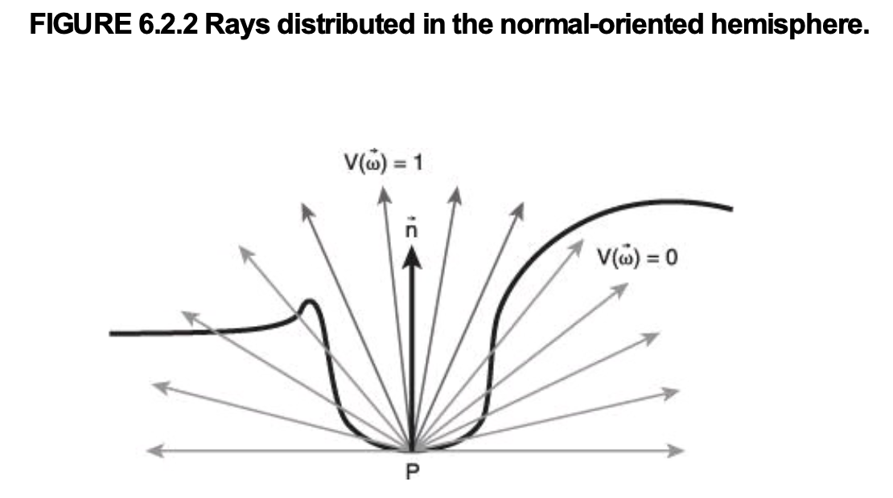

> 远程引用，需联网且可能失效。

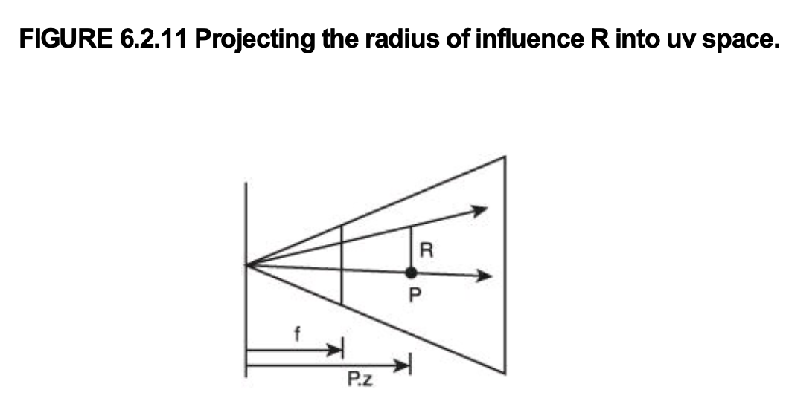

> 远程引用，需联网且可能失效。

---

## 屏幕空间反射（SSR / SSPR）

### SSR 的算法步骤

**输入**：Scene Color、Depth、Normal（+ smoothness/metallic）。**输出**：反射颜色 + 命中遮罩。

1. **准备 G-buffer**。反射面需要法线与粗糙度；通常用 smoothness 作为 mask，粗糙表面直接跳过，节省追踪开销。
2. **重建视图空间位置**。由 uv + 深度重建 $P_{\text{view}}$；天空（Reverse-Z 下深度为 0）直接输出 0。
3. **计算反射方向**。视线方向 $V=\text{normalize}(P_{\text{view}})$，法线经视图矩阵变换到视图空间，反射：
   $$
   R = V - 2(N\cdot V)N
   $$
4. **确定追踪距离**。反射方向与相机前向（视图空间 $-Z$）的点积衡量"往场景深处走"的程度：点积接近 1 时可用完整最大距离；接近 0（纯横向或朝相机回走）时，有效活动范围不超过起点深度，因此取 $\min(\text{depth},\ \text{maxDistance})$，两者之间线性插值平滑过渡。
5. **线性步进**。从起点沿 $R$ 以步长前进；每一步把三维位置投影回屏幕 uv：
   - 越界即终止；
   - 采样深度并转线性深度；
   - 跳过与起点深度差极小的样本（自交叉）；
   - 若"光线深度 − 场景深度 > 0"且差值小于厚度阈值（thickness），判定命中。
6. **二分搜索精细化**。线性步进只能定位到"步长精度"。命中后，在**最后一个外部点与当前内部点之间**做区间二分（而不是简单地每步把步长减半后盲走）：
   $$
   t_{\text{mid}}=\frac{t_{\text{out}}+t_{\text{in}}}{2}
   $$
   根据 $t_{\text{mid}}$ 处深度差的正负收缩区间；迭代 $k$ 次后精度为初始步长的 $2^{-k}$（源笔记取 6 次，即 $1/64$）。
7. **法线验证**。采样命中点法线，把反射方向变回世界空间，若 $N_{\text{hit}}\cdot R>0$，说明命中的是背面（例如光线穿过地板打到地板背面），丢弃该命中。
8. **距离衰减**。用起点到命中点的距离平方除以最大追踪距离平方，`1 - ratio` 后接 `smoothstep`，让接近最大距离的反射平滑淡出（常见过渡区间 50%~100%）。
9. **合成**。
   - 屏幕边缘淡出：命中 uv 靠近 0/1 时衰减，避免屏幕空间信息缺失造成的硬边；
   - 采样反射颜色；
   - Fresnel（Schlick）：
     $$
     F=F_0+(1-F_0)(1-N\cdot V)^5
     $$
   - 反射贡献 $= C_{\text{reflect}}\cdot F\cdot\text{mask}$，加回原场景颜色。

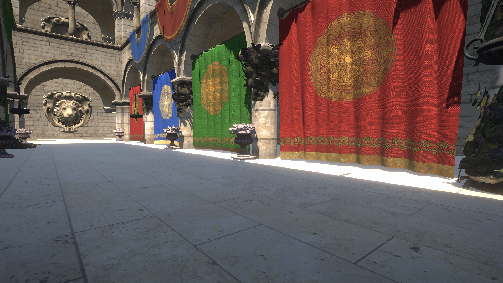

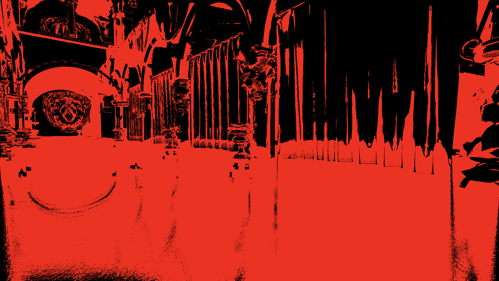

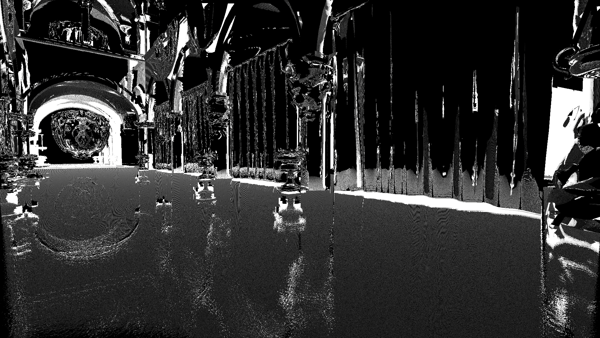

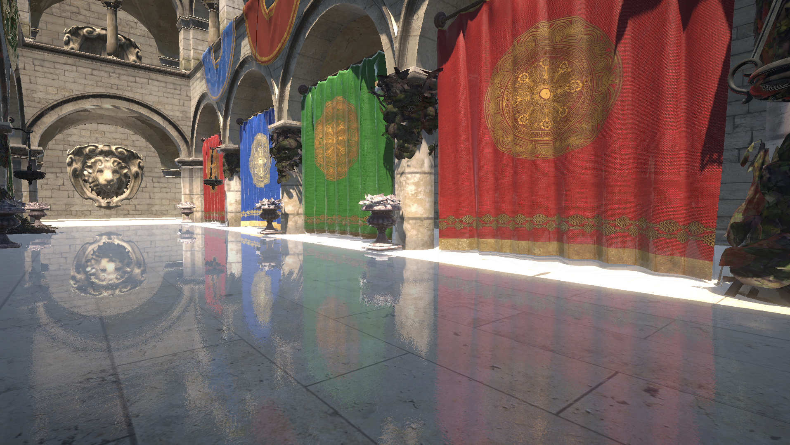

### 关键参数与常见错误

| 参数 | 作用 | 错误表现 |
|:--|:--|:--|
| 步长 / 最大步数 | 精度与成本 | 步长过大 → 穿透薄物体漏检；过小 → 走不出几步 |
| thickness | 深度容差 | 过小 → 大量漏检；过大 → 命中远处背景 |
| 自交叉阈值 | 剔除同一表面 | 过小 → 起点即命中自身；过大 → 漏掉近处真实交点 |
| smoothness 阈值 | 剔除粗糙面 | 过低 → 噪点与无意义反射；过高 → 反射缺失 |
| 最大追踪距离 | 限制开销 | 过大 → 远处反射拖影/错误命中 |

两个容易写错的地方：

- **视图空间 Z 的方向**。多数引擎的视图空间相机朝 $-Z$，而 `LinearEyeDepth` 返回正值；步进前要把位置与方向的 Z 取反，才能直接与线性深度做差，否则符号会整体反掉。
- **二分搜索的区间**。只在命中点附近"盲减半步长"会丢掉外部端点，收敛到错误位置；必须维护 $t_{\text{out}}$（深度差为负）与 $t_{\text{in}}$（深度差为正）两个端点。

### SSR 的优点与固有缺陷

优点：

- 对任何朝向、距离的反射面都适用，包括曲面、水面波纹、法线贴图扰动的表面；
- 本质是若干后处理 pass，可独立开关，扩展性好；
- 反射的是已经着色好的画面，因此动态物体、自发光、粒子都能反射，且光照与主场景天然一致；
- 不需要为每个反射面重绘场景，成本与几何复杂度基本无关。

缺陷（屏幕空间信息的三种缺失）：

1. **离屏信息（off-viewport）**：射线走出视口，没有命中任何东西。屏幕角落/边缘的反射最容易发生。
2. **背面/侧面信息**：镜子前的人物没有背面数据，无法正确反射。
3. **深度复杂度不足**：深度缓冲本质是一个高度场，一个像素只存一个深度。射线可能过早终止（物体下方出现奇怪暗部）或过晚终止（丢失明显反射）；分层物体（多层玻璃、栏杆）尤其容易失败。

由此产生的视觉问题：闪烁、空洞、角色移动带来的时序残影、法线贴图噪点、边缘锯齿。半分辨率会让这些问题更严重。

常见补救：时间重投影/时间超采样、双边滤波、保守性测试、源图像预模糊、反射面上的屏幕空间模糊（模拟粗糙反射）、分层上采样、空洞填充（flood fill），最后与 cubemap/reflection probe 混合。

### SSR 的加速结构

- **Hi-Z（层级 Z）**：用深度 mip 链做粗层跳跃，未命中就跳到更粗一级，命中再降级细化。可把步进从"逐像素"降到"逐 tile"。
- **DDA / 屏幕空间直线步进**：直接在 uv 空间做数字微分分析，避免每步一次投影；但透视下深度步进不均匀，需要额外处理。
- **半分辨率追踪 + 全分辨率合成**：主流做法，配合深度感知上采样。

### SSPR（Screen Space Planar Reflection）

SSR 需要 raymarching，代价高。对**平面反射面**（水面、大片地面）可以特化：用着色点世界坐标与平面关系直接算出反射点，完全不需要步进。

设着色点世界坐标 $w=(x,y,z)$，水平面高度 $h$，则关于平面的镜像点：

$$
w'=(x,\;2h-y,\;z)
$$

把 $w'$ 投影回屏幕得到 $p'$，$p'$ 处的颜色就是 $p$ 的反射颜色。

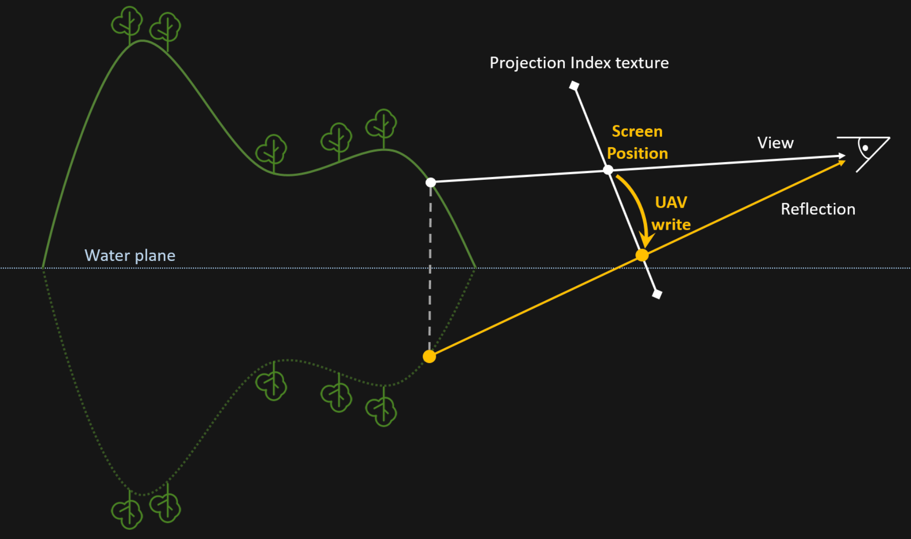

> 远程引用，需联网且可能失效。

#### 三个固有问题

1. **多对一映射（z-fighting）**：多个着色点镜像后投影到同一个屏幕像素，互相争夺写入权。
2. **空洞**：透视投影下，着色点的间隙在镜像重投影后被拉大。
3. **边缘缺失**：屏幕空间 + 透视共同导致，深度越大越向屏幕内偏移，屏幕两侧最明显。

#### 用 Hash + 原子操作解决争夺

三个 pass 生成反射贴图：

1. **Clear**：`hashRT` 填 `uint_max`。
2. **Update Hash**：计算每个像素的反射像素屏幕坐标，编码进一个 32 位 uint：
   ```text
   key = (id.y << 20) | (id.x << 8) | alpha
   ```
   用原子操作与已有值比较并写入最小值（`InterlockedMin`）。`id.y` 在最高位，因此 **y 更小的像素优先保留**；源笔记称"PixelY 小的像素会遮挡 PixelY 大的像素"，这是按屏幕 Y 的优先级做筛选，不是真正的深度测试。该打包给 `id.x`、`id.y` 各留 12 bit、`alpha` 留 8 bit，因此 x/y ≥ 4096 或 alpha > 255 时位段会互相串位。
3. **Resolve Color**：解码 key 得到 `id.xy`，转成 uv，采样 `OpaqueColorRT`（或历史帧 Color），写入 `ReflectRT`。

绘制反射材质时，采样 `ReflectRT` 作为 baseColor，或与 environment reflection 按权重混合。

#### 工程适配

- 为了与 TAA 配合，`ReflectRT` 的生成点通常放在 **AfterRenderingPrepass**，而不是 AfterRenderingSkybox。
- 用 TAA 的历史帧作为 ColorRT 时，必须用 motion vector 抵消相机运动与物体运动造成的像素错位。
- **Metal 不支持对 Texture 的原子操作**，只支持 `RWBuffer`。只有需要 `InterlockedMin` 的**写侧**才必须把二维坐标转成一维索引并换成 `RWBuffer`；读侧仍可用 `Texture2D` 的二维索引：

  ```hlsl
  Texture2D _MainTex;
  float4 LoadHistory(uint2 iPxHistory)
  {
      return _MainTex[iPxHistory];
  }
  ```

  写入侧则用 `RWBuffer<uint>` + 一维索引。

#### 与其它反射方案对比

| 特性 | SSR（屏幕空间光线步进） | Planar Reflection（镜像相机） | Reflection Probe（Cubemap） |
|:--|:--|:--|:--|
| 原理 | 屏幕空间 ray marching | 镜像相机重绘场景 | 预烘焙/实时 Cubemap |
| 画质 | 中/高，受屏幕信息限制 | 极高，物理正确 | 低/中，通常忽略视差 |
| 屏幕外物体 | 无法反射 | 完美反射 | 完美反射 |
| 开销 | 中，随分辨率增长 | 极高，随场景复杂度增长 | 低（静态烘焙） |
| 适用 | 一般水面、湿滑地面 | 镜子、小范围高质量水面 | 移动端、粗糙金属 |

> 源笔记 `反射.md` 的对比表把"屏幕空间光线步进"一栏标成了 SSPR，实际描述的是 SSR；本文已按算法归属改正。SSPR 是"平面 + 无步进"的特化，不是 ray marching。

---

## 附录：工作日志中的补充记录

> 本附录只收录工作日志中与后处理相关、且正文未展开的管线接入结论、参数、代码与踩坑记录；算法主体见正文对应章节。

### URP 后处理的接入结论（项目实测）

在把 URP 后处理接到实际项目时，各效果的可用性并不一致：

| 名称 | 状态 | 说明 |
|---|---|---|
| SMAA | 弃用 | 在项目中效果不明显（着色走样/断线检不出，见《06_抗锯齿与采样重建》附录） |
| Depth Of Field | 保留 | 放在 FSR 之后需要额外一张全分辨率深度图；放在 FSR 之前会出现闪烁，原因未查明（待核实） |
| TAA | 弃用 | 与 FSR 功能重复，且无法直接使用 |
| Motion Blur | 待定 | 无法直接使用，需要修改 |
| Panini Projection | 保留 | 可以直接使用 |
| UberPost | 保留 | 可以直接使用 |

由此得到的通用结论：**时域/上采样类效果（TAA、FSR2）与空间后处理（DOF、Motion Blur）在同一管线里会争抢深度与运动矢量**。DOF 需要全分辨率深度，而 FSR/上采样工作在低分辨率，二者的深度来源必须显式约定，否则要么多一张全分辨率深度，要么出现闪烁。

### UberPost 的内部顺序与拆分点

URP 的 `uberPost.shader` 是一个把多种效果串在一起的大 pass，实际执行顺序：

1. Chromatic Aberration（色差）
2. Bloom
3. Vignette（暗角）
4. Color Grading（调色）
5. Film Grain（胶片颗粒）
6. Dithering（抖色）
7. HDR OUT（`HDR_ENCODING`；URP ≤15 在移动端禁用，2023.2+/URP 17 起 iOS 16+ 与 Android 已支持）

对比本文开头的"典型 HDR 后处理顺序"，这里有两点差异需要注意：

- **只有 Bloom 的合成在 UberPost 内部完成**，prefilter、降采样链与上采样仍是独立的 `BloomPass`；因此被固定在这个位置的是"Bloom 结果参与合成的时机"，想调整 Bloom 与调色的先后必须改 shader 或拆 pass。
- **Vignette 在 Color Grading 之前**，而一般建议暗角放在调色之后（避免暗角被 LUT 重新映射）。若视觉上要求"调色后再压暗角"，只能拆 pass 或改 shader 顺序。

除 UberPost 外，StopNan、SMAA、DepthOfField、TAA、MotionBlur、PaniniProjection 各自是独立 pass。FSR2 若要插进这条链，只能选择"某个 pass 之前/之后"；如果必须落在 UberPost 中间，就要先拆分 UberPost。实际移植时 FSR2 是嵌在后处理 pass 内、StopNan 之后执行的（详见《06_抗锯齿与采样重建》附录），耦合度高、可维护性差。

### SSAO 的工程约束

正文给的是算法，这里补管线层面的必要条件：

1. **结果只作用于间接光**（常规约定/推断：源日志写作"SSAO 属于间接光遮挡，理应作用于环境光的权重"，属合理推断，未见实测验证）：SSAO 是环境光遮蔽，应作为环境光/间接光的权重，不能当 shadow 去遮蔽直接光。
2. **必须有屏幕空间法线**。法线来源两条：由深度近似重建，或由 `DepthNormalPass` 生成（URP 默认）。只要某个 pass 声明需要 Normal，`m_DepthNormalPrepass` 就一定会执行，即使 URP Asset 里没有勾选 Depth Texture：

   ```csharp
   bool needsNormals = (pass.input & ScriptableRenderPassInput.Normal) != ScriptableRenderPassInput.None;
   inputSummary.requiresDepthPrepass |= needsNormals || needsDepth && eventBeforeMainRendering;
   requiresDepthPrepass |= renderPassInputs.requiresDepthPrepass;
   ```

   片段取自 URP 2022.3（14.x）的 `UniversalRenderer`；其中 `needsDepth`、`eventBeforeMainRendering` 是上文省略的局部变量，URP 17（Unity 6）已重构这段前置 pass 的依赖判断。

3. **DepthNormalPass 的 layerMask 决定谁有法线**。曾出现 SSAO 完全不生效：`DepthNormalPass` 创建时传入了 Opaque 的 layerMask，而项目用 LayermapRendererFeature 绘制 opaque，导致该 mask 实际为 Nothing。让某些对象（例如车）参与 DepthNormal，需要给它的 `renderingLayerMask` 增加 Default 条目（在 prefab 中设置），而不是只改 pass 的 mask。
4. **DepthNormal 绘制时的 stencil 会污染结果**：DepthNormal pass 写了 stencil 后，后续依赖 stencil 的 pass 结果不对，需要检查双方的 ref/readMask 是否冲突（见下节）。
5. **分辨率必须匹配**。开启 FSR 后车被移到后处理之后、以全分辨率绘制，而 SSAO 运行在降分辨率，二者深度/法线对不上，车上出现错误 AO。两种选择：让车不接收 AO，或让车参与 DepthNormal 计算（项目选了后者）。
6. **开启 SSAO 的 RendererFeature 会导致 preZ pass 不执行**（待核实：与 URP 版本的 pass 依赖声明有关）。

性能参考（项目实测，单位应为毫秒；对应关系/测量口径未记录（待核实）：硬件、分辨率、是否含 pass 外开销、以及"优化前/对比项"具体指哪一组测量均未记录）：

| 项目 | 耗时 |
|---|---|
| SSAO | 4 ms（优化前 6~10 ms；两个数字的对应关系待核实） |
| TAA | 1.6 ms（对比项 2 ms，待核实对比对象） |
| Bloom | 0.72 ms |
| FSR1 | 0.08 / 0.09 ms |
| MotionVector | 0.01 ms |

### SSAO 的保边模糊：用法线点积代替双边滤波

SSAO 的降噪/上采样不能用 box 或 Gaussian，否则会跨越物体边缘把 AO 抹开。完整做法是双边滤波，但 Unity 的实现更便宜：用当前像素与邻域像素**法线夹角的余弦**作为边缘判据降权。

```hlsl
static const half kGeometryCoeff = half(0.8);
half CompareNormal(half3 d1, half3 d2)
{
    return smoothstep(kGeometryCoeff, HALF_ONE, dot(d1, d2));
}
```

$\mathrm{dot}(d_1,d_2)=1$ 表示两像素共面、非跨边，权重为 1；$\mathrm{dot}\to 0$ 表示墙角、跨边，权重趋 0。`kGeometryCoeff = 0.8` 约对应 37° 的夹角容差。这等价于把双边滤波的值域核换成"法线相似度核"，省掉了逐像素的指数运算。

### 切线空间（TBN）与 HLSL 矩阵构造

SSAO/HBAO 的半球采样要在切线空间构造再变到法线空间，这里容易踩矩阵构造的坑：

- HLSL 的 `float4x4(...)` / `float3x3(...)` 构造函数是**按行填充**，不是按列。把世界空间中切线空间的三个轴"按列摆放"得到 tangentToWorld，写成构造函数时就要按行写：

  ```hlsl
  // 构造切线空间 -> 世界空间，注意构造函数按行填充
  float4x4 tangentToWorld = float4x4(worldTangent.x, worldBinormal.x, worldNormal.x, 0.0,
                                      worldTangent.y, worldBinormal.y, worldNormal.y, 0.0,
                                      worldTangent.z, worldBinormal.z, worldNormal.z, 0.0,
                                      0.0, 0.0, 0.0, 1.0);
  // 正交矩阵下，逆 = 转置；worldToTangent 恰好等于按行放三个轴
  float3x3 worldToTangent = float3x3(worldTangent, worldBinormal, worldNormal);
  ```

- 由此可解释正文那句"TBN 是正交矩阵，`mul(n, TBN)` 与 `mul(transpose(TBN), n)` 等价"：worldToTangent 就是 tangentToWorld 的转置。
- **手系与矩阵乘法规则相互独立**：Unity 是左手系 + 列向量；DX 是左手系 + 行向量；GL 是右手系 + 列向量。不要因为"DX 用行向量"就推断 DX 是右手系。

### stencil 掩码：标记需要特殊处理的像素

时域方案需要一个"哪些像素不可信"的通道，最常见的载体是 stencil 的单个 bit：

- FSR2/STP 的参数里有一个 **stencil mask**，用来选出"需要特殊处理的像素"（粒子、火花、游戏内屏幕等）；没有 stencil 数据时设为 0。这些像素在 TAA 下会产生拖影或错误累积，必须让时域滤波器对它们降权或跳过。
- 由此产生一个顺序约束：**UberPost/FSR2 之后才绘制的 UI 无法被前面的掩码覆盖**。项目里"UI 需要被车压盖"原本靠"车画在 UI 后面"实现，但 FSR 要求 UI 在 FSR2 之后绘制，于是车也只能挪到 FSR2 之后（且全分辨率），与"车尽量在 FSR2 之前绘制"冲突。可行方向是利用车之前已写入的 stencil 值做压盖，而不是改绘制顺序。

用 `RenderStateBlock` 指定一批对象的 stencil 状态：

```csharp
RenderStateBlock renderStateBlock = new RenderStateBlock(RenderStateMask.Stencil)
{
    stencilReference = 13,
    stencilState = new StencilState()
    {
        readMask = 255,
        writeMask = 255,
        compareFunctionFront = CompareFunction.NotEqual,
        compareFunctionBack  = CompareFunction.NotEqual,
        passOperationFront   = StencilOp.Keep,
        passOperationBack    = StencilOp.Keep,
        enabled = true
    }
};
```

上面示例的 `passOperation` 是 `Keep`，只比较、不写值；若要用 stencil 做压盖（先画者写入 ref，后画者据此丢弃），被参照的那批对象必须改成 `passOperation = StencilOp.Replace`，否则 `Keep + NotEqual` 永远写不进 ref，判据形同虚设。

压盖判定的规则（也是"比较函数选 Greater 还是 GreaterEqual"的由来）：

> **来源拆分**：上面的 `CompareFunction.NotEqual` 代码来自日志 2024/07/30 18:38 的"渲染状态中 stencil 设置"；下面 Greater / GreaterEqual 的压盖规则来自 2024/07/25 10:40 的另一条记录。二者**不是同一个示例**，比较函数并不一致（`NotEqual` ≠ `Greater` / `GreaterEqual`），不要把它们当成同一份配置来读。

- `CompareFunction.Greater`：renderqueue 小的对象先画并写入 ref=13；renderqueue 大的对象后画、ref 也是 13，`13 > 13` 不成立 → 重叠像素被丢弃，从而实现"后画者被先画者压盖"。
- **3D 对象要用 `GreaterEqual`**：`13 >= 13` 通过 stencil 测试，再由深度测试决定谁被遮挡，否则同 ref 的对象会互相错误剔除。

比较公式始终是 `(referenceValue & readMask) comparisonFunction (stencilBufferValue & readMask)`；readMask 决定参与比较的位，writeMask 决定写回哪些位。

### 参数传递：material.SetVector 与 cmd.SetGlobalVector

- `material.SetVector(...)`：**立即**写入材质对象。
- `cmd.SetGlobalVector(...)`：只把命令**缓存进 command buffer**，按队列顺序在真正执行时生效。

多迭代模糊的典型坑：循环里用 `material.SetVector` 设置每趟参数，因为 blit 命令是延迟执行的，等到 GPU 真正跑时材质上只剩最后一次写入的值，测试表现为"每次迭代参数都一样"。改成 `cmd.SetGlobalVector` 后每趟命令带着自己的参数入队，结果正确：

```csharp
for (int i = 0; i < iterationCount; i++)
{
    float radius = 1.0f + i * blurRadius;
    blurParam.Set(1, 0, radius, 0);
    cmd.SetGlobalVector(_BlurParam, blurParam);   // 随命令入队，而不是立即写材质
    cmd.Blit(targetRT, _rtHandle, material);

    blurParam.Set(0, 1, radius, 0);
    cmd.SetGlobalVector(_BlurParam, blurParam);
    cmd.Blit(_rtHandle, targetRT, material);
}
```

同一原则适用于所有"一个材质、多次不同参数"的全屏 pass（Bloom 每级、DOF 每层、模糊每趟）。

### GatherRed：一次采样取四个像素

采样点比较集中（邻域滤波、模糊、min/max）时，用 `GatherRed` 把四次点采样压成一次：它返回双线性采样点周围 2×2 四个像素的 R 通道，打包成 `float4`。屏幕左下角为 (0,0) 时，分量顺序是：

| 分量 | 位置 |
|---|---|
| `.x` | 左上 |
| `.y` | 右上 |
| `.z` | 右下 |
| `.w` | 左下 |

若 V 原点在顶部（`v=0` 在上，例如翻转过的 RT），上下角色互换：`.x` 左下、`.y` 右下、`.z` 右上、`.w` 左上。

同类指令还有 `GatherGreen/Blue/Alpha`；Compute Shader 侧可再配合 group shared memory 进一步减少采样。注意 Gather 拿到的是**未做双线性混合的四个原始 texel**，权重需要自己算——这正好适合求 min/max 或自定义核，不适合直接当双线性结果用。

### 深度重建世界坐标：翻转判据要按投影是否翻转

常见写法：

```hlsl
float4 posCS = float4(uv * 2 - 1, rawDepth, 1);
#if UNITY_UV_STARTS_AT_TOP
    posCS.y = -posCS.y;
#endif
float4 posWS = mul(UNITY_MATRIX_I_VP, posCS);
posWS /= posWS.w;
```

这里把 `rawDepth` 直接当 NDC z，只对 NDC z∈[0,1] 的平台成立（D3D/Metal/Vulkan）；GL 的 NDC z 是 [−1,1]，需 `rawDepth * 2 - 1`（reversed-Z 时为 `1 - 2 * rawDepth`）。

另一种"先翻转 uv 再构造 NDC"的写法与它完全等价（$(1-uv.y)\cdot2-1=-(uv.y\cdot2-1)$），区别只是翻转写在 uv 上还是写在 posCS 上：

```hlsl
#if UNITY_UV_STARTS_AT_TOP
    uv.y = 1.0 - uv.y;
#endif
float4 posCS = float4(uv * 2 - 1, rawDepth, 1);   // 这里没有再翻转 posCS.y
```

真正决定要不要翻转的不是平台宏，而是**投影的 y 是否被翻转**：

```hlsl
if (_ProjectionParams.x < 0)
    uv.y = 1.0 - uv.y;   // 等价地翻转 posCS.y
```

`UNITY_UV_STARTS_AT_TOP` 只说明 UV 原点在上方；渲染到 RT 时 `_ProjectionParams.x` 可能为 -1（投影 y 翻转），直接上屏时为 1。用裸平台宏代替这个判据，或在两处各翻转一次（叠加成两次翻转），都会让重建出的世界坐标整体上下翻转——不报错，只是结果不对。

两个相关坑：

- **反方向（世界坐标 → 屏幕 UV）只在目标 V 原点与当前 uv 不一致时才翻转 uv**：`uv = posCS.xy / posCS.w * 0.5 + 0.5` 之后，只有目标（深度图/RTT）的 V 原点与当前 uv 不一致时才需要 `uv.y = 1 - uv.y`，否则采样深度图对不上；判据是 `_ProjectionParams.x`（与上面的正方向统一），不要用裸 `UNITY_UV_STARTS_AT_TOP`。
- 笔误写成 `float4 posClip = (uv * 2 - 1, rawDepth, 1.0f);`（少了 `float4` 构造、变成标量广播）编译不报错，但结果完全错误。

### 输出色彩空间与平台翻转（Interplay）

后处理链末端的输出格式在不同平台不一致，会直接表现为"多屏与 Mac 上颜色不同"：

- Interplay 只接受 **Linear ARGB32** 输入，但输出到屏幕应当按 **sRGB** 处理。
- Mac 上所有屏的输出 RT 都是 sRGB；台架上 HU 屏不经 Interplay 输出、设为 sRGB，其余屏是 Linear ARGB32。
- 格式不一致 → 颜色差异。排查建议：用 ColorChecker 分支逐级比对，尝试在链路中补 tonemap 等步骤逼近目标（属于补偿而非根治）（待核实）。
- Interplay 输出的图像上下镜像翻转，移植期用 `YFlipRendererFeature` 临时纠正，Interplay 修复后应移除。
- Vulkan 台架：开启 FSR 无法点亮，关闭 FSR 可点亮但极卡；FullScreenCollection 工程可配置成 Vulkan 正常运行（待核实：与具体机型/驱动相关）。

## 原始笔记索引

- `Graphics/PostProcess/Bloom.md`
- `Graphics/PostProcess/Blur.md`
- `Graphics/PostProcess/Depth Of Field.md`
- `Graphics/PostProcess/图形学基础_景深效果（Depth of Field：DOF）_dof 景深-CSDN博客.pdf.md`（正文未同步，仅登记）
- `Graphics/PostProcess/SSAO.md`
- `根目录笔记/HBAO.md`
- `根目录笔记/An alternative implementation for HBAO.md`
- `根目录笔记/Bilateral Filter.md`
- `根目录笔记/Image Sharpening Convolution Kernels.md`
- `根目录笔记/SSR Prompt.md`
- `根目录笔记/SSPR.md`
- `根目录笔记/The future of screenspace reflections.md`
- `根目录笔记/反射.md`
- `Log/日志 05010.md`（URP 后处理兼容性、UberPost 顺序、SSAO 约束、stencil、SetVector、GatherRed、HLSL 矩阵）
- `Log/日志0802.md`（TimeDomainFilter、Interplay 色彩空间与 YFlip）
- `Log/杂记/日志.md`（SSAO 保边模糊、深度重建世界坐标、MSAA 重复 Resolve）