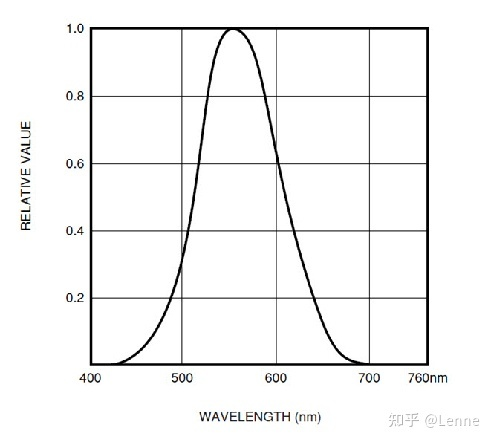
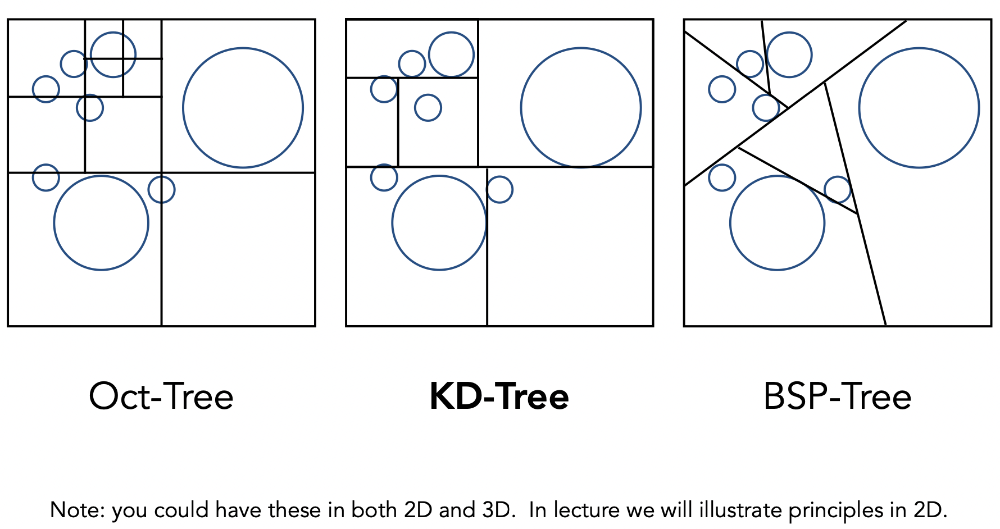
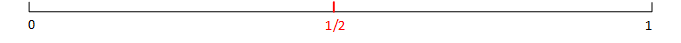
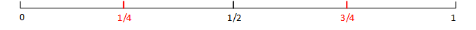
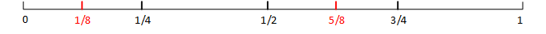
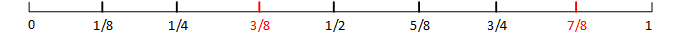
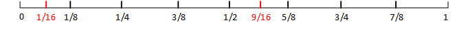
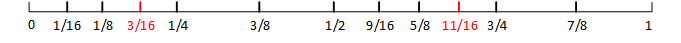

# 光线追踪与全局光照

> 本篇由「光线追踪原理 / 加速结构 / 蒙特卡罗采样 / 辐射度量学 / 全局光照工程实现」几组笔记重组而成。
> 组织顺序：先把光传输与蒙特卡罗估计讲清（第 1–2 章），再补渲染器必需的物理量纲（第 3 章），然后进入加速结构（第 4 章）与采样（第 5 章），最后是工程落地：环境光、Unity 中的 GPU 路径追踪、微表面采样、IBL 与 SH（第 6–9 章）。
> 标注「（待核实）」处为原始笔记表述含糊或与常见资料不一致、但无法从源文件确认的点。

---

## 1. 光线追踪的基本框架

### 1.1 从 Z-Buffer 到 Ray Casting

光栅化与光线追踪解决的是同一个可见性问题，只是遍历顺序相反：

```text
// Z-Buffer：以「物体 → 像素」为循环
for each object
    for each pixel inside object's projection
        if depth < ZBuffer[pixel]        // 更近则写入
            colorBuffer[pixel] = shade(object)
            ZBuffer[pixel]     = depth

// Ray casting：以「像素 → 物体」为循环
for each pixel
    for each object
        if ray through pixel hits object and t < t_saved
            compute shading; update color
```

- 光栅化是 *object order*（按图元推进），天然适合 SIMD 与固定管线；
- 光线追踪是 *pixel order*（按屏幕推进），天然支持"任意求交函数"，因此可以表达反射、折射、阴影这类**非局部**效果。

### 1.2 最近交点查询

整个渲染器的热路径只有一件事：**给定射线，求最近交点**。

```text
First_hit(ray, sr_min):
    t_min = +∞
    for j in objects:
        if objects[j]->hit(ray, t, sr) and t < t_min:
            t_min = t
            sr_min = sr            // ShadeRecord：交点位置、法线、材质等
    return sr_min
```

注意 `t` 必须取自同一条射线参数化 $P(t) = O + tD$，并且所有图元的 `hit` 都要拒绝 $t \le \epsilon$ 的解（自相交）。

### 1.3 Whitted-Style 递归光线追踪

Whitted 风格的核心假设：**只在"光滑"表面上继续弹射**，粗糙表面直接终止。

```text
Color RayColor(ray):
    color = (0, 0, 0)
    sr = First_hit(ray)

    // 1) 直接光照 + 阴影射线
    if sr.diffuse:
        shadowRay.o = sr.hitpoint
        v = light.pos - sr.hitpoint
        d = |v|
        shadowRay.d = v / d
        t = First_hit_shadow(shadowRay)          // 只需「是否被遮挡」
        if t >= d - ε:                            // 光源之前没有遮挡物
            color += Shading(light, sr)

    // 2) 环境项（常数近似）
    if sr.ambient:
        color += Ambient(sr)

    // 3) 镜面反射（递归）
    if sr.specular:
        color += reflection.coefficient * RayColor(reflect(ray, sr.normal))

    return color
```

要点：

- 阴影射线只判"有没有遮挡"，不需要最近交点，因此可以实现为任意命中即返回（any-hit）；
- `ε`（偏移）是必需的：交点因为浮点误差落在自身表面内侧时，会产生自阴影（shadow acne）。工程上更稳的做法是沿法线偏移起点，而不是单纯放大 `ε`；
- 递归深度必须截断，否则指数爆炸。

### 1.4 为什么"一次只弹射一条光线"是合理的

初学者最容易卡住的点：*随机弹射一条光线，岂不是可能走了一条现实中根本不存在的光路？*

**随机一条光线不是"真实光路"，而是对半球积分的一个采样点。**

渲染方程要算的是半球上的积分：

$$
L_o(x,\omega_o) = L_e(x,\omega_o) + \int_{\Omega^+} f_r(x,\omega_i,\omega_o)\, L_i(x,\omega_i)\, (\omega_i \cdot n)\, d\omega_i
$$

这个积分没有解析解，只能做蒙特卡罗估计：在半球上按某个概率密度 $p(\omega_i)$ 抽一个方向，用

$$
\hat{L}_o = \frac{f_r(\omega_i,\omega_o)\, L_i(\omega_i)\, (\omega_i\cdot n)}{p(\omega_i)}
$$

作为积分的一次无偏估计。**"这条光线是否存在"不是问题**——它是积分变量 $\omega_i$ 的一个实现值；决定能量如何分配的是 BRDF $f_r$，决定收敛速度的是 $p$。采样 $N$ 次取平均，结果依 $1/\sqrt{N}$ 收敛到真实积分。

因此两件事必须同时做对，否则结果有偏：

1. 方向必须按 $p$ 抽样，且估计量必须**除以 $p$**（漏掉 `1/pdf` 是最常见的错误）；
2. 多次采样必须取**平均**，而不是相加。

---

## 2. 路径追踪的蒙特卡罗估计

### 2.1 估计量、pdf 与 throughput

把"每弹射一次就乘一次 BRDF/pdf"写成递推，就得到路径追踪的 throughput（通量衰减系数）：

$$
T_{k+1} = T_k \cdot \frac{f_r(x_k,\omega_{k+1},\omega_k)\,(\omega_{k+1}\cdot n_k)}{p(\omega_{k+1})}
$$

最终像素值 = 各条路径贡献的平均：

$$
\langle L \rangle = \frac{1}{N}\sum_{j=1}^{N} \sum_{k} T^{(j)}_k \, L_e(x^{(j)}_k)
$$

即"沿途每次命中自发光/环境时，把当时的 throughput 累加进去"。

### 2.2 两种采样策略的等价性

- **BRDF 重要性采样**：$p \propto f_r \cos\theta$，估计量变成 $L_i$ 的加权平均，pdf 抵消掉 BRDF，方差主要来自 $L_i$ 本身；
- **余弦加权（在半球投影面积上均匀）采样**：$p = \cos\theta/\pi$，则估计量为 $\pi f_r L_i$，漫反射下 $f_r = \rho/\pi$ 时进一步化简为 $\rho L_i$。

两者都无偏，差别只在方差。**注意 `pdf` 必须是"对立体角"的 pdf**；如果 pdf 定义在**投影面积**上（$dA^{\perp}=\cos\theta\,d\omega$），要乘 $\cos\theta$ 换到立体角（很多实现错误出在这里）。若说的是半球**曲面面积**，那份因子是 $r^2$（单位球为 1），不是 $\cos\theta$——两种"面积"不要混。

### 2.3 路径终止与无偏性

- 固定最大弹射深度 → **有偏**（丢掉了长路径能量，暗部偏暗）；
- Russian Roulette：以概率 $q$ 继续，继续时 throughput 除以 $q$，否则终止。期望不变 → **无偏**，且高 throughput 路径自然活得久。

### 2.4 逐帧累加为什么要用 alpha blend

实时路径追踪器通常每帧只发 1 spp，靠多帧累积。设前 $N$ 帧的累积均值为 $m_N$，本帧新样本为 $x$，则

$$
m_{N+1} = \frac{N\,m_N + x}{N+1} = \left(1-\frac{1}{N+1}\right) m_N + \frac{1}{N+1}\,x
$$

这正是 alpha = $1/(N+1)$ 的 blend：**旧累积值权重 $(1-a)$，新样本权重 $a$**。

> **命名澄清**：原始笔记写作 $(N\cdot src + dst)/(N+1)$，并拆成 $[1-1/(N+1)]\cdot src + [1/(N+1)]\cdot dst$。这个代数本身是**自洽**的（$N/(N+1)+1/(N+1)=1$），在 `src = 累积均值`、`dst = 新样本` 的口径下正好收敛到均值，并非推导错误。
>
> 真正的问题只是**命名与 blend 语义相反**：Unity/HLSL 的 `Blend SrcAlpha OneMinusSrcAlpha` 里 `src` 指本帧新颜色、`dst` 指帧缓冲里的旧值。按 blend 语义应写成 $(N\cdot dst + src)/(N+1)$，对应 `alpha = 1/(frameIndex+1)`。

**退化情况**：带 TAA/重投影时，样本不再独立同分布，`1/(N+1)` 的无偏性只在该像素的样本确实来自同一分布时成立；相机移动后应重置或按重投影置信度加权。

---

## 3. 辐射度学与光度学

### 3.1 两套体系的差别

| | Radiometry（辐射度量学） | Photometry（光度学） |
|---|---|---|
| 度量对象 | 客观电磁能量 | 人眼感知的可见光 |
| 基准 | 瓦特（W） | 流明（lm） |
| 加权 | 无 | 乘 CIE 视见函数 $V(\lambda)$ |

- **Irradiance / Illuminance（辐射照度 / 照度）**：描述"**探测器/物体表面收到了多少功率**"；
- **Radiant intensity / Luminous intensity（辐射强度 / 发光强度）**：描述"**点光源**在某个方向上有多亮"；
- **Radiance / Luminance（辐射亮度 / 发光亮度）**：描述"**面光源/面元**在某个方向上有多亮"。

强度、亮度既可以用于光源（出射），也可以用于入射方向上的场；照度只用于"到达表面"。

### 3.2 四个基本量

立体角：$d\omega = \dfrac{dA_\perp}{r^2} = \dfrac{dA\cos\theta}{r^2}$，单位 sr。

| 量 | 定义 | 辐射度量单位 | 光度单位 |
|---|---|---|---|
| Radiant flux / 辐射通量（功率） $\Phi_e$ | 单位时间通过的总能量 | W | lm |
| Irradiance $E$ | $d\Phi/dA$ | W/m² | lux (lm/m²) |
| Radiant intensity $I$ | $d\Phi/d\Omega$ | W/sr | cd (lm/sr) |
| Radiance $L$ | $d^2\Phi/(dA_\perp\, d\Omega)$ | **W/(sr·m²)** | cd/m² (nit) |

> **术语修正**：$\Phi$ 在辐射度量学里是 **radiant flux / 辐射通量**（单位 W），不是"光通量"——**光通量（luminous flux）$\Phi_v$** 是它的光度对应量（单位 lm，即上表最后一列）。上表第一行同时列出 W 与 lm，正是这两套体系的一一对应：$\Phi_e \leftrightarrow \Phi_v$、$E_e \leftrightarrow E_v$、$I_e \leftrightarrow I_v$、$L_e \leftrightarrow L_v$。下面正文里不带下标的 $\Phi$ 一律指辐射通量。

> **修正**：原始笔记把辐射亮度的单位写成 `W/sr/s`，量纲错误。辐射亮度是"单位投影面积、单位立体角"的功率，正确单位是 $\mathrm{W/(sr\cdot m^2)}$；其光度对应量是 $\mathrm{cd/m^2}$（即 nit）。四者的递进关系是：
> $\Phi \xrightarrow{/A} E$，$\Phi \xrightarrow{/\Omega} I$，$\Phi \xrightarrow{/(A_\perp\Omega)} L$。

补充关系（路径追踪里最常用的一条）：**真空中沿同一射线的 radiance 不变**，即 $L(x,\omega) = L(y,-\omega)$。这就是为什么"追踪一条光线、把沿途 radiance 乘 BRDF 传回去"在物理上是成立的。

### 3.3 辐射量 ↔ 光度量的换算

单色光：

$$
\Phi_v = K_m\, V(\lambda)\, \Phi_e
$$

- $V(\lambda)$：CIE 视见函数（luminous efficiency），峰值在 555 nm；
- $K_m$：最大光谱光视效能，**现代 CIE 取 683 lm/W**（555 nm）。

> **修正**：原始笔记写 `k = 638 lm/W` 并给出 `1W = 638 lm`。638 **没有标准出处**（历史上旧值约 682 lm/W；1979 年 candela 的新定义起，$K_m=683\ \mathrm{lm/W}$ 才是标准值），疑为笔误或单位换算残留。若要与旧资料对齐，请注明所用的 $K_m$。

非单色光需要对光谱积分：

$$
\Phi_v = K_m \int_{380}^{780} V(\lambda)\,\Phi_{e,\lambda}(\lambda)\, d\lambda
$$

原始笔记中此式以图片形式给出（`WEBRESOURCE09601ecd6d7d765b36771781a59a9af3.jpg`），这里补成公式。

> 直觉检查：红外/紫外辐射功率再大，$\Phi_v$ 也是 0——这正是两套体系不能混用的原因。



---

## 4. 加速结构：AABB、空间划分与 BVH

### 4.1 为什么要 AABB

求交的代价差异极大：光线-球、光线-三角形是常数级；光线-百万三角形是 $O(n)$。加速结构的本质是**用便宜的包围体测试剔除绝大多数昂贵求交**。

AABB 的选择理由：slab 测试只需 6 次乘加，且与轴对齐后可以用 3 个分量的 `min/max` 向量化。

### 4.2 光线-AABB 求交（slab method）

对每个轴，射线进入/离开该轴 slab 的参数为

$$
t_0 = \frac{b_{\min} - o}{d}, \qquad t_1 = \frac{b_{\max} - o}{d}
$$

整体：

$$
t_{\text{enter}} = \max\big(t_0^x, t_0^y, t_0^z\big),\quad
t_{\text{exit}}  = \min\big(t_1^x, t_1^y, t_1^z\big)
$$

命中条件：$t_{\text{exit}} \ge \max(t_{\text{enter}}, 0)$（若允许射线起点在盒内，则 $t_{\text{enter}}$ 取下界 0）。

实践要点：

1. **除零要靠 IEEE 语义吃掉**：预计算 `invD = 1/d`，当 $d_k = 0$ 时得到 $\pm\infty$，比较结果自动正确，从而避免分支；
2. 但 $0 \cdot \infty = \mathrm{NaN}$：当射线起点恰好落在某个 slab 平面上时会出现 NaN。稳健做法是把 NaN 参与的比较显式处理掉：用 `fmax/fmin`（IEEE 规定它们忽略 NaN），或在比较时把 NaN 当作 $\pm\infty$。注意 HLSL/GLSL 的 `max/min` 对 NaN 的行为是**实现定义**的，不保证忽略——"NaN 自动被忽略"这句只在特定实现上成立；也可以对 $d$ 加一个极小扰动；
3. 若 `invD < 0`，交换 $t_0, t_1$（等价于对 min/max 做一次 swap），使 $t_0$ 始终是"进入"。

### 4.3 空间划分（Spatial Partition）

**均匀格子（Uniform Grid）**

- 预处理：场景包围盒均匀切分为格子；标记与**物体表面**相交的格子（渲染只关心表面，不关心实体内部）；
- 渲染：先判断光线经过哪些格子，再只对这些格子里的表面做求交；
  - 剔除：沿射线反方向的格子全部无效；
  - 遍历：思路同 2D 光栅化 Bresenham 的逐格步进；3D 对应 **DDA** 体素遍历（Amanatides & Woo，见《11 网格与几何处理》）；
- 适用性：格子密度是性能关键——太稀不加速，太密则格子遍历本身的开销超过收益。**物体分布均匀时效果好，分布极不均匀时效果差**（大量空格子）。

代价方面有两点要注意：

1. **格子数组是 $O(N_xN_yN_z)$，与三角形数无关；但跨格引用表随 $\sum$ 覆盖格数增长**：$N_xN_yN_z$ 个格子即使大多是空的也要占位（或至少占一层哈希/位图）。分辨率是全局统一的，无法局部加密，于是"大场景里放一个小茶壶"这类分布会退化成稀疏网格。
2. **跨格物体被重复引用**：长条形图元（地面、墙、管道）会出现在几十上百个格子里，每个格子都要存一份指针并各自求交一次。这也是格子不适合"少数超大图元 + 海量小图元"混合场景的根本原因。

**八叉树的自适应性与代价**

八叉树是对均匀格子的直接改良：只在还有物体的区域继续细分，相当于**分辨率不均匀的格子**，因此对"整体稀疏、局部密集"的场景明显优于均匀格子。代价是：

- 节点数随深度按 $8^d$ 增长，深度一大，指针跳转与空节点遍历的开销会吃掉求交省下的时间；
- 与 KD-Tree 一样属于**空间划分**：单元之间不重叠（剪枝干净），但图元会被分到多个节点（同 KD-Tree，重复求交与裁剪的代价见下）；
- 结构依赖场景分布，物体移动后难以增量更新，通常要重建。

**Oct-Tree / KD-Tree / BSP-Tree**



| 结构 | 划分方式 | 特点 |
|---|---|---|
| Oct-Tree | 每次三刀切成 8 块（2D 为四叉） | 节点数随深度指数增长；停止条件：无物体 / 物体够少 / 达到深度上限 |
| KD-Tree | 每层沿一个轴二分（选方差最大的轴） | 近似平衡：按**中位数**划分；中间节点不存图元、只在叶子存对象；但一个三角形可能跨多个叶节点 |
| BSP-Tree | 分割平面任意（不必轴对齐） | 更灵活，但平面求交更贵、构建更复杂 |

KD-Tree 的两个固有问题：

1. 三角形与"空间盒"求交不好做（盒边界是被切开的，需要裁剪三角形）；
2. 一个物体可能同时存在于多个叶节点 → 内存与重复求交。

**KD-Tree 的遍历**（补充：源笔记未涉及 KD-Tree 遍历，按标准 KD 遍历形式给出）

KD-Tree 的遍历比 BVH 多一层"区间"概念：递归时必须同时携带当前节点单元对应的射线参数区间 $[t_0,t_1]$，因为父节点的单元是被划分平面切开的，子节点的有效区间由平面与父区间求交得到。

```text
hit = none; tBest = +∞
stack.push(root, 0, +∞)

while stack not empty:
    (node, t0, t1) = stack.pop()
    if t0 > t1: continue                       // 区间已被切空
    if not intersectCell(node.cell, ray, tBest): continue

    if node.isLeaf:
        for prim in node.prims:                // 中间节点不存图元
            t = intersect(prim, tBest)
            if t < tBest: tBest = t; hit = prim
    else:
        // 划分平面与射线的交点参数；d·axis ≈ 0 时 tSplit 取 ±∞，由下方的 max/min 收敛
        tSplit = (node.splitPos - dot(ray.o, node.axis)) / dot(ray.d, node.axis)
        // left 是坐标较小的一侧（splitPos 负侧）；d·axis ≥ 0 时射线先进入 left
        if dot(ray.d, node.axis) >= 0:
            near = node.left;  far = node.right
        else:
            near = node.right; far = node.left

        stack.push(far,  max(tSplit, t0), t1)  // 后进先出 → 远的先压栈
        stack.push(near, t0, min(tSplit, t1))  // 近的先出栈
```

与 BVH 遍历的差别：

- BVH 只需测"射线是否命中节点 AABB"，不需要维护 $[t_0,t_1]$；KD-Tree 必须维护，否则无法在平面两侧正确切分区间；
- KD-Tree 的单元互不重叠，所以一旦某单元的 $t_0 > $ `tBest`，整棵子树可以剪掉；BVH 的兄弟包围盒重叠，两侧可能都要进（见 4.6）；
- 中间节点不存图元，意味着"命中"只能发生在叶子，且同一图元可能在多个叶子里被测多次——第一次命中不一定是最近命中，必须等所有更近的单元遍历完。

> **修正**：源笔记「需遍历整个 BVH 才能得到最近交点」不成立——节点重叠只降低剪枝率、使最坏情况退化为整树遍历，用 `tBest` 裁剪后无需遍历整棵树；只有只判「有无遮挡」的阴影射线才能真正提前终止（any-hit，见 4.6）。

### 4.4 物体划分：BVH

BVH（Bounding Volume Hierarchy）不切空间，而是**把物体集合二分**，每个节点持有"包含其全部子孙"的包围盒。

节点结构：**中间节点存分割轴与包围盒，叶子节点存实际图元**。划分的目标是**尽量减小两个子包围盒的表面积之和**（源笔记写的是"体积"，但命中概率正比于表面积，SAH 的代价式也按面积比推导——见 §4.5；体积只是更弱的启发式）。

构建流程：

1. 计算当前节点所有图元的包围盒并集；
2. 选择划分轴（方差最大 / 包围盒最长轴；两者对均匀分布近似等价；差异在长条状分布上明显）；
3. 沿该轴排序或分桶，把图元集合一分为二；
4. 递归，直到图元数 ≤ 叶子容量（如 4）。

第 3 步"一分为二"的位置有三种常见做法，质量与构建成本的取舍很明显：

| 策略 | 做法 | 特点 |
|---|---|---|
| 中点切分 | 取节点包围盒（或质心包围盒）中心在划分轴上的位置 | 一趟 $O(n)$ 扫描即可，无排序；分布有"空腔"时会切出空节点、树不平衡 |
| 等量切分 | 按质心排序后从中间切开（即中位数） | 构建 $O(n\log n)$（排序）；树平衡、深度可预测，深度上界 $\lceil\log_2 N\rceil$；但与"求交代价最小"无关，长条分布下会切出重叠严重的兄弟盒 |
| SAH | 枚举候选切分点，取代价最小者 | 质量最好，构建最慢；分桶实现可降到接近 $O(n)$（见 4.5）；方向分布高度不均匀 / 强遮挡时表面积只是 proxy，启发式失效 |

与 KD-Tree 的关键差别：

- **包围盒可以互相重叠，但一个三角形只属于一个叶节点**（这是 BVH 相对 KD-Tree 的最大优势：无需裁剪或复制图元，代价对比见 4.3）；
- 节点数与图元数同阶，构建/更新成本低，适合动态场景。

> **备注（原始笔记的疑问；以下为判断，待核实）**："选方差最大的轴还是最长的轴？" 两者都是启发式，源笔记未给结论；本文判断二者并非严格等价：方差大意味着质心在该轴分布散，最长轴意味着几何延展大。工程上通常用**质心包围盒的最长轴**（centroid bounds），因为 SAH 分桶需要按质心排序；对极端各向异性数据，方差轴更容易得到平衡树。

### 4.5 BVH 的高质量构建：SAH 与分桶

> **（补充，源笔记仅给出目录）**：本节的 SAH 代价公式、分桶伪代码与叶子终止判据在源文件中均无对应正文（`Graphics/ray trace/BVH.md` 仅有目录与零散要点，没有 SAH 推导）；源 `归类/resume.md` 只给出 SAH 的两条前提与「沿包围盒最长轴分桶、枚举划分取代价最小」的思路。

单纯按中位数切分只能保证"树平衡"，不能保证"求交代价最小"。**SAH（Surface Area Heuristic）** 用表面积近似"射线命中该盒的概率"：

$$
C = C_{\text{trav}} + \frac{S_L}{S_N}\,N_L\,C_{\text{isect}} + \frac{S_R}{S_N}\,N_R\,C_{\text{isect}}
$$

其中 $S_L, S_R, S_N$ 为左右子节点与父节点的表面积，$N_L, N_R$ 为图元数。终止判据见本节末尾。

> **SAH 的两个隐含前提**（源笔记点明，但公式里看不出来）：射线**方向均匀随机**、且**不被遮挡**（原文作「光源」，所指为射线方向，已更正）。只有在这两条成立时，"射线命中某盒的概率 ∝ 盒的表面积"才是对的。真实场景里主射线由相机发出、方向高度集中，阴影射线又常被遮挡，所以表面积只是**代理指标**（proxy）；对方向分布极不均匀的场景（室内单向光、长走廊），按 SAH 建出的树并非最优。工程上因此常见"SAH 离线建一次 + 运行期只做 refit / 重插"的组合。

**Binned SAH**（PBRT 的做法）：

```text
axis = 质心包围盒的最长轴      // 源文作「包围盒最长轴」；此处取质心包围盒（centroid bounds），为 PBRT 等实现的常用做法
把 [centroidMin, centroidMax] 均分为 B 个桶（B = 12~32）
每桶累计：count、bounds
前缀/后缀扫描，对 B-1 个候选切分点各算一次 SAH 代价
取代价最小处切分
```

复杂度从排序的 $O(n\log n)$ 降到 $O(n)$ 级别的分桶扫描；B 越大越接近精确 SAH。

叶子终止条件：图元数 ≤ maxLeafSize，或 SAH 判定"切分不划算"（$C_{\text{leaf}} \le C_{\text{split}}$）。

### 4.6 BVH 遍历

> **（补充，源笔记仅给出目录）**：下方遍历伪代码为补充；源笔记只给出「先测节点包围盒、相交再深入」的思路与影响效率的两个因素（树深、左右子树重叠），`Graphics/ray trace/BVH.md` 仅有零散要点、无遍历正文。

```text
tBest = +∞
stack.push(root)
while stack not empty:
    node = stack.pop()

    // 1) 先用「当前最近命中距离」裁剪
    if not intersectAABB(node, tBest):  continue

    if node.isLeaf:
        for prim in node.prims:
            t = intersect(prim, tBest)
            if t < tBest: tBest = t; hit = prim
    else:
        // 2) 有序遍历：先访问更近的孩子，让 tBest 尽快变小
        (tL, tR) = entryTimes(node.left, node.right)
        if tL < tR:
            stack.push(node.right); stack.push(node.left)   // 左先出栈
        else:
            stack.push(node.left);  stack.push(node.right)
```

**易错点（也是原始笔记未展开的部分）**：

1. **必须用 `tBest` 做裁剪**。只用"是否命中"判断，等于放弃了加速结构 90% 的收益；
2. **有序遍历**（front-to-back）本身不改变正确性，但让 `tBest` 尽早收敛，从而大幅提高裁剪率；
3. `intersectAABB` 返回的 `t_enter` 若为负（起点在盒内）应钳到 0，否则会错误地"进入"排序；
4. 叶子内命中后要更新的是**全局** `tBest`，而不是局部变量；
5. 求交函数必须用同一个 `tBest` 上界，才能在三角形层面提前返回。

**遍历效率由两件事决定**（也是调叶子容量时的权衡依据）：

1. **树深**——由叶子最大图元数与树的平衡性决定。深度每加一层就多一次 AABB 测试、一次栈访问；叶子容量调大则树浅但叶内线性求交变多，常见取值在 2–8 之间（具体甜点依场景而定，待核实）。
2. **兄弟包围盒的重叠度**——重叠越大，`tBest` 裁剪越难生效，两侧都得进，最坏退化为线性扫描。这是"按物体划分"换来的固有代价：BVH 允许包围盒重叠，才换到了"图元只存一份、无需裁剪"。

**阴影射线走 any-hit**：遮挡测试只问"有没有挡"，不关心最近交点。把求交上界设为"到光源的距离"（而非 $+\infty$），并在首次命中时立刻终止整个遍历，是阴影射线最有效的优化；主射线则必须 front-to-back 走完所有比 `tBest` 更近的节点。

### 4.7 动态场景：变换射线、TLAS/BLAS

> **（补充，源笔记仅给出要点）**：本节「变换射线到局部空间」与 TLAS/BLAS 两级结构在源文件中**只有要点、没有展开**（`BVH.md` 里确实写了"存储 transform 矩阵""存储世界空间 BVH 的包围盒，对构造 TLAS 很重要"等条目），正文按标准做法补充。

**移动物体**：不重建 BVH，而是**把世界空间射线乘上物体变换矩阵的逆**，变换到物体局部空间求交。

- 存储 4×4 transform（含旋转、平移，可能含缩放/剪切）；
- 在遍历到该实例时，把射线变换到局部空间，求交得到的 $t$ 在**仿射变换下保持一致**（前提是方向向量不做归一化，否则 $t$ 的尺度会变）；
- 法线要用逆转置矩阵变换（见《11 网格与几何处理》"法线矩阵"）。

**动画 / 大量实例**：两级结构

| 层级 | 内容 | 更新频率 |
|---|---|---|
| BLAS | 单个 mesh 的局部空间 BVH | 拓扑变化时重建；仅形变时 **refit**（自底向上重算包围盒） |
| TLAS | 每个实例的"世界空间 AABB + 指向 BLAS 的引用" | 每帧重建（实例数远小于三角形数） |

refit 的适用条件：**拓扑不变**（顶点连接关系不变）。若发生布娃娃撕裂、破碎等拓扑变化，必须重建。

### 4.8 选型结论：格子 / 八叉树 / KD-Tree / BVH

把 4.3–4.7 的取舍压成一张表。"单元是否重叠"决定剪枝率，"图元是否重复"决定内存与重复求交：

| 结构 | 划分对象 | 单元重叠 | 图元重复 | 构建 / 更新 | 典型适用 |
|---|---|---|---|---|---|
| 均匀格子 | 空间 | 否 | 是（跨格引用） | 极快，$O(n + \Sigma\text{覆盖格数})$ 计数 | 分布均匀、尺寸相近的静态场景；可用 3D 纹理在 GPU 上零结构实现 |
| 八叉树 | 空间 | 否 | 是（跨节点） | 中，随分布细分 | 整体稀疏、局部密集的静态场景 |
| KD-Tree | 空间 | 否 | 是（还需裁剪图元） | 慢，SAH 构建代价高 | 静态场景、离线渲染；单元不重叠使剪枝最干净 |
| BVH | 物体 | **是** | **否** | 快，支持 refit | 通用首选；动态场景、GPU 实时渲染 |

结论：

- **静态 + 分布均匀**：均匀格子最省事，遍历近乎无分支、访存连续，GPU 上尤其友好；分布一不均匀就迅速退化。
- **静态 + 分布不均**：KD-Tree 或 BVH。KD-Tree 单元互不重叠、剪枝更干净，离线渲染里常有更少的求交次数；代价是构建慢、图元要裁剪与复制，且对动态场景几乎不可用。
- **动态 / 通用**：BVH。图元只存一份、包围盒可 refit、构建可增量化，这三点让它成为实时渲染的事实标准，也是 DXR 的 TLAS/BLAS 模型的基础。
- 一条经验判据：**比较"重复"与"重叠"哪个更贵**。图元少而巨大（地面、墙、长条）时，空间划分的重复引用代价高 → 选 BVH；图元多而小且分布均匀时，格子的零构建成本更划算。

---

## 5. 采样：低差异序列与 Halton

### 5.1 动机

蒙特卡罗误差 $\propto \sigma/\sqrt{N}$：想降一半噪声要 4 倍样本。**低差异序列（low-discrepancy sequence）** 用"分层更均匀"的样本点替换伪随机数，使误差接近 $O(\log^{d}N / N)$，在低 spp 区间肉眼可见地更干净。

### 5.2 Halton 序列：基数反演

第 $i$ 个 Halton 样本的第 $j$ 维由**基数 $b_j$（通常取质数）的反演**给出：

$$
\Phi_{b}(i) = \sum_{k\ge 0} a_k(i)\, b^{-k-1},
\qquad i = \sum_{k\ge 0} a_k(i)\, b^{k}
$$

即"把 $i$ 写成 $b$ 进制，然后把小数点镜像到前面"。

$b=2$ 时逐项为：

| 序号 | 二进制 | $\Phi_2$ |
|---|---|---|
| 1 | 1 | 1/2 |
| 2 | 10 | 1/4 |
| 3 | 11 | 3/4 |
| 4 | 100 | 1/8 |
| 5 | 101 | 5/8 |
| 6 | 110 | 3/8 |
| 7 | 111 | 7/8 |
| 8 | 1000 | 1/16 |

每新增一项，都落在当前最大空隙的中点——这就是"覆盖度好"的本质，而不是"每 $a$ 个一循环"。

二维时用 $b_1=2, b_2=3$：

$$
\mathbf{x}_i = \big(\Phi_2(i),\ \Phi_3(i)\big)
$$








### 5.3 工程注意

- **维度高时 Halton 会出现相关性条纹**（相邻基数的序列相关），常用 Hammersley（第一维 $i/N$，其余 Halton）或 **scrambled / Owen-scrambled Sobol**；
- 每像素要**随机偏移（Cranley–Patterson rotation）**，否则固定序列会在屏幕上留下结构性图案；
- 低差异序列的收益建立在"样本与像素一一对应"上；一旦做重投影/时域复用，序列的均匀性会被破坏。

---

## 6. 环境光：Skybox in a Ray Tracer

当射线**没有命中任何几何**时，返回环境辐射。这就是 ray tracer 里的 skybox。

### 6.1 环境球当光源：textured area light

原始笔记给的是离线渲染的一般解法：假设除环境之外对场景一无所知。做法是**把环境看成一个半径足够大、足以包住场景的球**，然后像采样一盏面光源那样采样它——可以把它想成一盏 **textured area light**。

出射辐射拆成直接光与环境两项：

$$
L_{\text{direct}}(x\to\Theta) \;=\; L_{\text{lights}}(x\to\Theta) \;+\; L_{\text{env}}(x\to\Theta)
$$

其中环境贴图的贡献为

$$
L_{\text{env}}(x\to\Theta) \;=\; \int_{\Omega_x} L_{\text{tex}}(x\leftarrow\Psi)\, f_r(x,\Theta\leftrightarrow\Psi)\, V(x,\Psi)\cos(\Psi,N_x)\, d\omega_\Psi
\tag{1}
$$

这里 $\Psi$ 是"指向球面的方向"；$V(x,\Psi)=1$ 当且仅当从该方向能看到球面，否则 $V=0$；$f_r$ 是 BRDF；$L_{\text{tex}}$ 是贴图上的颜色。

方向 $\Psi$ 由球面的参数化生成。最简单的做法就是**把它当作贴图面光源：采样点上贴图是什么颜色，就发什么颜色的光**。

这样做效率不高，原因有三：

1. 它是"部分区域贡献更多"的光源（颜色随贴图变化），不像均匀发光的面光源那样可以在面积上均匀采样；
2. 球从外部看可占据接近半球（约 $2\pi\,\mathrm{sr}$）的立体角（而面光源只占其张成的**有限立体角**，通常远小于此），方差会急剧升高；
3. 可见性项 $V(x,\Psi)$ 还取决于场景（遮挡是否严重），进一步加剧方差。

### 6.2 采样与 pdf 的选择

- **参数化**：最常用经纬度（lat-long）参数化；想更均匀可以用 paraboloid 参数化、concentric-map 参数化；
- **pdf $p(\Psi)$**：先只对 $\cos(\Psi,N_x)$ 做重要性采样（即 cosine lobe 采样）就能降方差；若 $f_r$ 足够简单，直接采样 $f_r\cdot\cos(\Psi,N_x)$ 的乘积更好；
- **贴图驱动**：[Kollig, Keller 03] 直接用贴图自身的 2D 数组构造 pdf，于是贡献大的方向被采到的概率更大；用它与 BRDF 相乘得到的 pdf 是"采样成本 vs 实际降方差"折中后的最好结果；
- 更精巧的自适应方案见 [Agarwal et al. 03]。

实现要点：

1. **按方向查表**：把世界空间方向 $\omega$ 映射到环境贴图的 uv。
   - 等距柱状投影（equirectangular / lat-long）：
     $$
     u = \frac{1}{2\pi}\operatorname{atan2}(d_z, d_x) + 0.5,\qquad
     v = \frac{1}{\pi}\arccos\big(\mathrm{clamp}(d_y,-1,1)\big)
     $$
     > 注意 $v$ 的朝向（是否 `1 - v`）取决于贴图约定，接错会上下颠倒。
   - Cube map：取 $|d|$ 最大分量选面，再用剩余两分量除以该分量得到面内 uv，可避免极点畸变。
2. **不要做 mip 的自动导数**：在路径追踪里方向是逐样本计算的，`ddx/ddy` 无意义（同一 warp 内方向可能完全不同）。应根据**立体角/粗糙度**手动选 LOD（`tex.SampleLevel(..., lod)`）。
3. **与重要性采样配合**：如果环境贴图很亮（如太阳），均匀采样方向会带来巨大方差；应从环境贴图的亮度分布抽样（HDRI 的 importance sampling，见 `EIbHDRI.pdf`）。
4. **不参与求交**：skybox 必须"无限远"，任何 `t` 都不应被它截断；实现上只在"未命中"分支取值，或用一个足够大的球并把它排除在阴影射线之外。

---

## 7. GPU Path Tracing in Unity

### 7.1 结构

- 全屏 Pass，用 `SV_VertexID` 生成覆盖屏幕的大三角形（无需 VBO）；
- 由 `uv → clip → world` 反投影出每个像素的主射线方向；
- 每帧每像素 1 条路径，多帧累积。

### 7.2 `ray.energy` 究竟是什么

原始笔记里的 `Ray.energy`（初值 `(1,1,1)`）在物理上就是 **throughput（光谱通量衰减系数）**：

1. 初始化为 $(1,1,1)$；
2. 每命中一个表面，乘以该表面的 albedo/BRDF 权重（与 pdf 的比值）；
3. 三分量分别衰减 → 支持有色材质；
4. 最后命中 skybox 时乘以采样到的环境亮度；
5. 所以它表示"这条路径把多少比例的入射能量带回相机"。

这与第 2 章的 $T_k$ 完全一致，只是原始笔记用"albedo 衰减"这种更工程化的说法。

### 7.3 一个 C# 求值顺序的坑

```csharp
public class Ray { public float energy = 1; }

float handle(Ray ray) { ray.energy = 0; return 3.0f; }

ray = new Ray();
float result = ray.energy * handle(ray);   // 3，而不是 0
```

原因：`*` 的两个操作数**先各自求值、再相乘**。C# 规定从左到右求值，所以先读 `ray.energy`（得到 1），再调用 `handle(ray)`（把 energy 改成 0 并返回 3），最后算 `1 * 3 = 3`。

> 这条依赖语言求值顺序：C# 保证从左到右，**C/C++ 则不保证**。C++17 起，`*` 的两个操作数是 indeterminately sequenced（先各自求值再相乘，但先后不定），结果 **unspecified**（不同编译器可能得到 0），并非未定义行为；C++17 之前未规定求值顺序，那才是 UB。可移植的写法是把乘积累积到局部变量。

### 7.4 累积与无偏性

见 2.4：alpha = $1/(N+1)$，旧值权重 $(1-a)$。

---

## 8. 微表面采样：SampleGGX

### 8.1 要采什么

GGX/Trowbridge-Reitz 法线分布：

$$
D_{\text{GGX}}(\omega_h) = \frac{\alpha^2}{\pi\big((\omega_h\cdot n)^2(\alpha^2-1)+1\big)^2}
$$

"重要性采样 GGX"= 让半程向量 $\omega_h$ 的分布正比于 $D(\omega_h)\,(\omega_h\cdot n)$，即**在微表面法线上采样**（不是直接采 $\omega_i$）。

### 8.2 采样公式

令 $\varepsilon_0,\varepsilon_1 \sim U[0,1)$：

$$
\cos\theta_h = \sqrt{\frac{1-\varepsilon_0}{1+(\alpha^2-1)\,\varepsilon_0}},
\qquad \phi_h = 2\pi\varepsilon_1
$$

$$
\omega_h = (\sin\theta_h\cos\phi_h,\ \sin\theta_h\sin\phi_h,\ \cos\theta_h) \quad(\text{切线空间})
$$

再由半程向量反射出入射方向：

$$
\omega_i = 2(\omega_o\cdot\omega_h)\,\omega_h - \omega_o
$$

### 8.3 pdf 的换算链

半程向量的 pdf 是 $D$ 项乘上 $\omega_h\cdot n$，两者都是**对立体角**的量（单位 $1/\mathrm{sr}$）：

$$
p_h(\omega_h) = D(\omega_h)\,(\omega_h\cdot n)
= \frac{\alpha^2\,\mathrm{NoH}}{\pi\big(\mathrm{NoH}^2(\alpha^2-1)+1\big)^2}
$$

从"半程向量"换到"入射方向"，雅可比为 $\dfrac{1}{4\,|\omega_o\cdot\omega_h|}$：

$$
p(\omega_i) = \frac{D(\omega_h)\,(\omega_h\cdot n)}{4\,|\omega_o\cdot\omega_h|}
$$

这就是估计量里应当作分母的 pdf。

原始笔记 shader 中 `pdfGGX()` 写的是另一支式子（$\sin\theta = \sqrt{1-\mathrm{NoH}^2}$）：

$$
p_\theta(\theta) = \frac{2\alpha^2\,\mathrm{NoH}\,\sin\theta}{\big(\mathrm{NoH}^2(\alpha^2-1)+1\big)^2}
$$

它恰好等于 $2\pi\sin\theta\,p_h$，是同一分布在**极角 $\theta$ 上的边缘密度**（单位 $1/\mathrm{rad}$，在 $\theta\in[0,\pi/2]$ 上积分为 1），**不是**对立体角的 pdf。两者相差因子 $2\pi\sin\theta$：法线入射（$\sin\theta=0$）时 $p_\theta$ 给 0，而正确的 $p_h$ 是 $1/(\pi\alpha^2)$。这个数值可直接由 $p_h = D\cdot\mathrm{NoH}$ 核验：$\mathrm{NoH}=1$ 时 $D = \alpha^2/(\pi\alpha^4) = 1/(\pi\alpha^2)$。$\alpha=0.3$ 时 $p_h=3.5368$，而不是 $\alpha^2/\pi=0.02865$（差 $\alpha^{-4}\approx 123$ 倍）。

所以 $p_\theta$ 只适用于"对 $\theta$ 分层 / 求 CDF 反解"这类一维场合；一旦进蒙特卡罗估计量（与 $\omega_i$ 上的立体角积分测度配对），必须先还原成 $p_h=D\cdot\mathrm{NoH}$，再除以 $4|\omega_o\cdot\omega_h|$ 换到入射方向。直接拿 $p_\theta$ 当 $p(\omega_i)$ 得到的是**有偏**结果（相差因子 $2\pi\sin\theta$，掠射角还会发散），不只是"方差变大"；且 $\theta_o$ 越偏离法线、粗糙度越低，偏差越大。

### 8.4 原始 shader 中的问题

1. **切线空间构造错误（影响正确性）**。`Frame()` 用 `float3x3(T1,T2,N)` 构造矩阵；HLSL 的 `float3x3(a,b,c)` 是按**行**填充，所以 `mul(M, v) = (dot(T1,v), dot(T2,v), dot(N,v))`，这实际上是 **world → tangent**。代码把它命名为 `objectToWorld`，又求逆当 `worldToObject` 用，随后再乘回来。但两次变换**并不抵消**：`inverse()` 是先转置再求逆，对正交基返回的就是 $B$ 本身而非 $B^{\mathsf{T}}$，两次乘法用的是同一个矩阵，采样方向被额外旋转 $-2\varphi$（$\varphi=40^\circ/30^\circ$ 时都恒为 $60^\circ$），等于"以 +Z 为轴在错误坐标系里采样 GGX"。正确做法：`LocalToWorld` 直接用 `transpose(basis)`，且**只转一次**，切线空间采样后用 TBN 转到世界。
2. **缺 `h·wo > 0` 的翻转**。采到的 $\omega_h$ 必须与 $\omega_o$ 同侧，否则反射方向落到表面下方。标准写法：若 `dot(wo, h) < 0` 则 `h = -h`。
3. **`roughness` 与 $\alpha$ 的一致性**。代码里 `a2 = roughness*roughness` 之后又被当作 $\alpha^2$ 代入采样与 pdf，等价于取 $\alpha = \text{roughness}$：采样分布与 pdf 彼此自洽，但与 Disney 约定 $\alpha = \text{roughness}^2$ 不同（后者对应 `a2 = pow(roughness, 4)`）。若 `D` 项按 Disney 语义实现、采样仍用 $\alpha = \text{roughness}$，采样分布与实际 BRDF 就不匹配，会产生"看起来对、能量不对"的结果。因此应注明该 shader 用的是 $\alpha = \text{roughness}$（本篇按此口径），或把 `a2` 改为 $r^4$ 与 Disney 对齐。
4. **`rand()` 依赖 `_Seed` 的累加**：在片元着色器里对 uniform 做写操作，行为依赖编译器和并行执行顺序，不可靠。应使用按像素/帧哈希的确定性随机（如 PCG）。
5. **循环内 `gi.indirect.specular = 0` 与自定义 `LightingTest`**：绕开 Unity 内置反射是必要的，但 `BRDF1_Unity_PBS` 内部还会乘 `gi.indirect`，容易重复计入。

### 8.5 更优方案（补充）

GGX 的 NDF 采样在低 roughness 时仍有方差；Heitz 的 **VNDF（visible normal distribution）** 采样按 $D(\omega_h)(\omega_o\cdot\omega_h)$ 抽样，进一步降低方差，且天然避免采到背面微表面。工程实现可优先考虑。

---

## 9. IBL 与全局光照的衔接

### 9.1 IBL 是什么，不是什么

IBL = 用一张（预计算的）环境贴图当作"来自无穷远的入射辐射 $L_i$"，从而近似解析地算出入射积分。

它是**一次弹射的近似**：只考虑"环境 → 表面 → 相机"，**不含**遮蔽（occlusion）、不含表面之间的多次弹射、不区分远近。因此：

- 室内、有遮挡的场景，IBL 会明显偏亮、缺接触阴影 → 需要 SSAO / 屏幕空间 GI / DDGI / lightmap 补齐；
- IBL 与 path tracing 的关系：IBL 相当于把渲染方程里的 $L_i$ 提前烘焙好，把"求解积分"降级为"查表 + 卷积"。

### 9.2 Split-Sum 近似

镜面 IBL 的积分拆成两项：

$$
\int_{\Omega} f_r(\omega_i,\omega_o)\,L_i(\omega_i)\,(\omega_i\cdot n)\,d\omega_i
\approx
\underbrace{\int L_i(\omega_i)\,D\text{-weighted}\,d\omega_i}_{\text{预滤波环境图}(roughness,\,n)}
\times
\underbrace{\int f_r\,(\omega_i\cdot n)\,d\omega_i}_{\text{BRDF LUT}(roughness,\,\mathrm{NoV})}
$$

- 第一项：对每个 mip 用 GGX 分布做卷积，得到"按 roughness 预滤波的 cube map"；
- 第二项：与场景无关，预计算成 2D LUT（$x=\mathrm{NoV}$，$y=\text{roughness}$，输出 scale/bias）；
- 因为假设 $L_i$ 与 $\omega_o$ 无关、且把 $n$ 与 $\omega_o$ 的方位解耦，这个近似在掠射角与强方向光下误差明显。

### 9.3 与漫反射 GI 的衔接

- **漫反射 IBL**：$\int L_i \cos\theta\, d\omega / \pi$，等价于对辐照度做余弦卷积 → 用 irradiance cube map 或 **SH**（见第 10 章）；
- **真实 GI 的差异**：IBL 的 $L_i$ 是"不受本场景几何影响的环境"，而真实 GI 的 $L_i$ 包含邻居表面的反弹。把二者缝合的常见做法：
  1. Lightmap / 光照探针烘焙静态间接光，运行时叠加 IBL 的动态部分；
  2. SSAO 提供局部遮蔽因子，乘到 IBL 上（近似第一次弹射的 visibility）；
  3. DDGI / 探针更新，按帧刷新 SH 或 irradiance。

---

## 10. SH 在全局光照中的应用

> 本节只讨论 SH 在 GI 中的角色。SH 的基函数性质、与 PBR/PRT 的完整推导见 [04_PBR与IBL](04_PBR与IBL.md) §8 与 [15_球谐光照](15_球谐光照.md)。

### 10.1 为什么 GI 用 SH

间接漫反射光是**低频**的：它等于入射辐照度在半球上的余弦加权积分。把方向函数投影到球谐基上，3 阶（$l\le 2$，9 个系数）就能以很小误差表示"天空 + 一两个方向光"的分布。于是：

$$
L_i(\omega) \approx \sum_{l\le 2}\sum_{m=-l}^{l} c_{l,m}\,Y_{l,m}(\omega),
\qquad
c_{l,m} = \int_{\Omega} L_i(\omega)\,Y_{l,m}(\omega)\,d\omega
$$

**关键一步**：漫反射的余弦核也可以投影，且球谐是正交基，于是"积分"退化为"逐系数相乘"：

$$
E(n) = \sum_{l,m} \hat{A}_l\, c_{l,m}\, Y_{l,m}(n)
$$

其中 $\hat{A}_l$ 是 clamped-cosine 核的球谐系数（Ramamoorthi & Hanrahan）：

$$
\hat{A}_0 = \pi,\qquad \hat{A}_1 = \frac{2\pi}{3},\qquad \hat{A}_2 = \frac{\pi}{4}
$$

$\hat{A}_l$ 随 $l$ 快速衰减，所以**高频细节对漫反射几乎无贡献**——这正是 SH 能用 9 个系数表示 GI 的根本原因。

### 10.2 Games202 的切入点：用不等式近似 cosine 项

> 原始笔记此处只有一句："用不等式来近似 / lambert cosine law"。

其含义是实时 GI 的标准套路：**把 $\cos\theta$ 项从积分里"提出来"或"放缩掉"**，从而把 lighting 与 visibility 解耦。

- 若直接把 $L_i \approx \text{const}$，则辐照度 $E = \pi L_i$、出射辐亮度 $L_o = \rho\,L_i$（Lambert，$f_r = \rho/\pi$），但完全丢掉方向性；
- 更精确的做法是把 clamped cosine 用**低阶多项式/球谐**表示（等价于上面的 $\hat{A}_l$ 截断），此时 $E(n)$ 仍是 $n$ 的解析函数，可以逐顶点/逐像素求值；
- PRT 的思路更进一步：
  $$
  L_o = \sum_i l_i \int B_i(\omega)\,V(\omega)\cos\theta\,d\omega = \sum_i l_i\, T_i,
  $$
  把"光照系数 $l_i$"与"传输系数 $T_i$（含可见性）"分开预计算。系数个数随阶数按 $(l+1)^2$ 增长，截断到 $l\le L$ 时共 $(L+1)^2$ 个：$L=2/4/6$ 对应 9/25/49；若按"阶"说带数，$l\le1/2/3$ 才是 4/9/16。标准 PRT 里每个传输系数做一次传输模拟/积分，预计算成本随系数个数**线性**增长；只有光照基与传输基取不同基、需要 $n_{\text{light}}\times n_{\text{transport}}$ 的完整传输矩阵时才会出现平方。visibility 让传输矩阵不再对角。

> 具体用哪一条不等式做放缩，原始笔记未记录推导（待核实）。

### 10.3 Unity 中的落地

在 GI 里，SH 的落地只有三条结论（探针写入代码、`ambientProbe` / `LightProbes` 两个入口、点光衰减的详细说明见 [04_PBR与IBL](04_PBR与IBL.md) §8.3–8.4，此处不重复）：

- `RenderSettings.ambientProbe` 是全局环境 SH；对象一旦被烘焙的 Light Probe / Lightmap 覆盖，就不再用它——**两者同时存在会把环境光重复计入**；
- 探针之间用**四面体插值**而非三线性，避免"上白下黑"构型被插成零；
- shader 侧的 `unity_SHAr/…/unity_SHC` 已是**卷积过余弦核的 irradiance 系数**，运行时只是一次 9 项点积，不再做积分。

### 10.4 SH 表达 GI 的边界

- 只能表达**低频、方向性**的间接光；遮挡（visibility）在 2 阶下几乎无法表达尖锐阴影 → 需要 SH 阴影 / PRT / 屏幕空间方法；
- 对**镜面**反射无效（高频），必须走 IBL 预滤波或 path tracing；
- 插值误差集中在"亮源与暗背景交界"处，表现为探针泄漏（light leaking），工程上用探针遮挡数据（LPPV / probe volume）缓解。

---

## 11. 原始笔记索引

| 源文件 | 并入章节 |
|---|---|
| `Graphics/ray trace/BVH.md`（**仅有目录，无正文**） | 无（相关内容均为补充，见 4.5–4.7 的「（补充，源笔记仅给出目录）」标注） |
| `Graphics/ray trace/GPU Path Tracing in Unity.md` | 1.3、2.4、7 |
| `Graphics/ray trace/Skybox in a Ray Tracer.md` | 6 |
| `Graphics/ray trace/低差异序列.md` | 5 |
| `Graphics/ray trace/辐射度学与光度学.md` | 3 |
| `Graphics/ray trace/光线随机弹射的含义.md` | 1.4、2 |
| `Graphics/Games101/lecture_14    Using AABBs to accelerate ray tracing.md` | 4.2–4.3 |
| `Graphics/Games202/lecture03.md` | 10.2 |
| `Graphics/Global illumination/SampleGGX.md` | 8 |
| `Graphics/Global illumination/UC Davis.md` | 1.1–1.3 |
| `Graphics/SH/SH.md` | 10.1、10.3 |
| `Graphics/SH/LightProbes.bakedProbes.md` | 10.3 |
| `Graphics/SH/RenderSettings.ambientProbe.md` | 10.3 |
| `归类/resume.md`（第 846–915 行「场景划分与组织」） | 4.3（均匀格子 / 八叉树 / KD-Tree 部分）、4.4（BVH 数据结构与三种分割策略）、4.5（SAH 的两条前提）、4.6（遍历思路与两个效率因素）、4.8 |

**补充（无源段落）**：4.3 的 KD-Tree 遍历伪代码、4.5 的 SAH 代价公式 / 分桶伪代码 / 叶子终止判据、4.6 的遍历伪代码、4.7 的变换射线与 TLAS/BLAS，源文件均无展开正文（`BVH.md` 只有目录级要点），已在各节显式标注「（补充，源笔记仅给出要点）」。

**未并入**：`Graphics/Games101/lecture 02.md`、`lecture_04.md`（变换与投影矩阵）、`lecture_06.md`（采样走样）属于"变换 / 采样与抗锯齿"主题，不在本篇范围内。