# 色彩空间与色调映射

> 本文整合线性空间与 Gamma 空间、Gamma 校正的成因与做法、HDR/LDR 与色深、Tone Mapping 的四代演进（Reinhard / CE / Filmic / ACES）、URP 中的颜色空间处理链路，以及 YCoCg 色彩空间的定义。

---

## 1. 线性空间与 Gamma 空间

### 1.1 什么是线性空间

**线性空间**：对数字化的颜色与光照强度做相加、相乘，结果仍与真实物理结果一致的色彩空间。不满足这条性质的空间就是**非线性空间**，工程上通常统称为 **Gamma 空间**。

这条性质不是审美问题，而是正确性问题：光照的积分（渲染方程）本质是能量的线性叠加，如果在一个被幂函数扭曲的空间里做加法，两个 0.5 的光叠加不会得到 1.0 的亮度。

$$
0.25+0.25=0.50\quad\text{（Linear）},\qquad
\operatorname{enc}(0.25)+\operatorname{enc}(0.25)=0.537+0.537=1.074\neq 0.735=\operatorname{enc}(0.5)\quad\text{（Non-Linear）}
$$

即在 sRGB 空间里，两个线性 0.25 的灰各自编码为 0.537，直接相加得到 1.074（已越出 [0,1]）；而"线性 0.25+0.25=0.5 再编码"得到的是 $\operatorname{enc}(0.5)=0.735$。两者不一致，说明编码值不能直接相加。

### 1.2 Gamma 的由来

两个原因叠加：

1. **历史原因（CRT）**：CRT 显示器的电子枪电压—亮度响应是非线性的，约为 $L_{out} \propto V^{2.2}$。为了让显示端呈现线性亮度，图像在存储时要先做 $1/2.2$ 的幂运算预补偿。
2. **人眼感知（更本质）**：人眼对暗部亮度变化更敏感，对亮部不敏感。用 8 bit 存储时，如果把量化台阶均匀分配在物理线性亮度上，暗部会出现明显色阶（banding）。对线性亮度做 $\approx 0.45$ 次幂编码后，暗部获得更多码字，量化误差在**感知上**变得均匀。

第一点解释了"为什么历史上这么做"，第二点解释了"为什么 LCD 时代仍然保留 2.2 解码"——它不是历史包袱，而是编码需求。

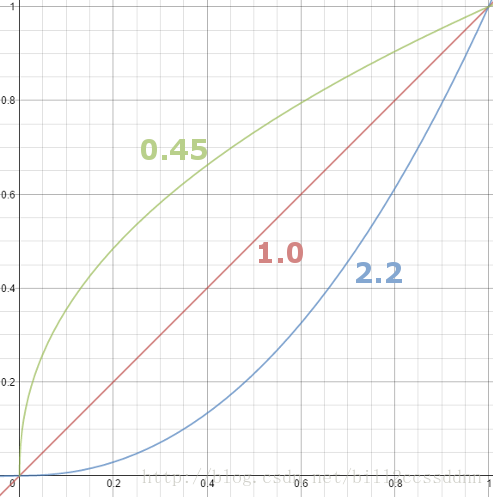
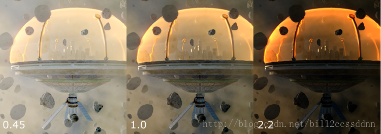

### 1.3 编码与解码

- **编码（linear → sRGB）**：对已归一化的线性亮度做 $\text{pow}(1/2.2)$，整体变亮；随后量化，暗部精度提高、亮部精度降低。
- **解码（sRGB → linear）**：做 $\text{pow}(2.2)$，回到线性空间。显示器硬件自带这一步解码。

完整链路（8 bit SDR 场景）：

| 阶段 | 所处空间 |
| --- | --- |
| 相机/渲染器内部计算 | 线性（gamma 1.0） |
| 存成图片文件 | 编码为 gamma 0.45（≈ sRGB） |
| 加载进 shader 前（勾 sRGB） | 硬件/导入器解码回线性 |
| shader 内光照计算 | 线性 |
| 输出到 framebuffer（LDR） | 编码为 sRGB |
| 显示器显示 | 硬件解码 gamma 2.2 |

$2.2$ 与 $0.45$ 近似互逆（$1/2.2 \approx 0.45$），所以"编码 + 解码"能还原出与原始一致的图像；如果图片没做编码却被显示器解码，画面会被压黑。

> 注意：**sRGB 并不严格等于 gamma 2.2**。sRGB 传输函数是分段的：暗部是线性段（斜率 12.92），亮部是 $\approx 1/2.4$ 的幂，整体近似 $1/2.2$。工程上说"sRGB ≈ gamma 0.45"是可以的，但精确实现（尤其是 HDR 管线）要用标准 sRGB 公式，否则暗部会有偏差。

### 1.4 为什么必须做 Gamma 校正

不做校正会同时出现两个错误：

1. **光照计算错误**：在线性光照结果与 sRGB 存储值之间少了转换，等于在一个扭曲空间里做能量叠加，导致过暗/过亮、明暗过渡不自然。
2. **量化精度错误**：8 bit 直接线性存储，暗部只有很少的码字可用，出现"台阶"（banding）。相机 RAW 是 12~14 bit，转成 8 bit JPG 时必须靠 gamma 重新分配码字，否则暗部层次直接丢失。

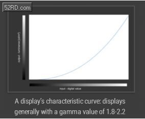
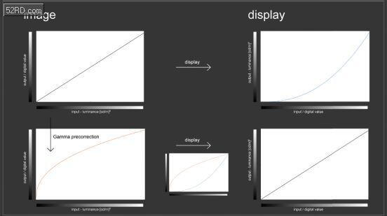

### 1.5 工程实践：URP 的处理链路

**纹理导入**：

- albedo、emissive 等**颜色**纹理：勾选 sRGB。8bit 纹理的像素数据在导入期**不会被修改**，Unity 只是把它标记为 `*_sRGB` 格式；解码发生在**采样时**，由 GPU 的 sRGB sampler 硬件完成，shader 里 `SAMPLE_TEXTURE2D` 拿到的已经是线性值（浮点/HDR 纹理才可能有导入期转换）；
- normal、mask、metallic、roughness 等**数据**纹理：不要勾 sRGB，否则数值会被错误地做幂运算（法线会被压弯，粗糙度会整体偏移）。

**RT 输出**：URP 在一帧最后执行 `FinalBlitPass`，把线性结果拷到目标 RT；`Blit` 依据源/目标 RT 类型做颜色空间转换（最常见是 Linear → sRGB）。若目标支持 HDR（线性格式），则不转换。

**shader 内**：所有光照、混合、后处理都应在线性空间完成；只在最终输出前编码一次。

---

## 2. HDR / LDR 与色深

### 2.1 动态范围

- **动态范围**：最高亮度与最低亮度的比值。人眼可感知约 $10^5:1$。
- **LDR**：8 bit RGB（每通道 256 级），**码值**比被限制在约 255:1（sRGB 解码后线性亮度比约 3300:1），且取值范围固定在 [0,1]。
- **HDR**：亮度可远超 1，需要浮点格式存储（R16G16B16A16_Float 或 R11G11B10_Float）。渲染中的"HDR"是相对概念——两个不同的 HDR 显示设备，其范围也可能不同，所以有 **VDR（Variable Dynamic Range；按本笔记口径，VDR 指亮度范围可变，该缩写在业界另有含义）** 的说法：此 H 不一定是彼 H。即使在 HDR 世界，仍然需要 tone mapping 来改变动态范围。

### 2.2 色深与格式

| 格式 | 每通道位数 | 典型用途 | 备注 |
| --- | --- | --- | --- |
| R8G8B8A8_UNorm | 8 | LDR 后处理、UI、最终 backbuffer | 需 sRGB 编码避免暗部色阶 |
| R8G8B8A8_sRGB | 8 | 颜色纹理 | 采样时硬件自动解码 |
| R16G16B16A16_Float | 16 | HDR RT、bloom、tonemap 输入 | 开销约为 8bit 的 2 倍带宽 |
| R11G11B10_Float | 10~11 | HDR 中间目标 | 无 alpha，精度略低，省带宽 |
| R32G32B32A32_Float | 32 | 离线/精确计算 | 极少用于实时 |

关键结论：**HDR 的意义不只是"更亮"，而是保留高光区的梯度**。一旦在 8 bit [0,1] 里截断，太阳、灯、金属高光都会变成一片纯白，tone mapping 也无从恢复细节。

---

## 3. Tone Mapping

### 3.1 它要解决什么

把 HDR 的宽亮度范围压进 LDR 的 [0,1]（或另一个 HDR 显示范围），同时尽量保留亮部与暗部的细节。本质是一条 S 形曲线：两端压缩、中间保留/拉伸。

### 3.2 四代演进

#### （1）经验派：Reinhard（2002，*Photographic Tone Reproduction for Digital Images*）

```cpp
float3 ReinhardToneMapping(float3 color, float adapted_lum)
{
    const float MIDDLE_GREY = 1;
    color *= MIDDLE_GREY / adapted_lum;     // 曝光归一化
    return color / (1.0f + color);
}
```

- `adapted_lum` 是全画面统计亮度（自动曝光），`MIDDLE_GREY` 定义"什么值算中灰"。
- 优点：极简，暗部提亮、亮部压暗，细节都在。
- 缺点：**整体发灰**，所有颜色都朝灰色压缩，像蒙了一层纱。

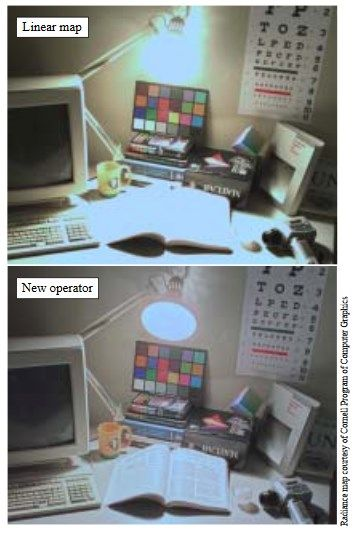
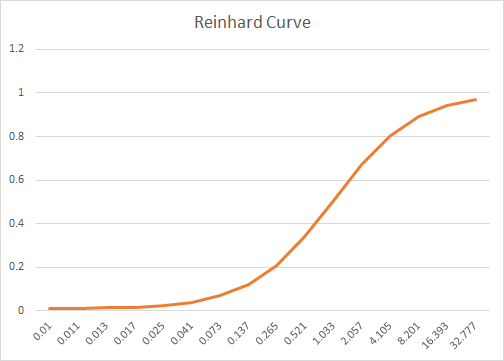
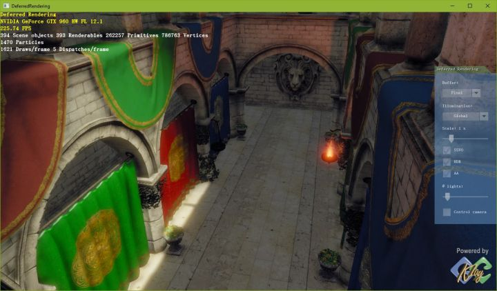

#### （2）粗暴派：CryEngine 2（2007，Crysis）

```cpp
float3 CEToneMapping(float3 color, float adapted_lum)
{
    return 1 - exp(-adapted_lum * color);
}
```

一行、无 magic number，用指数函数硬凑 S 曲线。对比度比 Reinhard 大、颜色更鲜艳，但仍偏灰，且没有可解释的改进方向。

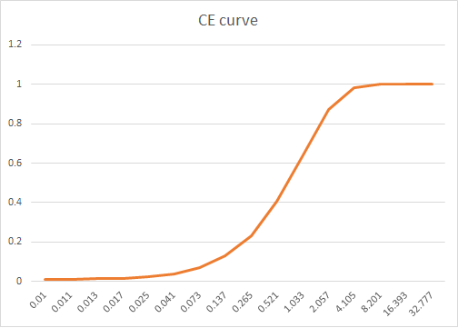
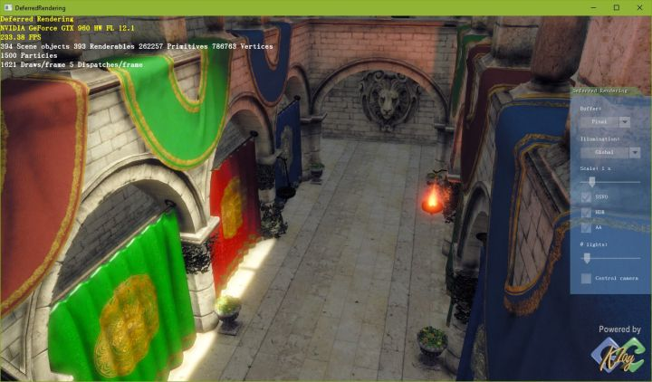

#### （3）拟合派：Uncharted 2 Filmic（2010）

思路：让艺术家用专业调色软件"人肉 tone mapping"出目标图，再对结果做高次曲线拟合。

```cpp
float3 F(float3 x)
{
    const float A = 0.15f, B = 0.50f, C = 0.10f;
    const float D = 0.20f, E = 0.02f, F = 0.30f;
    return ((x * (A * x + C * B) + D * E) / (x * (A * x + B) + D * F)) - E / F;
}

float3 Uncharted2ToneMapping(float3 color, float adapted_lum)
{
    const float WHITE = 11.2f;
    return F(2.0f * adapted_lum * color) / F(WHITE);
}
```

> 上面是 Hable 在 GDC 2010 给的原版常数（$A{=}0.15,B{=}0.50,C{=}0.10,D{=}0.20,E{=}0.02,F{=}0.30$，曝光系数 2.0，白点 11.2）。网上流传着 $A{=}0.22,B{=}0.30,E{=}0.01$、曝光 1.6 的变体，两者不是等价改写：各按自带的曝光系数（2.0 / 1.6）时，同一输入下输出可差 20% 以上（$x=1$ 时原版 0.493、变体 0.602）；若把曝光统一成同一个系数，差距扩大到约 35%。若照抄变体，请注明来源，别标成原版。

- 对比度更大，完全消除灰蒙感；增长区间很长，高光过渡自然。
- 缺点：两个多项式相除，运算量偏大；`WHITE` 是 magic number。
- 重要副产品：gamma 校正可以合并进这条曲线，一次搞定。

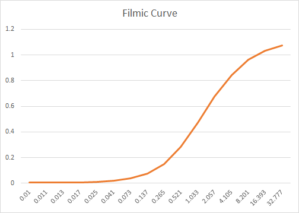
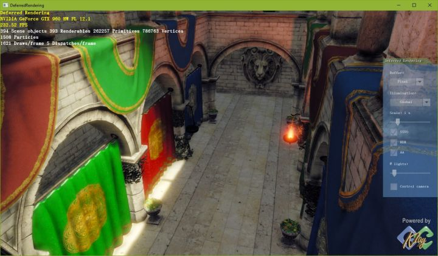

#### （4）标准派：ACES（Academy Color Encoding System）

ACES 是一整套颜色编码/交换体系：输入端把各种设备的数据转到 ACES，输出端再转到目标显示设备，从根本上解决 VDR 互通问题。

实时渲染只需其中很小的一段（HDR 线性 → 显示）：

```cpp
float3 ACESToneMapping(float3 color, float adapted_lum)
{
    const float A = 2.51f;
    const float B = 0.03f;
    const float C = 2.43f;
    const float D = 0.59f;
    const float E = 0.14f;

    const float MIDDLE_GREY = 1.0f;
    color *= MIDDLE_GREY / adapted_lum;   // 曝光归一化（同 Reinhard：除以统计亮度）
    return saturate((color * (A * color + B)) / (color * (C * color + D) + E));
}
```

- 拟合式在 $x\to\infty$ 时趋于 $A/C\approx 1.033$，**$x\approx 7.24$ 时输出恰好到 1**（$x=8$ 时约 1.0031），所以必须用 `saturate` 钳到 [0,1]，否则 HDR 高光会溢出。
- 单次多项式，比 Uncharted 便宜；S 感更浓，且在小值和接近 1 的区域仍有梯度，暗部亮部细节都保得住。
- 输出是**线性**的：接 LDR 设备再做一次 sRGB 编码；接 HDR10 设备则要先做一次 **Rec.2020 原色矩阵**变换，再施加 **PQ（SMPTE ST 2084）传递函数**并量化到 10 bit——只做矩阵、缺 PQ 编码会整体偏暗。这正是它优于前几代的地方——tone mapping 部分通用。
- 已被 UE 4.8+、Rise of the Tomb Raider 等采用，是目前实时渲染的主流选择。

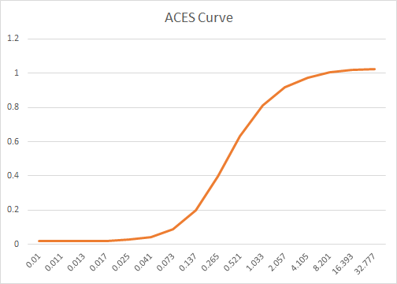
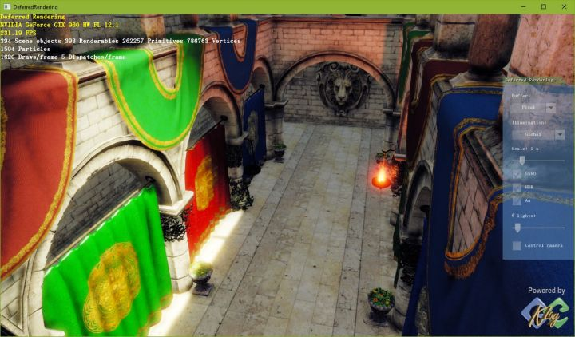

### 3.3 小结

| 方案 | 年份 | 类型 | 特点 | 主要问题 |
| --- | --- | --- | --- | --- |
| Reinhard | 2002 | 经验 | 简单、保细节 | 发灰 |
| CE (1-exp) | 2007 | 粗暴 | 一行、对比度高 | 仍偏灰、不可调 |
| Filmic (Uncharted 2) | 2010 | 拟合 | 对比度好、可融合 gamma | 计算量大、magic number |
| ACES | 2014（1.0）/2016 起在实时渲染流行 | 标准/拟合 | S 感强、通用（HDR→HDR 亦可） | 需配合正确的输出变换 |

### 3.4 Tone Mapping 与 Gamma Correction 的顺序

1. 线性 HDR 颜色 → **曝光**（乘 exposure / 除以 adapted luminance）；
2. **Tone mapping** → 压到 [0,1]（线性域）；
3. **Gamma / sRGB 编码** → 输出到 LDR 设备；
4. 若目标是 HDR 显示，跳过 2 或换成 HDR 输出变换，直接做 Rec.2020/PQ 转换。

顺序不能颠倒：先编码再 tone mapping 等于在非线性空间做压缩，中间调与亮部会被系统性压暗，近黑处几乎不变。

---

## 4. YCoCg 色彩空间

YCoCg（YCgCo）与 YCbCr 类似，用亮度 $Y$、绿色偏移色度 $C_g$、橙色偏移色度 $C_o$ 表示颜色。

### 4.1 RGB → YCoCg

$$
\begin{aligned}
Y  &= \tfrac{1}{4}R + \tfrac{1}{2}G + \tfrac{1}{4}B \\
C_o &= \tfrac{1}{2}R - \tfrac{1}{2}B \\
C_g &= -\tfrac{1}{4}R + \tfrac{1}{2}G - \tfrac{1}{4}B
\end{aligned}
$$

写成矩阵形式：

$$
\begin{bmatrix} Y \\ C_g \\ C_o \end{bmatrix}
=
\begin{bmatrix}
\tfrac14 & \tfrac12 & \tfrac14 \\[2pt]
-\tfrac14 & \tfrac12 & -\tfrac14 \\[2pt]
\tfrac12 & 0 & -\tfrac12
\end{bmatrix}
\begin{bmatrix} R \\ G \\ B \end{bmatrix}
$$

$Y \in [0,1]$，$C_o, C_g \in [-0.5, 0.5]$。例如纯红 $(1,0,0)$ 映射为 $(Y, C_g, C_o) = (\tfrac14, -\tfrac14, \tfrac12)$。

### 4.2 YCoCg → RGB

只需两次加法、两次减法：

```text
temp := Y - Cg
R    := temp + Co
G    := Y + Cg
B    := temp - Co
```

矩阵形式：

$$
\begin{bmatrix} R \\ G \\ B \end{bmatrix}
=
\begin{bmatrix}
1 & -1 & 1 \\
1 & 1 & 0 \\
1 & -1 & -1
\end{bmatrix}
\begin{bmatrix} Y \\ C_g \\ C_o \end{bmatrix}
$$

即

$$
R = Y - C_g + C_o,\quad G = Y + C_g,\quad B = Y - C_g - C_o
$$

### 4.3 优点

1. 在**实数域**可与 RGB 无损互转，逆变换只需两次加减（$R=Y-C_g+C_o$、$G=Y+C_g$、$B=Y-C_g-C_o$）；但整数实现要做**扩位**：$Y$ 与 $C_g$ 各扩 2 bit、$C_o$ 扩 1 bit，否则同精度整数往返不可逆。整数域的精确可逆形式是 **YCoCg-R**（lifting 结构，正反变换各只需加减与移位）：$Y$ 保持 $n$ bit，$C_o$ 与 $C_g$ 各扩 1 bit；
2. 避免了 YCbCr 浮点互转带来的舍入误差与颜色失真；
3. 更好地去除了颜色分量之间的相关性，提高压缩率（H.264 的 4:4:4 扩展与 HEVC RExt 采用的都是 **YCoCg-R** 残差颜色变换）。

> 修正：原文写"Cg 和 Cg 的取值范围"，应为 **Cg 和 Co**。

---

## 5. 常见错误清单

1. 把法线/粗糙度/AO 贴图勾成 sRGB —— 数据被幂运算污染，法线方向与粗糙度全部偏移。
2. 在 shader 里对 sRGB 值直接做光照累加 —— 等于在 Gamma 空间积分，暗部过暗、过渡失真。
3. 先 gamma 编码再 tone mapping —— 压缩曲线作用在非线性值上，暗部丢失。
4. 用 8 bit RT 做 HDR 中间结果 —— 高光直接截断成纯白，后续无法恢复。
5. 认为 sRGB 就是纯 gamma 2.2 —— 暗部线性段被忽略，HDR 管线里会有可见偏差。
6. 最终 backbuffer 已经做了 sRGB 编码，shader 里又 `pow(1/2.2)` —— 双重编码，画面发灰发白。

---

## 附录：工作日志中的补充记录

> 摘自 `Log/` 下的随手日志，只保留与色彩空间、色调映射相关的技术结论（定义口径、动机、参数），已删去日期流水账、任务进度与个人内容。与正文重复的条目不再复述，只做交叉引用。

### A.1 HDR / LDR 的定义口径

- **HDR = 高动态范围**，两个字的含义要分开看：
  - **高**：亮度跨度大，远大于显示器能直接呈现的 0–1；
  - **动态**：这个跨度本身**可变**——即使两台设备都叫 HDR，它们能表示的亮度范围也可能不同，所以同一份数据不能无缝通用。这种"范围可变"的说法即 **VDR（Variable Dynamic Range；按本笔记口径，VDR 指亮度范围可变，该缩写在业界另有含义）**。
- **LDR = 低动态范围**，工程上通常就直接指显示器能显示的 **0–255** 区间（8 bit 量化后的可视范围）。

> 正文 §2.1 已按动态范围比值、以及 §2.2 的格式表展开；此处只保留日志里"高/动态"二字拆解这一口径，因为它是理解"为什么 HDR 之后仍要 tone mapping"的入口。

### A.2 色调映射的适用面与动机

- **不是图形学专有**：电影行业早就在做同一件事——摄影师/调色环节把高亮区与阴影区一起向中间亮度压缩，只是手段是布光、胶片与调色台，而不是一条曲线。
- **不只是 HDR→LDR**：色调映射也包括 **HDR→HDR**，即把宽亮度范围重新映射到另一个（较窄但仍大于 1 的）HDR 范围。这正是 ACES 这类"编码 + 输出变换"体系存在的理由，也是正文 §3.2 说 ACES"tone mapping 部分通用"的由来。
- **两种偷懒做法的失败模式**：
  - **线性映射**（整体乘系数、线性缩放）→ 整体过亮或过暗。因为亮度分布本身不是线性的，人眼响应也非线性，一刀切的线性缩放必然在某一端失衡。
  - **直接截断**（clamp 到 $[0,1]$）→ 亮区与暗区的**梯度细节同时丢失**，高光变成一片纯白、暗部糊成一块。
- 因此实用曲线一律取 **S 型**：两端压缩、中间保留（斜率最大处即中灰附近）。实现路线可分三类：

| 类别 | 做法 | 代表 | 正文对应 |
| --- | --- | --- | --- |
| 经验型 | 凭经验直接写出公式 | Reinhard $c/(1+c)$、CE $1-e^{-c}$ | §3.2 (1)(2) |
| 拟合型 | 对艺术家调好的目标图做多项式拟合 | Uncharted 2 Filmic | §3.2 (3) |
| 标准型 | 由行业标准组织定义的完整编码体系 | ACES | §3.2 (4) |

- **ACES 的归属**：ACES 由 **Academy（AMPAS，Academy of Motion Picture Arts and Sciences，美国电影艺术与科学学院）** 联合制片厂与厂商推出。（原稿有误，已更正：原稿写作"美国电影协会出了一个 ACES"，而"美国电影协会"指 MPAA，是另一个组织；ACES 的主持方是 AMPAS。）

### A.3 Gamma：两条成因与 0.45 编码

- **成因一（硬件/历史）**：CRT 显示器的电子枪**电压与屏幕亮度不是线性关系**，约 $L \propto V^{2.2}$。为了让最终显示线性，图像在存储端先做 $1/2.2$ 的预补偿。
- **成因二（感知，更本质）**：**人眼对明暗的辨识度不均匀**——暗部差异容易分辨、亮部差异不易分辨，因此需要对图像做非线性处理，把有限的码字按感知均匀分配，才能获得"合适的辨识度"。
- **实现**：所有这些非线性处理统称 **gamma 校正**，具体就是对图像中**每个像素做一次幂函数运算**（存储端 $v^{1/2.2}\approx v^{0.45}$，读取/显示端 $v^{2.2}$）。
- **工程事实（最容易踩的一条）**：平时遇到的**绝大多数图片都已经被 gamma 0.45 纠正过**——gamma 校正是**几乎所有相机、几乎所有图像编辑软件**在**存储**图像时默认要做的事。所以文件里读到的像素值通常不是线性光强，直接拿去参与光照累加就是错的。

> 与正文的关系：§1.2 已完整讲了这两个成因，§1.3 讲了编码/解码链路，§5 的错误清单第 1、2、6 条是这条工程事实的直接后果。此处补两点正文未强调的：
> 1. "0.45 由相机/编辑软件默认施加"是**普遍默认行为**，不是可选优化；
> 2. $0.45$ 只是 $1/2.2$ 的近似，精确的 sRGB 传输函数是分段的（见 §1.3 注意事项），HDR 管线里要按标准公式走。

### A.4 未重复收录的条目

- 日志中 **Tone mapping 的四代演进、代码与"曝光→tonemap→编码"顺序**：正文 §3.2–§3.4 已远细于日志，不重复。
- 日志中的 **切线空间 / TBN** 结论（由 position 与 UV 偏导求 $T$、对 $N$ 正交化后叉乘得 $B$、TBN 为正交矩阵故逆=转置）：属纹理与法线主题，见 `07_纹理与法线.md` 的"切线空间"章。
- 日志中的 **延迟渲染、TBR/TBDR、管线优化**条目：与色彩空间无关，未收录。

---

## 原始笔记索引

- `Graphics/为什么要进行Gamma校正.md`
- `Graphics/PBR/linear space & gamma sapce.md`
- `Graphics/PBR/Tone mapping进化论.md`
- `Graphics/PBR/PBR白皮书.md`（线性空间与色调映射条目）
- `Graphics/PBR/基于物理的着色系统（Physical based shading）-直接光照.md`（tone mapping + gamma 代码段）
- `Graphics/Anti-Aliasing/YCoCg.md`（仅取色彩空间定义部分）
- `Log/log.md`（HDR/LDR 定义、色调映射动机与分类、Gamma 成因与 0.45 编码）
- `Log/随记.md`（HDR / Tone mapping / Gamma 条目，与 log.md 同源，仅交叉核对）