# 网格与几何处理

> 本篇整合「网格数据结构 / 简化 / 几何包围与遍历 / 法线与 UV / 曲线 / 模型格式 / 高模渲染」几组笔记。
> 主线：**先有表示（半边）→ 再谈简化（聚类、增量式、QEM）→ 然后是空间与屏幕空间的几何算法（OBB、DDA、JFA）→ 最后是属性与工程问题（法线、UV、格式、海量三角形）**。

---

## 1. 网格表示与半边数据结构

### 1.1 流形网格

图形学里说的"流形"通常指**二维拓扑流形**：曲面上每一点都有一个邻域，能与平面上的某个开集连续一一对应（内部点对应开集；边界点对应的是**半平面**中的开集）。

工程上等价的可操作判据要**两条一起用**：

> **边判据**：每条边最多被两个面共用；**顶点判据**：每个顶点的邻域（link，即与该顶点相邻的边与面围成的环）必须是**单一连通环**（内部顶点）或**单一连通链**（边界顶点）。
>
> 缺一不可：只查边会放过 bowtie 顶点（两个三角形只共一个顶点，顶点邻域是两个互不相连的环）和孤立顶点——它们都满足"每条边 ≤ 2 个面"，但顶点一圈遍历走不回起点，会让 §1.3 的 `while (h != v->edge)` 死循环或提前退出。反过来，只有**一条边被三个及以上面共用**时，边判据才会失败。悬挂面（自由边只挂 1 个面）和 T 型接缝在拓扑上只是边界/裂纹（长边属 1 个面、两条短边各属 1 个面），仍然满足"≤2"，它们破坏的是水密性，需要另做边-面映射与裂缝检查。

- 半边数据结构**只支持流形网格**；非流形需要额外机制（如允许一条边挂多条半边、或先做修复）。
- 带边界的开曲面仍是流形：边界边只有一个面，另一侧用"边界半边"占位。

### 1.2 三张表：顶点、半边、面

**核心思想**：把每条无向边拆成两条方向相反的**半边（half-edge）**，让"绕顶点"与"绕面"两种遍历都变成指针跳转。

```c
struct HE_vert {
    float x, y, z;
    HE_edge* edge;   // 以该顶点为起点的任意一条半边
};

struct HE_edge {
    HE_vert* origin; // 该半边的「起点」
    HE_vert* vert;   // 该半边的「终点」
    HE_edge* pair;   // 方向相反的孪生半边
    HE_face* face;   // 该半边左侧（或右侧，取决于约定）的面
    HE_edge* next;   // 绕同一面、按同一方向的下一条半边
};

struct HE_face {
    HE_edge* edge;   // 围绕该面的任意一条半边
};
```

面片在特定场合还需要存材质索引、法线、面积等附加信息。

### 1.3 不变量（自检清单）

任何一次 collapse/split 之后，这些关系都必须成立，否则遍历会死循环或丢面：

| 不变量 | 说明 |
|---|---|
| `h->pair->pair == h` | 孪生关系对称 |
| `h->next->pair->vert == h->vert` | `next` 之后的对偶边终点，是当前半边的终点 |
| `h->pair->face != h->face` | 两侧属于不同面（边界时一侧为 `nullptr`） |
| `h->face->edge` 在该面环路上 | 面的代表边任意，但必须属于该环 |
| 三角形：`h->next->next->next == h` | 三角形环路长度为 3 |
| 顶点代表边：`v->edge->pair->vert == v` | 代表半边的**起点**必须是 `v` 本身 |

**边界约定（全局唯一口径）**：每条无向边始终由两条半边表示，边界处那条朝外的半边是**占位半边**——它的 `pair` 指向真实半边、`face == nullptr`。所以 `h->pair` **永不为空**，判断边界一律写 `h->pair->face == nullptr`（§1.5 的构建与边界标记都按这一条执行），不要写 `h->pair == nullptr`，也不要用"0 号槽位是否为空"来代替。

最后一条是最容易忽略的：如果 `v->edge` 指向的半边终点不是 `v` 的邻居，那么"绕顶点一圈"的算法（`h = h->pair->next`）会跑到错误的环上。

**绕顶点遍历（顺时针/逆时针取决于 `next`/`prev` 约定）**：

```c
// 遍历 v 的一环邻边
HE_edge* h = v->edge;
do {
    visit(h);              // h 的终点是一个邻居
    h = h->pair->next;     // 跨到对偶边，再沿面走到下一条
} while (h != v->edge);
```

边界处 `pair->next` 会走进"边界半边环"。只要占位半边已经按边界环串接好，从**任何**以 $v$ 为起点的半边出发都能走完整个一环并回到起点——"代表半边必须选在边界上"这个说法并不成立。选边界半边的真正理由只是：如果你还想从 `v->edge` 直接沿**边界**行走或做序列化，需要一个确定的入口。

### 1.4 构建：按面添加

半边结构通常**由面列表逐个添加**来构建。

```text
addFace(a, b, c):
    verts = [a, b, c]
    // 1) 建三条半边 h0: a→b, h1: b→c, h2: c→a
    // 2) 串成环路
    h0->next = h1; h1->next = h2; h2->next = h0
    // 3) 设置 face
    h0->face = h1->face = h2->face = f
    // 4) 缝合：为每条半边找对偶
    for h in {h0,h1,h2}:
        e = findEdge(h->origin, h->vert)     // 以无序顶点对 (min,max) 为 key
        if e exists and e->pair == null:
            link(h, e)
        else:
            createEdge(min(id), max(id)) 并记录 h
```

顶点顺序（顺时针 / 逆时针）决定面法线方向：**三角形 (a,b,c) 与 (a,c,b) 得到相反的法线**。导入外部模型时必须与渲染器的正面约定（Unity 为左手系、顺时针为正面）对齐，否则会出现"整模反黑"。

> **说明（原始笔记）**：`初始化half_edge数据结构` 中写"createEdge 输入两个顶点，对三角形就是 0-2、1-0、2-1"。若三条半边是 `h0: v0→v1, h1: v1→v2, h2: v2→v0`（这与同笔记里 `next: 0→1, 1→2, 2→0` 一致），那么每条边的端点就是 **(0,1)、(1,2)、(2,0)**；(0,2)、(1,0)、(2,1) 是同一组无向边的另一种书写，在 §1.4 的 key 为**无序顶点对 (min,max)** 时两者等价，查到的对偶边相同，并不与 `next` 链矛盾。只有边表按**有序端点**（区分方向）存储时，这两种写法才指向不同的半边、产生冲突。无论哪种存储方式，边的端点都必须取自其所挂半边的 (起点, 终点)，否则对偶查找会整体错位。

### 1.5 从 OBJ 初始化

读取顺序与索引映射：

1. **`v`** → 建顶点。按出现顺序赋 id；同时放进 `m_verts`（列表）与 `m_map_vert`（id → 顶点）；
2. **`vt`** → 建 uv 数组，供面顶点查询（**不要**直接当成顶点属性：同一个位置顶点在不同面可以有不同的 uv）；
3. **`vn`** → 建法线数组，同理；
4. **`f`** → 每个 `f` 的 token 形如 `v/vt/vn`（也允许 `v//vn`、`v`），据此建面：
   - `m_faces` / `m_map_face` 收集面；
   - 每个面顶点建一条半边，与顶点、面关联；
   - `next`：`0→1, 1→2, 2→0`；`prev` 为其逆（`0→2, 1→0, 2→1`）；
   - 建边并缝合（见 1.4）。

**边界标记流程**：

```text
for each edge in m_edges:
    // 约定：任意边优先填充 0 号半边；边界处 h[1] 是占位半边（face == nullptr）
    if edge.h[1]->face == nullptr:         // 只有一侧有面
        markBoundary(edge.h[0]->origin)    // 边的起点
        markBoundary(edge.h[0]->vert)      // 边的终点（不是 prev 的 origin，那是面上的第三个顶点）
    else:
        // 归一化：让 h[0] 的方向固定（如按顶点 id 升序），便于查找与序列化
        if edge.h[0]->origin.id > edge.h[0]->vert.id: swap(edge.h[0], edge.h[1])   // 保证 origin.id < vert.id

removeVerticesWithoutEdge()
for each boundaryVertex v:
    h = v->edge
    // 沿着「终点 → prev」方向绕行，直到找到边界半边
    while h->pair->face != null:  h = h->prev->pair   // 具体方向依实现约定
    v->edge = h                                        // 必须是以 v 为起点的边界半边
```

> **修正 / 待核实（原始笔记）**：
> 1. "0 号半边一定不为空"是**实现约定**（插入时优先填 0 号槽），不是数学性质。更稳健的判据是 `h->pair->face == nullptr`（占位半边，见 §1.3 的边界约定；`pair` 本身不为空），不要依赖槽位顺序。
> 2. "若 0 号半边的源点 id 小于终点 id，则交换"这句的方向容易写反：目标是让**规范方向可复现**（例如统一为"起点 id < 终点 id"），从而让"用无序顶点对查边"与序列化都稳定。交换时同步更新 `edge.h[0]/h[1]` 即可；`pair` 是两条半边互指的指针，交换槽位后仍然指向对方，不需要额外修补。
> 3. 边界顶点代表半边的选取条件，应当是"**起点为该顶点**且位于边界上"；只满足"位于边界上"可能拿到的不是以 $v$ 为起点的半边，`v->edge` 的语义就断了。注意这只是为了确定入口（沿边界行走、序列化）——一环遍历本身对任何以 $v$ 为起点的半边都成立（见 §1.3）。

---

## 2. 网格简化综述

### 2.1 问题定义

把网格 $A$ 变换为 $B$：$|V_B| < |V_A|$、$|E_B| < |E_A|$、$|F_B| < |F_A|$，同时用一组**质量准则**约束"$B$ 与 $A$ 的差异"。

三个基本要求：

1. **误差可控**：简化后与原始表面的偏差（Hausdorff 距离、二次误差）在阈值内；
2. **可迭代**：一次只做局部操作（移除一个顶点/塌缩一条边），可反复进行；
3. **可逆**（理想情况）：记录操作序列即可从 $B$ 还原 $A$（渐进网格 / progressive mesh）。

### 2.2 Vertex Clustering（顶点聚类）

思路：把空间划成格子，每格内的顶点合并成一个代表点。

**a) 聚集生成**：用一个大包围盒囊括 mesh，按边长 $\varepsilon$ 切成 cells，把顶点映射进去。

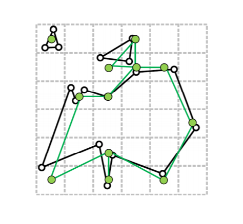

**b) 选代表顶点**（不必是原顶点）：

| 方法 | 说明 |
|---|---|
| 平均值 | cell 内顶点坐标取平均 |
| 中值 | 取最靠近中心的顶点 |
| QEM | 选使 cell 内二次误差和最小的点（见第 3 章） |

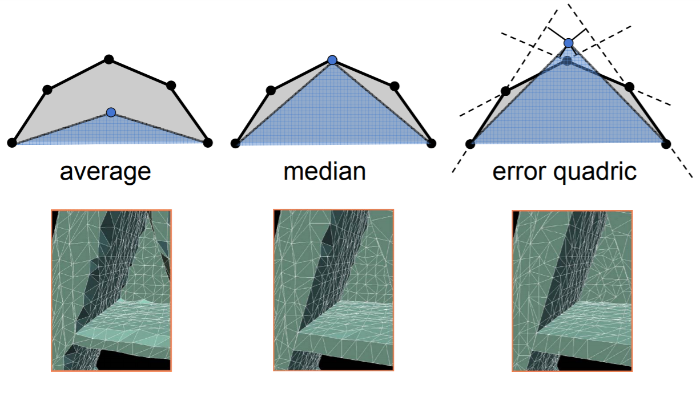

**c) 网格生成**：每个 cell 至多一个代表点。若 cell $A$ 的某个顶点与 cell $B$ 的某个顶点之间**存在原边**，则连接 $v_{pA}$、$v_{pB}$。

**d) 拓扑改变**：可能出现三角形退化成线段/点、非流形、面翻折。

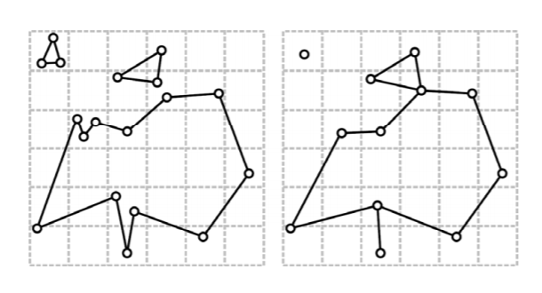

复杂度 $O(n)$（每个顶点只做一次哈希/取整映射，与顶点数线性），速度极快；代价是**拓扑不可控**。

> 原始笔记自问"为什么是 O(n)"：因为聚类只对顶点做一次"定位到 cell + 累加"的常数时间操作，不涉及邻域迭代与排序；后续的面重建也只需遍历一次原面表。

### 2.3 Incremental Decimation（增量式简化）

```text
repeat:
    pick mesh region                       // 通常是「误差最小」的候选
    apply decimation operator
until no further reduction possible
```

带优先队列的标准形式：

```text
for each candidate region:
    q = evaluate_quality_after_decimation(region)
    if q < ε:  enqueue(q, region)

repeat:
    (q, region) = pop_min()
    if q >= ε: break
    apply decimation_operator(region)
    // 只有受影响区域需要重新评估
    for neighbor_region in affected(region):
        update(neighbor_region)
until queue empty
```

**关键工程点**：塌缩后只需重算**邻域**的代价（局部性），这是增量式能跑在交互帧率下的原因。

### 2.4 简化算子

| 算子 | 操作 | 减少量 |
|---|---|---|
| Vertex Removal | 删一个顶点，把它的环重新三角化 | 1 顶点，2 面 |
| Edge Collapse | 把一条边缩成一个点 | 1 顶点，2 面，3 边 |
| Half-Edge Collapse | 把一条半边缩成一个点（一侧保留顶点位置） | 同上，但新点位置固定为端点之一 |

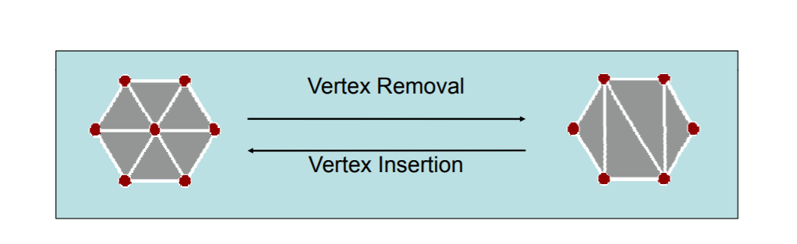
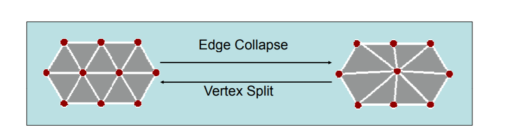
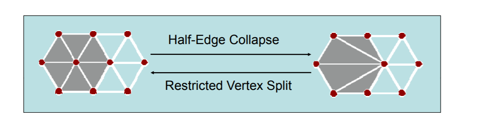

### 2.5 误差度量

- **局部误差**：只看被删/被缩区域（如 QEM 的二次型、法线偏差、面积变化）；
- **全局误差**：简化后的整体网格与原网格的偏差（Hausdorff 距离、每顶点到原表面的距离）。

**Fairness criteria（约束条件）**：

1. 误差不超过阈值；
2. 三角形形状不能退化（避免极瘦长三角形：可用最小角、边长比、法线偏转角约束）；
3. 拓扑约束：不允许产生非流形、不允许边界被"吃掉"、"link condition"必须满足（两顶点的公共邻居集合必须**恰好等于** link(edge) 的两个端点：内部边 2 个、边界边 1 个；只比较数量相等不够，非流形输入会出现"数量相同但集合不同"而漏判）。

### 2.6 两种方法对比

| | Vertex Clustering | Incremental Decimation |
|---|---|---|
| 复杂度 | $O(n)$ | $O(n\log n)$ 起（优先队列） |
| 速度 | 极快 | 中等，但可控 |
| 拓扑 | 可能改变、可能非流形 | 可严格保持 |
| 质量 | 一般（格子对齐伪影） | 好（可用 QEM + 形状约束） |
| 适用 | LOD 远层、点云、快速预览 | 高质量 LOD、资产优化 |

---

## 3. QEM（Quadric Error Metric）二次误差度量

Garland & Heckbert 的经典方法：用一个**二次型**表示"点偏离一组平面的总代价"。

### 3.1 平面到二次型

平面 $ax+by+cz+d=0$，且 $a^2+b^2+c^2=1$。记 $p=(a,b,c,d)^T$，则点 $v=(x,y,z,1)^T$ 到该平面的**有符号距离**为 $p^T v$（系数已归一化，无需再除模长），其平方——无符号的平方距离——是

$$
d(v)^2 = (p^T v)^2 = v^T\,(p\,p^T)\,v
$$

定义**基本误差二次型**：

$$
K_p = p\,p^T =
\begin{bmatrix}
a^2 & ab & ac & ad\\
ab & b^2 & bc & bd\\
ac & bc & c^2 & cd\\
ad & bd & cd & d^2
\end{bmatrix}
$$

对顶点 $v$，累加其所有相邻面的 $K_p$：

$$
Q_v = \sum_{f \ni v} K_{p_f}
$$

误差即 $\Delta(v) = v^T Q_v v$。

### 3.2 塌缩后的代价与新点位置

边 $(v_1,v_2)$ 塌缩到新点 $\bar v$，代价为

$$
\Delta(\bar v) = \bar v^T (Q_1+Q_2)\,\bar v
$$

把 $Q = Q_1+Q_2$ 分块：

$$
Q = \begin{bmatrix} A & b \\ b^T & c \end{bmatrix},
\qquad A \in \mathbb{R}^{3\times3},\ b\in\mathbb{R}^3,\ c\in\mathbb{R}
$$

则

$$
\Delta(\bar v) = \bar v_{xyz}^T A\,\bar v_{xyz} + 2b^T \bar v_{xyz} + c
$$

这是关于位置的**凸二次函数**，极值点满足

$$
A\,\bar v_{xyz} = -b
\quad\Longrightarrow\quad
\bar v_{xyz} = -A^{-1} b
$$

此时最小代价为

$$
\Delta_{\min} = c - b^T A^{-1} b
$$

（理论上 $\ge 0$；浮点误差可能得到极小负值，取 $\max(0,\cdot)$。）

> **修正（原始笔记）**：`QEM网格简化 - 简书` 里"`q11` 表示新的 Q 的第一行的第一个元素"来构造方程组，本质就是这个 $A\bar v = -b$，但原文没有区分 $A$（左上 3×3）与常数项 $c$，也没有给出代价的闭式 $c-b^TA^{-1}b$。按 $Q$ 的整体分块理解才不会有量纲/符号错误。

### 3.3 $A$ 奇异时的回退策略

实际中大量 $Q$ 是奇异的（共面区域、只有两个面、退化几何）。标准回退顺序：

1. 沿边做**一维极小化**：令 $\bar v(t) = v_1 + t(v_2-v_1)$，$\Delta(t)$ 是 $t$ 的二次函数，闭式解
   $$
   t^\* = -\frac{(v_2-v_1)^T(A v_1 + b)}{(v_2-v_1)^T A (v_2-v_1)}
   $$
   取 $t^*\in[0,1]$ 或端点。
2. 否则取**中点** $(v_1+v_2)/2$；
3. 再退化则取 $v_1$ 或 $v_2$ 中代价较小者。

> **修正**：原始笔记写"取 $k=0.1,0.2,\dots$ 分别计算 cost，取最小"。这是沿边采样，能得到近似解，但当 $A$ 非奇异、边与最深方向一致时会**漏掉最优解**；上面的闭式解与之等价但精确，且只需一次除法。采样法仅在需要避开数值不稳定时才作为兜底。

### 3.4 完整算法

```text
1. 为每个顶点计算 Q_v
2. 为每条边 (v1,v2) 计算候选代价 Δ 与最优位置，入最小堆
3. repeat:
       pop 代价最小的 (v1,v2)
       合法性检查：
         - 拓扑：link condition（两顶点的公共邻居集合必须**恰好等于** link(edge) 的两个端点：内部边 2、边界边 1；仅数量相等不够）
         - 几何：塌缩后不产生翻面（每个受影响面的法线与原法线夹角 < 阈值）
         - 边界：边界顶点/边界边有额外惩罚项（否则边界会被拉直、开口变形）
       执行塌缩，v1/v2 → v̄，Q ← Q1+Q2
       更新受影响边的代价（重算并入堆，旧的用「惰性删除」标记失效）
   until 达到目标面数 / 最小代价 > 阈值
```

**边界保持**：给边界边额外加一个"垂直于边界的平面"二次型（虚拟面），可显著减少开口轮廓的收缩。

**效果**：球体简化到 1/10、1/100 顶点仍保持形状：

> 下图（原图题注）：`Figure: QEM results: 70k, 1k, 100 triangles respectively.`——图中是 Stanford bunny 在 70k / 1k / 100 三角形下的 QEM 结果对比（示意图 + 题注，保留图片）。

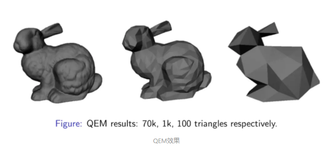
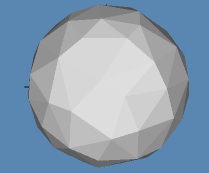
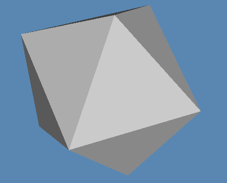

参考实现：<https://github.com/WZFish/QEM-MeshSimplification.git>

---

## 4. OBB（Oriented Bounding Box）

### 4.1 PCA 定轴

AABB 在斜置物体上包得极松，OBB 用**数据自身的主方向**作为坐标轴。

PCA 的直觉：把顶点云投影到某个方向上，**方差最大的方向**承载了最多的形状信息；第二个轴取与第一轴正交且方差次大的方向；依次重复到维数用尽。

### 4.2 生成步骤

1. 求点集样本均值 $\mu = \frac1n\sum_i p_i$；
2. 求协方差矩阵
   $$
   C = \frac1n\sum_i (p_i-\mu)(p_i-\mu)^T
   $$
   实现上只算上三角 6 个元素，再用对称性补全；
3. 求 $C$ 的特征值与特征向量（**雅可比迭代**，对称矩阵专用，稳定且无需外部库）；
4. 特征值**降序**排序，特征向量同步重排；
5. 取前两个特征向量 $\mathbf{e}_1,\mathbf{e}_2$，第三轴 $\mathbf{e}_3 = \mathbf{e}_1\times\mathbf{e}_2$（保证右手系）。

> **修正**：原始笔记写"取前两个特征向量进行施密特正交化"。对称矩阵在精确算术下特征向量**本就正交**，施密特正交化只在数值退化（特征值接近相等、点云近似各向同性）时才需要；此时主轴本身也不稳定，正交化只是保证"不崩"，不能保证"方向有意义"。另外 $\mathbf{e}_3 = \mathbf{e}_1\times\mathbf{e}_2$ 恒构成右手系，与第 3 个特征向量的符号无关；若希望两者同号（便于复现排序或序列化），可在叉乘后按 $\operatorname{sign}(\mathbf{e}_3\cdot\mathbf{V}_3)$ 决定是否翻转——这只是取号约定，翻转不会造成左手系。

### 4.3 表示与求交

OBB 需要存：

1. 三个正交单位轴 $\mathbf{u},\mathbf{v},\mathbf{w}$（或一个 3×3 旋转矩阵）；
2. 局部坐标系下的半长/最小最大点 $[\min,\max]$；
3. 中心点（世界坐标）。

**射线-OBB 求交**：

```text
1. 把射线变换到 OBB 局部空间：
      o_local = R^T (o - center)        // R 正交 → 逆 = 转置，无需矩阵求逆
      d_local = R^T d                   // 方向只旋转，不归一化，t 保持有效
2. 在局部空间做 AABB slab 测试（见《09 光线追踪与全局光照》4.2）
```

要点：**不要归一化 `d_local`**，否则解出的 $t$ 与原始射线的尺度不一致；旋转是等距变换，$t$ 可直接复用。

---

## 5. DDA 直线绘制与体素遍历

### 5.1 算法

DDA（Digital Differential Analyzer）用"主轴步进 + 斜率累加"把浮点端点离散成像素。

1. 输入端点取整：`p0 = round(start)`, `p1 = round(end)`；
2. 求差 `dP = p1 - p0`，比较 $|dP_x|$ 与 $|dP_y|$，**把较大分量轴换到 x**（交换 xy）；
3. 斜率步进值
   $$
   \Delta P = \frac{dP_{xy}}{|dP_x|}
   $$
   其 x 分量为 $\pm1$（可直接用 `sign(dP.x)`），y 分量为斜率 $k$；
4. 从 `p0` 起步、输出 $|dP_x|+1$ 个点：第 $k$ 个点（$k=0,\dots,|dP_x|$）为 $p_0+k\,\Delta P$，即循环 $|dP_x|$ 次、每次先累加再输出。

### 5.2 四个常见问题

**一、用输入浮点端点还是取整后的端点？**
端点的小数部分会让斜率略有差异，中间某些像素可能不同，但两端点结果一致。用整数端点更简单且可复现。

**二、为什么要交换 xy？**
为了**消除分支**：不交换就要写"x 为主轴"和"y 为主轴"两套步进循环；交换后永远 x 为主轴，循环体只有一份。
**注意**：交换后算出的坐标要再交换回来才是真正的屏幕坐标。

**三、步进值的分量**
$\Delta P.x = \pm 1$，$\Delta P.y = k$（被交换时同理）。若直接按 `dP/|dP.x|` 计算，就自动得到这个结果。

**四、Unity 的像素中心偏移**
片元着色器传入的 `SV_POSITION`（`positionCS.xy`）是**像素中心**，即坐标带 `+0.5`：

```c
positionCS.xy = (int2)positionCS.xy + 0.5;   // 取值范围 [0.5, width-0.5]
```

所以要么把端点也加上 0.5 保持同一坐标系：

```c
float2 p0 = int2(_StartPosSS) + 0.5;
float2 p1 = int2(_EndPosSS)   + 0.5;
float2 diff = abs(currPosSS - positionCS.xy);
```

要么把端点取整、比较时再把片元坐标取整：

```c
float2 p0 = round(_StartPosSS);
float2 p1 = round(_EndPosSS);
float2 diff = abs(currPosSS - (int2)positionCS.xy);
```

**不要混用**——一半带 0.5、一半不带，会产生半像素的偏移（线看起来"整体偏一格"）。

### 5.3 从 2D 到 3D：体素遍历

3D DDA（Amanatides & Woo）是均匀格子加速结构的遍历核心：维护

$$
t_{\text{Max}} = \frac{\text{到下一个格边界的距离}}{|d|},\qquad
t_{\text{Delta}} = \frac{\text{格子尺寸}}{|d|},
$$

每次沿 $t_{\text{Max}}$ 最小的轴走一格，并同步更新该轴的 $t_{\text{Max}} \mathrel{+}= t_{\text{Delta}}$。射线-AABB 求交给出初始的 $t_{\text{Max}}$（见《09 光线追踪与全局光照》4.2–4.3）。

---

## 6. Jump Flooding Algorithm（JFA）与距离场

### 6.1 用途

由二值 mask 生成**有符号距离场（SDF）**：求每个像素到最近边界点的距离。GPU 上比"逐像素暴力搜索"快几个数量级。

特点：

- **并行**：每个像素独立，适合全屏 Pass；
- **迭代传播**：第 $k$ 次迭代的步长是上一次的一半，信息以"跳跃"方式扩散。

### 6.2 数据布局

| 纹理 | 格式 | 内容 |
|---|---|---|
| mask | `R8_UNorm` | 0 = 外部，1 = 内部 |
| 中间纹理 ×2 | `R16G16B16A16_SFloat` | `.xy` 最近边界点（相对当前像素的向量）、`.z` 最近距离**平方**、`.w` 原始 mask 值（标记 inner/outer） |

- 用**平方距离**比较，避免每像素一次 `sqrt`；
- 方向向量有负值，必须用 **SFloat**；16 位是精度与带宽的折中。

**初始化（决定 JFA 能否收敛）**：第 0 帧（mask 生成 pass）就把 `.z` 写成"是否已找到种子"的标记：种子（mask 边界像素）`.xy = 0`、`.z = 0`；其余像素 `.z = INIT`（哨兵，远大于任何可能的距离值）。之后每轮 `.z` 只会在"找到更近的候选"时被改写，因此 `n.z >= INIT` 恰好表示邻居**尚未找到任何种子**，它的 `.xy` 没有意义、不能拿来当候选。

> **哨兵取值必须与 RT 格式匹配**：`.z` 存的是平方距离时，`R16G16B16A16_SFloat` 的 half 最大值只有 65504（写入 `1e9` 会变成 `inf` 或被饱和到 65504），且平方距离超过 65504 只对应约 256 px 以外的像素——那时邻居会被误判为"未找到种子"。两种可行做法：① `.z` 改用 `R32_SFloat`（RT 用 `R32G32B32A32_SFloat`），`INIT = 1e9`；② 保持 16 位，改存**归一化距离** `d/d_max ∈ [0,1]`（平方后仍 ≤ 1），`INIT = 1.0`。下文伪代码里的 `INIT` 必须与所选方案一致，并在 shader 里以宏或常量明确定义。

### 6.3 迭代步长

```csharp
int step = Mathf.RoundToInt(Mathf.Pow(2, floodfillSteps - 1));
while (step != 0)
{
    cmd.SetGlobalFloat("_Step", step);
    cmd.Blit(_tmpRT0, _tmpRT1, material, 2);
    (_tmpRT0, _tmpRT1) = (_tmpRT1, _tmpRT0);
    step /= 2;
}
```

- `floodfillSteps = 3` → 4, 2, 1（共 3 次）
- `floodfillSteps = 4` → 8, 4, 2, 1（共 4 次）

初始步长须 ≥ 纹理最大边长的一半，否则远处的边界信息传不到。

### 6.4 核心 Pass

```hlsl
float4 frag_jump(v2f_jump i) : SV_Target
{
    float4 curr = tex2D(_MainTex, i.uv[0]);

    for (uint j = 1; j <= 8; j++)
    {
        float4 n = tex2D(_MainTex, i.uv[j]);   // 按 step 偏移的 8 个采样点，不是邻接 8 像素

        // 邻域尚未找到任何种子（.z 仍是哨兵 INIT）→ 它的 .xy 无意义，跳过
        if (n.z >= INIT) continue;

        // 邻域像素在边界的另一侧 → 它自己就是边界（种子）
        if (n.w != curr.w) n.xyz = float3(0, 0, 0);

        // 邻域的最近点向量 + 当前→邻域的偏移 = 当前像素看到的候选边界点
        n.xy += i.uv[j] - i.uv[0];
        checkBounds(n.xy, i.uv[j]);

        float dist = ScreenDist(n.xy);          // 距离平方

        if (dist < curr.z) curr.xyz = float3(n.xy, dist);
    }
    return curr;
}
```

两条规则：

- **同侧**（inner/outer 相同）：用「当前→邻域 的偏移 + 邻域存的最近边界向量」合成候选；
- **异侧**：边界就在两者之间，用「当前→邻域 的偏移」作为候选（近似取邻域像素位置为边界点）。

比较 8 个候选取最小，写入当前像素。像素的 inner/outer 属性**全程不变**，只有 `.xyz` 被更新。

### 6.5 精度与已知问题

> **修正**：原始笔记说 JFA "最终计算出每个像素到最近边界点的距离"。严格说标准 JFA 是**近似**的：它只保证在步长序列覆盖下"很可能"找到最近种子，理论上存在少量像素收敛到次优解（尤其在细长结构、两个种子距离接近时）。工程上常用 **1+JFA**（先用 1 像素步长跑一遍再做标准序列）或 **JFA+2** 提升准确率，或对结果做一次局部修正。

实现坑：

- `fallbackMaterial` 替换原始材质渲染时，**必须移动 GameObject 才会执行该 Pass**——与 motion vector 计算里遇到的现象一致（`CameraMove` 可以触发，`ObjectMove` 只有对象真的移动才触发）；
- 距离输出阶段用距离控制 alpha 时，注意 `ScreenDist` 的坐标系（uv 空间 vs 像素空间）要与采样偏移一致，否则表现为"各向异性距离场"（横竖比例不对）。

### 6.6 测试流程

三步：① 生成 mask（一个 Pass，标记内外）→ ② 执行 Jump Flooding（Pass 数 = 迭代次数）→ ③ 输出 SDF。

**单点测试**：

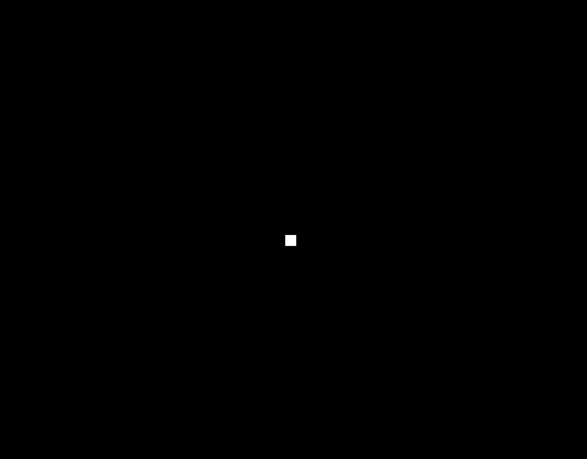
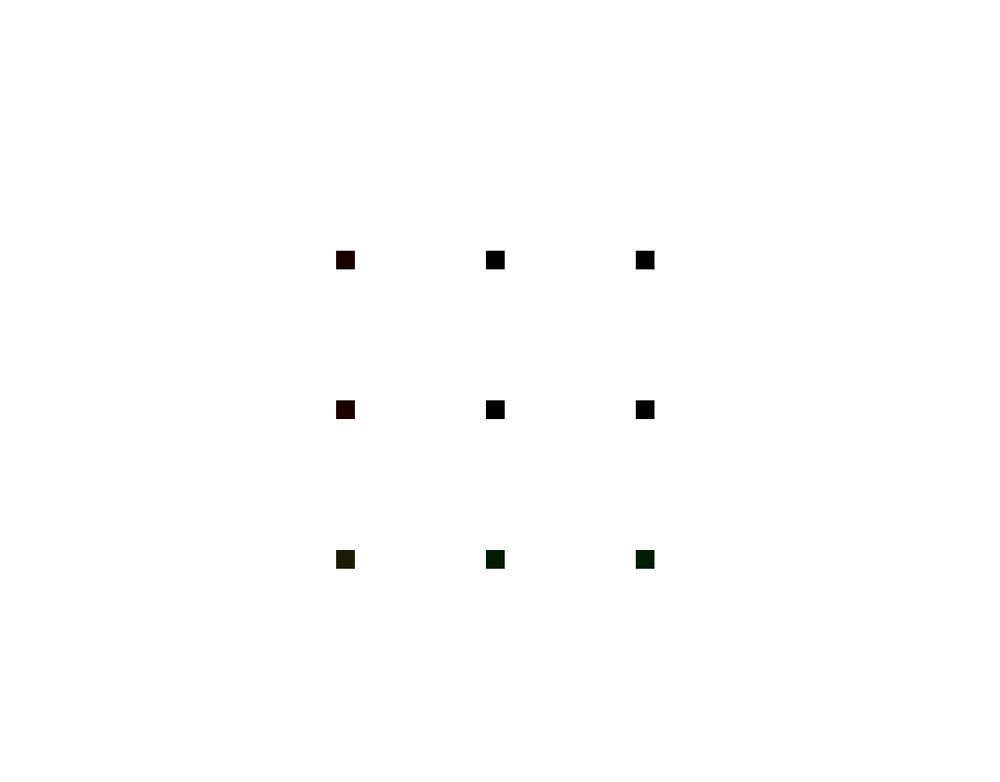
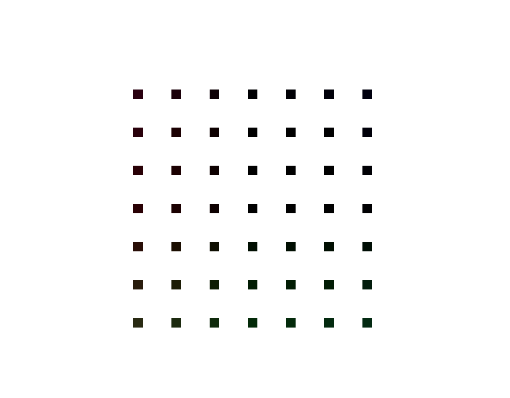
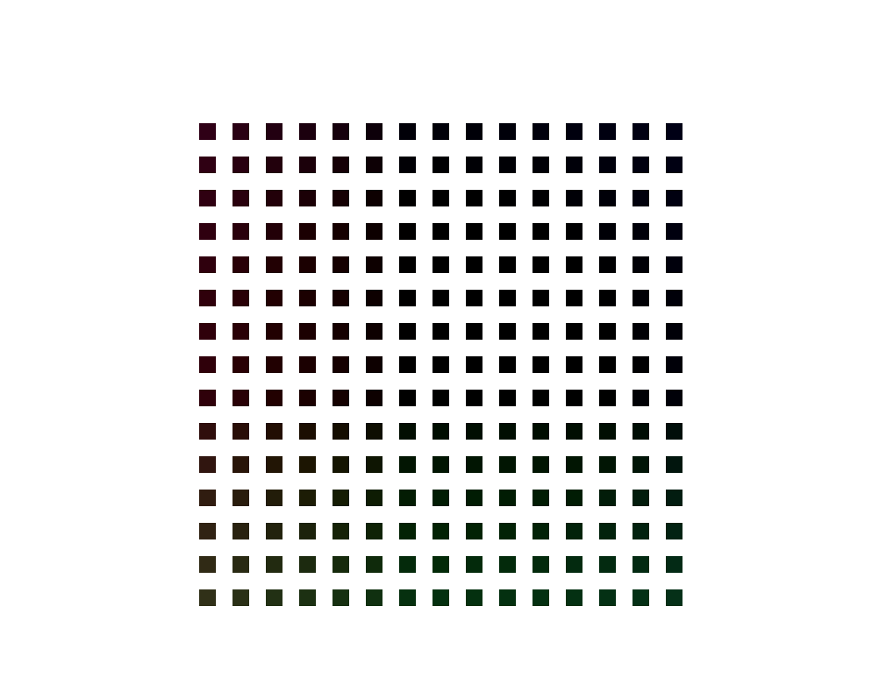
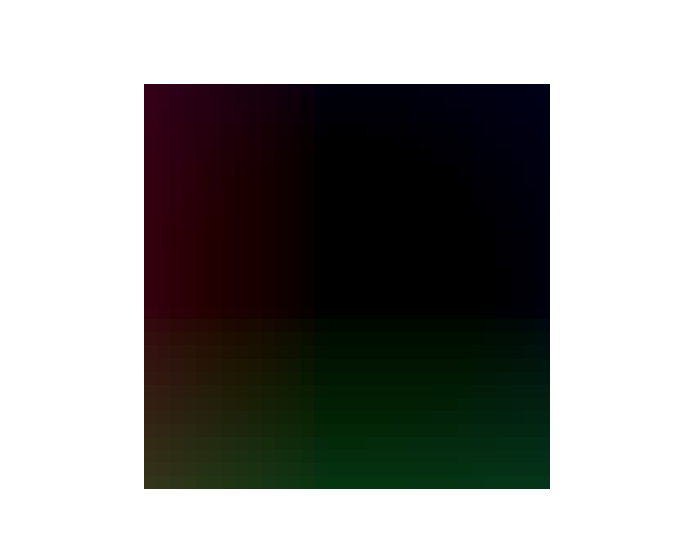
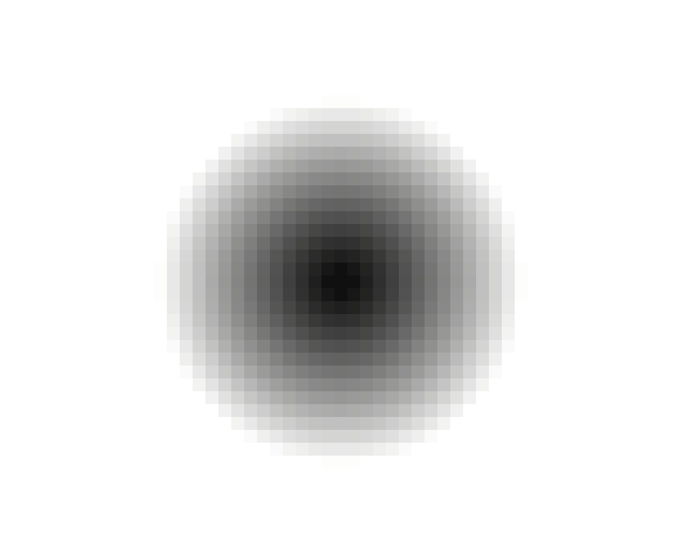

**场景测试**：

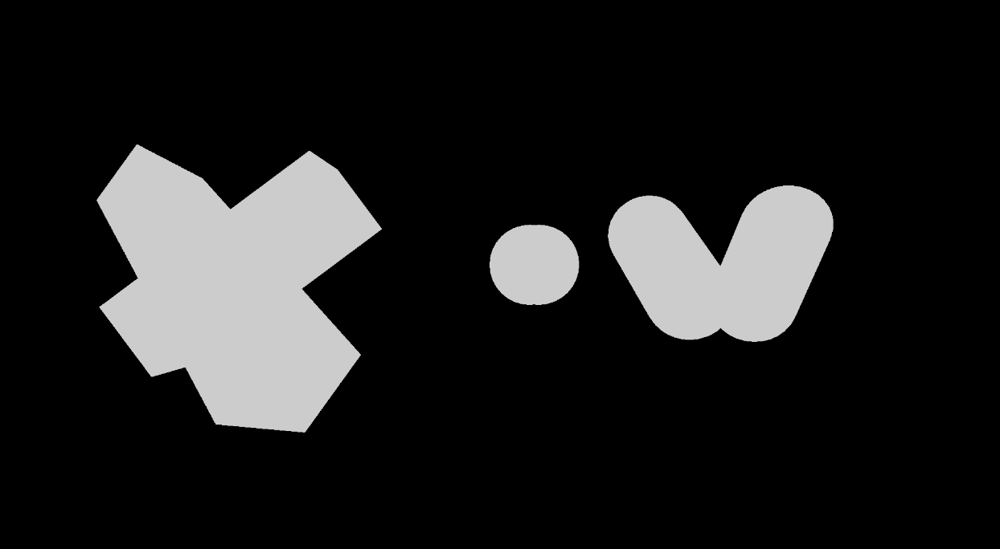
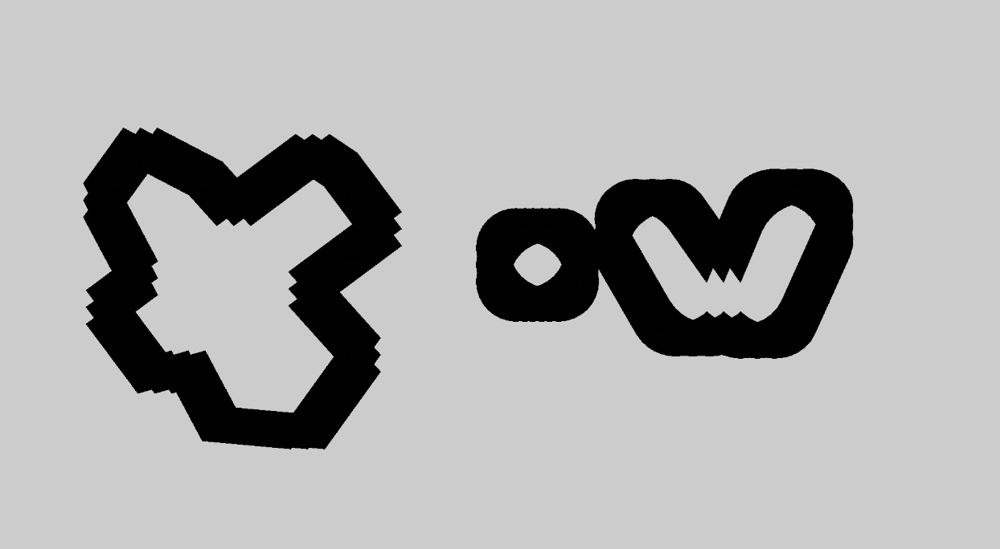
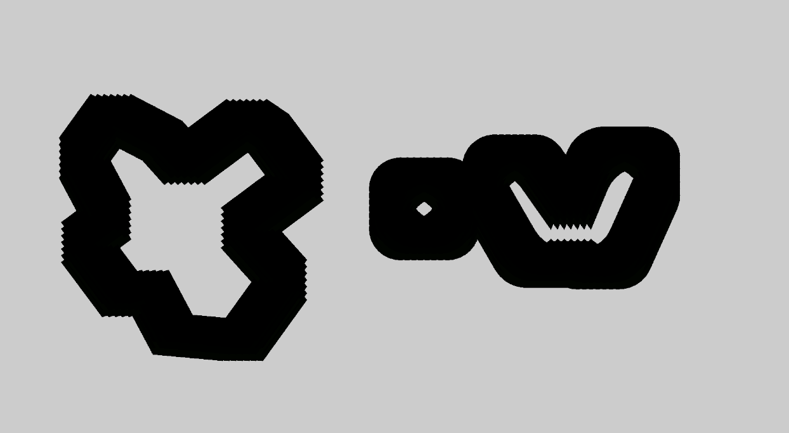
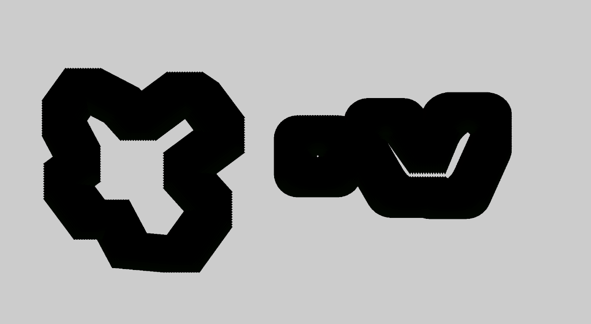
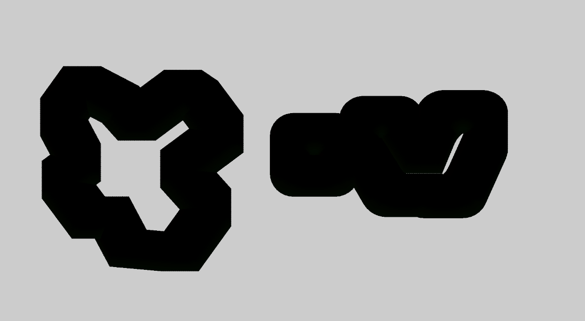
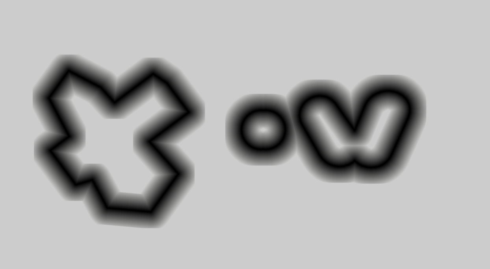

---

## 7. 法线

### 7.1 法线矩阵为什么是逆转置

**问题**：模型矩阵含非一致缩放时，直接用它变换法线会让法线不再垂直于表面。

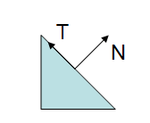
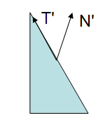

**推导**：设切线 $T$、法线 $N$ 满足 $T\cdot N = 0$。顶点变换矩阵左上 3×3 为 $M$，法线变换矩阵为 $G$。

切线是**两点之差**，所以随顶点一起变换：$T' = M T$。变换后仍要求垂直：

$$
(M T)\cdot(G N) = 0
\quad\Longleftrightarrow\quad
T^T M^T G N = 0
$$

只要 $M^T G = I$，上式对任意满足 $T\cdot N=0$ 的 $(T,N)$ 都成立，于是

$$
G = (M^{-1})^T = (M^T)^{-1}
$$

"逆的转置"与"转置的逆"相同，因为 $(M^T)^{-1} = (M^{-1})^T$。

**什么时候可以直接用 $M$？** 这里的 $M$ 指变换矩阵的**左上 3×3**。当它是正交矩阵时 $M^{-T}=M$，法线与切线的夹角、长度都不变。`glRotate`/`gluLookAt` 的左上 3×3 是正交阵；`glTranslate` 的左上 3×3 是**单位阵**（平移在第 4 列，不属于左上 3×3），所以平移同样不影响法线。注意 4×4 的平移矩阵**本身不是**正交阵——"刚性变换"的说法是对的，但"4×4 平移矩阵正交"不成立；本节结论只在左上 3×3 上成立。

**归一化**：

- 顶点阶段：若 $G$ 正交且输入法线已归一化，可省掉 `normalize`；
- 片元阶段：**必须重新归一化**。三个顶点法线线性插值后，模长一般小于 1（插值落在球内的弦上），方向正确但长度不足；
- 额外的坑：若顶点法线本身未归一化，插值出的方向也会错——所以即使某个顶点法线在顶点着色器里"没用到"，也应先归一化。

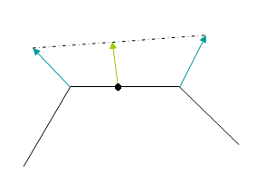

### 7.2 从深度重建法线

没有法线缓冲时（延迟管线只存深度、或需要逐帧重建），可以由深度图重建。质量不如模型自带法线，酌情使用。

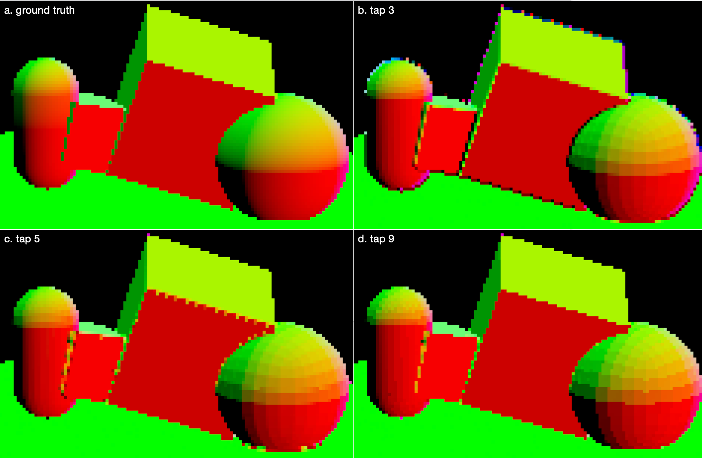

统一做法：由深度 + 每像素射线重建世界坐标 `posWS`，再用相邻像素的差分叉乘得到法线。

#### Tap 3（最省）

```hlsl
float3 normalWS = normalize(cross(ddy(posWS), ddx(posWS)));
```

或者手动采样右、上两个邻居：

```hlsl
worldPos[0] = GetPosWS(LoadSceneDepth(px),          rayWS[0]);  // center
worldPos[1] = GetPosWS(LoadSceneDepth(px + (1,0)),  rayWS[1]);  // right
worldPos[2] = GetPosWS(LoadSceneDepth(px + (0,1)),  rayWS[2]);  // up

float3 hDeriv = worldPos[1] - worldPos[0];
float3 vDeriv = worldPos[2] - worldPos[0];
float3 worldNormal = SafeNormalize(cross(vDeriv, hDeriv));
```

> 原始笔记调侃"只用一次采样应叫 tap 1"——`ddy/ddx` 由硬件 quad 提供，逻辑上仍是 3 个像素（center/right/up），叫 tap 3 是合理的。

**缺陷**：在物体**轮廓边缘**，选中的邻居像素可能属于另一个表面（深度跳变），叉乘结果完全错误 → 轮廓处出现亮边/黑边伪影。

#### Tap 5

用一次深度比较挑出"与当前像素在同一表面上"的邻居：

```hlsl
// 取左、右、下、上
float3 hDeriv = abs(l - c) < abs(r - c) ? (centerPos - leftPos)  : (rightPos - centerPos);
float3 vDeriv = abs(d - c) < abs(u - c) ? (centerPos - downPos)   : (upPos - centerPos);
float3 normalWS = SafeNormalize(cross(vDeriv, hDeriv));
```

直觉：深度差小的那个邻居更可能与中心在同一面片上。

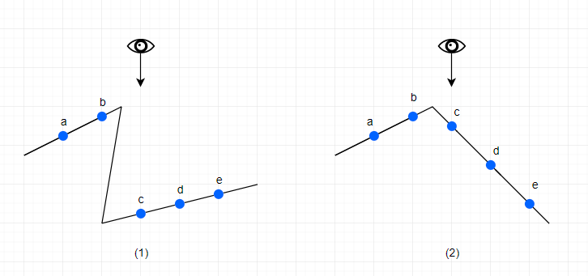

改善了一侧的轮廓伪影，但另一侧（例如细长突出物、斜向边缘）仍会错。

#### Tap 9

采样 9 个深度点，但只重建 **5 个**世界坐标（center/left/right/up/down），用"梯形中线"预测中心深度：

$$
c_1 = 2b - a,\qquad c_2 = 2d - e
$$

（上底 $c$、下底 $a$ 的梯形，中线 $b$ 满足 $2b = c + a$。）

```hlsl
float2 he = abs((2.0 * H.xy - H.zw) - c);   // 水平方向两个预测值的误差
float2 ve = abs((2.0 * V.xy - V.zw) - c);
float3 hDerivative = he.x < he.y ? centerPos - leftPos : rightPos - centerPos;
float3 vDerivative = ve.x < ve.y ? centerPos - downPos : upPos  - centerPos;
```

哪一侧的"线性预测"更贴合实际深度，就说明哪一侧属于同一平面，取该侧的差分。

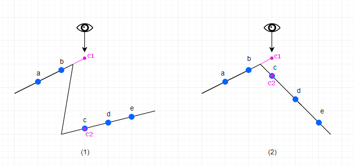
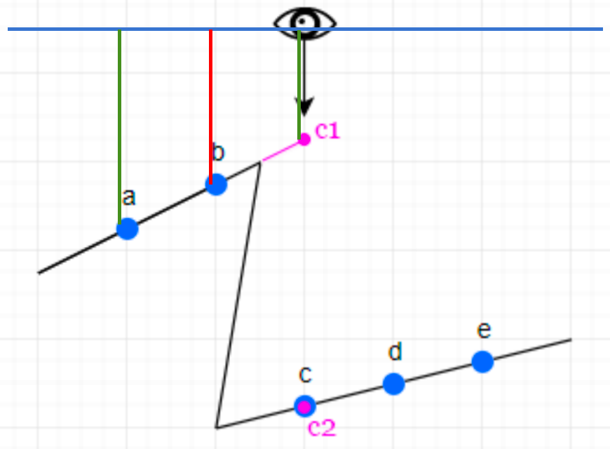
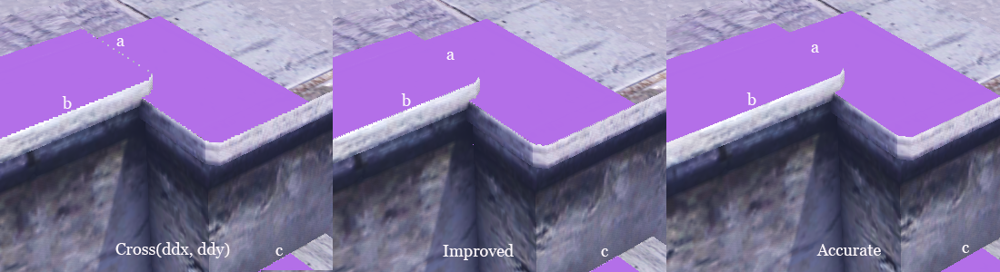

> **注意**：tap 9 采 9 个深度，但重建世界坐标仍只用 5 个（与 tap 5 相同）——省的是矩阵乘/射线插值，不是采样数。

**实现细节**：

- `GetPosWS` 里用 `rawDepth != UNITY_RAW_FAR_CLIP_VALUE` 作为 mask，把天空（无穷远）压成 0，避免天空参与差分；
- 深度可直接比较（不必先转线性深度），因为比较的是**同一像素邻域内的相对大小**，单调变换不改变大小关系；但若要转世界坐标，必须用 `Linear01Depth` 与射线方向相乘；
- `cross(vDeriv, hDeriv)` 的**顺序决定符号**，与渲染器的正面/坐标系约定绑定；写反会让光照整体反向（表现为"看起来像凹陷"）。

---

## 8. UV 与像素坐标

### 8.1 互转公式

| 方向 | 公式 | HLSL |
|---|---|---|
| 像素 → UV | $(P+0.5)/\text{Res}$ | `uv = (p + 0.5) * rcp(_ScreenParams.xy)` |
| UV → 像素 | $\lfloor UV\cdot \text{Res}\rfloor$ | `p = floor(uv * _ScreenParams.xy)` |
| 片元输入 → 像素 | 直接取 `.xy` | `input.positionCS.xy` |

> **修正**：原始笔记表格中"像素 → UV"的 HLSL 示例写的是 `uv = p * _ScreenParams.zw - 1.0`。这个式子既不是 UV 也不是 NDC：`.z = 1+1/w`，$p\in[0,\text{Res})$ 时输出 $[-1,\text{Res}-1]$，不是 $[-1,1)$。正确的 UV 是 `(p + 0.5) * rcp(_ScreenParams.xy)`；NDC 应为 `p * 2.0 * rcp(_ScreenParams.xy) - 1.0`，若要从 NDC 反推 UV 则是 `ndc * 0.5 + 0.5`。
>
> **注意 $\text{Res}^{-1}$ 的写法**：Unity 的 `_ScreenParams = (w, h, 1+1/w, 1+1/h)`，所以 `.zw` **不是** $1/\text{Res}$（`.z = 1+1/w`）。要拿倒数分辨率，用 `rcp(_ScreenParams.xy)`，或用 `.zw - 1`（即 `1/Res`），不能直接写 `_ScreenParams.zw`。

### 8.2 为什么 UV→像素用 floor 而不是 round

**1. 像素是区间（bucket），不是点**

宽度 10 时：第 0 个像素覆盖 $[0,1)$，第 1 个覆盖 $[1,2)$，……第 9 个覆盖 $[9,10)$。

$uv\cdot Res = 0.99$ 落在第 0 个像素的领地内 → `floor` 得 0，正确；`round` 得 1，已经跨进下一个像素。

**2. 与数组索引一致**

若用 round，$[0,0.5)$ 映射到 0、$[0.5,1.5)$ 映射到 1……第 0 个像素只分到半个像素宽，最后一个只剩半个，产生**采样偏差**（每个像素对应的立体角/面积不等）。

**3. 边界安全**

$uv \to 1^-$ 时（如 $uv=0.996$、$uv\cdot Res=99.6$）`floor` 得 99（合法末索引），而 `round` 得 100（越界）。floor 在 $[0,1)$ 上天然安全，不需要额外的 clamp。

**4. "像素中心"只在反向需要**

像素→UV 要 `+0.5`，是因为要从像素的**中心**出发；UV→像素时，样本可能位于该像素内任意位置，floor 都能把它归回所属索引。

一句话：**floor 回答"这个点属于哪个像素"，round 回答"离哪个像素中心最近"**。读纹理 / 访问 Buffer 时问的是前者。

### 8.3 UV 展开（Unwrapping）

> 原始笔记没有专门的展开笔记，以下为衔接说明（不含具体算法细节）。

- UV 展开 = 为网格建立一个从三维曲面到二维参数域的**分段线性映射**（每个三角形一个仿射映射），并把各 UV 岛打包进 $[0,1]^2$；
- 目标与代价：**保角**（角度不变，减少纹理拉伸）与**保面积**冲突，需要按用途取舍；
- 展开引入**接缝（seam）**：接缝处的顶点在 UV 空间被复制成多个，因此 mesh 的顶点数会增加——这也是为什么"同一位置顶点在不同面有不同 uv"必须由面顶点（`v/vt/vn` 三元组）承载，而不能挂在位置上（见 1.5）；
- 与 8.1 的关系：光栅化时插值的是 UV，最终由 `floor(uv*Res)` 或硬件采样器换成 texel；UV 展开的质量直接决定 `ddx/ddy` 得到的纹理梯度是否合理（接缝处梯度跳变 → mip 选择错误 → 接缝亮线）。

---

## 9. 贝塞尔曲线

$n$ 阶（$n+1$ 个控制点）贝塞尔曲线：

$$
\mathbf{B}(t) = \sum_{i=0}^{n} \binom{n}{i}\, t^{i}\,(1-t)^{n-i}\,\mathbf{P}_i,
\qquad t\in[0,1]
$$

原图（公式截图）把它展开成逐项求和的形式：

$$
\mathbf{B}(t)=\binom{n}{0}\mathbf{P}_0(1-t)^{n}t^{0}+\binom{n}{1}\mathbf{P}_1(1-t)^{n-1}t^{1}+\cdots+\binom{n}{n-1}\mathbf{P}_{n-1}(1-t)^{1}t^{n-1}+\binom{n}{n}\mathbf{P}_n(1-t)^{0}t^{n},\qquad t\in[0,1]
$$

性质：

- 端点插值：$\mathbf{B}(0)=\mathbf{P}_0$，$\mathbf{B}(1)=\mathbf{P}_n$；
- 凸包性：曲线位于控制点凸包内；
- 切线：$\mathbf{B}'(0) = n(\mathbf{P}_1-\mathbf{P}_0)$，$\mathbf{B}'(1) = n(\mathbf{P}_n-\mathbf{P}_{n-1})$；
- 仿射不变：对控制点做仿射变换等价于对曲线做同样的变换（因此可在局部空间求值再变换）。

**de Casteljau 算法**（数值最稳，避免高次幂的误差）：

```text
P_i^0 = P_i
for r = 1..n:
    for i = 0..n-r:
        P_i^r = (1-t) P_i^{r-1} + t P_{i+1}^{r-1}
return P_0^n
```

它把曲线递归地"切角"，过程中自然得到分割后的两段控制点（可用于细分/求交/裁剪）。

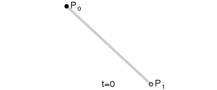
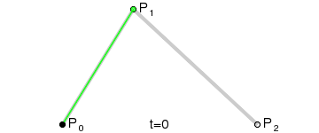
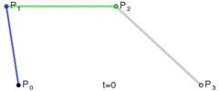
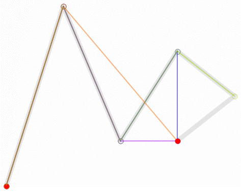

---

## 10. 模型格式与半边构建的关系

OBJ 的几何记录只有四类：`v`（位置）、`vt`（UV）、`vn`（法线）、`f`（面）。对半边构建最关键的一点是：`f` 中每个 token 的三个索引**各自独立**指向三张表（`v/vt/vn`，允许 `v//vn`、`v/vt`、`v` 等省略形式），所以同一个位置顶点在不同面上可以对应不同的 UV 与法线——这正是硬边与 UV 接缝的表达方式，也是不能按"位置索引"直接合并顶点的原因。

- OBJ 索引通常从 1 开始（部分导出器用负索引表示从末尾倒数）；
- 面可以是多边形，导入时需三角化；
- `mtllib` 引入材质库，`usemtl` 在面组上切换材质。

OBJ/MTL 的完整字段（含 `illum`、纹理映射选项、PBR 扩展）、glTF 2.0、POD 以及 Base64/JSON 解析，见同目录《14_模型与资源格式》。

---

## 11. 高模渲染的瓶颈

结论先行：**单纯算力不是瓶颈**。

按 30 fps、单帧 ~100 GFLOP（≈3 TFLOP/s）估算，一个顶点约百次浮点运算，上亿顶点也只占 1%–10% 的算力预算。真正的瓶颈有四层：

### 11.1 带宽

- 每顶点 3–4 个 float（12–16 B），一亿顶点 ≈ 1.2–1.6 GB；
- 桌面 GPU 带宽数百 GB/s，1 GB 大约数 ms——勉强可接受；
- **致命的是 CPU→GPU 的传输**：object 级剔除与动画通常在 CPU，显存也放不下全部顶点，而 CPU 侧带宽只有几到十几 GB/s。
- 结论：顶点数据必须**预先展开在显存里**（或直接从 SSD 流式加载到显存）；剔除与动画要搬到 GPU（compute shader + indirect/dispatch draw）。

### 11.2 剔除粒度

- 固定管线的前置剔除（视锥裁剪、背面剔除、零面积剔除）**以单个三角形为单位**；
- 上亿三角形"一个不落"地走这些操作，但它们其实属于连续的片元（meshlet），理应在更高层级先剔除。

### 11.3 微小三角形与 2×2 tile

- 硬件的"零面积剔除"要求至少两个顶点**完全重合**；浮点精度下，远处塌缩的小三角形往往并不严格退化，于是全部存活；
- GPU 的三角形离散以 **2×2 像素 tile** 为最小单位：再小的三角形也会产生至少 4 个像素（多数标记无效）；
- 无效像素仍要过 pre-Z、甚至 PS，结果是**上亿个无用 fragment 堵塞管线后半段**。

### 11.4 解法：用 CS 替代固定管线

- 以 meshlet / cluster 为单位做剔除（视锥、背面、遮挡、LOD 选择），粒度远粗于单三角形；
- 用 compute shader 做软光栅或 cluster 级光栅化，**最大限度避免无效 fragment**；
- 前后半段可以**即时反馈**：软光栅阶段发现小三角形过多，就通知前端切换到更粗的子表面层级；
- 代价：shading core 负担加重，需要与传统管线的工作负载调度平衡。

一句话：数千万三角形的处理 PS4 级别就够；难的是"真实游戏场景里混合多种情况时的调度与带宽"，这依赖 meshlet + GPU-driven 的工程实践。

---

## 12. 噪声与体积几何（FBM）

> 从后处理体积云 shader 的实现笔记中抽出与"几何/噪声"相关的部分。

**FBM（Fractal Brownian Motion）**：多个倍频噪声叠加，用大尺度定轮廓、小尺度补细节。

$$
\text{fbm}(p) = \sum_{i=0}^{n-1} a_i \cdot \text{noise}(f_i\, p),
\qquad a_i = \text{gain}^i,\quad f_i = \text{lacunarity}^i
$$

- `lacunarity`（频率倍率，常取 2.0）控制"细节比整体小多少"；
- `gain`（振幅倍率，常取 0.5）控制"细节比整体弱多少"；
- 层数 $n$ 是质量/性能旋钮；层数不足会显得"块状"，过多则高频噪点堆积。

**用阈值把密度场变成形状**（这是"几何"上的关键一步）：

```hlsl
float cloudValue = fbmNoise - pos.w;      // pos.w 是「生成门槛」的偏置
if (cloudValue > _CloudThreshold) { /* 此处有云 */ }
```

配合

```hlsl
rayDir.w = fragCoord.y / _ScreenParams.y - _ScreenOffset;
pos.w    = _StepSize * rayDir.w * i;
```

得到

$$
pos.w = \text{StepSize}\cdot i \cdot \left(\frac{y}{H} - \text{offset}\right)
$$

**这是"随高度变化的密度门槛"，不是一条硬边界**：

- $y/H = \text{offset}$ 处为中性线，$pos.w = 0$；
- 中性线以下 $pos.w < 0$ → `cloudValue` 变大 → **更容易**成云；
- 中性线以上 $pos.w > 0$ → 更难成云；
- 但最终是否成云仍由噪声与阈值共同决定：上方噪声足够高仍会有云，下方噪声不够也会没有。

视觉上表现为"云主要分布在某高度以下并向上逐渐变稀"的**强偏置**，而不是"线以上一刀切为空"。`_ScreenOffset` 只决定这条中性线在屏幕上的位置。

**与几何的联系**：这类体积云本质是**密度场 + ray marching**，不是真几何；它的"形状"完全由 $\text{fbm} - \text{bias} > \tau$ 的等值面决定。若要做真正的体积几何（可碰撞、可投影阴影），需要把等值面提取成 mesh（marching cubes）或维护显式体素/SDF。

---

## 13. 原始笔记索引

| 源文件 | 并入章节 |
|---|---|
| `Graphics/mesh simplification/half edge data struct.md` | 1.1–1.4 |
| `Graphics/mesh simplification/初始化half_edge数据结构.md` | 1.4–1.5 |
| `Graphics/mesh simplification/Mesh网格简化.md` | 2 |
| `Graphics/mesh simplification/QEM网格简化 - 简书.md` | 3 |
| `Graphics/mesh simplification/随记.note.md` | 3（仅参考链接，无正文） |
| `Graphics/OBB (oriented bounding box).md` | 4 |
| `根目录笔记/DDA.md` | 5.1–5.2 |
| `根目录笔记/Jump Flooding Algorithm.md` | 6 |
| `Graphics/法线矩阵.md` | 7.1 |
| `根目录笔记/重建法线.md` | 7.2 |
| `根目录笔记/像素与UV的互转.md` | 8.1–8.2 |
| `Graphics/随记/贝塞尔曲线.md` | 9 |
| `Graphics/随记/高模渲染难点.md` | 11 |
| `根目录笔记/FbmCloud.md` | 12（仅噪声/密度场部分） |
| `Log/日志0619.md` | 附录 A.1（网格合并：法线空间、UV/材质处理） |
| `Log/杂记/工作日志1.md` | 附录 A.2–A.4（顶面 UV 展开、Delaunay、ModelShader 几何部分） |
| `Log/杂记/工作日志2.md` | 附录 A.5（点-多边形、AABB/OBB、背面剔除、立方体阵） |

**未纳入本篇**：`Graphics/Games101/lecture 02.md`、`lecture_04.md`、`lecture_06.md`（变换、投影、采样走样）。OBJ/MTL 的完整字段与 glTF/POD 已归入《14_模型与资源格式》。

---

## 附录：工作日志中的补充记录

> 来源：`Log/日志0619.md`、`Log/杂记/工作日志1.md`、`Log/杂记/工作日志2.md`。只保留与网格/几何相关的结论，流水账与项目事务已剔除。

### A.1 合并 mesh 时的法线空间（日志 0619）

一个模型由多个子模型组成，每个子模型有各自的 transform 矩阵。合并时若把这些矩阵作用到**全部顶点属性**（含法线），会出现法线错误。原因是对"法线属于哪个空间"的混淆：

1. **局部空间法线不应先做变换**。法线是局部空间中的一个方向，一旦乘上变换矩阵，其数值已经是另一个空间的方向，不再代表原局部空间法线；
2. 法线是顶点属性，与顶点一起变换后就变成**世界空间（或父空间）法线**，后续光照、TBN 构造必须按新空间计算，不能再用局部空间法线。

所以合并的正确形态是"位置与法线进入同一空间"，而不是"位置变换、法线留在局部"。**位置与法线的目标空间必须一致：位置用 $M$，法线用 $(M^{-1})^T$ 并归一化。**

**矩阵辨析（原稿结论有误，已更正）**：原日志称"`transform.localToWorldMatrix` 的数值与 `Matrix4x4.TRS(position, rotation, scale)` 的计算结果不一定一致，该值的计算结果实际是 localToParent"。这句话把两个矩阵说反了：

- `Matrix4x4.TRS(position, rotation, scale)` **只有在传入本节点的 `localPosition` / `localRotation` / `localScale` 时**才等于 localToParent；若传入世界值与 `lossyScale`，得到的是世界矩阵（`lossyScale` 也不是本地 scale，父级带旋转或非一致缩放时会被"压扁"）；
- `Transform.localToWorldMatrix` 是**已累乘父链**的局部→世界矩阵。

二者只有在对象没有父级（或父级变换为单位阵）时才相等，这正是"数值并不一定一致"的真正原因。原日志据此把 `localToWorldMatrix` 当成 localToParent 使用，属于命名误判（原稿有误，已更正）。**其中"原日志据此…"一句是推断**：日志只记录了两者数值不一致的现象与"该值实际是 localToParent"的说法，并未记录当时实际如何使用该矩阵（待核实）。

工程结论：合并到合并根时，应使用"子模型相对合并根的矩阵"（沿父链累乘到根，即各段 localToParent 的乘积）；若目标空间是世界，则用完整的世界矩阵。无论哪种，**位置与法线必须落在同一目标空间**：位置用 $M$，法线用 $(M^{-1})^T$ 并归一化（见 §7.1），不能对法线直接用 $M$。

#### 合并时的 UV/材质处理

- **2024/05/23**：日志记录"完成 mesh 合并 DEMO：使用 mesh 的 **uv1 通道**存储每个材质对应的纹理映射的参数"。即合并后不再依赖每个子网格各自的材质槽，而是把"每个材质对应的纹理映射参数"随顶点写进 uv1，绘制时按材质索引取出对应参数。
- **2024/05/21**：日志把 mesh 合并的方法写作"三种"，但原文只列出两条：① **重新生成新的顶点**（类似 UGUI 的实现，每个瓦片 uv 一致，缺点是顶点数会明显增加）；② **拆分纹理图片为多张**，这样每个子网格都能使用 `[0, 1]` 范围的 uv。
- **待核实**：原稿称"三种方法"，日志实际只记录两条，第三种没有留下记录；uv1 中参数的具体编码（分量含义、是否含 tiling/offset）日志未展开，需按 DEMO 代码确认。

### A.2 顶面 UV 展开（工作日志1，2018/08/29–08/30）

俯视可见的**顶面**需要单独铺一张贴图，做法是先把顶面各面片"折平"到同一平面，再求包围矩形，最后按相对位置算 UV。

步骤：

1. 顶面顶点**绕序为逆时针**（与正面约定/法线朝向的关系待核实）；每个顶点都必须配 uv 坐标；
2. **展开**：以边 AB 为轴，把该面片的其余顶点绕轴旋转到与目标平面共面；要转的角度是绕 AB 旋转使两平面法线重合（即该面片落到目标平面上）所需的角，$-90°$ 只是"该面片与目标平面垂直"这一特例。A、B 保持不动，共享边不被撕开。绕轴 $(A,B)$ 旋转 $\theta$ 的点公式（Rodrigues）：

   $$
   \mathbf{u} = \frac{B-A}{\|B-A\|},\quad \mathbf{v}=P-A
   $$

   $$
   P' = A + \mathbf{v}\cos\theta + (\mathbf{u}\times\mathbf{v})\sin\theta + \mathbf{u}(\mathbf{u}\cdot\mathbf{v})(1-\cos\theta)
   $$

   取 $\theta=-90°$（$\cos\theta=0$、$\sin\theta=-1$）时化简为

   $$
   P' = A + \mathbf{u}(\mathbf{u}\cdot\mathbf{v}) - (\mathbf{u}\times\mathbf{v})
   $$

   **符号提示**：$-90°$ 的符号取决于面片法线朝向与旋转轴 $(A,B)$ 的相对关系——法线翻面时倒伏方向相反。若展开后落到平面的另一侧，应改用 $+90°$（或按实际绕序统一翻转）。

3. 收集所有展开后的顶点，**先把展开后的点投影到该平面的正交基（如 $\mathbf{u}$ 与 $\mathbf{u}\times\mathbf{n}$，其中 $\mathbf{n}$ 为该面片的法线）得到 2D 坐标，再求包围矩形** $(\min X,\min Y)$–$(\max X,\max Y)$，该矩形即纹理坐标域；
4. 逐顶点算相对位置得到 UV：

   $$
   u = \frac{x-\min X}{\max X-\min X},\qquad
   v = \frac{y-\min Y}{\max Y-\min Y}
   $$

5. 顶面三角化**不产生新顶点**，顶点数不变，因此 UV 可以按顶点直接存。

工程细节：展开结果与"初始化时先旋转还是先应用主题"无关——模型顶点数据本身不变，旋转只影响渲染，不影响 UV 计算；反过来若在旋转之后才铺设纹理，纹理就不是"正视铺上去"而是"投射上去"了。

### A.3 顶面剖分：Delaunay 逐点插入

> **适用范围说明**：以下为 Bowyer–Watson 通用流程；日志只记录计划，未记录实现与完成状态（待核实）。

原日志把"逐点插入的 Delaunay 三角剖分"列为顶面剖分的学习与实现条目，可确认的结论只有一条：顶面展开成 2D 多边形后按 **Delaunay 准则**三角化，采用**逐点插入（incremental insertion）**方案——每插入一个点，删除其所在三角形、与空外接圆被破坏的相邻三角形构成的多边形，再重新连边。

原日志未记录具体实现参数（超三角形初始化方式、空外接圆的判据与容差、共圆退化处理），这些细节需按实际代码确认（待核实）。

### A.4 ModelShader 中顶面/侧面的绘制混杂

工程记录：ModelShader 同时承担 **线、顶面、侧面、热力图、模型顶部贴图、选中贴图** 六类绘制，分支多、状态难维护，随手改一处容易连带破坏其他用途（原日志中有"修改 ModelShader 后不能用"的记录）。

关键结构结论：**模型顶部贴图并不是把纹理贴到顶面几何上，而是额外单独绘制一个矩形盖在顶面上**；选中态贴图同理。由此产生的几何层面问题：

- 顶面几何与"盖上去的矩形"是两次绘制，存在 z-fighting 与绘制顺序依赖，需要靠深度偏移、渲染队列或 stencil 消歧；
- 侧面与顶面共用同一 shader，任一侧的参数变化都可能影响另一侧；
- 覆盖矩形与真实顶面轮廓的贴合依赖 §A.2 的展开/包围矩形结果，两者不一致时会出现错位或拉伸。

### A.5 几何判定与包围盒（工作日志2）

- **点在多边形内判定**：原日志只记录了调研条目（"点在多边形内部的判断方法"），未记录所用算法与实现细节（待核实）。工程上常用射线交叉（奇偶规则）或环绕数（winding number），二者对自交多边形与"点恰在边界上"的归属处理不同，选型时应明确这两点。
- **AABB 的局限**：场景旋转会使 AABB 失效——轴对齐包围盒无法跟随几何旋转，缓存下来的盒子不再包围旋转后的物体。此时应改用 OBB（见 §4），或在每次变换后重建 AABB。
- **背面剔除**：与顶点绕序/面法线方向绑定（见 §1.4，$(a,b,c)$ 与 $(a,c,b)$ 法线相反）；2D 俯视模式下可配合剔除减少绘制面元。
- **立方体阵**：同日/次日记录立方体阵绘制（2018/11/22 记录"批量绘制；# 因为其与视锥剔除冲突，故放弃"，2018/11/23 记录"绘制一个立方体阵"），**与批量绘制的因果关系未记录（待核实）**——日志并没有说立方体阵是为批量绘制/实例化做的验证场景，这一关联是原稿的推断。
  - 工程推断（非日志结论）：批处理与剔除需要在同一层级上设计，这一点与 §11.2 的"剔除粒度"方向一致；日志只留下"与视锥剔除冲突，故放弃"这一句，未给出分析过程。
