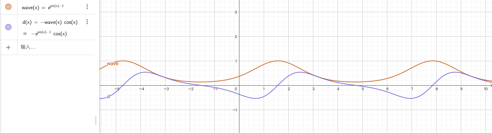
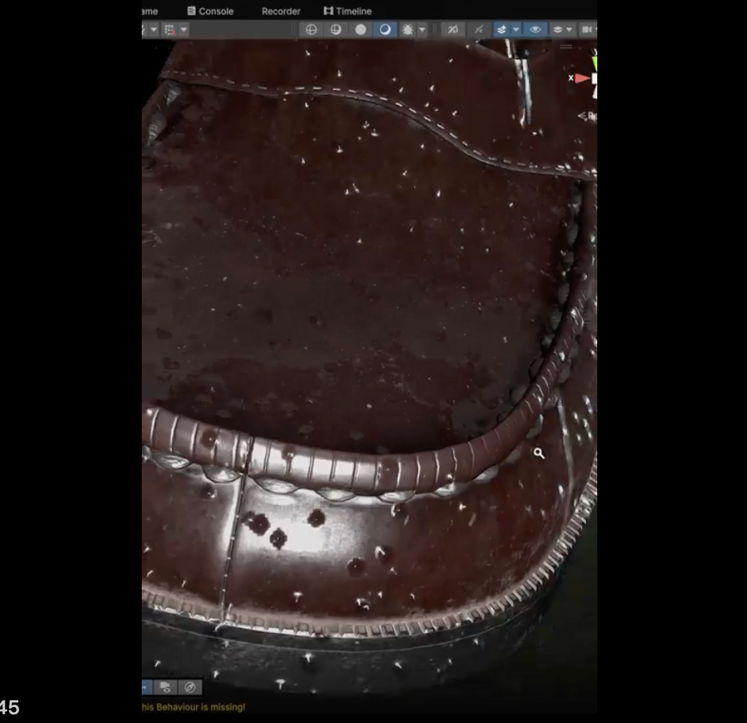
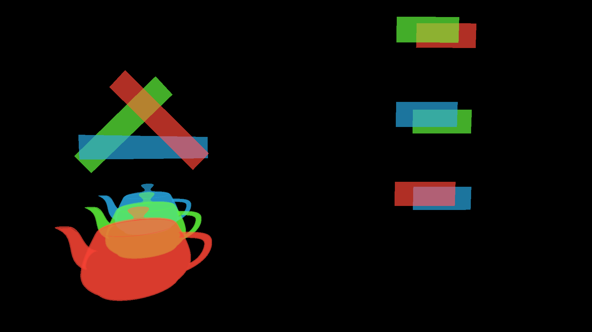
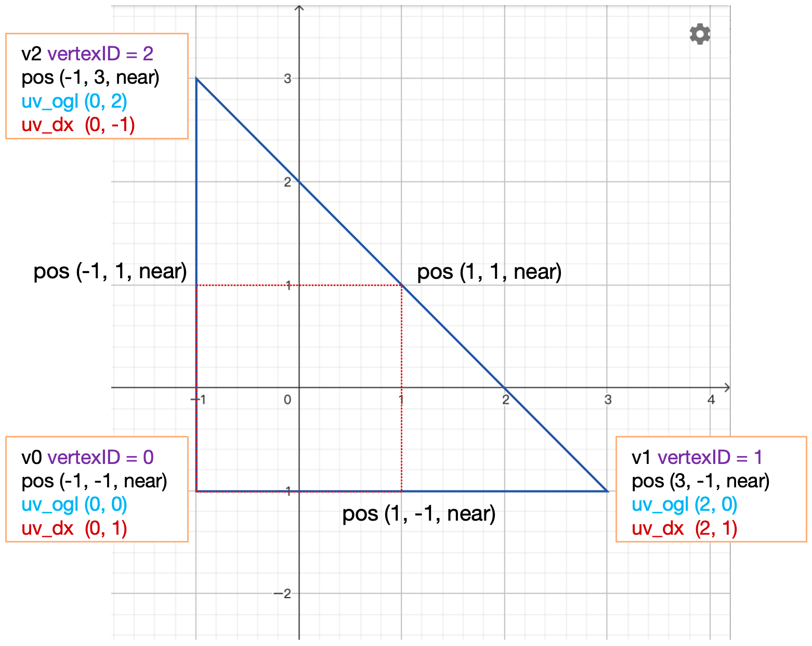
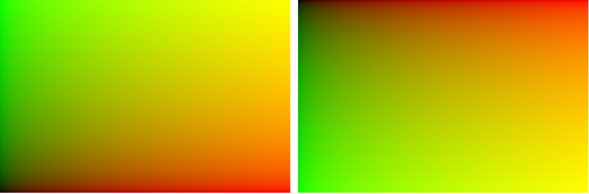

# 场景与特效技术：草、毛发、海洋、体积云与全屏 Pass

> 本文汇总场景级与特效级 Shader 技术：草与毛发的分层（shell）思路、Gerstner 波海洋、FBM 体积云、玻璃雨滴、XR 适配，以及后处理/特效常用的全屏三角形、`i.positionCS`、像素与 UV 互转。效果侧另收录贴花与贴花影子（深度重建）、全息/扭曲/溶解/描边/扫描/护盾能量场、头发丝阴影、可分离高斯模糊，以及 ray marching 的步进取舍与 `if`→`movc` 的指令级优化。Bloom、SSR 等屏幕空间效果本身见《08_后处理》，性能取舍见《12_性能优化》。

## 草（Grass）

源笔记只有一句核心：**以"当前层高 / 总层数"为权重，给逐层 layer 增加 alpha，用于调制草的形状，确保从下往上草的面积递减。**

把这句话展开成可实现的形式：

- 草不是一整块面片，而是若干层（layer）叠加的"壳"（shell）或交叉面片；
- 第 $i$ 层的归一化高度：
  $$
  h_i=\frac{i}{N},\qquad i=0,1,\dots,N-1
  $$
- 用 $h_i$ 去调制 alpha 阈值/形状遮罩，使越靠上的层保留的像素越少，形成"根部宽、梢部窄"的锥形轮廓；
- 形状遮罩通常来自噪声纹理或草的 alpha 贴图，乘以 $h_i$ 后与阈值比较：

  ```hlsl
  half  h    = (half)layerIndex / (half)layerCount;
  half  mask = SAMPLE_TEXTURE2D(_GrassMask, sampler_GrassMask, uv).r;
  clip(mask * (1.0 - h) - _Cutoff);
  ```

  （具体是 `h` 还是 `1-h` 取决于遮罩画的是"实心"还是"镂空"；原则是**上层保留面积更小**。）

工程要点：

- 层数越多轮廓越连续，但 overdraw 与 alpha-test 成本线性增长；远处必须切 LOD 或改用 billboard/impostor。
- 草几乎一定要用 alpha test（或 alpha-to-coverage），因此会禁用 Early-Z、在 TBDR 上打断 HSR；应放在不透明体之后绘制，并尽量写深度。
- 风摆通常在同一层内对顶点做偏移，层高 $h_i$ 同时作为风力权重（根部不动、梢部摆幅大）。

> 源笔记未记录层数、面片朝向与风场实现，以上为按该权重公式的常规落地方式；具体数值**（待核实）**原工程。工作日志中另有一版基于 `ComputeBuffer` + instancing 的 ShellGrass 实施步骤，见文末附录。

## 毛发（Fur / Shell Fur）

> **源状态说明**：`Fur.md` 没有正文（导出时未同步，仅剩标题与导出警告）。因此本节不还原原工程的参数，只给出 shell fur 的通用原理与必须注意的点；任何具体层数/密度都**待核实**。

### Shell 法

不做逐根毛发几何，而是沿模型表面法线方向"复制"出 $N$ 层壳：

$$
P_i = P + N\cdot \left(i\cdot \Delta h\right),\qquad i=0,\dots,N-1
$$

每层用同一张毛发密度/长度噪声纹理做 alpha 裁剪，只有噪声值超过该层阈值的像素保留：

```hlsl
half shellT   = (half)shellIndex / (half)shellCount;   // 0..1
half density  = SAMPLE_TEXTURE2D(_FurMask, sampler_FurMask, uv * _FurTiling).r;
half furAlpha = density - shellT;                       // 越靠外层要求密度越高
clip(furAlpha - _Cutoff);
```

- 外层保留的像素更少，于是从侧面看形成由粗到细的毛发轮廓；
- 每层可以沿法线再加一点方向性偏移（重力、梳理方向），避免"洋葱皮"感；
- 顶点可用切线方向做轻微弯曲，让毛尖倒向一侧。

### 层数不是固定值

shell fur 的层数是一个**性能/画质权衡参数**，不存在"标准层数"（原稿有误，已更正：不能照搬一组固定层数）。

- 层数不足 → 侧面出现明显分层条纹（banding）；
- 层数过多 → 几何提交与 overdraw 成倍增长，alpha-test 又会禁用 Early-Z；
- 常规做法是 8~32 层，并按距离 LOD 递减（近处 32、中距离 16、远处 8 或直接换 billboard）——具体取值随毛发长度与屏幕占比变化，**（待核实）**。

### 性能与正确性

1. **必须写深度 + alpha test**；alpha blend 会导致排序困难与严重 overdraw。开启 ZTest/ZWrite 后层序不影响正确性，若要优化性能应**由外到内（前→后）**提交，以便深度剔除尽早生效（"内到外"是混合时代的后到前顺序）。
2. 每层都是一次完整绘制，draw call/顶点数 ×N；移动端通常只用 4~8 层。
3. 光照：逐根毛发的 Kajiya-Kay / Marschner 模型在 shell 法下退化为逐层近似，通常用切线 + 位移后的法线做各向异性高光；层与层之间要做深度衰减（越内层越暗），否则看起来像塑料。
4. TAA/运动矢量：shell 顶点位移必须写入正确的运动矢量，否则毛发边缘会拖影。
5. 阴影：shell fur 的阴影通常用一张"毛发厚度"贴图近似，或只让最内层投影，避免 N 层全部进 shadow pass。

## 海洋与 Gerstner 波

### 从正弦波开始

$$
y = A\sin(kx-\omega t)
$$

- $A$：幅值，控制起伏强度；
- $k$：角波数，控制疏密；
- $\omega$：角频率，控制运动速度；
- $t$：时间。

用波长 $l$ 替代 $k$ 更方便美术调参：

$$
k=\frac{2\pi}{l}
$$

波长是两个相邻波峰（或波谷）之间的距离。相位取 $-\omega t$ 时，$t$ 增大波形沿 $+x$ 方向移动。

### Gerstner 波：把正弦"卷"成圆

一维圆的参数方程：

$$
(a\cos\theta,\; a\sin\theta)
$$

Gerstner 波在水平方向也加上圆周运动分量：

$$
\big(x + a\cos(kx-\omega t),\;\; a\sin(kx-\omega t)\big)
$$

顶点不再只上下动，而是做圆周运动，波峰变尖、波谷变平，接近真实海浪。

### 陡度（Steepness）与自相交

当 $a\to\infty$ 时，Gerstner 波会自相交。临界条件是 $ka=1$，因此不自相交要求：

$$
0<ka<1
$$

引入陡度 $s\in[0,1]$，令：

$$
a=\frac{s}{k}
$$

则 $ka=s<1$，天然安全。

### 二维 Gerstner 波

设波沿 xz 平面内的单位方向 $D=(D_x,D_z)$ 传播，相位：

$$
f=k\left(D_x x+D_z z\right)-\omega t
$$

顶点位移：

$$
\begin{cases}
X(x,z,t)=x+D_x A\cos f\\
Y(x,z,t)=A\sin f\\
Z(x,z,t)=z+D_z A\cos f
\end{cases}
$$

（原图缺失：此处原为有道云笔记中 Gerstner 波公式的配图，仅作公式示意，未提供额外参数或结论。）

### 切线、副切线与法线

约定：

- $T$：沿 $z$ 方向的切线，$T=\partial P/\partial z$；
- $B$：沿 $x$ 方向的切线（副切线），$B=\partial P/\partial x$；
- 这样 $T,B,N$ 才与 XYZ 轴对应，$N$ 对应 $+y$。

求导：

$$
\begin{aligned}
T_x&=-D_xD_z\,kA\sin f, & T_y&=D_z\,kA\cos f, & T_z&=1-D_z^2\,kA\sin f\\[4pt]
B_x&=1-D_x^2\,kA\sin f, & B_y&=D_x\,kA\cos f, & B_z&=-D_xD_z\,kA\sin f
\end{aligned}
$$

法线：

$$
N=\operatorname{normalize}\left(T\times B\right)
$$

按本节约定（$T=\partial_z,\ B=\partial_x$）必须用 $N=T\times B$（原稿有误，已更正：源笔记前半段用 $B=\partial/\partial z,\ T=\partial/\partial x$ 并写 $N=B\times T$，后半段又把 $T,B$ 改回本节约定却仍写 $N=B\times T$；两套命名混用会导致法线朝下）。

验证：静止时 $T=(0,0,1)$、$B=(1,0,0)$，

$$
T\times B=(0\cdot0-1\cdot0,\;1\cdot1-0\cdot0,\;0\cdot0-0\cdot1)=(0,1,0)
$$

朝上。若用 $B\times T$ 则得到 $(0,-1,0)$，法线朝下。

直观验证 y 分量：

$$
(T\times B)_y=T_zB_x-T_xB_z
=\left(1-D_z^2kA\sin f\right)\left(1-D_x^2kA\sin f\right)-\left(D_xD_zkA\sin f\right)^2
\approx 1-kA\sin f>0
$$

在 $kA<1$ 时恒为正。

> 左右手系影响的不是 `cross` 的公式，而是"哪个方向算正面"的约定。这里只算法线、判断 y 分量为正，不涉及面剔除的绕序，所以不受伤。

### 多波叠加

多个波的圆周运动分量相加，直线运动部分不变：

$$
\begin{cases}
X=x+\displaystyle\sum_{i=1}^{n}D_x^iA_i\cos f_i\\
Y=\displaystyle\sum_{i=1}^{n}A_i\sin f_i\\
Z=z+\displaystyle\sum_{i=1}^{n}D_z^iA_i\cos f_i
\end{cases}
$$

法线必须用**叠加后的解析导数**逐波累加，不能只对单个波算完再平均。

### 多波叠加的陡度

多波叠加后，各波导数叠加，可能无法满足 $kA<1$，波数越多自相交越严重。简单限制：

```hlsl
float steepness = lerp(steepnessMax, steepnessMin, step) / waveCount;
```

注意：单波时 $s\in[0,1]$；多波叠加时通常把总陡度控制在 $\sum_i s_i\le1$。水平位移映射的雅可比 $J=1-\sum_i s_i\sin f_i$ 只是所有波同向（1D）的特例；一般方向上 $\det J=(1-a)(1-b)-c^2$（$a,b$ 为两个方向的加权陡度、$c$ 为交叉项），$\sum_i s_i\le1$ 是**充分**条件而非必要（同向时它恰好是临界；不同方向的波约束更松）。同向情形实测 $\sum_i s_i=1$ 时 $\min\det J\approx0$，1.2 时 $\approx-0.2$，已经折叠。代码里除以 `waveCount` 正是为了让各波 $s_i$ 之和回到 `steepness`，所以再 clamp 到 $[0,1]$ 不会把波"压平"——$s=1$ 本身就是极限卷曲（波峰最尖而不折叠）。嫌波不够高，应减小 $k$（加长波长）或按 $A_i\propto1/k_i$ 分配，而不是突破 1。

### 海洋 Shader 的工程细节

#### NDC 与宽高比校正

```hlsl
// UV → 居中且做过宽高比校正的 NDC
float2 ndc = (uv * 2.0 - 1.0) * float2(_ScreenParams.x / _ScreenParams.y, 1.0);
```

两步：

1. `uv * 2 - 1`：$[0,1]\to[-1,1]$，屏幕中心为 $(0,0)$；
2. 乘 `aspect`：$x\in[-\text{aspect},\text{aspect}]$，$y\in[-1,1]$，匹配实际屏幕比例。

不乘 `aspect` 时，宽屏下水平方向被压缩，圆会变椭圆、太阳会变扁。

#### 相机射线的方向与位置解耦

Shadertoy 风格的 raymarcher 常把相机拆成两部分：

```hlsl
float3 origin = float3(_Time.y * 0.2, _CameraHeight, 1.0); // 位置
float3 ray    = getRay(fragCoord);                          // 方向（单位向量）
float3 hitPos = origin + ray * t;                           // 完整射线
```

- `getRay` 在假想原点处构造投影射线再旋转，只产出方向；
- 相机平移不改变方向，所以方向与位置可以独立；
- 数学上等价于 `View = Rotation × Translation`，只是把平移与旋转分开处理。

#### FBM + 拖拽（drag）

真实海面是"小涟漪骑在大浪上"。大浪会改变局部坡度与流速，小涟漪在浪尖被压缩聚集、在浪谷被拉伸舒展。常用近似是：用低频波形的**导数**去偏移高频层的采样坐标。

设低频波形为 `wave(x)`、导数为 `dx`，实际用于偏移的位移量取 $d=-dx$：

- 上升斜面：导数为正 → 位移量 $d<0$ → 采样点沿 $-p$ 回退（远离波峰）；
- 下降斜面：导数为负 → 位移量 $d>0$ → 采样点沿 $+p$ 前推（远离波峰）；
- 波峰处导数为 0 → $d=0$ → 不动。

于是波峰两侧的采样点向外扩散、波谷附近向内压缩。**采样点位移了，像素位置没变**：

- 波峰附近：单位像素覆盖的采样坐标范围更大 → 高频细节被压缩聚集，纹理密集、锐利；
- 波谷附近：单位像素覆盖的采样坐标范围更小 → 高频细节被拉伸稀疏，纹理平滑、舒展。

这正是跨尺度非线性耦合的廉价近似，也是"浪尖有细碎白沫感、浪谷干净"的来源。



图中这组示例用的就是上面这条"波形 + 位移量"关系（横轴 $x$，纵轴为函数值）：

$$
\text{wave}(x)=e^{\sin x-1},\qquad
d(x)=-\text{wave}(x)\cos x=-e^{\sin x-1}\cos x
$$

$\text{wave}'(x)=+e^{\sin x-1}\cos x$，所以图上标注的 $d(x)$ 其实是**导数的相反数**——它就是直接拿去偏移采样坐标的那个量：上升斜面 $d<0$（沿 $-p$ 回退）、下降斜面 $d>0$（沿 $+p$ 前推）、波峰处 $d=0$，与上面的符号约定一致。（原图只标了 $d$，若把它当成导数本身会差一个负号，此处按位移量理解。）

#### 高度场法线的叉乘顺序

由高度场 $H(x,z)$ 求法线时，常采样中心点与 $x\pm e$、$z\pm e$ 四个点。以中心 $a=(x,H(x,z),z)$、$b=(x-e,H(x-e,z),z)$、$c=(x,H(x,z+e),z+e)$ 为例：

$$
v_1=a-b=(e,\Delta H_x,0),\qquad v_2=a-c=(0,\Delta H_z,-e)
$$

$$
v_1\times v_2=\left(-e\Delta H_x,\;e^2,\;e\Delta H_z\right)
$$

$y$ 分量恒为 $e^2>0$，法线朝上。若两个偏移同号（都用 $+e$），$v_1$ 指向 $-x$，按 $v_1\times v_2$ 算出的 $y$ 分量为 $-e^2$、法线朝下——但把叉乘顺序反过来写成 $v_2\times v_1$，$y$ 分量就回到 $+e^2$。**真正的要求是"差分符号"与"叉乘顺序"配套，不是必须一加一减。**

## 体积云（FBM Cloud）

源笔记是一个 5 步迭代的开发记录，目标是一个**基于后处理的 FBM 体积云**。

### 五步路线

| 步骤 | 目标 | 验收标准 |
|:--|:--|:--|
| 1 | 天空背景 | 全屏覆盖、有竖直渐变、改色生效、不同分辨率不拉伸 |
| 2 | 基础云块 | 噪声打破纯色；云量可调；噪声尺度可调；边缘不规则 |
| 3 | 增加层次 | 大尺度噪声定轮廓 + 细噪声补边缘；"大形状包小细节" |
| 4 | 厚度感 | 多次累积采样；浓处厚、淡处薄；无断层/条纹 |
| 5 | 流动与风格 | 云缓慢平移；浓淡/亮暗/配色统一；背景与云融合 |

### 核心：用射线步进累积密度

后处理体积云本质是沿视线做固定步数的 ray march，每一步采样 3D FBM 噪声得到密度，再按 Beer-Lambert 累积：

$$
T=\exp\left(-\int \sigma(x)\,dx\right),\qquad
C=\int \sigma(x)\,T(x)\,L(x)\,dx
$$

实现上近似为：

```hlsl
float transmittance = 1.0;
float3 scatter = 0;
for (int i = 0; i < _StepCount; ++i)
{
    float3 p = rayOrigin + rayDir * (i * _StepSize);
    float density = Fbm(p * _NoiseScale + _Wind * _Time.y);
    density = max(0.0, density - _CloudThreshold);
    float a = 1.0 - exp(-density * _StepSize * _Absorption);
    scatter += transmittance * a * Lighting(p);
    transmittance *= (1.0 - a);
    if (transmittance < 0.01) break;   // early-out
}
```

### `pos.w` 是"云生成门槛"，不是硬边界

源笔记花了很长篇幅解释一个易误解的点。代码形如：

```hlsl
rayDir.w = fragCoord.y / _ScreenParams.y - _ScreenOffset;
pos.w    = _StepSize * rayDir.w * i;
float cloudValue = fbmNoise - pos.w;
if (cloudValue > _CloudThreshold) { /* 有云 */ }
```

展开：

$$
pos.w=\text{StepSize}\cdot i\cdot\left(\frac{\text{fragCoord}.y}{H}-\text{ScreenOffset}\right)
$$

- 在 `fragCoord.y / H == _ScreenOffset` 处，$pos.w=0$，是一条"中性线"；
- 线下 $pos.w<0$，`fbmNoise - pos.w` 更大 → **更容易**成云；
- 线上 $pos.w>0$ → **更难**成云；
- 但最终是否成云仍由噪声值与阈值决定，所以是"强偏置区域"，不是"线以下全是云"。

> 注意屏幕 y 的原点：D3D/Vulkan/Metal 上 `SV_POSITION.y` **自顶向下**递增，此时 `y/H < 0.8` 覆盖的是屏幕**上方** 80%，"线下"的直觉正好相反。若代码按自底向上理解，需要把 `y/H` 换成 `1 - y/H`（或把 `_ScreenOffset` 改成 `1-offset`）。

`_ScreenOffset` 决定中性线在屏幕上的位置（0.8 表示屏幕高度 80% 处）。视觉上像"云层主要分布在某条线以下"，实际是概率梯度。配合 early-out，线上大量区域会直接跳过采样。

### 性能

- 步数是成本主因，$O(\text{steps}\times\text{pixels})$；通常半分辨率 + 时间抖动 + 上采样。
- 早期退出（transmittance 足够小）能省掉大量尾部步数。
- 噪声用 3D 纹理或程序化 value/simplex noise；程序化更省显存但 ALU 更贵。
- 光照可先用"朝太阳方向再 march 几步"的 cheap self-shadow，再叠加 HG 相位函数。


## 玻璃雨滴

### 本质

不是"画一张雨滴贴图"，而是：

> 程序化生成一个二维扰动场（distortion field），用扰动场扭曲背景采样，模拟玻璃上的雨滴折射。

雨滴本身不是重点，**雨滴导致的折射/模糊**才是重点。

### 逐段拆解

#### 1. 网格化

```hlsl
float2 uv = UV * _Size * ASPECT;   // 网格坐标必须用 float：half 在 _Size 较大时 frac 已无小数位
uv.y += t * 0.25;
float2 gv = frac(uv) - 0.5;   // 格内坐标 [-0.5, 0.5]
half  n  = N21(floor(uv));   // 每格固定随机数
```

- `_Size` 越大，格子越密、雨滴越小越多；
- `floor(uv)` 是格子 ID；
- `gv` 是当前像素在格内的局部坐标，后续所有雨滴/拖尾形状都在这个局部空间里定义。

#### 2. 哈希噪声

```hlsl
float N21(float2 p)
{
    p = frac(p * float2(123.34, 345.45));
    p += dot(p, p + 34.345);
    return frac(p.x + p.y);
}
```

给每个格子一个 0~1 的随机种子，用于相位、初始 x 位置、大小。这里必须用 `float`：`half` 只有 10 位尾数，`123.34 * cell` 在 `cell` 约 10 时已到 1233、ulp≈1，`frac` 直接返回 0，哈希退化成规则网格、雨滴落成整齐阵列。调用侧的 `uv` 与时间 `t` 也建议同步改成 `float` 并对 1 取模，避免在上一层就已经丢精度。

#### 3. 时间与相位

```hlsl
half t = _Time.y * _Speed + offset;
uv.y += t * 0.25;   // 整体向下滚动
t += n * PI;        // 每格相位不同
```

`t += n * PI` 里的 `PI` 实为 `2π`，否则每格相位只覆盖半个周期，雨滴节奏会显得规律；命名应改为 `TWO_PI` 或直接写 `6.283185`（原稿有误，已更正：源笔记的代码审查亦指出此点）。

#### 4. 蛇形水平路径

```hlsl
half w = UV.y * 10.0;
half x = (n - 0.5) * 0.8;
x += (0.4 - abs(x)) * sin(3.0 * w) * pow(sin(w), 6.0) * 0.45;
```

- 基础项给每格一个随机水平偏移；
- 摆动项用 `sin(3w)` 叠加 `pow(sin(w), 6)`，让摆动集中在局部区间，模拟表面张力导致的左右偏摆。

#### 5. 泪滴形轮廓

```hlsl
half y = -sin(t + sin(t + sin(t) * 0.5)) * 0.45;
y -= (gv.x - x) * (gv.x - x);
```

- 嵌套 `sin` 让下落非匀速（走走停停）；
- 二次项 `-(gv.x-x)^2` 是抛物线惩罚：离雨滴中心横向越远，纵向压得越低，于是轮廓在中心收成尖、两侧下沿更宽更圆——**上尖下宽**，上边界约 $r-11x^2$、下边界约 $-r+9x^2$；配合 trail 才像水珠。

#### 6. 雨滴本体与拖尾

```hlsl
half2 dropPos = (gv - half2(x, y)) / ASPECT;
half  drop    = 1.0 - smoothstep(0.03, 0.05, length(dropPos));

half2 trailPos = (gv - half2(x, t * 0.25)) / ASPECT;
trailPos.y = (frac(trailPos.y * 8.0) - 0.5) * 0.125;
half trail = 1.0 - smoothstep(0.01, 0.03, length(trailPos));

half fogTrail = smoothstep(-0.05, 0.05, dropPos.y);
fogTrail *= smoothstep(0.5, y, gv.y);
fogTrail *= 1.0 - smoothstep(0.04, 0.05, abs(dropPos.x));
trail *= fogTrail;
```

- `drop`：到雨滴中心的距离场，软边圆；
- `trail`：把纵向切成 `frac(y*8)` 的小段，得到断续水痕，而不是一条连续线；
- `fogTrail`：门控遮罩，限制拖尾只出现在雨滴后方/中心附近。

返回：

```hlsl
return half3(drop * dropPos + trail * trailPos, fogTrail);
```

`xy` 是 UV 扰动向量，`z` 是雾化权重。

#### 7. 多层叠加

```hlsl
half3 drops  = layer(i.uv, 0.0);
drops       += layer(i.uv * 1.25 + 7.52, 0.0);
drops       += layer(i.uv * 1.35 + 1.54, 0.0);
drops       += layer(i.uv * 1.57 - 7.52, 0.0);
```

单层会有明显网格感与重复；4 层不同缩放/偏移叠加后，大小、分布、节奏都被打散。

#### 8. 折射与模糊

```hlsl
half  blur = _Blur * 7.0 * (1.0 - drops.z);
half4 col  = SAMPLE_TEXTURE2D_LOD(_MainTex, sampler_MainTex,
                                  i.uv + drops.xy * _Distortion, blur);
```

- `drops.xy * _Distortion`：扰动采样 uv，模拟折射；
- `SAMPLE_TEXTURE2D_LOD`：用 mip 级别伪装模糊；`drops.z` 越强（雨滴/擦净区域），blur 越小、越清晰；其余区域更糊，模拟起雾玻璃。

### 修正与注意

1. **`PI` 应为 `2π`**（源笔记自己的审查结论）。
2. **`tex2Dlod` 的平台兼容性**：URP 中应使用 `SAMPLE_TEXTURE2D_LOD`；某些移动平台/图形 API 对隐式 LOD 与显式 LOD 的支持不同，需要实机验证。
3. **`_Distortion = -5` 偏激进**，可能导致采样跳跃/拉伸；建议从 ±1 开始调。
4. **`blur = _Blur*7*(1-drops.z)` 的语义**是"雨滴处清晰、周围模糊"。真实玻璃上有时期望相反（水滴主体折射更强、边缘更糊），需要按美术目标调整。
5. **alpha 未单独控制**，透明混合的意义不足；若要叠在场景上，应明确输出 alpha 或直接做全屏合成。
6. 这是**风格化的 2D 扭曲**，不是物理折射；它采样固定纹理，不采样场景背景。

### Decal 版本（沿表面滑落）

源笔记还记录了一个 Decal 方向的变体，分三步：

1. **Decal 投影**：把雨滴投射到物体表面（需要 `_CameraNormalsTexture`、`_CameraOpaqueTexture`、prepass + copy color pass）；
2. **程序化雨滴 + 拖尾**：与上面的 `layer()` 相同，但只对 Decal 覆盖的区域生成；
3. **重力方向**：不按固定屏幕方向下滑，而是沿表面切向、受重力分量驱动：

$$
\vec{g}_{\text{ tangent}}=\vec{g}-N(\vec{g}\cdot N)
$$

在切线空间里推进雨滴位置，再用表面法线扰动折射方向。

Decal 版本的难点是：投影区域的 UV 展开、表面曲率导致的雨滴拉伸、以及透明排序；性能上每个受影响物体都要额外一次 Decal pass。



📎 [录屏2026-03-30 17.02.38.mov](../../技术笔记/assets/录屏2026-03-30%2017.02.38.mov)

## 材质笔记：车漆与钢结构

需要明确说明：源笔记中这两篇**不含材质技术内容**，因此本文不保留任何"车漆/钢结构材质"结论。

- `车.md`：内容是驾照考试（科目一）的法规、扣分、标志、ADAS 缩写等，与车漆材质无关。
- `钢结构.md`：内容是钢结构焊接施工的广告文案与现场照片，与渲染材质无关。

若后续要补"车漆"（清漆层 + 金属片 + Fresnel + 环境反射）或"钢结构"（各向异性金属、锈蚀混合、边缘磨损）专题，需要新的源笔记；当前不做推测性编写。

## OIC

源笔记 `OIC.md` **只有分步截图，没有任何文字说明**（main / main_fix / step1~step15），无法从笔记本身还原算法、参数与结论。




> 两张截图（`main` 与 `main_fix`）的像素内容完全相同，实为同一文件；仅凭它们无法看出"修正"前后到底改了什么，只能确认图上是带透明混合的多个茶壶叠放。

从截图命名只能确认：该效果经历了一次修正（`main` → `main_fix`），并按 15 个步骤迭代开发。具体是什么效果、每一步做了什么，**（待核实）**原工程；本文不臆测。

## XR 适配

源笔记是一份工程问题清单与状态机记录，核心是**单眼渲染 + 双眼复用/拷贝**、RT 尺寸随 XR 开关变化、以及 FOV 的设置时机。

### 已知问题清单

1. 需要修改 SRP，确保 `camera.renderTexture != null` 时也能启用 XR（URP core 从 Cache 中移出来）；
2. 自车 Shader 需要修改（转出）；
3. 天空 billboard Shader 需要支持 single pass；
4. FXAA Shader 需要支持 single pass；
5. 隧道灯 Decal Shader 需要支持 single pass；
6. 最终 RT 由引擎创建还是外部传入（结论：开发侧创建）；
7. 设备不支持时用原分辨率；支持但未开启时"画两遍"或用最后一步把左眼拷贝到右眼；开启时执行 MirrorView。

### 状态与 RT 尺寸

| 状态 | RT 尺寸 | 行为 |
|:--|:--|:--|
| 支持 XR | 2400 × 900 | 可开启 XR |
| 开启 XR | 2400 × 900 | 执行 MirrorView |
| 关闭 XR | 2400 × 900 | 关闭 XR，重设 RT descriptor |
| 不支持 XR | 1920 × 720 | 普通渲染 |

把状态读进 `allowXRRendering` 字段，并按"是否支持 XR"创建对应分辨率的 RT 赋给相机。

### FOV 的时序坑

设备支持 XR 时，开启/关闭后相机 FOV 如何设置？笔记的结论是：用上一次的 `xrDeviceSetting` 决定 FOV 会在启动时拿到错误值，必须与 `UpdateCamera` 的时序对齐；而它与 MX 的下发时机又不好同步。

```csharp
else if (!XRSystem.displayActive || !enableXR) // 设备支持，但未启用
{
    if (xrDeviceSetting == XRDeviceSetting.SUPPORT_AND_ENABLE)
    {
        _camera.fieldOfView = fieldOfView;
    }
    else
    {
        fieldOfView          = _camera.fieldOfView;
        clippingPlanes.x     = _camera.nearClipPlane;
        clippingPlanes.y     = _camera.farClipPlane;
    }

    _camera.rect     = new Rect(0, 0, 0.5f, 1f);   // 单眼视口
    xrDeviceSetting  = XRDeviceSetting.SUPPORT_BUT_DISABLE;
}
```

要点：

- 设备支持但**未启用** XR 时，按单眼视口渲染（`rect` 宽度 0.5），最后一步把左眼拷贝到右眼；
- XR 开启时由 XR SDK 接管双眼渲染与 FOV；
- 关闭 XR 后要显式恢复 FOV、near/far 与视口，否则会沿用上一帧的单眼参数；
- 状态切换与相机更新必须在同一帧内定序，否则会出现一帧的错误 FOV。

## 绘制全屏三角形

### 为什么用三角形而不是四边形

全屏四边形由两个三角形组成，需要 6 个顶点（或 4 个顶点 + 索引缓冲），且两个三角形在**对角线处要拼接**；一个覆盖屏幕的超大三角形只需 3 个顶点、1 个图元，没有内部拼边开销，顶点/图元处理量都更少（标准 fill rule 下共享边只归属其中一个三角形，两者在 overdraw 上没有实质差别）。

Unity 中：

```csharp
cmd.DrawProcedural(Matrix4x4.identity, material, passIndex,
                   MeshTopology.Triangles, 3);
```

### 顶点生成

```hlsl
float4 GetFullScreenTriangleVertexClipPosition(uint vertexID,
                                               float z = UNITY_NEAR_CLIP_VALUE)
{
    // 这里的 uv 只是计算位置的中间值，不是真正的 uv
    // v0 = 左下, v1 = 右下, v2 = 左上
    float2 uv  = float2((vertexID << 1) & 2, vertexID & 2);
    float4 pos = float4(uv * 2.0 - 1.0, z, 1.0);
    return pos;
}

// 齐次裁剪空间中的三角形：(-1,-1) (3,-1) (-1,3)
float2 GetFullScreenTriangleUV(uint vertexID)
{
#if UNITY_UV_STARTS_AT_TOP
    return float2((vertexID << 1) & 2, 1.0 - (vertexID & 2));
#else
    return float2((vertexID << 1) & 2, vertexID & 2);
#endif
}
```

顶点 ID 与坐标：

| vertexID | `(id<<1)&2` | `id&2` | 位置 |
|:--|:--|:--|:--|
| 0 | 0 | 0 | $(-1,-1)$ 左下 |
| 1 | 2 | 0 | $(3,-1)$ 右下外扩 |
| 2 | 0 | 2 | $(-1,3)$ 左上外扩 |

$v_1$、$v_2$ 两个顶点在屏幕外，三角形经裁剪后恰好覆盖整个视口。



图里同时标出了两个版本的 uv，可与上面的 ID 位运算直接对照：

| vertexID | 裁剪空间位置 | `uv_ogl`（未定义宏） | `uv_dx`（`UNITY_UV_STARTS_AT_TOP`） |
|:--|:--|:--|:--|
| 0 | $(-1,-1)$ 左下 | $(0,0)$ | $(0,1)$ |
| 1 | $(3,-1)$ 右下外扩 | $(2,0)$ | $(2,1)$ |
| 2 | $(-1,3)$ 左上外扩 | $(0,2)$ | $(0,-1)$ |

注意 $v_2$ 的 `uv_dx` 是 $-1$ 而不是 $0$：`1.0 - (vertexID & 2)` 在 `vertexID = 2` 时算的是 $1-2=-1$，与 $1-1=0$ 不同。三角形覆盖 $[-1,3]$ 的坐标范围，但视口 $[-1,1]^2$ 内的插值 uv 恰好落在 $[0,1]^2$，所以多出来的部分会被裁掉、不影响采样。

### 平台差异

`UNITY_UV_STARTS_AT_TOP` 在 D3D11 / Vulkan / Metal / Switch 上生效；OpenGL / OpenGL ES 不生效。生效时，VS 里 uv 从上往下生长，FS 里从下往上生长（透视校正插值的纯数学结果，Unity 没有额外操作）。

去掉宏后 Metal 上的 uv 会上下颠倒：



### 三个常见坑

1. **positionCS 用的 uv 必须固定以左下角为原点**，不能为了翻转 uv 去改它，否则位置也会跟着翻：

   ```hlsl
   // 正确：位置固定
   float2 uvPos = float2((vertexID << 1) & 2, vertexID & 2);
   o.positionCS = float4(uvPos * 2.0 - 1.0, UNITY_NEAR_CLIP_VALUE, 1.0);
   ```

2. **另起一行生成 uv**，不要复用位置那行：

   ```hlsl
   o.uv = GetFullScreenTriangleUV(vertexID);
   ```

3. **整数/浮点混用**：

   ```hlsl
   // 错：1 - (id & 2) 结果是整数
   uv = float2((id << 1) & 2, 1 - (id & 2));

   // 错：运算符优先级导致编译报错
   uv = float2((id << 1) & 2, 1.0f - id & 2);

   // 对：
   uv = float2((id << 1) & 2, 1.0 - (id & 2));
   ```

## `i.positionCS` 与像素坐标

现象：在片元着色器里想给某个像素单独着色，`i.positionCS.x == 700` 永远为 false；改成 `700.5` 才成立。

结论：**`SV_POSITION` 在片元阶段是像素中心坐标，整数像素索引对应 `index + 0.5`。**

```hlsl
if (i.positionCS.x == 700.5f && i.positionCS.y == 700.5f)
    color = float4(0, 0, 0, 1);
```

由此得到全屏 pass 里的常用换算：

- 像素索引 $p$ → UV：$\text{uv}=(p+0.5)/\text{res}$；
- `SV_POSITION.xy` 已经等于 $p+0.5$，所以 $\text{uv}=\text{positionCS.xy}\cdot(1/\text{res})$，**不要再加 0.5**；
- 用 `Texture.Load(int3(p, 0))` 时用整数索引 $p$，不是 `positionCS.xy`。

## 像素与 UV 的互转

三行转换表、`floor` 而非 `round` 的四条理由，与《11_网格与几何处理》§8 相同，此处不再重复。

本节只记录**差异项**：

- 13 的写法直接用 `rcp(_ScreenParams.xy)` 取倒数分辨率，而 11 §8.1 已订正为同一口径；
- 注意 Unity 的 `_ScreenParams = (w, h, 1+1/w, 1+1/h)`，`.zw` **不是** $1/\text{res}$，要用 `.z - 1`、`.w - 1` 或 `rcp(_ScreenParams.xy)`；
- 若 `p` 已经是 `SV_POSITION.xy`（像素中心），直接 `uv = p * rcp(_ScreenParams.xy)`，**不要再加 0.5**（见上一节）。

## Shader 框架与 Shader Debug 工具

一套自研 Shader 框架的两个核心件：用宏做模块化封装，以及能在 GPU 上把中间变量打出来的调试器。

### 框架：宏实现的"面向对象"

Unity 自带 Shader 更像面向过程——各功能平铺在一个文件里；框架按模块切开，用**宏定义**来做封装：

- **模块化**：宏开闭一个模块，宏也用来"重写"函数（相当于虚函数重写）；
- **易扩展**：函数级扩展走"虚函数重写"，模块级扩展只需按约定格式新增一个 `.hlsl` 文件；
- **易上手**：模板里勾选模块即可生成一个不用调试的新 Shader；
- **易做画质分级**：每个模块都由宏控制，针对不同档位定义不同宏集合即可；
- **易调试**：内置 shader debugger，可看中间变量。

代价是**可读性**：模块管理与"虚函数重写"都只能靠宏实现，模块越加越多，宏嵌套变深，阅读成本明显上升。这类框架的隐性成本还包括编译期展开后的报错定位困难（推断）。

### Debug 工具

- 通过宏在现有代码里**插入调试代码**，不调试时零开销；
- 可输出 **VS 与 FS 的中间结果**；
- 显示颜色、显示数值，无输出时显示灰色网格；
- 输出数值与"无输出"两种模式下需要传入世界坐标（用于生成灰度格子参照）。

它的定位是"看某一个中间量的数值/分布"，与 RenderDoc 这类抓帧工具互补：后者给的是 pass 级与资源级视图，前者给的是像素级表达式值。

## 贴花（Decal）与贴花影子（Decal Shadow）

核心思路：不去做"投影贴图"，而是**画一个包围盒的背面，在片元里用深度图把场景表面重建出来，再把表面点变换回 Decal 的局部空间**，最后用局部坐标算衰减。

五个绘制状态（`Cull Front`、`ZTest Always`、`ZWrite Off`、关 alpha test、开 `Blend SrcAlpha OneMinusSrcAlpha`）、"顶点相机空间坐标当射线 → `t = eye / -rayVS.z` → 逆变换回局部空间"的完整推导与代码、以及物体空间盒体裁剪，都与《05_阴影》§Shadow Decal 一致，这里直接交叉引用，不再重复。

只补一处源笔记没写、但手写时最容易错的细节——屏幕 uv 的生成。等价于 `ComputeScreenPos` 的正确写法是：

```hlsl
float2 screenPos = float2(pos.x, pos.y * _ProjectionParams.x) * 0.5 + pos.w * 0.5;
```

即除 `pos.xy * 0.5 + pos.w * 0.5` 之外，y 还要乘 `_ProjectionParams.x`。翻转来源：渲染到 RT 时 D3D 类平台（`UNITY_UV_STARTS_AT_TOP`）的投影矩阵带一次 y 翻转，`_ProjectionParams.x` 在"投影已翻转、图像需再翻回来"时取 $-1$；漏掉这一项，在 RT/后处理路径下采样屏幕深度图的 uv 会上下颠倒。

### 用局部坐标算衰减（与《05_阴影》的差异）

《05_阴影》§Shadow Decal 用物体空间盒体裁剪 `clip(0.5 - abs(osPos))` 限范围；这里改用**归一化后的局部坐标**同时算范围与衰减：

```hlsl
float3 q = abs(posOS) * 2.0 / _DecalSize;   // 归一化到盒子 [-1,1]
clip(1.0 - max(max(q.x, q.y), q.z));        // 盒外的像素直接丢弃（软边可改 smoothstep）
half atten = 1.0 - saturate(length(q));     // 球状/盒状衰减，边缘渐隐
```

- 盒外必须 `clip`，否则整个包围盒的屏幕投影都会染色；
- 与盒体裁剪的差别在于衰减函数与形状解耦：`length(q)` 给出球状渐隐，换成 `max` 分量就是盒状渐隐，"贴花从中心到边缘怎么淡"由这一行决定；
- 需要"只贴在不透明表面上、不贴天空"时，再补一个"采样深度不等于远裁剪面"的判断（与后文扫描线同理）。远裁剪面的深度值本身依赖 reversed-Z，必须分支：`#if UNITY_REVERSED_Z` 时远平面为 0，判 `raw > 0`；`#else` 时远平面为 1，判 `raw < 1`。更稳妥的跨平台写法是统一用 `Linear01Depth(raw) < 1`。

### 与玻璃雨滴 Decal 版的关系

本文《玻璃雨滴》的 Decal 变体用的是同一套骨架（屏幕 uv + 深度重建 + 局部坐标），差异只在"局部空间里生成什么"：那边生成程序化雨滴，这里生成影子/贴图。另外投影式 Decal 还需要 `_CameraNormalsTexture` 参与法线方向的投影偏移，二者在工程上会共用同一次 prepass（推断）。

## GPU 上的 `if`：`movc`、`step/lerp` 去分支与指令级取舍

### 简单 `if` 未必是分支

Shader 里的 `if` 不一定生成跳转。分支体足够简单时，编译器大多生成 **条件转移（conditional move）**，D3D 里就是一条 `movc`：两侧都算，按谓词选一个。

```hlsl
float _X0;
if (radius > _X0)
{
    y = step(radius, 0.5) * (_Y0 / pow((_X0 - 0.5), 2)) * pow((radius - 0.5), 2);
}
```

生成的汇编只有一条：

```text
movc o0.w, r0.x, r0.y, cb2[0].y   // o0.w = r0.x ? r0.y : cb2[0].y
```

所以"有 `if` 就有 warp 分歧"是个误解：只要谓词是逐像素的标量、且两侧都廉价，`movc` 就没有实际分支开销。

### 用 `step` + `lerp` 等价改写

```hlsl
step(a, x)  ->  (x >= a) ? 1 : 0
lerp(x, y, s) ->  x + s * (y - x)
lerp(x, y, step(a, x))  ->  (x >= a) ? y : x
```

改写后：

```hlsl
y = lerp(_Y0,
         step(radius, 0.5) * (_Y0 / pow((_X0 - 0.5), 2)) * pow((radius - 0.5), 2),
         step(_X0, radius));
```

对应汇编是两条 `mad`（以上两段汇编都只是**选取的指令片段**，两侧公共的 `step`/`pow` 展开未计入，故只能比较"条件选择"这一段的条数）：

```text
mad r0.y, r0.y, r0.z, -cb2[0].y
mad o0.w, r0.x, r0.y, cb2[0].y
```

**结论恰好与"去分支"的直觉相反**：这个例子里 `if` 是 1 条 `movc`，`lerp` 版本是 2 条 `mad`，所以**该用 `if`**。真正的去分支收益只在两种场合成立：

- 分支体很贵（采样、循环），`movc` 强制两侧都算反而更慢；
- 编译器确实生成了 `branch`，且同一 warp 内谓词不一致。

判断依据只能是**看编译后的汇编**，不是看源码里有没有 `if`（工程判断，推断）。

**边界差异（注意）**：`step(a, x)` 的语义是 `x >= a`，与 `if (radius > _X0)` 的严格大于在"恰好相等"时差一位；一般无害，但涉及阈值对齐（如 0.5 的中性值）时要知道。

### 幂与除法：指令数差在细节里

`pow(x, n)` 在指数为编译期常量时的展开：

| 写法 | 汇编 | 条数 |
|:--|:--|:--|
| `pow(x, 2)` | `mul r0.z, r0.z, r0.z` | 1 |
| `pow(x, 3)` | `mul` + `mul` | 2 |
| `pow(x, 4)` | `mul` + `mul` | 2 |
| `pow(x, 9)` | `log` / `mul` / `exp` | 3 |

注意点：`pow(x, 9)` 走的是 `exp(9 * log x)`，**底数为负时直接得到 NaN**；底数可能为负就必须改写成连乘。同理，`pow(x, 2)` 只有指数写成字面量 `2` 才会降成一条 `mul`（写成变量就走 `log/exp`）。

除法顺序也有差价：

$$
\frac{(x-x_1)^2}{(x_0-x_1)^2}\;\Longrightarrow\;\left(\frac{x-x_1}{x_0-x_1}\right)^2
$$

- 先平方再相除：两个 `mul` + 一个 `div`；
- 先相除再平方：一个 `mul` + 一个 `div`。

数学上等价（要求 $x_0\neq x_1$），指令少一条。若分母在整帧内不变，还可以在 CPU 侧传入倒数，把 `div` 降成 `mul`（推断/常规做法）。

### 向量化：一次 `add` 顶两次

`_X0 - 0.5` 与 `radius - 0.5` 是两次加法，打包成 `half2` 后只剩一次向量加法：

```hlsl
half2 v2 = half2(radius, _X0) - 0.5;
```

汇编多了一条 `mov`、少了一次 `add`：

```text
mov r0.y, cb2[0].x
add r0.yz, r0.xxyx, l(0.000000, -0.500000, -0.500000, 0.000000)
```

判定标准是"`mov` 比 `add` 便宜"——多数 GPU 上 `mov` 只是寄存器改名或可被合并，成本低于真正的 ALU 运算（源笔记的结论）。但 `half2` 的实际吞吐取决于架构，是否值得打包要看目标平台（推断）。

### 源笔记的取舍结论

1. 指令数少 > 指令数多 → 这里用 `if` 而不是 `lerp`；
2. 用"先相除，再平方"，而不是"先平方，再相除"；
3. `mov` > `add` → 能向量化就向量化。

补两条源笔记未涉及的风险（注意）：

- 原式分母是 `pow(_X0 - 0.5, 2)`，**`_X0 == 0.5` 时除零**，两条分支都一样；参数必须避开 0.5；
- 这类微优化的收益通常是每像素个位数指令，先确认它不在热点上，否则"省一条 `mad`"没有意义。

## 头发丝阴影

问题：Unity 自带的级联阴影（cascade shadow）在角色头部这种小范围内**有效分辨率太低**，头发丝没有阴影，参数怎么调都不满意。

三步解决：

1. **改 URP 管线**：在 ShadowCaster pass 里**替换 VP 矩阵**。自己构造的 VP 矩阵更贴合头部包围盒，shadowmap 分辨率不变，但有效区域占比提高，等效分辨率随之提高。
2. **改 ShadowCaster Shader**：头发丝是美术刷出来的，边缘 alpha 递减，因此按 alpha 做 **Dither**（类似镂空）再写入 shadowmap，而不是硬 `clip`。
3. **改接收端**：Shadow receive 阶段再叠加 **PCF** 滤波，得到"头发丝级"的高清阴影。

工程约束：

- 自定义 VP 后，**采样 shadowmap 时的矩阵必须同步替换**，否则投影与采样对不上，阴影会整体偏移或错位（由第 1 步直接推出，源未强调）；
- 这是一套"聚焦式阴影"：把 shadowmap 的有效像素让给头部，代价是身体/场景的阴影质量下降，所以通常只对主角单独开一个 shadow pass（推断）；
- Dither 会引入噪点，需要 TAA 或 PCF 抹平，否则头发边缘会闪。

## 全息、扭曲与溶解

三个都是"在片元里做一点小运算就能出效果"的类型，共同点是**便宜、风格化、不追求物理正确**。

### 全息（Hologram）

四个成分叠加：**扫描线 + 边缘光 + 故障抖动 + 边缘抖动**。

- **扫描线**：沿物体空间的某一个轴（通常是 Y）做高频条纹，再叠一个随时间下移的相位，得到"逐行扫描"的观感；
- **边缘光**：Fresnel（`pow(1 - saturate(dot(N, V)), p)`）压出轮廓；
- **故障抖动（glitch）**：按时间片随机偏移屏幕 uv 或顶点位置，制造横向撕裂；
- **边缘抖动**：在轮廓附近做高频扰动，让边缘"毛刺化"。

源笔记只列了四个成分，**没有给参数与代码**，所以扫描线的频率、抖动的时间片长度都**（待核实）**。常规做法是用一张噪声贴图 + 时间量化（`floor(t * rate)`）来驱动抖动，避免每帧完全随机导致闪烁（推断）。

### 扭曲（屏幕空间折射）

一句话流程：**把裁剪坐标映射到屏幕 uv → 采样权重图 → 用权重扰动 uv → 用扰动后的 uv 采样 opaque texture**。

```hlsl
// VS：把 [-w, w] 缩放到 [0, w]，插值到 FS
o.screenPos = ComputeScreenPos(o.positionCS);

// FS：透视除法得到 [0,1] 屏幕 uv
float2 uv     = i.screenPos.xy / i.screenPos.w;
half   weight = SAMPLE_TEXTURE2D(_DistortMask, sampler_DistortMask, i.uv).r;
float2 uvDis  = uv + (weight - 0.5) * _DistortStrength * float2(1, 1);
half3  col    = SAMPLE_TEXTURE2D(_CameraOpaqueTexture, sampler_CameraOpaqueTexture, uvDis).rgb;
```

要点：

- 采样的是 **`_CameraOpaqueTexture`**，所以必须保证 opaque 已经 copy 过（URP 里是 `CopyColor` pass）；透明物体看不到彼此，只看到不透明背景；
- 权重图起到"哪里扭、扭多少"的作用，边缘一般权重更高，配合 Fresnel 更像热浪/护盾；
- 屏幕空间扰动会在物体轮廓处**采到物体背后的像素**，导致边缘"漏色"；常见补法是按 `uv` 距离裁剪或乘一个边缘遮罩；
- 这与《玻璃雨滴》的 distortion field 是同一套机制，区别是那边的扰动场由程序化雨滴生成，这边来自一张权重图。

### 溶解（Dither Dissolve）

核心一行：**用纹理某个通道的值与阈值做差，然后 `clip`**。

```hlsl
half mask = SAMPLE_TEXTURE2D(_DissolveMask, sampler_DissolveMask, i.uv).r;
clip(mask - _Threshold);

// 阈值附近的窄带做边缘发光
half edge = 1.0 - smoothstep(0.0, _EdgeWidth, mask - _Threshold);
col.rgb  += _EdgeColor.rgb * edge;
```

- 阈值为 0 时完整，为 1 时完全消失；改动的是"哪些像素还存在"，`clip` 掉的片元根本不会写深度，所以不需要 ZWrite/深度写入配合；
- 要同步的是其它 pass：ShadowCaster / DepthOnly 必须用同一阈值、同一套 `clip` 再裁一次，否则影子与深度纹理不跟着消失；只有改用 alpha 淡出（不 `clip`）时，才需要单独处理深度写入与阴影的同步（多 pass 同步裁剪的完整说明见《05_阴影》§Shadow with dissolve，此处不重复）；
- 源笔记的项目清单里把它叫 **Dither 溶解**，但正文只写了 `clip`。两者关系（是否再用 Bayer 抖动把硬边过渡成网点、以便支持半透明渐隐）**（待核实）**。硬 `clip` 的代价是边缘呈像素级锯齿，加抖动可以把这个过程"打散"。

## 描边

两种做法，选型看"要不要在物体轮廓外扩"和"能不能接受额外 pass"。

### 方法一：Stencil + NDC 顶点外扩（外壳法）

两个 pass：

1. **Pass 1（法线/原样绘制）**：正常画物体，并在 stencil buffer 里写 1；
2. **Pass 2（描边）**：同一个网格，顶点在**NDC 中沿法线外扩**一定距离；stencil 测试设为"等于 1 的像素不通过"（`Comp NotEqual`）；通过的像素输出描边色。

```hlsl
// Pass 2 VS：先转到裁剪空间，再在 NDC 里外扩，最后乘回 w
float4 cs  = TransformObjectToHClip(v.positionOS.xyz);
float3 nCS = TransformWorldToHClipDir(TransformObjectToWorldNormal(v.normalOS));
cs.xy     += normalize(nCS.xy) * _OutlineWidth * cs.w;   // *w 抵消透视除法
```

要点：

- **必须在 NDC 里外扩**：直接在裁剪空间加常量，透视除法后近处粗、远处细；乘以 `w` 才得到屏幕空间等宽的描边；
- 硬币的另一面是：NDC 的 x/y 各自归一化到 [-1,1]，**宽高比会拉伸描边**，非方形视口下水平/竖直描边不等宽，需要用 `_ScreenParams` 校正（推断，源未记录）；
- 硬边/法线断裂（hard edge）处外扩方向会跳变，常见补法是按平滑后的法线或按顶点色控制外扩权重；
- 需要额外的描边 pass，且描边本身要被遮挡关系正确处理（通常 `ZTest LEqual`）。

### 方法二：Fresnel

`dot(N, V)` 越小越接近轮廓，直接拿 `1 - saturate(dot(N,V))` 当权重调制颜色/自发光。

- 优点：零额外 pass、零外扩，写在一个 shader 里；
- 缺点：只在**曲率连续**的表面上像描边；硬边模型（方块、机械）上会在面内出现整片发光，且无法给出物体轮廓外的线。所以它更像"边缘光"而不是真正的描边。

## 扫描、能量场与高斯模糊

### 扫描效果（Scan）

做法：**用深度图重建/读取场景深度，把"当前扫描位置"当作一个沿深度推进的平面，落在窄带内的像素叠色**。

```hlsl
float raw = SampleSceneDepth(i.uv);
float d01 = Linear01Depth(raw, _ZBufferParams);

// 条件：1) 近于扫描位置 2) 在扫描宽度内 3) 排除远裁剪面（天空盒）
if (d01 < _ScanDistance && d01 > _ScanDistance - _ScanWidth && d01 < 1.0)
{
    float diff = 1.0 - (_ScanDistance - d01) / _ScanWidth;
    return col + _ScanColor * diff;
}
return col;
```

要点：

- `d01 < 1` 这一条是必须的：深度为 1 表示远裁剪面，通常就是天空盒，不排除的话天空会跟着亮一片；
- `diff` 在带内从 1 线性降到 0，形成"前亮后暗"的拖尾；
- `_ScanWidth` 为 0 会除零，建议 `max(_ScanWidth, 1e-4)` 或 `saturate` 兜底（推断）。

源笔记正文写"计算片段到相机的距离"（原稿有误，已更正：同一节的代码比较的是 `Linear01Depth`，那是**沿视轴归一化到 [0,1] 的深度**，不是到相机的欧氏距离；两者在屏幕中心附近接近，在屏幕边缘差别明显——同一深度的物体，边缘的径向距离更大。若确实要"以相机为球心的扫描球"，应改用 `length(posVS)` 或 `LinearEyeDepth / cosθ`）。

另外 `_ScanColor *= diff` 是在改写一个"看起来像全局常量"的变量，虽然 HLSL 里它只是本次调用的局部副本、结果正确，但容易误读，建议改成局部变量。源笔记此处附有扫描效果动图（`resume.Image/strip.gif`，**原图缺失**），无法核对具体表现。

### 能量场（护盾）

四个成分：

1. **半透明**：`Blend SrcAlpha OneMinusSrcAlpha` + `ZWrite Off`；
2. **相交高亮**：能量场与其它物体相交的地方发亮；
3. **表面扭曲**：复用《扭曲》那一节（屏幕 uv 扰动 + opaque texture）；
4. **Fresnel 描边**：`pow(1 - saturate(dot(N, V)), _FresnelPower)` 做出球形护盾的轮廓。

**相交高亮的原理**：护盾表面某点的"自身深度"与"该像素处场景深度"相等时，说明两者正好相交；差值越小越接近相交线。

```hlsl
float sceneEye = LinearEyeDepth(SampleSceneDepth(uv), _ZBufferParams);
float fragEye  = LinearEyeDepth(i.positionCS.z, _ZBufferParams);
half  hit      = 1.0 - saturate(abs(sceneEye - fragEye) / _IntersectWidth);
```

- `_IntersectWidth` 控制高亮带的宽度；
- 只取 `abs` 会同时点亮"护盾在物体前面"和"护盾在物体后面"两种情况，若只要"护盾在物体前面"（护盾更近，`fragEye` 更小），加 `fragEye < sceneEye` 的条件；
- 片元阶段的 `SV_POSITION.w` 是 $1/w_{clip}$，不能当视空间深度用，所以这里用 `LinearEyeDepth` 反算；也可在 VS 里插值视空间 z（`−TransformWorldToView(pos).z`），精度更好。

源笔记附有护盾效果动图（`resume.Image/strip`，**原图缺失**）。

### 高斯模糊

高斯核可以分解成两个一维向量的外积，所以工程上一律**拆成两个 pass：先横向、再纵向**，合起来算"一次迭代"。可分离性、$G(x)\cdot G(y)$、权重公式与半径/$\sigma$ 的取值、双线性 tap 合并、降采样模糊，均见《08_后处理》§高斯模糊，此处不重复；下面只记本文独有的两趟 pass 写法与工程要点。

```hlsl
// 横向 pass：k 从 -_Radius 到 _Radius
half3 sum  = 0;
half  wsum = 0;
// _Radius 为常量时编译器会自动展开；若是 uniform 则无法 unroll，改用固定循环次数
int r = (int)_Radius;   // _Radius 在 ShaderLab 里是 float 属性，先显式取整，避免隐式窄化与逐次 int/float 比较
for (int k = -r; k <= r; ++k)
{
    half w = exp(-(k * k) / (2.0 * _Sigma * _Sigma));
    sum  += SAMPLE_TEXTURE2D(_MainTex, sampler_MainTex, uv + float2(k * _TexelSize.x, 0)) * w;
    wsum += w;
}
return sum / wsum;
```

要点：

- **必须归一化**（除以权重和），否则亮度会随半径漂移；权重也可以按《08_后处理》§高斯模糊在 CPU 端预计算后传入；
- `_Radius` 与 `_Sigma` 解耦：`_Radius` 只决定 tap 数（成本），`_Sigma` 只决定模糊程度，两者可独立调，半径与 $\sigma$ 的取值关系见《08_后处理》§高斯模糊；
- Bloom、DOF 里的模糊都是这个结构，见《08_后处理》。

## Ray marching

源笔记在这一节只有一句定义，加上一个**空白的"有遮挡情况"小标题**：

> 从一个起点开始，沿着一个方向步进，每走一步就进行一次计算。

也就是说，起点的选择、步长策略、遮挡处理**全部没有记录**（**待核实** 原工程）。下面是这句话的常规展开，用本文已有的两个实例（《体积云》的固定步长 march、《海洋》的解析求交）做对照。

### 步进策略

| 策略 | 步长 | 适用 |
|:--|:--|:--|
| 固定步长 | 常数 $\Delta t$ | 体积介质（云、雾、烟），密度场没有可靠的"到表面距离" |
| 距离场步进（sphere tracing） | $t \mathrel{+}= \lvert \text{SDF}(p)\rvert$ | 有符号距离场，且 SDF 满足 Lipschitz 常数 ≤ 1 |
| 自适应/分层 | 近处小、远处大 | 有明确关注区（角色、地面）的雾效 |

距离场步进的正确性来自"SDF 给出的是到最近表面的下界"：只要 SDF 精确，跨这一步绝不会穿进表面，所以既不漏交也不用二分回退。**SDF 被放大（非精确下界）就会漏掉薄物体**；被缩小只会多走几步，不会出错——所以工程上宁可让 SDF 略小于真实距离。

### 步长与稳定性

- 步长过大 → 薄特征被跳过（云的边缘出现"断层"、薄壁消失），体积里表现为**条带（banding）**；
- 步长过小 → 成本线性上升，$O(\text{steps}\times\text{pixels})$；
- 固定步长的条带可以用**抖动起点**换取噪声：每个像素把起始偏移随机化到 $[0,\Delta t)$，条带变成噪点，再交给 TAA/降噪抹平（体积云的常见做法，推断）；
- **提前退出**：透射率低于阈值（如 0.01）就 `break`，能砍掉大量尾部步数，这是体积 march 最有效的优化；
- 步数应按画质档位/距离分级，不要一套常数打天下。

### 与解析求交的取舍

| 维度 | 解析求交 | Ray marching |
|:--|:--|:--|
| 精度 | 精确，无步进伪影 | 依赖步长，有 banding / 漏交 |
| 成本 | 与形状复杂度相关，通常几个指令 | 与步数 × 像素数成正比 |
| 形状表达 | 必须是可解方程的形状（平面、球、参数化波面） | 任意隐式场、噪声体积、SDF |
| 法线 | 可直接解析求导，精确且便宜 | 常用中心差分采样，成本 ×6 且有噪 |
| 可分级 | 差（要么算要么不算） | 好（减步数即降档） |

本文的两个例子正好是两端：

- **海洋**用 Gerstner 波的**解析导数**算位置与法线：形状由公式定义，求交与求导都精确，不需要 march；
- **体积云**用固定步长 march：密度来自 3D FBM，没有闭式解，只能步进。

经验边界：形状能用公式写出来、且需要精确法线（受光的高光、反射）时用解析；形状是程序化/隐式的、或本质是体积积分（吸收、散射）时用 march。

## 实时全局光照（源缺正文）

**源状态**：在给定行范围内，`## 实时全局光照` 只有一个标题，正文为空（项目清单里也只有一条"实时全局光照"的条目）。因此本节**不给出任何 GI 方案细节**——具体是 DDGI、光照探针、SSGI 还是别的实现，**（待核实）** 原工程，不做推测性编写。

## 附录：工作日志中的补充记录

本附录收录工作日志里正文未展开的两套实现：ShellGrass 的工程步骤，以及顶点着色器版 Billboard。与正文重复的原理不再赘述，只做交叉引用。

### ShellGrass：五步分层草地

正文《草（Grass）》给出的是"层高权重 × 形状遮罩"的通用公式。工作日志记录的是把它落成 URP Shader 的五个步骤，顺序本身有工程含义：

| 步骤 | 内容 | 关键点 |
|:--|:--|:--|
| 1 | 创建 `ShellGrass.shader` 框架 | 复用现有材质属性；设置 URP Tags 与 Pass |
| 2 | 顶点着色器：**Shell 外扩 + 风吹** | 接收 `instanceID`，从 `ComputeBuffer` 读取 `shellIndex`；沿法线外扩；叠加风摆 |
| 3 | 片元着色器：**噪声 + Alpha 淡出 + 颜色渐变** | 噪声采样、`clip` 裁剪、根部→尖部颜色渐变、菲涅尔边缘光、基础光照（主光 + 环境光） |
| 4 | **ShadowCaster Pass** | 让草能投射阴影；需用同一套外扩与风摆顶点逻辑，否则阴影与本体错位（**推断**；源未记录，但不一致会错位） |
| 5 | 配置材质并测试 | 把现有材质换到新 Shader，微调参数 |

已确认落地的部分（日志中打勾的项）：

- 从 `ComputeBuffer` 读取 `shellIndex`；
- 顶点沿法线外扩；
- Alpha 渐变采用"**底层填充 + 高度渐变**"两级，而不是单一阈值；
- 颜色渐变（根部 → 尖部）；
- 菲涅尔边缘光；
- 基础光照（主光源 + 环境光）。

几个实现要点：

1. **`shellIndex` 用 `ComputeBuffer` 而不是材质属性**。这样一个 instanced draw 里每株草可以有独立的层号/相位，避免了"一层一个材质、一层一个 draw call"。正文的 `layerIndex / layerCount` 是它的简化版：如果每株草的层数相同，直接由 `instanceID % layerCount` 也能算出来，但用 buffer 更灵活。
2. **外扩方向用顶点法线，不用模型空间 Y**。草叶面片的法线若朝上，外扩会变成"整体抬高"；可行做法是外扩方向取"面片法线 + 世界向上"的混合，或直接在切线空间沿法线推（具体做法**待核实**原 Shader）。
3. **风摆要在外扩之后做**：先外扩、再叠加风摆，顺序反了会让整株草平移而不是弯曲；风摆权重随层高递增的规则见正文《草（Grass）》。
4. **ShadowCaster 需同步风摆**（**推断**；源未记录，但不一致会错位）。只做外扩不做风摆，阴影会是一根不动的柱子；风摆用了不同相位，阴影会抖动。
5. 性能上，层数 $N$ 意味着主 pass + 阴影 pass 合计约 $2N$ 层几何（overdraw 仍为 $N$）。该 ShellGrass 实现未记录层数（面片数亦未记录）；日志他处质量档位记为 1/5/5（可能属另一套草系统，**待核实**），落地时按正文建议做距离 LOD。

### Billboard：全顶点着色器的朝向重建

日志给出一份完整的 billboard 顶点着色器，特点是不用几何着色器、不用每帧回传矩阵，**全部在 VS 内完成**：省去几何着色器与逐帧矩阵回传，不增加额外 pass；配合 instancing 可单次提交多株。

```hlsl
// 全部在顶点着色器下完成
v2f vert(a2v v)
{
    float3 center = float3(0, 0, 0);          // 物体空间原点

    // 把相机位置变换到物体空间，得到"从物体原点指向相机"的方向
    float3 viewer    = mul(unity_WorldToObject, float4(_WorldSpaceCameraPos, 1));
    float3 normalDir = viewer - center;

    // 关键参数：缩放法线的 y 分量
    // 0 → 法线被压到水平面（Axial，只绕竖直轴转）
    // 1 → 法线完整指向相机（Viewpoint，完全朝向相机）
    normalDir.y = normalDir.y * _VerticalBillboarding;
    normalDir   = normalize(normalDir);

    // 若法线已经接近竖直，用 z 轴当临时 up，避免叉乘退化
    float3 upDir = abs(normalDir.y) > 0.999 ? float3(0, 0, 1) : float3(0, 1, 0);

    // 先由 up 与 normal 求出 right，再由 normal 与 right 反求正交化的 up
    float3 rightDir = normalize(cross(upDir, normalDir));
    upDir           = normalize(cross(normalDir, rightDir));

    // 把原顶点在物体空间的偏移，投影到新的 right/up/normal 基上
    float3 centerOffs = v.vertex.xyz - center;
    float3 localPos   = center
                      + rightDir   * centerOffs.x
                      + upDir      * centerOffs.y
                      + normalDir  * centerOffs.z;

    o.pos = UnityObjectToClipPos(float4(localPos, 1));
}
```

逐步解释：

1. **在物体空间算，而不是世界空间**。`unity_WorldToObject` 把相机位置带进物体空间，于是"朝向"可以直接和顶点坐标比较；如果物体有旋转，这一步已经把旋转抵消掉了。
2. **`normalDir.y *= _VerticalBillboarding` 是 Axial 与 Viewpoint 的插值开关**，也是该片段中唯一控制朝向模式的参数：美术用 0 得到"始终直立、只绕 Y 轴转向"的树/草牌，用 1 得到"完全贴合屏幕"的粒子/精灵。
3. **`upDir` 的退化保护**。当相机几乎在正上方时，`normalDir` 接近 $+Y$，`cross(up, normal)` 会趋近于零向量，`normalize` 得到 NaN，整块几何消失。代码用 `abs(normalDir.y) > 0.999` 切到 $Z$ 轴作为临时 up。
4. **两次叉乘得到正交基**。`right = normalize(cross(up, normal))`，`up = normalize(cross(normal, right))`；第二次叉乘把 `up` 修正为与 `normal` 严格垂直，消除临时 up 不垂直带来的剪切。
5. **顶点偏移在新基上重组**。`centerOffs` 的 x/y/z 分别乘 `right/up/normal`，等价于构造旋转矩阵 $R=[\,\text{right}\ \ \text{up}\ \ \text{normal}\,]$ 后做 $R\cdot \text{offset}$。这一步假定面片位于物体空间的 XY 平面（$z\approx0$），z 方向留给"沿法线的前后偏移"。

修正与注意：

- **注释里的命名不准确**（原稿有误，已更正：原注释写"控制物体法线朝向向上的限制，实现 Axial Billboard 到 World-Oriented Billboard 的变换"）。实际上 `_VerticalBillboarding` 缩放的是法线的 **y 分量**：0 对应 **Axial**（法线水平、绕竖直轴转），1 对应 **Viewpoint**（法线指向相机、完全朝向屏幕）。它不是 "World-Oriented"（那通常指法线固定为世界某方向），中间值是两者的线性插值，几何上不保证严格正交于某个轴。
- **枢轴必须在几何中心**。代码把 `center` 写死为 `(0,0,0)`，所以网格的 pivot 必须在面片中心；若 pivot 在底边，旋转时面片会绕底边甩动。稳妥做法是从 `unity_ObjectToWorld` 取包围盒中心，或在导入时把 pivot 调到中心。
- **不要有非均匀缩放**。`unity_WorldToObject` 会把缩放带进 `viewer`，非均匀缩放会让"朝向"算歪；需要缩放时放在子节点或顶点里做。
- **`_VerticalBillboarding = 0` 且相机正对头顶**时，`normalDir` 的 y 被清零、xz 分量也可能同时为 0（相机正好在原点正上方），`normalize(0)` 仍是 NaN。加一个 `length(normalDir.xz) < 1e-4` 的兜底分支即可（原稿没有处理，属边界缺陷）。
- 这套写法只旋转、不缩放，因此**不会自动适配距离**；要做"近大远小"的 impostor，需要在 CPU 侧或额外参数里乘尺寸。
- 性能上全部是顶点级运算（约十几次乘加 + 三次 `normalize`），片元阶段零成本；相比几何着色器方案，避免了 GS 的吞吐瓶颈与无法合批的问题。

## 原始笔记索引

- `根目录笔记/Grass.md`
- `根目录笔记/Fur.md`（正文未同步，仅登记）
- `根目录笔记/Ocean.md`
- `根目录笔记/Gerstner Wave.md`
- `根目录笔记/Gerstner wave-2.md`
- `根目录笔记/FbmCloud.md`
- `根目录笔记/玻璃雨滴.md`
- `根目录笔记/钢结构.md`（无材质内容，已剔除）
- `根目录笔记/车.md`（无材质内容，已剔除）
- `根目录笔记/OIC.md`（仅截图）
- `根目录笔记/XR适配.md`
- `根目录笔记/绘制全屏三角形.md`
- `根目录笔记/i.positionCS.md`
- `根目录笔记/像素与UV的互转.md`
- `Log/杂记/日志.md`（仅取 ShellGrass 五步实现）
- `Log/杂记/日志1217.md`（仅取 Billboard 顶点着色器）
- `杂项/FuncDecal_Shader.md`
- `归类/resume.md`（仅第 1432-1610 行：Ray marching、Shader 框架、Shader Debug 工具、头发丝阴影、全息、扭曲、溶解、贴花影子、实时全局光照、描边、扫描、高斯模糊、能量场）