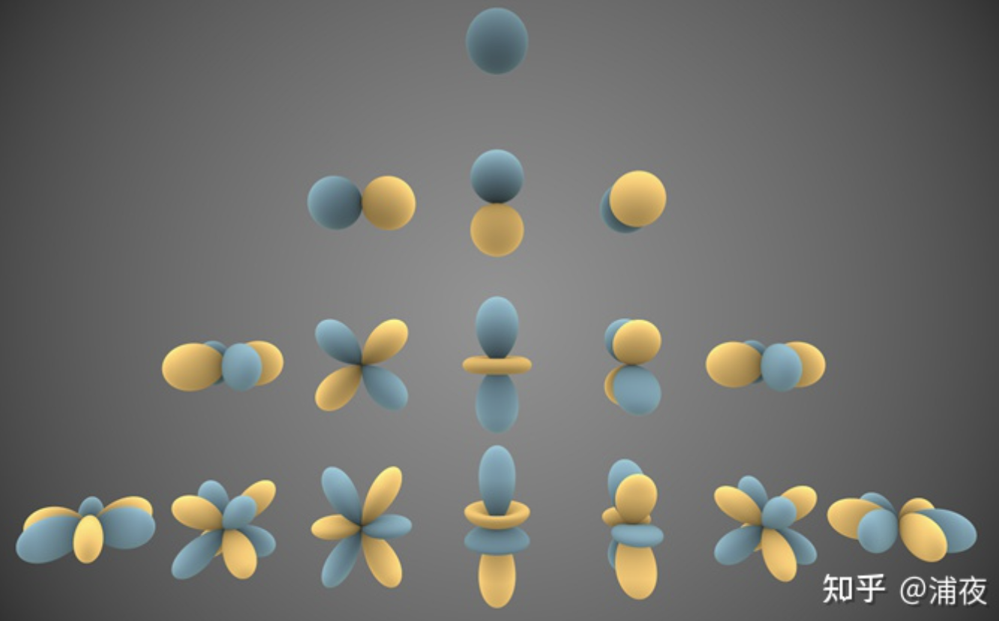
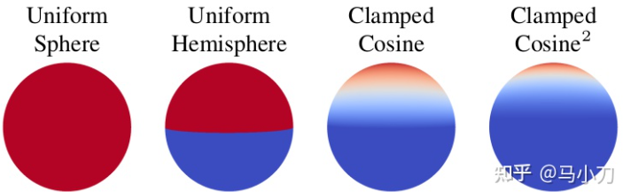
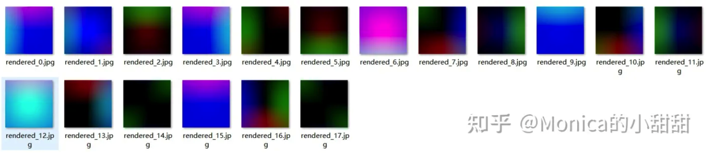
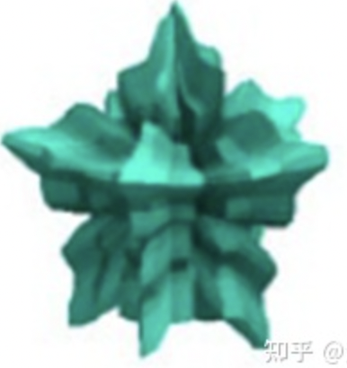
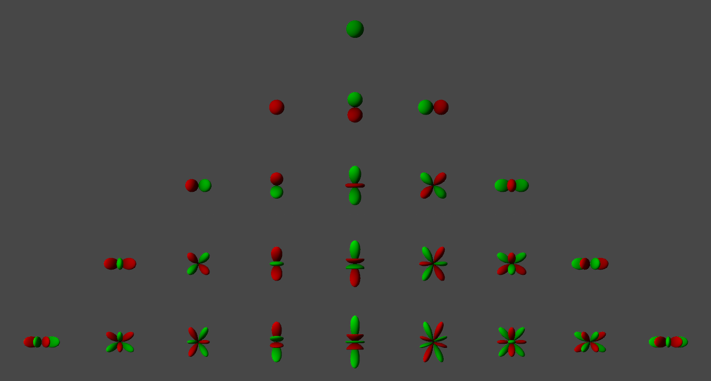
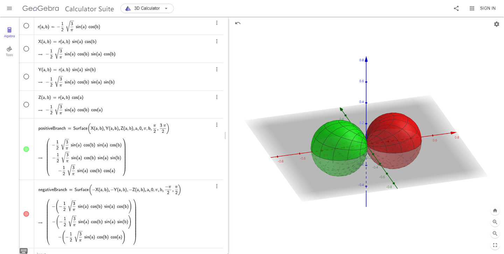

# 球谐光照：从拉普拉斯方程到实时漫反射

本文从球坐标下的拉普拉斯方程出发，依次推出缔合勒让德多项式、复/实球谐基、投影与重建、余弦瓣卷积，最后落到两条 SH Lighting 实现路线（逐法线预计算传输 vs 旋转不变性下的常数系数）与 StupidSH 的手写代码。入门概念、Unity 的 `SphericalHarmonicsL2` API 用法与 SH Visualizer 的工程步骤见 [04_PBR与IBL](04_PBR与IBL.md) §8，本文只做必要的引用，不重复叙述；重点是把"为什么是这 9 个系数""为什么卷积系数是 π、2π/3、π/4"推到能自己重算的程度。

## 1. 球谐函数的来源：球坐标下的拉普拉斯方程

### 1.1 谐函数

满足拉普拉斯方程的函数称为**谐函数**（harmonic function）：

$$
\nabla^2 u = \frac{\partial^2 u}{\partial x^2}+\frac{\partial^2 u}{\partial y^2}+\frac{\partial^2 u}{\partial z^2} = 0
$$

它的数学意义是梯度的散度为零；物理上对应"稳定"的势场——无源区域的引力势、静电场、磁场都满足它。给定边界条件后解唯一，因此它描述的是空间中一个标量场的分布。

**球谐函数就是把谐函数限制在球坐标系的单位球面上**得到的角向部分。它不是凭空定义的一组函数，而是这个偏微分方程在球坐标下分离变量的产物——这一点决定了它的正交性、完备性与"带（band）"结构。

### 1.2 球坐标与分离变量

球坐标变换：

$$
\begin{cases}
x = r\sin\theta\cos\varphi\\
y = r\sin\theta\sin\varphi\\
z = r\cos\theta
\end{cases}
\qquad
\begin{cases}
\theta = \arccos(z/r)\in[0,\pi]\\
\varphi = \operatorname{atan2}(y,x)\in[0,2\pi)
\end{cases}
$$

代入直角坐标形式，得到球坐标下的拉普拉斯方程：

$$
\nabla^2 u=\frac{1}{r^2}\frac{\partial}{\partial r}\Big(r^2\frac{\partial u}{\partial r}\Big)
+\frac{1}{r^2\sin\theta}\frac{\partial}{\partial\theta}\Big(\sin\theta\frac{\partial u}{\partial\theta}\Big)
+\frac{1}{r^2\sin^2\theta}\frac{\partial^2 u}{\partial\varphi^2}=0
$$

设三个变量相互独立，令 $u(r,\theta,\varphi)=R(r)\,Y(\theta,\varphi)$，代入后两边乘以 $r^2/(RY)$：

$$
\frac{1}{R}\frac{\mathrm d}{\mathrm dr}\Big(r^2\frac{\mathrm dR}{\mathrm dr}\Big)
= -\frac{1}{Y\sin\theta}\frac{\partial}{\partial\theta}\Big(\sin\theta\frac{\partial Y}{\partial\theta}\Big)
-\frac{1}{Y\sin^2\theta}\frac{\partial^2 Y}{\partial\varphi^2}
$$

左边只依赖 $r$，右边只依赖角量，二者只能同时等于一个常数。记该常数为 $l(l+1)$（这样写是为了后面解的形式方便），得到一个偏微分方程被拆成的两个方程：

$$
\frac{\mathrm d}{\mathrm dr}\Big(r^2\frac{\mathrm dR}{\mathrm dr}\Big)-l(l+1)R=0
$$

$$
\frac{1}{\sin\theta}\frac{\partial}{\partial\theta}\Big(\sin\theta\frac{\partial Y}{\partial\theta}\Big)
+\frac{1}{\sin^2\theta}\frac{\partial^2 Y}{\partial\varphi^2}+l(l+1)Y=0
$$

后者称为**球函数方程**。径向方程的解是 $R(r)=Ar^{l}+Br^{-(l+1)}$：若要求解在 $r=0$ 处有界，只能取 $r^l$ 项；球谐函数只关心角向的 $Y$。

### 1.3 关于 φ 与 θ 的方程

再令 $Y(\theta,\varphi)=\Theta(\theta)\Phi(\varphi)$，代入球函数方程并乘 $\sin^2\theta/(\Theta\Phi)$：

$$
\Phi''+\lambda\Phi=0,
\qquad
\sin\theta\frac{\mathrm d}{\mathrm d\theta}\Big(\sin\theta\frac{\mathrm d\Theta}{\mathrm d\theta}\Big)
+\big[l(l+1)\sin^2\theta-\lambda\big]\Theta=0
$$

$\varphi$ 方向要求以 $2\pi$ 为周期，故 $\lambda=m^2$、$m$ 为整数，$\Phi=e^{im\varphi}$（实基情形取 $\cos m\varphi$、$\sin m\varphi$）。$m^2$ 回代后，作变量替换 $x=\cos\theta\in[-1,1]$，得到**缔合勒让德方程**：

$$
(1-x^2)\frac{\mathrm d^2\Theta}{\mathrm dx^2}-2x\frac{\mathrm d\Theta}{\mathrm dx}
+\Big[l(l+1)-\frac{m^2}{1-x^2}\Big]\Theta=0
$$

当体系具有**极轴转动对称性**（关于 $\varphi$ 的方程解为常数，即 $m=0$）时，上式退化为**勒让德方程**：

$$
(1-x^2)\frac{\mathrm d^2\Theta}{\mathrm dx^2}-2x\frac{\mathrm d\Theta}{\mathrm dx}+l(l+1)\Theta=0
$$

（原稿有误，已更正：原稿把第一项写成 $(1-z^2)u'(z)$，应为二阶导 $u''(z)$。）

### 1.4 为什么解必须是多项式：闭区间上的收敛要求

勒让德方程在正常点 $z_0=0$ 附近可以用泰勒级数求解，$z=\pm1$ 是孤立奇点，收敛半径为 1。把级数代入方程可得系数递推，通解形如

$$
u(z)=a_0u_0(z)+a_1u_1(z),
\qquad |z|<1
$$

但球谐函数需要的解区间是 $\theta\in[0,\pi]$，即 $x=\cos\theta\in[-1,1]$ 这个**闭**区间。物理量必须有意义、不能发散，所以解在 $x=\pm1$ 处也必须**有限**。而级数解在端点一般是发散的，唯一能让它保持有限的办法是**级数在某一项终止**、成为有限项多项式——端点有限迫使级数终止，终止条件反过来限制了 $l$ 只能取非负整数，并给出 $|m|\le l$。于是得到闭区间 $[-1,1]$ 上勒让德方程的多项式解，即勒让德多项式。

这条链路是理解"为什么球谐是离散的带结构"的关键：带结构不是设计出来的，是边界有界性逼出来的。

### 1.5 勒让德多项式与缔合勒让德多项式

勒让德多项式（Rodrigues 公式）：

$$
P_l(x)=\frac{1}{2^l\,l!}\frac{\mathrm d^l}{\mathrm dx^l}\big[(x^2-1)^l\big]
$$

前几项：

| $l$ | $P_l(x)$ |
|---|---|
| 0 | $1$ |
| 1 | $x$ |
| 2 | $\frac12(3x^2-1)$ |
| 3 | $\frac12(5x^3-3x)$ |

缔合勒让德多项式是它的一般化，$l$ 为非负整数（band），$m=0,\dots,l$（order，即对 $P_l$ 求导的阶数）：

$$
P_l^m(x)=(1-x^2)^{m/2}\frac{\mathrm d^m}{\mathrm dx^m}P_l(x)
$$

> **相位约定：解析式与下面的递推式必须同口径。** 上式及本节三条递推都采用**不含** Condon–Shortley 相位的约定。若改用含相位的口径，则解析式与起始递推式要**同时**并入 $(-1)^m$（等价于 $P_l^m\to(-1)^mP_l^m$）；只改其中一条会让所有 $m\neq0$ 的项整体反号。各资料/代码分别采用哪一套见 §2.3。

工程实现不用导数，而用三条递推，可以按 band 逐个构造：

$$
(l-m)P_l^m(x)=x(2l-1)P_{l-1}^m(x)-(l+m-1)P_{l-2}^m(x)
$$

$$
P_m^m(x)=(2m-1)!!\,(1-x^2)^{m/2}
\qquad\text{（含相位口径下此处多一个 }(-1)^m\text{）}
$$

$$
P_{m+1}^m(x)=x(2m+1)P_m^m(x)
$$

第二条是"起始项"，不需要前序结果；第三条把 band 提升一级；第一条用前两个 band 生成当前 band。双阶乘 $n!!$ 表示不超过 $n$ 且与 $n$ 同奇偶的正整数之积：$1!!=1,\ 2!!=2,\ 3!!=3,\ 4!!=8,\ 5!!=15,\ 6!!=48$。

## 2. 复球谐与实球谐

### 2.1 复球谐函数

$$
Y_l^m(\theta,\varphi)=K_l^m\,e^{im\varphi}\,P_l^{|m|}(\cos\theta),
\qquad l\in\mathbb N,\ -l\le m\le l
$$

$$
K_l^m=\sqrt{\frac{2l+1}{4\pi}\cdot\frac{(l-|m|)!}{(l+|m|)!}}
$$

$K_l^m$ 是归一化常数，注意 $K_l^m=K_l^{-m}$。$P$ 是上一节的缔合勒让德多项式，$K$ 负责让基函数在单位球面上归一。

### 2.2 实球谐函数

渲染里要的是实值基，由复基的实部/虚部组合而来：

$$
y_l^m=
\begin{cases}
\sqrt2\,K_l^m\cos(m\varphi)\,P_l^m(\cos\theta), & m>0\\[4pt]
\sqrt2\,K_l^{|m|}\sin(|m|\varphi)\,P_l^{|m|}(\cos\theta), & m<0\\[4pt]
K_l^0\,P_l^0(\cos\theta), & m=0
\end{cases}
$$

（原稿在 $m<0$ 分支写的是 $P_l^{-m}$，应为 $P_l^{|m|}$：$P_l^{-m}=(-1)^m\frac{(l-m)!}{(l+m)!}P_l^m$ 是**含 Condon–Shortley 相位**的口径，而本节其余推导用的是不含相位的口径；直接用 $P_l^{-m}$ 会使 $|m|>0$ 项整体缩小。）

### 2.3 Condon–Shortley 相位：两套基符号不一致的根源

$(-1)^m$ 这个相位因子在量子力学文献里称为 **Condon–Shortley phase**。它可以并入缔合勒让德多项式的定义，也可以附加在球谐函数本身上；它不是必须的，但能简化升降算符相关的运算。**测地学与地磁学社区从不使用它**，所以不同资料列出的球谐基会有符号差异。

**两套系数对照。** 取 $l\le2$ 的基：不含相位的一套全是正号多项式；含相位的一套只在 $m$ 为奇数的位置多一个负号，于是 $y$、$x$、$yz$、$xz$ 四项变负，$1$、$z$、$xy$、$3z^2-1$、$x^2-y^2$ 不变。对同一个球面函数 $f$，两套基给出的系数也恰好在这四个位置上反号——所以"系数与基配套使用"时重建结果完全相同，只有混用（系数来自一套、着色器用另一套）才会让奇数 $m$ 的项反号。

维基百科"实球谐函数"的定义式**显式乘了** $(-1)^m$：

$$
Y_{\ell m}=
\begin{cases}
(-1)^{m}\sqrt{2}\,\sqrt{\dfrac{2\ell+1}{4\pi}\dfrac{(\ell-|m|)!}{(\ell+|m|)!}}\;P_{\ell}^{|m|}(\cos\theta)\,\sin(|m|\varphi), & m<0\\[2mm]
\sqrt{\dfrac{2\ell+1}{4\pi}}\;P_{\ell}^{m}(\cos\theta), & m=0\\[2mm]
(-1)^{m}\sqrt{2}\,\sqrt{\dfrac{2\ell+1}{4\pi}\dfrac{(\ell-m)!}{(\ell+m)!}}\;P_{\ell}^{m}(\cos\theta)\,\cos(m\varphi), & m>0
\end{cases}
$$

但该定义里的 $P_l^m$ 本身也含 CS 相位，两个 $(-1)^m$ 恰好抵消，所以它列出的 $l\le2$ 基函数全是正号，与本文 §2.4 的"不含相位"表逐项一致：

**$\ell=0$**

$$
Y_{00}=s=Y_{0}^{0}=\frac{1}{2}\sqrt{\frac{1}{\pi}}
$$

**$\ell=1$**

$$
\begin{aligned}
Y_{1,-1}&=p_y=i\sqrt{\tfrac12}\left(Y_{1}^{-1}+Y_{1}^{1}\right)=\sqrt{\frac{3}{4\pi}}\cdot\frac{y}{r},\\
Y_{1,0}&=p_z=Y_{1}^{0}=\sqrt{\frac{3}{4\pi}}\cdot\frac{z}{r},\\
Y_{1,1}&=p_x=\sqrt{\tfrac12}\left(Y_{1}^{-1}-Y_{1}^{1}\right)=\sqrt{\frac{3}{4\pi}}\cdot\frac{x}{r}.
\end{aligned}
$$

**$\ell=2$**

$$
\begin{aligned}
Y_{2,-2}&=d_{xy}=i\sqrt{\tfrac12}\left(Y_{2}^{-2}-Y_{2}^{2}\right)=\frac{1}{2}\sqrt{\frac{15}{\pi}}\cdot\frac{xy}{r^{2}},\\
Y_{2,-1}&=d_{yz}=i\sqrt{\tfrac12}\left(Y_{2}^{-1}+Y_{2}^{1}\right)=\frac{1}{2}\sqrt{\frac{15}{\pi}}\cdot\frac{y\,z}{r^{2}},\\
Y_{2,0}&=d_{z^{2}}=Y_{2}^{0}=\frac{1}{4}\sqrt{\frac{5}{\pi}}\cdot\frac{3z^{2}-r^{2}}{r^{2}},\\
Y_{2,1}&=d_{xz}=\sqrt{\tfrac12}\left(Y_{2}^{-1}-Y_{2}^{1}\right)=\frac{1}{2}\sqrt{\frac{15}{\pi}}\cdot\frac{x\,z}{r^{2}},\\
Y_{2,2}&=d_{x^{2}-y^{2}}=\sqrt{\tfrac12}\left(Y_{2}^{-2}+Y_{2}^{2}\right)=\frac{1}{4}\sqrt{\frac{15}{\pi}}\cdot\frac{x^{2}-y^{2}}{r^{2}}.
\end{aligned}
$$

Unity / Filament 用的 `SHEvalDirection9` 则是**另一套**：相位留在 $P_l^m$ 里、不在实球谐定义式前再乘一次，也就是多数资料所称的"原始/未消去负号"版本——所以代码里 $y$、$x$、$yz$、$xz$ 带负号。**本文 §2.4 的 9 系数表用的是不含相位的一套（与上面的维基表格同号），§6.1 的代码用含相位的一套**；而多数图形学教材列出的多项式表不带相位。

**符号不影响正交性，也不影响最终光照**——只要投影和重建用同一套基。但混用两套基（例如系数来自维基公式、着色器用另一套多项式）会让奇数 $m$ 的项反号，表现为光照方向被镜像或出现对称性错误，是最隐蔽的一类 bug。

### 2.4 $l\le2$ 的 9 个基函数（工程常用表）

下表是**不含** Condon–Shortley 相位的版本，单位球上 $x^2+y^2+z^2=1$，系数已含 $K_l^m$：

| $i$ | $(l,m)$ | 多项式 | 常数 |
|---|---|---|---|
| 0 | $(0,0)$ | $1$ | $0.282095=\frac{1}{2\sqrt\pi}$ |
| 1 | $(1,-1)$ | $y$ | $0.488603=\sqrt{\frac{3}{4\pi}}$ |
| 2 | $(1,0)$ | $z$ | $0.488603$ |
| 3 | $(1,1)$ | $x$ | $0.488603$ |
| 4 | $(2,-2)$ | $xy$ | $1.092548=\frac{\sqrt{15}}{2\sqrt\pi}$ |
| 5 | $(2,-1)$ | $yz$ | $1.092548$ |
| 6 | $(2,0)$ | $3z^2-1$ | $0.315392=\frac{\sqrt5}{4\sqrt\pi}$ |
| 7 | $(2,1)$ | $xz$ | $1.092548$ |
| 8 | $(2,2)$ | $x^2-y^2$ | $0.546274=\frac{\sqrt{15}}{4\sqrt\pi}$ |

这个索引顺序（$y,z,x$ 而非 $x,y,z$）是 Unity 的 `SphericalHarmonicsL2` 与多数 SH 论文的约定，自定义实现务必与数据布局对齐。

前 3 个带的形状（蓝正、黄负）：



若把基函数扩展到 band 3（共 $1+3+5+7=16$ 个，可视化工具会全部画出来），未归一化的多项式形式为：

$$
\begin{aligned}
Y_3^{-3}&\propto y(3x^2-y^2), & Y_3^{-2}&\propto xyz, & Y_3^{-1}&\propto y(5z^2-1),\\
Y_3^{0}&\propto z(5z^2-3), & Y_3^{1}&\propto x(5z^2-1), & Y_3^{2}&\propto z(x^2-y^2),\\
Y_3^{3}&\propto x(x^2-3y^2). &&
\end{aligned}
$$

对应的归一化常数依次为 $\sqrt{\frac{35}{32\pi}}$、$\sqrt{\frac{105}{4\pi}}$、$\sqrt{\frac{21}{32\pi}}$、$\sqrt{\frac{7}{16\pi}}$、$\sqrt{\frac{21}{32\pi}}$、$\sqrt{\frac{105}{16\pi}}$、$\sqrt{\frac{35}{32\pi}}$。

维基百科的 band 3 示例表给出的正是这套全正号形式（相位已在定义式里抵消，见 §2.3），可直接逐项对照：

**$\ell=3$**

$$
\begin{aligned}
Y_{3,-3}&=f_{y(3x^{2}-y^{2})}=i\sqrt{\tfrac12}\left(Y_{3}^{-3}+Y_{3}^{3}\right)=\frac{1}{4}\sqrt{\frac{35}{2\pi}}\cdot\frac{y\left(3x^{2}-y^{2}\right)}{r^{3}},\\
Y_{3,-2}&=f_{xyz}=i\sqrt{\tfrac12}\left(Y_{3}^{-2}-Y_{3}^{2}\right)=\frac{1}{2}\sqrt{\frac{105}{\pi}}\cdot\frac{xy\,z}{r^{3}},\\
Y_{3,-1}&=f_{yz^{2}}=i\sqrt{\tfrac12}\left(Y_{3}^{-1}+Y_{3}^{1}\right)=\frac{1}{4}\sqrt{\frac{21}{2\pi}}\cdot\frac{y\left(5z^{2}-r^{2}\right)}{r^{3}},\\
Y_{3,0}&=f_{z^{3}}=Y_{3}^{0}=\frac{1}{4}\sqrt{\frac{7}{\pi}}\cdot\frac{5z^{3}-3zr^{2}}{r^{3}},\\
Y_{3,1}&=f_{xz^{2}}=\sqrt{\tfrac12}\left(Y_{3}^{-1}-Y_{3}^{1}\right)=\frac{1}{4}\sqrt{\frac{21}{2\pi}}\cdot\frac{x\left(5z^{2}-r^{2}\right)}{r^{3}},\\
Y_{3,2}&=f_{z(x^{2}-y^{2})}=\sqrt{\tfrac12}\left(Y_{3}^{-2}+Y_{3}^{2}\right)=\frac{1}{4}\sqrt{\frac{105}{\pi}}\cdot\frac{\left(x^{2}-y^{2}\right)z}{r^{3}},\\
Y_{3,3}&=f_{x(x^{2}-3y^{2})}=\sqrt{\tfrac12}\left(Y_{3}^{-3}-Y_{3}^{3}\right)=\frac{1}{4}\sqrt{\frac{35}{2\pi}}\cdot\frac{x\left(x^{2}-3y^{2}\right)}{r^{3}}.
\end{aligned}
$$

### 2.5 正交归一性

复基：

$$
\int_{\Omega}Y_l^m(\omega)\,Y_{l'}^{m'*}(\omega)\,\mathrm d\omega=\delta_{ll'}\delta_{mm'}
$$

实基（这正是"当且仅当两个基函数相同，内积才为 1"的表述）：

$$
\int_{\Omega}y_i(\omega)\,y_j(\omega)\,\mathrm d\omega=\delta_{ij}
$$

这条性质是整个 SH 光照能化简的核心：所有交叉项在积分后消失，双重求和坍缩成一次点积。注意归一化是针对**整个球面**的积分，不是"半球的平均"。

## 3. 投影、重建与带宽

### 3.1 投影就是内积

球谐基构成函数空间 $(y_0,y_1,y_2,\dots)$。把球面函数 $f$ 投影到这个空间，就是逐个求内积——与"点 $P$ 在 XYZ 基上的坐标是 $(\mathrm{dot}(P,X),\mathrm{dot}(P,Y),\dots)$"完全同构：

$$
c_i=\langle f,y_i\rangle=\int_{\Omega}f(\omega)\,y_i(\omega)\,\mathrm d\omega
$$

函数可以看作无穷维向量，连续情形的内积就是积分；离散情形（例如 cubemap 像素）就是带权求和。若 $f$ 有解析式且乘积可积，可求精确解；否则用蒙特卡洛：

$$
c_i\approx\frac{4\pi}{N}\sum_{k=0}^{N-1}f(\omega_k)\,y_i(\omega_k)
$$

（原稿有误，已更正：原稿写作 $\int_0^{2\pi}\!\!\int_0^{\pi} f\,y_i\,\mathrm d\theta\,\mathrm d\varphi$，球面积分必须带雅可比 $\sin\theta$，即 $\mathrm d\omega=\sin\theta\,\mathrm d\theta\,\mathrm d\varphi$；上面已改用 $\mathrm d\omega$ 的统一写法。）

### 3.2 重建与带宽

$$
f(\omega)\approx\tilde f(\omega)=\sum_{l=0}^{L}\sum_{m=-l}^{l}c_l^m\,y_l^m(\omega)=\sum_{i=0}^{(L+1)^2-1}c_i\,y_i(\omega)
$$

- band $l$ 有 $2l+1$ 个基函数；只取 $l\le L$ 时共 $(L+1)^2$ 个系数。
- 术语上极易混用："二阶 SH"有时指 $l\le1$（4 个系数），有时指 $l\le2$（9 个系数）。原稿中"二阶是 4 个系数、三阶是 9 个系数"用的是"带数"口径，而 [04_PBR与IBL](04_PBR与IBL.md) §8 里"9 个（3 阶，L2）"是"最高带"口径。本文一律写 $l\le L$ 或直接写系数个数，避免歧义。（原稿另有"前 $n$ 阶共 $n^2$ 个"的说法，与 $(L+1)^2$ 不一致，属两种口径混用。）
- 只记系数，一个球面函数就被压缩成一组数。这是**有损压缩**：项数越多越接近原函数，$L\to\infty$ 时才精确。

### 3.3 为什么低频只要 9 个

- $l=0$：常数项，即球面平均值（整体亮度）；
- $l=1$：线性梯度，等价于一个方向光的主方向 + 强度；
- $l=2$：二次项，能表达"上下亮、中间过渡"这类轴向分布；
- $l\ge3$：更高频的细节，能量占比小。

环境光的漫反射分量天然是低频的（余弦瓣本身就是低通核，见 §4），所以 $l\le2$ 的 9 个系数已经足够；而镜面反射、高频环境细节必须靠 cubemap / prefiltered env，SH 不适合。

### 3.4 旋转：Wigner D 矩阵

旋转是对输入方向 $\mathbf u$ 做变换。若旋转用欧拉角 $(\alpha,\beta,\gamma)$ 表示为 $R^{\alpha,\beta,\gamma}$（**z–y–z 约定**：先绕 z 转 $\alpha$、再绕 y 转 $\beta$、最后绕 z 转 $\gamma$；$\alpha,\gamma$ 都是偏航，$\gamma$ 不是滚转），则

$$
Y_l^m\big(R^{-1}(\mathbf u)\big)=\sum_{m'=-l}^{l}D^{l}_{m',m}\big(R^{\alpha,\beta,\gamma}\big)\,Y_l^{m'}(\mathbf u)
$$

$$
D^{l}_{m',m}\big(R^{\alpha,\beta,\gamma}\big)=e^{-im'\alpha}\,d^{l}_{m',m}(\beta)\,e^{-im\gamma}
$$

注意左边是 $R^{-1}$：上面这个 $D$ 对应"把函数转过去"，与"对方向做 $R$"恰好差一个逆旋转。若坚持写成 $Y_l^m(R\mathbf u)$，右边就要换成 $D^{\dagger}$。

其中 $d^l_{m',m}$ 是（实）Wigner d 矩阵。意义在于：旋转后**不需要重新计算** $Y_l^m(R\mathbf u)$，只要把已算好的同带基函数乘一个 $(2l+1)\times(2l+1)$ 矩阵。任意一个 SH 基函数都可以用**同带**的基函数线性表示——这就是"旋转不改变带结构"。

对展开后的函数 $f(\mathbf u)=\sum_{l,m}c_l^mY_l^m(\mathbf u)$，旋转后的系数为

$$
c_l^{m'}\;\longrightarrow\;\sum_{m}D^{l}_{m',m}\,c_l^{m}
$$

即"函数旋转 = 系数做线性变换"，避免了重新投影。§5.4 会用它把逐法线的传输系数变成常数。

## 4. 球谐卷积：余弦瓣与辐照度系数

### 4.1 球面上的卷积

渲染里反复出现"某函数与一个只依赖夹角 $\omega\cdot\mathbf n$ 的核做球面积分"。这类核称为**带谐（zonal）核**，可展开为勒让德多项式：

$$
h(\omega\cdot\mathbf n)=\sum_l h_l\,P_l(\omega\cdot\mathbf n),
\qquad
h_l=\frac{2l+1}{2}\int_{-1}^{1}h(t)P_l(t)\,\mathrm dt
$$

用加法定理 $\sum_m y_l^m(\omega)y_l^m(\mathbf n)=\frac{2l+1}{4\pi}P_l(\omega\cdot\mathbf n)$，可得卷积的系数形式：

$$
(f*h)(\mathbf n)=\int_{\Omega}f(\omega)\,h(\omega\cdot\mathbf n)\,\mathrm d\omega
=\sum_{l}\frac{4\pi}{2l+1}h_l\sum_{m=-l}^{l}f_l^m\,y_l^m(\mathbf n)
$$

即：**每个带乘一个常数、形状不变**。记

$$
\hat A_l=\frac{4\pi}{2l+1}h_l
$$

则 $(f*h)(\mathbf n)=\sum_l\hat A_l\sum_m f_l^m y_l^m(\mathbf n)$——这就是"SH 域里的滤波"，$\hat A_l$ 是频域响应。

常见的几种球面分布（从均匀球面到 clamped cosine）：



它们在 SH 域里的衰减速度不同：越"尖"的核，$\hat A_l$ 随 $l$ 衰减越慢，需要的带数越多。余弦族 $\cos^k\theta$ 是 IBL diffuse 与 SH 传输的标准核；球面高斯则用于更可控的滤波。

### 4.2 clamped cosine 的带谐系数

漫反射的核是截断余弦（只取上半球）：

$$
A(\theta')=\cos\theta'=\sum_{n\ge0}A_n\,Y_{n,0}(\theta')
$$

$$
A_n=2\pi\int_0^{\pi/2}Y_{n,0}(\theta')\cos\theta'\sin\theta'\,\mathrm d\theta'
=2\pi\sqrt{\frac{2n+1}{4\pi}}\int_0^{1}P_n(u)\,P_1(u)\,\mathrm du
$$

其中 $u=\cos\theta'$，因子 $2\pi$ 来自水平角对 1 的积分；积分限是 $0\sim\pi/2$ 而不是 $\pi$，因为只考虑上半球（下半球核值为 0）。注意 $u=P_1(u)$，所以被积函数写成 $P_nP_1$。

利用勒让德多项式的奇偶性与正交性 $\int_{-1}^{1}P_a(u)P_b(u)\,\mathrm du=\frac{2}{2a+1}\delta_{a,b}$，以及"$n$ 为奇数时 $P_n$ 为奇函数"，可得：

$$
\int_0^1P_n(u)P_1(u)\,\mathrm du=
\begin{cases}
\dfrac{1}{2}, & n=0\\[4pt]
\dfrac{1}{3}, & n=1\\[4pt]
\dfrac{1}{8}, & n=2\\[4pt]
0, & n=3\\[4pt]
-\dfrac{1}{48}, & n=4
\end{cases}
$$

代回即得数值（$\hat A_l$ 为辐照度系数，见下一节）：

| $l$ | $A_l$（传输系数 $t_l$） | $\hat A_l=\sqrt{\frac{4\pi}{2l+1}}A_l$ | $\hat A_l/\pi$ |
|---|---|---|---|
| 0 | $0.886227=\frac{\sqrt\pi}{2}$ | $\pi$ | $1$ |
| 1 | $1.023327$ | $2\pi/3$ | $2/3$ |
| 2 | $0.495416$ | $\pi/4$ | $1/4$ |
| 3 | $0$ | $0$ | $0$ |
| 4 | $-0.110778$ | $-\pi/24$ | $-1/24$ |

$l=3$ 恰好为零、$l=4$ 变负，说明 clamped cosine 的能量集中在 $l\le2$，高阶项迅速衰减——这正是"9 个系数够用"的定量依据。

### 4.3 辐照度重建

若 $L$ 为入射辐亮度（球面上的函数），漫反射辐照度

$$
E(\mathbf n)=\int_{\Omega_+}L(\omega)\,(\mathbf n\cdot\omega)\,\mathrm d\omega
=(L*h)(\mathbf n),\qquad h(t)=\max(t,0)
$$

于是

$$
E(\mathbf n)\approx\sum_{l=0}^{2}\hat A_l\sum_{m=-l}^{l}L_l^m\,y_l^m(\mathbf n)
=\pi L_0^0y_0^0+\frac{2\pi}{3}\sum_m L_1^my_1^m+\frac{\pi}{4}\sum_m L_2^my_2^m
$$

运行时只需一次 9 项点积。若要得到出射辐亮度，再乘反照率并除以 $\pi$：$L_o=\frac{\rho}{\pi}E$。

## 5. SH Lighting 的实现

> **记号**：本节统一用 $E(\mathbf n)$ 表示**辐照度**（irradiance），即入射辐亮度对余弦项的积分；$L(\omega)$ 表示入射/环境辐亮度（radiance）。漫反射出射辐亮度为 $L_o(\mathbf n)=\frac{\rho}{\pi}E(\mathbf n)$（$\rho$ 为反照率），与 §4.3 一致。下文讨论"漫反射光照"时一律以 $E(\mathbf n)$ 为准，不再把它写成 $L(\mathbf n)$。

### 5.1 环境光的简化

球谐光照最主要的应用是**环境光**（天空盒发出的光）：光源无限远、天空盒无限大，于是可以忽略着色点位置、只保留法线信息。漫反射项：

$$
E(p,\mathbf n)=\int_{\Omega_+}L(p,\omega_i)\,(\mathbf n\cdot\omega_i)\,\mathrm d\omega_i
=\int_{\Omega}L(p,\omega_i)\max(\mathbf n\cdot\omega_i,0)\,\mathrm d\omega_i
$$

与环境光结合后，位置 $p$ 不再出现：

$$
E(\mathbf n)=\int_{\Omega}L(\omega_i)\max(\mathbf n\cdot\omega_i,0)\,\mathrm d\omega_i
$$

（若需要出射辐亮度，再乘 $\rho/\pi$，见本节开头的记号说明。）

传统做法是 IBL：预计算 irradiance map，运行时按法线采样一次立方体纹理，代价是存储与带宽（一张 cubemap）。SH 的做法是不存贴图、只存少量系数，运行时用系数重建。

### 5.2 两侧展开，正交性消去交叉项

把积分里的两部分分别记作

$$
\begin{cases}
\text{light}(\omega)=L(\omega)\\
t(\omega)=\max(\mathbf n\cdot\omega,0)
\end{cases}
$$

各自用 SH 展开（求和上限由使用者指定；漫反射环境光只需 3 个带、即 $l\le2$，$N=9$。原稿把"带数"记作 $L=3$，与"最高带号"口径差 1）：

$$
\begin{cases}
\text{light}(\omega)=\sum_{i=0}^{N-1}L_i\,y_i(\omega)\\[4pt]
t(\omega)=\sum_{i=0}^{N-1}t_i\,y_i(\omega)
\end{cases}
$$

代入并交换求和与积分：

$$
\begin{aligned}
E(\mathbf n)&=\int_{\Omega}\Big(\sum_i L_iy_i(\omega)\Big)\Big(\sum_j t_jy_j(\omega)\Big)\mathrm d\omega\\
&=\sum_j\sum_i L_it_j\int_{\Omega}y_i(\omega)y_j(\omega)\,\mathrm d\omega
\end{aligned}
$$

由正交归一性 $\int_{\Omega}y_iy_j\,\mathrm d\omega=\delta_{ij}$，双重求和坍缩为：

$$
E(\mathbf n)=\sum_{i=0}^{N-1}L_i\,t_i
$$

到这里整个光照公式变成"常数乘积之和"，但这个结论有个陷阱：$t_i$ 里含法线。

### 5.3 朴素预计算为什么失败

两个系数的定义：

$$
L_i=\int_{\Omega}L(p,\omega)\,y_i(\omega)\,\mathrm d\omega,
\qquad
t_i=\int_{\Omega}\max(\mathbf n\cdot\omega,0)\,y_i(\omega)\,\mathrm d\omega
$$

- $L_i$：对天空盒积分即可，**与着色点无关**。逐像素/逐纹素累加即可：

```cpp
for (pixel& p : Cubemap)
    Li += p.color * Yi(normalize(p.position)) * dw;
```

- $t_i$：含法线 $\mathbf n$，**每个法线方向都要一组**。$t_i$ 本身是标量（同一组 9 个 $t_i$ 直接作用到 RGB 三个通道），所以每个法线方向只需要 **9 个**通道，工程上就是 **3 张与 cubemap 同分辨率的 RGB cubemap**（每张存 3 个系数，$3\times6=18$ 张面切片）：

```cpp
for (normal& n : sphere)
{
    for (pixel& p : Cubemap)
        Li[n] += max(dot(n, normalize(p.position)), 0.0) * Yi(normalize(p.position)) * dw;
}
```

预计算的结果就是一叠与法线方向一一对应的纹理——下面的 18 张切片（`rendered_0` … `rendered_17`，即 3 张 cubemap × 6 面）拼在一起，每张面的 RGB 三个通道各存一个 $t_i$ 在球面上的方向分布：



这等于把 irradiance map 又预计算了一遍——没有逃脱采样的命运，只是把"采样贴图"换成了"采样一堆系数纹理"。

### 5.4 旋转不变性救场

Ramamoorthi & Hanrahan 的做法：不再逐法线存储，而是利用旋转不变性把 $t_i$ 化为常数。

关键在于核是**截断**余弦 $t(\omega)=\max(\mathbf n\cdot\omega,0)$：只取上半球、下半球核值为 0。它绕 $\mathbf n$ 轴对称，因此 SH 展开只有 $m=0$ 项，且各带系数是固定常数，由**半球**积分给出：

$$
t_l=\int_{\Omega}\max(\mathbf n\cdot\omega,0)\,y_l^0(\omega)\,\mathrm d\omega
=A_l
$$

这里的 $A_l$ 就是 §4.2 用 $\int_0^1P_nP_1\,\mathrm du$ 算出的那一列（$0.886227,\ 1.023327,\ 0.495416,\ 0,\ -0.110778$）。把"法线方向上的带谐核"用旋转不变性搬到任意法线上，最终得到：

$$
E(\mathbf n)=\sum_{l=0}^{\infty}\sum_{m=-l}^{l}\sqrt{\frac{4\pi}{2l+1}}\,L_l^m\,t_l\,y_l^m(\mathbf n)
$$

工程上截断到 $l\le2$：

$$
E(\mathbf n)\approx\sum_{l=0}^{2}\hat A_l\sum_{m=-l}^{l}L_l^m\,y_l^m(\mathbf n),
\qquad \hat A_0=\pi,\ \hat A_1=\frac{2\pi}{3},\ \hat A_2=\frac{\pi}{4}
$$

> **核必须是截断的。** 若误用未截断的 $\mathbf n\cdot\omega$，它本身就是 $l=1$ 的函数，整球展开只有 $l=1$ 非零（$\int_\Omega(\mathbf n\cdot\omega)y_1^m\,\mathrm d\omega=\frac{4\pi}{3}y_1^m(\mathbf n)\approx2.0466\,n_m$，更高带全为 0），根本得不到 $l=0,2,4$ 的 $\pi$、$\pi/4$、$-\pi/24$。表中那些常数只属于 $\max(\mathbf n\cdot\omega,0)$。

结论三条：

- $L_l^m$ 仍需预计算（一次，对天空盒）；
- $t_l$ 不再随法线变化，只是几个常数（$A_l$；乘上 $\sqrt{4\pi/(2l+1)}$ 后即 $\hat A_l=\pi,\ 2\pi/3,\ \pi/4$）；
- $y_l^m(\mathbf n)$ 的参数是法线，可以在着色器里当场算——于是运行时只剩 9 项乘加。

### 5.5 cubemap 投影：立体角加权

把 cubemap 投影成 SH 系数时，不同像素对应的立体角不同，必须按立体角加权，不能直接对像素求平均：

```cpp
float f[], s[];
float fWtSum = 0;
foreach (cube map face)
    foreach (texel)
        float fTmp = 1 + u*u + v*v;          // r^2 = w^2+u^2+v^2, w=1
        float fWt  = 4 / (sqrt(fTmp) * fTmp); // ∝ 该纹素的立体角
        EvalSHBasis(texel, s);
        f += t(texel) * fWt * s;              // vector
        fWtSum += fWt;
f *= 4 * Pi / fWtSum;                          // 归一化到整球 4π
```

推导：设立方体面在 $w=1$ 平面上，方向为 $(u,v,1)$，$r=\sqrt{1+u^2+v^2}$。面元 $\mathrm dA=\mathrm du\,\mathrm dv$，其法线与视线夹角余弦为 $1/r$，故

$$
\mathrm d\omega=\frac{\mathrm dA\cdot(1/r)}{r^2}=\frac{\mathrm du\,\mathrm dv}{r^3}
=\frac{\mathrm du\,\mathrm dv}{(1+u^2+v^2)^{3/2}}
$$

每个纹素占 $\Delta u=\Delta v=2/\text{size}$，所以单个纹素的立体角是 $\frac{4}{\text{size}^2}\cdot\frac{1}{r^3}$；代码里的常数 $4$ 就是这个 $4/\text{size}^2$ 的分子（$\text{size}^{-2}$ 在最后按 $4\pi/\text{fWtSum}$ 归一化时被约掉）。

> 原稿把这一步写成"$dA=\cos\theta=S/r$"，把投影面积与余弦混在了一起（原稿有误，已更正：应为 $\mathrm d\omega=\mathrm dA_\text{proj}/r^2$，其中 $\mathrm dA_\text{proj}=4/r$ 是 $2\times2$ 面片沿视线方向的投影面积）。

若改用均匀采样，蒙特卡洛估计为

$$
C_i=\int_S\text{light}(v)\,y_i(v)\,\mathrm dv
=\frac{1}{N}\sum_{j=1}^{N}L(x_j)\,y_i(x_j)\,w(x_j)
=\frac{4\pi}{N}\sum_{j=1}^{N}L(x_j)\,y_i(x_j)
$$

因为单位球面积为 $4\pi$，均匀采样的权重恒为 $4\pi$。

### 5.6 运行时求值

```hlsl
// 9 个系数按 (0,0),(1,-1),(1,0),(1,1),(2,-2)...(2,2) 排列
// 基函数不含 Condon–Shortley 相位；若数据来自 Unity 的 SHEvalDirection9，
// 需把 y、x、yz、xz 四项取负以保持投影/重建一致。
float3 SHEvalIrradiance(float3 n, float3 c[9])
{
    float b[9];
    b[0] = 0.282095;
    b[1] = 0.488603 * n.y;
    b[2] = 0.488603 * n.z;
    b[3] = 0.488603 * n.x;
    b[4] = 1.092548 * n.x * n.y;
    b[5] = 1.092548 * n.y * n.z;
    b[6] = 0.315392 * (3.0 * n.z * n.z - 1.0);
    b[7] = 1.092548 * n.x * n.z;
    b[8] = 0.546274 * (n.x * n.x - n.y * n.y);

    float3 e = c[0] * b[0] * 3.14159265;                       // band 0: π
    e += (c[1]*b[1] + c[2]*b[2] + c[3]*b[3]) * 2.09439510;     // band 1: 2π/3
    e += (c[4]*b[4] + c[5]*b[5] + c[6]*b[6]
        + c[7]*b[7] + c[8]*b[8]) * 0.78539816;                 // band 2: π/4

    return max(e, 0);   // 低阶重建可能出现负值，钳到 0
}
```

### 5.7 PRT：预计算辐射度传输

把"传输"整体预计算，就能突破"只有环境光"的限制，把阴影、互反射、自遮挡也编码进系数。

一般形式：对每个顶点（或探针）预计算

$$
t_i(p)=\int_{\Omega}T_p(\omega)\,y_i(\omega)\,\mathrm d\omega,
\qquad T_p(\omega)=V(p,\omega)\,\max(\mathbf n\cdot\omega,0)\,\rho/\pi
$$

其中 $V$ 是可见性。运行时：

$$
L_o(p)=\sum_i L_i\,t_i(p)
$$

即"光照系数向量"与"传输系数向量"的点积。特点：

- 每个顶点存 9（或更多）个系数，比 irradiance map 便宜，但空间分辨率受顶点/探针密度限制；
- 支持软阴影、环境遮蔽、乃至多次弹射（$T$ 可用路径追踪预计算）；
- 只对低频光照成立；光源可以整体旋转（旋转 $L_i$ 即可），但不能逐光源任意移动；
- 若要方向性更强的高光，需要更多带（$9\to16\to25$），存储与计算同步上升。

## 6. StupidSH 的手写实现

### 6.1 基函数求值 `SHEvalDirection9`

对方向 $v=(x,y,z)$ 一次算出 9 个基函数值，全部常数预先写成字面量，避免运行期算 $\sqrt{\pi}$：

```cpp
// 9 个 SH 基函数求值（含 Condon–Shortley 相位，与 Unity 一致）
static inline void SHEvalDirection9(const math::float3& v, math::float4* outsh)
{
    const float kInv2SqrtPI        = 0.28209479177387814347403972578039f; // 1/(2√π)
    const float kSqrt3Div2SqrtPI   = 0.48860251190291992158638462283835f; // √3/(2√π)
    const float kSqrt15Div2SqrtPI  = 1.0925484305920790705433857058027f;  // √15/(2√π)
    const float k3Sqrt5Div4SqrtPI  = 0.94617469575756001809268107088713f; // 3√5/(4√π)
    const float kSqrt15Div4SqrtPI  = 0.54627421529603953527169285290135f; // √15/(4√π)
    const float kOneThird          = 0.3333333333333333333333f;

    using namespace math;

    float4 kMul0 = float4(kInv2SqrtPI, kSqrt3Div2SqrtPI,
                          kSqrt3Div2SqrtPI, kSqrt3Div2SqrtPI);
    float3 vsq  = v * v;
    float4 mul0 = float4(1.0f, -v.y, v.z, -v.x);
    outsh[0] = mul0 * kMul0;                     // y00, y1-1, y10, y11

    float4 kMul1 = float4(kSqrt15Div2SqrtPI, kSqrt15Div2SqrtPI,
                          k3Sqrt5Div4SqrtPI, kSqrt15Div2SqrtPI);
    float4 mul1 = float4(v.x * v.y, -v.y * v.z,
                         vsq.z - kOneThird, -v.x * v.z);
    outsh[1] = mul1 * kMul1;                     // y2-2, y2-1, y20, y21

    outsh[2] = (vsq.x - vsq.y) * kSqrt15Div4SqrtPI;  // y22
}
```

注意 $y_{2,0}$ 那一项用的是 `vsq.z - 1/3` 乘以 $3\sqrt5/(4\sqrt\pi)$，与 §2.4 表的 $0.315392(3z^2-1)$ 等价（$0.946175\times(z^2-1/3)=0.315392\times(3z^2-1)$）。因为 $v$ 是单位向量，这里直接用了 $x^2+y^2+z^2=1$ 的化简，传入非单位向量会出错。

### 6.2 天空盒单面投影 `ProjectSkyboxFaceIntoSH`

```cpp
template<typename SrcT>
static void ProjectSkyboxFaceIntoSH(const ImageReference& img,
    const Vector3f& basisX, const Vector3f& basisY, const Vector3f& basisZ,
    float pixelToFloat, bool inputIsSRGB,
    SphericalHarmonicsL2& outAmbientProbe)
{
    Assert(img.GetOldTextureFormat() == kTexFormatARGB32  && sizeof(SrcT) == 1 ||
           img.GetOldTextureFormat() == kTexFormatARGBFloat && sizeof(SrcT) == 4);
    Assert(img.GetWidth() == img.GetHeight());

    SphericalHarmonicsL2 tempProbe;
    tempProbe.SetZero();
    float4 shtmp[SphericalHarmonicsL2::kCoeffCountSIMD];

    const int   size       = img.GetWidth();
    const float coordBias  = -1.f + 1.f / size;   // 像素中心映射到 -1..1
    const float coordScale =  2.f / size;
    float weightSum = 0.0f;

    for (int y = 0; y < size; ++y)
    {
        const SrcT* pixel = reinterpret_cast<SrcT*>(img.GetRowPtr(y));
        float fy = y * coordScale + coordBias;
        for (int x = 0; x < size; ++x, pixel += 4)
        {
            float fx = x * coordScale + coordBias;

            float ftmp         = 1.0f + fx * fx + fy * fy;
            float linearWeight = 4.0f / (Sqrt(ftmp) * ftmp);  // ∝ 立体角

            Vector3f dir = Normalize(basisZ + basisX * fx + basisY * fy);
            SHEvalDirection9(math::vload3f(dir.GetPtr()), shtmp);

            float r = pixel[1] * pixelToFloat;
            float g = pixel[2] * pixelToFloat;
            float b = pixel[3] * pixelToFloat;
            if (inputIsSRGB)
            {
                r = GammaToLinearSpace(r);
                g = GammaToLinearSpace(g);
                b = GammaToLinearSpace(b);
            }

            r *= linearWeight;
            g *= linearWeight;
            b *= linearWeight;

            float1 rgb[3] = { r, g, b };
            tempProbe.AddToCoefficients(shtmp, rgb);
            weightSum += linearWeight;
        }
    }

    for (int i = 0; i < SphericalHarmonicsL2::kCoeffCount; ++i)
        tempProbe.GetCoefficient(SphericalHarmonics::kColorChannelRed, i) *=
            SphericalHarmonicsL2::kNormalizationConstants[i];
    for (int i = 0; i < SphericalHarmonicsL2::kCoeffCount; ++i)
        tempProbe.GetCoefficient(SphericalHarmonics::kColorChannelGreen, i) *=
            SphericalHarmonicsL2::kNormalizationConstants[i];
    for (int i = 0; i < SphericalHarmonicsL2::kCoeffCount; ++i)
        tempProbe.GetCoefficient(SphericalHarmonics::kColorChannelBlue, i) *=
            SphericalHarmonicsL2::kNormalizationConstants[i];

    // 除以 6 是因为这里只烘焙了立方体的一个面
    const float normWeight = 4.0f * kPI / weightSum / 6.0f;
    outAmbientProbe.AddWeighted(tempProbe, normWeight);
}
```

几个实现细节值得注意：

- 像素中心映射：整数下标 $0..\text{size}-1$ 对应 $-1+1/\text{size}$ 到 $1-1/\text{size}$，而不是 $-1..1$；
- 颜色必须先转到线性空间再累加，否则 sRGB 曲线会把低频系数拉偏；
- 每个面单独归一化（`4π / weightSum / 6`），6 个面依次 `AddWeighted` 累加到同一个 probe；
- `kNormalizationConstants` 不是"重复归一化"，而是**必要**的一步：该数组等于 $k_i\cdot(\hat A_l/\pi)$（$k_i$ 为 §6.1 含 Condon–Shortley 相位口径的基常数），它在同一步里做两件事：把 §6.1 的 Y 基系数换成 Unity 的 p 基（基常数并入系数），并乘上余弦卷积因子 $\hat A_l/\pi$（radiance→$E/\pi$）。因此它必须乘在**系数**上（§6.2 代码里的 `GetCoefficient(...)`），之后用 p 基求值（`ShadeSH9`）；**不能**再乘到 `SHEvalDirection9` 的返回值上——那会把基常数算两遍（band 0 变成 $0.282095^2\approx0.0796$，连"全白重建为 1"都过不了）。取值为 $\{0.282095,\ -0.325735,\ 0.325735,\ -0.325735,\ 0.273137,\ -0.273137,\ 0.078848,\ -0.273137,\ 0.136569\}$（例如 band 1 为 $0.488603\times\frac23=0.325735$，负号来自 $y$、$x$ 的相位）。注意"全白天空盒重建为 $1$"这类自检只能验证 band 0——常数环境下 band 1/2 的系数恰为 0，乘错也看不出来——建议再补一个非均匀环境（单方向光或渐变天空）的自检，逐带与暴力积分对比。

### 6.3 自检清单

1. 用常数环境（全白）投影，重建得到常数 $1$；
2. 用单方向光环境投影，重建的 $l=1$ 部分最大值方向与光源方向一致；
3. 旋转天空盒 90°，9 个系数应发生可预期的带内重排，$l=0$ 不变；
4. 与"逐像素暴力积分"对比，误差应在 $10^{-4}$ 量级。

## 7. 可视化

### 7.1 径向长度法

球谐基函数 $y_l^m(\theta,\varphi)$ 是单位球面上的实值函数，可以直接"画成曲面"：把函数值当作径向长度 $r$，方向不变：

$$
\begin{cases}
x = r(\theta,\varphi)\sin\theta\cos\varphi\\
y = r(\theta,\varphi)\sin\theta\sin\varphi\\
z = r(\theta,\varphi)\cos\theta
\end{cases}
\qquad r(\theta,\varphi)=y_l^m(\theta,\varphi)
$$

因为 $y_l^m$ 有正有负，$r$ 为负时点落在反方向，于是曲面自然分裂成"正瓣"与"负瓣"。任意球面函数用径向长度表示就是这种形状：



退化到二维（只画某个剖面）更容易看清带结构：$r=1$ 是球，$r=\cos\theta$ 描出的是 $x^2+y^2+z^2=z$ 这**一个**球（$+z$ 侧、半径 $\tfrac12$，正负两支重合、每点被描两次），$r=\cos\theta\sin\theta$ 是四叶，$r=2\cos^2\theta-1$ 是"上下瓣 + 赤道环"：

$$
r=1,\qquad r=\cos\theta,\qquad r=\sin\theta,\qquad r=\cos\theta\sin\theta,\qquad r=2\cos^{2}\theta-1
$$

（其中本节是退化到二维的**剖面**，$r=\cos\theta$ 与 $r=\sin\theta$ 在剖面里各只描出一个相切**圆**；把 $r=\cos\theta$ 绕极轴旋转才得到 +z 侧一个半径 ½ 的球，而 $r=\sin\theta$ 绕极轴旋转得到的是**环面**（horn torus，$x^2+y^2+z^2=\sqrt{x^2+y^2}$），不是球。只有取 $|r|$、或把正负两支分开绘制，才会看到"沿极轴的两个相切圆"的并集形状；$r<0$ 的部分落在反方向。）

（原稿注明该 2D 图的系数仅作示意，不精确。）

### 7.2 16 个基函数与 ray marching

$l\le3$ 共 16 个基函数，形状从"球"→"偶极子"→"四叶"→"六瓣/八瓣"逐层复杂化：



要把它们做成可交互的 3D 展示，直接生成网格既费事又容易出洞。更简单的做法是**全屏 ray marching + 隐式曲面**：对每个像素构造相机射线，在包围盒内步进，找满足

$$
f(\mathbf p)=\big|y_l^m(\operatorname{dir}\mathbf p)\big|-\|\mathbf p\|=0
$$

的交点——即"半径等于基函数绝对值"的等值面。命中后按 $y_l^m$ 的符号（正/负）分别着色，再叠一层法线光照与环境光遮蔽，形状就出来了。具体步骤（全屏三角形 → 相机射线 → 包围盒裁剪 → 16 个基函数按金字塔排布 → 正负瓣着色）见 [04_PBR与IBL](04_PBR与IBL.md) §8.5。

### 7.3 正负瓣

正负瓣不是"渲染瑕疵"，而是基函数的固有结构：$l=1$ 的 $y_1^1\propto x$ 在 $+x$ 半球为正、$-x$ 半球为负；$l=2$ 的 $y_2^0\propto 3z^2-1$ 在极区为正、赤道带为负。单看一个基函数时两瓣颜色不同；把多个基函数加权求和后，负瓣会被其他基函数的正瓣抵消，最终重建出任意形状。

以 $Y_1^1$ 为例（Geogebra 中把正负两支分开绘制）：



同一条性质在光照里就是"SH 系数可以是负数"。归一化后的余弦瓣 $l=4$ 系数为负（$\hat A_4/\pi=-1/24$）也源于此：各带基函数的正负瓣交替，才能拼出带截断的余弦形状。

## 8. 常见错误与工程结论

**数学层**

1. **丢掉 $\sin\theta$**：球面积分写成 $\mathrm d\theta\mathrm d\varphi$。二维积分必须先乘雅可比，否则系数在高纬区被高估。
2. **归一化口径混乱**：$\hat A_l$（$\pi,2\pi/3,\pi/4$）与 $A_l$（$\sqrt\pi/2,1.0233,0.4954$）差一个 $\sqrt{4\pi/(2l+1)}$；再与除以 $\pi$ 的"归一化辐照度"（$1,2/3,1/4$）混用，亮度会差 $\pi$ 倍。
3. **相位混用**：投影用带 Condon–Shortley 的基、重建用不带相位的基（或反之），奇数 $m$ 项整体反号，表现为光照方向镜像。修法只有一条：全程锁定一套基。
4. **把 $t_i$ 当常数**：在朴素的"两侧展开"推导里 $t_i$ 依赖法线；只有在用旋转不变性把核搬到法线轴上之后，$t_l$ 才是 §4.2 的那几个常数。两套推导的中间量同名，极易张冠李戴。
5. **误以为 SH 能表达高频**：9 个系数只有 9 个自由度，镜面高光、锐利阴影边界都会丢。SH 是低通滤波器，不是压缩算法。

**实现层**

6. **cubemap 直接求平均**：不按 $4/(r^3)$ 加权，角部与棱处误差最明显（偏差 $\propto1/r^3$：面心 1、棱 $\sqrt2$、角 $\sqrt3$；Unity 布局里极区正是面心，偏差最小）。
7. **忘记线性化**：把 sRGB 编码值直接当作线性值投影，数值偏大、能量偏亮（低频系数偏亮），不是偏暗；Unity 的 `ProjectSkyboxFaceIntoSH` 里有显式的 `GammaToLinearSpace`。
8. **$r^2$ 未归一**：`SHEvalDirection9` 里用了 $x^2+y^2+z^2=1$ 的化简，传入非单位向量会算错。
9. **低阶重建出负值**：截断到 $l\le2$ 后重建的辐照度可能在背光面变负，运行时需要 `max(e, 0)`。
10. **探针插值当作精确**：SH 重建对系数是**线性**的，所以 $\mathrm{lerp}(c_1,c_2)$ 重建的结果严格等于 $\mathrm{lerp}(f_1,f_2)$——"SH 支持在系数上插值"这条性质本身没错。真正的偏差来自插值后的钳位（`max(e,0)`）、重归一化，以及 Unity 四面体插值按距离加权的权重，跨探针边界会出现"过冲"。

**结论**

- 漫反射环境光只需要 $l\le2$（9 系数 × RGB）；$l=3$ 的余弦系数恰为 0，再往上迅速衰减，这就是"9 个够用"的定量理由；
- 运行时成本是 9 次乘加 + 一次钳位（`max(e,0)`），远低于 cubemap 采样，且系数可以在探针之间插值——这是 Light Probe 的基础；
- 想要阴影/互反射，走 PRT（逐顶点预计算 $t_i$）；想要任意光源位置或高频细节，回到 IBL / 实时 GI，不要硬撑 SH。

## 原始笔记索引

- `球谐/球谐函数介绍_Spherical_Harmonics.md`
- `球谐/球谐.md`
- `球谐/SH Lighting.md`
- `球谐/StupidSH.md`
- `球谐/球谐函数可视化.md`
- `球谐/球谐和预计算辐射度（PRT）.md`
- `球谐/维基百科-SH.md`
- `球谐/杂记.md`
- `归类/resume.md`（587–668 行：球谐光照：拉普拉斯方程、球谐函数、缔合勒让德多项式、投影与重建）