# OpenGL 基础

> 本文由 `OpenGL/` 根目录下 45 篇零散笔记按知识逻辑重组而成，合并了重复的 VAO/VBO、投影、Look_at、拾取内容，删除了网页转载残留与只有链接的条目。
>
> **约定与修正说明**：OpenGL 使用**右手坐标系**，裁剪空间可见范围为 `-w ≤ x,y,z ≤ w`，规范化设备坐标（NDC）的 `x,y,z` 均为 `[-1, 1]`，经视口变换后深度才映射到 `[0, 1]`（可用 `glDepthRange` 修改）。原文中与此冲突、或与当前 OpenGL 规范不符之处（如 `glTexImage2D` 的行对齐、VAO 与 `GL_ELEMENT_ARRAY_BUFFER` 的绑定关系、透视投影矩阵的符号与 `w` 分量等）已在正文中直接修正，少量无法确认的表述标注“（待核实）”。

---

## 1. 管线与对象

### 1.1 OpenGL 是什么：规范、Context 与对象

OpenGL 不是一个 API 库，而是一套**标准/规范**：它严格规定每个函数的语义、参数与返回值，具体实现由各显卡厂商根据自家硬件特性完成。可以理解为“OpenGL 提供统一接口，功能实现依赖 GPU 驱动”。

OpenGL 程序运行在一个 **Context（上下文）** 中。Context 可以粗略理解为一个包含了所有 OpenGL 状态的对象；Context 被销毁，OpenGL 也就不存在了。创建 Context 通常与创建窗口一起完成，窗口自带 **默认帧缓冲（Default Framebuffer，ID 为 0）**，OpenGL 通过它把内容显示到屏幕。

**OpenGL 对象**是状态的集合，负责管理其下属状态与数据。大多数对象在使用前必须**绑定（bind）**到 Context 上。绑定有两个作用：

1. 修改该对象的状态（多数对象只有绑定后才能改）；
2. 让 Context 在渲染时使用它的状态。

常见的对象类型：Buffer Objects（VBO/EBO/PBO/UBO）、Vertex Array Objects（VAO）、Textures、FrameBuffer Objects（FBO）、Renderbuffer、Query、Sampler 等。

所有对象都遵循同一套“三件套”：

```cpp
void glGen*(GLsizei n, GLuint *objects);          // 生成 n 个对象名（此时尚未分配存储）
void glDelete*(GLsizei n, const GLuint *objects); // 销毁对象
void glBind*(GLenum target, GLuint object);       // 绑定/激活对象
```

注意：

- 对象通过**名字**（无符号整数）引用；从 OpenGL 3.1 起名字必须由 `glGen*` 生成，不再接受用户自定义名字。
- `0` 是保留值，`glGen*` 永远不会返回 0。绑定 0 通常表示解绑或“使用默认对象”。
- 可用 `glIsBuffer` 等 `glIs*` 函数查询某个名字是否是已创建的、尚未删除的对象。

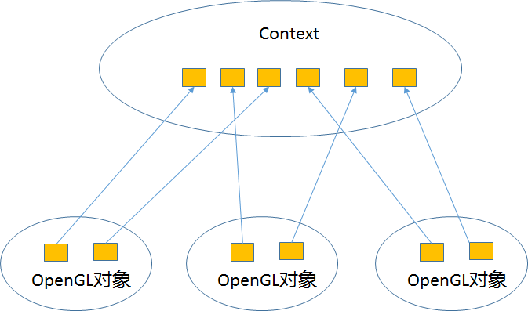

### 1.2 图形渲染管线总览

图形渲染管线（Pipeline）把一批原始图形数据经过一系列阶段，最终变成屏幕上的像素。它可分为两大部分：

1. 把 3D 坐标转换为 2D 坐标；
2. 把 2D 坐标变成有颜色的像素。

各阶段高度专门化、可并行执行。GPU 上有大量小核心，为每个阶段运行各自的小程序，这些小程序就是**着色器（Shader）**。

抽象管线（蓝色阶段为可编程着色器）：


1. **顶点着色器（Vertex Shader）**：输入单个顶点，主要把 3D 坐标变换到裁剪空间，也可处理顶点属性。
2. **细分着色器（Tessellation Shader，可选）**：把图元细分为更多小图元，用于近距离时生成更平滑的几何。
3. **几何着色器（Geometry Shader，可选）**：以（细分后的）图元为输入，可产生新顶点、构造新图元。
4. **图元装配（Primitive Assembly）**：按图元类型（`GL_POINTS`、`GL_TRIANGLES`、`GL_LINE_STRIP` 等）把顶点组装成图元；细分与几何着色器已按输入图元工作过，这里装配的是送往裁剪的最终图元。
5. **裁剪（Clipping）**：位于图元装配与光栅化之间，把图元裁到裁剪空间可见范围内，丢弃视野外的部分（多边形裁剪可能产生新顶点并插值属性）。
6. **光栅化（Rasterization）**：把图元映射为屏幕像素，生成**片段（Fragment）**。
7. **片段着色器（Fragment Shader）**：计算像素最终颜色（光照、阴影、纹理等都在这里）。
8. **逐片段操作（Per-Fragment Operations）**：Alpha/模板/深度测试、混合，最终写入帧缓冲。

现代 OpenGL（Core Profile）中，顶点着色器与片段着色器是**必须**的，GPU 不再提供默认的固定功能着色器。

顶点数据以数组形式传入，称为**顶点数据（Vertex Data）**；每个顶点由若干**顶点属性（Vertex Attributes）**描述（位置、法线、颜色、纹理坐标……）。绘制时必须告诉 OpenGL 这些数据要组装成什么图元。

### 1.3 渲染器结构与渲染状态

渲染器在组织上通常分为“资源/状态/绘制”几层：

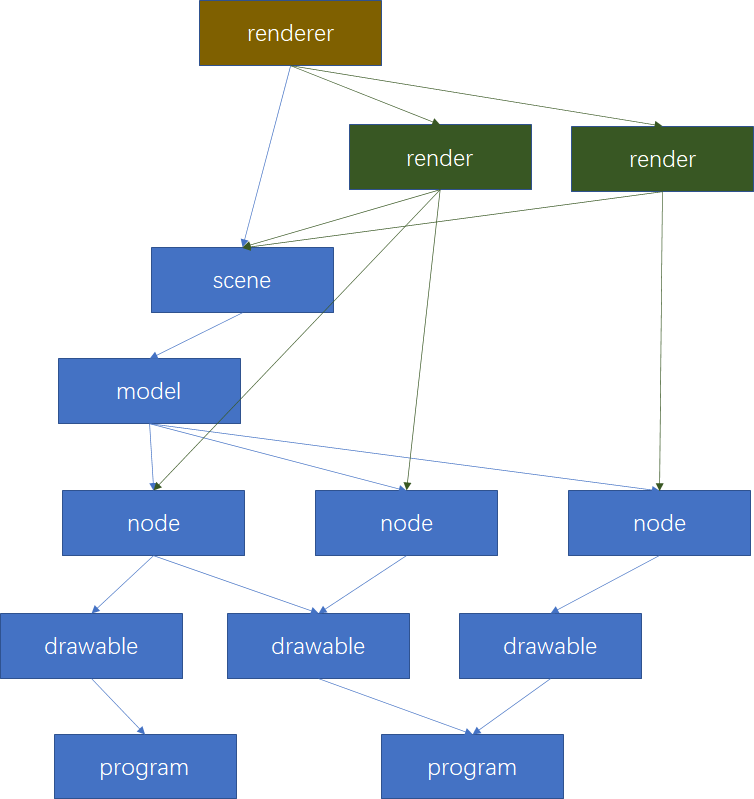

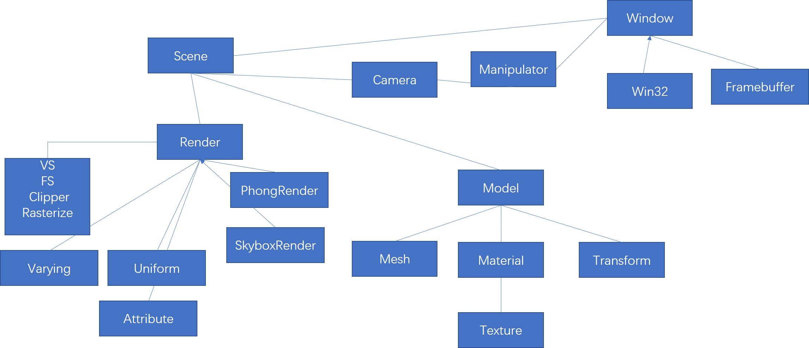

**渲染状态**定义了场景中的 mesh 怎样被渲染，包括但不限于：

1. 使用哪个顶点着色器 / 片段着色器（Program）；
2. 使用哪张纹理、绑定到哪个纹理单元；
3. 开启哪些片段测试（深度、模板、裁剪、混合）；
4. 是否开启混合及混合方程；
5. 视口、裁剪矩形、面剔除、多边形模式等。

OpenGL 是**状态机**：状态没变，所有 mesh 都沿用同一套状态。渲染状态的切换会导致命令缓冲区刷新、驱动重新校验管线，因此状态切换本身就是开销来源。工程上的基本原则是：**按状态（Program → 材质/纹理 → 顶点格式）排序绘制，尽量减少状态切换**。

### 1.4 固定功能渲染管线（理解现代管线的基础）

固定功能管线把各阶段写死在硬件里，理解它有助于理解现代管线中“哪些事被移到了着色器”。

#### 1.4.1 顶点处理

主要负责顶点齐次坐标变换与**逐顶点光照**（Gouraud）。

光照要点：

1. 光照关闭时，顶点颜色直接取当前颜色（`glColor*`）。
2. 光照开启时，根据当前材质（`glMaterial*`，可分正/背面）与法线（`glNormal*`）计算环境光、漫反射、镜面反射并叠加。
3. 光照分正/背面进行，顶点处理后有正面颜色与背面颜色（对应内置输出 `gl_FrontColor` / `gl_BackColor`）。
4. 正面颜色依据正面材质与法线 `n`；背面依据背面材质与 `-n`。
5. 双面光照关闭时，只算正面，并把背面颜色简单设为与正面相同（单面光照**不等于**只照亮正面）。
6. 光栅化时按图元环绕方向判定正/背面，据此选择用正面还是背面顶点颜色插值。
7. 固定管线逐顶点光照类似 Gouraud 模型；逐片元光照（Phong）先插值出片元法线再算光照，需要片段着色器。
8. 光照计算中的距离、点积都在**相机坐标系（eye space）**进行。`glGetLightfv(GL_LIGHT0, GL_POSITION, ...)` 返回的光源位置也是观察坐标——因为相机空间仍是直角坐标系，而裁剪空间不一定。
9. 顶点变换与逐顶点光照都可以由顶点着色器替代。

#### 1.4.2 图元装配与裁剪

1. 顶点处理/顶点着色器输出的是裁剪坐标系（Clip Space）下的顶点，先按连接关系装配成点、线、多边形。
2. 装配后裁剪（Clipping）。多边形裁剪可能产生新顶点，其颜色、纹理坐标等需要插值。
3. 除默认的 `x,y,z = ±w` 六个裁剪面外，用户可指定额外裁剪面（`glClipPlane`）。
4. 裁剪之后做**透视除法**（`xyz / w`），得到 NDC。
5. 随后是**视口变换**，同时把 NDC 的 `z ∈ [-1,1]` 缩放到 `[0,1]` 的深度值（默认越小越近），可用 `glDepthRange(GLclampd n, GLclampd f)` 指定范围。
6. 图元装配之后、裁剪/透视除法/视口变换之前，也可以插入几何着色器。

#### 1.4.3 光栅化

1. 经过视口变换后，光栅化在二维（附带深度）的屏幕坐标系中进行。
2. 光栅化有两个任务：
   - 确定图元覆盖哪些整数坐标的“小方块”（与屏幕像素对应，此时还叫“片段”更准确）；
   - 由顶点深度、颜色插值出这些小方块的深度与颜色（后续可能被纹理等修改）。
3. 多边形光栅化前要判定 front-facing / back-facing（点、线只有正面）。判定结果用于选择正/背面顶点颜色插值；若开启 `GL_CULL_FACE`，与 `glCullFace(GL_FRONT|GL_BACK)` 匹配的面直接剔除，跳过后续光栅化。
4. 光栅化除填充多边形外，也可只构造边（`GL_LINE`）或点（`GL_POINT`）。
5. 纹理处理最复杂的部分在光栅化阶段：每个片元要计算纹理坐标去采样纹素，计算看似简单，出错时效果往往出人意料。
6. 纹理、雾等操作在现代管线中可由片段着色器替代；片段着色器还可做逐片元光照等。

#### 1.4.4 逐片段处理

1. 光栅化输出一系列片段（可能已经片段着色器处理），片段是“准像素”：屏幕上一个整数坐标只有一个像素，但可以前后“堆叠”多个片段。
2. 逐片段操作首先做各种测试，不通过则丢弃：Scissor Test、Alpha Test（核心模式已移除，需在着色器里 `discard`）、Stencil Test、Depth Buffer Test。
3. 所有测试通过的片段写入帧缓冲（RGBA、Depth）。注意模板缓冲只用于测试，片段本身没有“模板值”。
4. **缓冲区使能与缓冲区屏蔽是独立的**：使能控制是否进行测试（不测试则直接通过），屏蔽（`glColorMask`/`glDepthMask`/`glStencilMask`）控制通过测试后是否真正写入。

### 1.5 缓冲区对象 VBO

**VBO（Vertex Buffer Object）** 是显存中的一块缓冲区，有名字（ID），OpenGL 在 GPU 侧记录 ID 与显存地址（或偏移）。它与 PBO、UBO、EBO 同属 Buffer Object 家族，但出现得更早。

#### 1.5.1 为什么需要 VBO

传统绘制方式有两类：

- `glBegin()/glEnd()` 立即模式，或把其放入**显示列表（Display List）**；
- **顶点数组（VA，Vertex Array）**：把顶点及属性放在客户端数组里，用 `glDrawArrays`/`glDrawElements` 一次提交。

VA 的数据在客户端，每次绘制都要把顶点数据再传给服务端（GPU），存在一次多余拷贝；显示列表效率高但内容固定、不能修改。VBO 把数据直接放到显存，绘制时直接从显存取，既避免二次传输，又保留修改数据的弹性（`glBufferData`/`glBufferSubData`/`glMapBuffer`）。因此 VBO 的效率介于 VA 与显示列表之间，同时具备良好的可更新性。

#### 1.5.2 创建、分配与更新

```cpp
// 生成并绑定
GLuint vbo;
glGenBuffers(1, &vbo);
glBindBuffer(GL_ARRAY_BUFFER, vbo);

// 分配显存并上传数据（相当于服务端的 malloc + memcpy）
glBufferData(GL_ARRAY_BUFFER, sizeof(vertices), vertices, GL_STATIC_DRAW);
```

`glBufferData` 签名与参数：

```cpp
void glBufferData(GLenum target, GLsizeiptr size, const GLvoid *data, GLenum usage);
```

- `target`：
  - `GL_ARRAY_BUFFER`：顶点属性数据；
  - `GL_ELEMENT_ARRAY_BUFFER`：索引数据；
  - `GL_PIXEL_PACK_BUFFER`：从 OpenGL 读回的像素数据；
  - `GL_PIXEL_UNPACK_BUFFER`：传给 OpenGL 的像素数据；
  - `GL_COPY_READ_BUFFER` / `GL_COPY_WRITE_BUFFER`：缓冲区之间复制；
  - `GL_TRANSFORM_FEEDBACK_BUFFER`：变换反馈输出；
  - `GL_UNIFORM_BUFFER`：统一变量块。
- `size`：字节数，通常是“元素个数 × 元素类型大小”。
- `data`：客户端内存指针，可为 `NULL`（只分配空间不初始化，之后用 `glBufferSubData` 填充）。原有数据会被整体删除。
- `usage`：性能提示，由“更新频率 × 用途”组合：

| 更新频率 | Draw | Read | Copy |
|---|---|---|---|
| 不复改（一次指定多次使用） | `GL_STATIC_DRAW` | `GL_STATIC_READ` | `GL_STATIC_COPY` |
| 频繁改（反复指定与使用） | `GL_DYNAMIC_DRAW` | `GL_DYNAMIC_READ` | `GL_DYNAMIC_COPY` |
| 每帧改（一次指定一次使用） | `GL_STREAM_DRAW` | `GL_STREAM_READ` | `GL_STREAM_COPY` |

`draw` 表示数据送往 GPU 用于绘制，`read` 表示由客户端读取，`copy` 表示 GPU 内部复制。对 VBO 而言主要用 `*_DRAW`。显存不足时 `glBufferData` 会产生 `GL_OUT_OF_MEMORY`。

> 旧笔记中“`GL_DYNAMIC_*` 使用 AGP 内存”的说法属于早期硬件时代的经验，现代驱动会自行决定存放位置，**不应作为编程依据**（待核实/已过时）。

更新数据的三种方式：

```cpp
// 1) 整体替换：重新分配并上传（会丢弃旧内容）
glBufferData(GL_ARRAY_BUFFER, size, newData, GL_STREAM_DRAW);

// 2) 部分更新：从 offset 字节开始写入 size 字节
void glBufferSubData(GLenum target, GLintptr offset, GLsizeiptr size, const GLvoid *data);

// 3) 映射显存后直接写
GLvoid* glMapBuffer(GLenum target, GLenum access);   // access: GL_READ_ONLY/GL_WRITE_ONLY/GL_READ_WRITE
GLboolean glUnmapBuffer(GLenum target);
GLvoid* glMapBufferRange(GLenum target, GLintptr offset, GLsizeiptr length, GLbitfield access);
```

- `glBufferSubData`：只更新一段，`offset/size` 必须落在原缓冲范围内。若该缓冲正在被 GPU 使用，驱动可能等待或做同步。
- `glMapBuffer`：返回显存映射指针。传统 `glMapBuffer` 可能把数据从 GPU 拷回主机，且需要 CPU/GPU 同步，因此较慢；`glMapBufferRange` 限定范围，效率更高。更现代的做法是持久映射（`GL_MAP_PERSISTENT_BIT`）配合显式同步（fence），本文不展开。
- 缓冲区之间可直接复制（GL 3.1+）：

```cpp
void glCopyBufferSubData(GLenum readbuffer, GLenum writebuffer,
                         GLintptr readoffset, GLintptr writeoffset, GLsizeiptr size);
```

#### 1.5.3 VBO 初始化时“不知道”自己存的是什么

**关键理解**：`glGenBuffers` + `glBindBuffer(GL_ARRAY_BUFFER)` + `glBufferData` 只是分配了一块显存，此时 VBO 并不知道里面是位置、法线还是纹理坐标。数据的含义是在**渲染（或顶点属性设置）时**由 `glVertexAttribPointer`（或旧的 `glVertexPointer`）指定的：

- 数据在哪里：当前绑定到 `GL_ARRAY_BUFFER` 的 VBO；
- 数据格式：`size/type/normalized/stride/offset`；
- 对应哪个 shader 输入：`index`（attribute location）。

连接“显存里的字节”和“顶点属性语义”的桥梁就是 Context。因为整个程序通常只有一个 Context，同一帧里多份绘制代码必须反复切换这些状态——这正是 VAO 要解决的问题。

### 1.6 顶点数组对象 VAO

**VAO（Vertex Array Object）不是 Buffer Object**，它不存储顶点数据；它是 **state object（状态对象）**，记录“一次绘制所需的顶点状态”。它与旧的 VA（顶点数组）没有直接关系，名字容易误导。

VAO 记录：

1. 各个顶点属性数组是否启用（`glEnableVertexAttribArray` / `glDisableVertexAttribArray`）；
2. 每个属性的格式与数据位置（`glVertexAttribPointer` / `glVertexAttribIPointer` 的参数：size、type、normalized、stride、offset，以及当时绑定的 VBO）；
3. **索引缓冲的绑定**（`GL_ELEMENT_ARRAY_BUFFER` 的绑定是 VAO 状态的一部分）。

它**不记录** `GL_ARRAY_BUFFER` 的当前绑定。`glVertexAttribPointer` 在调用时把“当时绑定到 `GL_ARRAY_BUFFER` 的 VBO”记录进该属性的状态；之后解绑 `GL_ARRAY_BUFFER` 不会影响 VAO。


创建与使用：

```cpp
void glGenVertexArrays(GLsizei n, GLuint *arrays);
void glBindVertexArray(GLuint array);
```

`glBindVertexArray` 的行为与其它对象一致：绑定已创建的 name 激活它；绑定 0 解绑。**“首次绑定非 0 名字即创建对象”只在兼容模式成立**：Core Profile 下对象名必须先由 `glGenVertexArrays` 生成，直接绑定一个未生成的名字会得到 `GL_INVALID_OPERATION`。

**完整初始化与绘制：**

```cpp
// 初始化：一次完成
glGenVertexArrays(1, &vao);
glBindVertexArray(vao);

glGenBuffers(1, &vbo);
glBindBuffer(GL_ARRAY_BUFFER, vbo);
glBufferData(GL_ARRAY_BUFFER, sizeof(vertices), vertices, GL_STATIC_DRAW);

glEnableVertexAttribArray(0);
glVertexAttribPointer(0, 3, GL_FLOAT, GL_FALSE, 3 * sizeof(float), (void*)0);

glGenBuffers(1, &ebo);
glBindBuffer(GL_ELEMENT_ARRAY_BUFFER, ebo);
glBufferData(GL_ELEMENT_ARRAY_BUFFER, sizeof(indices), indices, GL_STATIC_DRAW);

// VAO 仍绑定时解绑 ELEMENT_ARRAY_BUFFER 会清掉 VAO 里记录的索引绑定，所以先解绑 VAO
glBindVertexArray(0);
// GL_ARRAY_BUFFER 的绑定不属于 VAO，何时解绑无所谓
glBindBuffer(GL_ARRAY_BUFFER, 0);

// 绘制：只 bind VAO
glUseProgram(program);
glBindVertexArray(vao);
glDrawElements(GL_TRIANGLES, indexCount, GL_UNSIGNED_INT, 0);
glBindVertexArray(0);
```

**易错点（修正原笔记）：**

- 原笔记称“`glDrawElements` 里的索引状态 VAO 没记录”——**错误**。索引缓冲的绑定（`GL_ELEMENT_ARRAY_BUFFER`）确实保存在 VAO 中，这正是“绑定 VAO 就能直接 `glDrawElements`”的原因。真正不被 VAO 记录的是 `GL_ARRAY_BUFFER` 的绑定。
- 因此解绑顺序要注意：**在 VAO 仍绑定的时候解绑 `GL_ELEMENT_ARRAY_BUFFER`，会把该 VAO 的索引绑定清成 0**，之后绘制就没有索引数据了。正确顺序是先 `glBindVertexArray(0)`，再解绑 EBO。
- 解绑 VAO 并不会“关掉”属性启用状态；这些状态留在 VAO 里。切换 VAO 即切换整套顶点状态。
- Core Profile 下**必须**绑定 VAO，否则绘制会被拒绝（`GL_INVALID_OPERATION`）。
- 不要把已废弃的 `glVertexPointer`/`glEnableClientState` 与 `glVertexAttribPointer`/`glEnableVertexAttribArray` 混用。

### 1.7 顶点属性索引与数据格式

#### 1.7.1 绑定属性索引的两种方式

**方式一：`glBindAttribLocation`（链接前调用）**

```cpp
glBindAttribLocation(program, 0, "VertexPosition"); // 索引 0 → VertexPosition
glBindAttribLocation(program, 1, "VertexColor");    // 索引 1 → VertexColor
```

必须在**编译之后、链接之前**调用（`glLinkProgram` 会固化绑定）。

**方式二：GLSL `layout(location = N)`（GLSL 330+ / GL 3.3+）**

```glsl
#version 330 core
layout(location = 0) in vec3 VertexPosition;
layout(location = 1) in vec3 VertexColor;
out vec3 Color;

void main()
{
    Color = VertexColor;
    gl_Position = vec4(VertexPosition, 1.0);
}
```

也可以在链接后用 `glGetAttribLocation` 查询（未显式绑定时由驱动分配）。

#### 1.7.2 `glVertexAttribPointer`

```cpp
void glVertexAttribPointer(GLuint index, GLint size, GLenum type,
                           GLboolean normalized, GLsizei stride, const void *ptr);
```

| 参数 | 含义 |
|---|---|
| `index` | 顶点属性索引（对应 shader 的 location） |
| `size` | 该属性由几个分量组成（1–4），如 `vec3` 为 3 |
| `type` | 分量数据类型，如 `GL_FLOAT` |
| `normalized` | 是否把整数规格化：`GL_TRUE` 时有符号映射到 `[-1,1]`、无符号映射到 `[0,1]`；`GL_FALSE` 则直接转换为浮点 |
| `stride` | 相邻两个顶点之间的字节跨度；0 表示紧密排列（由 `size × sizeof(type)` 推导） |
| `ptr` | 数据起始偏移。**若当前绑定了非 0 的 `GL_ARRAY_BUFFER`，这是缓冲区内的字节偏移；否则是客户端内存指针** |

顶点缓冲中位置数据的布局（3 个 `float` 紧密排列，第一个值位于缓冲起始处）：


配套：

```cpp
glEnableVertexAttribArray(index);   // 顶点属性默认关闭，必须显式开启
```

整数属性若不想被转换成浮点，应使用 `glVertexAttribIPointer`（`bIsIntegral = true`），此时 shader 中对应 `ivec*`/`uvec*`。

### 1.8 索引绘制与多重纹理下的 VBO

#### 1.8.1 索引 VBO（EBO/IBO）

索引数据放在绑定到 `GL_ELEMENT_ARRAY_BUFFER` 的 VBO 中，绘制时用 `glDrawElements`：

```cpp
// 初始化
glGenBuffers(1, &ibo);
glBindBuffer(GL_ELEMENT_ARRAY_BUFFER, ibo);
glBufferData(GL_ELEMENT_ARRAY_BUFFER, indexCount * sizeof(GLuint), indices, GL_STATIC_DRAW);

// 渲染
glBindBuffer(GL_ARRAY_BUFFER, vbo);
glVertexAttribPointer(0, 3, GL_FLOAT, GL_FALSE, 0, 0);
glEnableVertexAttribArray(0);
glBindBuffer(GL_ELEMENT_ARRAY_BUFFER, ibo);
glDrawElements(GL_TRIANGLES, indexCount, GL_UNSIGNED_INT, 0);
```

`glDrawElements` 的 `indices` 参数在绑定 EBO 时是**字节偏移**，常传 `0` 或 `(void*)(offset)`。

索引类型必须与 `type` 参数一致：

| C 类型 | `type` |
|---|---|
| `unsigned char` | `GL_UNSIGNED_BYTE` |
| `unsigned short` | `GL_UNSIGNED_SHORT` |
| `unsigned int` | `GL_UNSIGNED_INT` |

**网格索引的构造**：用行扫描顺序存放顶点最方便，但绘制要按小矩形取索引。对 `XSCALE × ZSCALE` 的规则网格：

```cpp
int indexCount = (ZSCALE - 1) * (XSCALE - 1) * 4;   // 每个格子 4 个索引（GL_QUADS）
GLuint *indices = new GLuint[indexCount];
int i = 0;
for (int z = 0; z < ZSCALE - 1; ++z) {
    for (int x = 0; x < XSCALE - 1; ++x) {
        int index = x + z * XSCALE;
        indices[i + 0] = index;
        indices[i + 1] = index + XSCALE;
        indices[i + 2] = index + 1 + XSCALE;
        indices[i + 3] = index + 1;
        i += 4;
    }
}
```

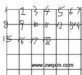

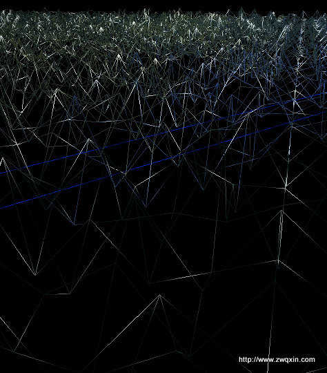

> 现代 OpenGL Core Profile 已移除 `GL_QUADS`，应改为每格两个三角形（6 个索引）。索引缓冲中三角形的顶点顺序要保持一致的环绕方向。

#### 1.8.2 多重纹理下的 VBO

多重纹理并不需要多个 VBO：所有纹理坐标打包在同一个 VBO 中即可。关键是渲染时要区分**纹理单元**与**纹理坐标数组**两套状态：

- `glActiveTexture(GL_TEXTUREi)` 选择当前纹理单元，之后 `glBindTexture` 影响该单元；
- `glClientActiveTexture(GL_TEXTUREi)`（旧式顶点数组 API）选择当前客户端纹理坐标数组；
- 现代管线中更常用 `glVertexAttribPointer` 为每个纹理坐标属性单独指定 location，再用 `sampler2D` uniform 指定纹理单元。

旧式写法（顶点数组时代）：

```cpp
glActiveTexture(GL_TEXTURE0);
glEnable(GL_TEXTURE_2D);
glBindTexture(GL_TEXTURE_2D, tex0);
glActiveTexture(GL_TEXTURE1);
glEnable(GL_TEXTURE_2D);
glBindTexture(GL_TEXTURE_2D, tex1);

glBindBuffer(GL_ARRAY_BUFFER, texcoordVBO);
glClientActiveTexture(GL_TEXTURE0);
glEnableClientState(GL_TEXTURE_COORD_ARRAY);
glTexCoordPointer(2, GL_FLOAT, 0, 0);
glClientActiveTexture(GL_TEXTURE1);
glEnableClientState(GL_TEXTURE_COORD_ARRAY);
glTexCoordPointer(2, GL_FLOAT, 0, 0);

glDrawArrays(GL_TRIANGLES, 0, vertexCount);
```

注意：`glActiveTexture` 管的是**纹理对象**，`glClientActiveTexture` 管的是**纹理坐标数组**，二者不能互相替代；`glEnable(GL_TEXTURE_2D)` 也不能省（旧管线）。

#### 1.8.3 交错数组与分离数组

- **Interleaved arrays**：把位置、颜色、法线等按顶点交错放在一个 VBO 中，减少 VBO 数量与绑定次数，但 `stride/offset` 计算更易错，且更新局部数据时可能牵动整块缓存。

```cpp
#pragma pack(push, 1)
struct SVertex
{
    GLubyte r, g, b;
    GLfloat x, y;
};
#pragma pack(pop)
```

- **Serialized arrays**：把多种属性各自成段、前后拼接进同一个 VBO，用 `glBufferSubData(target, offset, size, data)` 只更新需要变的那一段。相比交错数组更利于局部更新，是更实用的折中。

### 1.9 图元、GL_TRIANGLE_STRIP 与图元装配

#### 1.9.1 常用图元类型

`glDrawArrays`/`glDrawElements` 的 `mode`：

- `GL_POINTS`
- `GL_LINES`、`GL_LINE_STRIP`、`GL_LINE_LOOP`
- `GL_TRIANGLES`、`GL_TRIANGLE_STRIP`、`GL_TRIANGLE_FAN`
- 兼容/旧管线：`GL_QUADS`、`GL_QUAD_STRIP`、`GL_POLYGON`（Core Profile 已移除）

#### 1.9.2 `GL_TRIANGLE_STRIP`

对顶点 `V1…V6`，三角形装配为：

| 三角形 | 顶点 |
|---|---|
| T1 | V1 V2 V3 |
| T2 | V3 V2 V4 |
| T3 | V3 V4 V5 |
| T4 | V5 V4 V6 |

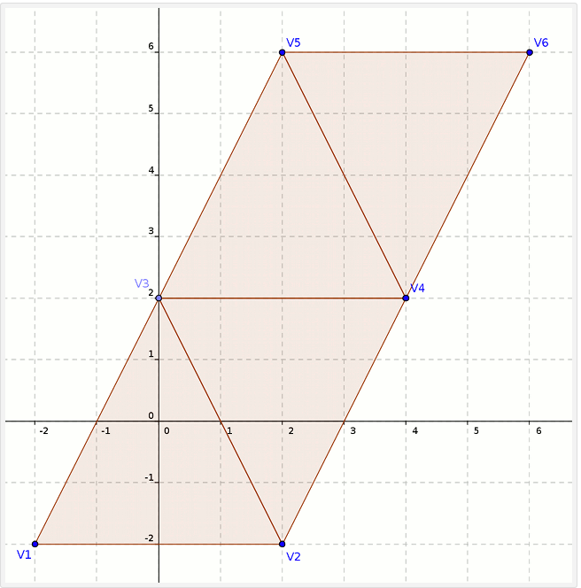

规律：第 `n` 个三角形使用顶点 `(n, n+1, n+2)`；为保证**环绕方向（winding）一致**，奇数三角形交换前两个顶点。`N` 个顶点生成 `N-2` 个三角形，比 `GL_TRIANGLES` 节省索引与顶点复用。拼接多条 strip 时可插入退化三角形（degenerate triangle）保持一次 draw call。

#### 1.9.3 图元装配

顶点着色器处理完顶点后进入图元装配：**裁剪（Clipping）→ 透视除法（Perspective Division）→ 视口变换（Viewport Transform）**。裁剪在裁剪空间进行，可能产生新顶点并插值其属性；透视除法把齐次坐标除以 `w` 得到 NDC。

### 1.10 视口与光栅化

#### 1.10.1 视口

- 视口是最终渲染结果的目的矩形区域，单位是像素。
- 视口坐标系原点在窗口客户区**左下角**，x 向右、y 向上（与 Windows 窗口坐标系相反）。
- 设置函数：

```cpp
void glViewport(GLint x, GLint y, GLsizei width, GLsizei height);
```

例如 `glViewport(100, 50, 200, 200)` 表示在客户区 `(100,50)` 处开一个 200×200 的渲染区域。初始化窗口环境时视口默认铺满整个客户区。

- 视口是 Context 的状态之一；一次渲染只能使用当前视口，但一帧内可以多次改变视口、多次渲染，拼出多视口画面（分屏、小地图）。配合 `glScissor` 可限制清除/写入区域。
- 窗口尺寸变化时应重新 `glViewport`，并用新的宽高比更新投影矩阵。

#### 1.10.2 三角形光栅化

三角形按形状分为：

1. **平顶（flat-top）**：一条水平边在顶部；
2. **平底（flat-bottom）**：一条水平边在底部；
3. **任意三角形**：可拆分为一个平顶 + 一个平底。

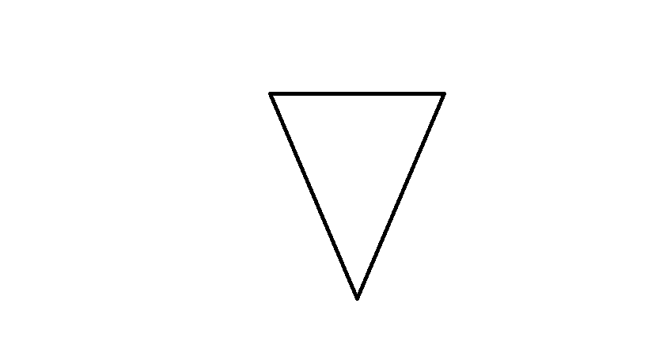

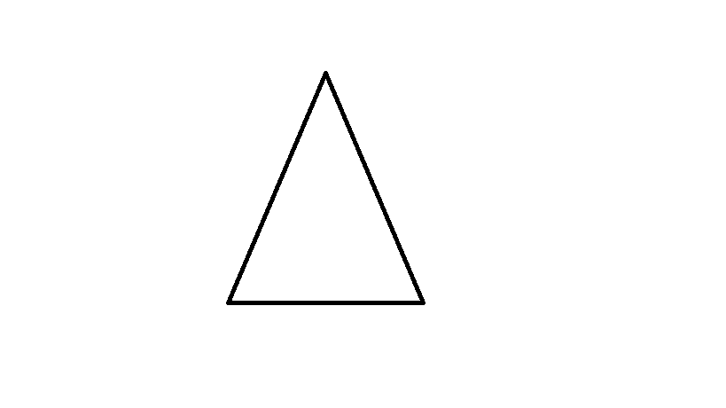

光栅化的核心是：对每条扫描线求出与三角形边的交点，填充区间；同时按重心坐标/线性插值得到深度、颜色、纹理坐标。现代 GPU 用并行的小三角形遍历硬件完成，不再逐扫描线。

### 1.11 DrawCall 与批处理

**DrawCall** 是 CPU 对底层图形绘制接口的一次调用，命令 GPU 执行一次渲染。CPU 与 GPU 并行工作，通过**命令缓冲区**连接：CPU 往队列里放命令，GPU 取出来执行。

DrawCall 多的代价主要在 CPU：每次绘制都要做准备工作——检测/切换渲染状态、提交渲染数据、提交 uniform、校验管线。GPU 计算能力很强，往往很快就处理完；DrawCall 过多时 CPU 成为瓶颈，GPU 反而闲置。

优化方向是**批处理（Batching）**：把小的 DrawCall 合并成大的 DrawCall。

1. 合并的网格在一次渲染中绘制，渲染数据、状态、shader 必须一致，因此合并条件至少是：**同材质、同贴图、同 shader**，最好顶点格式也一致。
2. 避免大量小网格；确实需要时合并。
3. 避免过多材质，尽量共享材质/纹理。
4. 合并在编辑期/离线完成，避免运行时开销。
5. 运行时必须合并时，把静态物体与动态物体分开：静态合并一次即可，动态物体一变就要重新合并。
6. 减少状态切换：按 Program/材质/纹理排序，把使用同一状态的物体排在一起。

---

## 2. 坐标与变换

### 2.1 坐标空间与变换链

一个顶点从模型到屏幕通常经历：

```
模型空间 (Object/Model)
  --Model Matrix--> 世界空间 (World)
  --View Matrix-->  相机空间 (Eye/View)
  --Projection-->   裁剪空间 (Clip)
  --透视除法 (/w)--> 规范化设备坐标 NDC
  --Viewport-->     窗口/屏幕空间 + 深度 [0,1]
```

用列向量（GLSL 习惯）表示为：

```glsl
gl_Position = P * V * M * vec4(position, 1.0);
```

**重要澄清：**

- OpenGL 的裁剪空间与 NDC 是**右手系**；NDC 中 `x,y,z ∈ [-1,1]`（不是 `[0,1]`，那是 D3D 的传统约定）。
- 透视除法后 `w` 不再参与；`gl_FragCoord.z` 是视口变换后的深度，范围 `[0,1]`。
- 变换矩阵的乘法顺序与向量约定强相关，详见 2.5。

### 2.2 投影与透视投影

#### 2.2.1 投影规范化

大多数图形系统的投影规范化由**投影变换矩阵**实现：矩阵把对象变换到四维裁剪坐标系，随后的透视除法把顶点变到三维 NDC，视口变换再把 NDC 变到窗口坐标系。

投影矩阵由**投影类型**与**视见体（view volume）**决定。

#### 2.2.2 正交投影

正投影是投影线垂直于投影平面的平行投影。`glOrtho(l, r, b, t, n, f)` 的矩阵可拆成两步理解：

1. 平移，把视见体中心移到规范视见体中心（原点）：

```
T = T( -(right+left)/2, -(top+bottom)/2, +(far+near)/2 )
```

2. 缩放，使每条边长都为 2：

```
S = S( 2/(right-left), 2/(top-bottom), -2/(far-near) )
```

关于 z：

- OpenGL 中相机看向 `-z`，近平面为 `z = -near`、远平面为 `z = -far`。
- 平移量的 z 是 `+(far+near)/2`（z 方向缩放带负号，平移项经缩放后会再翻一次号，因此不能照搬 x/y 的负号），缩放因子为 `-2/(far-near)`。
- 结果：`z=-near → -1`，`z=-far → +1`。数值校验：取 `near=1`、`far=10`，近平面得 `-1`、远平面得 `+1`。

#### 2.2.3 透视投影

透视投影分两步：

1. 用透视矩阵把顶点从视锥体变换到裁剪空间（视锥体变成 CVV，裁剪空间立方体）；
2. CVV 裁剪完成后进行**透视除法**。

两种常用设置：

```cpp
// 1) glFrustum：left/right/top/bottom 在近裁剪平面上指定
void glFrustum(GLdouble left, GLdouble right, GLdouble bottom, GLdouble top,
               GLdouble nearVal, GLdouble farVal);

// 2) 常用透视函数
mat4 perspective(GLfloat fovy, GLfloat aspect, GLfloat nearVal, GLfloat farVal);
```

- `fovy` 是**垂直视场角**（上下裁剪面的夹角），单位弧度；
- `aspect = width / height`，必须用浮点计算；
- 要求 `near > 0`、`far > near`。

标准 OpenGL 透视矩阵（列主序书写为行）：

```
[ f/aspect   0        0                    0
  0          f        0                    0
  0          0    (far+near)/(near-far)   (2*far*near)/(near-far)
  0          0       -1                    0 ]
```

其中 `f = 1 / tan(fovy/2)`。

验证符号：对相机空间中的点 `(x, y, z, 1)`（`z < 0`）：

```
z_clip = (far+near)/(near-far) * z + 2*far*near/(near-far)
w_clip = -z
```

- `z = -near`：`z_clip = -near`，`w = near` → `z_ndc = -1`；
- `z = -far`：`z_clip = far`，`w = far` → `z_ndc = +1`。

**修正原笔记的两点：**

1. 透视矩阵第 4 行是 `[0, 0, -1, 0]`，因此 `w_clip = -z_eye`，这一点正确。
2. 但“所有变换后顶点的第 4 个元素均相同”**不成立**：`w_clip = -z_eye` 随每个顶点的相机空间深度而不同，这正是透视除法能产生近大远小的原因。只有在正交投影中 `w` 才恒为 1。

`glFrustum` 规范要求 `near > 0`、`far > 0` 且 `near != far`，否则产生 `GL_INVALID_VALUE`。工程上必须保证近平面在相机前方；若把 `near` 设成 0 或负数，近平面会跑到相机背后，裁剪与深度都会异常。

### 2.3 Look_at

`LookAt` 高效地构造观察矩阵，本质是**基变换**：

1. 新标架 `new` 到旧标架 `old` 的变换为 `old = M * new`，求出 `M`；
2. `M` 的转置可把旧标架下的坐标 `a` 变到新标架：`b = transpose(M) * a`（因为 `M` 是正交旋转矩阵，逆等于转置）。

功能：生成把世界坐标系中的对象变换到相机坐标系的矩阵。构造方法：

1. 由 `U、V、N` 构造旋转矩阵；
2. 由眼点坐标构造平移矩阵。

```
        [ Ux  Uy  Uz  0 ]
        [ Vx  Vy  Vz  0 ]
look_at = [ Nx  Ny  Nz  0 ] * T(-eye)
        [  0   0   0  1 ]
```

其中（右手系、相机看向 `-Z`）：

```cpp
N = normalize(eye - center);          // 相机后方（+Z 轴）
U = normalize(cross(up, N));          // 相机右方（+X 轴）
V = cross(N, U);                      // 相机上方（+Y 轴）
```

`T(-eye)` 把眼点移到原点。用列向量时，视图矩阵为：

```
V_view = R^T * T(-eye)
```

上面给出的 `look_at` 矩阵本身就是列向量约定下的 `Rᵀ·T(-eye)`；若改用行向量约定，对它取转置即可，二者描述的是同一变换。

### 2.4 位姿矩阵（旋转平移矩阵）

位姿矩阵是若干旋转矩阵与平移矩阵的合成，用来描述物体方位，形式为：

```
[ R  t ]
[ 0  1 ]
```

按元素展开即：

$$
\begin{bmatrix}
a & d & g & x \\
b & e & h & y \\
c & f & i & z \\
0 & 0 & 0 & 1
\end{bmatrix}
$$

其中 3×3 部分 `R` 是**正交阵**（表示合旋转）：

$$
\begin{bmatrix}
a & d & g \\
b & e & h \\
c & f & i
\end{bmatrix}
$$

各行/列两两正交且模为 1，因此 `R^T R = I`，`R^{-1} = R^T`：

$$
A^{-1} = A^{T}
$$

最后一列 `t` 表示合位移：

$$
\begin{pmatrix} x & y & z & 1 \end{pmatrix}^{T}
$$

其逆矩阵非常简单：

```
[ R  t ]^{-1}   [ R^T  -R^T t ]
[ 0  1 ]     =  [  0      1   ]
```

记位姿矩阵为 `RMmat`：

$$
\text{RMmat} =
\begin{bmatrix}
a & d & g & x \\
b & e & h & y \\
c & f & i & z \\
0 & 0 & 0 & 1
\end{bmatrix}
$$

则其逆矩阵为：

$$
\text{RMmat}^{-1} =
\begin{bmatrix}
a & b & c & -xa-yb-zc \\
d & e & f & -xd-ye-zf \\
g & h & i & -xg-yh-zi \\
0 & 0 & 0 & 1
\end{bmatrix}
$$

直接求逆计算量大，利用正交性可显著优化图形程序。位姿矩阵是“先旋转、再平移”的复合 `M = T(t)·R`，其逆可以写成一行：

$$
M^{-1} = R^{T}\cdot T(-t)
$$

注意 `T` 与 `R` 不可交换，不能写成 `T·R^{-1}`。逐项展开：

$$
=
\begin{bmatrix}
a & d & g & 0 \\
b & e & h & 0 \\
c & f & i & 0 \\
0 & 0 & 0 & 1
\end{bmatrix}^{-1}
\cdot
\begin{bmatrix}
1 & 0 & 0 & x \\
0 & 1 & 0 & y \\
0 & 0 & 1 & z \\
0 & 0 & 0 & 1
\end{bmatrix}^{-1}
$$

$$
=
\begin{bmatrix}
a & d & g & 0 \\
b & e & h & 0 \\
c & f & i & 0 \\
0 & 0 & 0 & 1
\end{bmatrix}^{T}
\cdot
\begin{bmatrix}
1 & 0 & 0 & x \\
0 & 1 & 0 & y \\
0 & 0 & 1 & z \\
0 & 0 & 0 & 1
\end{bmatrix}^{-1}
\quad\left(\text{因为 }
\begin{bmatrix}
a & d & g \\
b & e & h \\
c & f & i
\end{bmatrix}
\text{ 是正交阵}\right)
$$

$$
=
\begin{bmatrix}
a & b & c & 0 \\
d & e & f & 0 \\
g & h & i & 0 \\
0 & 0 & 0 & 1
\end{bmatrix}
\cdot
\begin{bmatrix}
1 & 0 & 0 & -x \\
0 & 1 & 0 & -y \\
0 & 0 & 1 & -z \\
0 & 0 & 0 & 1
\end{bmatrix}
$$

$$
=
\begin{bmatrix}
a & b & c & -xa-yb-zc \\
d & e & f & -xd-ye-zf \\
g & h & i & -xg-yh-zi \\
0 & 0 & 0 & 1
\end{bmatrix}
$$

### 2.5 行向量与列向量

#### 2.5.1 两种约定

- **行向量约定**：向量在左，矩阵在右，`v' = v * M`；复合变换写作 `v * M * V * P`（先模型、再视图、再投影）。
- **列向量约定**：矩阵在左，向量在右，`v' = M * v`；复合变换写作 `P * V * M * v`。GLSL 采用这一约定。

两种写法描述的变换相同，只是矩阵互为转置、乘法顺序相反。

#### 2.5.2 内存布局与上传

- C/C++ 二维数组 `m[row][col]` 第一个下标是行、第二个是列，默认**行主序**。
- OpenGL/GLSL 的矩阵按**列主序**解释连续内存。
- 把行主序数组直接传给 `glUniformMatrix4fv`，若 `transpose = GL_FALSE`，GPU 会把第 0 行当作第 0 列，数学上相当于用了转置矩阵；若 `transpose = GL_TRUE`，驱动先转置再上传，GPU 得到与 CPU 相同的数学矩阵。
- OSG 的 `Matrix` 元素按行排列（`SET_ROW` 字面上设置行），但 OSG 采用**行向量**约定，顶点计算是 `v * M * V * P`。把它按原内存直接上传（`transpose = GL_FALSE`）时，GPU 把第 0 行解释为第 0 列，得到的正是 `M` 的转置，而 `Mᵀ` 恰好就是 GLSL 列向量写法 `P * V * M * v` 所需要的矩阵（与 `osg::Uniform` 内部的处理一致）；若上传时 `transpose = GL_TRUE`，矩阵会再被转置一次，结果反而错误。

```cpp
value_type _mat[4][4];

#define SET_ROW(row, v1, v2, v3, v4) \
    _mat[(row)][0] = (v1);           \
    _mat[(row)][1] = (v2);           \
    _mat[(row)][2] = (v3);           \
    _mat[(row)][3] = (v4);

#define INNER_PRODUCT(a, b, r, c)          \
    ((a)._mat[r][0] * (b)._mat[0][c]) +    \
    ((a)._mat[r][1] * (b)._mat[1][c]) +    \
    ((a)._mat[r][2] * (b)._mat[2][c]) +    \
    ((a)._mat[r][3] * (b)._mat[3][c])

void Matrix_implementation::makeTranslate(value_type x, value_type y, value_type z)
{
    SET_ROW(0, 1, 0, 0, 0)
    SET_ROW(1, 0, 1, 0, 0)
    SET_ROW(2, 0, 0, 1, 0)
    SET_ROW(3, x, y, z, 1)   // 行向量约定：平移在最后一行
}
```

记忆方式：**列主序就是“按列操作”**——不管内存里怎么排，读写都以列为单位。

### 2.6 左手系与右手系

1. 左手系与右手系的区别在于第三个坐标轴的指向：右手系 `+Z` 指向屏幕外（朝向观察者），左手系 `+Z` 指向屏幕内。
2. 叉乘方向也随之相反；左手系用左手定则，右手系用右手定则。OpenGL 使用右手系，正面默认按**逆时针（CCW）**环绕判定。

### 2.7 视口变换

视口变换把 NDC 映射到窗口坐标：

```
x_w = (x_ndc + 1) * width/2  + x0
y_w = (y_ndc + 1) * height/2 + y0
z_w = (z_ndc + 1) * (f - n)/2 + n      // 默认 n=0, f=1
```

其中 `(x0, y0, width, height)` 来自 `glViewport`，`n/f` 来自 `glDepthRange`。视口变换后 `z_w` 即写入深度缓冲的值，因此深度范围默认是 `[0,1]`，且**非线性**（见 5.2）。

### 2.8 法线变换

开启光照时，法线决定顶点/表面接收多少光。光照在**相机空间**进行，因此物体空间法线也要用 `GL_MODELVIEW` 变换到相机空间。但法线**不能**像顶点那样直接乘 `GL_MODELVIEW`：

考虑顶点 `(0,0,0)`、法线 `(1,0,0)`，若模型矩阵只是沿 Y 平移 2，顶点变为 `(0,2,0)`，法线应仍为 `(1,0,0)`，而不是 `(1,2,0)`。

把法线看作平面方程的系数（平面方程的 `n` 与平面垂直）：

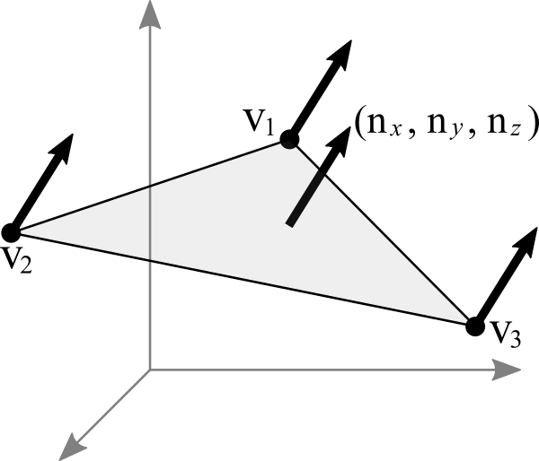

三角形 `v1-v2-v3` 的齐次平面法线为：

$$\vec{n} = (n_x, n_y, n_z, n_w)$$

欧氏空间中的法线为：

$$(n_x, n_y, n_z)$$

平面方程：

$$\vec{n}\cdot\vec{v} = 0$$

$$(n_x, n_y, n_z, n_w)\cdot(x, y, z, w) = 0$$

$$n_x x + n_y y + n_z z + n_w w = 0$$

顶点满足平面方程：

$$v_1 = (x_1, y_1, z_1, w_1)$$

$$n_x x_1 + n_y y_1 + n_z z_1 + n_w w_1 = 0$$

矩阵形式：

$$
\begin{pmatrix} n_x & n_y & n_z & n_w \end{pmatrix}
\begin{pmatrix} x \\ y \\ z \\ w \end{pmatrix}
= 0
$$

在中间插入 `M^{-1}M`：

$$
\underbrace{
\begin{pmatrix} n_x & n_y & n_z & n_w \end{pmatrix} M^{-1}
}_{\text{normal transform}}
\underbrace{
M \begin{pmatrix} x \\ y \\ z \\ w \end{pmatrix}
}_{\text{vertex transform}}
= 0
$$

右半部分是顶点变换到相机空间，左半部分就是相机空间法线：

$$Mv \qquad\text{与}\qquad n^{T}M^{-1}$$

因此物体空间到相机空间的法线变换为：

$$
\begin{pmatrix} nx_{eye} \\ ny_{eye} \\ nz_{eye} \\ nw_{eye} \end{pmatrix}
=
\begin{pmatrix} nx_{obj} & ny_{obj} & nz_{obj} & nw_{obj} \end{pmatrix} M^{-1}
$$

即 **ModelView 矩阵左上 3×3 的逆转置**：

```glsl
normal_eye = normalize(mat3(transpose(inverse(modelView))) * normal_object);
```

GLSL 兼容管线提供 `gl_NormalMatrix`，即该逆转置矩阵：

```glsl
norm = normalize(gl_NormalMatrix * gl_Normal);
```

等价的转置写法：

$$
\begin{pmatrix} nx_{eye} \\ ny_{eye} \\ nz_{eye} \\ nw_{eye} \end{pmatrix}
=
\left(M^{-1}\right)^{T}
\begin{pmatrix} nx_{obj} \\ ny_{obj} \\ nz_{obj} \\ nw_{obj} \end{pmatrix}
$$

> 若矩阵只含旋转与统一缩放，法线可直接用旋转部分变换后再归一化；含非统一缩放时必须用逆转置，否则法线会不再垂直于表面。

### 2.9 纹理倾斜：行对齐导致的图像错位

用 OpenGL 绘制某些纹理时，图片会出现“不可描述的倾斜/错位”。

原图：

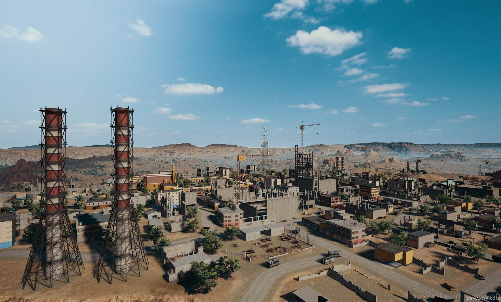

绘制结果：

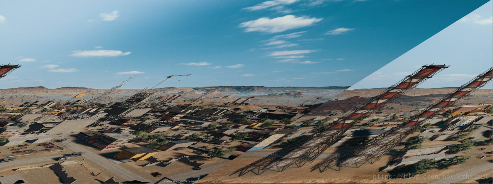

原因不是纹理坐标，而是**像素行对齐**：`glPixelStorei(GL_UNPACK_ALIGNMENT, ...)` 默认值是 **4**，即每读取完一行像素后，读指针要跳到下一个 4 字节边界。若图像每行字节数不是 4 的倍数（例如 3 通道 RGB、宽度不是 4 的倍数），行首就会错位，图像逐行偏移，看起来像倾斜。

解决办法：把解包对齐设为 1，表示紧密排列、不做行尾填充：

```cpp
glPixelStorei(GL_UNPACK_ALIGNMENT, 1);
```

> 修正原笔记的表述：并不是“OpenGL 要求纹理大小必须是 4 字节的倍数”，而是**默认要求每行起始地址 4 字节对齐**。把 `GL_UNPACK_ALIGNMENT` 设为 1/2/4/8 即可匹配数据布局。上传到 FBO 等 `GL_PACK_ALIGNMENT` 场景同理。

---
## 3. 纹理与帧缓冲

### 3.1 glTexImage2D

```cpp
void glTexImage2D(GLenum target, GLint level, GLint internalformat,
                  GLsizei width, GLsizei height, GLint border,
                  GLenum format, GLenum type, const GLvoid *data);
```

| 参数 | 含义 |
|---|---|
| `target` | `GL_TEXTURE_2D`，或立方体贴图的六个面 `GL_TEXTURE_CUBE_MAP_POSITIVE_X/NEGATIVE_X/POSITIVE_Y/NEGATIVE_Y/POSITIVE_Z/NEGATIVE_Z` |
| `level` | mipmap 层级。0 为基本图像，第 n 级是第 n 个缩小图 |
| `internalformat` | 纹理在 OpenGL 内部如何存储（分量构成、精度），如 `GL_RGB`、`GL_RGBA`、`GL_RGBA8`、`GL_SRGB8_ALPHA8`、`GL_DEPTH_COMPONENT24` |
| `width` / `height` | 纹理像素尺寸。规范保证至少支持 64×64 的 2D 纹理、16×16 的立方体面 |
| `border` | 边框宽度。OpenGL ES 必须为 0；桌面 GL 传统上允许 0 或 1，现代实践一律用 0 |
| `format` | **外部数据**的像素格式，如 `GL_RGB`、`GL_RGBA`、`GL_BGRA`、`GL_LUMINANCE`、`GL_DEPTH_COMPONENT` |
| `type` | 外部数据的元素类型，如 `GL_UNSIGNED_BYTE`、`GL_FLOAT`、`GL_UNSIGNED_SHORT_5_6_5` |
| `data` | 指向图像数据的指针；可为 `NULL`，此时只分配纹理存储，稍后用 `glTexSubImage2D` 填充（未初始化部分被采样时结果未定义） |

**`internalformat` 与 `format` 的区别（修正原笔记）：**

- `internalformat` 描述纹理在 GPU 内部如何表示（有哪些分量、多少位、是否 sRGB/压缩）。
- `format` 描述你传入的内存数据如何排列（红绿蓝各分量在内存中的顺序）。
- 在 **OpenGL ES 2.0** 中，规范要求 `format` 必须与 `internalformat` 一致，且不支持格式转换；`GL_BGRA` 也不是 ES2 核心格式（需要 `EXT_texture_format_BGRA8888`，iOS 设备通常支持该扩展）。
- 在**桌面 OpenGL** 中二者**不必相同**：`internalformat` 可以用带尺寸的格式（`GL_RGBA8`、`GL_SRGB8_ALPHA8`），`format` 仍为 `GL_RGBA`，驱动会做转换；`GL_BGRA` 是桌面 GL 的合法 `format`。
- 因此“必须一致”只适用于 ES2 的受限语境，不能当作通用规则。

**像素行对齐**（与 2.9 同一个坑）：

从 `data` 读取 `width × height` 个纹素时，默认每读完一行，读指针会前进到下一个 **4 字节边界**。这个对齐由 `glPixelStorei(GL_UNPACK_ALIGNMENT, n)` 控制，`n` 可为 1/2/4/8，默认 4。若一行字节数不是 4 的倍数，必须设为 1：

```cpp
glPixelStorei(GL_UNPACK_ALIGNMENT, 1);
glTexImage2D(GL_TEXTURE_2D, 0, GL_RGB, w, h, 0, GL_RGB, GL_UNSIGNED_BYTE, pixels);
```

**大纹理/异步上传**：可用 PBO（`GL_PIXEL_UNPACK_BUFFER`）把像素数据先传到显存，再让 `glTexImage2D` 的 `data` 作为 PBO 偏移，避免阻塞（本文不展开）。

**创建带 mipmap 的纹理：**

```cpp
GLuint tex;
glGenTextures(1, &tex);
glBindTexture(GL_TEXTURE_2D, tex);
glTexParameteri(GL_TEXTURE_2D, GL_TEXTURE_MAG_FILTER, GL_LINEAR);
glTexParameteri(GL_TEXTURE_2D, GL_TEXTURE_MIN_FILTER, GL_LINEAR_MIPMAP_LINEAR);
glTexParameteri(GL_TEXTURE_2D, GL_TEXTURE_WRAP_S, GL_CLAMP_TO_EDGE);
glTexParameteri(GL_TEXTURE_2D, GL_TEXTURE_WRAP_T, GL_CLAMP_TO_EDGE);
glTexImage2D(GL_TEXTURE_2D, 0, GL_RGBA, width, height, 0,
             GL_RGBA, GL_UNSIGNED_BYTE, data);
glGenerateMipmap(GL_TEXTURE_2D);   // OpenGL 3.0+；2.1 可用 gluBuild2DMipmaps
glBindTexture(GL_TEXTURE_2D, 0);
```

若 `MIN_FILTER` 使用 mipmap 过滤却没有生成完整 mipmap 链，纹理被视为**不完整**，采样结果通常是黑色——这是“纹理全黑”的经典原因。

### 3.2 纹理过滤与各向异性

- `GL_TEXTURE_MAG_FILTER`：放大过滤，常用 `GL_LINEAR` / `GL_NEAREST`。
- `GL_TEXTURE_MIN_FILTER`：缩小过滤，可选 `GL_NEAREST`、`GL_LINEAR`、`GL_NEAREST_MIPMAP_NEAREST`、`GL_LINEAR_MIPMAP_NEAREST`、`GL_NEAREST_MIPMAP_LINEAR`、`GL_LINEAR_MIPMAP_LINEAR`。
- `GL_TEXTURE_WRAP_S/T`：`GL_REPEAT`、`GL_CLAMP_TO_EDGE`、`GL_CLAMP_TO_BORDER`、`GL_MIRRORED_REPEAT`。

**各向异性过滤（`EXT_texture_filter_anisotropic`）**

普通 mipmap 过滤假设像素滤波器在纹理空间的投影足迹是**正方形（各向同性）**。但斜视表面上的足迹往往是长条形（各向异性），此时 mipmap 会严重模糊。

该扩展允许应用按纹理对象指定最大各向异性度：

```cpp
glTexParameterf(GL_TEXTURE_2D, GL_TEXTURE_MAX_ANISOTROPY_EXT, 8.0f);
GLfloat maxAniso;
glGetFloatv(GL_MAX_TEXTURE_MAX_ANISOTROPY_EXT, &maxAniso);
```

- `TEXTURE_MAX_ANISOTROPY_EXT` 合法值 ≥ 1.0，默认 1.0；小于 1.0 产生 `GL_INVALID_VALUE`。
- 驱动可把请求值钳制到 `MAX_TEXTURE_MAX_ANISOTROPY_EXT`（规范要求至少 2.0）。
- 它与 min/mag 过滤模式**正交**：先按 min/mag 选择采样方案，再由各向异性度决定在足迹内取多少个样本。
- 实现思路（规范给出的一种）：

```
Px = sqrt((du/dx)^2 + (dv/dx)^2)
Py = sqrt((du/dy)^2 + (dv/dy)^2)
Pmax = max(Px, Py), Pmin = min(Px, Py)
N = min(ceil(Pmax / Pmin), maxAniso)
lambda' = log2(Pmax / N)
```

然后在 LOD `lambda'` 上沿长轴取 `N` 个样本求平均。

- 追求最高质量时建议：`MIN_FILTER = GL_LINEAR_MIPMAP_LINEAR`、`MAG_FILTER = GL_LINEAR`、较大的各向异性度。
- 支持 sampler object 的实现中，sampler 的同名状态会覆盖 texture 上的设置。

### 3.3 2 的 n 次方（NPOT）限制

老式 OpenGL（2.0 以前）与 OpenGL ES 1.x 要求纹理宽高为 2 的幂。桌面 OpenGL 2.0 起把 `ARB_texture_non_power_of_two` 纳入核心，规范上支持完整的 NPOT（含 mipmap 与 `GL_REPEAT`），但早期驱动可能实现不完整。**OpenGL ES 2.0 仍限制 NPOT**：不能生成 mipmap、wrap 只能用 `GL_CLAMP_TO_EDGE`；OpenGL ES 3.0 起才完整支持。

兼容老环境的做法是把图像**填充（pad）到 2 的幂**，再用缩放后的纹理坐标采样：

```cpp
inline int next_p2(int a)
{
    int rval = 1;
    while (rval < a) rval <<= 1;
    return rval;
}

int w2 = next_p2(tex.width);
int h2 = next_p2(tex.height);

if (tex.width == w2 && tex.height == h2) {
    glTexImage2D(GL_TEXTURE_2D, 0, GL_RGBA, w2, h2, 0,
                 format, GL_UNSIGNED_BYTE, data);
    tex.scaleX = tex.scaleY = 1.0f;
} else {
    // 先分配放大后的空纹理，再把原图写进左上角
    glTexImage2D(GL_TEXTURE_2D, 0, GL_RGBA, w2, h2, 0,
                 format, GL_UNSIGNED_BYTE, NULL);
    glTexSubImage2D(GL_TEXTURE_2D, 0, 0, 0, tex.width, tex.height,
                    format, GL_UNSIGNED_BYTE, data);
    tex.scaleX = (float)tex.width  / (float)w2;
    tex.scaleY = (float)tex.height / (float)h2;
}
```

渲染时把纹理坐标乘以 `scaleX/scaleY`，只采样有效区域。注意 `glTexSubImage2D` 同样受 `GL_UNPACK_ALIGNMENT` 影响；填充区的像素内容是未定义的，必须靠坐标缩放避开。

### 3.4 Cubemap 实现方式

立方体贴图用六张面组成天空盒/环境贴图。六个 target 与空间方向的对应关系如下：

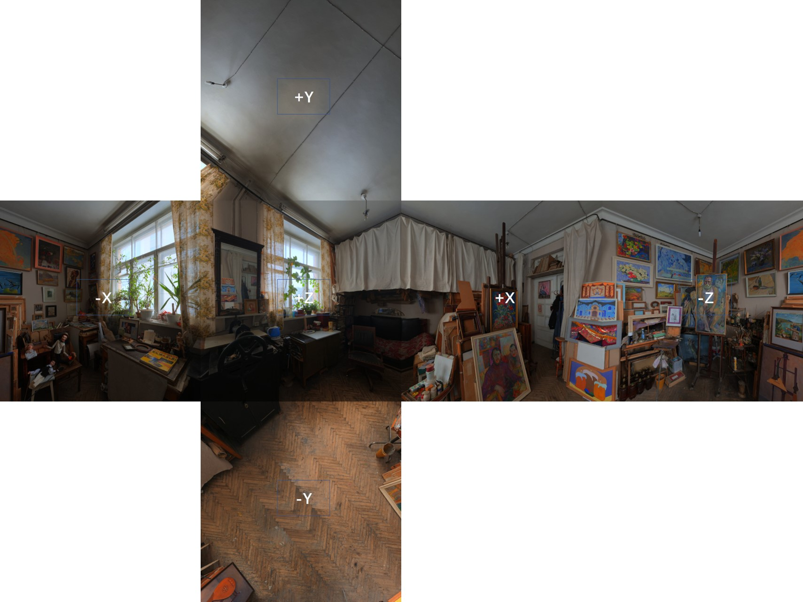

> 不要用 left/right/top 之类的说法——没有统一参考系，极易混淆；直接用 `+X/-X/+Y/-Y/+Z/-Z`。

关键事实：

- 从**立方体外部**看，六个面的图像都是正常的；从**内部**环视，每个面在水平方向（纹理 `u`）被镜像翻转。
- 二维图像载入内存时原点在**左上角**：

```cpp
int idx = r * texture->width + c;
texture->buffer[idx];
// [0,0] 对应左上角
```

- 单个面的纹理坐标：`u` 从 0 到 1 为左→右，`v` 从 0 到 1 为上→下；UV 的增长方向应以**从立方体外部观察**为准。
- 采样方向向量 `(x, y, z)` 的每个分量范围是 `[-1, 1]`。

以常见约定（相机在盒内，`+Z` 朝观察者）为例：

**-Z 面**（从内部正对它）：

- `x` 从 -1 到 1，站在中心看是左→右；从外部看则是右→左，故 `u` 需取反（1→0）；
- `y` 从 -1 到 1，图中从下到上，外部看也是从下到上，与纹理 `v`（上→下）相反，故 `y` 需取反。

**+Z 面**：

- `x` 从 -1 到 1，站在中心看是右→左；从外部看是左→右，符合 `u` 的增长方向，不需取反；
- `y` 从 -1 到 1 从下到上，与 `v` 相反，`v` 需取反。


内部视角的镜像效果：

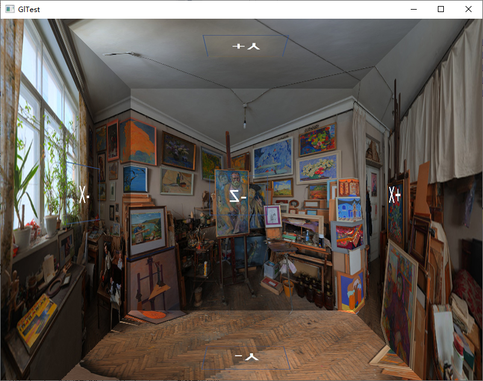

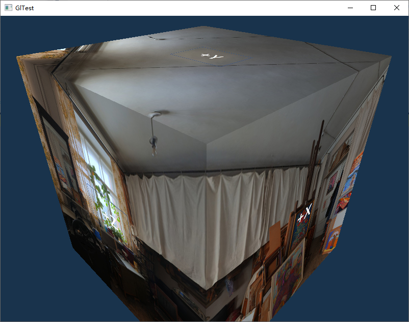

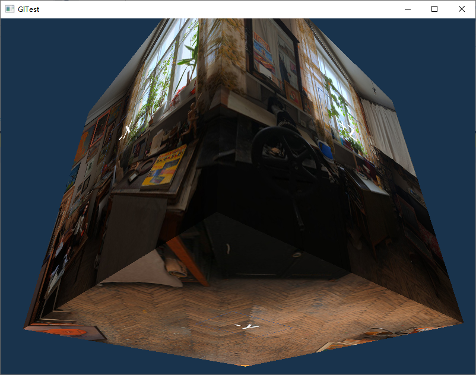

实现要点：

1. 纹理 target 用 `GL_TEXTURE_CUBE_MAP`，六个面分别用 `glTexImage2D(GL_TEXTURE_CUBE_MAP_POSITIVE_X + i, ...)` 上传；
2. 六个面必须是**正方形**且尺寸一致；
3. `WRAP_S/WRAP_T` 设为 `GL_CLAMP_TO_EDGE`，否则接缝处会出现边缘色带；
4. 天空盒绘制时关闭深度写入（`glDepthMask(GL_FALSE)`）或使用 `GL_LEQUAL`，并让天空盒始终以相机为中心；
5. 采样时用世界空间方向向量（或反射向量）访问 `samplerCube`。

### 3.5 帧缓冲对象 FBO

#### 3.5.1 概念

管线最终渲染目的地是**帧缓冲（Framebuffer）**：颜色、深度、模板（以及历史上的累积）缓存的集合。默认帧缓冲由窗口系统创建和管理，ID 为 0。

`GL_ARB_framebuffer_object`（GL 3.0 核心）允许创建**非显示的应用帧缓冲对象（FBO）**，把输出重定向到程序控制的存储。FBO 本身**没有任何图像存储区**，只有一组**关联点（attachment points）**：

- 多个颜色关联点：`GL_COLOR_ATTACHMENT0 … GL_COLOR_ATTACHMENTn`（数量由 `GL_MAX_COLOR_ATTACHMENTS` 查询）；
- 一个深度关联点：`GL_DEPTH_ATTACHMENT`；
- 一个模板关联点：`GL_STENCIL_ATTACHMENT`（也可用打包的 `GL_DEPTH_STENCIL_ATTACHMENT`）。

可关联的图像有两类：

- **纹理图像（texture image）** → “渲染到纹理”（render to texture）；
- **渲染缓冲图像（renderbuffer image）** → 离线渲染，不能直接采样，适合深度/模板。

多个 FBO 可以共享同一张纹理；切换关联图像比切换 FBO 更快。多个颜色关联点同时输出即 **MRT（Multiple Render Targets）**。

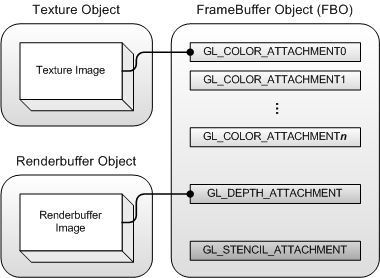

#### 3.5.2 创建与绑定

```cpp
void glGenFramebuffers(GLsizei n, GLuint *ids);
void glDeleteFramebuffers(GLsizei n, const GLuint *ids);
void glBindFramebuffer(GLenum target, GLuint id);   // target = GL_FRAMEBUFFER
```

绑定后所有会影响帧缓冲的操作都作用于当前 FBO；绑定 0 恢复默认帧缓冲。

#### 3.5.3 Renderbuffer

```cpp
void glGenRenderbuffers(GLsizei n, GLuint *ids);
void glBindRenderbuffer(GLenum target, GLuint id);      // target = GL_RENDERBUFFER
void glRenderbufferStorage(GLenum target, GLenum internalFormat,
                           GLsizei width, GLsizei height);
void glGetRenderbufferParameteriv(GLenum target, GLenum param, GLint *value);
```

新建的 renderbuffer 没有存储区，必须 `glRenderbufferStorage` 分配。`internalFormat` 可以是颜色格式（`GL_RGB`、`GL_RGBA`）、深度格式（`GL_DEPTH_COMPONENT`、`GL_DEPTH_COMPONENT24`）或模板格式（`GL_STENCIL_INDEX8`）。宽高不能超过 `GL_MAX_RENDERBUFFER_SIZE`，否则 `GL_INVALID_VALUE`。

可查询参数：`GL_RENDERBUFFER_WIDTH/HEIGHT/INTERNAL_FORMAT/RED_SIZE/GREEN_SIZE/BLUE_SIZE/ALPHA_SIZE/DEPTH_SIZE/STENCIL_SIZE`。

#### 3.5.4 关联图像

```cpp
void glFramebufferTexture2D(GLenum target, GLenum attachment,
                            GLenum textureTarget, GLuint textureId, GLint level);

void glFramebufferRenderbuffer(GLenum target, GLenum attachment,
                               GLenum renderbufferTarget, GLuint renderbufferId);
```

- `attachment` 为 `GL_COLOR_ATTACHMENTi`、`GL_DEPTH_ATTACHMENT`、`GL_STENCIL_ATTACHMENT`。
- `textureId = 0` 表示把纹理从该关联点分离；纹理在仍关联时被删除会自动从**当前绑定的** FBO 分离。
- `level` 是要关联的 mipmap 层级，通常为 0。

#### 3.5.5 完整性检查

```cpp
GLenum status = glCheckFramebufferStatus(GL_FRAMEBUFFER);
if (status != GL_FRAMEBUFFER_COMPLETE) { /* 处理错误 */ }
```

不完整时任何绘制命令都会失败。完整性准则：

1. 关联图像的宽高必须非零；
2. 颜色关联点的图像必须有可渲染的颜色格式；
3. 深度关联点的图像必须有可渲染的深度格式；
4. 模板关联点的图像必须有可渲染的模板格式；
5. FBO 至少关联一幅图像；
6. 所有关联图像必须有相同的宽高；
7. 所有颜色关联图像必须有相同的内部格式。

即使全部满足，驱动也可能不支持某些格式组合，此时返回 `GL_FRAMEBUFFER_UNSUPPORTED`。

#### 3.5.6 渲染到纹理完整示例

```cpp
// 颜色纹理
GLuint colorTex;
glGenTextures(1, &colorTex);
glBindTexture(GL_TEXTURE_2D, colorTex);
glTexParameteri(GL_TEXTURE_2D, GL_TEXTURE_MIN_FILTER, GL_LINEAR);
glTexParameteri(GL_TEXTURE_2D, GL_TEXTURE_MAG_FILTER, GL_LINEAR);
glTexParameteri(GL_TEXTURE_2D, GL_TEXTURE_WRAP_S, GL_CLAMP_TO_EDGE);
glTexParameteri(GL_TEXTURE_2D, GL_TEXTURE_WRAP_T, GL_CLAMP_TO_EDGE);
glTexImage2D(GL_TEXTURE_2D, 0, GL_RGBA8, fboWidth, fboHeight, 0,
             GL_RGBA, GL_UNSIGNED_BYTE, NULL);
glBindTexture(GL_TEXTURE_2D, 0);

// 深度 renderbuffer
GLuint rbo;
glGenRenderbuffers(1, &rbo);
glBindRenderbuffer(GL_RENDERBUFFER, rbo);
glRenderbufferStorage(GL_RENDERBUFFER, GL_DEPTH_COMPONENT24, fboWidth, fboHeight);
glBindRenderbuffer(GL_RENDERBUFFER, 0);

// FBO 与关联
GLuint fbo;
glGenFramebuffers(1, &fbo);
glBindFramebuffer(GL_FRAMEBUFFER, fbo);
glFramebufferTexture2D(GL_FRAMEBUFFER, GL_COLOR_ATTACHMENT0,
                       GL_TEXTURE_2D, colorTex, 0);
glFramebufferRenderbuffer(GL_FRAMEBUFFER, GL_DEPTH_ATTACHMENT,
                          GL_RENDERBUFFER, rbo);

if (glCheckFramebufferStatus(GL_FRAMEBUFFER) != GL_FRAMEBUFFER_COMPLETE)
    /* 错误处理 */;

glBindFramebuffer(GL_FRAMEBUFFER, 0);
```

渲染：

```cpp
glBindFramebuffer(GL_FRAMEBUFFER, fbo);
glViewport(0, 0, fboWidth, fboHeight);
glClear(GL_COLOR_BUFFER_BIT | GL_DEPTH_BUFFER_BIT);
drawScene();
glBindFramebuffer(GL_FRAMEBUFFER, 0);

// FBO 不会触发自动 mipmap，需要显式生成
glBindTexture(GL_TEXTURE_2D, colorTex);
glGenerateMipmap(GL_TEXTURE_2D);
glBindTexture(GL_TEXTURE_2D, 0);
```

要点：

- FBO 中的深度测试需要深度关联图像；缺深度附件时深度测试结果不正确（或直接被禁用）。
- 需要模板测试时还要关联模板图像。
- `GL_GENERATE_MIPMAP` 只对 `glTex{Sub}Image2D`/`glCopyTex{Sub}Image2D` 生效；FBO 渲染不会触发，必须手动 `glGenerateMipmap`。
- 相比“渲染到默认帧缓冲再 `glCopyTexSubImage2D` 拷到纹理”，FBO 省掉一次拷贝，而且可以渲染到**比窗口更大**的纹理（传统方式会被窗口尺寸裁剪）。
- 记得渲染前用 `glViewport(0,0,fboWidth,fboHeight)`，切回默认帧缓冲后恢复窗口视口。

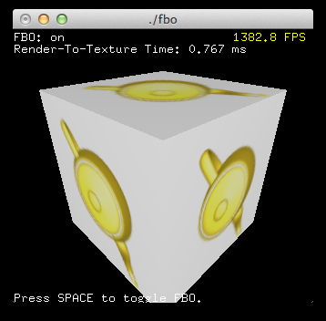

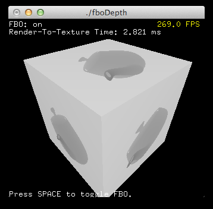

---

## 4. 拾取与查询

### 4.1 两种拾取思路

**射线检测（ray picking）**：鼠标点击屏幕一点时，从相机位置过该点发射一条射线，穿入世界空间，与场景做线-面相交测试；命中即选中该面所属物体。

- 优点：与图形 API 无关，实现成本低，不依赖渲染管线。
- 缺点：场景物体多时要与所有物体求交；模型三角形多时逐个面求交代价高。工程上通常改为**射线与包围盒（AABB/OBB）**求交，再对候选做精确三角形测试。

**OpenGL 内置拾取**：利用固定管线“视截体裁剪”的能力，把鼠标附近一个小矩形作为新的近平面，形成一个很窄的视锥，只有落在其中的图元才会产生 hit 记录。它不是射线检测，而是“用一个小视锥去裁”。

> 注意：`GL_SELECT` 渲染模式、名字栈、`gluPickMatrix` 都属于**已废弃的固定功能/GLU 特性**，在 Core Profile 与 OpenGL ES 中不可用。现代项目应使用射线拾取或颜色拾取（见 4.4）。下面保留它是因为它是理解“用裁剪做拾取”的经典范例。

### 4.2 名字栈与选择缓冲

OpenGL 用 **Name（名字）** 唯一标识可拾取物体。Name 本质就是 ID，可以是任意 `GLuint`。

相关函数（仅在选择模式有意义）：

```cpp
void glInitNames(void);              // 清空名字栈
void glPushName(GLuint name);        // 压入名字
void glPopName(void);                // 弹出名字
void glLoadName(GLuint name);        // 替换栈顶：等价于 glPopName(); glPushName(name);
```

选择缓冲用于接收 **Hit Record（击中记录）**：

```cpp
void glSelectBuffer(GLsizei size, GLuint *buffer);
```

`buffer` 由应用分配，`size` 是 `GLuint` 的个数。Hit Record 的结构：

| 位置 | 内容 |
|---|---|
| 0 | 本次击中涉及的 name 数量 `k` |
| 1 | 该物体在视锥内最近点的深度值 |
| 2 | 该物体在视锥内最远点的深度值 |
| 3 … 3+k-1 | `k` 个名字（按名字栈自底向上） |

- 深度值是 Z-buffer 深度乘以 `2^32 - 1` 后取整；由于深度非线性，这些值也不线性（其倒数线性）。
- 深度针对的是**视锥体裁剪后**物体的最近/最远点，不一定是完整物体在世界空间中的最近/最远点。
- 若某物体没有压入名字（例如“墙”只用于挡住射线），则产生 `k = 0` 的三项记录。这样后续可以判断“射线先撞到了无名遮挡物”。
- 一次点击可能产生多条 Hit Record，按渲染顺序依次写入。选择缓冲大小要按“最大可能命中数 × 每条记录长度”估算。

典型用法（`RenderObjects` 中按物体压栈）：

```cpp
glPushName(OBJECT1);
RenderObject1();
glPopName();

glPushName(OBJECT2);
RenderObject2();
glPopName();
```

名字栈只在对应物体的顶点进入流水线的那一刹那起指涉作用；随后处理下一个物体时要换成下一个名字。

### 4.3 拾取矩阵与完整流程

真正生成“小视锥”的是投影矩阵。`gluPickMatrix` 在原有投影矩阵基础上再做一次裁剪：

```cpp
void gluPickMatrix(GLdouble x, GLdouble y, GLdouble width, GLdouble height,
                   GLint viewport[4]);
```

- `(x, y)`：鼠标在 OpenGL 视口坐标系（左下角原点）中的位置；
- `width/height`：容差矩形（pick box）的像素尺寸。容差越大越容易选中，越小越需要精确点击；
- `viewport`：当前视口，`glGetIntegerv(GL_VIEWPORT, viewport)` 获得。

Windows 鼠标坐标原点在左上角，需转换：`y_gl = viewport[3] - mouse.y`（更严格地说应使用窗口客户区高度；视口通常铺满客户区）。

完整选择流程：

```cpp
void OnLButtonDown(int mouseX, int mouseY)
{
    GLuint selectBuf[512];
    GLint viewport[4];

    glSelectBuffer(512, selectBuf);
    glGetIntegerv(GL_VIEWPORT, viewport);

    glRenderMode(GL_SELECT);
    glInitNames();

    glMatrixMode(GL_PROJECTION);
    glPushMatrix();
        glLoadIdentity();
        gluPickMatrix((GLdouble)mouseX,
                      (GLdouble)(viewport[3] - mouseY),
                      10, 10, viewport);
        gluPerspective(fov, (float)winWidth / (float)winHeight, nearZ, farZ);

        glMatrixMode(GL_MODELVIEW);
        // 注意：不要 glLoadIdentity()，要保留相机视图矩阵
        camera.Look();

        // 绘制所有候选物体，每个物体前后 push/pop name
        RenderObjects(/*selectMode=*/true);

    glMatrixMode(GL_PROJECTION);   // 压栈的是投影栈，必须切回投影模式再弹出
    glPopMatrix();
    glMatrixMode(GL_MODELVIEW);    // 之后还要正常绘制，切回模型视图栈

    GLint hits = glRenderMode(GL_RENDER);   // 返回命中数，同时恢复渲染模式
    // 解析 selectBuf ...
}
```

要点：

1. `glRenderMode(GL_SELECT)` 之后名字栈才生效；结束后必须切回 `GL_RENDER`。
2. 投影矩阵要 `glPushMatrix` 保存，选择结束后必须**先 `glMatrixMode(GL_PROJECTION)` 再 `glPopMatrix`** 恢复：`glPopMatrix` 弹出的是当前模式对应的栈，若停留在 MODELVIEW 栈会下溢（`GL_STACK_UNDERFLOW`），投影栈上压入的拾取矩阵也不会被弹出，从而永久污染后续渲染。弹出后若要继续正常绘制，再切回 `GL_MODELVIEW`。
3. `gluPickMatrix` 必须**先于** `gluPerspective` 调用（它右乘到当前投影矩阵上）。
4. 拾取时**不要**重置模型视图矩阵，相机变换必须与正常渲染一致。
5. 选择模式下不会写帧缓冲，但几何仍会走顶点处理/裁剪，因此物体多时拾取本身也有开销。

### 4.4 解析命中结果

```cpp
int picked = 0;
if (hits > 0) {
    int n = 0;
    GLuint minZ = selectBuf[1];
    for (int i = 1; i < hits; ++i) {
        if (selectBuf[1 + i * 4] < minZ) {   // 每条记录固定 4 项的前提：每个物体只有一个名字
            n = i;
            minZ = selectBuf[1 + i * 4];
        }
    }
    picked = selectBuf[3 + n * 4];           // 最近物体的名字
}
```

上面按“每条记录 4 项”简化解析，前提是每个物体只压一个名字。若存在多名字或无名遮挡物，必须按记录首项的 `k` 动态步进：

```cpp
const GLuint *ptr = selectBuf;
for (int i = 0; i < hits; ++i) {
    GLuint nameCount = *ptr++;
    GLuint zMin = *ptr++;
    GLuint zMax = *ptr++;
    const GLuint *names = ptr;
    ptr += nameCount;
    // 处理 names[0..nameCount-1]
}
```

选择模式可能暂停主渲染循环（鼠标消息是中断），若场景复杂、需要即时反馈，可在拾取后强制重绘一次。

### 4.5 现代拾取方案

1. **射线拾取**：把屏幕坐标反变换到 NDC，用逆投影/逆视图矩阵构造世界空间射线，先与包围盒求交，再与三角形求交（或直接用物理引擎的 raycast）。
2. **颜色拾取（color picking）**：离屏 FBO 中给每个物体渲染唯一颜色（ID 编码到 RGB），`glReadPixels` 读鼠标像素，反解 ID。实现简单、精度高，但多一次绘制与一次 GPU→CPU 回读。
3. **GPU 拾取**：把 ID 写入拾取纹理，配合 PBO 异步回读，减少 stalls。

### 4.6 Occlusion Query（遮挡查询）

OpenGL 提供遮挡查询接口：先用一个简单的 **depth-only pass** 把场景深度写入 Z-buffer，然后用物体的**包围盒**做遮挡测试。若包围盒的所有像素都被已有深度遮挡，则该物体不可见；否则可见。

用途：**遮挡剔除（occlusion culling）**，避免绘制被墙/地形完全挡住的物体。

两个现实问题限制了它的使用：

1. 遮挡查询本身有开销（额外的绘制与查询管理）；
2. 查询结果从 GPU 回读到 CPU 有延迟（GPU→CPU 同步很慢）。

因此通常把查询结果放到**下一帧**使用：本帧发起查询，下一帧读取结果决定是否剔除。这意味着遮挡剔除**延迟一帧生效**，快速移动相机时可能出现短暂错误（物体该显示却没显示，或反之）。可用 `GL_ANY_SAMPLES_PASSED`（只要有一个样本通过就算可见）减少查询开销，配合 conditional rendering 让 GPU 自行决定是否绘制。

---

## 5. 深度与轮廓

### 5.1 深度测试

**深度缓冲（depth buffer / z-buffer）** 与颜色缓冲类似，为每个片段保存深度信息，通常与颜色缓冲同宽高。深度值由窗口系统创建，位深为 16/24/32 位，多数系统为 24 位。

启用后，OpenGL 把片段的深度与深度缓冲中的值比较：

- 通过：写入新深度（若深度掩码允许）；
- 失败：丢弃该片段。

深度测试在**片段着色器之后**、**模板测试之后**、屏幕空间中执行。屏幕空间坐标与 `glViewport` 设置的视口直接相关，可在片段着色器通过 `gl_FragCoord` 访问：`x/y` 是屏幕空间坐标（原点左下角），`z` 是该片段的深度值，正是与深度缓冲比较的值。

深度测试**默认关闭**：

```cpp
glEnable(GL_DEPTH_TEST);
glClear(GL_COLOR_BUFFER_BIT | GL_DEPTH_BUFFER_BIT);
```

每帧渲染前必须清除深度缓冲，否则会保留上一帧的深度值。

若需要测试但**不更新**深度缓冲，可关闭深度写入：

```cpp
glDepthMask(GL_FALSE);   // 仅在深度测试启用时才有意义
```

> **提前深度测试（Early-Z）**：多数现代 GPU 支持在片段着色器之前执行深度测试，提前丢弃必然不可见的片段，节省昂贵的着色计算。限制是片段着色器**不能写 `gl_FragDepth`**，否则驱动无法预知深度，只能退回着色后测试。使用 `discard` 也会破坏 Early-Z 的优化。

### 5.2 深度测试函数

```cpp
glDepthFunc(GLenum func);
```

| 运算符 | 含义 |
|---|---|
| `GL_ALWAYS` | 永远通过 |
| `GL_NEVER` | 永远不通过 |
| `GL_LESS` | 片段深度 < 缓冲深度时通过（默认） |
| `GL_EQUAL` | 等于时通过 |
| `GL_LEQUAL` | 小于等于时通过 |
| `GL_GREATER` | 大于时通过 |
| `GL_NOTEQUAL` | 不等于时通过 |
| `GL_GEQUAL` | 大于等于时通过 |

默认 `GL_LESS`：深度值更小（更靠近相机）的片段通过，深度更大或相等的片段被丢弃。

把函数设为 `GL_ALWAYS` 等价于关闭深度测试：最后绘制的片段总在前面，即使它本应在后面。

### 5.3 深度精度、非线性与 z-fighting

深度缓冲中的值在 `[0,1]`，由视空间 `z` 经投影与视口变换得到。若线性映射：

```
depth = (z - near) / (far - near)
```

则近处和远处精度相同。但实际投影矩阵产生的是**非线性**深度，与 `1/z` 成正比：

```
depth = (1/z - 1/near) / (1/far - 1/near)
```

等价地，从深度反推线性视空间距离：

```glsl
float z_ndc = depth * 2.0 - 1.0;
float linearDepth = (2.0 * near) / (far + near - z_ndc * (far - near));
```

（该式是投影矩阵推导结果的常用形式；演示时常再除以 `far` 归一化到 `[0,1]`。）

含义：

- `z` 接近 `near` 时深度变化极快、精度很高；接近 `far` 时深度迅速趋近 1、精度很低。
- 深度 0.5 并不对应视锥中点，而对应一个离相机相当近的位置。
- 把深度值直接当颜色输出（`vec4(vec3(gl_FragCoord.z), 1.0)`）时，画面几乎全白，只有非常靠近相机的地方才变暗。

**z-fighting（深度冲突）**：两个面/三角形共面或距离极近时，深度缓冲精度不足以区分谁在前，二者逐帧交替获胜，画面出现闪烁。物体越远越严重。

缓解手段：

1. **拉开几何距离**：给共面物体一个用户不可察觉的偏移（例如容器底部相对地板沿 +Y 抬一点）。最有效但需要逐物体调整与测试。
2. **把近平面推远**：近平面附近精度最高，增大 `near` 能显著提升整个视锥的深度精度，但太远会裁剪近处物体。
3. **提高深度精度**：使用 32 位深度缓冲（代价是带宽/性能），或使用 reversed-Z + 浮点深度（现代做法，需 `glClipControl`，本文不展开）。
4. **多边形偏移**（见 5.4）。

### 5.4 stitching 与 Polygon Offset

**Stitching（缝线）**：同一物体先用 `GL_FILL` 绘制面，再用 `GL_LINE` 和不同颜色绘制边。由于线与多边形的光栅化规则不同，同一位置的深度值不完全相同，导致线有时在面内、有时在面外，线框断断续续。

**Z-fighting**：两个共面图元深度值相同，深度缓冲无法区分。默认 `GL_LESS` 下深度相等时后绘制的图元会被丢弃，只有改成 `GL_LEQUAL` 才会盖到前面的图元上；深度接近但不完全相等时，浮点精度决定谁胜出，二者逐帧交替，画面产生微弱闪光。

解决办法是**多边形偏移**：先画面，再切换到线框模式，把线框稍微向观察者方向偏移后绘制。

```cpp
glm::vec4 color(1.0f, 0.0f, 0.0f, 1.0f);
glPolygonMode(GL_FRONT_AND_BACK, GL_FILL);
glUniform4fv(renderTech.getUni("Color"), 1, &color.x);
pObj->renderOBJ();

color = glm::vec4(1.0f, 1.0f, 0.0f, 0.0f);
glPolygonMode(GL_FRONT_AND_BACK, GL_LINE);
glEnable(GL_POLYGON_OFFSET_LINE);
glPolygonOffset(-1.0f, -1.0f);   // 负值 → 更靠近相机
glUniform4fv(renderTech.getUni("Color"), 1, &color.x);
pObj->renderOBJ();
```

`glPolygonOffset(factor, units)` 的偏移量为 `factor * dz + units * r`，其中 `dz` 与多边形在屏幕空间的深度斜率有关，`r` 是深度值的最小可分辨单位。负值把图元拉近相机。对应开关：`GL_POLYGON_OFFSET_FILL`、`GL_POLYGON_OFFSET_LINE`、`GL_POLYGON_OFFSET_POINT`。

### 5.5 用模板缓冲绘制物体轮廓

思路：先用模板缓冲“记住”物体覆盖的区域，再绘制一个放大的物体，只保留模板之外（或之内）的部分作为描边。

步骤：

1. **第一遍：写入模板**
   1. 清除模板缓冲为 0；
   2. 开启模板写入（`glStencilMask(0xFF)`）；
   3. 正常绘制物体。物体覆盖的像素模板值被写成 1（通过 `glStencilFunc`/`glStencilOp` 配置）。
2. **第二遍：绘制放大物体**
   1. 关闭模板写入（`glStencilMask(0x00)`）；
   2. 关闭深度测试（`glDisable(GL_DEPTH_TEST)`），避免放大后的背面被深度剔除；
   3. 绘制放大一些的物体，并在片段着色器中输出描边颜色；
   4. 用模板测试只保留“原物体之外”的像素（例如 `glStencilFunc(GL_NOTEQUAL, 1, 0xFF)`）。

典型状态配置：

```cpp
// 第一遍
glEnable(GL_STENCIL_TEST);
glStencilFunc(GL_ALWAYS, 1, 0xFF);
glStencilOp(GL_KEEP, GL_KEEP, GL_REPLACE);
glStencilMask(0xFF);
drawObject();

// 第二遍
glStencilFunc(GL_NOTEQUAL, 1, 0xFF);
glStencilMask(0x00);
glDisable(GL_DEPTH_TEST);
drawObjectScaled(1.05f);
glEnable(GL_DEPTH_TEST);
glStencilMask(0xFF);
```

要点：

- 若第二遍直接放大原网格，法线/光照可能不再正确；很多实现改用背面外扩（沿法线偏移顶点）或单独的后处理描边。
- 模板缓冲必须存在：默认帧缓冲需在创建窗口时申请（GLFW 的 `GLFW_STENCIL_BITS`），FBO 需关联模板附件。
- 先画物体再画描边时，深度测试关闭会让放大物体盖住其他物体；必要时改用深度测试 + `GL_LEQUAL` 或先做深度预pass。

---

## 6. 函数、Uniform 与错误

### 6.1 常用函数速查

#### 6.1.1 旧式矩阵栈（固定功能）

```cpp
glPushMatrix();      // 当前矩阵压栈
glPopMatrix();       // 弹出并恢复
glLoadIdentity();    // 当前矩阵设为单位阵
glLoadMatrix{fd}(m); // 用 m 替换当前矩阵
glLoadTransposeMatrix{fd}(m);        // 用 m 的转置替换
glMultMatrix{fd}(m);                 // 当前矩阵 = 当前矩阵 * m
glMultTransposeMatrix{fd}(m);        // 当前矩阵 = 当前矩阵 * m^T
glGetFloatv(GL_MODELVIEW_MATRIX, m); // 读取 16 个元素到 m
```

这些函数只存在于兼容模式；Core Profile 需自行管理矩阵并用 uniform 上传。

#### 6.1.2 `glDrawElements`

```cpp
void glDrawElements(GLenum mode, GLsizei count, GLenum type, const GLvoid *indices);
```

- `mode`：图元类型（见 1.9）。顶点属性数组未启用并不会导致失败：该属性取当前通用属性值（由 `glVertexAttrib*` 设置），图元照常生成；真正会失败的是 Core Profile 下未绑定 VAO。
- `count`：索引个数（不是三角形个数）。
- `type`：索引元素类型，只能是 `GL_UNSIGNED_BYTE`、`GL_UNSIGNED_SHORT`、`GL_UNSIGNED_INT`。
- `indices`：索引数组指针；绑定 EBO 时为缓冲区内的字节偏移。

#### 6.1.3 `glVertexAttribPointer`

见 1.7.2。补充：`size` 的初始值为 4；`stride = 0` 表示紧密排列；`ptr` 在绑定 VBO 时是字节偏移。

#### 6.1.4 `glRenderbufferStorage`

见 3.5.3。第一个参数必须是 `GL_RENDERBUFFER`；第二个参数决定颜色/深度/模板格式；后两个参数是像素宽高。

### 6.2 glGetUniformLocation 与 uniform 上传

```cpp
GLint glGetUniformLocation(GLuint program, const char *name);
```

- `program`：链接后的程序对象 ID；
- `name`：着色器中的 uniform 变量名；
- 返回值：该 uniform 在程序的 uniform 列表中的位置；若不存在或已被优化掉，返回 `-1`。

链接时 GLSL 编译器会创建 uniform 列表，`glGetUniformLocation` 拿到的就是列表索引。名字可以很灵活：

```glsl
struct Light {
    vec3 position;
    vec3 color;
};

uniform mat4 model;
uniform mat4 view;
uniform mat4 proj;
uniform vec3 lightColor;
uniform float shininess;
uniform Light lights[4];
```

```cpp
// 普通变量
GLint loc = glGetUniformLocation(program, "model");

// 数组元素：必须带下标，取首元素即可上传整个数组
GLint light0 = glGetUniformLocation(program, "lights[0].position");

// 结构体成员：用 . 访问
GLint lp = glGetUniformLocation(program, "lights[0].position");

// 上传
glUniformMatrix4fv(loc, 1, GL_FALSE, &matrix[0][0]);
```

常见坑：

- 变量没被着色器实际使用，会被编译器优化掉，location 返回 `-1`；此时调用 `glUniform*` 会被静默忽略，**不产生**任何 GL 错误。
- 数组要传 `"name[0]"`，不能只传 `"name"`（部分驱动宽容，但不可依赖）。
- `glUniform*` 必须在 `glUseProgram` 之后调用，作用于当前程序。
- 上传矩阵时注意行/列主序与 `transpose` 参数（见 2.5）。

### 6.3 错误集锦

1. **GLSL 编译失败，最后把文件读取方式从 `"r"` 改成 `"rb"` 才通过**：

```cpp
FILE *fp = fopen(shaderFile, "rb");
```

Windows 下文本模式会做 CRLF 转换、并把某些字节（如 `0x1A`）当作 EOF，导致源码被截断或长度错误。二进制读取可避免。

2. **索引数组类型与 `glDrawElements` 的 `type` 不一致**：

```cpp
unsigned char indices[] = {0, 1, 2, 3};
glDrawElements(GL_TRIANGLES, 4, GL_UNSIGNED_BYTE, indices);   // 必须匹配
```

类型写错通常不会立刻报错，而是读到越界/错位索引，画出乱七八糟的三角形。

3. **`glActiveTexture` 与 `glBindTexture` 的顺序**：

```cpp
glActiveTexture(GL_TEXTURE1);
glBindTexture(GL_TEXTURE_2D, texId);
```

`glActiveTexture` 选择当前纹理单元，`glBindTexture` 把纹理绑到**当前单元**。顺序颠倒会把纹理绑到错误的单元，表现为“采样到上一张纹理”或全黑。

4. **纹理不完整**：`MIN_FILTER` 用了 mipmap 模式却没有 `glGenerateMipmap`/完整 mipmap 链，采样结果为黑色。

5. **`GL_UNPACK_ALIGNMENT` 未设为 1**：宽度不是 4 的倍数、3 通道图像会逐行错位（见 2.9/3.1）。

6. **整数除法算宽高比**：`width/height` 两个 `int` 相除会截断，导致投影矩阵比例错误、画面拉伸。

```cpp
float aspect = float(width) / float(height);
```

7. **Core Profile 未绑定 VAO**：绘制被拒绝，屏幕全黑，`glGetError` 返回 `GL_INVALID_OPERATION`。

8. **`glVertexAttribPointer` 时绑定了错误的 VBO**：属性数据来源是调用那一刻绑定到 `GL_ARRAY_BUFFER` 的 VBO，绑定错了会读到别的数据。

9. **`glGetError` 的正确用法**：它一次只取一个错误标志，应循环读到 `GL_NO_ERROR`；否则旧错误会掩盖新错误。

```cpp
while (GLenum err = glGetError()) { /* log err */ }
```

10. **`glewInit()` 必须在 `glfwMakeContextCurrent()` 之后**，否则没有当前上下文，初始化失败。

11. **`glMapBuffer` 与 `glBufferSubData` 的选择**：`glMapBuffer` 可能把数据从 GPU 拷回主机，且需要 CPU/GPU 同步，较慢；只上传不读取时优先 `glBufferSubData`。

### 6.4 GLFW 使用

GLFW 是跨平台的窗口/上下文/输入库，用来替代已停止维护的 GLUT（macOS 早已弃用 GLUT）。

#### 6.4.1 最小程序

```cpp
#include <GLFW/glfw3.h>

int main(void)
{
    GLFWwindow *window;

    if (!glfwInit())
        return -1;

    window = glfwCreateWindow(640, 480, "Hello World", NULL, NULL);
    if (!window) {
        glfwTerminate();
        return -1;
    }

    glfwMakeContextCurrent(window);

    while (!glfwWindowShouldClose(window)) {
        glClear(GL_COLOR_BUFFER_BIT);

        glfwSwapBuffers(window);
        glfwPollEvents();
    }

    glfwTerminate();
    return 0;
}
```

#### 6.4.2 头文件与加载器

```cpp
#include <glad/glad.h>     // 扩展加载器必须放在 GLFW 之前
#include <GLFW/glfw3.h>
```

- 引用 `GLFW/glfw3.h` 后**不要**再引用自己的 OpenGL 头文件；Windows 下也不必再包含 `<windows.h>`。
- 很多平台只提供旧版 OpenGL 头文件，需要扩展加载器（glad/GLEW）。加载器必须在 GLFW 之前包含。
- GLEW 的初始化必须发生在当前上下文建立之后：

```cpp
glfwMakeContextCurrent(window);
glewExperimental = GL_TRUE;          // Core Profile 下建议
if (glewInit() != GLEW_OK) { /* 失败 */ }
glGetError();                        // 清除 glewInit 产生的伪错误
```

#### 6.4.3 初始化与终止

```cpp
if (!glfwInit()) { /* 失败 */ }
// ...
glfwTerminate();     // 程序退出前调用
```

#### 6.4.4 错误回调

```cpp
void error_callback(int error, const char *description)
{
    fprintf(stderr, "Error: %s\n", description);
}
glfwSetErrorCallback(error_callback);
```

#### 6.4.5 创建窗口与上下文

```cpp
GLFWwindow *window = glfwCreateWindow(640, 480, "My Title", NULL, NULL);
```

参数依次为：宽、高、标题、显示器（`NULL` 为窗口化，指定显示器则全屏）、共享资源的窗口（`NULL` 不共享）。

可在创建前设置上下文版本等 hint：

```cpp
glfwWindowHint(GLFW_CONTEXT_VERSION_MAJOR, 3);
glfwWindowHint(GLFW_CONTEXT_VERSION_MINOR, 3);
glfwWindowHint(GLFW_OPENGL_PROFILE, GLFW_OPENGL_CORE_PROFILE);
#ifdef __APPLE__
glfwWindowHint(GLFW_OPENGL_FORWARD_COMPAT, GLFW_TRUE);   // macOS 必须
#endif
```

销毁：

```cpp
glfwDestroyWindow(window);   // 调用后句柄失效，不再产生事件
```

#### 6.4.6 当前上下文与加载器

```cpp
glfwMakeContextCurrent(window);
gladLoadGLLoader((GLADloadproc)glfwGetProcAddress);
```

上下文会一直保持，直到设置另一个上下文或该窗口被销毁。

#### 6.4.7 关闭标志与输入

```cpp
while (!glfwWindowShouldClose(window)) { /* ... */ }
```

用户点关闭按钮/Alt+F4 只是把关闭标志置 1，窗口并未销毁；需要自己监测并退出。

```cpp
static void key_callback(GLFWwindow *window, int key, int scancode, int action, int mods)
{
    if (key == GLFW_KEY_ESCAPE && action == GLFW_PRESS)
        glfwSetWindowShouldClose(window, GLFW_TRUE);
}
glfwSetKeyCallback(window, key_callback);
```

#### 6.4.8 渲染与视口

```cpp
int width, height;
glfwGetFramebufferSize(window, &width, &height);
glViewport(0, 0, width, height);
```

注意使用 **framebuffer size** 而不是窗口尺寸：高 DPI 屏幕上二者不同（framebuffer 通常更大）。窗口尺寸变化时用 `glfwSetFramebufferSizeCallback` 更新视口。

#### 6.4.9 时间、双缓冲与 vsync

```cpp
double time = glfwGetTime();     // 自 glfwInit 起的秒数，精度到微秒/纳秒
```

GLFW 默认使用双缓冲：前缓冲正在显示，后缓冲正在渲染；一帧结束后交换：

```cpp
glfwSwapBuffers(window);
glfwSwapInterval(1);   // 交换间隔 = 1，即 vsync；0 为不等待
```

交换间隔为 0 时，缓冲区可能在屏幕刷新中途交换，出现**画面撕裂**；设为 1 可避免，但会引入输入延迟。

#### 6.4.10 事件处理

```cpp
glfwPollEvents();   // 轮询：立即返回，适合游戏/动画
glfwWaitEvents();   // 等待：有事件才返回，适合编辑器，省 CPU
```

事件处理必须有可见窗口，通常每帧在交换缓冲后执行一次。

#### 6.4.11 完整示例（旧式 GLSL 1.20）

```cpp
#include <glad/glad.h>
#include <GLFW/glfw3.h>
#include "linmath.h"
#include <stdlib.h>
#include <stdio.h>

static const struct { float x, y; float r, g, b; } vertices[3] = {
    { -0.6f, -0.4f, 1.f, 0.f, 0.f },
    {  0.6f, -0.4f, 0.f, 1.f, 0.f },
    {   0.f,  0.6f, 0.f, 0.f, 1.f }
};

static const char *vertex_shader_text =
    "uniform mat4 MVP;\n"
    "attribute vec3 vCol;\n"
    "attribute vec2 vPos;\n"
    "varying vec3 color;\n"
    "void main()\n"
    "{\n"
    "    gl_Position = MVP * vec4(vPos, 0.0, 1.0);\n"
    "    color = vCol;\n"
    "}\n";

static const char *fragment_shader_text =
    "varying vec3 color;\n"
    "void main()\n"
    "{\n"
    "    gl_FragColor = vec4(color, 1.0);\n"
    "}\n";

static void error_callback(int error, const char *description)
{
    fprintf(stderr, "Error: %s\n", description);
}

static void key_callback(GLFWwindow *window, int key, int scancode, int action, int mods)
{
    if (key == GLFW_KEY_ESCAPE && action == GLFW_PRESS)
        glfwSetWindowShouldClose(window, GLFW_TRUE);
}

int main(void)
{
    GLFWwindow *window;
    GLuint vertex_buffer, vertex_shader, fragment_shader, program;
    GLint mvp_location, vpos_location, vcol_location;

    glfwSetErrorCallback(error_callback);
    if (!glfwInit())
        exit(EXIT_FAILURE);

    glfwWindowHint(GLFW_CONTEXT_VERSION_MAJOR, 2);
    glfwWindowHint(GLFW_CONTEXT_VERSION_MINOR, 0);
    window = glfwCreateWindow(640, 480, "Simple example", NULL, NULL);
    if (!window) {
        glfwTerminate();
        exit(EXIT_FAILURE);
    }
    glfwSetKeyCallback(window, key_callback);
    glfwMakeContextCurrent(window);
    gladLoadGLLoader((GLADloadproc)glfwGetProcAddress);
    glfwSwapInterval(1);

    glGenBuffers(1, &vertex_buffer);
    glBindBuffer(GL_ARRAY_BUFFER, vertex_buffer);
    glBufferData(GL_ARRAY_BUFFER, sizeof(vertices), vertices, GL_STATIC_DRAW);

    vertex_shader = glCreateShader(GL_VERTEX_SHADER);
    glShaderSource(vertex_shader, 1, &vertex_shader_text, NULL);
    glCompileShader(vertex_shader);
    fragment_shader = glCreateShader(GL_FRAGMENT_SHADER);
    glShaderSource(fragment_shader, 1, &fragment_shader_text, NULL);
    glCompileShader(fragment_shader);
    program = glCreateProgram();
    glAttachShader(program, vertex_shader);
    glAttachShader(program, fragment_shader);
    glLinkProgram(program);

    mvp_location = glGetUniformLocation(program, "MVP");
    vpos_location = glGetAttribLocation(program, "vPos");
    vcol_location = glGetAttribLocation(program, "vCol");

    glEnableVertexAttribArray(vpos_location);
    glVertexAttribPointer(vpos_location, 2, GL_FLOAT, GL_FALSE,
                          sizeof(float) * 5, (void*)0);
    glEnableVertexAttribArray(vcol_location);
    glVertexAttribPointer(vcol_location, 3, GL_FLOAT, GL_FALSE,
                          sizeof(float) * 5, (void*)(sizeof(float) * 2));

    while (!glfwWindowShouldClose(window)) {
        float ratio;
        int width, height;
        mat4x4 m, p, mvp;

        glfwGetFramebufferSize(window, &width, &height);
        ratio = width / (float)height;
        glViewport(0, 0, width, height);
        glClear(GL_COLOR_BUFFER_BIT);

        mat4x4_identity(m);
        mat4x4_rotate_Z(m, m, (float)glfwGetTime());
        mat4x4_ortho(p, -ratio, ratio, -1.f, 1.f, 1.f, -1.f);
        mat4x4_mul(mvp, p, m);

        glUseProgram(program);
        glUniformMatrix4fv(mvp_location, 1, GL_FALSE, (const GLfloat*)mvp);
        glDrawArrays(GL_TRIANGLES, 0, 3);

        glfwSwapBuffers(window);
        glfwPollEvents();
    }

    glfwDestroyWindow(window);
    glfwTerminate();
    exit(EXIT_SUCCESS);
}
```

> 该示例使用 GLSL 1.20 的 `attribute/varying` 与 `gl_FragColor`，只适用于兼容模式/旧版本；现代写法应使用 `in/out`、`layout(location=)` 和显式 VAO。

---

## 7. 着色器与光照

### 7.1 顶点着色器的职责

Vertex Shader 主要完成：

1. 基于逐顶点的矩阵乘法位置变换；
2. 按光照公式计算每顶点颜色（Gouraud）；
3. 生成或变换纹理坐标。

现代顶点着色器还常负责：法线/切线空间变换、传递世界空间位置、骨骼蒙皮、顶点动画等。

### 7.2 Phong 光照模型

#### 7.2.1 三个分量

```
pixel color = ambient + diffuse + specular
```

- **环境光（ambient）**：底色，近似全局照明。
- **漫反射（diffuse）**：由光源与物体相对位置决定，通常是主分量。
- **镜面反射（specular）**：物体表面的一层“膜”，除光源/物体位置外还受视线影响。

公式：

```
ambient_color  = ambient_light_color  * ambient_material_color
diffuse_color  = diffuse_light_color  * diffuse_material_color  * cos(Θ)
specular_color = specular_light_color * specular_material_color * cos(α)^gloss
```

其中 `cos(Θ) = dot(L, N)`（`L` 为指向光源的单位向量，`N` 为单位法线），`cos(α) = dot(R, V)`（`R` 为反射光向量，`V` 为指向眼睛的单位向量）。

镜面反射：

```
spec = pow(max(0, cos(R, V)), gloss)
```

`gloss`（shininess）越大，高光越集中、表面越光滑。

反射向量：

```
R = 2 * N * dot(N, L) - L
```

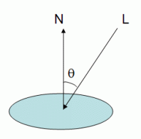

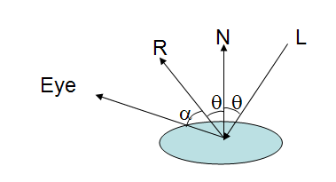

#### 7.2.2 Blinn-Phong

反射向量 `reflect()` 在 GPU 上较耗，可用**半角向量**代替：

```
H = normalize(L + V)
cos(α) ≈ dot(H, N)
```

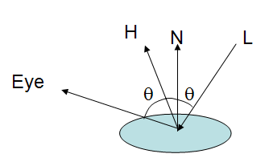

注意方向约定：若 `Lightvec(input) = vertex - lightPos`（光源指向顶点），则 `H = normalize(eyeVec - Lightvec)`；若 `L = lightPos - vertex`（顶点指向光源，常用约定），则 `H = normalize(L + eyeVec)`。两种写法只差一个符号，混用会导致高光位置错误。

### 7.3 逐像素光照（Per-Pixel Lighting）

实时渲染主要使用 Gouraud（逐顶点）与 Phong（逐像素）两类模型：前者对**顶点颜色**插值，后者对**法线**插值后在片元上算光照。逐像素光照的重点就是法线插值，以及各向量在 shader 中的“流向”。

经典 OpenGL 光照模型的输入包括：物体位置、光源位置、眼睛位置、三种光的颜色、法线，以及与镜面高光相关的 shininess。

$$
\begin{aligned}
\text{vertexcolor} ={}& \text{emission}_{material} + \text{ambient}_{lightmodel} * \text{ambient}_{material} + \\
& \sum_{i=0}^{n-1}
\left(\frac{1}{k_c + k_l d + k_q d^2}\right)_{i}
* \text{spotlight\_effect}_{i}
*
\left[
\begin{aligned}
&\text{ambient}_{light} * \text{ambient}_{material} \;+\\
&\text{diffuse}_{light} * \text{diffuse}_{material} * \left(\max\{L \bullet n, 0\}\right) \;+\\
&\text{specular}_{light} * \text{specular}_{material} * \left(\max\{s \bullet n, 0\}\right)^{shininess}
\end{aligned}
\right]
\end{aligned}
$$

#### 7.3.1 顶点着色器：准备向量

```glsl
uniform vec3 lightpos;   // 光源位置（相机空间）
uniform vec4 eyepos;     // 眼睛位置（相机空间）

varying vec3 lightdir;   // 入射光向量 L
varying vec3 halfvec;    // 半角向量
varying vec3 norm;       // 法线

void main(void)
{
    vec4 pos = gl_ModelViewMatrix * gl_Vertex;
    pos = pos / pos.w;

    lightdir = normalize(lightpos - pos.xyz);
    vec3 eyedir = normalize(eyepos.xyz - pos.xyz);
    halfvec = normalize(lightdir + eyedir);
    norm = normalize(gl_NormalMatrix * gl_Normal);

    gl_FrontColor = gl_Color;
    gl_Position = ftransform();
}
```

顶点着色器只做“力所能及”的事：把光向量、法线、半向量算好并传到片元。`gl_NormalMatrix` 是 ModelView 左上 3×3 的逆转置（见 2.8）。

#### 7.3.2 片段着色器：重新归一化并计算

插值会把向量的**长度**也插值，片元中必须重新单位化，否则光照模型被破坏：

```glsl
lightdir = normalize(lightdir);
norm     = normalize(norm);
halfvec  = normalize(halfvec);
```

若光源是方向光而非点光源，`lightdir` 可以不重新归一化（它本来就是常量方向）。

```glsl
uniform float shiness;
uniform vec4 ambient, diffuse, specular;

varying vec3 lightdir;
varying vec3 halfvec;
varying vec3 norm;

void main(void)
{
    lightdir = normalize(lightdir);
    norm     = normalize(norm);

    float diffusefract = max(dot(lightdir, norm), 0.0);
    float specularfract = 0.0;

    if (diffusefract > 0.0) {           // 背光面不必再算高光
        halfvec = normalize(halfvec);
        specularfract = max(dot(halfvec, norm), 0.0);
        specularfract = pow(specularfract, shiness);
    }

    gl_FragColor = vec4(0.3 * ambient.xyz
                      + 0.4 * diffuse.xyz * diffusefract
                      + 0.3 * specular.xyz * specularfract, 1.0);
}
```

三种光直接相加很可能超过 1.0，因此实践中会给每个分量一个权重（上例 0.3/0.4/0.3），或使用 HDR + tone mapping。

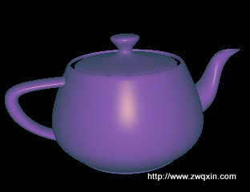


#### 7.3.3 兼容管线的内置光照结构

若直接从 OpenGL 应用取值，可用内置 uniform 结构，省去自己传材质/光源：

```glsl
struct gl_LightSourceParameters {
    vec4 ambient;
    vec4 diffuse;
    vec4 specular;
    vec4 position;
    vec4 halfVector;
    vec3 spotDirection;
    float spotExponent;
    float spotCutoff;        // [0.0, 90.0], 180.0
    float spotCosCutoff;     // [1.0, 0.0], -1.0
    float constantAttenuation;
    float linearAttenuation;
    float quadraticAttenuation;
};
uniform gl_LightSourceParameters gl_LightSource[gl_MaxLights];

struct gl_LightModelParameters {
    vec4 ambient;
};
uniform gl_LightModelParameters gl_LightModel;

struct gl_MaterialParameters {
    vec4 emission;
    vec4 ambient;
    vec4 diffuse;
    vec4 specular;
    float shininess;
};
uniform gl_MaterialParameters gl_FrontMaterial;
uniform gl_MaterialParameters gl_BackMaterial;
```

例如用 `gl_LightSource[0].ambient * gl_FrontMaterial.ambient` 表示环境项，`halfVector` 也可直接取用。但使用前必须在应用中调用 `glLight*`/`glMaterial*` 设置对应状态，且这些内置变量在 Core Profile 中已移除。

> 这些 `gl_*` 内置变量属于兼容模式（GLSL 1.20 及以前）。现代 GLSL 应自行定义 uniform 与 in/out，并显式传入相机空间位置。

---

## 8. 零散观点与经验

### 8.1 OpenGL 是一个标准，不是库

- OpenGL 不是 API 库，而是标准/规范：严格规定每个函数如何执行、输入输出是什么。
- 具体实现由厂商按硬件特性开发（驱动）。
- 因此同一段代码在不同驱动/显卡上可能有细微差异（精度、扩展支持、优化路径），调试时要区分“规范要求”与“实现相关”。

### 8.2 OGL 随记

- `glewInit()` 必须在 `glfwMakeContextCurrent()` 之后调用，否则没有当前上下文，初始化失败。
- `glPushMatrix()` 实质是把当前矩阵状态做一个副本压入栈。
- `0` 是缓存对象的保留值，`glGenBuffers()` 永远不会返回 0。
- `glMapBuffer` 可能需要把数据从 GPU 拷回主机，多一次内存拷贝且需 CPU/GPU 同步，很慢；只上传数据时用 `glBufferSubData` 更合适。
- **投影矩阵比例错误导致立方体旋转时严重变形**：检查 `(width / height) != (right - left) / (top - bottom)`。根因是 `int width, height` 直接相除发生整数截断，必须先转浮点：

```cpp
float aspect = float(width) / float(height);
```

### 8.3 从 Cocos2d-x 看 OpenGL 底层：为什么精灵一多就卡

问题：同样是 2D 游戏，为什么渲染 100 多个精灵就卡，而别的大作渲染很多物体仍然流畅？

排除游戏逻辑与 CPU 瓶颈后，问题出在渲染 API 的调用方式。

**OpenGL 的 API 层很薄、很僵硬**：能控制的无非是资源生成、渲染缓存状态、调用 Draw。它是状态机设计，每次调用 API 都会改变管线中某个开关，并生成一条指令告诉显卡怎么做，这本身有性能损失。调用是异步的：命令进入缓冲区/队列，在某个时机批量发给驱动；可以手动 `glFlush` 强制发送，但通常不推荐。**因此，减少 OpenGL API 调用次数就能提升性能。**

**批次渲染（Batching）** 是最通用也最简单的做法：

- 把一次渲染比作一群人排队上车：相邻且穿同色衣服的人可以坐同一辆车，颜色一变就要新车。100 个人 100 种颜色要 100 辆车；都同色只要 1 辆；调整排队顺序也能减少车数。
- 渲染队列中每个渲染命令对应一次 OpenGL 调用。OpenGL 是状态机，第一条命令设置好状态后，第二条命令如果状态相同就无需重设——把两条命令合并成一条，就少一次 API 调用而画同样多的东西。

2D 游戏的每个渲染命令通常只涉及三件事：**设置 Shader、绑定 Texture、DrawElements**。

1. Shader 通常相同，容易合并；
2. 每个精灵一张纹理看似无法合并，但可以把多张小图拼成**图集（atlas）**，用顶点 UV 区分，就能合并；
3. 图元都是三角形，把顶点数据放进同一个 VBO，就能合并。

Cocos2d-x 的演进：

- 早期 `BatchNode`：同一纹理的精灵才会生成批次，但美术改资源、子节点纹理不在大图里时会出问题；
- 3.x 的 **Auto-batching**：在深度优先的子节点遍历中，相邻节点材质相同就自动合并批次。

实测对比（6000×3 个节点）：空节点、三张分开的图、一张合图。代码几乎相同，但合图的性能提升在极端情况下可达约 **3 倍**；即使批次命中率只提高 10%–20%，对性能也有实际收益。所需做的往往只是**把图片合并成一张大图**。

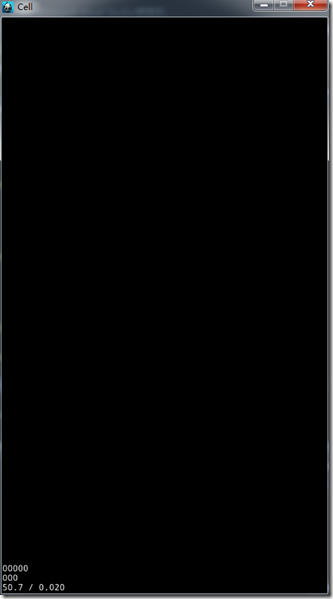


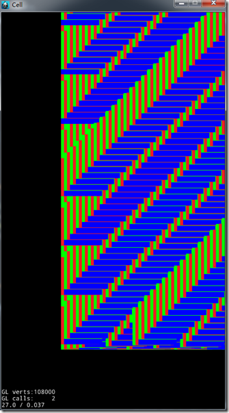

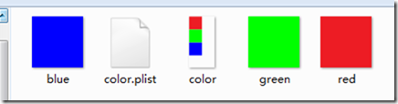

延伸结论：

- 合批的前提是**同 shader、同纹理（或同图集）、同渲染状态**；
- 透明物体还要考虑绘制顺序，合批不能破坏正确的 blending；
- UI/2D 场景优先做图集与状态排序，3D 场景优先做材质共享、实例化（instancing）与静态合批。

---

## 附录：工作日志中的补充记录

> 本节补录 `Log/` 中的零散技术片段。原日志以日期+待办的流水形式记录，这里只抽取技术结论、参数与代码，删除日期、待办勾选与个人事务。
> 与正文重复的内容不再展开，只给交叉引用与速查；凡推断不确定处标注「（待核实）」。

### A.1 管线阶段速查（对应 §1.2 / §1.4）

把管线的六个处理阶段压缩成一句话职责，便于回忆整条链路：

| 阶段 | 一句话职责 | 详见 |
|---|---|---|
| 顶点数据 | 以数组形式提供顶点属性（位置、法线、颜色、UV 等） | §1.5、§1.7 |
| 顶点着色 | 主要是**位置变换**，也可计算逐顶点颜色 | §1.4.1、§7.1 |
| 图元装配 | 按连接关系把顶点组装成点/线/三角形（随后由裁剪阶段处理视野外部分） | §1.9.3、§1.4.2 |
| 光栅化 | 确定图元覆盖哪些片元，并**插值**出片元的属性值 | §1.4.3、§1.10.2 |
| 片元着色 | 对插值产生的片元着色（纹理采样、光照等） | §7.3 |
| 逐片元处理 | 一系列测试：裁剪（scissor）、Alpha、模板、深度；测试全部通过后经混合（Blending）写入帧缓冲 | §1.4.4、§5.1、§5.5 |

补充结论：

1. **光栅化的本质是插值**：顶点上的属性（颜色、纹理坐标、深度）在光栅化阶段按图元覆盖关系插值成片元属性，片元着色器拿到的都是插值后的值。这也是“顶点着色器算出来的值在片元里不准”的根源。
2. **顶点位置变换由 model / view / projection 三个矩阵完成**，透视除法与视口变换在其后：
   ```
   clip = P * V * M * position   →  NDC = clip / w   →  窗口坐标 = 视口映射(NDC)
   ```
   > 原稿把四者并列容易被误解为同为矩阵；viewport 实为透视除法后的**视口映射**，不是矩阵乘法——它把 NDC 的 `x,y` 映射到窗口像素、`z` 从 `[-1,1]` 映射到 `[0,1]`。完整链路见 §2.1 与 §2.7。
3. **一帧的最后一步是交换前后缓冲**：绘制完成的是后缓冲，交换（`glfwSwapBuffers` / `SwapBuffers`）之后图形才真正出现在屏幕上。双缓冲与 vsync 的取舍见 §6.4.9。

### A.2 着色器存储限定符：uniform / attribute / varying

GLSL 1.20（兼容模式）用三个存储限定符区分“值从哪来、能不能改、是否插值”。现代 GLSL 用 `in` / `out` 替代后两个，`uniform` 保持不变。

| 限定符 | 声明位置 | 读写权限 | 值的语义 | 更新方式 | 现代写法 |
|---|---|---|---|---|---|
| `uniform` | 着色器全局 | 顶点/片元着色器内均**只读** | **一次绘制调用内不变**的全局量 | CPU 侧 `glUniform*` 写入 | 仍为 `uniform`（可用 UBO 批量上传） |
| `attribute` | 顶点着色器全局 | **只读**输入 | **逐顶点**数据 | `glVertexAttribPointer` 指定数据来源与布局，配合 `glEnableVertexAttribArray`；数据更新用 `glBufferData`/`glBufferSubData` | 顶点着色器的 `in` |
| `varying` | 顶点着色器输出 / 片元着色器输入 | 顶点侧写、片元侧只读 | 顶点值经光栅化**插值**后成为片元值 | 由管线自动插值，无需手动传递 | 顶点侧 `out`、片元侧 `in` |

要点澄清：

1. `uniform` 是**顶点着色器与片元着色器共享**的：两处必须同名同类型声明，链接后指向同一份存储，因此一次 `glUniform*` 对两个阶段同时生效。上传接口与 `-1` 返回值见 §6.2。
2. 原稿称 `attribute` “全局定义”，指的是**在着色器中于全局作用域声明**；它的取值是**逐顶点**的，等同“每个顶点一份、只读”的输入（原稿表述易误解，已澄清：`attribute` 不是全局常量）。**槽位编号由 `glBindAttribLocation` / `layout(location)` / `glGetAttribLocation` 决定，`index` 只是写入哪个槽**，见 §1.7。
3. `varying` 是顶点着色器的**输出**、片元着色器的**输入**，中间由光栅化插值——这正是 §7.3 逐像素光照必须“在片元着色器里重新归一化法线”的原因（插值后的向量长度不再为 1）。
4. `uniform` 与 `varying` 都受可用数量限制（`gl_MaxVertexUniformComponents`、`gl_MaxVaryingFloats` 等），超额会在链接期或运行期报错（待核实具体驱动的实际上限）。

---

## 原始笔记索引

- `OpenGL/####  OpenGL  ###.md`
- `OpenGL/### OpenGL函数 ###.md`
- `OpenGL/### 矢量差乘（外积）  ######.md`
- `OpenGL/#### VAO ###.md`
- `OpenGL/###### VBO ######.md`
- `OpenGL/Cocos2d-x与OpenGL底层的感想.md`
- `OpenGL/EXT_texture_filter_anisotropic.md`
- `OpenGL/GLFW库的使用.md`
- `OpenGL/GL_TRIANGLE_STRIP.md`
- `OpenGL/Look_at函数.md`
- `OpenGL/Occlusion Query.md`
- `OpenGL/OGL随记.md`
- `OpenGL/OpenGL ES2.0 3.0 glTexImage2D 函数详解.md`
- `OpenGL/OpenGL Normal Vector Transformation.md`
- `OpenGL/OpenGL函数.md`
- `OpenGL/OpenGL内置的拾取机制.md`
- `OpenGL/OpenGL动态执行2n次方图像限制.md`
- `OpenGL/OpenGL帧缓存对象(FBO：Frame Buffer Object).md`
- `OpenGL/OpenGL中的透视投影.md`
- `OpenGL/OpenGL程序错误集锦.md`
- `OpenGL/Opengl新观点.md`
- `OpenGL/Per Pixel Lighting(逐像素光照).md`
- `OpenGL/Phong 光照模型.md`
- `OpenGL/Vertex Shader.md`
- `OpenGL/cubemap实现方式.md`
- `OpenGL/glGetUniformLocation.md`
- `OpenGL/openGL纹理倾斜.md`
- `OpenGL/z-fighting和stitching问题.md`
- `OpenGL/三角形光栅化.md`
- `OpenGL/位姿矩阵（或者称为旋转平移矩阵）.md`
- `OpenGL/渲染器结构.md`
- `OpenGL/渲染状态.md`
- `OpenGL/图元装配.md`
- `OpenGL/对象拾取.md`
- `OpenGL/对DrawCall的理解.md`
- `OpenGL/左手系 右手系.md`
- `OpenGL/投影.md`
- `OpenGL/固定功能渲染.md`
- `OpenGL/画一个三角形.md`
- `OpenGL/深度测试.md`
- `OpenGL/行向量，列向量.md`
- `OpenGL/视口.md`
- `OpenGL/顶点属性索引的设置.md`
- `OpenGL/索引顶点的VBO与多重纹理下的VBO.md`
- `OpenGL/绘制物体轮廓.md`
- `Log/opengl总结.md`
