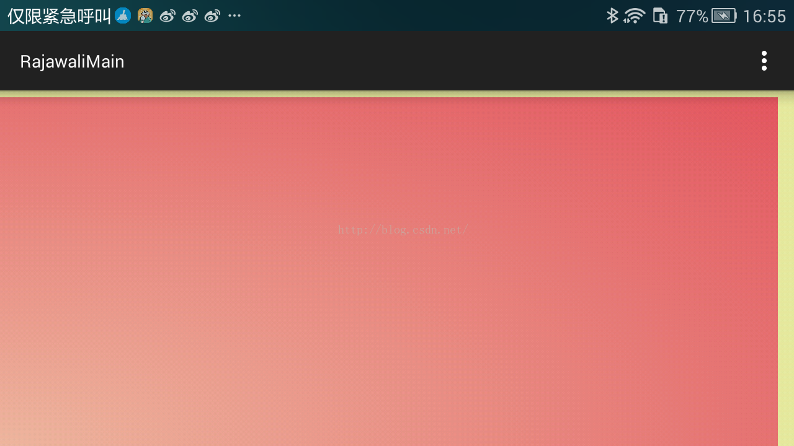
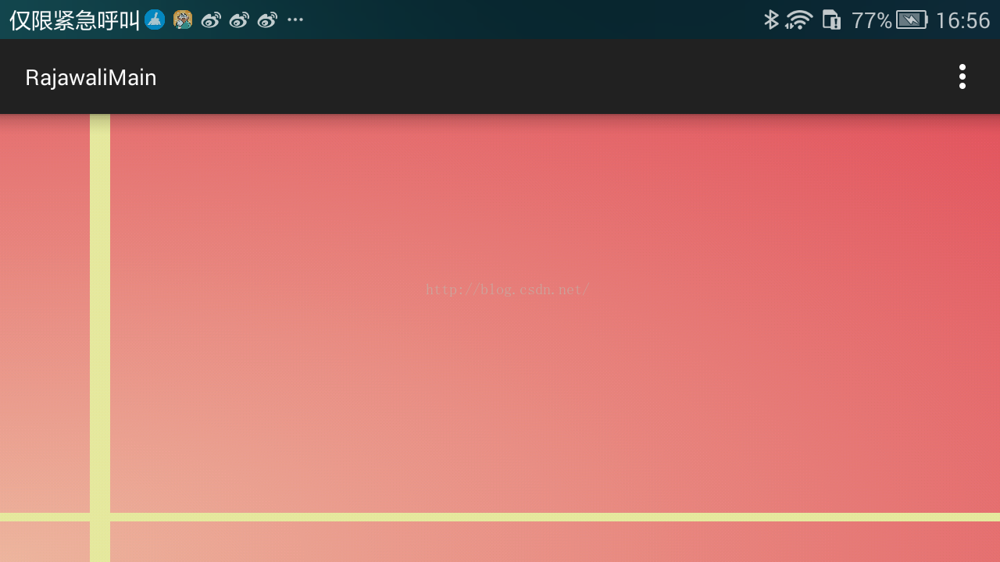
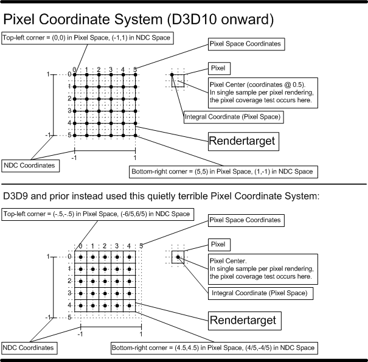
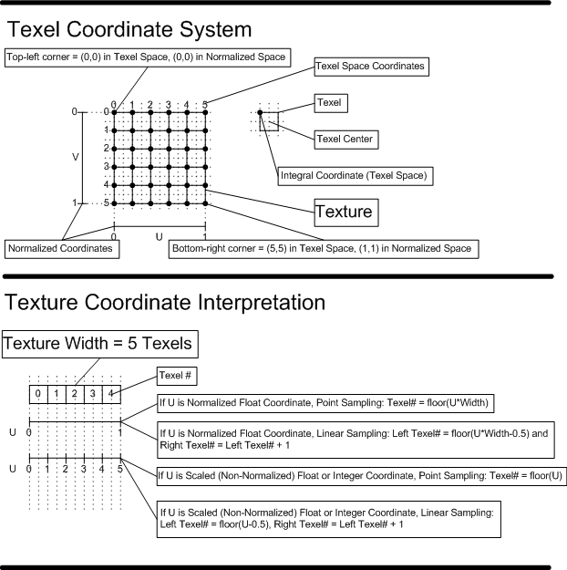

# 02 GLSL 语法与内建函数

> 本文由 `OpenGL/GLSL/` 下的 7 篇笔记重组、订正而成，面向「能读懂并写出片元着色器」的目标，只保留常用语法与常用内建函数，不搬运完整语言手册。

## 一、版本与默认精度

### 1.1 版本谱系

| 环境 | 着色语言 | 说明 |
| --- | --- | --- |
| WebGL 1.0 / OpenGL ES 2.0 | GLSL ES 1.00 | `#version 100`；用 `attribute` / `varying` / `gl_FragColor` |
| WebGL 2.0 / OpenGL ES 3.0 | GLSL ES 3.00 | `#version 300 es`；用 `in` / `out`，自定义输出变量 |
| 桌面 OpenGL | GLSL 1.10 ~ 4.60 | 1.30 起引入 `in` / `out`，逐步补齐 `switch`、位运算、数组的数组等 |

`#version` 必须写在文件第一行（前面只能有注释）。跨平台代码通常用宏隔离：

```glsl
#ifdef GL_ES
precision mediump float;
#endif
```

### 1.2 默认精度

GLSL ES 的精度限定符有三个：`highp`、`mediump`、`lowp`。

顶点着色器有默认精度（且浮点为 `highp`）：

```glsl
precision highp float;
precision highp int;
precision lowp sampler2D;
precision lowp samplerCube;
```

片元着色器**没有默认的 float 精度**，必须显式声明，否则编译报错：

```glsl
precision mediump float;   // 片元着色器必须写
precision mediump int;     // int 默认即为 mediump
precision lowp sampler2D;
precision lowp samplerCube;
```

> 注意：桌面 GLSL 没有精度限定符（写了会被忽略），只在 GLSL ES 上有意义；且 1.30+ 才允许书写 `precision` 语句，1.10/1.20 里写它属于语法错误，而不是「忽略」。

### 1.3 精度的实际含义

以 GLSL ES 3.0 规范给出的**最低**保证（实际实现可能更高）为参考：

| 限定符 | 浮点范围 | 相对精度 | 典型硬件 |
| --- | --- | --- | --- |
| `lowp` | ±2^8（ES 1.00 更窄，约 ±2） | 2^-8 | 8 bit，常用于颜色 |
| `mediump` | ±2^14 | 2^-10 | 半精度 fp16 |
| `highp` | ±2^62 | 2^-16 | fp32 |

规范原表的完整字段（多出「浮点数量级范围」与「整型范围」两列）：

| 限定符 | 浮点范围 | 浮点数量级范围 | 浮点精度 | 整型范围 |
| --- | --- | --- | --- | --- |
| `highp` | $(-2^{62}, 2^{62})$ | $(-2^{62}, 2^{62})$ | 相对精度 $2^{-16}$ | $(-2^{16}, 2^{16})$ |
| `mediump` | $(-2^{14}, 2^{14})$ | $(-2^{14}, 2^{14})$ | 相对精度 $2^{-10}$ | $(-2^{10}, 2^{10})$ |
| `lowp` | $(-2, 2)$ | $(2^{-8}, 2)$ | 绝对精度 $2^{-8}$ | $(-2^{8}, 2^{8})$ |

> 上表与上面的简表对照可见：`lowp` 的**浮点范围**是 $(-2, 2)$，$2^{-8}\sim 2$ 才是它的**数量级范围**；简表里写的「±2^8」取的是数量级列，两处并不矛盾。

选择建议：

- **vertex position / 世界坐标 / 深度**：`highp`。`mediump` 是 fp16（5 位指数、指数范围约 ±2^14，10 位尾数），大坐标会抖动。
- **texture coordinate**：`mediump` 通常够用；但 UV 需要高精度平铺（如大世界 triplanar）时用 `highp`。
- **color**：`lowp`；但要做 HDR 或高精度渐变累加时 `mediump` 起。
- **时间累加、噪声哈希、极坐标角度**：`highp`，否则跑几分钟后画面会「跳」。

### 1.4 精度传播规则

变量精度先看自身限定符；没有则看右侧表达式里已确定精度的操作数，整个表达式按其中**最高**的精度计算；都没有才用默认精度。

```glsl
uniform highp float h1;
highp float h2 = 2.3 * 4.7;   // 高精度
mediump float m;
m = 3.7 * h1 * h2;            // 表达式按 highp 计算，结果再存回 mediump
h2 = m * h1;                  // highp
m = h2 - h1;                  // highp
h2 = m + m;                   // mediump（两个操作数都是 mediump）
```

`invariant` 用于要求「同一表达式在不同 shader 中结果逐位一致」，典型场景是顶点着色器算出的坐标要在片元着色器里做比较（如深度预 pass）：

```glsl
invariant varying vec2 vTexCoord;
// 或者一刀切，但会限制编译器优化：
// #pragma STDGL invariant(all)
```

多个限定符的顺序：普通变量 `invariant > storage > precision`，函数参数 `storage > parameter > precision`。

```glsl
invariant varying lowp float color;
void f(const in lowp float s) { }
```

## 二、基础语法

### 2.1 基本类型

| 类型 | 说明 |
| --- | --- |
| `void` | 空类型，仅用于无返回值函数 |
| `bool` / `int` / `float` | 标量 |
| `vec2` `vec3` `vec4` | 浮点向量 |
| `ivec2..4` / `bvec2..4` | 整数向量 / 布尔向量 |
| `mat2` `mat3` `mat4` | 方阵，另有 `mat2x3` 等非方阵（GLSL 1.20+） |
| `sampler2D` `samplerCube` `sampler3D` `sampler2DShadow` | 采样器句柄 |

GLSL 支持函数重载；**没有隐式类型提升**；不支持指针、字符串、字符，本质上只处理数值数据。

> 位运算与 `switch`：GLSL ES 1.00 不支持；GLSL 1.30 / ES 3.00 起支持 `& | ^ ~ << >>` 与 `switch`。老笔记里「不支持位运算符」的结论只对 ES 1.00 成立。

### 2.2 向量分量访问（swizzle）

同一组分量有三种命名，含义等价，只是语义暗示不同：

- 位置：`.x .y .z .w`
- 颜色：`.r .g .b .a`
- 纹理坐标：`.s .t .p .q`

```glsl
vec4 v = vec4(1.0, 2.0, 3.0, 4.0);
float a = v.x;      // 1.0
float b = v.r;      // 1.0
float c = v[0];     // 1.0
vec3 xyz = v.xyz;   // vec3(1.0, 2.0, 3.0)
vec2 yz  = v.yz;
v.xy = v.yx;        // 交换
```

规则：一次 swizzle 里不能混用不同命名组（`v.xg` 非法）；作为**左值**时不能重复分量（`v.xx = vec2(0.0)` 非法）；作为右值可以任意重复（`v.xxx`）。

### 2.3 矩阵：列主序

GLSL 的矩阵按**列**存储，构造函数的参数也是先填满一列再填下一列。

```glsl
mat2 m = mat2(1.0, 2.0,   // 第 0 列
              3.0, 4.0);  // 第 1 列
// m[0] = vec2(1,2)，m[1] = vec2(3,4)

mat4 m4;
m4[2][3] = 2.0;           // 第 3 列、第 4 行（列优先）
```

矩阵与向量相乘不是逐分量运算：

```glsl
vec2 v = vec2(10.0, 20.0);
mat2 m = mat2(1.0, 2.0, 3.0, 4.0);
vec2 w = m * v;   // = vec2(1*10 + 3*20, 2*10 + 4*20) = (70, 100)
vec2 u = v * m;   // = vec2(1*10 + 2*20, 3*10 + 4*20) = (50, 110)
```

`m * v` 是「矩阵乘列向量」，`v * m` 是「行向量乘矩阵」，两者互为转置关系。这也是从 HLSL 移植时最容易翻车的地方（见第七节）。

### 2.4 结构体与数组

结构体是唯一的用户自定义类型，可以用 `=` 赋值、用 `==` / `!=` 比较整体：

```glsl
struct Light {
    vec3 position;
    vec3 color;
};
Light l0 = Light(vec3(0.0), vec3(1.0));
Light l1 = l0;
bool same = (l0 == l1);
```

数组：

```glsl
vec4 points[10];
vec4 dynamic[];          // 不定长，声明时可不给大小
const float c[3] = float[3](5.0, 7.2, 1.1);
int n = points.length(); // 内建 length()
```

限制：

- 索引从 0 开始，无指针。
- GLSL ES 1.00 只支持**一维**数组，且不能用变量下标（除非是常量表达式或循环索引）。GLSL 4.30 / ES 3.10 起支持数组的数组。
- 采样器数组在 ES 1.00 中下标必须是常量表达式。

### 2.5 类型转换：必须显式

```glsl
int   a = int(2.0);      // 2
float b = float(2);      // 2.0
bool  c = bool(0);       // false
bool  d = bool(0.9);     // true，非 0 即真
int   e = int(true);     // 1
```

以下全部非法，因为不做隐式提升：

```glsl
int   a = 2.0;              // 错
float b = 2;                // 错
vec3  c = vec3(1.0) * 2;    // 错，vec 与 int 不能逐分量运算
```

`float` 与 `vec` / `mat` 之间是逐分量运算（`vec3 * 2.0` 合法），`int` 与 `vec` 之间不可运算。

### 2.6 运算符与优先级（摘要）

| 优先级 | 运算符 | 结合性 |
| --- | --- | --- |
| 1 | `()` | — |
| 2 | `[]` `()` `.` `++` `--`（后缀） | 左 |
| 3 | `++` `--` `+` `-` `!`（前缀） | 右 |
| 4 | `*` `/`（1.30+ / ES 3.00 起还有整型 `%`） | 左 |
| 5 | `+` `-` | 左 |
| 6 | `<` `>` `<=` `>=` | 左 |
| 7 | `==` `!=` | 左 |
| 8 | `&&` | 左 |
| 9 | `^^`（逻辑异或） | 左 |
| 10 | `\|\|` | 左 |
| 11 | `? :` | 右 |
| 12 | `=` `+=` `-=` `*=` `/=` | 右 |
| 13 | `,` | 左 |

注意 `%` 有版本差异：GLSL ES 1.00（以及桌面 GLSL 1.10/1.20）**没有** `%`，取余只能用 `mod()`；GLSL 1.30 / ES 3.00 起 `%` 是合法的**整型**取模（浮点仍用 `mod()`，两者对负数的符号规则不同）。另外逻辑异或是 `^^` 而不是 `^`。

### 2.7 变量限定符

| 限定符 | 作用域 | 可写 | 说明 |
| --- | --- | --- | --- |
| 无 | 局部变量 | 是 | 函数内默认 |
| `const` | 全局/局部/参数 | 否 | 必须在声明时初始化 |
| `attribute` | 仅顶点着色器 | 否 | 逐顶点输入，来自顶点缓冲；只能是 float/vec/mat，不能是数组或结构体（ES 1.00） |
| `uniform` | 全局 | 否 | 一次 draw call 内不变，由 CPU 设置；顶点与片元共享 |
| `varying` | 全局 | 顶点写、片元读 | 光栅化时插值 |

GLSL 1.30 / ES 3.00 之后统一为 `in` / `out`：顶点着色器 `in` 取代 `attribute`，`out` 取代 `varying`；片元着色器 `in` 取代 `varying`，自定义 `out` 取代 `gl_FragColor`。

```glsl
// 顶点着色器
in vec3 aPosition;
in vec2 aTexCoord;
out vec2 vTexCoord;

// 片元着色器
in vec2 vTexCoord;
out vec4 fragColor;
```

坑：

- 全局变量只能带一个存储限定符，`uniform varying` 这种复合写法非法。
- `const` 可以修饰结构体变量，但不能修饰结构体**字段**：

```glsl
struct Light { vec3 pos; /* const vec3 p; 错 */ };
const Light light0 = Light(vec3(0.0));
```

### 2.8 函数参数限定符

| 限定符 | 语义 |
| --- | --- |
| 无 / `in` | 值传递，函数内修改不影响实参 |
| `out` | 只写「坑位」，返回时写回实参 |
| `inout` | 可读可写，返回时写回实参 |

```glsl
void doubleSize(inout float size) { size *= 2.0; }
void split(vec3 v, out float len, out vec3 dir) {
    len = length(v);
    dir = v / max(len, 1e-6);
}
```

GLSL 函数不能嵌套、不能递归（ES 1.00 明确禁止），必须声明返回类型。

### 2.9 布局限定符 `layout`

`layout` 用它替代「靠链接器猜顺序」，但它是**逐项**引入的，不能一概写成「1.30+」——GLSL 1.30 连 `layout` 语法都还没有：

```glsl
layout(location = 0) in vec3 aPosition;      // 顶点属性槽：GLSL 3.30 / GL 3.3，或 ES 3.00
layout(location = 0) out vec4 fragColor;      // 片元输出颜色附件：GLSL 4.10 / GL 4.1，或 ES 3.00
layout(std140) uniform Camera {               // std140 内存布局：GLSL 1.40
    mat4 viewProj;
};
layout(std140, binding = 0) uniform Camera {  // 显式 binding：GLSL 4.20
    mat4 viewProj;
};
```

`std140` 的对齐规则（vec3 占 16 字节、数组元素按 16 字节对齐等）是跨 API 传 UBO 时必须遵守的；`std430` 更紧凑，但只适用于 SSBO / compute。

### 2.10 分支与循环

语法与 C 基本一致，唯一的特殊控制流是片元着色器里的 `discard`：立即结束该片元，不写颜色/深度。

```glsl
if (alpha < 0.5) discard;

for (int i = 0; i < 4; ++i) {
    color += lights[i];
}

while (i < n) { sum += data[i]; ++i; }

do { color += c; --n; } while (n > 0);
```

老版本限制（GLSL ES 1.00，WebGL 1）：

- 循环上界必须是常量表达式，循环变量只能做简单自增。
- 不能在 `if` / `else` 分支里声明变量（作用域规则导致），要提前声明。
- 条件必须是 `bool`，不能写 `if (x)`。
- `?:` 两个分支类型必须一致。
- 无 `switch`。

`discard` 的代价：会让 GPU 失去早期深度剔除（early-Z）的机会，并且分支两侧的像素仍需着色。移动端大量使用 `discard` 做 Alpha Test 是常见性能陷阱。

### 2.11 预编译指令与内置宏

```glsl
#define NUM 100
#undef NUM
#if NUM == 100
#elif defined(FOO)
#else
#endif
#ifdef GL_ES
#endif
#error "unsupported"
#pragma STDGL invariant(all)
#extension GL_OES_standard_derivatives : enable
#line 10
```

常用内置宏：

| 宏 | 含义 |
| --- | --- |
| `__LINE__` | 当前行号 |
| `__VERSION__` | 版本号整数，如 `100`、`300` |
| `GL_ES` | 处于 OpenGL ES 环境时为 1 |
| `GL_FRAGMENT_PRECISION_HIGH` | 片元着色器支持 `highp` 时为 1 |

按环境选精度的惯用写法：

```glsl
#ifdef GL_ES
  #ifdef GL_FRAGMENT_PRECISION_HIGH
    precision highp float;
  #else
    precision mediump float;
  #endif
#endif
```

## 三、内置变量

### 3.1 顶点着色器输出

| 变量 | 类型 | 说明 |
| --- | --- | --- |
| `gl_Position` | `highp vec4` | 齐次裁剪空间坐标，必须写 |
| `gl_PointSize` | `mediump float` | 点大小，仅 `GL_POINTS` 有效 |

`gl_Position` 处于**齐次裁剪空间**：GPU 用 `-w <= x,y,z <= w` 做裁剪，然后做透视除法得到 NDC。所以「把顶点放到屏幕上」的完整过程是 `clip = P * V * M * pos`，而不是先除 w。

### 3.2 片元着色器输入

| 变量 | 类型 | 说明 |
| --- | --- | --- |
| `gl_FragCoord` | `mediump vec4` | `(x, y, z, 1/w)`，窗口坐标 |
| `gl_FrontFacing` | `bool` | 当前图元是否为正面 |
| `gl_PointCoord` | `mediump vec2` | 点精灵内部坐标，`[0,1]` |
| `gl_FragDepth` | `float` | 写入自定义深度（会禁用 early-Z） |

`gl_FragCoord` 的四个分量：

- `x, y`：**像素中心**的窗口坐标，原点在**左下角**，范围 `[0, width]` / `[0, height]`，所以第一个像素是 `(0.5, 0.5)`，不是 `(0, 0)`。
- `z`：窗口空间深度，已经过视口深度变换，默认在 `[0, 1]`（`glDepthRange` 之后）。它**不是** NDC 的 z（NDC z 在 `[-1, 1]`）。
- `w`：`1 / w_clip`，即裁剪空间 w 的倒数。

### 3.3 片元着色器输出

| 变量 | 说明 |
| --- | --- |
| `gl_FragColor` | ES 1.00 / GLSL 1.10 的单颜色输出 |
| `gl_FragData[n]` | MRT，配合 `glDrawBuffers` |
| `layout(location = n) out vec4` | 现代写法（片元输出 location 需 GLSL 4.10 / GL 4.1，或 ES 3.00） |

`gl_FragColor` 与 `gl_FragData` 在 GLSL 1.30 起被标记为 deprecated，核心 profile 3.2+ 已移除，新代码应使用自定义 `out` 变量。

### 3.4 `gl_FragCoord` 实测

一个 2D 全屏 Pass，viewport 为 `(0, 0, 1280, 574)`，则 `gl_FragCoord.x ∈ [0.5, 1279.5]`、`y ∈ [0.5, 573.5]`。把它归一化即得屏幕 UV：

```glsl
precision mediump float;
uniform vec2 screenSize;

void main() {
    vec2 uv = gl_FragCoord.xy / screenSize;   // [0,1]
    float r = length(uv);                     // 左下角为圆心的半径
    vec3 bg = mix(vec3(0.93, 0.71, 0.62),
                  vec3(0.90, 0.44, 0.44), r);
    gl_FragColor = vec4(bg, 1.0);
}
```



把判定区间从 `[0.98, 1.0]` 改成 `[0.09, 0.11]`，高亮带就从右侧/上方移到靠近原点处，这验证了原点在左下角、y 向上：



想要以屏幕中心为原点、纵向归一化，常用：

```glsl
vec2 st = (gl_FragCoord.xy * 2.0 - u_resolution) / u_resolution.y;
```

### 3.5 与 HLSL `SV_POSITION` / `VPOS` 的对应关系

| 概念 | GLSL | HLSL (D3D10+) | HLSL (D3D9) |
| --- | --- | --- | --- |
| 顶点输出裁剪空间坐标 | `gl_Position` | `SV_POSITION` | `POSITION` |
| 片元输入像素坐标 | `gl_FragCoord.xy` | `SV_POSITION.xy` | `VPOS.xy` |
| 原点 | 左下角 | 左上角（y 向下） | 左上角 |
| 像素中心偏移 | +0.5 | +0.5 | 无（整数像素坐标） |
| 深度 | `gl_FragCoord.z` ∈ [0,1] | `SV_POSITION.z` ∈ [0,1] | `VPOS.z` |
| `w` | `1/w_clip` | `w_clip` 原样保留 | — |

关键点：

1. **`SV_POSITION` 在片元着色器里语义变了**。作为顶点输出时它是齐次裁剪坐标；作为像素着色器输入时，`xy` 是像素中心的屏幕坐标（左上角为原点，带 0.5 偏移），`z` 已经是深度值，`w` 保持裁剪空间的 w。
2. 因此片元里读深度直接 `clipPos.z`，不需要再除 w：

```hlsl
float4 PSMain(float4 clipPos : SV_POSITION) : SV_TARGET
{
    return float4(clipPos.z, clipPos.z, clipPos.z, 1.0);
}
```

3. NDC 的 z 范围不同：OpenGL 是 `[-1, 1]`，Direct3D 是 `[0, 1]`。这也是投影矩阵要做 z 映射的原因。
4. 顶点着色器里 `gl_Position` 与 `SV_POSITION` 不能直接互换语义：D3D 要求 `0 <= z <= w`，GL 允许 `-w <= z <= w`。

### 3.6 Unity 的 reversed Z

Unity 在部分平台（DirectX、部分主机）使用反转深度，`SV_POSITION.z` 被写成 `1 - z`，于是 0 表示远平面、1 表示近平面。用 `UNITY_REVERSED_Z` 判断：

```hlsl
fixed4 frag (v2f i) : SV_Target
{
    float depth = i.vertex.z;
#if defined(UNITY_REVERSED_Z)
    depth = 1.0 - depth;
#endif
    return float4(depth, depth, depth, 1.0);
}
```

反转深度的好处是近处精度更高（浮点分布更合理），代价是所有手写深度比较都要注意方向（`ZTest LEqual` vs `GEqual`）。Unity 的 `LinearEyeDepth` / `Linear01Depth` 已经处理了这层差异。





## 四、内建函数

记号：`T` 表示 `float / vec2 / vec3 / vec4`（逐分量），`bvec` 表示布尔向量。

### 4.1 通用函数

| 函数 | 说明 |
| --- | --- |
| `T abs(T x)` | 绝对值 |
| `T sign(T x)` | 符号，返回 -1 / 0 / 1 |
| `T floor(T x)` | 向下取整 |
| `T ceil(T x)` | 向上取整 |
| `T fract(T x)` | 小数部分 `x - floor(x)`，结果 `[0,1)` |
| `T mod(T x, T y)` | `x - y * floor(x / y)`，符号随 y（与 C 的 `%` 不同） |
| `T min/max(T x, T y)` | 逐分量最值 |
| `T clamp(T x, T lo, T hi)` | `min(max(x, lo), hi)` |
| `T mix(T x, T y, T a)` | 线性插值 `x*(1-a) + y*a` |
| `T step(T edge, T x)` | `x < edge ? 0 : 1` |
| `T smoothstep(T e0, T e1, T x)` | 平滑阶跃，见下 |
| `T modf(T x, out T i)` | 拆成小数与整数部分 |
| `T round(T x)` | 四舍五入（GLSL 1.30+，实现依赖 .5 的方向） |
| `T trunc(T x)` | 截断取整 |
| `T fma(T a, T b, T c)` | `a*b+c` 单指令（ES 3.20+） |
| `bool isnan(float)` / `bvec isnan(vecN)`；`isinf` 同 | 判断 NaN / Inf；向量入参返回 `bvec`，不是 `bool` |

**`mix` 的三个版本**：

```glsl
genType mix(genType x, genType y, float a);       // 标量权重
genType mix(genType x, genType y, genType a);     // 逐分量权重
genType mix(genType x, genType y, genBType a);    // 逐分量选择（1.30+）
```

第三个版本等价于 `a ? y : x`，写「按通道选择」时比 `step` 更直观：

```glsl
vec3 c = mix(colorA, colorB, greaterThan(uv, vec2(0.5)));
```

`mix` 的权重不做 clamp，`a` 超出 `[0,1]` 时会外插，这是做对比度/过曝的常用手段，但也是「颜色溢出」的常见来源。

**`step` 与 `smoothstep`**：

```glsl
step(edge, x)              // x < edge → 0，否则 1（含 x == edge 时为 1）
smoothstep(e0, e1, x) {
    t = clamp((x - e0) / (e1 - e0), 0.0, 1.0);
    return t * t * (3.0 - 2.0 * t);   // Hermite，等价 3t² - 2t³
}
```

边界行为（按规范）：

- `x <= e0` → 0；`x >= e1` → 1。老笔记写成「x < e0 / x > e1」，端点归属是错的，端点处结果仍是 0 / 1（公式给出同样的值）。
- **`e0 >= e1` 时结果未定义**（undefined）。`smoothstep(0.5, 0.2, r)` 这种「反着写」在多数 GPU 上会得到反向渐变（分母为负），但不可移植，正式代码应写成 `1.0 - smoothstep(0.2, 0.5, r)`。
- 输入是 NaN 时结果未定义；`e0 == e1` 会除零。

`smoothstep` 的一阶导在两端为 0，所以过渡「软」，适合做抗锯齿边缘、软遮罩、扫描线；`step` 是硬边，适合做区间判定但斜线上会有锯齿。

### 4.2 三角函数与定义域

| 函数 | 定义域 | 值域 |
| --- | --- | --- |
| `radians(d)` / `degrees(r)` | 任意 | 换算 |
| `sin/cos/tan(x)` | 任意（弧度） | `[-1,1]` / `[-1,1]` / 全实数 |
| `asin(x)` | `[-1, 1]` | `[-π/2, π/2]` |
| `acos(x)` | `[-1, 1]` | `[0, π]` |
| `atan(y_over_x)` | 任意 | `(-π/2, π/2)` |
| `atan(y, x)` | 任意（不同时为 0） | `[-π, π]` |

**`atan(y, x)` 才是四象限反正切**（GLSL 里没有叫 `atan2` 的函数，HLSL 里叫 `atan2`，参数顺序同为 `(y, x)`）：

| 点 `(x, y)` 所在象限 | `atan(y, x)` 范围 |
| --- | --- |
| 第一象限（x>0, y>0） | `(0, π/2)` |
| 第二象限（x<0, y>0） | `(π/2, π)` |
| 第三象限（x<0, y<0） | `(-π, -π/2)` |
| 第四象限（x>0, y<0） | `(-π/2, 0)` |
| y 轴正向 / 负向 | `+π/2` / `-π/2` |
| x 轴负向（y=0, x<0） | `+π`（或 `-π`，实现相关） |

`atan(y/x)` 只看比值，值域 `(-π/2, π/2)`，会丢失象限信息——这是「角度算出来总是差 180°」的根源。

`atan(0, 0)` 未定义；做极坐标时若原点可能出现，要加保护：

```glsl
float angle = atan(p.y, p.x + 1e-6);
```

**`acos` 的定义域陷阱**：`acos(dot(n, l) / (length(n) * length(l)))` 在浮点误差下可能传入 `1.0000001`，结果是 NaN，随后整个像素变黑或出现亮斑。正确做法：

```glsl
float cosTheta = clamp(dot(n, l) / max(length(n) * length(l), 1e-6), -1.0, 1.0);
float theta = acos(cosTheta);
```

同理，`normalize(vec3(0))`、`sqrt(负数)`、`pow(负数, y)` 都是 NaN 来源。

### 4.3 指数与幂

| 函数 | 说明 |
| --- | --- |
| `pow(x, y)` | `x^y`；`x < 0` 时未定义；`x = 0` 且 `y ≤ 0` 时也未定义 |
| `exp(x)` / `log(x)` | 自然指数 / 自然对数（`x <= 0` 时 `log` 未定义） |
| `exp2(x)` / `log2(x)` | 以 2 为底 |
| `sqrt(x)` / `inversesqrt(x)` | 平方根 / `1/sqrt(x)` |

工程上常用 `exp2` 做指数雾、`pow(x, 5.0)` 收紧遮罩边缘；`pow` 在移动端比连乘慢，固定小指数（2、3、4）直接手写乘法更快。

### 4.4 几何函数

| 函数 | 说明 |
| --- | --- |
| `length(v)` | 向量长度 |
| `distance(a, b)` | `length(a - b)` |
| `dot(a, b)` | 点积 |
| `cross(a, b)` | 叉积（仅 `vec3`） |
| `normalize(v)` | 单位化 |
| `faceforward(N, I, Nref)` | `dot(Nref, I) < 0 ? N : -N` |
| `reflect(I, N)` | `I - 2 * dot(N, I) * N`，`I` 指向表面 |
| `refract(I, N, eta)` | 折射向量；全反射时返回 0 向量 |

```glsl
vec3 L = normalize(lightPos - worldPos);
vec3 N = normalize(normalWS);
float ndotl = max(dot(N, L), 0.0);
vec3 R = reflect(-L, N);             // 反射方向
vec3 T = refract(-L, N, 1.0 / 1.5);
```

`refract` 在全反射时返回 `vec3(0)`，不要直接拿去 `normalize`。

### 4.5 矩阵与向量关系函数

| 函数 | 说明 |
| --- | --- |
| `matrixCompMult(a, b)` | **逐分量**相乘（不是矩阵乘法） |
| `lessThan(a, b)` 等 | 逐分量比较，返回 `bvec` |
| `any(bvec)` / `all(bvec)` / `not(bvec)` | 逻辑归约 |

```glsl
bvec3 m = lessThan(vec3(0.0), v);   // 逐分量 v > 0
if (all(m)) { }
if (any(m)) { }
```

### 4.6 导数函数

| 函数 | 说明 |
| --- | --- |
| `dFdx(v)` / `dFdy(v)` | 屏幕空间 x/y 方向的偏导（`GL_OES_standard_derivatives`） |
| `fwidth(v)` | `abs(dFdx(v)) + abs(dFdy(v))` |

典型用途：无纹理抗锯齿、程序化网格线、法线重建：

```glsl
vec3 n = normalize(cross(dFdx(worldPos), dFdy(worldPos)));
float w = fwidth(uv.x) * 100.0;        // 按屏幕密度调整线宽
```

导数在**非一致控制流**（divergent branch）里没有定义，因为 GPU 是按 2×2 像素块（quad）求差的。这就是「动态分支里不能用隐式 LOD 采样」的根因。

## 五、数组运算符与 HLSL 对照

GLSL 用 `[]` 访问向量、矩阵、数组；矩阵 `m[c][r]` 是**列优先**。HLSL 的 `[]` 语义相同（向量分量、数组元素），但矩阵是**行优先**：

```hlsl
float4x4 m = { {0,0,0,0}, {1,1,1,1}, {2,2,2,2}, {3,3,3,3} };
m[0][1] = 1.1;          // 第 0 行、第 1 列
float x = m[0][1];      // 1.1（原笔记注释写成 0.0 是错的）
```

要点：

- 第一个下标是行，第二个是列（HLSL）。
- 初始化用嵌套花括号按行给；GLSL 的 `mat4(...)` 按列给。移植时必须转置或改构造顺序。
- HLSL 标识符不能以数字开头，`float4 4D_Vector`、`float 1DFloat` 这类写法是非法的，应改为 `v4`、`f1`。
- 动态索引数组在旧 Shader Model 上可能被展开成循环；能用常量索引就用常量。

## 六、纹理采样

### 6.1 函数谱系

| 用途 | GLSL ES 1.00 | GLSL 1.30+ / ES 3.00 | HLSL |
| --- | --- | --- | --- |
| 普通采样（自动 LOD） | `texture2D(s, uv)` | `texture(s, uv)` | `tex2D(s, uv)` |
| 指定 mip | `texture2DLod(s, uv, lod)`（仅顶点） | `textureLod(s, uv, lod)` | `tex2Dlod(s, float4(uv,0,lod))` |
| 显式梯度 | 需扩展 | `textureGrad(s, uv, dx, dy)` | `tex2Dgrad` |
| 投影采样 | `texture2DProj(s, vec3/vec4)` | `textureProj(s, p)` | `tex2Dproj` |
| cube 采样 | `textureCube(s, dir)` | `texture(s, dir)` | `texCUBE(s, dir)` |
| 带 bias | `texture2D(s, uv, bias)`（仅片元） | `texture(s, uv, bias)` | `tex2Dbias` |

`textureLod` 的第三个参数是 **LOD 值本身**（mip level 的浮点索引），不是归一化的 `[0,1]`：

- `lod = 0` → 第 0 级（原始分辨率）；
- `lod = 1` → 第 1 级（1/2 边长）；
- 小数会在相邻两级之间三线性插值；
- 超过 `log2(maxSize)` 会被 clamp 到最后一层。

它**绕过自动求导**，因此在顶点着色器、动态分支、compute 里都能用；代价是不会自动做各向异性过滤，远处会糊。

```glsl
vec4 c0 = textureLod(uTex, uv, 0.0);   // 强制 base level
vec4 c2 = textureLod(uTex, uv, 2.0);   // 强制第 2 级
```

### 6.2 LOD 是怎么来的

片元着色器按 2×2 像素 quad 执行，`dFdx(uv)` / `dFdy(uv)` 给出 UV 在屏幕上的变化率，硬件据此选 mip。所以：

- 在 `if` 里采样（不同像素走不同路径）时，quad 内的导数不完整 → 未定义；
- 需要时改用 `textureLod` / `textureGrad`；
- 或在 Unity 里用 `SAMPLE_TEXTURE2D_LOD`，或把分支改成 `flatten` / `unroll`（见 `03_Shader编程技巧`）。

### 6.3 cube 采样与 `TEXTURECUBE_PARAM`

cube map 的采样参数是**方向向量**，不是 UV，硬件按绝对值最大的分量选面：

```glsl
vec3 dir = normalize(worldPos - cameraPos);
vec4 env = texture(uCube, dir);
```

Unity 的 SRP 宏把「纹理 + 采样器」成对声明，`TEXTURECUBE_PARAM` 展开后就是 `TextureCube` + `SamplerState`：

```hlsl
TEXTURECUBE_PARAM(_EnvCube, sampler_EnvCube);   // 声明
half4 c = SAMPLE_TEXTURECUBE(_EnvCube, sampler_EnvCube, dir);
half4 l = SAMPLE_TEXTURECUBE_LOD(_EnvCube, sampler_EnvCube, dir, 3.0);
```

对应的 2D 版本是 `TEXTURE2D_PARAM` / `SAMPLE_TEXTURE2D` / `SAMPLE_TEXTURE2D_LOD`。这些宏在 GLES2 上会退化回 `sampler2D` + `texture2D`，是跨平台写法。

### 6.4 采样器对象

采样器是「纹理 + 过滤/寻址状态」的句柄。ES 1.00 里 `sampler2D` 把两者绑死；ES 3.00 / D3D11 允许分离（`Texture2D` + `SamplerState`），详见 `03_Shader编程技巧` 的「Separate textures and samplers」。

采样器数组的下标在 ES 1.00 中必须是常量表达式，所以「按材质索引选贴图」在 WebGL1 上通常要写成 `if` 链或 `switch`（ES 3.00）。

## 七、HLSL 与 GLSL 差异对照

| 主题 | GLSL | HLSL |
| --- | --- | --- |
| 入口 | `void main()` | 任意函数名 + 语义 |
| 顶点输入 | `attribute` / `in` | 语义 `POSITION`、`TEXCOORD0`… |
| 顶点输出 | `gl_Position` | `SV_POSITION` |
| 片元输出 | `gl_FragColor` / `out` | `SV_TARGET` / `SV_TARGETn` |
| 插值传递 | `varying` / `out`+`in` | 自定义语义 + `nointerpolation` 等 |
| 矩阵存储 | 列主序 | 行主序（默认） |
| 矩阵乘向量 | `M * v` | `mul(M, v)` |
| 向量乘矩阵 | `v * M` | `mul(v, M)` |
| 隐式转换 | 无 | 有（int↔float 可隐式） |
| 取余 | `mod(x, y)` | `fmod(x, y)`（`%` 为整数取余） |
| 小数部分 | `fract(x)` | `frac(x)` |
| 插值 | `mix(a, b, t)` | `lerp(a, b, t)` |
| 饱和 | `clamp(x, 0.0, 1.0)` | `saturate(x)` |
| 四象限反正切 | `atan(y, x)` | `atan2(y, x)` |
| 导数 | `dFdx` / `dFdy` / `fwidth` | `ddx` / `ddy` / `fwidth` |
| 丢弃片元 | `discard` | `clip(x)`（`x < 0` 丢弃）或 `discard` |
| 采样 | `texture(s, uv)` | `tex2D(s, uv)` / `s.Sample(smp, uv)` |
| 位运算 | 1.30+ 支持 | 一直支持 |
| bool 向量 | `bvec3` | `bool3` |
| 分支提示 | 无标准写法 | `[branch]` / `[flatten]` / `[loop]` / `[unroll]` |

> 关于矩阵乘法的两行对应，要区分两种语境：表中的 `M * v ↔ mul(M, v)`、`v * M ↔ mul(v, M)` 说的是**数学等价**——矩阵内容与语义相同时，两边算的是同一件事；而下面移植建议里的 `M * v` ↔ `mul(v, M)` 说的是**同一块内存原样搬运**——同一批数字 GLSL 按列、HLSL 按行理解（见上表「矩阵存储」一行），矩阵实际上已被转置，乘法次序要跟着换（或先显式转置）。两者并不矛盾，取决于讨论的是数学公式还是内存布局。

移植时的三个高频错误：

1. **矩阵顺序**：同内存原样移植时，矩阵会被按另一方向解释，GLSL 的 `M * v` 要写成 `mul(v, M)`，或先把矩阵转置；若已在 HLSL 侧构造出数学上相同的矩阵，则直接写 `mul(M, v)`。
2. **NDC z 范围**：GL 是 `[-1,1]`，D3D 是 `[0,1]`，投影矩阵与深度重建公式都要换。
3. **`atan` 参数顺序**：两边都是 `(y, x)`，但从数学公式 `atan2(y/x)` 手写时容易写成 `(x, y)`，结果是旋转方向反了。

## 八、综合示例：Phong / Blinn-Phong 片元着色器

把前面的语法点串起来。下面是一个点光源的片元着色器（GLSL ES 1.00 写法，现代版本只需把 `varying` 换成 `in`、`texture2D` 换成 `texture`、`gl_FragColor` 换成 `out` 变量）：

```glsl
precision mediump float;

uniform sampler2D u_Sampler2D;
uniform vec3  u_LightColor;
uniform vec4  u_BaseColorFactor;
uniform vec3  u_LightPos;        // 世界坐标
uniform vec3  u_EyePos;          // 世界坐标
uniform bool  u_HasTexture;
uniform bool  u_HasNormal;
uniform bool  u_EnableSpecular;

varying vec3 v_Position;         // 世界坐标（与法线保持同一空间）
varying vec2 v_Texcoords;
varying vec3 v_Normal;           // 世界坐标

vec3 getNormal()
{
    if (u_HasNormal) {
        return normalize(v_Normal);
    }
    // 无顶点法线时用屏幕空间导数重建面法线
    vec3 n = cross(dFdx(v_Position), dFdy(v_Position));
    return normalize(n);
}

void main()
{
    vec4 baseColor = u_HasTexture
        ? texture2D(u_Sampler2D, v_Texcoords)
        : u_BaseColorFactor;

    vec3 N = getNormal();
    vec3 L = normalize(u_LightPos - v_Position);
    vec3 V = normalize(u_EyePos - v_Position);

    // 环境光
    vec3 ambient = 0.1 * u_LightColor;

    // 漫反射
    float ndotl = max(dot(N, L), 0.0);
    vec3 diffuse = ndotl * u_LightColor;

    // 镜面反射
    vec3 specular = vec3(0.0);
    if (u_EnableSpecular) {
        // Phong：反射向量与视线方向比较
        vec3 R = reflect(-L, N);
        float spec = pow(max(dot(R, V), 0.0), 32.0);

        // Blinn-Phong：半程向量与法线比较，高光更宽、更便宜
        // vec3 H = normalize(L + V);
        // float spec = pow(max(dot(N, H), 0.0), 32.0);

        specular = 0.5 * spec * u_LightColor;
    }

    vec3 result = (ambient + diffuse + specular) * baseColor.rgb;
    gl_FragColor = vec4(result, baseColor.a);
}
```

几个容易忽略的点：

- **坐标空间必须统一**。原笔记里 `v_Position` 注释为相机空间、`v_Normal` 为世界空间、`u_LightPos` 又是世界坐标，三者混用会让高光位置随相机漂移。要么全在世界空间算，要么全在观察空间算。
- `dFdx/dFdy` 重建法线需要 `GL_OES_standard_derivatives`（ES 2.0），且只适用于屏幕空间变化平缓的表面；硬边处会断裂。
- 高光指数（示例里的 `32.0`）决定高光斑大小，原笔记写成 `1.0`，视觉上几乎没有高光。
- `bool` 分支在片元里会造成 divergent branch，移动端若整个材质是统一的（uniform 驱动），编译器通常能提出去；但同一批次里材质不同就会两条路都走。

## 九、内建函数速查表（原手册函数表）

以下为原笔记保留的 GLSL 手册函数表（已从截图转写为下表），供快速查阅；正文已覆盖常用部分。表中 `genType` 指 `float` 或浮点向量，逐分量作用于每个分量。

### 9.1 纹理查找

| 语法 | 说明 |
| --- | --- |
| `vec4 texture2D (sampler2D sampler, vec2 coord [, float bias])`<br>`vec4 texture2DProj (sampler2D sampler, vec3 coord [, float bias])`<br>`vec4 texture2DProj (sampler2D sampler, vec4 coord [, float bias])`<br>`vec4 texture2DLod (sampler2D sampler, vec2 coord, float lod)`<br>`vec4 texture2DProjLod (sampler2D sampler, vec3 coord, float lod)`<br>`vec4 texture2DProjLod (sampler2D sampler, vec4 coord, float lod)` | 用纹理坐标 `coord` 对绑定到 `sampler` 的 2D 纹理做一次查找。投影（`Proj`）版本中，纹理坐标 `(coord.s, coord.t)` 会被 `coord` 的最后一个分量除；`vec4 coord` 版本里 `coord` 的第三个分量被忽略。 |
| `vec4 textureCube (samplerCube sampler, vec3 coord [, float bias])`<br>`vec4 textureCubeLod (samplerCube sampler, vec3 coord, float lod)` | 用坐标 `coord` 对绑定到 `sampler` 的 cube map 做查找。`coord` 的**方向**用于选择在哪个面上做二维纹理查找（见 OpenGL 2.0 规范 3.8.6 节）。 |

### 9.2 角度与三角函数

| 语法 | 说明 |
| --- | --- |
| `genType radians (genType degrees)` | 角度转弧度，即 $\frac{\pi}{180}\cdot degrees$ |
| `genType degrees (genType radians)` | 弧度转角度，即 $\frac{180}{\pi}\cdot radians$ |
| `genType sin (genType angle)` | 正弦 |
| `genType cos (genType angle)` | 余弦 |
| `genType tan (genType angle)` | 正切 |
| `genType asin (genType x)` | 反正弦，返回正弦值为 `x` 的角度，值域 $\left[-\frac{\pi}{2},\frac{\pi}{2}\right]$；$\left|x\right|>1$ 时结果未定义 |
| `genType acos (genType x)` | 反余弦，返回余弦值为 `x` 的角度，值域 $\left[0,\pi\right]$；$\left|x\right|>1$ 时结果未定义 |
| `genType atan (genType y, genType x)` | 反正切，返回正切值为 $y/x$ 的角度，用 $x$、$y$ 的符号确定象限，值域 $\left[-\pi,\pi\right]$；$x$、$y$ 同时为 0 时结果未定义 |
| `genType atan (genType y_over_x)` | 反正切，返回正切值为 $y\_over\_x$ 的角度，值域 $\left[-\frac{\pi}{2},\frac{\pi}{2}\right]$ |

### 9.3 指数与幂

| 语法 | 说明 |
| --- | --- |
| `genType pow (genType x, genType y)` | 返回 $x^y$；$x<0$ 时结果未定义；$x=0$ 且 $y \le 0$ 时结果未定义 |
| `genType exp (genType x)` | 自然指数 $e^x$ |
| `genType log (genType x)` | 自然对数，即满足 $x = e^y$ 的 $y$；$x \le 0$ 时结果未定义 |
| `genType exp2 (genType x)` | $2^x$ |
| `genType log2 (genType x)` | 以 2 为底的对数，即满足 $x = 2^y$ 的 $y$；$x \le 0$ 时结果未定义 |
| `genType sqrt (genType x)` | $\sqrt{x}$；$x < 0$ 时结果未定义 |
| `genType inversesqrt (genType x)` | $\frac{1}{\sqrt{x}}$；$x \le 0$ 时结果未定义 |

### 9.4 通用函数

| 语法 | 说明 |
| --- | --- |
| `genType abs (genType x)` | $x \ge 0$ 时返回 $x$，否则返回 $-x$ |
| `genType sign (genType x)` | $x>0$ 返回 1.0，$x=0$ 返回 0.0，$x<0$ 返回 −1.0 |
| `genType floor (genType x)` | 返回小于等于 $x$ 的最大整数 |
| `genType ceil (genType x)` | 返回大于等于 $x$ 的最小整数 |
| `genType fract (genType x)` | 返回 $x - \mathbf{floor}(x)$ |
| `genType mod (genType x, float y)`<br>`genType mod (genType x, genType y)` | 取模（modulo），返回 $x - y * \mathbf{floor}(x/y)$ |
| `genType min (genType x, genType y)`<br>`genType min (genType x, float y)` | $y<x$ 时返回 $y$，否则返回 $x$ |
| `genType max (genType x, genType y)`<br>`genType max (genType x, float y)` | $x<y$ 时返回 $y$，否则返回 $x$ |
| `genType clamp (genType x, genType minVal, genType maxVal)`<br>`genType clamp (genType x, float minVal, float maxVal)` | 返回 $\mathbf{min}(\mathbf{max}(x, minVal), maxVal)$；$minVal > maxVal$ 时结果未定义 |
| `genType mix (genType x, genType y, genType a)`<br>`genType mix (genType x, genType y, float a)` | 返回 $x$ 与 $y$ 的线性混合，即 $x(1-a) + y\cdot a$ |

### 9.5 几何函数

| 语法 | 说明 |
| --- | --- |
| `float length (genType x)` | 向量长度，即 $\sqrt{x[0]^2+x[1]^2+\dots}$ |
| `float distance (genType p0, genType p1)` | $p0$ 与 $p1$ 的距离，即 $\mathbf{length}(p0 - p1)$ |
| `float dot (genType x, genType y)` | 点积，即 $x[0]y[0]+x[1]y[1]+\dots$ |
| `vec3 cross (vec3 x, vec3 y)` | 叉积：$\left[x[1]y[2]-y[1]x[2],\ x[2]y[0]-y[2]x[0],\ x[0]y[1]-y[0]x[1]\right]$ |
| `genType normalize (genType x)` | 返回与 $x$ 同向、长度为 1 的向量 |
| `genType faceforward (genType N, genType I, genType Nref)` | $\mathbf{dot}(Nref, I) < 0$ 时返回 $N$，否则返回 $-N$ |
| `genType reflect (genType I, genType N)` | 对入射向量 $I$ 和表面朝向 $N$，返回反射方向 $I - 2 * \mathbf{dot}(N, I) * N$；$N$ 必须已归一化才能得到期望结果 |

### 9.6 矩阵逐分量运算

| 语法 | 说明 |
| --- | --- |
| `mat matrixCompMult (mat x, mat y)` | 把矩阵 $x$ 与 $y$ **逐分量**相乘，即 `result[i][j]` 是 `x[i][j]` 与 `y[i][j]` 的标量积。<br>注意：要得到线性代数意义的矩阵乘法，应使用乘号运算符（`*`）。 |

### 9.7 关系函数

| 语法 | 说明 |
| --- | --- |
| `bvec lessThan(vec x, vec y)`<br>`bvec lessThan(ivec x, ivec y)` | 逐分量比较 $x < y$ |
| `bvec lessThanEqual(vec x, vec y)`<br>`bvec lessThanEqual(ivec x, ivec y)` | 逐分量比较 $x \le y$ |
| `bvec greaterThan(vec x, vec y)`<br>`bvec greaterThan(ivec x, ivec y)` | 逐分量比较 $x > y$ |
| `bvec greaterThanEqual(vec x, vec y)`<br>`bvec greaterThanEqual(ivec x, ivec y)` | 逐分量比较 $x \ge y$ |
| `bvec equal(vec x, vec y)`<br>`bvec equal(ivec x, ivec y)`<br>`bvec equal(bvec x, bvec y)` | 逐分量比较 $x == y$ |
| `bvec notEqual(vec x, vec y)`<br>`bvec notEqual(ivec x, ivec y)`<br>`bvec notEqual(bvec x, bvec y)` | 逐分量比较 $x \ne y$ |
| `bool any(bvec x)` | `x` 的任一分量为 `true` 时返回 true |
| `bool all(bvec x)` | 只有 `x` 的所有分量都为 `true` 时才返回 true |
| `bvec not(bvec x)` | 返回 `x` 逐分量的逻辑补 |

## 原始笔记索引

- `OpenGL/GLSL/1. 默认精度.md`
- `OpenGL/GLSL/glsl基础.md`
- `OpenGL/GLSL/GLSL内建函数.md`
- `OpenGL/GLSL/glsl内置变量gl_FragCoord.md`
- `OpenGL/GLSL/GLSL中文手册.md`
- `OpenGL/GLSL/mix.md`
- `OpenGL/GLSL/phong shader.md`
- `Shader/atan2(y, x） acos(x).md`
- `Shader/HLSL 数组运算符 [].md`
- `Shader/Pixel Shader中的SV_POSITION.md`
