# SRP 与 URP

本文把分散在 SRP 概念、最小管线实现、URP 执行流程、SRP Batcher、渲染顺序、Pass 与 RT 管理、URP 相机、Lightmap 精度等笔记里的内容按"管线—合批—排序—资源—相机"的逻辑重新组织。

## 一、SRP 是什么

### 1.1 从 Built-in 到 SRP

Scriptable Render Pipeline（SRP）是 Unity 2018 引入的一套渲染 API。与 Built-in Render Pipeline 相比，SRP 把从"遍历相机、计算裁剪矩阵"到"提交一个 Mesh 的绘制"的每一步都暴露成 C# 接口，渲染流程由脚本编排。

Built-in 管线是一个黑盒：

- 屏幕法线纹理、屏幕空间阴影贴图等中间过程无法介入，只能通过开关式的参数启用或关闭；
- 虽然可以用 CommandBuffer 扩展，但只能在固定流程的特定位置插入自定义绘制，实现方式并不优雅；
- 为了兼顾低性能移动端与高性能 PC/主机，所有平台共用一套折中设计：移动端性能不佳，PC/主机端又过于简陋，也无法针对新硬件最大化发挥。

**SRP 只是一套渲染 API，本身不是一个可直接使用的渲染管线。** 用它做完整管线，需要自己从遍历场景相机开始，用 C# 写完整个流程。Unity 在 SRP 之上实现了两个成品管线：

- **URP**（Universal Render Pipeline，前身 LWRP）：通用跨平台轻量级；
- **HDRP**（High Definition Render Pipeline）：面向高性能 PC / 主机。

官方主推 URP/HDRP，对 SRP 本身的文字介绍很少；推荐做法是基于开源的 URP/HDRP 改，而不是从零写。下面给出一个最小实现，用于理解 SRP 的骨架。

### 1.2 接入方式

创建一个 `RenderPipelineAsset` 子类，并把它设置到 **Project Settings > Graphics > Scriptable Render Pipeline Settings**。该项留空时使用 Built-in 管线。

需要先导入 `com.unity.render-pipelines.core` 包（或 clone Unity 的 ScriptableRenderPipeline 仓库并以本地 package 方式引入），详见 <https://github.com/Unity-Technologies/ScriptableRenderPipeline>。

## 二、最小 SRP 实现

### 2.1 RenderPipelineAsset 与 RenderPipeline

`RenderPipelineAsset` 负责保存管线设置，并向 SRP 提供"实例化管线"的入口；真正的渲染从 `RenderPipeline.Render()` 开始。

```csharp
using UnityEngine;
using UnityEngine.Rendering;

[CreateAssetMenu(fileName = "SimpleRP", menuName = "SimpleRP/SimpleRenderPipeline")]
public class SimpleRenderPipelineAsset : RenderPipelineAsset
{
    protected override RenderPipeline CreatePipeline()
    {
        return new SimpleRenderPipeline(this);
    }
}

public class SimpleRenderPipeline : RenderPipeline
{
    SimpleRenderPipelineAsset settings { get; set; }

    public SimpleRenderPipeline(SimpleRenderPipelineAsset asset)
    {
        settings = asset;
        // 告诉 Shader 哪个 SubShader 属于本管线（配合 "RenderPipeline" Tag）
        Shader.globalRenderPipeline = "SimpleRenderPipeline";
    }

    protected override void Render(ScriptableRenderContext context, Camera[] cameras)
    {
        foreach (var camera in cameras)
        {
            // 对每个相机执行渲染
        }
    }
}
```

`Render()` 的 `cameras` 包含场景中所有相机，也包括编辑器里的 SceneView 相机、AssetPreview 等预览相机，需要自行区分处理。

### 2.2 单相机渲染流程

```csharp
void RenderCamera(ScriptableRenderContext context, Camera camera)
{
    // 1. 裁剪
    camera.TryGetCullingParameters(out var cullingParameters);
    var cullResults = context.Cull(ref cullingParameters);

    var renderingData = new RenderingData
    {
        camera = camera,
        cullResults = cullResults
    };

    // 2. 设置相机相关全局量（投影矩阵、视图矩阵、相机位置等）
    context.SetupCameraProperties(camera, false);

    // 3. SceneView 需要额外提交世界几何
    if (camera.cameraType == CameraType.SceneView)
        ScriptableRenderContext.EmitWorldGeometryForSceneView(camera);

    // 4. 绘制不透明物体
    SimpleForwardRenderer.RenderOpaque(context, renderingData);

    // 5. 天空盒与编辑器 Gizmos
    context.DrawSkybox(camera);
    if (camera.cameraType == CameraType.SceneView)
    {
        context.DrawGizmos(camera, GizmoSubset.PreImageEffects);
        context.DrawGizmos(camera, GizmoSubset.PostImageEffects);
    }

    // 6. 提交命令，否则 GPU 什么都不会做
    context.Submit();
}
```

要点：

- 裁剪结果 `CullingResults` 是后续 `DrawRenderers` 的输入；
- `SetupCameraProperties` 会设置投影矩阵等相机参数。也可以自己用 CommandBuffer 设置全局变量，但必须确认变量名与内置约定一致；
- 所有命令都挂在 `ScriptableRenderContext` 上，**必须调用 `Submit()`** 才会真正提交到 GPU。

> 不同 Unity 版本的 `SetupCameraProperties` 重载不同（新版本为 `SetupCameraProperties(camera)`，XR 通过 `StartMultiEye`/`SetupCameraProperties(camera, stereoSetup)` 处理）。示例中的 `(camera, false)` 属于较早版本写法。

### 2.3 DrawRenderers：过滤、排序与绘制

```csharp
public static void RenderOpaque(ScriptableRenderContext context, RenderingData renderingData)
{
    var camera = renderingData.camera;
    SetupLights(context, ref renderingData);

    // 过滤：只取不透明队列
    FilteringSettings filteringSettings = new FilteringSettings(RenderQueueRange.opaque);

    // 排序：不透明物体通常从前向后
    SortingSettings sortingSettings = new SortingSettings(camera);
    sortingSettings.criteria = SortingCriteria.CommonOpaque;

    // 绘制：指定 Pass 的 LightMode Tag
    DrawingSettings drawingSettings =
        new DrawingSettings(new ShaderTagId("SimpleForward"), sortingSettings)
    {
        mainLightIndex = GetMainLightIndex(ref renderingData),
        enableDynamicBatching = true
    };

    RenderStateBlock stateBlock = new RenderStateBlock(RenderStateMask.Nothing);

    context.DrawRenderers(renderingData.cullResults,
        ref drawingSettings, ref filteringSettings, ref stateBlock);
}
```

`DrawRenderers` 的四组参数：

| 参数 | 作用 |
| --- | --- |
| `FilteringSettings` | 过滤：LayerMask、`RenderQueueRange`、`RenderingLayerMask` 等。`RenderQueueRange.opaque` = 0–2500，`transparent` = 2501–5000 |
| `SortingSettings` | 物体间排序。`SortingCriteria.CommonOpaque` 为前向到后向；透明物体用 `CommonTransparent`（后向前） |
| `DrawingSettings` | 指定本次绘制使用的 Pass Tag（对应 Shader 的 `LightMode`）；多 Pass 用 `drawingSettings.SetShaderPassName(index, shaderTagId)` |
| `RenderStateBlock` | 重写深度/混合/剔除等渲染状态；`RenderStateMask.Nothing` 表示不改 |

### 2.4 光照数据

前向光照的最小做法：从裁剪结果的 `visibleLights` 中取出主光源，把方向和颜色写进 Shader 全局变量。

```csharp
public static void SetupLights(ScriptableRenderContext context, ref RenderingData renderingData)
{
    var cmd = CommandBufferPool.Get();

    renderingData.lights = renderingData.cullResults.visibleLights;
    var mainLightIdx = GetMainLightIndex(ref renderingData);

    // GetMainLightIndex 在 RenderSettings.sun 为空时返回 -1，直接索引会越界，这里写入默认光兜底
    if (mainLightIdx < 0)
    {
        cmd.SetGlobalColor("_MainLightColor", Color.black);
        cmd.SetGlobalVector("_MainLightDirection", Vector3.down);
        cmd.SetGlobalColor("_AmbientColor", RenderSettings.ambientLight);

        context.ExecuteCommandBuffer(cmd);
        cmd.Clear();
        CommandBufferPool.Release(cmd);
        return;
    }

    var mainLight = renderingData.lights[mainLightIdx];

    cmd.SetGlobalColor("_MainLightColor", mainLight.finalColor);
    cmd.SetGlobalVector("_MainLightDirection", mainLight.light.transform.forward);
    cmd.SetGlobalColor("_AmbientColor", RenderSettings.ambientLight);

    context.ExecuteCommandBuffer(cmd);
    cmd.Clear();
    CommandBufferPool.Release(cmd);
}

static int GetMainLightIndex(ref RenderingData renderingData)
{
    var lights = renderingData.cullResults.visibleLights;
    var sun = RenderSettings.sun;
    if (sun == null) return -1;

    for (var i = 0; i < lights.Length; i++)
    {
        if (lights[i].light == sun) return i;
    }
    return -1;
}
```

注意方向语义：`transform.forward` 是"光源照向场景"的方向，因此 Shader 里要取反得到从表面指向光源的方向（见 2.6 的 `lightDir = -_MainLightDirection`）。URP 中平行光的 `_MainLightPosition.xyz` 存的是**从物体表面指向光源**的方向，与这里自定义的 `_MainLightDirection` 语义相反，混用时容易出错。

### 2.5 配套 Shader 的两个 Tag

自建管线无法直接使用 Unity 默认材质，需要写配套 Shader。两个 Tag 必须对上：

- SubShader 的 `"RenderPipeline" = "SimpleRenderPipeline"`：与代码里 `Shader.globalRenderPipeline` 对应，声明该 SubShader 属于本管线；
- Pass 的 `"LightMode" = "SimpleForward"`：与 `DrawingSettings` 中的 `ShaderTagId` 对应，否则这个 Pass 不会被 `DrawRenderers` 选中。

```hlsl
Shader "SimpleRP/ForwardDefault"
{
    Properties
    {
        _MainTex("Main Texture", 2D) = "white" {}
        _Color("Color", Color) = (1, 1, 1, 1)
    }
    SubShader
    {
        Tags
        {
            "RenderPipeline" = "SimpleRenderPipeline"
            "RenderType" = "Opaque"
            "Queue" = "Geometry"
        }

        Pass
        {
            Tags { "LightMode" = "SimpleForward" }

            HLSLPROGRAM
            // ...
            ENDHLSL
        }
    }
}
```

片元用最简单的 Lambert：

```hlsl
float4 _Color;
sampler2D _MainTex;

float4 _MainLightDirection;
float4 _MainLightColor;
float4 _AmbientColor;

float4 frag(v2f i) : SV_TARGET
{
    float4 albedo = tex2D(_MainTex, i.uv) * _Color;
    float3 ambient = _AmbientColor.rgb * albedo.rgb;
    float3 light = _MainLightColor.rgb;

    float3 normal = normalize(i.normal);
    float3 lightDir = -_MainLightDirection.xyz;   // 从表面指向光源
    float nl = saturate(dot(normal, lightDir));

    float3 diffuse = albedo.rgb * light * nl;
    return float4(diffuse + ambient, albedo.a);
}
```

### 2.6 最小实现的易错点

1. **忘记 `context.Submit()`**：所有命令都不会执行。
2. **Tag 不匹配**：`RenderPipeline` / `LightMode` 任一不对，物体直接不显示。
3. **SceneView 与预览相机**：不区分 `cameraType` 会导致编辑器视图异常（Gizmos、预览物体缺失）。
4. **全局变量名**：自定义管线没有 URP 的 `SetPerCameraShaderVariables`，相机矩阵、时间、光照都得自己按约定填充。
5. **CommandBuffer 归还**：`CommandBufferPool.Get()` 必须配对 `Release()`，执行后 `Clear()` 再复用。

## 三、URP 的渲染流程

### 3.1 入口：UniversalRenderPipeline.Render

```csharp
protected override void Render(ScriptableRenderContext renderContext, Camera[] cameras)
{
    SetupPerFrameShaderConstants();     // 每帧一次的全局常量
    SortCameras(cameras);               // 按 depth 排序

    var camera = cameras[i];
    if (IsGameCamera(camera))
    {
        // Base Camera（可能带 Overlay 栈）
        RenderCameraStack(renderContext, camera);
    }
    else
    {
        // SceneView / Preview 等编辑器相机
        BeginCameraRendering(renderContext, camera);
        UpdateVolumeFramework(camera, null);
        RenderSingleCameraInternal(renderContext, camera);
        EndCameraRendering(renderContext, camera);
    }
}
```

`RenderCameraStack` 的职责是：先渲染 stack 中的 Base Camera，再按顺序渲染它的 Overlay Camera；每个相机前后都会触发 `BeginCameraRendering` / `EndCameraRendering` 事件（供 SRP Callback 使用）。

### 3.2 RenderSingleCamera 的调用时序

下面是 URP 单相机渲染的精简时序（伪代码，用于表达顺序，方法签名随版本略有差异）：

```csharp
static void RenderSingleCamera(ScriptableRenderContext context, CameraData cameraData,
                               bool anyPostProcessingEnabled)
{
    // 1. 清理上一相机遗留状态
    renderer.Clear(cameraData.renderType);

    // 2. 裁剪参数 + 裁剪
    renderer.SetupCullingParameters(ref cullingParameters, ref cameraData);

    // 3. 组装 RenderingData（光照、阴影、后处理等开关）
    InitializeRenderingData(asset, ref cameraData, ref cullResults,
                            anyPostProcessingEnabled, out var renderingData);

    // 4. 收集 Pass
    renderer.AddRenderPasses(ref renderingData);

    // 5. Setup：分配 RT、登记需要执行的 Pass
    renderer.Setup(context, ref renderingData);
    //    ConfigureCameraTarget(colorTarget, depthTarget);
    //    m_DepthPrepass.Setup(cameraTargetDescriptor, m_DepthTexture);
    //    EnqueuePass(m_DepthPrepass);

    // 6. Execute：真正执行
    renderer.Execute(context, ref renderingData);
}
```

`ScriptableRenderer.Execute` 内部的关键步骤：

1. `InternalStartRendering`：对所有已入队 Pass 调用 `OnCameraSetup(cmd, ref renderingData)`；
2. `SetPerCameraShaderVariables`：写入相机相关的全局变量（投影参数、`_ZBufferParams`、相机位置等）；
3. `SetShaderTimeValues`：写入时间变量；
4. `SortStable`：按 `RenderPassEvent` 稳定排序 Pass 队列；
5. 对每个 Pass 调用 `Configure(cmd, cameraTargetDescriptor)`；
6. `SetupLights`：写入光源常量与阴影；
7. 按 block 执行：`BeforeRendering` → （设置相机矩阵、时间）→ `MainRenderingOpaque` → `MainRenderingTransparent` → `AfterRendering`；
8. `InternalFinishRendering`：对所有 Pass 调用 `FrameCleanup(cmd)`。

### 3.3 Pass 队列与 RenderPassBlock

URP 把 Pass 按 `RenderPassEvent` 排序，再映射到若干 block 顺序执行。`RenderPassEvent` 的常用取值：

| 枚举 | 值 | 时机 |
| --- | --- | --- |
| `BeforeRendering` | 0 | 所有渲染之前，相机矩阵尚未设置 |
| `BeforeRenderingShadows` | 50 | 阴影前 |
| `AfterRenderingShadows` | 100 | 阴影后 |
| `BeforeRenderingPrepasses` | 150 | 深度/法线 Prepass 前 |
| `AfterRenderingPrePasses` | 200 | Prepass 后 |
| `BeforeRenderingOpaques` | 250 | 不透明物体前 |
| `AfterRenderingOpaques` | 300 | 不透明物体后 |
| `BeforeRenderingSkybox` | 350 | 天空盒前 |
| `AfterRenderingSkybox` | 400 | 天空盒后 |
| `BeforeRenderingTransparents` | 450 | 透明物体前 |
| `AfterRenderingTransparents` | 500 | 透明物体后 |
| `BeforeRenderingPostProcessing` | 550 | 后处理前 |
| `AfterRenderingPostProcessing` | 600 | 后处理后、Final Blit 前 |
| `AfterRendering` | 1000 | 全部渲染之后 |

整体顺序可概括为：

```
Shadow → Prepass → Opaque → Skybox → Transparent → PostProcessing
```

为什么是 Opaque → Skybox → Transparent：

- 不透明物体由近及远绘制，充分利用 early-Z / depth prepass；
- 透明物体必须与已经确定的背景混合，所以天空盒要先画完，透明物体最后画。

### 3.4 Renderer 的 Setup 与资源初始化

`ForwardRenderer` 构造时初始化两张内置纹理的 ID：

```csharp
public ForwardRenderer(ForwardRendererData data) : base(data)
{
    m_DepthTexture.Init("_CameraDepthTexture");
    m_OpaqueColor.Init("_CameraOpaqueTexture");
}
```

这两个名字就是 Shader 里广泛使用的 `_CameraDepthTexture`、`_CameraOpaqueTexture`，所以 Pass 只要把 RT 绑到对应 ID，材质里就能直接采样。

注意 `.Init(string)` 是旧版的资源句柄写法，与本篇 §8 的 `RTHandle` 属于不同版本：URP 12 起 `ForwardRenderer`/`ForwardRendererData` 改名为 `UniversalRenderer`/`UniversalRendererData`，句柄也换成 `RTHandle`，两种写法混用会编译失败，需要按目标版本核对。

URP 的调用链与方法职责可以用下面两张图对照（前者为单相机流程，后者为整体结构）：

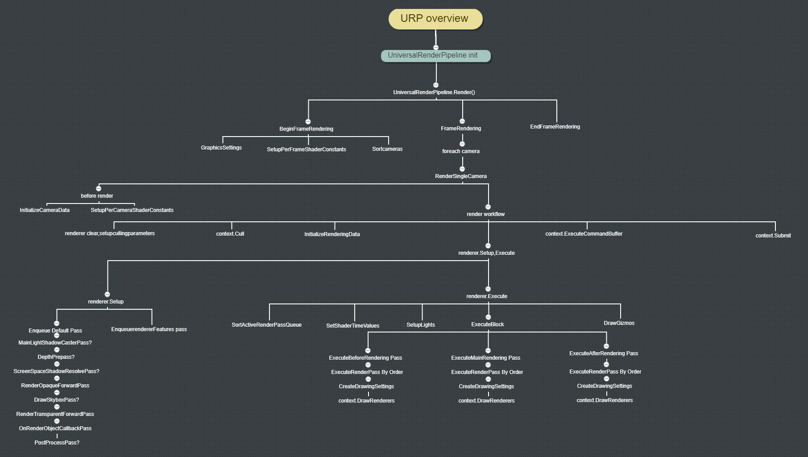

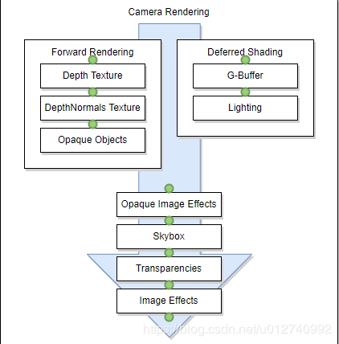

另一份笔记中的管线全景图（原属 Graphics/Rendering pipline 目录）：

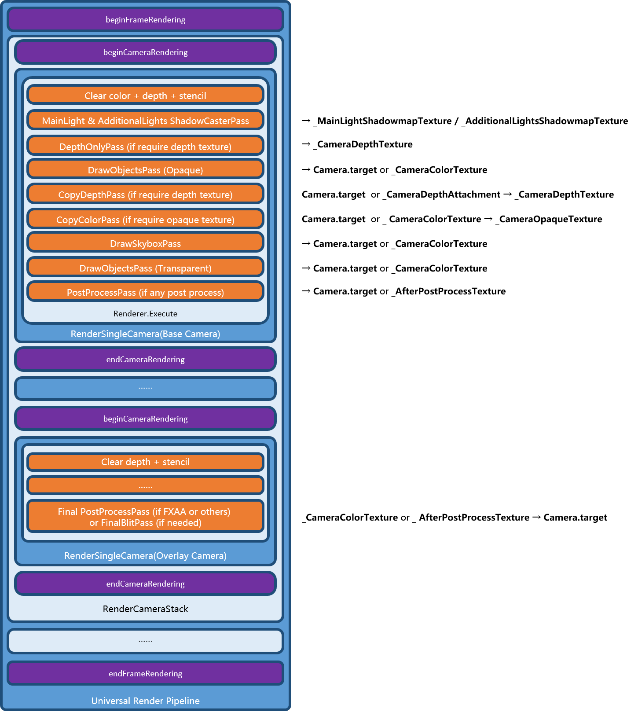

## 四、SRP Batcher

### 4.1 原理

SRP Batcher 只在 SRP 下有效，Built-in 管线不支持。

常规绘制每次 DrawCall 都要"设置 CBUFFER → 上传 CBUFFER"。SRP Batcher 让**每个材质在显存中占据一块固定位置的 CBUFFER**：只要材质内容不变，CPU 就不需要重新绑定/上传，只是切换绘制对象。因此：

- **不减少 DrawCall 数量**；
- 减少的是 DrawCall 之间的 CPU 状态设置开销；
- 因此同一个 Batch 内包含的 DrawCall 越多，收益越大。

### 4.2 适用条件（修正）

原笔记写作"对相同材质的物体进行 Drawcall 合并"，这个表述不准确。实际条件是：

1. 使用 SRP（URP / HDRP / 自定义 SRP），Built-in 管线不生效；
2. 物体使用**同一个 Shader 的同一个变体**（keyword 变体一致）；
3. Shader 的所有材质属性都声明在名为 `UnityPerMaterial` 的 CBUFFER 中，且**所有使用该 Shader 的材质具有完全相同的 CBUFFER 布局与大小**（数值可以不同）；
4. 不能对该材质使用 `MaterialPropertyBlock` 逐物体改属性；
5. 材质属性在运行时被修改后，需要重新上传该材质的数据（当帧收益消失）。

也就是说，SRP Batcher 合并的是**"同 Shader 变体、不同材质"**的绘制，而不是"同一个材质"的绘制。可用 FrameDebugger 查看是否出现 `SRP Batch` 节点，以及 Shader 面板里的 "SRP Batcher: compatible / not compatible"。

### 4.3 合批被打破的情况

同一个 Shader 的三个球可以合成一个 SRP Batch：

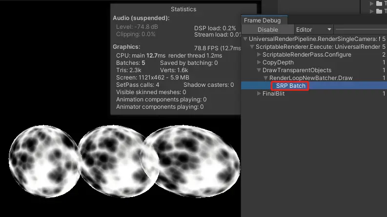

用 `MaterialPropertyBlock` 改属性后不再合并（5 个球 5 个 call）：

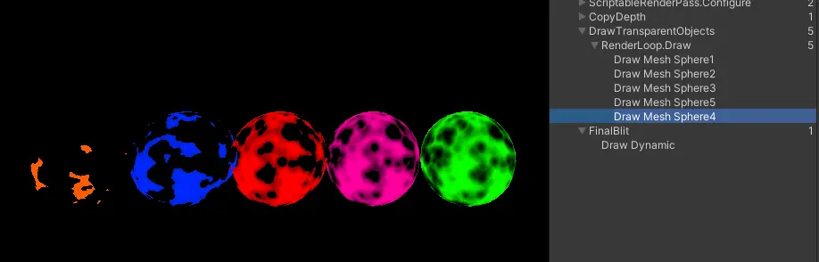

如果中间插入一个其他材质的物体，合批会被打断——下图中粉色球把另外三个球分成了两段：

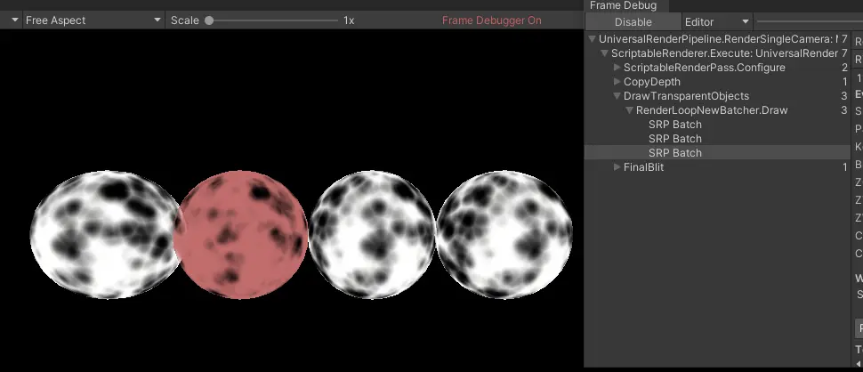

解决思路有两个：

1. 调整粉色球的位置/深度，使其不落在另外三个球的绘制区间内；
2. 给其中一个材质改 `Queue` 偏移（例如 `"Queue"="Geometry+1"`），让同 Shader 的物体连续绘制。

### 4.4 与 GPU Instancing 的对比

| 维度 | SRP Batcher | GPU Instancing |
| --- | --- | --- |
| 前提 | 同 Shader 变体 + `UnityPerMaterial` 布局一致 | 同材质 + 同 Mesh（可用 `MaterialPropertyBlock` 做少量差异） |
| 减少什么 | DrawCall 之间的 CPU 常量绑定/上传 | DrawCall 数量本身 |
| 数据放置 | 每材质一块固定 CBUFFER，内容不变就不重传 | 每实例数据（矩阵、UV 偏移、lightmap index 等）放入常量缓冲 |
| 数据量限制 | 受每材质 CBUFFER 布局约束 | 单个 Constant Buffer ≤ 64 KB（D3D11 限制），实例数受此约束 |
| 典型 API | 自动生效 | `Graphics.DrawMeshInstanced`、`Renderer` 自动 instancing |

GPU Instancing 的两种常见用法：

1. 直接对场景中符合条件（同材质同 Mesh）的物体自动合批，可用 `MaterialPropertyBlock` 改颜色、Cutoff 等少量属性；
2. 用 `Graphics.DrawMeshInstanced` 传一个 `Matrix4x4[]` 一次性画出大量只有位姿不同的物体，需要改属性时配合 `MaterialPropertyBlock`。

补充结论：

- 切换 Shader 变体、切换贴图、开关 Blend 会改变渲染状态；只改颜色等材质属性值通常不引起渲染状态切换；
- GPU Instancing 也能把属性写进 `UnityPerMaterial`，但 **SRP Batcher 优先级高于 GPU Instancing**：没有用 `MaterialPropertyBlock` 修改属性时，会优先走 SRP Batcher；
- GPU Instancing 可以避免"合并 Mesh"带来的内存上升，但每帧都要重建所有实例数据并上传，故常量缓冲区大小必须严格控制；
- `MaterialPropertyBlock` 会打断 SRP Batcher。

### 4.5 合批优先级

```
SRP Batcher / Static Batching  >  GPU Instancing  >  Dynamic Batching
```

（Static Batching 与 SRP Batcher 属于不同层面的优化，实际顺序取决于 Shader 兼容性与物体是否 static；上式为笔记中的经验结论。）

## 五、渲染顺序

### 5.1 整体排序

一个可用的排序理解顺序（针对同一相机）：

1. 相机深度（`Camera.depth`）：小的先渲染；
2. 不透明 / 透明分类：不透明先，透明后；
3. Sorting Layer；
4. Sorting Order（Order in Layer）；
5. RenderQueue。

需要强调：**RenderQueue 2500 是不透明与透明的分界**（不透明 0–2500，透明 2501–5000，队列总范围 0–5000），不是"3000 才开始透明"。`Transparent` 这个名字对应数值 3000，只是透明区间内的一个常用档位。

原笔记中"RenderQueue 大的绝对挡住小的，SortingLayer/SortingOrder 完全不起作用"以及"SortingLayer 高的绝对在前面，无视 RenderQueue"这两句，只在特定渲染器上成立：Sorting Layer / Order in Layer 主要用于 2D（SpriteRenderer、SortingGroup）以及透明队列的排序，**对 3D 不透明物体的 RenderQueue 排序并不是万能的覆盖关系**。实际表现随渲染器类型与队列区间而变，工程上应避免依赖这种"跨维度覆盖"的假设（待核实）。

排序示意：

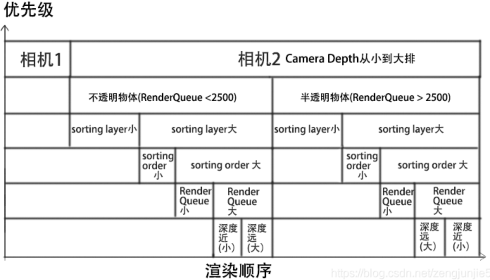

（原图把分界写成 `RenderQueue < 2500` / `> 2500`，有误，已更正：不透明为 `≤ 2500`，透明从 `2501` 开始。）

### 5.2 RenderQueue 数值

ShaderLab 的 `Queue` Tag 预定义了 5 个描述性名字：

| 名称 | 数值 | 用途 |
| --- | --- | --- |
| `Background` | 1000 | 最先渲染，如背景 |
| `Geometry` | 2000 | 不透明物体，**默认值** |
| `AlphaTest` | 2450 | 需要 alpha clip 的物体，可减少 overdraw |
| `Transparent` | 3000 | alpha blending 物体，如粒子、玻璃 |
| `Overlay` | 4000 | 最后渲染，如 UI |

```hlsl
Tags { "Queue" = "Transparent" }
```

数值越小越先渲染。ShaderLab 不支持直接把 `Queue` 写成任意整数，但支持**基于关键字的偏移**：

```hlsl
Tags { "Queue" = "Geometry+1" }     // 2001
Tags { "Queue" = "Transparent-10" } // 2990
```

用偏移可以把同 Shader 的物体排到一起（见 4.3），也常用于解决透明物体之间的穿插顺序。

### 5.3 RenderType

`RenderType` 是给替换式渲染（`Camera.SetReplacementShader`）和某些后处理用的分类标签，常见值：

- `Opaque`：不透明；
- `Transparent`：透明。

它不参与排序，不要和 `Queue` 混淆。

### 5.4 RenderQueueRange 与 ShaderTagId

在 SRP 中，"队列"和"Pass 选择"分别由两个东西控制：

```csharp
// 队列区间过滤
new FilteringSettings(RenderQueueRange.opaque);        // [0, 2500]
new FilteringSettings(RenderQueueRange.transparent);   // [2501, 5000]
new FilteringSettings(new RenderQueueRange(2000, 2500));
```

- `RenderQueueRange` 决定**画哪些物体**（按材质 Queue 过滤）；
- `ShaderTagId`（对应 Pass 的 `LightMode`）决定**用哪个 Pass 画**。

URP 中若 Pass 没有设置 `LightMode`，默认按 `SRPDefaultUnlit` 处理。常见 `LightMode` 取值：

| LightMode | 说明 |
| --- | --- |
| `UniversalForward` | 通过可渲染对象的几何形状并评估所有光源贡献。URP 在正向渲染路径中使用此标记值。 |
| `UniversalGBuffer` | 通过可渲染对象几何形状，而无需评估任何光源贡献。URP 在延迟渲染路径中使用此标记值。 |
| `UniversalForwardOnly` | 与 `LightMode` 具有 `UniversalForward` 值时类似，Pass 渲染对象的几何形状并评估所有光源的贡献。与 `UniversalForward` 的不同之处在于，URP 可以将 Pass 用于正向和延迟渲染路径。如果 URP 使用“延迟渲染路径”时某个 Pass 必须使用“正向渲染路径”渲染对象，则使用此值。例如，如果 URP 使用“延迟渲染路径”渲染场景，并且场景包含具有不适合 GBuffer 的着色器数据的对象（例如“透明涂层法线”），请使用此标签。如果着色器必须同时在“正向渲染路径”和“延迟渲染路径”中进行渲染，请使用 `UniversalForward` 和 `UniversalGBuffer` 标记值声明两个 Pass。如果无论 URP 渲染器使用什么渲染路径，着色器都必须使用正向渲染路径进行渲染，则仅声明 `LightMode` 标记设置为 `UniversalForwardOnly` 的 Pass。 |
| `Universal2D` | 通过可渲染对象并评估 2D 光源。URP 在 2D 渲染器中使用此标记值。 |
| `ShadowCaster` | 通过可从灯光角度将对象深度渲染到阴影贴图或深度纹理中。 |
| `DepthOnly` | Pass 仅将从摄像机的角度来的深度信息渲染为深度纹理。 |
| `Meta` | 仅在 Unity 编辑器中烘焙光照贴图时，Unity 才执行此 Pass。构建 Player 时，Unity 从着色器中删除此 Pass。 |
| `SRPDefaultUnlit` | 渲染对象时，请使用此 `LightMode` 标记值绘制一个额外的 Pass。应用示例：绘制对象轮廓。此标记值对于“正向”和“延迟”渲染路径均有效。当 Pass 不具有 `LightMode` 标签时，URP 会将此标签值用作默认值。 |

## 六、DepthOnlyPass

### 6.1 触发条件

`ForwardRenderer.Setup` 中，只有当 `requiresDepthPrepass == true` 时，才会把 `m_DepthPrepass` 加入 `m_ActivePassQueue`。该值最终来自渲染器/相机的配置数据。以项目中的 `URPAsset` 为例：

- **Renderer List**
  - `0`：`URPRenderer`（`ForwardRendererData`）— Default
  - `1`：`AthenaShadowRenderer`（`AthenaShadowRendererData`）— Set Default
  - `2`：`UIRenderer`（`ArkUIRendererData`）— Set Default
- **Depth Texture**：勾选（原图中用红线标出）
- **[Ark] DepthPrepass**：未勾选
- **Opaque Texture**：勾选；Opaque Downsampling = `2x Bilinear`
- **[Ark] Transparent Texture**：勾选；[Ark] Transparent Downsampling = `None`
- **Terrain Holes**：未勾选

勾选 **Depth Texture** 后，FrameDebugger 中会出现深度相关的 Pass：能直接拷贝深度时是 **`CopyDepthPass`**，只有不能低成本拷贝（例如开启 MSAA）时才走 **`DepthOnlyPass`**（节点名 `DepthPrepass`），具体以 FrameDebugger 中的节点名为准。

精确条件是"相机需要深度纹理，且渲染器不能低成本地直接拷贝深度"（例如开启 MSAA、或使用 depth priming 时需要单独写深度）。不同 URP 版本的判定字段不同（`requiresDepthTexture`、`m_DepthPrimingMode` 等），需要按版本核对（待核实）。

### 6.2 渲染目标

`m_DepthPrepass` 配置时把渲染目标设为 `m_DepthTexture`；`m_DepthTexture` 初始化时 ID 为 `_CameraDepthTexture`，这正是 Shader 中通用的深度纹理名。因此 DepthOnlyPass 的产物可以被任意材质直接采样。

> 项目中另外重写了 `DepthOnlyPass`，目的是支持 **Dither** 与 **Dissolve**：这类效果依赖 alpha clip，必须在深度预写阶段使用与主 Pass 相同的裁剪逻辑，否则深度图与颜色图不一致。
>
> 注意：重写时若 Pass 的过滤条件不包含某些物体，它们不会写入 `_CameraDepthTexture`，后处理与软粒子会出现错误。

## 七、CommandBuffer.GetTemporaryRT

`CommandBuffer.GetTemporaryRT(nameID, descriptor, filterMode)` 做两件事：

1. 从临时 RT 池申请一张纹理；
2. 把该 RT 与 `nameID` 对应的全局 Shader 属性绑定，后续 Shader 可直接按该名字采样。

URP 的 `CopyColorPass` 就是用它把 `_CameraColorTexture` 拷贝到临时 RT 供后续 Pass 使用。

### 7.1 坑点：释放不等于清零

调用 `CommandBuffer.ReleaseTemporaryRT` 只是把纹理**归还池**，并不会清空内容。之后若申请一张尺寸/格式相同的临时 RT，很可能拿到同一张纹理，里面还是上一次的数据。因此：

- 需要干净内容时必须显式 `Clear`（或在 `SetRenderTarget` 时用 `RenderBufferLoadAction.Clear`）；
- 依赖"新申请的 RT 一定是空的"是常见 bug 来源。

### 7.2 坑点：RT 名称会错乱

复用发生时，RT 的 `name` 不会随新的 Shader 属性绑定更新，在 FrameDebugger 里会看到令人困惑的名字。例如两个相机各做一次全屏 CopyBlit：前者绑定 `_Transparent`、后者绑定 `_UITransparent`，但实际自始至终只有一张名叫 `_UITransparent` 的 RT，只是在过程中更换了绑定。Shader 取值逻辑正确，但调试时极易误判。

想规避就用 `new RenderTexture(...)` 显式创建（代价是失去池化复用），或给不同用途的 RT 使用不同的 descriptor/尺寸。

### 7.3 生命周期约定

- `GetTemporaryRT` 应在 `OnCameraSetup` 中申请，`ReleaseTemporaryRT` 在 `OnCameraCleanup` 中释放；
- 不要在 `Execute` 里每帧申请而不释放；
- 临时 RT 在帧结束时也会被引擎回收（不同版本行为略有差异，待核实），但显式释放仍是推荐做法；
- `CommandBuffer` 本身来自 `CommandBufferPool.Get()`，执行后必须 `Release`。

## 八、RT 的创建与销毁

一个真实事故：在自定义 `DepthNormalPass : ScriptableRenderPass` 中重载 `OnCameraSetup` / `OnCameraCleanup`，在 `OnCameraCleanup` 里把 RT 置为 `null`。

`OnCameraSetup` 中申请 RT：

```csharp
public override void OnCameraSetup(CommandBuffer cmd, ref RenderingData renderingData)
{
    var desc = renderingData.cameraData.cameraTargetDescriptor;
    desc.depthBufferBits = 0;
    desc.graphicsFormat = GetGraphicsFormat();
    RenderingUtils.ReAllocateIfNeeded(ref _normalHandle, desc, FilterMode.Point, TextureWrapMode.Clamp, name: "_CameraNormalsTexture");

    desc.graphicsFormat = GraphicsFormat.None;
    desc.depthStencilFormat = GraphicsFormat.D32_SFloat_S8_UInt;
    desc.depthBufferBits = 32;
    RenderingUtils.ReAllocateIfNeeded(ref _depthHandle, desc, FilterMode.Point, wrapMode: TextureWrapMode.Clamp, name: "_CameraDepthTexture");

    ConfigureTarget(_normalHandle, _depthHandle);
    ConfigureClear(ClearFlag.All, Color.black);
}
```

`OnCameraCleanup` 中却只是把引用置空：

```csharp
public override void OnCameraCleanup(CommandBuffer cmd)
{
    _normalHandle = null;
    _depthHandle = null;
}
```

结果内存持续上涨，涨到约 177 GB 后机器死机。

原因：把引用置 `null` 并不会释放底层显存；下一帧 `OnCameraSetup` 又申请一张新的，旧的那张再也没有引用可以释放，于是每帧泄漏一张 RT。

正确做法：

- 用 `RenderTexture.Release()` / `RTHandles.Release()` 显式释放，再置空引用；
- 或使用池化的 `GetTemporaryRT` / `ReleaseTemporaryRT`；
- 或在 `RTHandle` 体系下用 `ReAllocateIfNeeded`，只在 descriptor 变化时重建。

`RTHandle` 版本的典型写法：

```csharp
public class CustomPass : ScriptableRenderPass
{
    RTHandle m_Handle;
    RTHandle m_DestinationColor;
    RTHandle m_DestinationDepth;

    public override void OnCameraSetup(CommandBuffer cmd, ref RenderingData renderingData)
    {
        var desc = renderingData.cameraData.cameraTargetDescriptor;
        desc.depthBufferBits = 0;   // RTHandle 不能把 color 与 depth 合在一张里
        RenderingUtils.ReAllocateIfNeeded(ref m_Handle, desc,
            FilterMode.Point, TextureWrapMode.Clamp, name: "_CustomPassHandle");
    }

    public override void OnCameraCleanup(CommandBuffer cmd)
    {
        m_DestinationColor = null;
        m_DestinationDepth = null;
    }

    public override void Execute(ScriptableRenderContext context, ref RenderingData renderingData)
    {
        CommandBuffer cmd = CommandBufferPool.Get();
        ScriptableRenderer.SetRenderTarget(cmd, m_DestinationColor, m_DestinationDepth,
            clearFlag, clearColor);
        // ...
        context.ExecuteCommandBuffer(cmd);
        CommandBufferPool.Release(cmd);
    }
}
```

释放时机：`m_Handle` 这类跨相机存活的 RTHandle 应在 RendererFeature 销毁时 `Release()`；`ScriptableRenderPass` 本身没有 `Dispose` 回调，需要自己在 Feature 层管理（待核实具体版本接口）。

### 8.1 RenderBufferLoadAction / StoreAction

设置渲染目标时可指定渲染前后的处理方式：

```csharp
cmd.SetRenderTarget(buffer, loadAction, storeAction);
```

LoadAction（渲染前）：

- `Clear`：按指定颜色/深度值清除，避免脏数据；
- `DontCare`：不关心旧内容，跳过加载/清除，通常更快；**前提是这一步只写不读**——只要后续要读取已有的 depth / stencil（或需要与之前绑定时的内容连续），就必须改成 `Load`，并在结果还要被采样/继续使用时配 `Store`，否则读到的是未定义内容；
- `Load`：保留原内容继续绘制（多步合成、要沿用已有 depth/stencil 时用）。

StoreAction（渲染后）：

- `Store`：保存结果；
- `DontCare`：结果不再需要，省带宽；
- `Resolve`：MSAA resolve 成单采样纹理；
- `StoreAndResolve`：既保留 MSAA 版本，又生成 resolve 版本。

### 8.2 Stencil 依附于 Depth

Unity 无法单独申请 stencil buffer，必须依附于带 depth 的 RT；`RenderTextureDescriptor.depthStencilFormat` 同时决定 depth 与 stencil 的格式。

## 九、Camera 的 targetTexture 与清屏

### 9.1 targetTexture

`Camera.targetTexture` 指定离屏渲染目标：

- 设置后相机不再输出到屏幕，而是渲染到该 `RenderTexture`；
- 适合做监控画面、角色头像、反射/环境捕捉、小地图；
- 与 `Camera.Render()` 配合可以精确控制渲染时机（立即渲染）；
- 渲染 HDR 内容时，RT 需要设置为线性读写，并挂载 tonemapping 后处理，否则读回的不是线性空间结果。

### 9.2 清屏

Unity **不会在每帧开始时自动清空颜色/深度缓冲**，而是由每个相机的 `clearFlags` 决定：

- `Skybox`：清颜色（画天空盒）+ 清深度；
- `SolidColor`：清为 `backgroundColor` + 清深度；
- `DepthOnly`：只清深度，颜色保留（Overlay 相机常用）；
- `Nothing`：都不清，直接在上一帧/上一相机结果上继续画。

由此产生两个实践结论：

1. **花屏/残影**：如果场景中所有相机都没有清颜色，本帧会叠加在上一帧结果上。至少要有一个相机的 `clearFlags` 为 `SolidColor` 或 `Skybox`，并且它的 `depth` 是所有相机中最小的（最先渲染）。
2. **Overlay 相机的行为**：Base Camera 的 clear 是 color + depth + stencil；Overlay Camera 清 depth + stencil，颜色直接叠加在 Base 的颜色附件上。这与"Overlay 就是画 UI"的印象不同——它和 Base 基本等同，只是不清颜色。另外相机的 **Clear Depth** 开关关闭时，Overlay 相机不执行深度清除，而是沿用上一相机写入的深度；此时"只清 depth + stencil"的描述不成立。

### 9.3 FrameDebugger 中的一个陷阱

SRP 的每个 Pass 可以自主决定是否 clear。若某个 Pass 没有任何可绘制对象而被过滤掉，**它配置的 clear 仍然会执行**。FrameDebugger 里看到的 `Clear(Depth)` 可能来自前一个 Pass，而不是当前可见的 Pass——不要据此判断 clear 的来源。

## 十、URP 相机设置

### 10.1 Universal Additional Camera Data

URP 中带 `Camera` 组件的 GameObject 还必须带 **Universal Additional Camera Data** 组件。项目使用 URP 时，新建 Camera 会自动添加（下图粉色标识）：

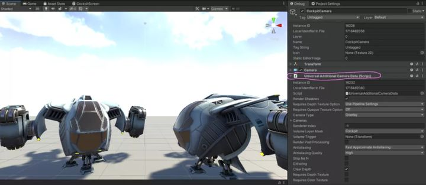

### 10.2 Base Camera 与 Overlay Camera

URP 的 Render Type 分两种：

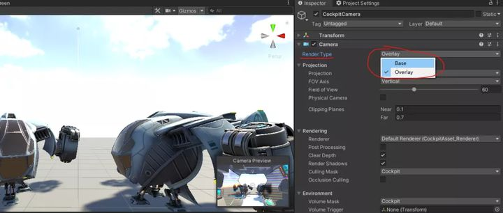

- **Base Camera**：默认类型，可渲染到指定目标的通用相机。场景中至少要有一个 Base Camera 才能渲染任何东西。
- **Overlay Camera**：把自己的视图叠加到另一个相机的输出之上，用于驾驶舱、UI 叠加等。

**Overlay Camera 不能单独使用**：不属于任何 Camera Stack 的 Overlay 相机不会执行渲染循环中的任何步骤，必须作为某个 Base Camera 的 stack 成员。

### 10.3 Camera Stack 与多相机用途

Camera Stack 把一个或多个 Overlay Camera 叠加到 Base Camera 上，并明确定义渲染顺序。常见用途：

1. 合并多个相机输出为单个输出，例如在 2D UI 中插入 3D 模型、做车辆驾驶舱；
2. 多个 Base Camera 或 Camera Stack 渲染到同一目标，做分屏；
3. 把 Base Camera / Camera Stack 渲染到 RenderTexture，做 CCTV 监视器之类的效果。

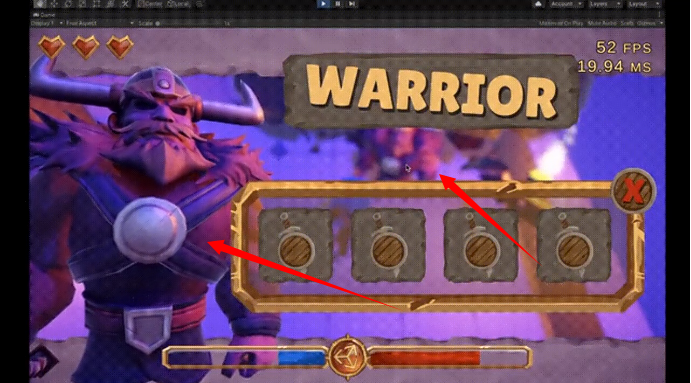

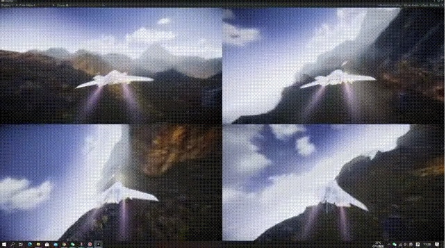

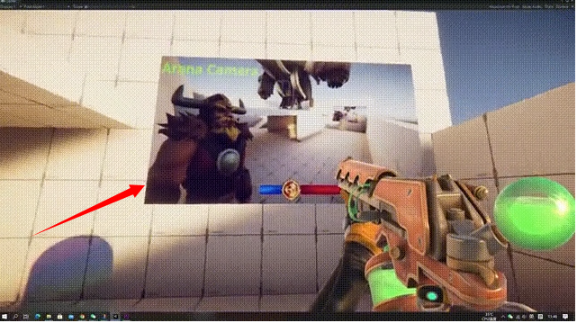

### 10.4 多相机渲染的实际行为（Base + Overlay）

1. Overlay 相机依然可以是透视投影；
2. `DrawOpaqueObjectsPass` 之前需要 clear RT：Base 是 color + depth + stencil，Overlay 是 depth + stencil（Clear Depth 关闭时 Overlay 不清深度，沿用上一相机的深度）；
3. 中间 RT（如 `_MainLightShadowmapTexture`、`_CameraDepthTexture`）的 clear 行为在 Base 与 Overlay 上一致；
4. `FinalBlitPass` 只在最后一个 Overlay 上执行；若开启后处理，则没有 FinalBlit（由后处理链路完成最终输出）；
5. 后处理是相机属性，每个相机可独立开关；
6. Overlay 相机没有 Output 属性，无法指定 Display，跟随其所属 Base Camera。

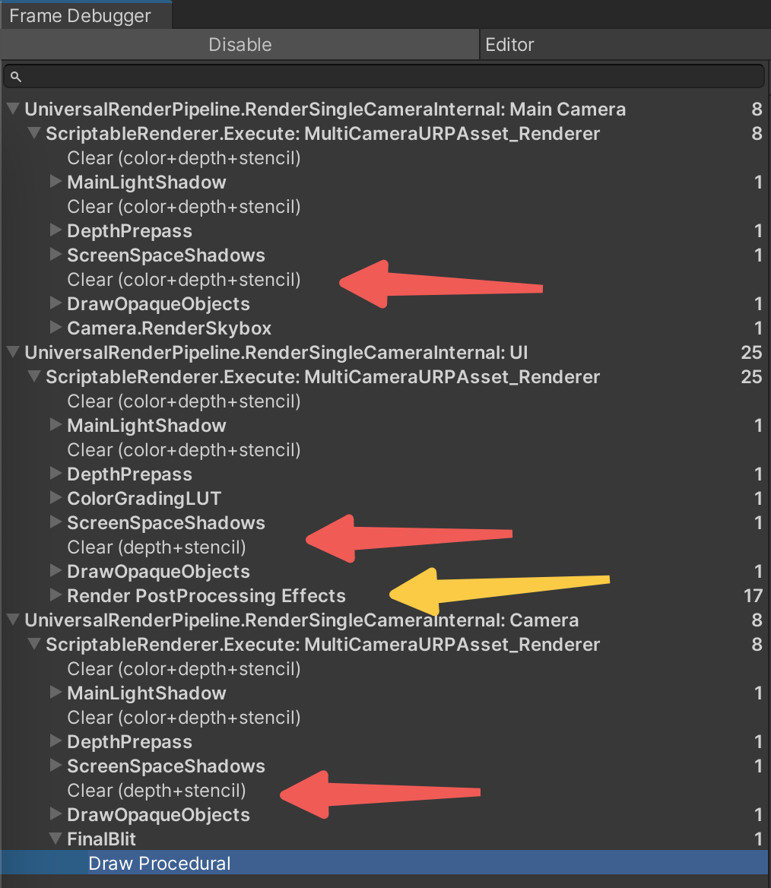

### 10.5 相机与裁剪

- 相机先 `TryGetCullingParameters` 得到剔除参数，再由 `context.Cull` 得到 `CullingResults`；
- 近裁剪面会直接裁掉几何：当一个面的顶点跨过近裁剪面时出现多边形裁剪；当整个面位于近裁剪面之后时整面消失；
- 若"什么都没有画出来"，还要检查 `Cull` 模式：默认 `Cull Back` 会剔除背向相机的面，最远的那一面本来就不会被绘制，移动位置也不会出现。

## 十一、Lightmap Resolution 对大小与表现的影响

### 11.1 参数含义

**Lightmapping Settings > Lightmap Resolution** 的单位是 **texels per unit**，即"场景中每单位长度占用的纹理像素数"。值越大，烘焙时间与计算量越大。

影响 lightmap 图集与子图大小的因素：

| 参数 | 作用 |
| --- | --- |
| Lightmap Size | 单张 lightmap 的最大尺寸，32–4096 像素 |
| Lightmap Padding | 子图之间的间距，单位像素 |
| Lightmap Resolution | 每单位长度的像素数，控制子图精度 |
| MeshRenderer 的 Scale In Lightmap | 在 Resolution 基础上乘缩放，逐物体控制精度 |
| Transform 的 Scale | 物体缩放同样影响子图精度 |

所谓"子图精度"，指物体在 lightmap 图集中占据的像素大小。

Lighting 窗口（Scene / Realtime Lightmaps / Baked Lightmaps 三个标签，截图为 Scene 页）中的相关设置：

- Resolution：`128`
- Compression：`Auto`
- Intensity Multiplier：`1`
- Bounces：`1`

Realtime Lighting：

- Realtime Global Illumination：未勾选

Mixed Lighting：

- Baked Global Illumination：勾选
- Lighting Mode：`Shadowmask`
  - 面板提示原文：Mixed lights provide realtime direct lighting. Indirect lighting gets baked into lightmaps and light probes. Shadowmasks and light probe occlusion get generated for baked shadows. The Shadowmask Mode used at run time can be set in the Quality Settings panel.

Lightmapping Settings：

- Lightmapper：`Progressive GPU (Preview)`
- Prioritize View：勾选
- Multiple Importance Sampling：勾选
- Direct Samples：`32`
- Indirect Samples：`512`
- Environment Samples：`256`
- Light Probe Sample Multiplier：`4`
- Bounces：`2`
- Filtering：`Auto`
- Indirect Resolution：`2` texels per unit
- Lightmap Resolution：`5` texels per unit
  - 该行提示原文：Sets the resolution in texels that are used per unit for objects being lit by baked global illumination. Larger values will result in increased time to calculate the baked lighting.
- Lightmap Padding：数值被提示框遮挡，未读出（11.3 的截图中为 `20`）
- Directional Mode：`Directional`
- Indirect Intensity：`1`
- Albedo Boost：`1`
- Lightmap Parameters：`Default-Medium`

底部统计：`1 Directional Lightmap: 1024x1024px`，`2.7 MB`；`Occupied Texels: 471.2k`；`Bake Performance: 43.53 mrays/sec`；Auto Generate 未勾选。

### 11.2 UV2 与自动分 UV

模型默认可能已有三套 UV：

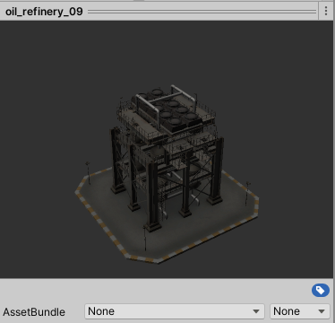

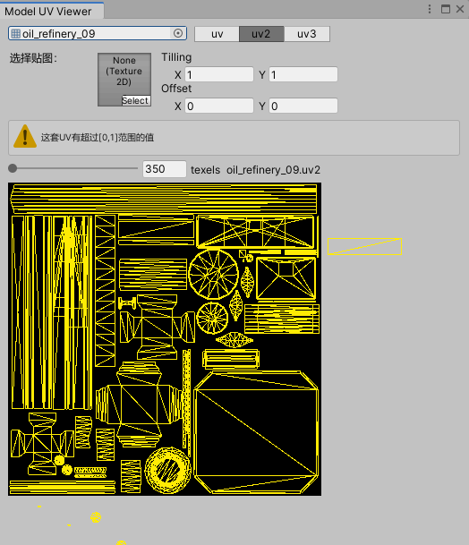

UV2 是 lightmap UV。导入设置中勾选 **Generate Lightmap UV**，Unity 会重新生成一套覆盖 UV2。导入设置（Model 页）中的相关参数：

- Tangents：`Calculate Legacy With Split Tang…`（下拉框截断显示）
- Swap UVs：未勾选
- Generate Lightmap UV：勾选
- Lightmap UVs settings
  - Hard Angle：`88`
  - Pack Margin：`1`
  - Angle Error：`8`
  - Area Error：`15`

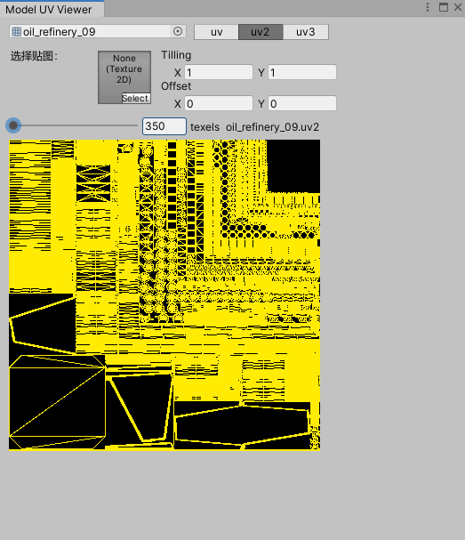

Unity 的自动 lightmap UV 生成（repacking）比较简单粗暴：按三角形的相对面积分配 UV，面积越大分到的 UV 范围越大，**无论该三角形是否可见都会分到 UV**。

为了缩短烘焙时间、提高精度与表现，通常手动分 lightmap UV：给重要且可见的部分更大的 UV 范围，看不见或不重要的部分少分甚至不分。

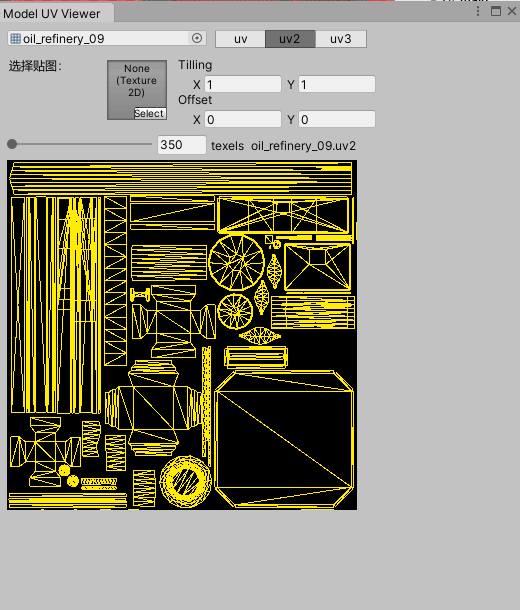

（上图中舍弃了 [0,1] 之外的 UV。）

### 11.3 实例：5 texels per unit

设置 Resolution = 5，场景含 4 个可烘焙物体和 1 个红色 baked point light，其中 `oil_refinery_09` 有 2 倍缩放。相关设置：

- Indirect Resolution：`2` texels per unit
- Lightmap Resolution：`5` texels per unit
- Lightmap Padding：`20` texels
- Lightmap Size：`1024`
- Compress Lightmaps：勾选

场景层级：

```text
main
├─ Main Camera
├─ Point Light
├─ Cube_2x2x2
├─ Cube_1x1x1
├─ Cube_2x1x1
└─ oil_refinery_09
```

烘焙得到 1024×1024 的 lightmap：

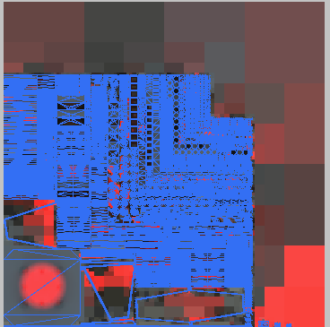

切到 Baked Lightmap 模式可以看到：1×1 的正方体每条边确实占 5 个像素。因为 Unity 自动 UV 是按比例分配的，所以地面、柱子、管道、楼梯只要实际长度是 1 单位，占用的像素数都一样：

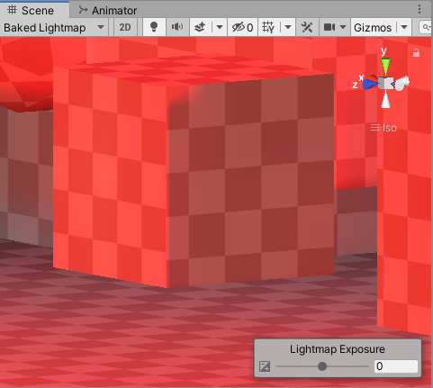

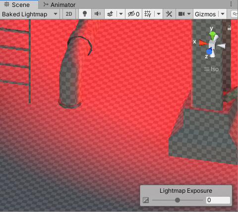

改用手动 UV 烘焙后，同样单位长度在不同部件上占用的像素不同——这就是手动分 UV 的价值：可以灵活决定模型各部分的全局光照精细度。


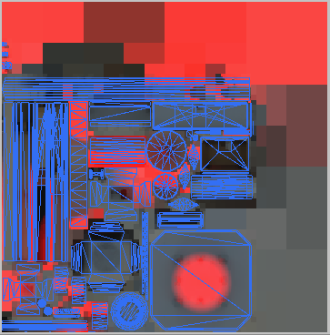

### 11.4 子图大小的估算过程

Unity 由自动 UV 烘焙时，子图大小的计算大致是：

1. 取模型任一三角形的一条边，计算世界长度 `L`；
2. `N = L × Resolution`，得到这条边应占的像素数；
3. 用 `N` 除以这条边在 UV 中的范围，得到整个子图在 lightmap 中的大小。

具体实现未公开，原理应如上（待核实）。若自己分 UV 烘焙，计算方式则不同。

得到子图范围后会划分 UV charts：

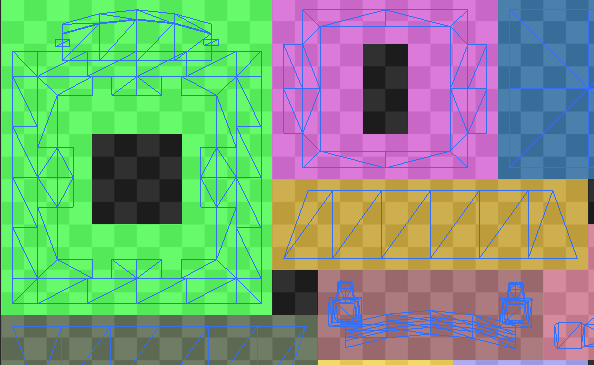

UV chart 之间会预留边缘像素防止 bleeding。注意 `Lightmap Padding` 是**可配置参数**，并非固定 0.5 像素。

烘焙结果是一系列 lightmap 贴图，同时把物体在大图中的子图 Tiling / Offset 写回 MeshRenderer。

## 附录：工作日志中的补充记录

本附录只保留工作日志里可复用的技术结论、公式、代码与参数，按"入口 → 后处理 → FSR → RT → stencil → 顺序"排列。与前文重复的内容只做交叉引用，不再重复展开。

### A.1 后处理入口：从 onRenderImage 到 RendererFeature

Built-in 管线的相机后处理入口是 `MonoBehaviour.OnRenderImage(RenderTexture src, RenderTexture dst)`：相机渲染完成后由引擎回调，脚本里用 `Graphics.Blit` 把 `src` 处理到 `dst`。**URP 不会调用 `OnRenderImage` / `OnPostRender`**，因此把 Built-in 的后处理脚本直接挂到 URP 相机上完全不会执行。

迁移到 URP 的正确入口是 `ScriptableRendererFeature` + `ScriptableRenderPass`：

```csharp
public class MyPostFeature : ScriptableRendererFeature
{
    MyPostPass m_Pass;

    public override void Create()
    {
        m_Pass = new MyPostPass { renderPassEvent = RenderPassEvent.BeforeRenderingPostProcessing };
    }

    public override void AddRenderPasses(ScriptableRenderer renderer, ref RenderingData renderingData)
    {
        renderer.EnqueuePass(m_Pass);   // 入队后由 ScriptableRenderer.Execute 调度
    }
}
```

- Pass 的执行时机由 `renderPassEvent` 决定，取值表见 §3.3；
- 同一个 `RenderPassEvent` 上的多个 Feature，执行顺序由 **URP Asset / Renderer Data 中 Feature 的排列顺序**决定；
- Feature 需要在 Renderer Data 的 Renderer Features 列表里启用，否则 `AddRenderPasses` 不会被调用。

> 日志只记录到"把当前的 PostProcess 替换成 RendererFeature 方式"，并在同阶段增加了平移 / 旋转功能，未记录具体实现（待核实其功能边界）。

#### A.1.1 附：`material.SetVector` 与 `cmd.SetGlobalVector`

两种把参数传给 Shader 的方式，执行时机完全不同：

```csharp
material.SetVector(_BlurParam, blurParam);   // 立即执行：直接改材质（CPU 侧状态），与命令缓冲无关
cmd.SetGlobalVector(_BlurParam, blurParam);  // 缓存为命令，按 CommandBuffer 的执行顺序生效
```

典型踩坑：一个后处理 Pass 在一次 `Execute` 里循环多趟模糊，每趟通过 `material.SetVector` 改半径参数。因为 `cmd.Blit` 只是把命令排进 buffer，而 `material.SetVector` 是**立即写入同一个材质对象**，等到 GPU 真正执行这些 Blit 时，材质上的参数早已是最后一次写入的值——所有迭代都用同一个半径。

正确写法：参数用 `cmd.SetGlobalVector` 与 `cmd.Blit` 一起入队，保证"设参数 → 画"的先后关系在 GPU 侧成立：

```csharp
for (int i = 0; i < iterationCount; i++)
{
    float radius = 1.0f + i * blurRadius;

    blurParam.Set(1, 0, radius, 0);
    cmd.SetGlobalVector(_BlurParam, blurParam);
    cmd.Blit(targetRT, _rtHandle, material);

    blurParam.Set(0, 1, radius, 0);
    cmd.SetGlobalVector(_BlurParam, blurParam);
    cmd.Blit(_rtHandle, targetRT, material);
}
```

结论：**一帧内需要多次改变参数时，一律用 `cmd.SetGlobal*`；`material.Set*` 只适合"整帧只有一个值"的情况。** 另外 `cmd.SetGlobal*` 写的是全局变量，会影响之后所有使用同名属性的材质，命名要注意隔离。

### A.2 URP 后处理的兼容性梳理

在把 URP 内置后处理移植到实际项目时，逐个效果的可用性结论：

| 后处理 | 结论 | 说明 |
| --- | --- | --- |
| SMAA | 弃用 | 在该项目场景中效果不明显 |
| Depth Of Field | 保留 | 放在 FSR **之后**需要额外一张全分辨率深度图；放在 FSR **之前**会出现闪烁，原因待查 |
| TAA | 弃用 | 与 FSR 功能重复，且无法直接使用 |
| Motion Blur | 待定 | 无法直接使用，需要修改 |
| Panini Projection | 保留 | 可以直接使用 |
| UberPost | 保留 | 可以直接使用 |

两条与深度相关的结论：

- **DOF 依赖深度图**：把 DOF 放到 FSR 之后，深度已经是低分辨率上采样结果，必须额外准备一张全分辨率深度；放到 FSR 之前虽然深度来源正确，但与 FSR 的时序耦合会引入闪烁（同一现象在部分记录里也写作"抖动"，两种说法并存，具体原因待查）。
- **SSAO 属于间接光遮挡**，应作为环境光的权重使用，而不是当成一种阴影。它需要深度 + 法线，因此强依赖 `DepthNormalPass`（见 A.10）。

`UberPost.shader` 内部的合成顺序：

1. Chromatic Aberration（色差）
2. Bloom（泛光合成）
3. Vignette（暗角：从中心向四周亮度/饱和度递减）
4. Color Grading（色彩分级，含 LUT）
5. Film Grain（胶片颗粒）
6. Dithering（抖色）
7. HDR 输出编码（`HDR_ENCODING`，移动端不可用，待核实）

> 说明：Bloom 的降采样 / 升采样模糊在独立的 Bloom Pass 中完成，UberPost 里只做与主图像的合成；上表描述的是 UberPost 着色器内部的采样顺序。

### A.3 FSR 的两个开关、相机 key 与交叉渲染冲突

**两个层级的开关**：

1. 每个相机上挂 `FsrCtrl`（后重构为 `Fsr2Controller`）脚本，控制**该相机**是否做 FSR；
2. Renderer Data 上的 `Fsr2RendererFeature` 是**所有相机的总开关**。

之所以要按相机开关，是因为"后处理是相机属性"——每个相机可以独立开闭后处理，FSR 作为后处理的一环也必须跟随相机粒度。

**FSR 设置字典必须以 `Camera` 为 key，不能用 index**：管线中能拿到的是 `camera`，没有稳定的相机索引。

**交叉渲染冲突**：工程里的"交叉渲染"（多相机交替出帧）与 FSR 冲突，开启 FSR 时必须关闭交叉渲染。冲突根因是交叉渲染漏帧后运动矢量失效，有两种表现：

- 相邻两帧都被漏掉时，MotionVector 为 0；
- 只漏一帧时，计算出的 MotionVector 实际指向"被漏掉的那一帧"，重投影到错误的历史帧。

原 `Fsr2Ctrl` 在 `Update()` 里执行 `UpdateVPMatrix` / `UpdateCameraJitter`，漏帧时无法得到正确的 VP 与抖动；重构为 `Fsr2Controller` 后在渲染时序内更新，冲突消除。

> 说明：这里只保留 VP / MotionVector 失效这一条结论。

**FSR 的插入位置**：FSR 目前嵌在 `PostProcessPass` 内部、`StopNan` 之后执行，耦合很紧。若要插在 UberPost 中间，就必须把 UberPost 拆成两个 Pass；长期方案是把 FSR 从后处理里拆出来独立成 Pass。

**抖动与深度**：深度纹理在 `CameraJitterPass` **之前**生成，这样用深度重建世界坐标时不会带上 jitter，否则像素重建出的世界位置会逐帧抖动。

### A.4 cameraTargetDescriptor 的格式与 URP 初始化时序

要在渲染开始前改相机的颜色附件格式（例如把后处理前的 RT 从 sRGB 改成 Linear），必须在 `AddRenderPasses` 里改 `cameraData.cameraTargetDescriptor`，并且把该 Feature 放在 Features 列表的**第 0 位**：

```csharp
public override void AddRenderPasses(ScriptableRenderer renderer, ref RenderingData renderingData)
{
    ref var desc = ref renderingData.cameraData.cameraTargetDescriptor;
    if (renderingData.cameraData.camera.cameraType != CameraType.SceneView)
    {
        var cameraData = renderingData.cameraData;
        bool needsAlphaChannel = Graphics.preserveFramebufferAlpha;
        desc.graphicsFormat = MakeRenderTextureGraphicsFormat(
            cameraData.isHdrEnabled, cameraData.hdrColorBufferPrecision, needsAlphaChannel);
        desc.depthBufferBits = 32;
        desc.sRGB = (QualitySettings.activeColorSpace == ColorSpace.Linear);
    }
}

static GraphicsFormat MakeRenderTextureGraphicsFormat(bool isHdrEnabled,
    HDRColorBufferPrecision requestHDRColorBufferPrecision, bool needsAlpha)
{
    if (isHdrEnabled)
    {
        // 不需要 alpha 且不要求 64 位时，优先 B10G11R11（省带宽）
        if (!needsAlpha && requestHDRColorBufferPrecision != HDRColorBufferPrecision._64Bits
            && RenderingUtils.SupportsGraphicsFormat(GraphicsFormat.B10G11R11_UFloatPack32,
                FormatUsage.Linear | FormatUsage.Render))
            return GraphicsFormat.B10G11R11_UFloatPack32;

        if (RenderingUtils.SupportsGraphicsFormat(GraphicsFormat.R16G16B16A16_SFloat,
                FormatUsage.Linear | FormatUsage.Render))
            return GraphicsFormat.R16G16B16A16_SFloat;

        return SystemInfo.GetGraphicsFormat(DefaultFormat.HDR);   // 老设备上可能仍是 LDR 格式
    }

    return SystemInfo.GetGraphicsFormat(DefaultFormat.LDR);
}
```

**可修改与不可修改的位置**（`RenderSingleCameraInternal` 的调用链）：

```text
RenderSingleCameraInternal
  InitializeCameraData            -- 初始化 cameraData，创建 cameraTargetDescriptor
  InitializeAdditionalCameraData  -- 初始化其余相机参数
  RenderSingleCamera
    renderer.OnPreCullRenderPasses(in cameraData)          -- cameraData 只读，不能改
    renderer.SetupCullingParameters(ref cullingParameters, ref cameraData)  -- 可以改
    UpdateTemporalAATargets                                -- 影响 URP 自带 TAA
    renderer.AddRenderPasses(ref renderingData)            -- 可以改，且要放在 Feature 列表第 0 位
    renderer.Setup(context, ref renderingData)
```

要点：

- `InitializeCameraData` 创建的 descriptor 会一路传到 `renderer.Setup`，之后 `ConfigureTarget` 按它分配 RT；因此格式修改必须在 `renderer.Setup` / `ConfigureTarget` 之前完成，即位于 Feature 列表第 0 位的 `AddRenderPasses` 中（更早的 `OnPreCullRenderPasses` 对 cameraData 只读，改不了）；
- 在 `AddRenderPasses` 里改 descriptor 时，因为 `cameraData` 是 `ref` 传入的，修改会作用于后续所有 Pass；
- `desc.sRGB` 控制 RT 的 sRGB 编码/解码，影响写入与采样；`graphicsFormat` 才是底层存储格式，两者不能互相替代。

### A.5 RTManager：预创建 RT 与每相机 color/depth attachment

**预创建的中间 RT 清单**（以实际项目分辨率为例）：

| RT | 尺寸 | 说明 |
| --- | --- | --- |
| `_MainLightShadowmapTexture` | 4096 × 2048 | 尺寸来自 URP Asset |
| `_CameraNormalsTexture` | 2504 × 1260 | 与相机分辨率一致 |
| `_CameraDepthTexture` | 2504 × 1260 | 与相机分辨率一致 |
| `_SSAO_OcclusionTexture` | 1252 × 630 | 半分辨率 |
| 反射 RT（外部创建） | 1024 × 1024 | 不属于 RTManager 管理 |
| `_CameraColorAttachment` | 2504 × 1260 | 每相机 / 每 Display 一份 |
| `_CameraDepthAttachment` | 2504 × 1260 | 每相机 / 每 Display 一份 |

**每相机 RT 的创建**：把 color 与 depth 拆成两张 RT（不能在 RTHandle 里把两者合在一张），depth 的 descriptor 必须显式改成纯深度格式：

```csharp
void CreateCameraRT(ref RenderTextureDescriptor descriptor, CommandBuffer cmd)
{
    if (perDisplayRT.CameraColorAttachmentRT == null)
    {
        RenderingUtils.ReAllocateIfNeeded(ref perDisplayRT.CameraColorAttachmentRT, descriptor,
            FilterMode.Bilinear, TextureWrapMode.Clamp,
            name: perDisplayRT.name + "_CameraColorAttachment");
        cmd.SetGlobalTexture("_CameraColorTexture", perDisplayRT.CameraColorAttachmentRT.nameID);
    }

    if (perDisplayRT.CameraDepthAttachmentRT == null)
    {
        var depthDescriptor = descriptor;
        depthDescriptor.useMipMap = false;
        depthDescriptor.autoGenerateMips = false;
        depthDescriptor.bindMS = false;
        depthDescriptor.graphicsFormat = GraphicsFormat.None;          // 纯深度
        depthDescriptor.depthStencilFormat = k_DepthStencilFormat;     // 例如 D32_SFloat_S8_UInt
        RenderingUtils.ReAllocateIfNeeded(ref perDisplayRT.CameraDepthAttachmentRT, depthDescriptor,
            FilterMode.Point, TextureWrapMode.Clamp,
            name: perDisplayRT.name + "_CameraDepthAttachment");
        cmd.SetGlobalTexture("_CameraDepthAttachment", perDisplayRT.CameraDepthAttachmentRT.nameID);
    }
}
```

要点：

- `graphicsFormat = GraphicsFormat.None` 是"只要深度"的写法；stencil 只能依附在带深度的 RT 上（见 §8.2）；
- 用 `ReAllocateIfNeeded` 而不是每帧新建，descriptor 不变时不重建；
- 每 Display / 每相机各持有一份，key 用相机（或 Display），不要用索引；
- 计划把 `ScreenSpaceShadow` 的中间 RT 也接入 RTManager 统一预创建（性能考虑），避免每帧申请/释放——目前只是计划，尚未落地；
- 日志中出现过 `_CameraDepthTexture` 与单独创建的 CameraDepthRT **重复**的问题，尝试的处理方式是去掉重复的 CameraDepthRT，并确保复用该 RT 前先 clear；该改动属于尝试阶段，结论待确认。

### A.6 FSR 与 BufferSystem 的衔接需要额外 Blit

FSR 前后与 URP 的 `BufferSystem`（前 / 后 buffer 交换的 ping-pong 机制）衔接受限：

- 启用 FSR 后，`BufferSystem` 只能服务 **FSR 之前**或 **FSR 之后**的一方 Pass，不能两边共用；
- `BufferSystem` 与 Renderer、后处理 Pass 的耦合非常紧，硬插会迫使到处改 `ConfigureCameraTarget`；
- 实践结论：既然 `BufferSystem` 只能服务其中一侧，就**在 FSR 之前或之后的一侧额外增加一次 Blit** 来做交接，这是最省改动的做法（代价是一次全屏拷贝）。

`BufferSystem` 的交换语义：

```text
destination = frontBuffer
source      = backBuffer
blit(source, destination)
colorBufferSystem.Swap();   // 交换后 back 指向上次的运算结果，front 指向上次的源
ConfigureCameraTarget(backBuffer)
```

### A.7 让后处理拿到 depth / stencil：改造 Blit

URP 原生 `PostProcessPass.Blit` 用 `m_UseDrawProcedural` 分流，该值等于 `renderingData.cameraData.xr.enabled`；非 XR 时直接调用 `cmd.Blit`：

```csharp
private new void Blit(CommandBuffer cmd, RenderTargetIdentifier source,
    RenderTargetIdentifier destination, Material material, int passIndex = 0)
{
    cmd.SetGlobalTexture(ShaderPropertyId.sourceTex, source);
    if (m_UseDrawProcedural)
    {
        Vector4 scaleBias = new Vector4(1, 1, 0, 0);
        cmd.SetGlobalVector(ShaderPropertyId.scaleBias, scaleBias);
        cmd.SetRenderTarget(new RenderTargetIdentifier(destination, 0, CubemapFace.Unknown, -1),
            RenderBufferLoadAction.Load, RenderBufferStoreAction.Store,
            RenderBufferLoadAction.Load, RenderBufferStoreAction.Store);
        cmd.DrawProcedural(Matrix4x4.identity, material, passIndex, MeshTopology.Quads, 4, 1, null);
    }
    else
    {
        cmd.Blit(source, destination, material, passIndex);
    }
}
```

`cmd.Blit` 的渲染目标只有颜色，**不携带 depth / stencil**。若后处理链中间某个阶段要读 depth 或做 stencil 测试，必须绕开 `Blit`，自己 `SetRenderTarget` 把深度附上：

```csharp
private new void Blit(CommandBuffer cmd, RenderTargetIdentifier source,
    RenderTargetIdentifier destination, Material material, int passIndex = 0,
    bool needstencil = false, Camera camera = null)
{
    cmd.SetGlobalTexture(ShaderPropertyId.sourceTex, source);
    if (m_UseDrawProcedural)
    {
        // ...（同上面的 XR 分支）
    }
    else
    {
        if (needstencil && camera != null)
        {
            // 目标颜色 + 相机深度（含 stencil）一起绑定
            // 这里只做 stencil 测试，需要沿用已有的 depth/stencil，所以 color 与 depth 都用 Load
            cmd.SetRenderTarget(destination,
                RenderBufferLoadAction.Load, RenderBufferStoreAction.Store,
                m_Depth.id,
                RenderBufferLoadAction.Load, RenderBufferStoreAction.Store);
            cmd.SetViewProjectionMatrices(Matrix4x4.identity, Matrix4x4.identity);
            cmd.DrawMesh(RenderingUtils.fullscreenMesh, Matrix4x4.identity, material, 0, passIndex);
            cmd.SetViewProjectionMatrices(camera.worldToCameraMatrix, camera.projectionMatrix);  // 还原
        }
        else
        {
            cmd.Blit(source, destination, material, passIndex);
        }
    }
}
```

要点：

- 用 `SetRenderTarget(color, depth)` 双目标重载才能同时带 depth 与 stencil；
- 画全屏用 `RenderingUtils.fullscreenMesh` + 单位视图投影矩阵，与 `cmd.Blit` 结果等价但**几何不同**：`fullscreenMesh` 是一张**全屏 quad**（4 顶点，配合 `DrawMesh` 使用）；而 `cmd.Blit` 内部走 `Blit.hlsl`，提交的是 **3 顶点全屏三角形**。若要手写全屏三角形，需用 `DrawProcedural` 只提交 3 个顶点（见 `03_渲染设置与相机.md` §2.3）；
- 画完必须把 View / Projection 矩阵还原，否则会污染后续 Pass；
- `ClearRenderTarget` 的参数顺序是 `ClearRenderTarget(bool clearDepth, bool clearColor, Color backgroundColor)`：要清深度/模板传第一个参数，要清颜色传第二个参数。原稿写作 `ClearRenderTarget(false, true, Color.clear)` 并注释"只清深度/模板，不清颜色"，实际效果正好相反——清的是颜色、不清深度。
- 但在上面这个场景里**不应该清 depth**：stencil 依附于 depth attachment（§8.2），清 depth 会把 stencil 一起重置，stencil 测试就失去意义。要沿用已有的 depth/stencil，应使用 `RenderBufferLoadAction.Load`（后续还需要读回时配 `Store`），而不是 `Clear` 或 `DontCare`。

### A.8 Stencil 掩码、压盖与分类型遮挡

先补两条与 §2.3 / §5.4 配套的用法：

```csharp
// 按 RenderQueue 排序，让同队列的物体连续绘制（有利于合批）
RenderQueueRange renderQueueRange = new RenderQueueRange(minQueue, maxQueue);
DrawingSettings opaqueDrawingSettings =
    CreateDrawingSettings(ShaderTagIds, ref renderingData, SortingCriteria.RenderQueue);
```

> 原日志把 `RenderQueueRange` 与 `ShaderTag` 都说成"用来筛选材质"，表述不准确：`RenderQueueRange` 是按材质的 Queue 值**筛选物体**，`ShaderTagId` 是**选择 Pass**（`LightMode`），后者不对物体做任何过滤。

需要逐批次改渲染状态（blend / depth / stencil / stencilReference）时，入口是 `RenderStateBlock`，而不是材质——这正是同一批物体共用材质、却要写入不同 stencil 值的场景所必需的。

**测试公式**（Unity / D3D 语义）：

```text
(referenceValue & readMask)  comparisonFunction  (stencilBufferValue & readMask)
```

即 reference 与 buffer 值都**先与 readMask 相与**，再比较；写入时按 writeMask 截断。

**在 `DrawRenderers` 上覆盖 stencil 状态**：

```csharp
RenderStateBlock renderStateBlock = new RenderStateBlock(RenderStateMask.Stencil)
{
    stencilReference = 13,
    stencilState = new StencilState()
    {
        readMask = 255,
        writeMask = 255,
        compareFunctionFront = CompareFunction.NotEqual,
        compareFunctionBack = CompareFunction.NotEqual,
        passOperationFront = StencilOp.Keep,
        passOperationBack = StencilOp.Keep,
        enabled = true
    }
};
```

`RenderStateBlock` 可覆盖的状态：`blendState`、`depthState`、`stencilState`、`stencilReference`；`RenderStateMask.Nothing` 表示不改（见 §2.3）。

**用 stencil 做压盖（同一批次、不同 queue）**：

- 两个材质放在同一个 `RenderStateBlock` 里，`Stencil Comp = Greater`，`Stencil Pass = Replace`，`Stencil Ref = 13`；
- queue 小的先画并写入 13；queue 大的后画，由于 `13 > 13` 不成立，重叠像素被丢弃 → 得到"后画的盖住先画的"反向效果，即先画的压盖后画的；
- **3D 对象必须用 `GreaterEqual`**：让后画的物体也能通过 stencil 测试，再由深度测试丢弃真正被遮挡的像素，否则同一物体自身重叠处会被误裁。

一条 FrameDebugger 中的实际状态（stencil 写入 pass）：

| 项目 | 值 | 项目 | 值 |
| --- | --- | --- | --- |
| Size | 2504 × 1260 | ZTest | Always |
| Format | B10G11R11_UFloatPack32 | ZWrite | On |
| Color Actions | Load / Store | Cull | Off |
| Depth Actions | Load / Store | Offset | 0, 0 |
| Blend Color | One / Zero（不混合） | Stencil Ref | 13 |
| BlendOp | Add | Stencil Comp | Greater / Greater |
| Draw Calls | 1 | Stencil Pass | Replace / Replace |

**分类型遮挡**：遮挡关系需要"能被 A 类物体遮挡、不能被 B 类物体遮挡"时，给被遮挡物（如自车）指定一个 stencil 值，各类遮挡物在各自 Pass 里用不同的 `stencilReference` + 比较函数写入，半透明遮挡效果再按 stencil 判定。多套掩码共存时按位分配，例如（readMask / writeMask / compare / ref）：

| 类别 | readMask | writeMask | 比较 | ref |
| --- | --- | --- | --- | --- |
| car | 255 | 255 | never | 1 |
| opaque（多次通过） | 1 | 255 | equal | 2 |
| before（单次通过） | 255 | 255 | greater | 1 |
| grass（多次通过） | 3 | 255 | equal | 4 |
| after（单次通过） | 255 | 255 | greater | 1 |

要点是**每位只表达一件事**：readMask 决定"看哪几位"，writeMask 决定"写哪几位"，多次通过的类别必须用小 readMask 把自己那一位读出来，否则第二次绘制会被自己的写入挡住。

**两个易错点**：

- 同一个材质既写 stencil、又要在后续 Pass 里被读取时，queue 顺序不当会导致**自身绘制出错**（例如 LaneLevel 写 stencil 且 queue 设为 2010 时出现自遮挡）；
- UGUI 的 Mask 靠 stencil 实现。自定义 UI Pass（如 `CameraUIRenderPass`）在画 UI 前必须把 stencil 归零，应在 Pass 配置阶段用 **`ConfigureClear`** 设置 `ClearFlag`，确保 `ConfigureTarget` 之后生效；否则上层的 Mask 对下层失效。

**深度 RT 与半透明遮挡**：自车写深度的 Pass 用 `ZTest LEqual / ZWrite On`，遮挡半透明效果用 `ZTest Always / ZWrite Off`。若两者共用一张深度 RT，深度图里已经包含自车自身深度，判断遮挡时必须排除自遮挡，做法是额外用一张深度 RT 或在 shader 里比较自身深度。

### A.9 车 / UI / FSR 的绘制顺序矛盾

FSR 把画面分成"低分辨率渲染 → 上采样 → 全分辨率 UI"三段，自车与 UI 的绘制位置因此互相冲突：

- **自车放在 FSR 之后**：遮挡半透明效果出错，因为此时可用的深度图不是全分辨率；
- **自车放在 FSR 之前**：UI 绘制出错，因为 UI 在 FSR 之后绘制，需要**全分辨率深度所附带的 stencil** 来做遮挡，而车没有写入这张全分辨率 buffer。

另一条等价描述：UI 需要被自车压盖，原本靠"车在 UI 之后绘制"实现；但 UI 必须在 FSR 之后绘制，车就也被推到 FSR 之后，与"车尽量在 FSR 之前绘制"的需求冲突。

可行的方向是**把车的 stencil 提前写入**：车在 FSR 之前渲染时写入 stencil，FSR 之后的 UI Pass 读取这个 stencil 值做压盖判断，从而不需要车本体在 FSR 之后重画。低分辨率 stencil 直接上采样会糊边，是否可接受取决于遮挡区域大小（待核实）。

### A.10 SSAO 对 DepthNormal 的依赖

SSAO 需要深度 + 法线，因此依赖 `DepthNormalPass` 的产物（`_CameraDepthTexture`、`_CameraNormalsTexture`）。工程中踩到的三个问题：

1. **自车没有 AO 或 AO 错误**：自车不参与 `DepthNormalPass`。二选一——让车不参与 AO，或让车参与 DepthNormal 计算；选择后者时，需要给车的 `renderingLayerMask` 增加一个 `Default` 条目（在 prefab 中设置），否则 `DepthNormalPass` 的过滤条件选不到它。
2. **`DepthNormalPass` 使用了 stencil** 时结果不对：参与写入的物体集合与主 Pass 不一致，导致法线/深度图出现空洞。
3. **开启 FSR 后**车被移到后处理之后并按全分辨率绘制，而 SSAO 仍是降分辨率，两者分辨率不一致，AO 结果出现错位。

由此得到的通用约束：**所有依赖屏幕空间深度/法线的效果，必须与写入深度/法线的 Pass 在同一分辨率、同一物体集合下**。分辨率或过滤集合不一致，就会出现"某类物体没有 AO""遮挡边缘发黑"这类问题。

### A.11 顺带说明：矩阵行/列主序

日志中关于"矩阵行主序 / 列主序不影响乘法语义、只影响矩阵构造"的结论与示例，与 `03_渲染设置与相机.md` §1.4 的 TBN 构造部分完全一致，此处不再重复。

## 原始笔记索引

- `Unity/SRP.md`
- `Unity/URP Pipeline.md`
- `Graphics/Rendering pipline/URP Pipeline.md`
- `Unity/SRP Batcher.md`
- `Unity/SRP Batcher & GPU Instance.md`
- `Unity/渲染顺序.md`
- `Unity/DepthOnlyPass.md`
- `Unity/CommandBuffer.GetTemporaryRT.md`
- `Unity/RT的创建与销毁.md`
- `Unity/URP相机.md`
- `Unity/unity使用.md`（仅取 URP 多相机、clear、RenderPassEvent、RenderTexture 相关段落）
- `Unity/Lightmap Resolution对lightmap大小和表现的影响.md`
- `Log/2023年05月07日_记录.md`（仅取后处理入口 onRenderImage 测试一条）
- `Log/2023年05月11日_记录.md`（仅取后处理替换为 RendererFeature 一条）
- `Log/日志 05010.md`（仅取 URP 后处理兼容性、UberPost 顺序、SSAO/DepthNormal、stencil 掩码、SetGlobalVector、jitter 与深度纹理相关段落）
- `Log/日志0619.md`（仅取 FSR 双开关、交叉渲染冲突、cameraTargetDescriptor、后处理 Blit 携带 depth/stencil、行列主序对照）
- `Log/日志0802.md`（仅取 RenderQueueRange/ShaderTag/DrawingSettings、RenderStateBlock stencil、RTManager 预创建 RT、FSR 以 camera 为 key 相关段落）
- `Log/日志0929.md`（仅取 CreateCameraRT、FSR 与 BufferSystem 衔接相关段落）
- `Log/杂记/日志1217.md`（仅取车/UI 与 FSR 顺序矛盾、ScreenSpaceShadow 接 RT 管理、分类型遮挡 stencil 相关段落）