# 渲染设置与相机

本文覆盖 Unity 中与"渲染设置 + 相机"相关的知识：空间与坐标系、投影与裁剪、渲染队列、光照与 Lightmap 设置、Cubemap 采样，以及不同图形 API 下的深度与 UV 差异。渲染队列与 SRP 侧的 Pass 细节在 `01_SRP与URP.md` 中有更完整的实现说明，本文只保留与设置/相机直接相关的部分。

## 一、Unity 的空间与坐标系

### 1.1 各空间的约定

| 空间 | 手系 | 朝向 / 说明 |
| --- | --- | --- |
| 模型空间（Local） | 左手系 | Y-up，+Z 朝前；齐次坐标 `w = 1` |
| 世界空间（World） | 左手系 | Y-up，+Z 朝前 |
| 相机空间（View） | **右手系** | Y-up，相机朝向 **-Z**（OpenGL 约定） |
| 裁剪空间（Clip） | 左手系（按笔记约定） | Y-up，范围 `[-w, w]` |
| NDC | 左手系 | Y-up，透视除法后得到；深度范围随平台变化 |
| 屏幕空间（Screen） | — | 单位像素；原点随平台：OpenGL 左下，D3D/Metal 左上 |
| 切线空间（Tangent） | 由 TBN 决定 | 法线贴图所在空间，Z 轴为顶点法线 |

几个容易混淆的点：

- Unity 的**世界空间与局部空间是左手系**，但 `Camera.worldToCameraMatrix` 采用的是 **OpenGL 形式的右手系**（相机看向 -Z），所以世界→相机是一次手系切换；
- 编辑器 SceneView 中绘制的相机 Gizmos 视锥看起来是左手系（朝 +Z），但实际的 `worldToCameraMatrix` 是右手系（朝 -Z）。**不要用 Gizmos 判断矩阵的手系**；
- `Camera.worldToCameraMatrix` 保存的是 OpenGL 规范的视图矩阵（与平台无关）；投影矩阵也是 OpenGL 形式，传给 Shader 前必须经过 `GL.GetGPUProjectionMatrix()` 做平台转换。

后文的深度推导统一使用下列记号：$f$ 为 far plane（远裁剪面）到 eye（Camera point）的距离，$n$ 为 near plane（近裁剪面）到 eye 的距离，二者均为正值。

- $z_{eye}$：顶点在 View space 中的 z 分量
- $z_{clip}$：顶点在 Homogeneous clip space 中的 z 分量
- $w_{clip}$：顶点在 Homogeneous clip space 中的 w 分量
- $z_{ndc}$：顶点在 NDC 空间的 z 分量，也就是 $\frac{z_{clip}}{w_{clip}}$
- $z_{depth}$：顶点在 DepthBuffer 中的深度值
- $z_{linear}$：顶点在 View space 中在 near 到 far 之间的线性值，near 是 0，far 是 1
- $z_{linear2}$：顶点在 View space 中的 eye 到 far 之间是线性值，eye 是 0，far 是 1

### 1.2 C# 矩阵与 Shader 内置矩阵的对应关系

```csharp
camera.projectionMatrix != Shader 中的 UNITY_MATRIX_P;
GL.GetGPUProjectionMatrix(camera.projectionMatrix, false) == Shader 中的 UNITY_MATRIX_P;

UNITY_MATRIX_V = unity_MatrixV = camera.worldToCameraMatrix
```

`UNITY_MATRIX_M` 与 `unity_ObjectToWorld` 一致；`unity_WorldToObject` 也能正确完成"左手世界 → 左手局部"的变换。

关于 `camera.cameraToWorldMatrix` 与 `unity_CameraToWorld`：原笔记记录两者不相等，并认为 `unity_CameraToWorld` 把世界空间当作右手空间使用，需要把相机空间坐标的 z 乘 -1 才能得到正确结果。这一点与官方文档的描述（`unity_CameraToWorld` 是"相机空间到世界空间"的矩阵，相机空间同样遵循 -Z 朝前的 OpenGL 约定）存在冲突，**建议以项目实测为准（待核实）**。可以确定的是：`UNITY_MATRIX_V` 是右手系视图矩阵，其逆矩阵才对应"相机空间 → 世界空间"。

`Matrix4x4.LookAt(from, to, up)` 与 `camera.worldToCameraMatrix` 也不相等：前者构造的基向量仍是左手系，等价于

```csharp
Matrix4x4.TRS(from, Quaternion.LookRotation(to - from, up), Vector3.one)
```

即先旋转再平移；后者涉及手系转换，U/V 与世界基向量一致，但 N（前向）需要翻转。

### 1.3 手系对运算的影响

局部→世界、世界→相机这类变换的本质是**基变换**，与手系无关：

- 线性变换定理与左右手无关：基只要线性无关即可，不要求正交；
- 矩阵乘法与左右手无关：本质是换基；
- 点积与左右手无关：要求两向量在同一线性空间且基两两正交；
- **叉乘与左右手有关**：结果方向需要按手系判定。Unity 的 `Vector3.Cross` 采用左手系规则。

因此：世界空间（左手）到相机空间（右手）的变换可以直接用矩阵完成，不需要为"手系不同"额外加负号；只有涉及叉乘（如手工构造切线空间、求法线方向）时才需要关注手系。

### 1.4 切线空间与法线变换

切线空间（TBN）用于法线贴图：法线贴图存的是切线空间下的法线，需要变换到世界空间参与光照。

**法线不能用模型矩阵直接变换。** 非统一缩放会把法线拉歪，必须使用模型矩阵的逆转置：

```hlsl
float3 TransformObjectToWorldNormal(float3 normalOS, bool doNormalize = true)
{
#ifdef UNITY_ASSUME_UNIFORM_SCALING
    // 缩放一致，直接使用模型变换矩阵
    return TransformObjectToWorldDir(normalOS, doNormalize);
#else
    // mul(normalOS, (float3x3)GetWorldToObjectMatrix())
    // 等价于 (M^-1)^T * normalOS：交换相乘顺序实现转置效果
    float3 normalWS = mul(normalOS, (float3x3)GetWorldToObjectMatrix());
    if (doNormalize)
        return SafeNormalize(normalWS);
    return normalWS;
#endif
}
```

**TBN 的构造与使用**（逐顶点构造、按行填充）：

```hlsl
// 三行分别是 tangent / bitangent / normal（行主序）
half3x3 tangentToWorld = half3x3(input.tangentWS.xyz, bitangent.xyz, input.normalWS.xyz);
inputData.normalWS = TransformTangentToWorld(normalTS, tangentToWorld);

real3 TransformTangentToWorld(float3 normalTS, real3x3 tangentToWorld, bool doNormalize = false)
{
    // 矩阵是行主序，因此用左乘：mul(normalTS, tangentToWorld)
    real3 result = mul(normalTS, tangentToWorld);
    if (doNormalize)
        return SafeNormalize(result);
    return result;
}
```

bitangent 通常由叉乘得到：

```hlsl
float3 bitangent = cross(normalWS, tangentWS.xyz) * tangentWS.w;
```

`tangent.w` 保存手性（±1）。这里正是第 1.3 节所说的"叉乘与手系有关"的实际影响点：如果 TBN 的手性与网格导入设置不一致，法线贴图的凹凸方向会整体反转（视觉上表现为"凹变凸"）。

> 矩阵的行主序/列主序不影响乘法语义，但影响矩阵的**构造**方式。上例按行填入 tangent/bitangent/normal，所以用 `mul(vector, matrix)`。

### 1.5 投影矩阵与 NDC 深度

有两种主流约定：

**OpenGL-like**

- 左手系，Y-up，相机朝 +Z（注意：这是"投影后"的约定，与 Unity 的相机空间 -Z 朝前不同）；
- Z 轴：near → -1，far → +1；
- 列主序，矩阵在左、向量在右。

变换的结果为 $(x_{clip}, y_{clip}, z_{clip}, w_{clip})$，其中：

$$w_{clip} = -z_{eye}$$

$$z_{clip} = -\frac{f+n}{f-n}z_{eye} - \frac{2fn}{f-n}$$

深度推导：

- 通过投影变换以及 Perspective division 最后得到的 $z_{ndc} = \frac{z_{clip}}{w_{clip}}$ 是在 $(-1, 1)$ 范围内；
- 最后写入 DepthBuffer 的值是映射到 $(0, 1)$ 范围内的 $z_{depth} = \frac{z_{ndc}+1}{2}$；
- 前面 View space 介绍过 $z_{eye}$ 是负值，所以计算 $z_{linear}$ 和 $z_{linear2}$ 的时候需要处理成正值进行计算。

$$z_{ndc} = \frac{z_{clip}}{w_{clip}} = \frac{-\frac{f+n}{f-n}z_{eye} - \frac{2fn}{f-n}}{-z_{eye}} = \frac{f+n}{f-n} + \frac{2fn}{(f-n)z_{eye}}$$

$$z_{depth} = \frac{z_{ndc}+1}{2} = \frac{f}{f-n} + \frac{fn}{(f-n)z_{eye}}$$

$$-z_{eye} = \frac{2fn}{(f+n) - z_{ndc}(f-n)} = \frac{fn}{f - z_{depth}(f-n)} = \frac{1}{\frac{1}{n} + z_{depth}\frac{n-f}{fn}}$$

$$z_{linear} = \frac{-z_{eye}-n}{f-n} = \frac{1}{\left(1-\frac{f}{n}\right) + \frac{f}{n z_{depth}}}$$

$$z_{linear2} = \frac{-z_{eye}}{f} = \frac{1}{z_{depth}\left(1-\frac{f}{n}\right) + \frac{f}{n}}$$

**Direct3D-like**

- Y-up，相机朝 -Z；Z 轴：near → 1，far → 0（**Reversed-Z**）；
- 行主序，向量在左、矩阵在右；
- Unity 在 D3D-like 平台上使用 Reversed-Z；非 Reversed-Z 情况只需把 near/far 互换即可。

Unity 的相机空间是 OpenGL 形式（右手、-Z 朝前），再叠加 Reversed-Z，透视变换的结果为 $(x_{clip}, y_{clip}, z_{clip}, w_{clip})$，其中：

$$w_{clip} = -z_{eye}$$

$$z_{clip} = \frac{n}{f-n}z_{eye} + \frac{fn}{f-n}$$

（原图有误，已更正：原图此处写作 $z_{clip} = \frac{f}{f-n}z_{eye} + \frac{fn}{f-n}$，该式不能同时满足 near → 1、far → 0；满足 Reversed-Z 映射的正确系数为 $\frac{n}{f-n}$。）

深度推导：

- 通过投影变换以及 Perspective division 最后得到的 $z_{ndc} = \frac{z_{clip}}{w_{clip}}$ 是在 $(1, 0)$ 范围内；
- 最后写入 DepthBuffer 的值是映射到 $(1, 0)$ 范围内的 $z_{depth} = z_{ndc}$；
- 前面 View space 介绍过 $z_{eye}$ 是负值，所以计算 $z_{linear}$ 和 $z_{linear2}$ 的时候需要处理成正值进行计算。

$$z_{ndc} = \frac{z_{clip}}{w_{clip}} = \frac{\frac{n}{f-n}z_{eye} + \frac{fn}{f-n}}{-z_{eye}} = -\frac{n}{f-n} - \frac{fn}{(f-n)z_{eye}}$$

$$z_{depth} = z_{ndc}$$

$$-z_{eye} = \frac{fn}{n + z_{ndc}(f-n)} = \frac{1}{\frac{1}{f} + z_{ndc}\frac{f-n}{fn}} = \frac{1}{\frac{1}{f} + z_{depth}\frac{f-n}{fn}}$$

$$z_{linear} = \frac{-z_{eye}-n}{f-n} = \frac{1}{\left(1-\frac{f}{n}\right) + \frac{f}{n(1-z_{depth})}}$$

$$z_{linear2} = \frac{-z_{eye}}{f} = \frac{1}{z_{depth}\left(\frac{f}{n}-1\right) + 1}$$

> 原笔记在 D3D-like 一节旁标注"相机朝向负 Z 轴 # 存疑，这种还是左手系吗？"。这里的手系描述容易自相矛盾：**关键不是给裁剪空间贴"左手/右手"标签，而是明确近平面/远平面对应的深度值**。工程上只需记住：OpenGL 为 `[-1, 1]`，D3D 常规为 `[0, 1]`，D3D + Reversed-Z 为 `[1, 0]`。

### 1.6 正交投影

正交投影矩阵：

$$\mathbf{M}_{projection} =
\begin{bmatrix}
\frac{2}{r-l} & 0 & 0 & -\frac{r+l}{r-l} \\
0 & \frac{2}{t-b} & 0 & -\frac{t+b}{t-b} \\
0 & 0 & -\frac{2}{f-n} & -\frac{f+n}{f-n} \\
0 & 0 & 0 & 1
\end{bmatrix}$$

当视锥左右、上下对称时 `l = -r`、`b = -t`，矩阵可大幅简化（非对称正交常用于阴影级联或自定义投影）。

注意：`LinearEyeDepth` / `Linear01Depth` 这类由深度缓冲反推线性深度的公式**不适用于正交投影**，也不处理斜视锥（oblique frustum）。

### 1.7 深度线性化与 _ZBufferParams

URP 在 `SetPerCameraShaderVariables` 中这样计算：

```csharp
// From http://www.humus.name/temp/Linearize%20depth.txt
// OpenGL 的深度纹理返回值也在 0..1（与 D3D 相同），所以两者使用同一组常量：
// OpenGL would be:
//   zc0 = (1.0 - far / near) / 2.0;
//   zc1 = (1.0 + far / near) / 2.0;
// D3D is:
float zc0 = 1.0f - far * invNear;
float zc1 = far * invNear;

Vector4 zBufferParams = new Vector4(zc0, zc1, zc0 * invFar, zc1 * invFar);

if (SystemInfo.usesReversedZBuffer)
{
    zBufferParams.y += zBufferParams.x;
    zBufferParams.x = -zBufferParams.x;
    zBufferParams.w += zBufferParams.z;
    zBufferParams.z = -zBufferParams.z;
}
```

`Common.hlsl` 中的三个换算函数：

```hlsl
// Z buffer 转线性 0..1 深度（近平面 0，远平面 1）
// 不处理斜视锥，不支持正交投影
float Linear01DepthFromNear(float depth, float4 zBufferParam)
{
    return 1.0 / (zBufferParam.x + zBufferParam.y / depth);
}

// Z buffer 转线性 0..1 深度（相机原点 0，远平面 1；近平面落在 n/f）
// 不处理斜视锥，不支持正交投影
float Linear01Depth(float depth, float4 zBufferParam)
{
    return 1.0 / (zBufferParam.x * depth + zBufferParam.y);
}

// Z buffer 转线性视空间深度（eye depth）
// 不处理斜视锥，不支持正交投影
float LinearEyeDepth(float depth, float4 zBufferParam)
{
    return 1.0 / (zBufferParam.z * depth + zBufferParam.w);
}
```

三者的零点不同，按需要的端点选择：

- `Linear01Depth`：**相机原点为 0、远平面为 1**，近平面并不在 0，而是落在 `n/f`；
- `Linear01DepthFromNear`：**近平面为 0、远平面为 1**，即把 `Linear01Depth` 的结果再按 `(d - n/f) / (1 - n/f)` 重新归一化；
- `LinearEyeDepth`：返回世界单位的视空间深度（近平面为 `n`、远平面为 `f`），不做归一化。

等价的手写版本（便于理解 `_ZBufferParams` 的构成）：

```hlsl
float LinearEyeDepth(float depth)
{
    half2 params = half2(0, 0);
#if UNITY_REVERSED_Z   // Direct3D / Metal / Vulkan
    params.x = (-1 + _Far / _Near) / _Far;
    params.y = 1 / _Far;
#else                  // OpenGL
    params.x = (1 - _Far / _Near) / _Far;
    params.y = (_Far / _Near) / _Far;
#endif
    return 1 / (params.x * depth + params.y);
}

float Linear01Depth(float depth)
{
    half2 params = half2(0, 0);
#if UNITY_REVERSED_Z
    params.x = -1 + _Far / _Near;
    params.y = 1;
#else
    params.x = 1 - _Far / _Near;
    params.y = _Far / _Near;
#endif
    return 1 / (params.x * depth + params.y);
}
```

### 1.8 从片段着色器获取深度

三种常见方式：

**（1）直接用 `SV_POSITION`**

`SV_POSITION` 在进入片段着色器前已完成插值与透视除法；在 OpenGL 平台还会做 `glDepthRange(0, 1)`，其 z 就是 NDC 下的非线性深度：

```hlsl
float depth = i.vertex.z;
depth = Linear01Depth(depth, _ZBufferParams);
```

**（2）用 varying 保存裁剪空间的 zw**

```hlsl
// vertex shader
v.screenPos = ComputeScreenPos(v.vertex);       // 返回 [0, w]

// fragment shader
float depth = i.screenPos.z / i.screenPos.w;     // 透视除法 → NDC
depth = Linear01Depth(depth, _ZBufferParams);
```

跨平台注意：这里除完得到的是 **NDC 深度**，而 `Linear01Depth` 是按**深度缓冲值**（D3D 为 `[0, 1]`，Reversed-Z 为 `[1, 0]`）构建的。D3D-like 平台两者数值相同，直接传没问题；GL/GLES 的 NDC 是 `[-1, 1]`，直接喂进去会整体错位，需要先换算成缓冲值（`ndc * 0.5 + 0.5`），或直接采样 `_CameraDepthTexture`。

**（3）用 `COMPUTE_EYEDEPTH` / `COMPUTE_DEPTH_01`**

在顶点着色器里变换到相机空间并存进 varying，得到的是**线性**深度，可插值：

```hlsl
#define COMPUTE_EYEDEPTH(o)  o = -mul(UNITY_MATRIX_MV, v.vertex).z
#define COMPUTE_DEPTH_01     -(mul(UNITY_MATRIX_MV, v.vertex).z * _ProjectionParams.w)
```

`_ProjectionParams.w = 1 / FarPlane`。取负号是因为 Unity 的相机空间符合 OpenGL 约定，z 在 `[-n, -f]` 区间。

`ComputeScreenPos` 的实现也解释了为什么它返回 `[0, w]`：

```hlsl
inline float4 ComputeNonStereoScreenPos(float4 pos)
{
    float4 o = pos * 0.5f;
    o.xy = float2(o.x, o.y * _ProjectionParams.x) + o.w;  // o.w = 0.5w
    o.zw = pos.zw;
    return o;
}
```

其中 `_ProjectionParams.x` 为 -1 时表示投影矩阵 y 轴被翻转（渲染到 RT），这也解释了后文 UV 原点差异的处理方式。

## 二、相机的投影与裁剪

### 2.1 投影矩阵的平台转换

`GL.GetGPUProjectionMatrix(proj, renderIntoTexture)` 的第二个参数表示"是否渲染到纹理"，通常传 `IsCameraProjectionMatrixFlipped`。规则：

- `SystemInfo.graphicsUVStartsAtTop == false`（UV 原点在左下，典型为 OpenGL）：`renderIntoTexture = false`；
- `SystemInfo.graphicsUVStartsAtTop == true`（UV 原点在左上，典型为 D3D/Metal/Vulkan）：渲染到屏幕时 `false`，渲染到离屏 RT 时 `true`。

Unity 引擎侧的转换逻辑：

```cpp
void GfxDevice::CalculateDeviceProjectionMatrix(Matrix4x4f& m,
                                                bool usesOpenGLTextureCoords,
                                                bool invertY) const
{
    bool revertZ = GetGraphicsCaps().usesReverseZ;

    if (usesOpenGLTextureCoords)
    {
        // OpenGL-like 纹理坐标：Reversed-Z 平台需要把 z 行取反，转回 GL 的 [-1, 1] 约定
        if (revertZ)
        {
            m.Get(2, 0) = -m.Get(2, 0);
            m.Get(2, 1) = -m.Get(2, 1);
            m.Get(2, 2) = -m.Get(2, 2);
            m.Get(2, 3) = -m.Get(2, 3);
        }
        return;   // OpenGL-like 设备到此为止
    }

    // 翻转屏幕空间 y：OpenGL 屏幕原点在左下，其他平台在左上
    if (invertY)
    {
        m.Get(1, 0) = -m.Get(1, 0);
        m.Get(1, 1) = -m.Get(1, 1);
        m.Get(1, 2) = -m.Get(1, 2);
        m.Get(1, 3) = -m.Get(1, 3);
    }

    // DirectX：NDC 的 z 从 [-1, 1] 变换到 [0, 1]，Reversed-Z 时为 [1, 0]
    //  1   0    0    0
    //  0   1    0    0
    //  0   0  0.5  0.5
    //  0   0    0    1
    m.Get(2, 0) = m.Get(2, 0) * (revertZ ? -0.5f : 0.5f) + m.Get(3, 0) * 0.5f;
    m.Get(2, 1) = m.Get(2, 1) * (revertZ ? -0.5f : 0.5f) + m.Get(3, 1) * 0.5f;
    m.Get(2, 2) = m.Get(2, 2) * (revertZ ? -0.5f : 0.5f) + m.Get(3, 2) * 0.5f;
    m.Get(2, 3) = m.Get(2, 3) * (revertZ ? -0.5f : 0.5f) + m.Get(3, 3) * 0.5f;
}
```

实践结论：

```csharp
var projection = Camera.main.projectionMatrix;              // OpenGL 形式
projection = GL.GetGPUProjectionMatrix(projection, true);   // 与 UNITY_MATRIX_P 一致
```

### 2.2 近裁剪面裁剪与背面剔除

相机视角下，绿色框为近裁剪面：

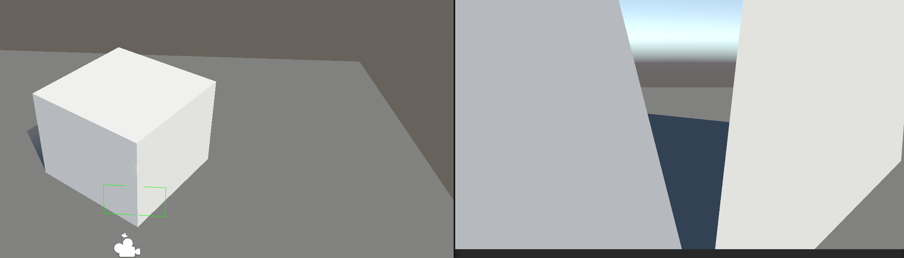

- 当立方体的侧边到相机的距离小于近裁剪面距离时，出现**多边形裁剪**效果；
- 当某个侧面整体位于近裁剪面之后时，整个面被裁掉。

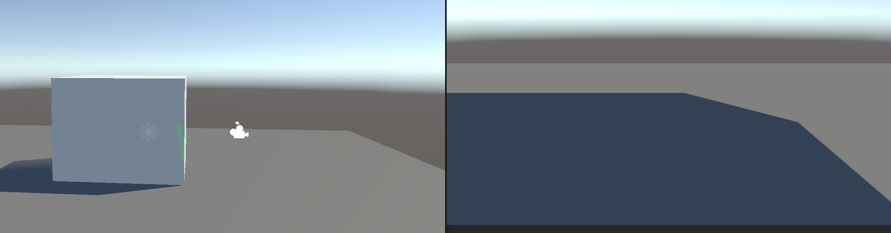

"为什么什么都没有画出来"的常见原因：Shader 默认 `Cull Back`，对相机来说最远的那一面是背面朝向相机的，本来就不会被绘制，与近裁剪面无关。

用深度图 + 像素深度做 `clip` 可以模拟 ZTest：

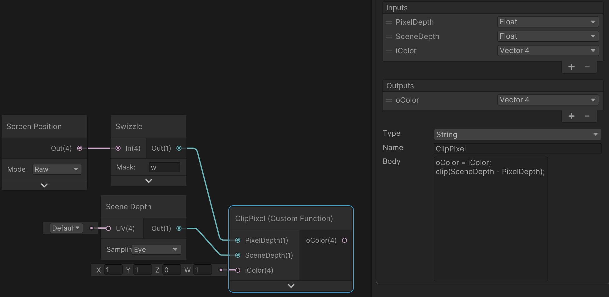

上图 Shader Graph 中自定义函数 `ClipPixel` 的函数体（Node 上 PixelDepth 接 `Screen Position`（Mode = Raw）经 `Swizzle` 取出的 `w` 分量，SceneDepth 接 `Scene Depth`（Sampling = Eye），iColor 接 `Screen Position` 的 xyzw）：

```hlsl
oColor = iColor;
clip(SceneDepth - PixelDepth);
```

### 2.3 后处理中的矩阵

后处理经 `cmd.Blit` 绘制时，几何是一个覆盖屏幕的**全屏三角形**（不是 quad；此处指 `cmd.Blit` 内部路径）：

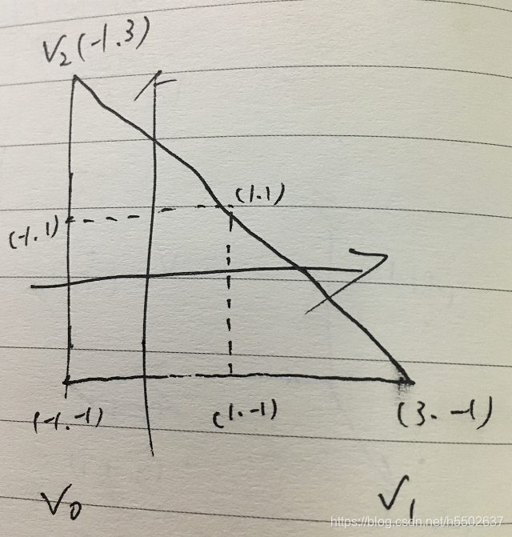

虚线正方形是 NDC 区域，所以 `cmd.Blit` 内部只画了一个超出屏幕的全屏三角形（3 顶点全屏三角形，来自 URP 的 `Blit.hlsl`）。注意区分两种"全屏"几何：

- **`RenderingUtils.fullscreenMesh` 是 quad**（4 顶点），用于 `cmd.DrawMesh` + 单位 View/Proj 矩阵的写法；
- **`cmd.Blit` 的几何在内部走 `Blit.hlsl` 的 3 顶点全屏三角形**，与上面的 `GetFullScreenTriangleVertexPosition` 对应。

两者都覆盖屏幕，但顶点数与提交路径不同，不要混为一谈。后处理阶段 View/Proj 矩阵会被重设：View 变为单位矩阵，Proj 为正交投影（具体取值随管线实现，待核实）。

```hlsl
float4 GetFullScreenTriangleVertexPosition(uint vertexID, float z = UNITY_NEAR_CLIP_VALUE)
{
    float2 uv = float2((vertexID << 1) & 2, vertexID & 2); // (0,0) (2,0) (0,2)
    float4 pos = float4(uv * 2.0 - 1.0, z, 1.0);            // (-1,-1) (3,-1) (-1,3)
    return pos;
}
```

## 三、渲染顺序与队列（相机视角）

完整的排序与队列规则见 `01_SRP与URP.md` 第五节，这里只列与相机设置强相关的部分。

### 3.1 相机深度决定先后

`Camera.depth` 越小越先渲染。URP 中 `SortCameras` 会按此排序；Base Camera 与其 Overlay stack 作为一个整体参与排序。

### 3.2 清屏与顺序的耦合

- 每帧开始 Unity 不会自动清空颜色/深度，靠相机 `clearFlags`；
- 必须有一个 `SolidColor` 或 `Skybox` 的相机，且它的 depth 最小；
- Overlay 相机清 depth + stencil，颜色叠加在 Base 上；若其 **Clear Depth** 开关关闭，则不清深度，沿用上一相机写入的深度。

清屏设置与对应行为：

| ClearFlag | 颜色缓冲区 | 深度（+ stencil）缓冲区 |
| --- | --- | --- |
| SkyBox | **清空**，然后绘制天空盒 | **清空** |
| SolidColor | **清空**，填充为 Background 颜色 | **清空** |
| DepthOnly | 不改变（保留上一相机颜色） | **清空** |
| Nothing | 不改变 | 不改变 |

要点：`SkyBox` 与 `SolidColor` 的差别只在颜色缓冲区**用什么填**（天空盒 vs Background 颜色），两者都是"清颜色 + 清深度"；`DepthOnly` 只清深度、不清颜色（Overlay 相机常用）；`Nothing` 两者都不清，直接在上一相机的结果上继续画。与 `01_SRP与URP.md` §9.2 的清屏说明一致。

### 3.3 队列速查

| Queue | 值 | 说明 |
| --- | --- | --- |
| `Background` | 1000 | 最先渲染 |
| `Geometry` | 2000 | 不透明默认值 |
| `AlphaTest` | 2450 | alpha clip |
| `Transparent` | 3000 | alpha blend |
| `Overlay` | 4000 | UI 等最后绘制 |

- 不透明区间 0–2500，透明区间 2501–5000；
- 支持偏移写法：`"Queue"="Geometry+1"`；
- SRP 中用 `RenderQueueRange.opaque` / `transparent` 做过滤，用 `ShaderTagId` 选择 Pass。

### 3.4 透明物体为什么要等天空盒

不透明物体由近及远绘制以利用 early-Z；透明物体需要与**已经确定的背景**混合，所以顺序必须是 `Opaque → Skybox → Transparent`。

## 四、光照与 Lightmap 设置

### 4.1 主光源方向的约定

URP 中平行光的 `_MainLightPosition.xyz` 存的是**从物体表面指向光源**的方向向量（背离物体、指向光源），关键代码如下：

```csharp
Vector4 dir = -lightLocalToWorld.GetColumn(2);
// 即 -visibleLight.localToWorldMatrix.GetColumn(2) == -transform.forward
```

除平行光外，`_MainLightPosition` 才表示真正的光源世界空间位置。

URP 中 `InitializeLightConstants_Common` 的完整实现（`UniversalRenderPipelineCore.cs`）：

```csharp
public static void InitializeLightConstants_Common(NativeArray<VisibleLight> lights, int lightIndex, out Vector4 lightPos, out ...)
{
    lightPos = k_DefaultLightPosition;
    lightColor = k_DefaultLightColor;
    lightOcclusionProbeChannel = k_DefaultLightsProbeChannel;
    lightAttenuation = k_DefaultLightAttenuation;   // Directional by default.
    lightSpotDir = k_DefaultLightSpotDirection;

    // When no lights are visible, main light will be set to -1.
    // In this case we initialize it to default values and return
    if (lightIndex < 0)
        return;

    // Avoid memcpys. Pass by ref and locals for multiple uses.
    ref VisibleLight lightData = ref lights.UnsafeElementAtMutable(lightIndex);
    var light = lightData.Light;
    var lightLocalToWorld = lightData.localToWorldMatrix;
    var lightType = lightData.LightType;

    if (lightType == LightType.Directional)
    {
        Vector4 dir = -lightLocalToWorld.GetColumn(2);
        lightPos = new Vector4(dir.x, dir.y, dir.z, 0.0f);
    }
    else
    {
        Vector4 pos = lightLocalToWorld.GetColumn(3);
        lightPos = new Vector4(pos.x, pos.y, pos.z, 1.0f);
    }
    ...
}
```

即平行光取 `-localToWorldMatrix.GetColumn(2)`（w = 0），其他光源取 `GetColumn(3)`（w = 1）。

这一点在自建管线时尤其容易搞错：如果自己写入的是 `transform.forward`（照向场景的方向），Shader 里必须取反。

### 4.2 Lightmap Resolution

`Lightmap Resolution` 的单位是 texels per unit，即"每单位长度占用的纹素数"。可以把它想象成一层纹理覆盖在物体表面：每个纹素向外发射光线去寻找光源，光线可多次弹射以捕获间接光。

影响子图大小的参数与计算过程见 `01_SRP与URP.md` 第十一节，核心结论：

- 子图精度由 `Lightmap Resolution × Scale In Lightmap × Transform.Scale` 共同决定；
- Unity 自动 UV 按三角形面积比例分配，不可见面也会占 UV；
- 手动分 UV 可以把精度集中到重要且可见的区域，是提升表现最直接的手段；
- 单张 lightmap 尺寸上限 32–4096，`Lightmap Padding` 以像素为单位且可配置。

### 4.3 各类光源的采样方式

**平行光（直接采样）**

纹素沿光源方向发射一条射线：如果能触达天空（背景），说明该纹素被平行光照到。这决定了主阴影的形状（地面、墙面上的投影）。

**面光源**

单个方向不够，需要在纹素周围多个方向发射射线，统计击中面光源的比例与强度：击中越多，纹素越亮。

**环境光 / 间接光**

射线寻找天空，并允许多次弹射；每次弹射采样击中表面的颜色并带回原纹素，能量按弹射次数衰减（权重递减）。

### 4.4 滤波

除平行光外，每个纹素发射的射线方向是随机的，命中光源数量不同，会造成亮度随机分布（噪点）。滤波用低通滤波去掉高频成分，使亮度过渡平滑：

- **高斯滤波**：方形滤波核，不区分几何体，容易漏光；
- **A-Trous**：会区分几何体，不从其他物体上取值，漏光更少。

### 4.5 Soft Shadow 生效条件

1. 产生阴影的光源（通常是主光源）的 Light 组件 `Shadow Type` 设为 **Soft Shadow**；
2. URP Asset 中勾选 **Soft Shadows**，对应字段 `UniversalRenderPipelineAsset.supportsSoftShadows`（`supportsMainLightShadows` 只管主光阴影是否开启，不是软阴影开关）。

URP Asset 的 `Shadows` 分组参数：

| 参数 | 值 |
| --- | --- |
| Max Distance | 100 |
| Working Unit | Metric |
| Cascade Count | 4 |
| Split 1 | 6 |
| Split 2 | 24 |
| Split 3 | 50 |
| 级联区间（示意） | Split 1/2/3 是占 Max Distance 的百分比，100m 时为 0–6m / 6–24m / 24–50m / 50–100m（4 段） |
| Depth Bias | 1 |
| Normal Bias | 1 |
| Soft Shadows | 勾选（✓） |

### 4.6 烘焙产物

`Lighting / Environment > Generate Lighting` 会对 static 物体烘焙，产生：

- 每个 Reflection Probe 对应的 HDR cubemap（`ReflectionProbe-0`、`ReflectionProbe-1`…）；
- skybox 对应的 Reflection Probe 通常编号最后（如 `ReflectionProbe-10`）；
- Lightmap 贴图。

动态模型进入 Reflection Probe 范围就使用该 cubemap 作为环境光；处于多个 probe 之间则插值；都不在则用默认 skybox。

Unity 有两套 GI 系统：Baked GI（Lightmapping + Light Probe + Reflection Probe）与 Realtime GI（将被弃用）。

## 五、Cubemap

### 5.1 Panoramic 图的参数化

导入的 panoramic（经纬图）满足：

1. **经度**：以 **-Z 轴**为起点、绕 Y 轴的欧拉角，范围 `[0, 360]`；
2. **纬度**：绕 X 轴的角度，范围 `[-90, +90]`。

```csharp
// 欧拉角转方向向量
Vector3 direction = Matrix4x4.Rotate(
    Quaternion.Euler(new Vector3(latitude, longitude, 0))) * Vector3.back;
// Vector3.back = (0, 0, -1)
```

### 5.2 六个面的朝向

1. 每个面在生成时都做了**垂直方向的镜像翻转**，所以从上往下对应 uv 的 v 从 0 到 1；
2. Unity 世界坐标系是左手系，经度从 -Z 起算，因此 **+Z 轴指向 panoramic 图的中间位置**；
3. 采样时按方向向量选面。

### 5.3 采样规则

以 +X 面为例：

```
u = -direction.z / absX;
v = -direction.y / absX;
```

- `direction.z` 从 -1 到 +1，在 +X 面上对应的方向是**从右向左**，而 uv.x 需要从左往右，所以取负；
- `direction.y` 从 -1 到 +1，在 +X 面上对应**从下向上**，方向本来与 uv.v 一致，但 Unity cubemap 的六个面在 v 方向已被翻转，需要再取负抵消。

完整流程：

1. 取 xyz 三个分量中绝对值最大的作为主轴，选择对应二维纹理；
2. 用另外两个分量除以主分量的绝对值，归一化到 `[-1, +1]`；
3. 线性映射到 `[0, 1]` 后采样（线性滤波）。

### 5.4 Shader 实现

```hlsl
float2 Scale01(float2 direction)
{
    return direction.xy * 0.5 + 0.5;
}

float4 SampleEnvironmentMap(float3 direction)
{
    direction = normalize(direction);
    float3 absDir = abs(direction);

    float4 color = (float4)0;
    float2 uv = (float2)0;

    if (absDir.x > absDir.y && absDir.x > absDir.z)
    {
        if (direction.x > 0.0)
        {
            uv.x = -direction.z / absDir.x;
            uv.y = -direction.y / absDir.x;
            uv = Scale01(uv);
            color = tex2D(_PositiveX, uv);
        }
        else
        {
            uv.x = direction.z / absDir.x;
            uv.y = -direction.y / absDir.x;
            uv = Scale01(uv);
            color = tex2D(_NegativeX, uv);
        }
    }
    else
    {
        if (absDir.y > absDir.z)
        {
            if (direction.y > 0.0)
            {
                uv.x = direction.x / absDir.y;
                uv.y = direction.z / absDir.y;
                uv = Scale01(uv);
                color = tex2D(_PositiveY, uv);
            }
            else
            {
                uv.x = direction.x / absDir.y;
                uv.y = -direction.z / absDir.y;
                uv = Scale01(uv);
                color = tex2D(_NegativeY, uv);
            }
        }
        else
        {
            if (direction.z > 0.0)
            {
                uv.x = direction.x / absDir.z;
                uv.y = -direction.y / absDir.z;
                uv = Scale01(uv);
                color = tex2D(_PositiveZ, uv);
            }
            else
            {
                uv.x = -direction.x / absDir.z;
                uv.y = -direction.y / absDir.z;
                uv = Scale01(uv);
                color = tex2D(_NegativeZ, uv);
            }
        }
    }

    return color;
}
```

配套的顶点/片元骨架（方向直接用世界坐标，适合展示用天空球）：

```hlsl
struct appdata { float4 vertex : POSITION; };
struct v2f
{
    float3 posWS : TEXCOORD0;
    float4 vertex : SV_POSITION;
};

v2f vert (appdata v)
{
    v2f o;
    o.posWS = v.vertex.xyz;
    o.vertex = UnityObjectToClipPos(v.vertex);
    return o;
}

fixed4 frag (v2f i) : SV_Target
{
    fixed4 col = fixed4(0, 0, 0, 1);
    col.rgb = SampleEnvironmentMap(i.posWS).rgb;
    return col;
}
```

### 5.5 CPU 侧等价实现

```csharp
static Vector2 Scale01(Vector2 direction)
{
    direction.x = direction.x * 0.5f + 0.5f;
    direction.y = direction.y * 0.5f + 0.5f;
    return direction;
}

Color Sample2D(Color[] colors, Vector2 uv)
{
    Color color = Color.black;
    int envDim = (int)Mathf.Sqrt(colors.Length);
    if (uv[0] < 0 || uv[0] > 1 || uv[1] < 0 || uv[1] > 1)
        return color;

    // uv[1] 不需要额外翻转：cubemap 六个面的纹理已经上下翻转

    uv[0] *= envDim - 1;
    uv[1] *= envDim - 1;

    float[] floorUV = new float[2] { Mathf.Floor(uv[0]), Mathf.Floor(uv[1]) };
    float[] ceilUV  = new float[2] { Mathf.Ceil(uv[0]),  Mathf.Ceil(uv[1]) };

    Vector4[] envPixValue = new Vector4[4];
    envPixValue[0] = colors[(uint)(floorUV[0] + floorUV[1] * envDim)];
    envPixValue[1] = colors[(uint)(ceilUV[0]  + floorUV[1] * envDim)];
    envPixValue[2] = colors[(uint)(floorUV[0] + ceilUV[1]  * envDim)];
    envPixValue[3] = colors[(uint)(ceilUV[0]  + ceilUV[1]  * envDim)];

    float blendU = uv[0] - floorUV[0];
    float blendV = uv[1] - floorUV[1];

    color = Color.Lerp(
        Color.Lerp(envPixValue[0], envPixValue[1], blendU),
        Color.Lerp(envPixValue[2], envPixValue[3], blendU),
        blendV);
    return color;
}

public Color SampleEnvironmentMap(Cubemap cubemap, Vector3 direction)
{
    Vector3 absDir = new Vector3(Mathf.Abs(direction.x),
                                 Mathf.Abs(direction.y),
                                 Mathf.Abs(direction.z));
    Color texColor = new Color();
    Vector2 uv = Vector2.zero;
    Color[] colors;

    if (absDir.x > absDir.y && absDir.x > absDir.z)
    {
        if (direction.x > 0.0)
        {
            uv.x = -direction.z / absDir.x;
            uv.y = -direction.y / absDir.x;
            uv = Scale01(uv);
            colors = cubemap.GetPixels(CubemapFace.PositiveX, 0);
        }
        else
        {
            uv.x = direction.z / absDir.x;
            uv.y = -direction.y / absDir.x;
            uv = Scale01(uv);
            colors = cubemap.GetPixels(CubemapFace.NegativeX, 0);
        }
    }
    else if (absDir.y > absDir.z)
    {
        if (direction.y > 0.0)
        {
            uv.x = direction.x / absDir.y;
            uv.y = direction.z / absDir.y;
            uv = Scale01(uv);
            colors = cubemap.GetPixels(CubemapFace.PositiveY, 0);
        }
        else
        {
            uv.x = direction.x / absDir.y;
            uv.y = -direction.z / absDir.y;
            uv = Scale01(uv);
            colors = cubemap.GetPixels(CubemapFace.NegativeY, 0);
        }
    }
    else
    {
        if (direction.z > 0.0)
        {
            uv.x = direction.x / absDir.z;
            uv.y = -direction.y / absDir.z;
            uv = Scale01(uv);
            colors = cubemap.GetPixels(CubemapFace.PositiveZ, 0);
        }
        else
        {
            uv.x = -direction.x / absDir.z;
            uv.y = -direction.y / absDir.z;
            uv = Scale01(uv);
            colors = cubemap.GetPixels(CubemapFace.NegativeZ, 0);
        }
    }

    texColor = Sample2D(colors, uv);
    return texColor;
}
```

## 六、平台差异

### 6.1 Reversed-Z 的动机

常规透视投影的 NDC 深度 `d` 具有几个特点：

- 契合近大远小：`d` 在 z 小时增长快、z 大时增长慢，深度量化后近处精度更高；
- 绝大部分精度落在近裁剪面附近，远裁剪面趋于无穷对精度影响也很小；
- `d` 在屏幕空间是线性的，光栅化时可直接线性插值。

缺点：

- 精度分布单调递减，离近裁剪面越近精度越高，而实际场景最关心的区域往往不在紧贴近裁剪面处，这部分精度被浪费；
- 近处曲线过陡，绝大多数精度被很近的距离区间占用，稍远处就容易出现 **z-fighting**。

缓解手段：

1. 推远近裁剪面，或把物体拉近；
2. 使用 polygon offset（OpenGL）；
3. 提高深度缓冲位宽；
4. 使用 Reversed-Z。

### 6.2 用浮点替代整型并不会自动提升精度

- 32 位浮点尾数只有 23 位，规格化后加隐含位共 24 位，与 24 位无符号整数精度相同；另外 8 位指数只是扩大表示范围，对精度没有帮助；
- NDC 深度范围是 `[0, 1]`，用浮点后 24 位精度中大于 1 的部分（指数能表示的范围）被浪费；
- 浮点在 0 附近精度最高，与透视深度"近处密集"叠加，分布反而更不均匀。

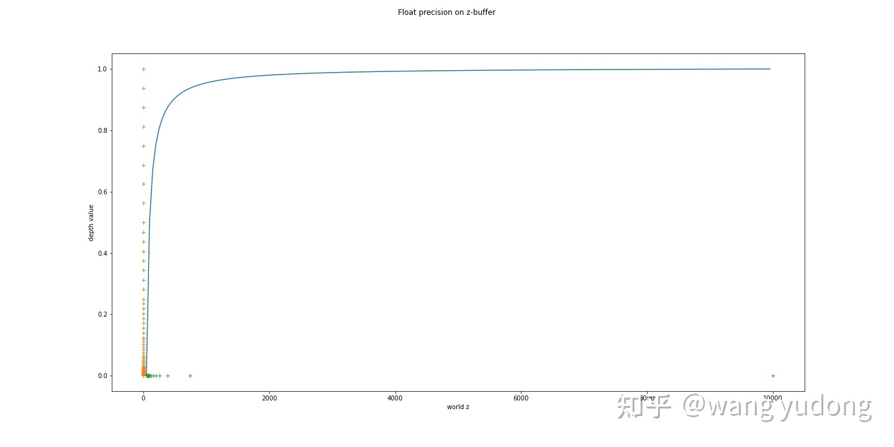

### 6.3 Reversed-Z 的做法

把 `[0, 1]` 的深度首尾互换（0.5 保持不变），图形相当于以 `depth = 0.5` 为轴上下翻转：近裁剪面映射到 1，远裁剪面映射到 0。

投影矩阵有两种实现方式：

1. 直接交换 `n` 与 `f`（对 NDC 中的 `d` 直接操作）；
2. 对投影矩阵左乘一个交换矩阵。

$$\mathbf{T}\mathbf{M}_{p}\mathbf{P}_{w} =
\begin{bmatrix}
1 & 0 & 0 & 0 \\
0 & 1 & 0 & 0 \\
0 & 0 & -1 & 1 \\
0 & 0 & 0 & 1
\end{bmatrix}
\begin{bmatrix}
s & 0 & 0 & 0 \\
0 & s & 0 & 0 \\
0 & 0 & \frac{f}{f-n} & -\frac{fn}{f-n} \\
0 & 0 & 1 & 0
\end{bmatrix}
\begin{bmatrix}
x \\ y \\ z \\ 1
\end{bmatrix}$$

$$d = -\frac{n}{f-n} + \frac{fn}{f-n} \cdot \frac{1}{z}$$

（这里 $z$ 取**正距离**，即 $w_{clip}=z$；与 §1.5 中 $w_{clip}=-z_{eye}$、$z_{eye}$ 为负值的约定只差一个符号。）

此时 `d` 与 `z` 的关系：

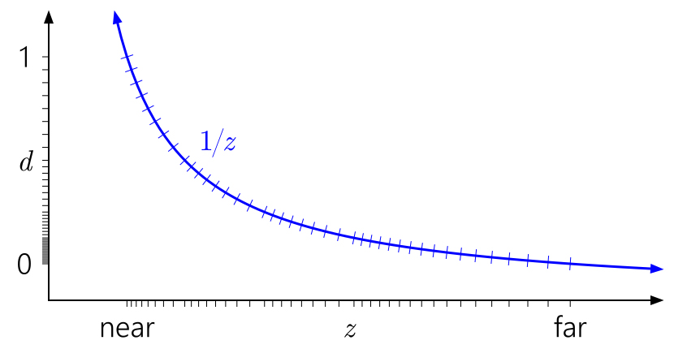

**注意**：OpenGL 的 NDC 深度范围是 `[-1, 1]`，浮点精度集中在 0 附近；即使采用 Reversed-Z，也只是把 `[-1,1]` 翻转，无法获得与 `[0,1]` 相同的精度改善。

### 6.4 各平台的深度范围

| 平台/API | 是否 Reversed-Z | 深度范围 |
| --- | --- | --- |
| Direct3D 11/12 | 是 | `[1, 0]` |
| Metal | 是 | `[1, 0]` |
| Vulkan | 是 | `[1, 0]` |
| Switch | 是 | `[1, 0]` |
| OpenGL / OpenGL ES | 否 | NDC `[-1, 1]`，写入深度缓冲后经 `glDepthRange(0,1)` 为 `[0, 1]` |

原笔记中写作 "D3D11 Metal Switch Vulkan 均采用了 RESERVED_Z"，系 `REVERSED_Z` 的笔误。

对应的宏：

- `UNITY_REVERSED_Z`：D3D / Metal / Vulkan 等平台定义，深度缓冲值为 `[1, 0]`；
- `UNITY_NEAR_CLIP_VALUE`：近裁剪面在 NDC 的 Z 值，DX 下为 1，OpenGL 下为 -1。

```hlsl
#if defined(SHADER_API_D3D11) || defined(SHADER_API_PSSL) || defined(SHADER_API_METAL) || defined(SHADER_API_VULKAN) || defined(SHADER_API_SWITCH)
// D3D style platforms where clip space z is [0, 1].
#define UNITY_REVERSED_Z 1
#endif

#if defined(UNITY_REVERSED_Z)
#define UNITY_NEAR_CLIP_VALUE (1.0)
#else
#define UNITY_NEAR_CLIP_VALUE (-1.0)
#endif
```

### 6.5 精度分布对比

整型的精度分布（近处密集）：

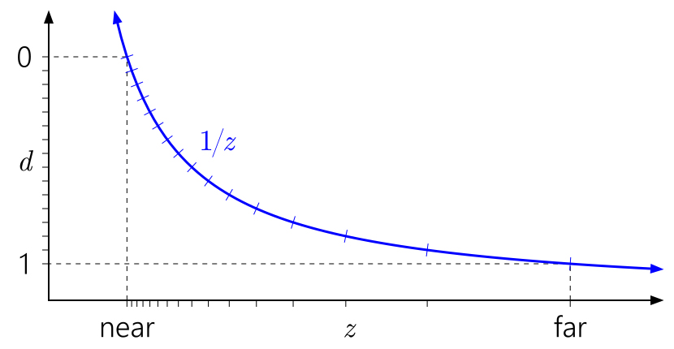

拉近近裁剪面会加剧不均衡：


把远裁剪面推到无穷只让 `d` 缓慢逼近 1，不改变分布形状：

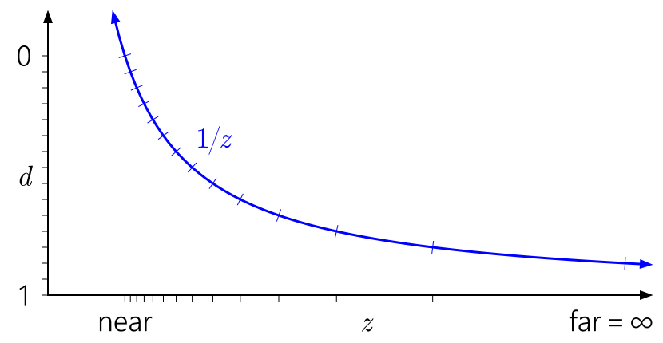

浮点深度（3 指数 3 尾数模拟）在近裁剪面仍存在冗余：


Reversed-Z 后近裁剪面映射到 `d = 1`、远裁剪面映射到 `d = 0`，精度分布明显均衡：

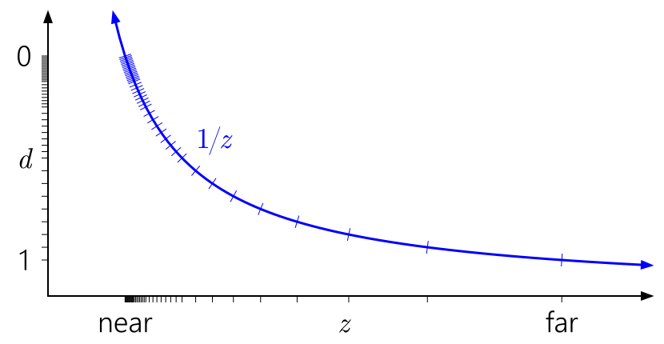

OpenGL 浮点深度：精度集中在 `d = 0` 附近，Reversed-Z 无法改善：

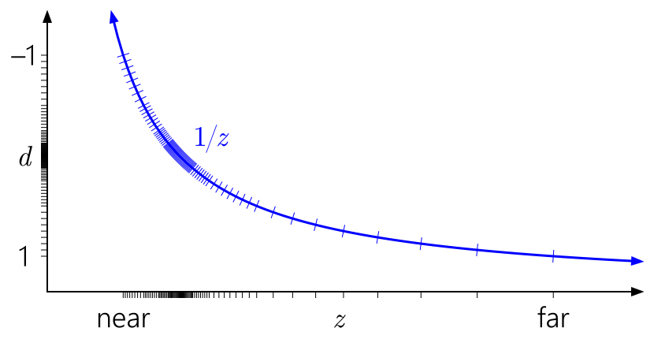

### 6.6 Reversed-Z 带来的接口变化

Unity 官方文档（Shaders: Z-buffer float inverted）中的结论：

- 裁剪空间范围变为 `[near, 0]`，不再是 `[0, far]`；
- `_CameraDepthTexture` 的范围变为 `[1, 0]`；
- Z-bias 在应用前会被取反；
- 24 位深度缓冲切换为 32 位浮点格式。

以下宏/函数已内部处理 Reversed-Z，无需修改：

- `Linear01Depth(float z)`
- `LinearEyeDepth(float z)`
- `UNITY_CALC_FOG_FACTOR(coord)`

手工采样深度缓冲时必须自己处理：

```hlsl
float z = tex2D(_CameraDepthTexture, uv).r;
#if defined(UNITY_REVERSED_Z)
    z = 1.0f - z;
#endif
```

如果要用裁剪空间深度，用下面的宏（注意它在 OpenGL/ES 上不会改变裁剪空间，仍是 `[-near, far]`）：

```hlsl
float clipSpaceRange01 = UNITY_Z_0_FAR_FROM_CLIPSPACE(rawClipSpace);
```

Reversed-Z 平台上的 `_ZBufferParams` 为：

```
x = -1 + far/near
y = 1
z = x / far
w = 1 / far
```

Z-bias 由 Unity 自动处理；若使用 native 渲染插件，需要自己在 C/C++ 侧取反。

### 6.7 UV 原点差异

- `SystemInfo.graphicsUVStartsAtTop` 描述纹理 UV 的 v 轴方向；
- OpenGL 系列：UV 原点在左下（false），屏幕坐标原点也在左下；
- D3D / Metal / Vulkan：UV 原点在左上（true），屏幕坐标原点在左上；
- 因此渲染到 RT 时投影矩阵的 Y 轴需要翻转（`GL.GetGPUProjectionMatrix` 的 `renderIntoTexture` 参数）；
- Shader 中 `ComputeScreenPos` 用 `_ProjectionParams.x` 处理这个翻转。

Compute Shader 的 `SV_DispatchThreadID` 只是线程索引，与纹理坐标无关，没有固定的坐标原点与朝向语义：

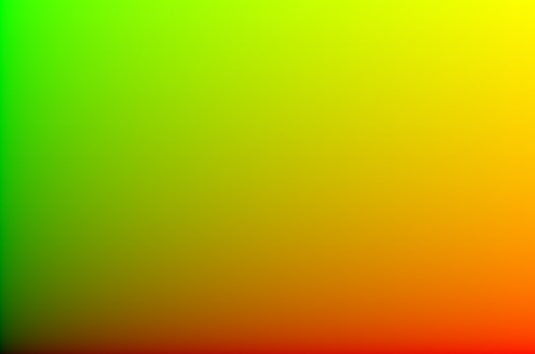

```hlsl
[numthreads(8,8,1)]
void CSMain (uint3 id : SV_DispatchThreadID)
{
    uint width, height;
    _Result.GetDimensions(width, height);
    float2 uv = (id.xy + 0.5f) / float2(width, height);
    _Result[id.xy] = float4(uv.x, uv.y, 0, 1);
}
```

### 6.8 屏幕坐标的一个细节

片段着色器中的 `SV_POSITION` 已经是视口坐标，范围是 `[0.5, width - 1 + 0.5]`（像素中心采样）。因此直接与整数比较永远为 false：

```hlsl
// 错误：永远不成立
if (i.positionCS.x == 700)

// 正确：命中的是第 700 个像素中心
if (i.positionCS.x == 700.5f && i.positionCS.y == 700.5f)
```

`LOAD_TEXTURE2D` 要求 `int2` 且范围为 `[0, width-1]`，对 `positionCS.xy` 做强转等价于 `floor`，刚好落在这个区间：

```hlsl
LOAD_TEXTURE2D(_MainTex, positionCS.xy);          // 隐式 (int2)
LOAD_TEXTURE2D(_MainTex, (int2)positionCS.xy);    // 等价写法
```

## 附录：工作日志中的补充记录

本附录收录工作日志里与"相机 / 投影"直接相关的结论，包括非对称投影、保持 PV 一致的相机推近、相机朝向的 Billboard，以及桥下遮挡的判断思路。与前文重复的推导只做交叉引用。

### B.1 非对称投影：PerspectiveOffCenter 与投影偏移

需要对画面做"水平平移"（保持相机位置和朝向不变，只把投影中心挪开，例如把某个 POI 移到画面指定位置）时，不能用相机的旋转，否则近景会跟着产生视差；正确做法是构造**非对称视锥**。

```csharp
float aspect  = targetCamera.aspect;
float tanFov  = Mathf.Tan(info.FieldOfView * Mathf.Deg2Rad / 2);   // FieldOfView 为纵向 FOV
float height  = info.Near * tanFov;
float width   = height * aspect;

// OriChangeX > 0 表示画面整体向某一侧偏移（归一化到 [-1, 1] 的比例）
float right = width * (1f - info.OriChangeX);
float left  = -width * (1f + info.OriChangeX);

Matrix4x4 projectionMatrix = PerspectiveOffCenter(left, right, -height, height, info.Near, info.Far);
targetCamera.projectionMatrix = projectionMatrix;

Matrix4x4 PerspectiveOffCenter(float left, float right, float bottom, float top, float near, float far)
{
    float x = 2.0f * near / (right - left);
    float y = 2.0f * near / (top - bottom);
    float a = (right + left) / (right - left);
    float b = (top + bottom) / (top - bottom);
    float c = -(far + near) / (far - near);
    float d = -(2.0f * far * near) / (far - near);
    float e = -1.0f;

    Matrix4x4 m = new Matrix4x4();
    m[0, 0] = x;     m[0, 1] = 0.0f;  m[0, 2] = a;    m[0, 3] = 0.0f;
    m[1, 0] = 0.0f;  m[1, 1] = y;     m[1, 2] = b;    m[1, 3] = 0.0f;
    m[2, 0] = 0.0f;  m[2, 1] = 0.0f;  m[2, 2] = c;    m[2, 3] = d;
    m[3, 0] = 0.0f;  m[3, 1] = 0.0f;  m[3, 2] = e;    m[3, 3] = 0.0f;
    return m;
}
```

与 §1.5 的 OpenGL-like 投影矩阵对照：`c = -(f+n)/(f-n)`、`d = -2fn/(f-n)`、`m[3,2] = -1`，完全一致；差别只在 `a`、`b` 不再为 0。因为 `camera.projectionMatrix` 本身就是 OpenGL 约定（Z 范围 `[-1, 1]`），这个矩阵可以直接赋值，之后再由 `GL.GetGPUProjectionMatrix` 做平台转换（§2.1）。

**为什么可以只改 `m02`**：把右边界收紧、左边界放宽后

$$r = w(1-O),\quad l = -w(1+O)$$

有

$$r-l = 2w,\quad r+l = -2wO \;\Rightarrow\; a = \frac{r+l}{r-l} = -O,\quad x = \frac{2n}{r-l} = \frac{n}{w}$$

即横向缩放系数 `x` 与对称投影时**完全相同**，只有偏移项 `a` 变成 `-O`。所以等价的快捷写法是只改投影矩阵的 `m02`（第一行第三列，即 `a`），纵向同理改 `m12`（`b`）。但必须写成"基线 + 偏移 + jitter"的**合成**形式，不要在一个已含 jitter 的矩阵上直接覆盖 `m02`：

```csharp
// baseline 必须是基线矩阵：不含 jitter，也不含非对称偏移（由 fov/aspect/near/far 重建）
baseline.m02 = -info.OriChangeX + jitter.x;
baseline.m12 = -info.OriChangeY + jitter.y;
targetCamera.projectionMatrix = baseline;
```

直接对含 jitter 的矩阵赋值（`perspective.m02 = -info.OriChangeX;`）会**抹掉**当帧 jitter，表现为 TAA / FSR 抖动失效、边缘发虚。

**前提与 jitter 的合成**：写成 `baseline.m02 = -info.OriChangeX + jitter.x;` 之所以安全，是因为它在**基线**上一次性合成；若像早年示例那样直接 `perspective.m02 = -info.OriChangeX;`（整体覆盖 `m02`），只有在"此刻投影矩阵里除了这个偏移没有别的写入"时才成立。TAA / FSR 的 jitter 同样写在投影矩阵的 `m02` / `m12` 上，因此：

- **前提**：拿到的是**基线矩阵**——不含 jitter、也不含非对称偏移（按 fov / aspect / near / far 重新构造，或取本帧写入 jitter 之前的 `camera.projectionMatrix`）；
- **合成方式**：保存基线后写 `-O + jitterOffset`，例如 `baseline.m02 = -O + jitter.x; baseline.m12 = -Oy + jitter.y;`；若手上已经是一个带 jitter 的矩阵，则改用 `+=`（`perspective.m02 += -O;`），不要直接赋值；
- **写入顺序**：先定基线 → 在同一次写入里叠加"非对称偏移 + 当帧 jitter" → 最后一次性赋给 `camera.projectionMatrix`。若先写偏移、之后管线再写 jitter，偏移会被 jitter 的写入覆盖；反过来若在 jitter 之后直接覆盖 `m02`，jitter 会被抹掉（表现为 TAA/FSR 抖动失效、边缘发虚）。两条路都只保留一个值，所以必须在同一处合成后写一次。

```csharp
// 1) 基线：不含偏移、不含 jitter
Matrix4x4 baseline = BuildSymmetricProjection(targetCamera);   // 由 fov/aspect/near/far 重建

// 2) 一次写入：非对称偏移 + 当帧 jitter
baseline.m02 = -info.OriChangeX + jitter.x;
baseline.m12 = -info.OriChangeY + jitter.y;
targetCamera.projectionMatrix = baseline;
```

**注意**：

- `camera.projectionMatrix` 是 OpenGL 约定，且索引是 `m[行, 列]`，`m02` 就是上式里的 `a`；
- 这份矩阵**每帧都可能被管线重算覆盖**（URP 在 `SetupCameraProperties` 里按相机参数重建投影），因此必须在每帧渲染前重新写入，例如放在 `RendererFeature` 的 `AddRenderPasses` / 相机回调里；
- 只改投影矩阵**不会同步更新裁剪**：视锥剔除用的是相机自身的 culling 参数，偏移量较大时边缘物体会被误裁（待核实具体版本行为），必要时把相机 FOV 略微放大再偏移；
- 与 FSR / TAA 的 jitter 共用同一个投影矩阵，两者必须在同一处合成后一次写入（见上面的"前提与 jitter 的合成"），否则后写的一方会覆盖先写的一方。

日志中打印出来的投影矩阵长这样（只列关键分量）：

```text
1.87795   0        0          0
0         3.73205  0          0
0         0       -1.01958   -64.62669
0         0       -1          0
```

第三行是 `(0, 0, c, d)`、第四行是 `(0, 0, -1, 0)`，正是 OpenGL 约定（`m[3,2] = -1`）；横向偏移生效后第一行的第三个数（`m02`）会从 0 变成非零。反查这组数值可得 `f/n ≈ 103`（由 `c` 定）与 `fn/(f-n) ≈ 32.3`（由 `d` 定），可用来校验自己构造的矩阵是否与引擎一致。

### B.2 推近相机同时保持画面：PV 一致

需求：在画面完全不变的前提下缩短主相机视锥在 z 方向的长度（用于提高阴影分辨率，见 §4.5）。

约束是"最终的投影 × 视图矩阵不变"。设推近前的投影、视图为 $P_1$、$V_1$，推近后为 $P_2$、$V_2$，令

$$P_1 V_1 = P_2 V_2$$

两边右乘 $V_2^{-1}$：

$$P_2 = P_1 V_1 V_2^{-1}$$

（原稿在这里先写了一步"$P_1V_1 = P_1V_1V_2^{-1}V_2$"的恒等变形，写法容易误导，已省略。）

实现步骤（顺序不能颠倒）：

1. **确定推近方向**：沿相机的 **forward（视线方向）**直推，即新位置 = 旧位置 + `forward × Δd`；只改位置、不改旋转，否则 $V_2$ 里会混入朝向变化，"画面不变"的前提不成立；
2. 记下当前的 $P_1$（`camera.projectionMatrix`）与 $V_1$（`camera.worldToCameraMatrix`）；
3. 把相机沿 forward 推近到新位置，得到 $V_2$；
4. **先确定新的 near / far**：推近后场景中物体到相机的距离整体减小，near/far 要按新位置重新确定（near 不能切到最近的景物，far 至少要覆盖最远处），Shadow Max Distance 也要同步缩小；
5. **再计算 $P_2$**：near/far 决定投影矩阵的 z 行（`c`、`d`），必须先定下来；$P_2$ 的 x/y 与 $P_1V_1$ 保持一致，z 用新的 near/far，通常还是**非对称投影**（物体不再居中），可以理解为 B.1 的推广；
6. 用 $P_2 = P_1 V_1 V_2^{-1}$ 校验/求出 x/y 部分并赋给 `camera.projectionMatrix`。

顺序上的两个坑：

- **先定 near/far，再算 $P_2$**：反过来先算 $P_2$ 再改 near/far，z 行与 x/y 行来自两套参数，深度分布会对不上；
- **重设 near/far 后必须重新推导 $P_2$**：$P_1V_1 = P_2V_2$ 是在 $P_1$ 的 near/far 下成立的恒等式，一旦 near/far 变化，z 方向的映射就不再是 $P_1$ 的那一套，旧的 $P_2$ 已失效（即使 x/y 看起来仍对），需要按新的 near/far 重新推导，否则深度、阴影与后处理的世界坐标重建都会出现偏差。

为什么能提高阴影分辨率：阴影贴图的精度取决于级联覆盖的世界范围与贴图尺寸之比。把主相机推近、并同步减小 Shadow Max Distance，可以把光源正交视锥在 z 方向的长度压到最小，同时画面保持一致；日志测试结论是 **Cascade Count = 1 就足够**——单级调好之后多级几乎带不来可见提升，反而让 ShadowCaster Pass 的数量按级联数翻倍。

### B.3 相机朝向的 Billboard

让面片始终面向相机（图标、POI、路牌），全部在顶点着色器完成，不需要每帧在 CPU 改 `transform.rotation`：

```hlsl
v2f vert(a2v v)
{
    float3 center = float3(0, 0, 0);                       // 物体空间原点
    // 相机位置转到物体空间，得到"物体指向相机"的方向
    float3 viewer    = mul(unity_WorldToObject, float4(_WorldSpaceCameraPos, 1));
    float3 normalDir = viewer - center;

    // 0..1：压平 y 分量，1 为完全朝向相机，0 为只绕 Y 轴旋转
    normalDir.y *= _VerticalBillboarding;
    normalDir = normalize(normalDir);

    // 法线接近竖直时换一个 up，避免叉乘退化
    float3 upDir    = abs(normalDir.y) > 0.999 ? float3(0, 0, 1) : float3(0, 1, 0);
    float3 rightDir = normalize(cross(upDir, normalDir));
    upDir           = normalize(cross(normalDir, rightDir));   // 重建正交基

    // 把顶点从原坐标系搬到新的朝向坐标系
    float3 centerOffs = v.vertex.xyz - center;
    float3 localPos   = center + rightDir * centerOffs.x
                              + upDir     * centerOffs.y
                              + normalDir * centerOffs.z;
    o.pos = UnityObjectToClipPos(float4(localPos, 1));
}
```

要点：

- 基向量在**物体空间**里构造，`normalDir` 是"物体 → 相机"方向，`right` 由 `up × normal` 得到，再用 `normal × right` 反推精确的 `up`，保证三者正交；
- 先算 `rightDir` 再重算 `upDir` 是关键：直接沿用世界 up 会在大俯仰角下产生剪切；
- `|normalDir.y| > 0.999` 时法线与 up 几乎平行，叉乘退化，必须换 `(0,0,1)` 作临时 up。

> （原稿有误，已更正：原注释把 `_VerticalBillboarding = 0` 说成 "Axial Billboard"、`= 1` 说成 "World-Oriented Billboard"。按代码语义，`= 0` 时 `normalDir.y` 被清零、法线始终保持水平，物体只绕 Y 轴转向相机（柱面 / Y 轴 billboard，图标始终竖直）；`= 1` 时法线完整保留，物体在球面上完全对准相机（Viewpoint-oriented billboard，俯视时会"躺下"）。）

### B.4 桥下遮挡：用相机夹角加权包围球

问题：车行驶到桥下、视角接近垂直向下时，车会被判定为"部分被遮挡"，遮挡半透明效果误触发。

原因：遮挡判断基于屏幕空间深度比较，而车是一个有限体积，桥面在垂直视角下会与车的包围球上半部分相交。

日志中的方案（待核实，未记录验证结果）：以**相机 forward 向量与车自身三个坐标轴的夹角**为系数，对车的包围球直径做加权——视线越接近某个轴，沿该轴的包围球半径权重越小，从而避免把"车顶上方很近的桥面"算成遮挡。实现上是在计算遮挡前动态调整包围球半径，而不是改动深度比较逻辑。

## 原始笔记索引

- `Unity/Unity的空间与坐标系.md`
- `Unity/UNITY_REVERSED_Z.md`
- `Unity/Unity中的Cubemap实现.md`
- `Unity/Unity函数.md`（仅取 `_ZBufferParams`、`ComputeScreenPos`、`LinearEyeDepth` / `Linear01Depth` 相关段落）
- `Unity/片段着色器中获取深度值.md`
- `Unity/渲染顺序.md`
- `Unity/URP相机.md`
- `Unity/Lightmap Resolution对lightmap大小和表现的影响.md`
- `Unity/unity使用.md`（仅取相机/渲染相关段落：主光源方向、多相机 clear、全屏三角形、RenderTexture、Lightmap 采样与滤波、soft shadow）
- `Log/日志0929.md`（仅取 PerspectiveOffCenter 非对称投影、projectionMatrix.m02 投影偏移相关段落）
- `Log/PWRD/日志.md`（仅取"推近相机保持 PV 一致"的公式与原理）
- `Log/杂记/日志1217.md`（仅取 Billboard 顶点着色器实现、桥下遮挡包围球加权方案）