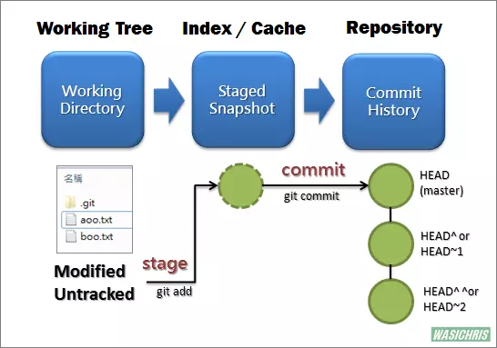
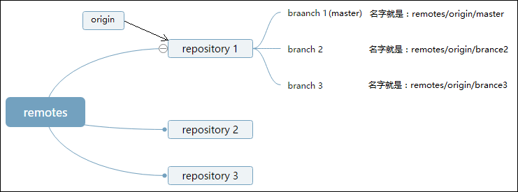
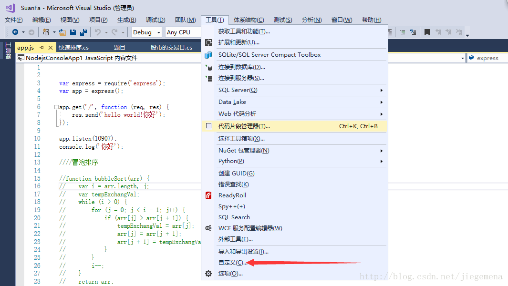
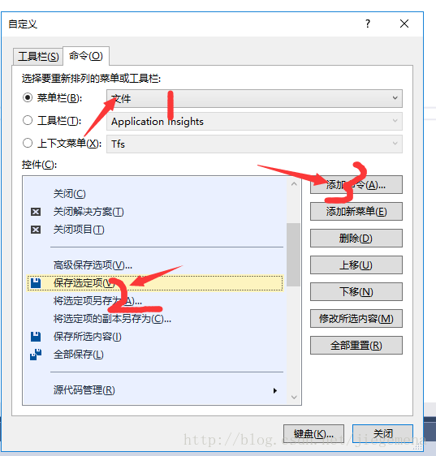
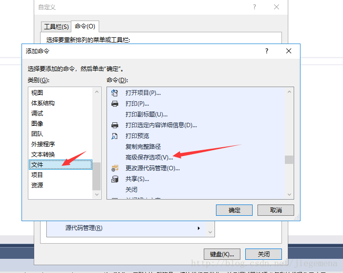
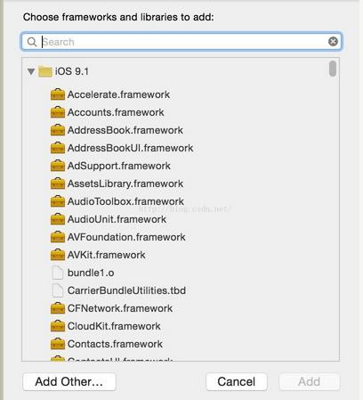
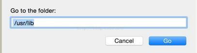
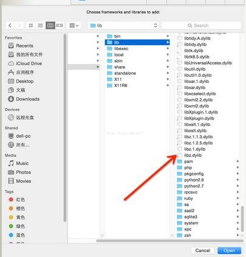

# 开发环境与工具

日常开发中反复用到的工具链与系统操作：Git、CMake、Makefile、Markdown，以及 macOS / Linux / Windows 下的常用命令与若干工程配置。

## 一、Git

### 1.1 提交信息约定

| 前缀 | 含义 |
|---|---|
| `feat` | 新功能（feature） |
| `fix` | 解决 bug |
| `docs` | 文档（documentation） |
| `refactor` | 重构，功能不变但改变实现方式 |
| `test` | 测试 |
| `chore` | 构建过程或辅助工具的变动 |
| `resource` | 资源的增删改 |
| `append` | 对上次提交的补充 |
| `tidy` | 整理、精简代码、去冗余或补注释，功能不变 |

### 1.2 分支与远程

查看当前分支与远程地址：

```bash
git branch
git remote -v
git ls-remote --get-url origin   # 只取某个 remote 的 URL
```

从远程分支拉出并建立跟踪关系：

```bash
git checkout -b dev origin/dev
```

`origin` 只是某个远程仓库的默认名字（是一个指向 repository 的指针，可以存在 `origin2`、`origin3`），`dev` 是分支名。

推送指定分支：

```bash
git push <远程主机名> <本地分支名>:<远程分支名>
git push origin master:master    # 同名的简写
git push origin master
```

删除远程分支：

```bash
git push origin --delete <branch_name>
```

### 1.3 撤销、清理与回退

删除未跟踪的文件（`-d` 连同未跟踪的目录——整个目录及其内容一并删除，不只是空目录；`-x` 连同被 .gitignore 忽略的文件）：

```bash
git clean -df      # 未跟踪的文件与目录
git clean -xdf     # 连同被忽略的文件、目录一起删，慎用
```

放弃对某个文件的跟踪但保留本地文件（注意是 `-f`，不是 `--f`）：

```bash
git rm --cached readme1.txt    # 取消跟踪，保留工作区文件
git rm -f readme1.txt          # 取消跟踪并删除本地文件
git commit
```

查看最近一次提交：

```bash
git show
git show --stat
```

本地回退后同步到远端（会重写远端历史，多人协作分支上禁用）：

```bash
git push origin <branch> --force
git push origin <branch> -f
```

### 1.4 tag

tag 基于本地 commit 创建，与分支推送相互独立，需要单独推送。

```bash
# 创建与推送
git tag <tagName>                       # 轻量标签
git tag -a v0.1.0 -m "release 0.1.0"    # 附注标签
git push origin <tagName>
git push origin --tags                  # 一次推送全部本地标签

# 查看
git tag
git tag -l
git show <tagName>
git ls-remote --tags origin             # 远程所有 tag

# 删除
git tag -d <tagName>                    # 本地
git push origin :<tagName>              # 远程（等价于 --delete）
```

### 1.5 换行符 CRLF / LF

- CR（Carriage Return）对应 `\r`，LF（Line Feed）对应 `\n`。
- Windows 传统上使用 CRLF，Linux 与近年的 macOS 使用 LF。

Git 通过 `core.autocrlf` 处理换行符，涉及两个动作：

- **标准化**：提交时把工作区的 CRLF 转成 LF 存入版本库；
- **转换**：检出时把库中的 LF 转成 CRLF 写入工作区。

```bash
git config --global core.autocrlf true    # Windows：提交标准化 + 检出转换
git config --global core.autocrlf input   # Linux/macOS：只标准化，不转换
git config --global core.autocrlf false   # 提交与检出都保持原样（安装后的默认值）
```

注意：CRLF 与 LF 混用的文件同样逐处标准化——文件里每个 CRLF 都会被转成 LF 存入版本库，与纯 CRLF 文件没有区别。容易造成误解的是检出环节：一旦触发转换，Git 会把整份文件的 LF 都转成 CRLF，于是混用文件在 `git diff` 里会多出大量本不属于本次改动的行。

### 1.6 .gitignore 与取消追踪

`.gitignore` 只对**未被跟踪**的文件生效。已经被跟踪的文件需要先取消跟踪，再写进 `.gitignore`：

```bash
git rm --cached <file>
git commit -m "chore: stop tracking <file>"
```

### 1.7 子模块

```bash
# 仓库尚未 clone：连子模块一起克隆
git clone --recursive <url>

# 仓库已存在：初始化并更新子模块
git submodule update --init --recursive

# 只取最近一次提交，下载更快（不打算贡献代码时可用）
git clone <url> --depth=1
```

子模块下载慢或频繁失败时的处理思路（原笔记方法，镜像后缀的可用性**待核实**）：

```bash
git clone <url>                 # 先不递归
# 编辑 .gitmodules，把各子模块 url 的 github.com 换成可用镜像
git submodule sync              # 同步 .gitmodules 中的地址到 .git/config
git submodule update --init --recursive
```

`.gitmodules` 保存子模块名称、本地路径与下载地址三项信息。

### 1.8 常见报错

| 报错 | 原因 | 处理 |
|---|---|---|
| `CAfile: /etc/ssl/certs/ca-certificates.crt CRLfile: none` | 证书链不完整 | `git config --global http.sslverify false` |
| `SSL certificate problem: unable to get local issuer certificate` | HTTPS 访问的服务器证书未经第三方机构认证 | 同上；按范围可分 `--system` / `--global` / 当前仓库 |
| 每次操作都要输入用户名密码 | 未启用凭据存储 | `git config --global credential.helper store` |
| `error: 5646 bytes of body are still expected` / `early EOF` / `invalid index-pack output` | 大仓库下载中断，HTTP 缓冲不足 | `git config --global http.postBuffer 1024M`（按包体大小调整） |

关闭校验会降低安全性，仅建议在自建或内网仓库上临时使用。

### 1.9 git reset 三种模式

`git reset` 的本质不是"撤销提交"，而是**移动 HEAD 以及 HEAD 指向的 branch**，并决定暂存区、工作区是否跟着回退。

Git 的三个区域：

- **Working Tree**：当前工作目录；
- **Index / Stage**：暂存区，`git add` 把改动放进来；
- **Repository**：提交历史，`git commit` 后的结果，`HEAD` 指向当前提交。

文件进入版本库的流程：工作区修改（modified）→ `git add`（staged）→ `git commit`（进入 repository，三区重新一致）。


三种模式的差异（这是最容易记混的地方）：

| 模式 | HEAD / branch | Index 暂存区 | Working Tree 工作区 | 原 HEAD 与目标提交之间的差异去哪 |
|---|---|---|---|---|
| `--soft` | 移到目标提交 | **保持不动** | **保持不动** | 留在暂存区，相对新 HEAD 呈现为已暂存（staged） |
| `--mixed`（默认） | 移到目标提交 | 重置为目标的快照 | **保持不动** | 留在工作区，呈现为未暂存（unstaged） |
| `--hard` | 移到目标提交 | 重置为目标的快照 | 重置为目标的快照 | **直接丢弃** |

```bash
git reset --soft HEAD^    # 撤销 commit，改动仍在暂存区，可直接重新 commit
git reset HEAD^           # 等价于 --mixed：撤销 commit 与 add，改动回到工作区
git reset --hard HEAD^    # 撤销 commit，并丢弃暂存区与工作区的改动
git reset --hard HEAD     # 放弃本地全部未提交改动
git reset HEAD <file>     # 只把某个文件移出暂存区（unstage）
```

`HEAD^` 表示父提交，等价写法 `HEAD~1`；要回退多个提交用 `HEAD~3`。

使用场景：

1. **`--soft`**：把若干零碎的提交合并成一个。回退到目标提交后，差异都在暂存区，直接 `git commit` 即可。
2. **`--mixed`**：想重新组织提交内容（先 `git add` 挑选，再 `git commit`）；或误 `git add` 了文件，用 `git reset HEAD <file>` 取消暂存；或提交里混入了不该提交的文件，回退后删掉再提交。
3. **`--hard`**：确实要抛弃本地所有改动，或确实要丢弃目标提交之后的全部历史。



风险提示：

- `--hard` 会直接覆盖工作区，未提交的改动无法找回；
- `--hard` 之后如果发现回退错了，可以用 `git reflog` 找到原来的 commit hash，再 `git reset --hard <hash>` 恢复（reflog 有保留期限）；
- 已经推送到共享远端的历史不要用 reset 改写，改用 `git revert` 生成反向提交。

### 1.10 origin 与 master

- 服务端（remote）有多个 repository，每个 repository 下有多个 branch；
- `origin` 是指向某个 repository 的指针，`master`（或 `main`）是该 repository 中默认创建的第一个 branch；
- 本地也有一份 `master`，它指向从远端复制下来的本地分支。

因为 `origin` 和 `master` 都是默认名字，`git push origin master` 可以简写，但依赖默认值属于 bad practice：换分支后容易推错目标，显式写全更安全。



图中层级：`remotes` → `repository 1/2/3`，`origin` 指向 `repository 1`；该仓库下 `branch 1 (master)`、`branch 2`、`branch 3` 在本地分别记为 `remotes/origin/master`、`remotes/origin/branch2`、`remotes/origin/branch3`（原图写作 `braanch 1(master)`、`remotes/origin/brance2`、`remotes/origin/brance3`，拼写有误，已更正为 `branch`）。

## 二、CMake 与 vscode + cmake

### 2.1 生成器（Generator）

CMake 通过生成器产出对应平台的构建文件：Linux 常用 `Unix Makefiles` / `Ninja`，macOS 可用 `Xcode` 或 `Unix Makefiles`，Windows 常用 `Visual Studio <版本>`。

```bash
cmake --help          # 末尾 Generators 一节列出本机可用生成器
cmake -G              # 部分版本会直接打印生成器列表（会先报一行 No generator specified，再列出全部生成器；版本差异，待核实）
```

选择生成器（名字必须与 `cmake --help` 中列出的完全一致）：

```bash
cmake -G "Unix Makefiles" ..
cmake -G "Xcode" ..
cmake -G "Visual Studio 15 2017" ..
cmake -G "Visual Studio 16 2019" -A x64 ..
```

注意：原笔记里的 `cmake .. -GXcode` 是紧凑写法（`-G` 直接粘贴参数），至今仍被接受，属风格差异而非失效写法；`-G Xcode`（`-G` 与参数之间留空格）可读性更好，推荐使用。

常规流程是先建独立构建目录，避免中间文件污染源码目录：

```bash
mkdir -p build && cd build
cmake ..
cmake --build .
```

### 2.2 CMakeLists 常用写法

```cmake
cmake_minimum_required(VERSION 3.16)
project(Breakout)

# 收集当前目录（不递归）下的源文件
aux_source_directory(src DIR_SRCS)

# 递归收集所有 .cc 源文件，新增文件无需改 CMakeLists
file(GLOB_RECURSE SOURCE_FILES CONFIGURE_DEPENDS *.cc)

add_executable(${PROJECT_NAME} ${DIR_SRCS} ${SOURCE_FILES})
```

`aux_source_directory` 不会递归子目录；需要覆盖多级目录时用 `file(GLOB_RECURSE ...)`。`CONFIGURE_DEPENDS` 让构建时重新检查文件列表（CMake 3.12+）。

### 2.3 引入第三方库

**源码形式（以 glfw 为例）**

```bash
git submodule add https://github.com/glfw/glfw.git 3rd/glfw
```

```cmake
add_subdirectory(${GLFW_DIR})                       # 把库一起编译
include_directories(${GLFW_DIR}/include)            # 头文件搜索路径
target_link_libraries(${PROJECT_NAME} glfw)         # 链接
```

**预编译库形式（以 irrKlang 为例）**

用 `find_package` 引入，找不到官方预定义模块时会执行 `FindXXX.cmake`：

```cmake
find_package(IrrKlang REQUIRED)
include_directories(${IRRKLANG_INCLUDE_DIR})
target_link_libraries(${PROJECT_NAME} glfw ${IRRKLANG_LIBRARY})
```

`FindIrrKlang.cmake` 中按平台分支设置路径，并用 `find_library` 按 base name 找库：

```cmake
find_path(IRRKLANG_INCLUDE_DIR NAMES irrKlang.h PATHS "${3RD_DIR}/irrKlang-1.6.0/include")

if(WIN32)
    if("${CMAKE_CXX_COMPILER_ID}" STREQUAL "MSVC")
        find_library(IRRKLANG_LIBRARY NAMES irrKlang PATHS "${3RD_DIR}/irrKlang-1.6.0/lib/Win32-visualStudio")
    elseif("${CMAKE_CXX_COMPILER_ID}" STREQUAL "GNU")
        find_library(IRRKLANG_LIBRARY NAMES libirrKlang.a PATHS "${3RD_DIR}/irrKlang-1.6.0/lib/Win32-gcc")
    endif()
elseif(APPLE)
    find_library(IRRKLANG_LIBRARY NAMES libirrklang.dylib PATHS "${3RD_DIR}/irrKlang-1.6.0/bin/macosx-gcc")
elseif(UNIX AND NOT APPLE)
    find_library(IRRKLANG_LIBRARY NAMES IrrKlang PATHS "${3RD_DIR}/irrKlang-1.6.0/bin/linux-gcc")
endif()
```

`target_link_libraries` 的第一个参数是构建目标，其后可跟多个库。

### 2.4 源码编码与运行工作目录

MSVC 只把**带 BOM** 的 UTF-8 认作 UTF-8；无 BOM 时按系统代码页解析（中文 Windows 为 GBK），含中文注释的 UTF-8 无 BOM 文件会报莫名的语法错误：

```cmake
add_compile_options("$<$<CXX_COMPILER_ID:MSVC>:/source-charset:utf-8>")
```

直接双击运行可执行文件时，资源与动态库常因工作目录不对而加载失败。VS 的调试工作目录只对"从 VS 启动调试"有效：

```cmake
set_property(TARGET ${PROJECT_NAME} PROPERTY VS_DEBUGGER_WORKING_DIRECTORY
    ${CMAKE_SOURCE_DIR}/resources)
```

更可靠的做法是把资源和库复制到可执行文件旁边：

```cmake
# 编译后复制资源
add_custom_command(TARGET ${PROJECT_NAME} POST_BUILD
    COMMAND ${CMAKE_COMMAND} -E copy_directory
        ${CMAKE_SOURCE_DIR}/resources
        $<TARGET_FILE_DIR:${PROJECT_NAME}>/resources)

# 编译前复制动态库
add_custom_command(TARGET ${PROJECT_NAME} PRE_BUILD
    COMMAND ${CMAKE_COMMAND} -E copy_directory
        ${IRRKLANG_BIN_DIR}
        $<TARGET_FILE_DIR:${PROJECT_NAME}>)
```

`PRE_BUILD` 用于动态库：程序启动时库必须已在目标目录。

### 2.5 修改 macOS 动态库加载路径

把库放在可执行文件旁边后仍可能报：

```text
dyld: Library not loaded: /usr/local/lib/libirrklang.dylib
  Referenced from: ...
  Reason: image not found
```

因为库在编译时把 install name 写死成了 `/usr/local/lib/...`。用 `install_name_tool` 改成相对可执行文件查找：

```cmake
if(APPLE)
    add_custom_command(TARGET ${PROJECT_NAME} POST_BUILD
        COMMAND install_name_tool -change /usr/local/lib/libirrklang.dylib
            @executable_path/libirrklang.dylib ${PROJECT_NAME})
endif()
```

`@executable_path` 表示可执行文件所在目录。另一种做法是把库 `install` 到 `/usr/local/lib`，但会污染系统目录。

### 2.6 VSCode 集成

目标工作流：

1. `Ctrl+Shift+B`（macOS `Command+Shift+B`）调用 CMake 生成工程；
2. `Ctrl+B`（macOS `Command+B`）编译并运行；
3. `F5` 调试运行（启动较慢，日常看效果用 `Ctrl+B` 更快）。

推荐插件：`C/C++`（Microsoft，补全/跳转/调试）、`CMake`（twxs，语法高亮与代码段）。

**`.vscode/tasks.json`**：先建 build 目录，再执行 `cmake ..`，最后编译与运行。

```json
{
    "label": "mkbuild",
    "type": "shell",
    "command": "mkdir",
    "args": ["-p", "build"],
    "windows": { "args": ["-Force", "build"] },
    "group": "build",
    "problemMatcher": "$msCompile"
}
```

上面 `windows` 分支的 `-Force` 是 PowerShell 的写法。这是有前提的：VS Code 在 Windows 上默认以 PowerShell 作为任务 shell，所以原写法默认成立；只有在 `automationProfile` 里把 shell 改成了 `cmd.exe` 时，`mkdir` 才会把 `-Force` 和 `build` 当成两个目录名。

```json
{
    "label": "cmake",
    "type": "shell",
    "command": "cmake",
    "args": [".."],
    "options": { "cwd": "build" },
    "group": "build",
    "problemMatcher": "$msCompile",
    "dependsOn": ["mkbuild"]
}
```

```json
{
    "label": "compile",
    "type": "shell",
    "command": "cmake --build .",
    "options": { "cwd": "build" },
    "group": "build",
    "problemMatcher": "$msCompile"
}
```

```json
{
    "label": "run",
    "type": "shell",
    "command": "./${workspaceFolderBasename}",
    "options": { "cwd": "build" },
    "windows": { "options": { "cwd": "build/Debug" } },
    "group": "build",
    "problemMatcher": "$msCompile",
    "dependsOn": ["compile"]
}
```

把默认的 "Run Build Task" 快捷键改成直接执行 `run` 任务（`keybindings.json`）：

```json
{
    "key": "ctrl+b",
    "command": "workbench.action.tasks.runTask",
    "args": "run"
}
```

**`.vscode/launch.json`**：F5 调试 C/C++，macOS 用 lldb，Linux 用 gdb，Windows 用 cppvsdbg。

```json
{
    "version": "0.2.0",
    "configurations": [
        {
            "name": "Launch Debug",
            "type": "cppdbg",
            "request": "launch",
            "program": "${workspaceFolder}/build/${workspaceFolderBasename}",
            "args": [],
            "stopAtEntry": false,
            "cwd": "${workspaceFolder}/build",
            "preLaunchTask": "compile",
            "environment": [],
            "externalConsole": false,
            "osx": { "MIMode": "lldb" },
            "linux": {
                "MIMode": "gdb",
                "setupCommands": [
                    {
                        "description": "Enable pretty-printing for gdb",
                        "text": "-enable-pretty-printing",
                        "ignoreFailures": true
                    }
                ]
            },
            "windows": {
                "type": "cppvsdbg",
                "program": "${workspaceFolder}/build/Debug/${workspaceFolderBasename}.exe"
            }
        }
    ]
}
```

也可以直接用原生 IDE 调试：Windows 打开 CMake 生成的 Visual Studio 解决方案；macOS 用 `cmake -G Xcode ..` 生成 Xcode 工程。

## 三、Makefile

### 3.1 规则与执行流程

一条规则由三部分组成：

```makefile
targets: prerequisites
	command
```

- `targets`：目标文件（也可以是伪目标标签）；
- `prerequisites`：生成目标所依赖的文件，任一依赖比目标新（或目标不存在）就执行命令；
- `command`：Shell 命令，**必须以 Tab 开头**（若与依赖写在同一行，用 `;` 分隔）。

示例：

```makefile
edit: main.o kbd.o command.o display.o insert.o search.o files.o utils.o
	cc -o edit main.o kbd.o command.o display.o insert.o search.o files.o utils.o

main.o: main.c defs.h
	cc -c main.c

clean:
	rm edit *.o
```

`make` 的默认行为：读入 Makefile → 取**第一个目标**作为最终目标 → 递归解析依赖并自底向上构建。`clean` 不在依赖链上，只能显式 `make clean`。

### 3.2 变量

```makefile
objects = main.o kbd.o command.o
edit: $(objects)
	cc -o edit $(objects)
```

四种赋值：

| 写法 | 语义 |
|---|---|
| `=` | 递归展开，值取整个 Makefile 展开后的最终值（可引用后面才定义的变量） |
| `:=` | 立即展开，值取决于定义位置之前的内容 |
| `+=` | 追加；继承前一次的赋值方式 |
| `?=` | 仅当变量未定义时赋值 |

```makefile
x = foo
y = $(x) bar
x = xyz          # y 为 "xyz bar"

x := foo
y := $(x) bar
x := xyz         # y 为 "foo bar"
```

变量替换的简写：

```makefile
objects = foo.o bar.o baz.o
srcs := $(objects:.o=.c)          # foo.c bar.c baz.c
srcs := $(patsubst %.o,%.c,$(objects))
```

### 3.3 自动变量

| 变量 | 含义 |
|---|---|
| `$@` | 当前规则的目标文件名 |
| `$<` | **第一个**依赖文件 |
| `$^` | 所有依赖文件（去重，空格分隔） |
| `$+` | 所有依赖文件（保留重复项） |
| `$?` | 比目标新的依赖文件 |
| `$*` | 模式规则中 `%` 匹配到的部分（stem） |
| `$(@D)` / `$(@F)` | 目标的目录部分 / 文件名部分 |

```makefile
%.o: %.c
	$(CC) -c $< -o $@
```

原笔记中"`$<` 表示所有的依赖目标集"的说法是错的：`$^` 才是全部依赖，`$<` 只是第一个依赖。这也是 `%.o: %.c` 只写一个依赖时能正常工作的原因。

### 3.4 伪目标

`clean` 之类的目标并不产生同名文件。若目录里恰好存在名为 `clean` 的文件，make 会认为目标已是最新而跳过规则；用 `.PHONY` 声明它是"假的"：

```makefile
.PHONY: clean
clean:
	rm -f *.o
```

多目标时用 `all` 作为默认目标（放在第一条）：

```makefile
all: main1 main2
.PHONY: all
```

`clean` 惯例放在文件末尾，避免成为默认目标。

### 3.5 模式规则与静态模式

模式规则：

```makefile
%.o: %.c
	$(CC) $(CFLAGS) -c $< -o $@
```

静态模式规则（目标集合 + 目标模式 + 依赖模式）：

```makefile
objects = foo.o bar.o
$(objects): %.o: %.c
	$(CC) -c $(CFLAGS) $< -o $@
```

`%` 在目标模式中匹配 `foo` / `bar`，依赖模式据此展开为 `foo.c` / `bar.c`。

make 自带隐式规则（如 `.c` → `.o`），因此常见目标不写命令也能构建；不希望被推导时，使用 `-r` 关闭内建规则，或把规则写完整。

### 3.6 常用函数

```makefile
$(subst <from>,<to>,<text>)              # 字符串替换（子串）
$(patsubst <pattern>,<replacement>,<text>)  # 模式替换，含 %
$(strip <string>)                        # 去首尾空白
$(findstring <find>,<in>)                # 查找子串，找到返回 find，否则空
$(filter <pattern...>,<text>)            # 保留匹配的单词
$(filter-out <pattern...>,<text>)        # 去掉匹配的单词
$(sort <list>)                           # 排序并去重
$(word <n>,<text>)                       # 第 n 个单词（从 1 开始）
$(wordlist <s>,<e>,<text>)               # 第 s 到 e 个单词
$(words <text>)                          # 单词个数
$(firstword <text>)                      # 首个单词
$(dir <names...>)                        # 目录部分（最后一个 / 之前），无 / 返回 ./
$(notdir <names...>)                     # 非目录部分
$(suffix <names...>) / $(basename <names...>)
$(addsuffix <suffix>,<names...>) / $(addprefix <prefix>,<names...>)
$(join <list1>,<list2>)                  # 逐词拼接
$(wildcard <pattern>)                    # 按通配符展开为文件列表
$(foreach <var>,<list>,<text>)           # 循环
$(if <condition>,<then>,<else>)          # 条件
$(call <expression>,<parm1>,...)         # 带参数的"函数"
$(shell <command>)                       # 执行 Shell 并取输出（有性能开销）
$(origin <variable>)                     # 变量来源：undefined/default/environment/file/command line/override/automatic
$(error <text>) / $(warning <text>)      # 中断 / 警告
```

原笔记用 `$(subst cpp,o,$(TARGETS))` 做后缀替换，这对 `111.cpp` 恰好成立，但 `subst` 是**子串**替换：文件名中任意位置的 `cpp` 都会被替换，且 `$(subst cpp,lo,...)` 会产生 `.lo` 这类非预期结果。做后缀替换应使用：

```makefile
OTARGETS := $(TARGETS:.cpp=.o)
LTARGETS := $(TARGETS:.cpp=.lo)
# 或
OTARGETS := $(patsubst %.cpp,%.o,$(TARGETS))
```

由 VPATH 生成头文件搜索参数：

```makefile
override CFLAGS += $(patsubst %,-I%,$(subst :, ,$(VPATH)))
```

### 3.7 文件搜索与嵌套 make

`VPATH` 指定依赖文件搜索目录（冒号分隔，当前目录永远优先）：

```makefile
VPATH = src:../headers
```

`vpath` 关键字按模式指定，更灵活：

```makefile
vpath %.h ../headers
vpath %.c foo:bar
vpath              # 清除所有搜索路径
```

子目录递归构建：

```makefile
subsystem:
	$(MAKE) -C subdir
```

`$(MAKE)` 展开为当前 make（保留命令行参数），`-C` 切换到指定目录，等价于 `cd subdir && $(MAKE)`。变量需显式 `export` 才会传给子 make；`MAKEFLAGS`/`MFLAGS` 是例外，总是传递。`SHELL` 则相反：GNU make 既不从环境读取它（`export SHELL=...` 无效），也不会把它传给子 make。要让子 make 用别的 shell，需在子 Makefile 里设 `SHELL`，或在调用时显式传入参数：

```makefile
subsystem:
	$(MAKE) SHELL=/bin/bash -C subdir
```

### 3.8 命令行参数与命令前缀

| 参数 | 作用 |
|---|---|
| `-f <file>` | 指定 Makefile |
| `-C <dir>` | 先切换目录再执行 |
| `-n` | 只打印命令，不执行（调试规则） |
| `-j<N>` | 并行构建 |
| `-k` | 某规则出错后继续构建其它目标 |
| `-i` | 忽略所有命令错误 |
| `-s` | 不显示命令本身 |
| `-B` | 无条件重建所有目标 |
| `-q` | 只检查是否需要更新，不执行 |

命令前缀：

- `@` 不回显该条命令；
- `-` 忽略该条命令的错误（如 `-rm -f *.o`）。

`define ... endef` 可定义多行命令包：

```makefile
define run-yacc
yacc $(firstword $^)
mv y.tab.c $@
endef
```


## 四、Markdown 语法

### 4.1 数学公式字号

`\tiny`、`\scriptsize`、`\footnotesize`、`\small`、`\normalsize`（默认）、`\large`、`\Large`、`\LARGE`、`\huge`、`\Huge`。

### 4.2 希腊字母

小写用 `\alpha` 这类反斜杠命令，大写首字母即可（`\Gamma`、`\Delta` 等）；直接用拉丁字母 `A`、`B` 时在数学模式下显示为斜体。

| 输入 | 显示 | 输入 | 显示 | 输入 | 显示 | 输入 | 显示 |
|---|---|---|---|---|---|---|---|
| `\alpha` | α | `A` | *A* | `\beta` | β | `B` | *B* |
| `\gamma` | γ | `\Gamma` | Γ | `\delta` | δ | `\Delta` | Δ |
| `\epsilon` | ϵ | `E` | *E* | `\zeta` | ζ | `Z` | *Z* |
| `\eta` | η | `H` | *H* | `\theta` | θ | `\Theta` | Θ |
| `\iota` | ι | `I` | *I* | `\kappa` | κ | `K` | *K* |
| `\lambda` | λ | `\Lambda` | Λ | `\mu` | μ | `M` | *M* |
| `\nu` | ν | `N` | *N* | `\xi` | ξ | `\Xi` | Ξ |
| `o` | *o* | `O` | *O* | `\pi` | π | `\Pi` | Π |
| `\rho` | ρ | `P` | *P* | `\sigma` | σ | `\Sigma` | Σ |
| `\tau` | τ | `T` | *T* | `\upsilon` | υ | `\Upsilon` | Υ |
| `\phi` | ϕ | `\Phi` | Φ | `\chi` | χ | `X` | *X* |
| `\psi` | ψ | `\Psi` | Ψ | `\omega` | ω | `\Omega` | Ω |

部分字母有变量专用形式，以 `\var` 开头：

| 小写形式 | 大写形式 | 变量形式 | 显示（小写 / 大写 / 变量） |
|---|---|---|---|
| `\epsilon` | `E` | `\varepsilon` | ϵ / *E* / ε |
| `\theta` | `\Theta` | `\vartheta` | θ / Θ / ϑ |
| `\rho` | `P` | `\varrho` | ρ / *P* / ϱ |
| `\sigma` | `\Sigma` | `\varsigma` | σ / Σ / ς |
| `\phi` | `\Phi` | `\varphi` | ϕ / Φ / φ |

### 4.3 常用记号

- 黑体：`\mathbf`
- 偏导、微分：`\partial`

### 4.4 矩阵环境

```latex
\begin{pmatrix} & & & \end{pmatrix}
\begin{bmatrix} & & & \end{bmatrix}
\begin{Bmatrix} & & & \end{Bmatrix}
\begin{vmatrix} & & & \end{vmatrix}
\begin{Vmatrix} & & & \end{Vmatrix}
```

### 4.5 正文字体颜色

```html
<font color=Blue>Test</font>
```

## 五、macOS 快捷键与命令

### 5.1 常用快捷键

| 快捷键 | 作用 |
|---|---|
| `Option + Command + C` | 复制文件路径 |
| `Option + Command + 空格` | 全局打开 Finder 窗口 |
| `Command + Shift + N` | 新建文件夹 |
| `Command + N` | 新建 Finder 窗口 |
| `Command + Shift + G` | 前往文件夹（输入绝对路径） |
| `Command + Shift + .` | 显示 / 隐藏隐藏文件 |
| `Command + F3` | 回到桌面 |
| `Command + Shift + 3` | 截屏 |
| `Command + Q` | 退出程序 |

### 5.2 文件操作命令

```bash
# 创建文件（可一次多个）
touch hello.txt a.txt b.txt c.txt

# 创建文件并写入内容
echo "hello world!" >> a.txt

# 查找文件
find . -name "*.md"

# 打开文件或 Finder
open .
open <file>

# 拷贝
cp [options] <source> <target>
cp [options] source1 source2 source3 ... <directory>
```

`cp` 常用选项：

| 选项 | 含义 |
|---|---|
| `-a` | 保留链接与文件属性，递归拷贝（相当于 `-d -p -r`） |
| `-d` | 保留链接 |
| `-f` | 目标已存在时直接删除，不提示 |
| `-i` | 覆盖前确认 |
| `-p` | 同时复制修改时间与权限 |
| `-r` | 递归复制目录 |
| `-l` | 不拷贝，只创建硬链接 |
| `-s` | 创建符号链接（快捷方式） |
| `-u` | 仅当源比目标新时才更新 |

## 六、macOS 查找

查找应用程序的安装路径：

- 方法一：右键应用 → **显示包含内容**，逐层进入；
- 方法二：Finder 中 `Command + Shift + G` 打开"前往文件夹"，直接输入路径。

## 七、Homebrew

Homebrew 是 macOS / Linux 上的包管理工具，由四部分组成：`brew`（命令行入口）、`homebrew-core`（核心公式仓库）、`homebrew-cask`（GUI 应用）、`homebrew-bottles`（预编译二进制包）。

| 名称 | 说明 |
|---|---|
| `brew` | Homebrew 源代码仓库 |
| `homebrew-core` | Homebrew 核心源 |
| `homebrew-cask` | 提供 macOS 应用和大型二进制文件的安装 |
| `homebrew-bottles` | 预编译二进制软件包 |

```bash
brew install <formula>
brew install --cask <app>
brew list
brew update
brew upgrade
```

## 八、Linux 常用命令

修复损坏的软件包（尝试卸载出错包并重装正确版本）：

```bash
sudo apt-get -f install
```

执行权限为 `executable` 的文件（Ubuntu 14.04 及类似环境）：

```bash
chmod +x filename
sudo ./filename
```

安装 OpenGL ES 2.0 开发库：

```bash
sudo apt-get install libgles2-mesa-dev
```

链接选项：

```bash
-lGLESv2 -lEGL -lm -lX11
```

其中 EGL 是 OpenGL ES 渲染 API 与本地窗口系统之间的接口，X11 是 Linux 的窗口系统。

递归修改权限：

```bash
chmod -R 777 runtime
```

`777` 表示所有者 / 组 / 其他用户均可读可写可执行；生产环境不建议使用。

## 九、Windows 批量删除特定类型文件

在目标目录的 `cmd` 中执行：

```bat
del /a /s /q "*.meta"
```

- `/a`：按属性选择（包含隐藏、系统文件）；
- `/s`：递归子目录；
- `/q`：静默，不逐条确认。

该命令不可恢复，执行前建议先 `dir /s /b *.meta` 确认匹配范围，或先备份。

## 十、Visual Studio 设置 UTF-8 编码入口

VS 默认没有把"高级保存选项"放在文件菜单里，需要手动添加：

1. **工具 → 自定义**；
2. 切到 **命令** 选项卡，选择 **菜单栏：文件**；
3. 点击 **添加命令**；
4. 类别选 **文件**，命令列表中选择 **高级保存选项(V)...**，确定；
5. 之后在 **文件 → 高级保存选项** 中即可选择 UTF-8（无签名）等编码。



「自定义」对话框中的控件（图中用红箭头标出操作顺序）：

- 选项卡：**工具栏(S)**、**命令(O)**；
- 单选组「选择要重新排列的菜单或工具栏」：**菜单栏(B)**（下拉选中 `文件`）、**工具栏(T)**、**上下文菜单(X)**；
- 列表框 **控件(C)**：列出当前菜单下的命令，选中项高亮（如「高级保存选项(V)...」「保存选定项(V)...」）；
- 右侧按钮：**添加命令(A)...**、**添加新菜单(E)**、**删除(D)**、**上移(U)**、**下移(N)**、**修改所选内容(M)**、**全部重置(R)**；
- 底部：**键盘(K)...**、**关闭**。





「添加命令」对话框的可见项：

- **类别(G)**：视图、体系结构、调试、图像、团队、外接程序、文本转换、**文件**、项目、资源 ……
- **命令(D)**：打开项目(P)...、打印(P)...、打印副标题(U)...、打印选定内容详细信息(D)...、打印预览、复制完整路径、**高级保存选项(V)...**、更改源代码管理(O)...、共享(S)...、关闭 ……；
- 按钮：**确定**、**取消**。

## 十一、Cornerstone SVN 使用

Cornerstone（以及 `svn status`）用字母标记工作副本的状态：

- `" "`：无修改
- `"A"`：新增
- `"C"`：冲突
- `"D"`：删除
- `"G"`：合并
- `"I"`：忽略
- `"M"`：改变
- `"R"`：替换
- `"X"`：未纳入版本控制，但被外部定义所用
- `"?"`：未纳入版本控制
- `"!"`：该项目已遗失（被非 svn 命令所删除）或是不完整
- `"~"`：版本控制下的项目与其它类型的项目重名

使用要点：

- 新增（标记为 `A`）与删除（标记为 `D`）同样是**需要提交到服务器**的变更：新增要上传 `A` 状态的文件，删除则右键选择 delete 把文件标记为 `D` 后提交；
- 手工拷贝 / 覆盖文件时不要把 `.svn` 目录一起拷过去，否则会把旧的版本信息带进目标目录。

## 十二、Apple 开发者账号与 iOS 库路径

开发者资源入口：<https://developer.apple.com/download/>

账号信息按占位符记录（原始凭据不在此保留）：

```text
Apple ID: <your-apple-id>
Password: <stored-in-password-manager>
```

模拟器使用的动态库目录：

```text
/Applications/Xcode.app/Contents/Developer/Platforms/iPhoneSimulator.platform/Developer/SDKs/iPhoneSimulator.sdk/usr/lib/
```

真机使用的库目录：

```text
/Applications/Xcode.app/Contents/Developer/Platforms/iPhoneOS.platform/Developer/SDKs/iPhoneOS.sdk/usr/lib/
```

## 十三、libz.tbd 导入

1. 进入项目的 **Build Phases**；
2. 点击 **+**，在弹窗中选择 **Add Other...**；
3. 按 `Command + Shift + G` 打开"前往文件夹"；
4. 输入 `/usr/lib`；
5. 滑动到列表底部选择 `libz.tbd`。

Xcode 7 / iOS 9 起，系统库改为以 `.tbd`（text-based stub）形式提供，当前 SDK 的 `/usr/lib` 下已经没有 `libz.dylib`，找不到时直接选 `libz.tbd` 即可；等价的链接选项是 `-lz`。下面第 5 步截图取自更早的 SDK，文件名仍是 `.dylib`。







## 十四、内网穿透

两套工具并用：ZeroTier 用于 SSH 连接，cpolar + Windows App 用于远程桌面。

### 14.1 ZeroTier（macOS）

菜单栏应用与系统服务是两个进程，退出菜单栏应用不会停止服务。

```bash
# 停止
sudo launchctl bootout system /Library/LaunchDaemons/com.zerotier.one.plist

# 启动
sudo launchctl bootstrap system /Library/LaunchDaemons/com.zerotier.one.plist
```

`load` / `unload` 自 OS X 10.10 起属遗留接口（目前仍可用）；现行系统优先用 `bootstrap` / `bootout`，第一个参数是域，系统守护进程用 `system`。

### 14.2 cpolar 映射 RDP

在 Windows 侧启动 TCP 隧道，把本机 3389 端口暴露出去：

```bat
.\cpolar.exe tcp 3389
```

成功输出示例：

```text
Status online
Web Interface : http://127.0.0.1:9200
Forwarding    : tcp://<subdomain>.tcp.cpolar.top:<port> -> 127.0.0.1:3389
```

在 macOS 的 Windows App 中添加 PC，远程桌面地址填 `tcp://` 后给出的 `<subdomain>.tcp.cpolar.top:<port>`。

### 14.3 Cloudflare Tunnel

先在远端 Windows 上创建 tunnel 并按指引安装 cloudflared，然后在本地建立访问通道：

```bash
cloudflared access rdp --hostname <your-hostname> --url 127.0.0.1:3389
```

## 附录：工作日志中的补充记录

工作日志（`Log/`）以流水账形式记录，其中夹着一批可复用的命令、配置与结论。本附录按工具归类，只保留能直接照做的部分；与前文重复的内容不再重述，只标注"见某节"。

### A.1 终端提示符（zsh，`~/.zshrc`）

把下面几段加到 `~/.zshrc` 末尾（顺序不能乱：先 `autoload`，再定义函数，最后设 `PROMPT`）：

```bash
# 开启自定义颜色（载入 green、cyan 等颜色名定义）
autoload -U colors && colors

# 取当前 Git 分支，输出形如 [master]
function parse_git_branch() {
    git branch 2> /dev/null | sed -n -e 's/^\* \(.*\)/[\1]/p'
}
# 开启提示符中的命令替换，$(...) 才会被求值
setopt PROMPT_SUBST

# 用户@主机 绿，路径 青，分支 绿，提示符 白
PROMPT='%F{green}%n@%m:%F{cyan}%~%F{green}$(parse_git_branch)%F{white}> %f'
```

转义符含义：

| 转义 | 含义 |
|---|---|
| `%n` | 当前用户名 |
| `%m` | 主机名（到第一个 `.` 为止） |
| `%~` | 当前路径，家目录显示为 `~` |
| `%F{颜色}` | 开始着色，可用 `black` `red` `green` `yellow` `blue` `magenta` `cyan` `white` |
| `%f` | 恢复默认颜色 |

生效方式：`source ~/.zshrc`，或新开一个终端窗口。

三处修正：

- 原稿写作 `export PROMPT='...'`。`PROMPT` 是 shell 自己的参数，不需要（也不该）`export`——`export` 只是把变量放进子进程环境，对提示符没有额外作用。已改为直接赋值。
- 原稿提示符结尾停在 `%F{white}> `，没有 `%f` 收尾，导致此后输入的命令行文字也继承白色。已补 `%f`。
- 原稿最后一行是 `source ~/.bash_profile`，放在 `.zshrc` 里是错的：bash 的 profile 可能含有仅 bash 支持的语法（如 `shopt`、数组写法），在 zsh 中 source 会报错或污染环境变量。zsh 的登录初始化文件是 `~/.zprofile`。该行已删除。可移植的 `export PATH=…` 等应移入 `~/.zprofile`，仅 bash 专有语法不要迁移。

### A.2 VSCode 编辑器配色与操作

把两个块合并进已有的 `settings.json`（该文件本身是一个 JSON 对象，注意保留原有键，不要整文件覆盖）。下方代码块标为 `json`，但含 `//` 行内注释，实际是 JSONC 写法——VS Code 的 `settings.json` 支持 `//` 注释，可直接粘贴：

```json
{
    "editor.tokenColorCustomizations": {
        "comments": "#37aa33",      // 注释
        "keywords": "#6a51d8c9",    // 关键字
        "variables": "#fffbfb",     // 变量名
        "strings": "#e2d75dbd",     // 字符串
        "functions": "#fc5b5bc9",   // 函数名
        "numbers": "#AE81FF"        // 数字
    },
    "workbench.colorCustomizations": {
        "editor.selectionBackground": "#aa0000"
    }
}
```

- 颜色支持 `#RRGGBB` 与带透明度的 `#RRGGBBAA`：`#6a51d8c9` 的末两位 `c9` 是 alpha；`#37aa33`、`#fffbfb`、`#AE81FF` 是不带 alpha 的六位写法。
- `editor.tokenColorCustomizations` 只改语法着色，不改界面；界面色（选中背景等）走 `workbench.colorCustomizations`；界面色不要写进 `editor.tokenColorCustomizations`，两类键各自独立、可同时存在。
- `Shift + 鼠标滚轮`：在编辑器中横向滚动（左右平移视图），不用去拖底部滚动条。

修正：原稿把提示语 `！按住shift键再滑动鼠标滚轮则是左右滑动；` 直接写在 JSON 代码块内。它不是合法的 JSON 项，`settings.json` 虽允许 `//` 注释，但不允许这种裸文本，粘进去会导致整个文件解析失败、设置全部失效。已移出代码块，改为上面的说明。

### A.3 SVN 日志前缀约定

提交日志（变更说明）里用单个符号标出本次改动的性质：

| 前缀 | 含义 |
|---|---|
| `*` | 修改 |
| `+` | 增加 |
| `-` | 删除 |
| `b` | 解决 BUG |

注意与第十一节的字母标记区分：那里是 `svn status` / Cornerstone 报告的**工作副本状态**（`A`/`M`/`D`/`C`…，由工具自动生成），这里是**人写在提交说明开头**的约定前缀，小写 `b` 不要写成大写 `B`。

### A.4 GitHub 访问：DNS 查 IP 写入 hosts

网络打不开 github.com 时，可用"手工解析"临时绕过（改的是本机域名解析，不涉及任何账号信息）：

1. 打开 DNS 查询工具，如 `http://tool.chinaz.com/dns`；
2. 输入 `github.com` 检索；
3. 从结果里任选一个解析 IP，例如 `13.250.176.223`（**以当场查询结果为准**）；
4. 以管理员权限编辑 hosts 文件：`C:\Windows\System32\drivers\etc\hosts`；
5. 在末尾追加一行：

```text
13.250.176.223 github.com
```

6. 保存后重新访问。记事本必须先"以管理员身份运行"再打开该文件，否则保存会被拒绝（或提示另存为）；普通用户对 `etc` 目录没有写权限。

修正：

- 原稿写的是 `13.250.176.223 github`，缺了 `.com`。hosts 是"主机名 → IP"的映射，浏览器请求的主机名是 `github.com`，写成 `github` 匹配不上，等于没改。已更正为 `github.com`（如需覆盖子域，再加 `www.github.com` 一行）。
- **IP 可能过期，仅历史参考**：GitHub 的解析地址会变，写死一个旧 IP 会表现为"能查到但连不上/证书异常"。失效时按上面步骤重查重写，并记得把这一行删掉恢复默认解析。

### A.5 构建工具：Makefile → CMake

来自引擎项目（Linux 侧）的构建方式演进，只取结论：

- 同一套代码要同时跑 **ARM 侧**和 **Ubuntu 主机**，早期是两套构建并存：ARM 侧用 Makefile，Ubuntu 侧用 CMakeLists；
- 之后**编译方式改为 CMakeLists**。

对应关系（Makefile 里的写法在 CMake 中落到哪）。下表为通用对照，非原日志内容：

| Makefile | CMakeLists |
|---|---|
| `-I<dir>` | `target_include_directories(<target> PRIVATE <dir>)` |
| `-lGLESv2 -lEGL -lm -lX11` | `target_link_libraries(<target> GLESv2 EGL m X11)` |
| `-L<dir>` | `target_link_directories(<target> PRIVATE <dir>)`（需 CMake 3.13+，旧版本用 `link_directories`） |
| 手写 `.o` 规则 | 由 `add_executable` 自动推导，见 2.2 |

Linux 下 OpenGL ES 开发库的安装与链接选项见第八节（`libgles2-mesa-dev`、`-lGLESv2 -lEGL -lm -lX11`），此处不重复。生成器选择与构建命令见第二章。

## 原始笔记索引

- `开发环境/Git使用/git.md`
- `开发环境/Git使用/git使用.md`
- `开发环境/Git使用/Git Reset 三种模式.md`
- `开发环境/Git使用/origin和master.md`
- `开发环境/Git使用/git clone --recursive 快速高效下载方法   # 不确定.md`
- `开发环境/CMake.md`
- `开发环境/vscode + cmake.md`
- `开发环境/Markdown语法.md`
- `开发环境/Operating System/MacOS 快捷键与命令.md`
- `开发环境/Operating System/MAC  查找.md`
- `开发环境/Operating System/Homebrew.md`
- `开发环境/Operating System/windows批量删除特定类型文件.md`
- `开发环境/Operating System/vs设置utf入口.md`
- `开发环境/Operating System/cornerstone SVN使用.md`
- `开发环境/Operating System/apple开发者账号.md`
- `开发环境/Operating System/libz.dylib框架怎么导入.md`
- `开发环境/Operating System/linux/常用命令.md`
- `开发环境/Operating System/linux/makefile.md`
- `Resource/链接收藏/makefile 详细用法之二.md`
- `根目录笔记/内网穿透.md`
- `Log/terminal显示设置.md`
- `Log/易航/vscode.md`
- `Log/杂记/SVN日志标志.md`
- `Log/github登录不上.md`
- `Log/易航/易航开发日志.md`