# 项目笔记

按项目归集的工程记录：PBRT 源码阅读、自研 Graphics 项目、UnityMapView、Hyy 的 URP 实验、Look Dev 中 Substance Painter 与 Unity 的一致性、ECharts 工具、Figma 导入 Unity 工具链、车机台架调试，以及若干工程备忘。

## 一、PBRT 阅读笔记

### 1.1 EFloat：误差管理

PBRT 中的 `EFloat` 类用于管理浮点误差：除了保存数值本身，还保存一个保守的误差界（error bound），在射线求交等计算后判断交点是否落在可信区间内，从而避免因浮点误差漏交或误交。

> 原笔记仅有"PBRT 中的 Efloat 类管理误差"一句，具体实现细节**待补充**。

### 1.2 Interaction 类

`Interaction` 表示光线与表面的一个交点，主要成员：

```cpp
Point3f p;
Float time;
Vector3f pError;
Vector3f wo;          // 出射方向（指向摄像机一侧）
Normal3f n;           // 交点法线
MediumInterface mediumInterface;
```

- `p`：交点位置；
- `time`：与该交点关联的时间（用于运动模糊等时间相关计算）；
- `pError`：交点位置的保守误差范围。交点由浮点运算得到，`pError` 保证真实交点不会超出该范围；
- `wo`：出射方向，即"光线方向的相反方向"——光线从摄像机发出并与表面相交，`wo` 保存这条光线的反向，指向摄像机；
- `n`：交点处的法线（几何法线或着色法线，视构造方式而定）；
- `mediumInterface`：交点所处的介质接口，描述光在哪种介质中传播；阅读时尚未用到。

出射方向的符号记法：$\omega_o$。

### 1.3 Shape 与求交

`Shape` 的职责分两类：

1. 几何属性；
2. 几何体的基本操作：求曲面面积、计算包围盒、射线求交。

要点：

- `Shape` 定义在**对象坐标空间**下，通过变换与世界空间关联；
- 有两个布尔量：是否需要反转法向量、物体变换到世界空间后是否改变手性（左右手系）；
- `intersectP`：只判断 `Ray` 与 `Shape` 是否相交，不求微分属性；
- `intersect`：除判断相交外，还要计算交点处的微分属性（位置、法线、uv、偏导等）；
- 计算机无法表示无限远的射线，`Ray` 用 `tMax` 定义终点，求交时必须忽略终点之后的交点；
- 不做光栅化意义上的背面剔除：光追中这样做的性能收益非常有限。

#### 光线与包围盒求交

光线用参数形式表示：

$$
\mathbf{r}(t) = \mathbf{o} + t\,\mathbf{d}
$$

对每一维分别求进入 / 离开该 slab 的距离：

$$
t_{near} = \frac{x_0 - \mathbf{o}_x}{\mathbf{d}_x}, \qquad t_{far} = \frac{x_1 - \mathbf{o}_x}{\mathbf{d}_x}
$$

三个轴的区间有公共交集时才算相交：

$$
\max\{t_{near}\} \le \min\{t_{far}\}
$$

最终交点的参数区间取各轴的交集：

$$
t_0 = \max\{t_{near}\}, \qquad t_1 = \min\{t_{far}\}
$$

- 相交判据写作 `t0 ≤ t1` 且 `t1 ≥ 0`：相切（`t0 = t1`）按命中处理，`t1 < 0` 说明包围盒整体在射线背后；
- 若 `Ray` 的 origin 在 AABB 内部，返回 `t0 = 0`；
- 必须忽略 `Ray` 终点（`tMax`）之后的交点；
- 计算 `t_near` / `t_far` 时不需要判断分母是否为 0：按 IEEE 浮点规范，除以 0 得到 `inf` 或 `-inf`，配合合适的 `t_max` 会自动排除这些情况；
- 当 origin 落在 AABB 的某个面上，或整条射线都在某个面上时，会出现 `0/0`，结果为 `NaN`；任何涉及 `NaN` 的比较都返回 `false`，因此在用最大值 / 最小值求 `t0`、`t1` 的过程中这些 `NaN` 会被自然忽略；
- 当 `Ray` 完全在 AABB 内部时，即使交点不在 `(0, t_max)` 区间内也返回 `true`；
- 传入预计算的 `(1,1,1)/d`，可把 3 次除法变成乘法；
- 传入 `d` 各分量是否为负的标志，可直接确定 `t_near` 与 `t_far` 的对应关系，省去计算后的比较与交换。

## 二、自研 Graphics 项目

基于 OpenGL 开发，包含以下模块，其中 path tracing 的主要代码运行在 GLSL 中：

1. **path tracing**：基于 GLSL 的路径追踪渲染器；
2. **raster renderer**：光栅化渲染器；
3. **delaunay triangulate**：Delaunay 三角剖分；
4. **QEM**：二次误差度量（Quadric Error Metrics）网格简化；
5. **BVH SAH**：基于 SAH（Surface Area Heuristic）构建的 BVH；
6. **spherical harmonics**：球谐函数（SH）相关的光照 / 压缩表示。

> 原笔记仅列出模块条目与"基于 OpenGL、path tracing 主要代码在 GLSL"这一句，各模块的实现细节**待补充**。

## 三、UnityMapView 记录

### 3.1 IC 屏元素的压盖关系

IC 屏元素按 Feature / Sub-Feature 两级归类，需要处理压盖关系的元素如下表：

| Feature | Sub-Feature |
|---|---|
| Overlay | Traffic Light |
| EGoCar/ Destination Flag | EGoCar/ Destination Flag |
| Camera Bubble | Guidance Camera Bubble |
| Guidance Object | Fishbone Arrow<br>Street Name |
| PTS | PTS Warning |
| SR | Moving Object (Default / Highlight)<br>Moving Object highlight marking<br>Static Object |
| ADAS warning | AEB / BSM / SRA Wave |
| ADAS function | Parking Area<br>Trajectory<br>Set Distance<br>BSM Lane Hatch<br>Target lane highlight / Landing zone<br>Lane Keep Hightlight / Lane Depature Warning |
| Guidance Carpet | Guidance Carpet<br>Offroad Guidance dash line |
| Road Markings | Stop line<br>Crossing<br>Turn Arrows<br>Lane Divider (with different color and different type)<br>Curb<br>Lane Marking(Bus Lane/Bicycle Lane/HOV Lane) |
| Building | Building |
| Underground Areas | Fuzzy Road Surface (Route based) (Only in SD Mode with active guidance)<br>Fuzzy Road Surface (Fake) (Only in Perception Only and SD Mode)<br>Fadeout Mask (Only in Perception Only and SD Mode)<br>SD+ Road Surface<br>SD Road Surface<br>Areas (River/Grass) |

原图中用红框圈出的三组为压盖问题最突出的元素：`EGoCar/ Destination Flag`、`Camera Bubble`（橙色文字）、`SR`。

### 3.2 压盖关系的实现

`RenderQueueRange` 与 `ShaderTag` 用于筛选材质：

```csharp
RenderQueueRange renderQueueRange = new RenderQueueRange(minQueue, maxQueue);
// SortingCriteria 指定渲染排序规则，这里按 RenderQueue 排序
DrawingSettings opaqueDrawingSettings =
    CreateDrawingSettings(ShaderTagIds, ref renderingData, SortingCriteria.RenderQueue);
```

`RenderStateBlock` 指定该批次的渲染状态：

- `blendState`
- `depthState`
- `stencilState`
- `stencilReference`

以叠加层说明压盖逻辑。该批次在 RenderDoc 中的渲染状态：

| 参数 | 值 | 参数 | 值 |
|---|---|---|---|
| Size | 2504×1260 | ZClip | True |
| Format | B10G11R11_UFloatPack32 | ZTest | Always |
| Color Actions | Load / Store | ZWrite | On |
| Depth Actions | Load / Store | Cull | Off |
| Memoryless | No | Conservative | False |
| Foveated Rendering | Disabled | Offset | 0, 0 |
| ColorMask | RGBA | Stencil Ref | (0b00001101) 13 |
| Blend Color | One / Zero | Stencil ReadMask | - |
| Blend Alpha | One / Zero | Stencil WriteMask | - |
| BlendOp Color | Add | Stencil Comp | Greater / Greater |
| BlendOp Alpha | Add | Stencil Pass | Replace / Replace |
| DrawInstanced Calls | - | Stencil Fail | Keep / Keep |
| Instances | - | Stencil ZFail | Keep / Keep |
| Draw Calls | 1 | | |
| Vertices | 146 | | |
| Indices | 372 | | |

两个 `renderQueue` 不同的材质处于同一个 `RenderStateBlock` 中，对象在屏幕上重叠：

- `renderQueue` 小的先画，写入 stencil buffer 值 13；
- `renderQueue` 大的后画，`Stencil Comp` 为 `Greater`，但它的 `Stencil Ref` 也是 13，`13 == 13` 不满足 `Greater`，重叠区域的像素被丢弃，从而形成压盖效果。

3D 对象的 `RenderStateBlock` 中 `Stencil Comp` 需要设为 `GreaterEqual`：后画的材质能通过 stencil 测试，再由深度测试剔除被遮挡的像素，得到正确结果。

## 四、Hyy 记录（URP 实验）

### 4.1 在 shader 中使用 GraphicsFormat.R8_UInt（2024/09/02）

8 位无符号整型纹理的注意事项：

- 数值范围 `[0, 255]`；
- 不能用 `TEXTURE2D` 宏声明，必须显式写成 `Texture2D<uint>`。这里的 `uint` 是 32 位无符号整型，但实际存储是 8 位，不要被类型名误导；
- 片元函数返回值必须与目标 RT 的格式一致，否则报错：

```hlsl
uint Frag(v2f i) : SV_Target
{
}
```

- 可用 `LOAD_TEXTURE2D` 读取。

### 4.2 TestLensShift：投影矩阵报错（2024/08/17）

修改投影矩阵后报 `Screen position out of view frustum`。对比了两种写法：

- `UpdateProjectionCorrect`
- `UpdateProjectionInCorrect`

后续测试确认与写法无关，真正原因是传入的 `FieldOfView = 0`，构造出的透视矩阵非法。

### 4.3 cmd.Blit 的矩阵约定（2024/08/13）

使用 `cmd.Blit` 时需仔细核对 shader 中矩阵变量的值：

1. 此时投影矩阵是**正交**矩阵；
2. 此时相机矩阵是**单位**矩阵。

### 4.4 URP TAA 移植：规律性黑帧（2024/05/07）

把 URP 自带的 TAA 抽出来调试时，出现规律性的黑色帧，多次检查代码未发现问题，最终定位到一处 `mul`：

```hlsl
v2f Vert(appdata v)
{
    v2f o = (v2f)0;
    o.positionCS = mul(UNITY_MATRIX_MVP, v.positionOS.xyz);
    o.UV = v.UV;
    return o;
}
```

`mul` 的第二个参数是 3 分量类型，因此它实际代表的是**向量**而不是**点**。

另外两处修改：

- 修正 velocity 的正负号；
- 增加运动判断。

### 4.5 TAA / 后处理要点（2024/05/02）

1. TAA 的关键步骤：Dilation、Stencil、Clip AABB、Variance Clipping、Tonemap；
2. 滤波核：Sharpen Filter、Bicubic Filter；
3. 相关效果：SSR、SSPR、SSAO。

### 4.6 Test/SpriteAtlasUV

思路是用 `unity_RendererBounds_Min`、`unity_RendererBounds_Max` 与 Image 的 `positionWS` 把图集 UV 转换到 `[0,1]` 的局部 UV。

当前问题：`unity_RendererBounds_Min` 实际传入的是整个 Canvas 下所有 Image 计算出的 AABB，因此对单个 Image 无法得到正确的 `[0,1]` UV。

### 4.7 景深 Depth of Field（Assets/Features/PostProcess）

实现要点：

- 用 `RendererFeature` 实现（`DepthOfFieldRendererFeature`）；
- 需要深度图：勾选 URP Asset → Rendering → Depth Texture；
- 禁用 URP 自带后处理：去掉 Camera → Rendering → Post Processing 的勾选；
- 参数通过 Volume 系统更新，需要添加 Volume Profile 的 Depth Of Field override。

URP 的两种景深模式：

| 模式 | 特点 |
|---|---|
| Gaussian | 近似摄像机效果，模糊半径有限，只做远场模糊，速度最快，适合低端平台 |
| Bokeh | 较慢但质量更高，可做近场与远场模糊，在亮度高的区域产生散景（bokeh） |

Gaussian 参数：`Start`（远场开始模糊的距离）、`End`（达到最大模糊半径的距离）、`Max Radius`（默认 1，大于 1 可能出现欠采样瑕疵）、`High Quality Sampling`（更高质量采样，减少闪烁，有性能开销）。

Bokeh 参数：`Focus Distance`、`Focal Length`（越大景深越浅）、`Aperture`（f 值，越小景深越浅）、`Blade Count`（叶片越多散景越圆）、`Blade Curvature`（值越小叶片越明显，1 为正圆）、`Blade Rotation`。

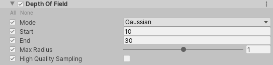

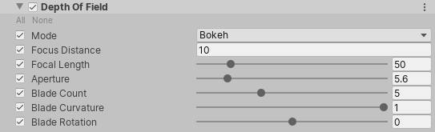

## 五、Look Dev：Substance Painter 与 Unity 的一致性

目标是让 SP 中的材质预览与 Unity 中的渲染结果可比对、可复现。

### 5.1 环境光设置

SP 侧：

- 背景图与 Unity 一致；
- 背景图透明度 100；
- 背景曝光 0；
- 背景模糊 0。

Unity 侧：

- 确认颜色空间为 **Linear**；
- `ProjectSettings/GraphicsSettings.asset` 中把 `m_LightsUseLinearIntensity` 设为 1，确保能正确读取光源面板上的颜色与亮度；
- 关闭 Directional Light；
- 关闭相机的后处理；
- HDRI 纹理导入设置：
  - 不勾选 sRGB；
  - Mip Map Filtering = Box；
  - Mapping = Latitude-longitude Layout；
  - Convolution Type = None；
  - Filter Mode = Trilinear；
  - Compression = None；
- 天空盒材质用 `Skybox/Cubemap`：
  - Tint Color 设为 `(0.5, 0.5, 0.5)`。Unity 会在 `Skybox/Cubemap` 的 shader 中把颜色乘以 `unity_ColorSpaceDouble`，属性取 0.5 才能与之抵消；
  - Exposure = 1；
- 需要点击一次 **Generate Lighting**，让 Unity 根据设置的 HDRI 正确计算 SH 系数与 Reflection Map，shader 才能取到正确的光照参数。

`Skybox/Cubemap` 的 shader 中与之相关的代码（原图箭头指向 Tint 与 `unity_ColorSpaceDouble` 相乘的一行）：

```hlsl
v2f vert (appdata_t v)
{
    v2f o;
    UNITY_SETUP_INSTANCE_ID(v);
    UNITY_INITIALIZE_VERTEX_OUTPUT_STEREO(o);
    float3 rotated = RotateAroundYInDegrees(v.vertex.xyz, _Rotation);
    o.vertex = UnityObjectToClipPos(rotated);
    o.texcoord = v.vertex.xyz;
    return o;
}

fixed4 frag (v2f i) : SV_Target
{
    half4 tex = texCUBE (_Tex, i.texcoord);
    half3 c = DecodeHDR (tex, _Tex_HDR);
    c = c * _Tint.rgb * unity_ColorSpaceDouble.rgb;   // ← 原图箭头所指
    c *= _Exposure;
    return half4(c, 1);
}
```

### 5.2 PBR 着色差异

| 项 | Unity | Substance Painter |
|---|---|---|
| 直接光照 | Directional Light | 无（可自定义取环境球最亮点） |
| 间接漫反射 | SH（L2） | SH（L1） |
| 间接镜面反射 | 移动版 split sum approximation | ImportanceSampleGGX |
| mipmap | 有 | 无（待确定） |
| tonemapping | Neutral、ACES | tonemapSCurve（sigma 与 n 控制的 S 曲线） |
| Gamma 校正 | 未确定当前使用哪一个 | - |

其它要点：

- SP 有一系列默认参数（basecolor、roughness、specular_level 等），当纹理的某些通道缺失时会回退到这些参数，例如 basecolor 的 alpha 不为 1 时；
- SP 提供的 `uniform_main_light` 用环境球的最亮点作为主光源方向；
- SP 最基本的着色公式：`emissiveColor + albedo * diffuseShading + specularShading`；
- SP 不支持 cubemap，需要转成 lat-long 格式；
- SP 的电介质（dielectric）Fresnel 项更精确，通过 IOR 计算；
- SP 使用虚拟纹理；
- SP 提供有限的 API，可自定义 shader，但只能添加 fragment shader。

### 5.3 杂记

- 保证相机一致可以更方便地比对，目前尚未走通；
- Unity 纹理导入设置中的 sRGB：启用表示纹理存储在伽马空间。非 HDR 的颜色纹理（albedo、specular 颜色）应勾选；这类纹理表示反射率，数值范围 0 到 1；
- Unity 的 HDRP 管线自带 Look Dev 功能，可作为比对参考；
- SP 中的 sheen、coating 等参数按需要开启或禁用。

## 六、ECharts 调试

### 6.1 起一个本地静态服务器

1. 打开终端（macOS / Linux）或 PowerShell（Windows）；
2. 进入 HTML 文件所在目录：

```bash
cd /path/to/your/html/files
```

3. 启动服务器：

```bash
# Python 3
python3 -m http.server 8000

# Python 2
python -m SimpleHTTPServer 8000
```

4. 浏览器访问 `http://localhost:8000` 或 `http://127.0.0.1:8000`，点击列表中的 HTML 文件。

### 6.2 临时禁用 CORS 检查

仅在开发环境使用，关闭浏览器后失效：

```bash
# macOS（使用独立的用户数据目录，避免影响日常配置）
open -na Google\ Chrome --args --disable-web-security --user-data-dir=/tmp/chrome-dev

# Windows PowerShell
Start-Process chrome.exe -ArgumentList "--disable-web-security", "--user-data-dir=C:\temp\chrome-dev"
```

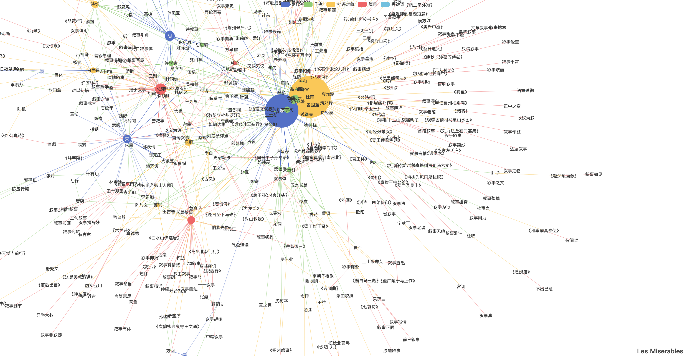

### 6.3 需求：前端 Excel 转 JSON

产出的 JSON 由三个数组组成：`category`、`nodes`、`links`。

- `category`：遍历表格第一行，生成 name 数组；
- `nodes`：遍历除第一行外的所有单元格，去重后生成 node 数组，每个 node 含 `name`、`category`、`value`：
  - `name`：单元格内容；
  - `category`：所在列的下标；
  - `value`：遍历除第一行外的第 A 列与第 C 列，统计该节点出现次数；未出现在这两列中的节点默认 1；
- `links`：除第一行外，以相邻两列的元素对生成 link，每个 link 含 `source`、`target`，值为对应 node 在 `nodes` 数组中的下标。

## 七、Figma 设计稿导入 Unity

### 7.1 为什么采用"插件 + Skill"

Figma 的设计逻辑与 UGUI 不同，元素无法一一映射，需要做格式转换。Figma 到 Unity 涉及的元素映射、属性转换与应用非常细碎，但流程本身是确定性的，因此必须用代码做强制约束，避免任何概率性猜测。

同时工具要对用户友好，隐藏实现细节，只保留自然语言接口。可行方案是用 Skill 连接：用户发出导入指令 → 触发 Skill → Skill 调用插件 API 完成实际转换，兼顾确定性与易用性。

Figma 节点类型到 Unity 的映射关系：

| Node Type | Unity Mapping |
|---|---|
| Frames | Any frame placed on the root of a page is considered a "screen" and turned into prefab, stored in the *Screens* Folder |
| Image fills | These are downloaded as PNGs and imported as sprites and stored in the *ImageFills* folder with the name of Figma ID |
| Components | These are created as prefabs, and stored in the *Components* Folder |
| Component Instances | The matching component prefab is instantiated, and any modified properties are applied |
| Pages | Prefabs of each complete page are stored in the *Pages* folder |
| Vectors | Rendered on the server as a PNG (see *Server Rendering* below) |

（原图有误，已更正：`Theses are created as prefabs` 应为 `These are created as prefabs`；`see Server Rendering nelow` 应为 `below`。）

### 7.2 使用流程

#### Figma 侧

1. 获取 **Personal Access Token**：登录 Figma → 右上角头像 → Settings → Security → Personal access tokens → Generate new token，权限至少勾选 `file_content:read`（旧的 `files:read` 已弃用）。Token 只在生成时显示一次，需立刻保存；
2. 获取 **Document URL**：设计稿页面右上角 Share → Copy link。

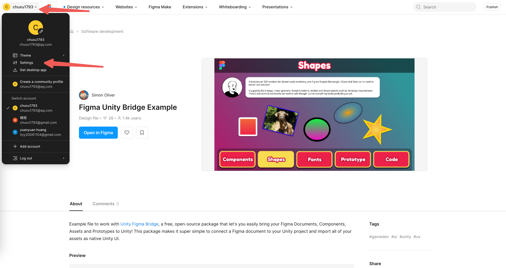


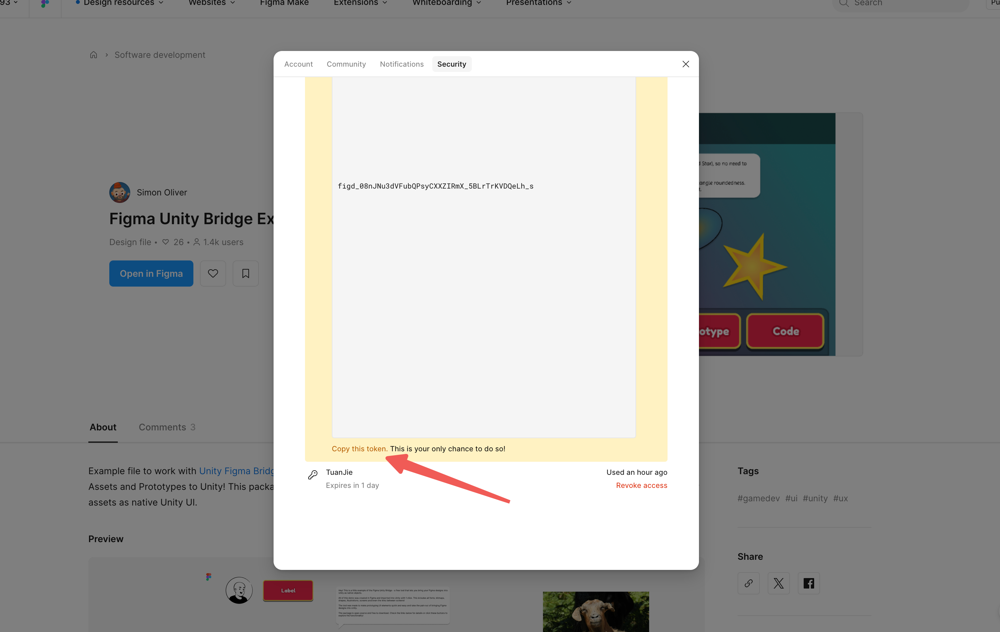

#### Tuanjie / Unity 侧

1. 安装 figma 同步 Skill（或 `cn.tuanjie.figma2unity` 包）；
2. 用自然语言显式声明"导入 figma 设计稿到 Unity / 同步 figma 的设计到 Unity"以激活 Skill；
3. 给出 Token 与 Document URL；缺失时 Skill 会主动询问；
4. 等待执行完成。同步是异步操作，Skill 每 10s 轮询一次、共 30 次检查是否导入成功，最后输出结果。

关键注意事项：

- 首次使用需配置 Figma Token、文档 URL 与运行时场景路径；
- `RunTimeAssetsScenePath` 未设置会导致 Editor 卡死（弹出阻塞对话框）；
- 输出产物在 `Assets/Figma/` 下，包含 Screens、Components、Pages 等目录；
- 可用 `FigmaOutput.json` 判断同步是否完成。

### 7.3 工具选型与二次开发

调研过 FigmaUnityBridge 与 FigmaConverterForUnity，两者都不能完全满足需求，计划在二者基础上二次开发。两周计划：

| 阶段 | 内容 | 预估 |
|---|---|---|
| 调研 | 熟悉 Figma 节点字段含义与导出格式 | 1 天 |
| 下载器 | 用 AI 调用同步接口时可能多次重试，而 Figma 对非会员的短时间高频请求会限流甚至封号；先做本地缓存下载器，把节点数据与图片资源落到本地 | 3 天 |
| 主体功能 | DataSource：Figma 数据获取 | 2 天 |
| | Pipeline：导入流程、节点处理 | 3 天 |
| | Renderer：UGUI 组件映射（Image、Button、Mask）、procedural UI 渲染 | 3 天 |
| | Asset：资源管理、Sprite 下载与生成、字体加载 | 2 天 |
| Prototype Flow | 原型交互系统（按钮响应页面跳转等） | 待定 |
| Skill | 插件环境检查步骤、关键词与接口映射 | 1 天 |

`clip content` 的作用：裁剪超出节点边界的子内容（对应 Unity 中的 RectMask2D / Mask 语义）。

### 7.4 落地过程中遇到的问题

- 通过 Figma REST API + URL 拉取数据时请求次数多，改为离线下载器：一次性下载节点数据与图片，之后只从本地解析；
- 离线打包器 / zip 构建器的集成测试会导致 Editor 卡死，改为不依赖 Editor 的独立测试方式验证功能；
- 导入后 Scene 中创建了大量 GameObject，但 UI 上不显示任何对象；
- 导入后页面元素全部重叠在一起（根因在节点层级与布局属性的还原，需检查 DataSource 到 Pipeline 的坐标与约束转换）；
- 移除增量同步、改为每次完整导入：需要评估对已有资源引用、重复资源与导入耗时的影响；
- overlay 页面：去除出现时背景变暗的处理；overlay 的出现位置要与设计稿一致。

### 7.5 工具开发 Skill 的约束

针对 `cn.tuanjie.figma2unity` 包的修复型 Skill：

- 只检查与修复导入工具本身，不修改工程资源；工具目录：`Packages/cn.tuanjie.figma2unity/`；
- 每次修复都要考虑通用性与兼容性，修通用方法，避免只针对某个具体问题打补丁；
- 每个修复任务另开子代理执行，不污染当前上下文；
- 确认修复后提醒提交 git。

导入型 Skill 的检查项：

1. `cn.tuanjie.figma2unity` 包是否存在，不存在则提示安装；
2. 是否提供了 Figma file key；
3. 是否提供了 Personal Access Token；
4. 执行菜单 `Figma2Unity → import`。

> 原始笔记中记录过若干 Figma Token、账号与密码，均已在本文中移除。

## 八、台架调试

车机（台架）地址示例：`<host>`，用户名 `<user>`。

### 8.1 安装包

1. 连接台架网络（车载热点，SSID 形如 `MBUX****`）；
2. 上传安装包到台架 `/tmp`：

```bash
scp elinux_player_Development_0.97.0_232.0_3.0_3717_25081615.tar <user>@<host>:/tmp
```

3. 上传安装脚本：

```bash
scp unity_install.sh <user>@<host>:/tmp
```

4. 登录台架并执行：

```bash
ssh <user>@<host>
cd /tmp
bash unity_install.sh elinux_player_Development_0.97.0_232.0_3.0_3717_25081615.tar
```

5. 等待安装完成。

### 8.2 连接 Frame Debugger

```bash
ssh <user>@<host>
nft flush ruleset
```

刷新防火墙规则后可能还需要重启应用。

### 8.3 开启日志

1. 台架上创建目录：

```bash
mkdir -p /run/filesystem_storage/systemwide/navi/cn_navi/temp
```

2. 本地把配置推到该目录：

```bash
scp only_for_developer.json <user>@<host>:/run/filesystem_storage/systemwide/navi/cn_navi/temp
```

3. 在台架屏幕上输入：`*#0020#1`
4. 重启应用：

```bash
systemctl restart navigation-china
```

### 8.4 DLT 抓帧率

1. 增加 Filter：`[UnityMapView]:[FPS] Camera`；
2. 输入 IP 地址连接台架；
3. 停止抓取后按 Filter 搜索，先点 `next` 再点 `save`；
4. 下方窗口出现搜索结果，全选复制粘贴到 txt 保存；
5. 解析：

```bash
python3 get_perf_data3.0.py ~/Downloads/gputop_native.csv ~/Downloads/Untitled-1-fps.txt
```

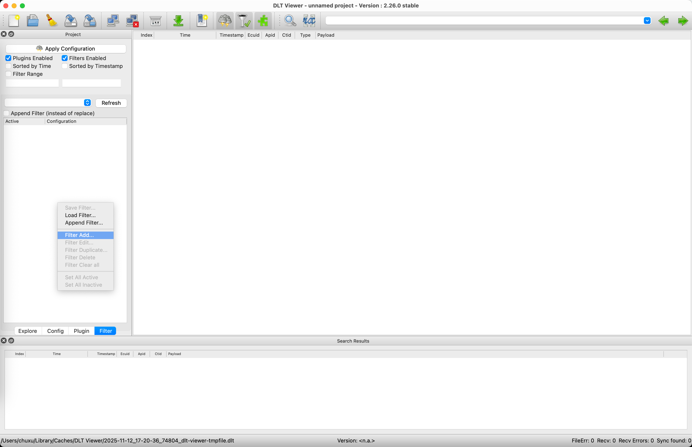

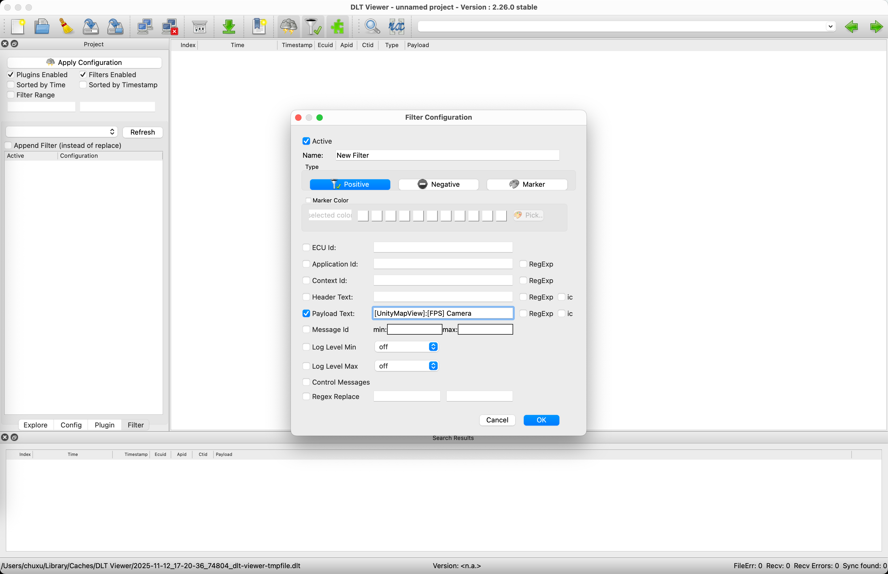

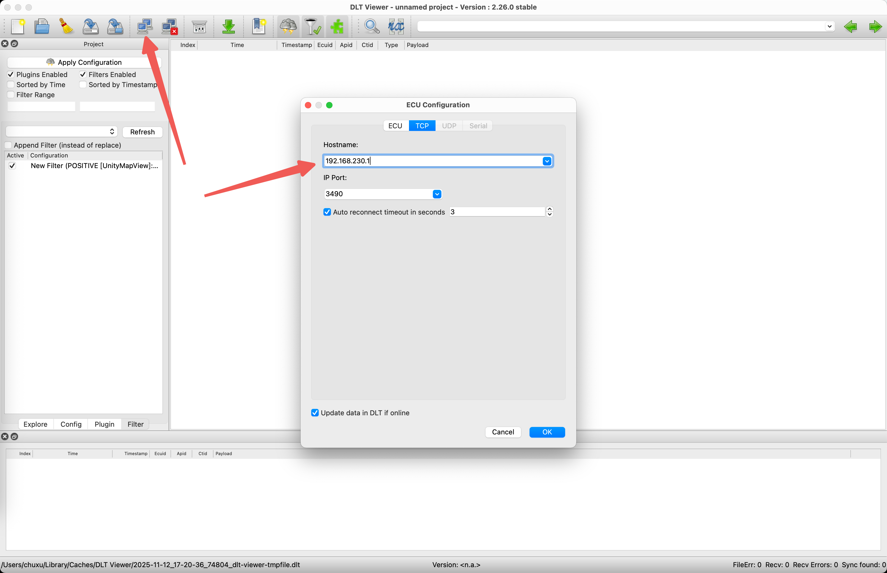

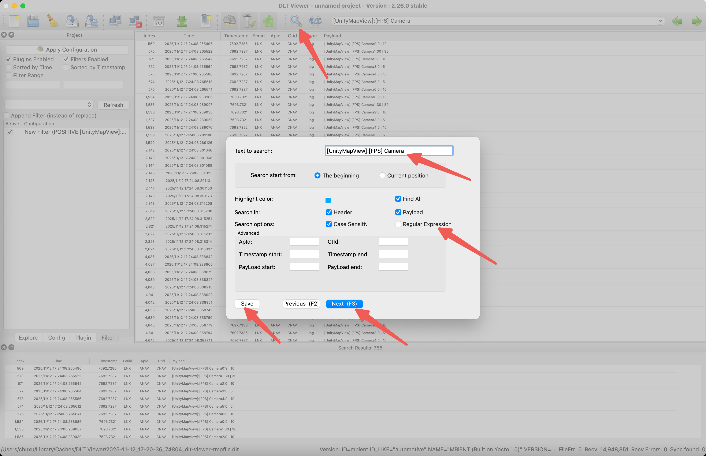

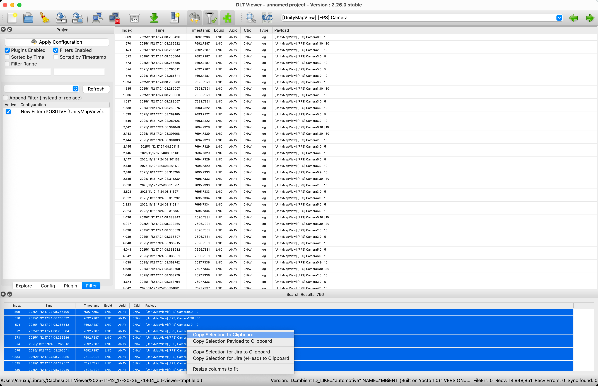

### 8.5 采集 GPU 占用率

```bash
cd ~/Downloads; rm -rf gputop_native.csv; touch gputop_native.csv
pkill -f "ssh -L 2225:<host>:22"
ssh -L 2225:<host>:22 <user>@<host> -N -f
ssh -p 2225 <user>@localhost "export PATH=/ifs/bin:/ifs/usr/bin:/ifs/usr/sbin:/ifs/sbin:/mnt/bin:/mnt/usr/bin:/mnt/usr/sbin:/mnt/sbin:/mnt/scripts:/mnt/bin/camera:/ifs/bin/camera; sh -s -- -p -i 1000" < gputop.sh | tee gputop_native.csv
```

`Ctrl+C` 结束采集，数据保存在 `~/Downloads`。

解析同上：

```bash
python3 get_perf_data3.0.py ~/Downloads/gputop_native.csv ~/Downloads/Untitled-1-fps.txt
```

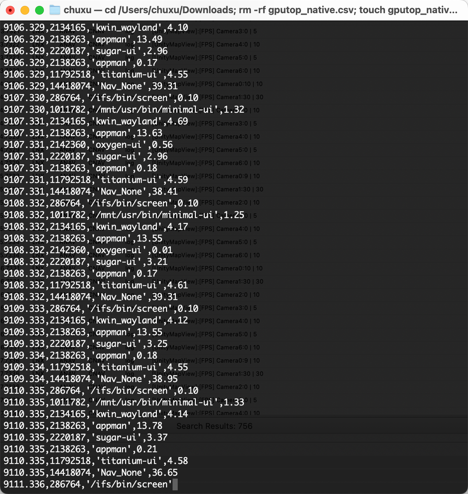

若解析报依赖缺失，报错形式为：

```text
Traceback (most recent call last):
  File "~/Downloads/get_perf_data3.0.py", line 8, in <module>
    import pandas as pd
ModuleNotFoundError: No module named 'pandas'
```

切换到可用网络后重建虚拟环境：

```bash
cd ~/Downloads
rm -rf perf_env
python3 -m venv perf_env
source perf_env/bin/activate
pip install pandas matplotlib openpyxl
```

### 8.6 切换输入参数（OnRenderLevel）

配置文件：

```bash
vi /opt/navroot/cn_amap/res/nv_ctrl.ini
```

- 按 `i` 进入 insert 模式；
- 修改 `OnRenderLevel`；
- 按 `Esc`，输入 `:wq` 回车保存退出；
- 重启应用：

```bash
systemctl restart navigation-china
```

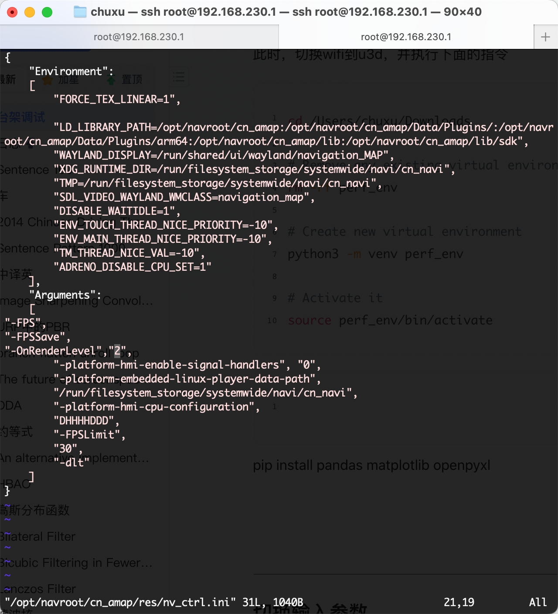

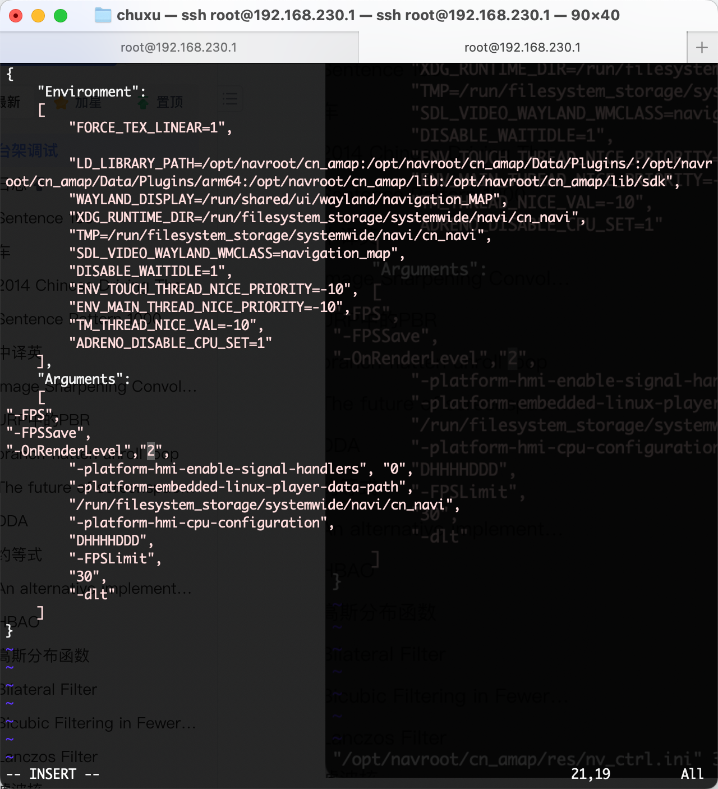

### 8.7 macOS 通过 Wi-Fi 连不上 Profiler

1. 在台架查进程 pid：

```bash
ps -ef | grep navi
# 2672 navcn ... /opt/navroot/cn_amap/nv_main ... -FPSLimit 30 -dlt
```

2. 通过 pid 查端口：

```bash
netstat -tunple | grep 2672
# tcp 0 0 127.0.0.1:60001 0.0.0.0:* LISTEN ... 2672/nv_main
# tcp 0 0 0.0.0.0:55000  0.0.0.0:* LISTEN ... 2672/nv_main
```

3. 取对外的 55000 端口；
4. 本地建立端口转发：

```bash
ssh -L 55000:127.0.0.1:55000 <user>@<host>
```

5. Editor 的 Profiler 连接地址填 `127.0.0.1:55000`，开始连接（台架记得先执行 `nft flush ruleset`）。

### 8.8 权限不足与黑屏

提示权限不足时，把根分区重新挂为可写：

```bash
mount -o remount rw /
```

台架黑屏开机时，检查供电与启动流程（原笔记仅保留现象截图，处理方式**待补充**）。

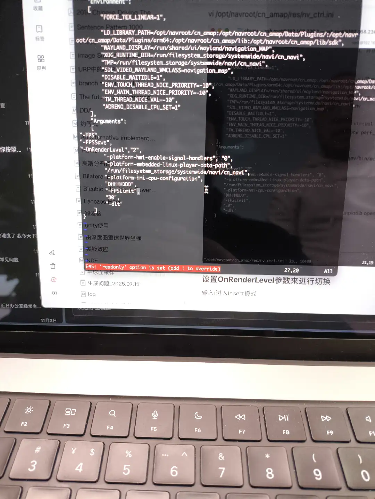

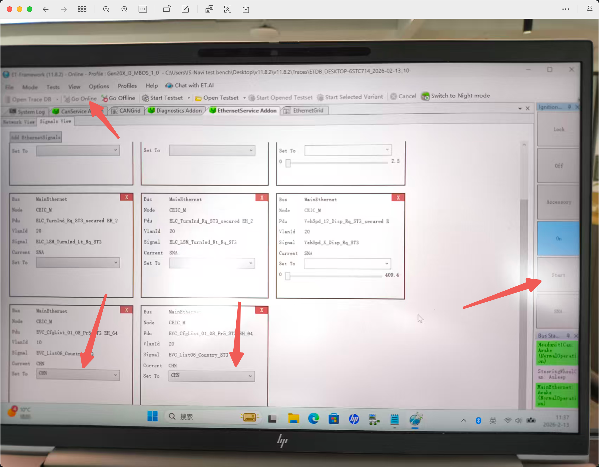

## 九、工程备忘

- **u3d 工程密码**：原始笔记中明文记录了一个工程密码，已移除；如需使用请从团队密码管理器获取，此处只保留说明。
- 台架热点、账号、Figma Token、Apple 开发者账号等凭据均不在本文出现。

## 附录：工作日志中的项目记录

本附录从 `Log/` 下按日期记录的工作日志中提取**项目级内容**：项目背景、模块划分与职责、工程决策、踩坑结论。逐日任务勾选状态、个人事务、影视下载链接、教程链接清单已剔除；阴影、深度等算法细节不在此展开，见《03_图形学/05_阴影》《03_图形学/02_光栅化与深度可见性》。

### 附.1 PWRD（Unity 游戏渲染）

**项目背景**：Unity 游戏项目（原日志未注明具体渲染管线），关注角色创建（"建角"）场景的画面质量，核心诉求是在**不改变构图与画面内容**的前提下提高头发阴影分辨率。

**工具链**：

- Unity（级联阴影、ShadowCaster Pass、lightmap 等均为主流管线的通用概念）；
- RenderDoc：抓取后端已编译的 DXBC（DirectX Bytecode，字节码）并查看反汇编，用于统计指令与采样数。DXBC 来自 **D3D 后端**（Editor / Windows 平台），是特定后端的编译产物，不是跨平台通用字节码；
- Metal 平台：**仅用于验证** `_CameraDepthTexture` 的深度方向（远端为 0、近端为 1，即已应用 Reversed-Z），不用于统计指令数，也不产生 DXBC。

**渲染改动与工程决策**：

1. **角色脚下阴影改用投影贴花**：用屏幕深度图（`_CameraDepthTexture`，源日志原名 `_cameraDepthBuffer`）重建片元的世界坐标并转到物体空间，取局部坐标算出阴影衰减，使阴影形状由贴图精确控制、不再受阴影贴图分辨率限制。渲染状态表、数据流与盒体裁剪细节见《03_图形学/05_阴影》的 Shadow Decal 一节及其附录"贴花阴影：另一种实现路线"。
2. **推近相机换阴影分辨率**：保持最终 `P·V` 不变，只改投影矩阵并把主相机向角色推近——
   $$P_2 = P_1 \, V_1 \, V_2^{-1}$$
   由于 `P1·V1 = P2·V2`，画面构图不变；同时相机到目标的距离缩短、`MaxDistance` 下调，于是主相机视锥 z 方向变短 → 级联包围球半径变小 → 光源正交视锥的 x/y 尺寸收窄 → 纹素占比提高。这是"画面不变 + 分辨率提高"能同时成立的关键。
3. **级联阴影只保留 1 级**：`Cascade Count = 1` 是权衡后的结论而非遗漏——单级级联调好之后，多级带来的提升不明显，却会让 ShadowCaster Pass 数量成倍增加。论证与适用条件见《03_图形学/05_阴影》附录"为什么只用一级级联"。
4. **地形碰撞体 / 通过性检查工具**：遍历场景中所有 `Collider`，取出 mesh 动态生成材质并绘制；着色器按**面法线与世界 Y 轴的夹角**区分可站立面与不可站立面。工具在几何着色器中为动态构建的三角形补算法线（`[maxvertexcount(3)]`，用 `cross(p1-p0, p2-p0)` 求面法线后写入三个顶点），供站立面检测使用。
5. **Shader 分级的量化依据**：用 DXBC 统计 fragment shader 的指令数与采样数，按功能递增顺序取**增量**来划分档位。方法、局限与结论见《03_图形学/05_阴影》附录"用 DXBC 指令数给 shader 功能分级"。
6. **环境光烘焙的近似做法**：用均匀白光烘焙环境光，取 lightmap 中的白色成分作为 skyAO 去调制 skySH，其余部分作为剩余 GI。
7. **经验判断**：实时渲染更像"效果组合"——最终画面取决于各 feature 的叠加与相互补偿，因此调参要整体看画面，而不是逐项追求单项正确。

### 附.2 易航（车载 HMI 与 3D 环视）

**项目定位**：车载 HMI 与 3D 环视界面，C++ 实现，目标平台为板卡（嵌入式 Linux / ARM）。工作分为两个阶段：先做点云可视化（2019 上半年），再做 HMI 与 3D 环视窗口（2019 下半年至 2020 年）。

**时间线与阶段划分**：

| 时间 | 阶段内容 |
|---|---|
| 2019/05–06 | 点云渲染性能优化。<br>**已完成**：多边形裁剪（06/11）、射线检测超出点云范围的边界问题（06/10 用拼接射线检测面解决）、加大视口获得更大有效区并用于缓存更新。<br>**计划 / 待定**（原日志标为计划或待定，不是已完成成果）：视锥剔除改独立线程、八叉树组织与加载 / 卸载调度、缓存管理、渲染线程各步骤耗时定位（06/01 标"待定"）、按索引网格号管理缓存加载卸载 |
| 2019/07 | 工作目录 `D:\work_space\YHRviz`；确定解耦方向：把 OpenGL ES 绘制部分封装成库，与操作系统解耦；bubble 部分改用 C++ 实现但对外提供 C 接口 |
| 2019/07–08 | 构建与平台迁移：搭建 ARM 与 Ubuntu 共用开发环境；把 `test_pbr` 工程适配 Linux；包围盒功能下放到每个节点；编译方式统一到 CMakeLists |
| 2019/11 | HMI 需求确定：横竖屏切换、按钮点击事件、topview 区域增加窗口切换 |
| 2019/12 | 重构 XML 解析功能 |
| 2020/02 | UI 框架成型：`ui_config` 配置格式与 XML 解析类改造、Window/View/Button 元素类、ImageSet/TextureMgr 动态纹理、XML 增加窗口层级、窗口树与每窗口一个 render、key 按键、2D/3D 逻辑、移植板卡；同时把 2D 视频纹理与 3D 渲染移植进 `libavg_ui` 库 |
| 2020/03 | 3D 环视窗口 Y 轴镜像修正、熟悉配置文件并设计泊车逻辑结构、车位显示功能开发与板卡移植、点击事件改用访问者模式重构（计划） |

**架构结论**：

1. **窗口树 + 每窗口一个 render**：窗口用树组织，每个窗口附带一个自己的 render，而不是全局一个渲染器统一遍历所有窗口。窗口的显隐、层级与 2D/3D 混合因此按窗口隔离。
2. **节点设计的两种方案**：方案一是"节点完备"——场景图中每个节点都是完备对象，既包含业务关心的属性信息，也包含绘制所需的信息，每帧遍历场景树调用各节点的 `update`。（原始笔记在描述第二种方案时截断，仅存"两种方案"的提法；第二种方案的具体内容**待补充**。）
3. **UI 描述与解析**：界面由 `ui_config` 配置驱动，XML 承载窗口层级结构；代码侧建立 Window / View / Button 三类元素类，分别对应窗口、视图容器与可交互按钮。XML 相关改动共有三次：2019/12 重构 XML 解析功能；2020/02 起改 `ui_config` 配置格式与对应的 XML 解析类，再调整 XML 格式以增加窗口层级结构。
4. **纹理管理**：纹理的动态加载与使用落在 `ImageSet`、`TextureMgr` 两个类上（原笔记只记录到这一步，接口细节**待补充**）。
5. **移植策略**：移植按依赖顺序推进——先把 2D 视频纹理移植进 `libavg_ui` 库并验证，再移植 3D，最后整体上板卡。

**踩坑结论**：

- **3D 环视窗口 Y 轴镜像**：3D 环视窗口的画面上下颠倒，需要在窗口层做 Y 轴镜像修正。
- 坐标约定、点云边界、缓存与加载顺序、构建系统四条已分别展开在《04_OpenGL与Shader/04_OSG》B.4.2–B.4.4 与《03_图形学/12_性能优化》"大规模点云"、"八叉树与流式加载的调度"两节，此处只留结论：宽高按 **xz** 取（沿用 OSG 坐标系，y 为上方向——此点系由 `CalcArea::rasterize` 的注释与 OSG 轴约定**推断**，与 04_OSG B.4.2 的表述一致，仍**存疑**）、点云覆盖范围外用拼接射线兜底、缓存区域最终去掉改为按视口优先加载、构建体系统一到 CMakeLists。

### 附.3 渲染技术待办清单（SSPR 技术栈）

2026 年初整理的一份渲染技术待办，把与 SSPR（Screen Space Planar Reflection）相关的技术列成子项，作为规划索引而非知识条目：SSAO / HBAO、TAA、FSR 2.0、Interior map、Checkerboard rendering、Blur、Normal reconstruction、Jump flooding algorithm（inline feature）、motion vector display 工具、ray marching cloud、Upsample，以及草地与水面渲染。

其中 Jump flooding 被标注为 SSPR 的 inline feature，motion vector display 属于调试工具而非渲染特性——排期时应与其余渲染项分开。各项的具体原理分别见《03_图形学/06_抗锯齿与采样重建》（TAA、FSR、checkerboard）、《03_图形学/08_后处理》（SSAO、Blur、Upsample）、《03_图形学/13_场景与特效技术》（草地、水面、体积云）。

## 原始笔记索引

- `Project/PBRT/Efloat类.md`
- `Project/PBRT/Interaction类.md`
- `Project/PBRT/记录.md`
- `Project/Graphics/Graphics.md`
- `Project/UnityMapView记录.md`
- `Project/Hyy/Hyy记录.md`
- `Project/Look Dev/关于sp与unity的一致性记录.md`
- `Project/ECharts.md`（源文件名含控制字符）
- `根目录笔记/Figma设计稿导入Unity.md`
- `根目录笔记/Figma中的UI设计导入Unity.md`
- `根目录笔记/台架调试.md`
- `根目录笔记/u3d 密码.md`
- `Log/PWRD/日志.md`
- `Log/易航/HMI.md`
- `Log/易航/工作日志/2020年二月.md`
- `Log/易航/工作日志/2020年三月.md`
- `Log/易航/易航开发日志.md`
- `Log/2026年02月11日_记录.md`