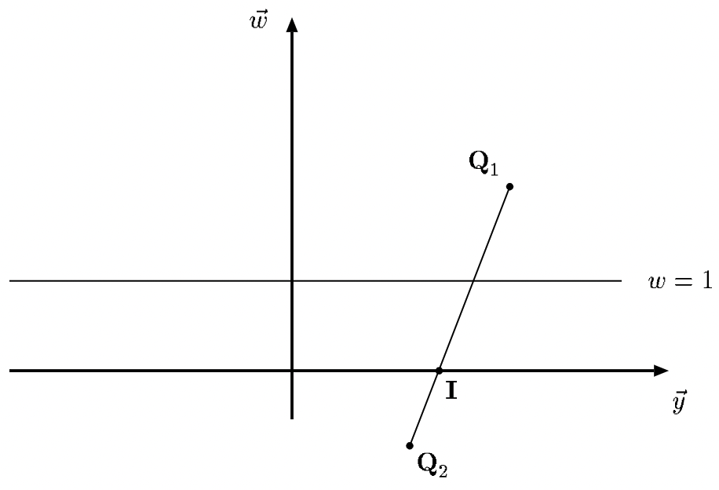
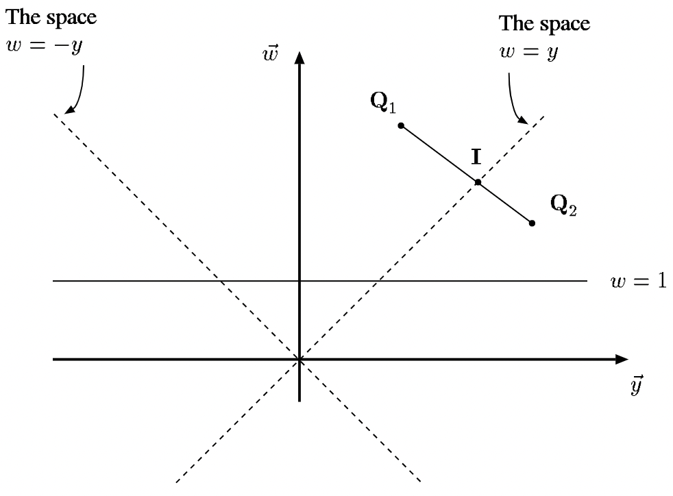

# 面试复盘整理：图形学技术问答

本文覆盖渲染管线与 Early-Z / Late-Z、裁剪与光栅化、阴影（PCF / VSM / SAT）、TAA 与 motion vector、蒙特卡洛重要性采样，以及工程侧的 `shared_ptr` 实现。建议按章节顺序阅读：第 1–2 章是管线基础，第 3–4 章的阴影与时间累积建立在其之上，第 5–6 章可独立成题。

## 1. 渲染管线与 Early-Z / Z-Prepass

### 1.1 Early-Z 在什么情况下失效？

Early-Z（early depth test）指在片元着色器（FS）之前，用光栅化阶段就已经确定的片元深度先做一次深度测试，未通过的片元直接丢弃、不进入 FS。它成立的前提是"深度值在 FS 执行前是已知且可信的"。以下情况这个前提被破坏：

1. **开启 alpha test**：alpha test 需要采样纹理、比较 alpha，硬件无法在 FS 之前知道该片元会不会被丢弃，只能把深度测试推迟到 FS 之后。（原稿有误，已更正：原稿把 alpha test 写作"FS 之后的 alpha test 阶段"；现代图形 API 已取消固定功能的 alpha test，改由 FS 内的 `clip(alpha - _Cutoff)` / `discard` 实现，硬件同样无法提前判定。）
2. **开启 Tex kill（`discard` / `clip()`）**：与第 1 条同源——只要 FS 里存在可能丢弃片元的指令，深度测试与深度写入就必须等 FS 执行完才能确定。现代 API 下 alpha test 与 texkill 是同一机制；固定功能的 alpha test 仅存在于 D3D9 / GL2 等 legacy 管线。
3. **关闭深度测试**：early-Z 的前提就是存在一次可以提前执行的深度比较；`ZTest Always` 或彻底关闭 depth test 时，没有"提前测试"可言。

   > **补全（非原稿）**：还有两种常被提到的失效原因：**在 FS 中写深度**，以及**深度输出方向不确定**——未声明方向的 `SV_Depth` 写深度会破坏提前深度测试，因为提前测到的深度不再可信。反过来，声明 `SV_DepthGreaterEqual` / `SV_DepthLessEqual`（保守深度输出）时，硬件知道深度只会朝某个方向变化，仍可保留 early-Z。

**常见误解：alpha blend 会让 Early-Z 失效。**

> **补全（非原稿）**：（原稿有误，已更正：原稿称"启用了 alpha 混合的像素……无法执行深度测试"，不成立——alpha blend 本身并不要求关闭深度测试，也不禁止 early-Z；深度测试与深度写入是彼此独立的开关。）混合的片元只是需要读取 framebuffer 参与混合，仍可正常做深度比较。工程上透明物体常配 `ZWrite Off / ZTest LEqual`，并必须从远到近排序渲染；此时 early-Z 仍然有效，只是把深度缓冲里已有的不透明深度当作保守的可见性判断，对 overdraw 的削减真实存在，但不参与本 draw call 内部的深度竞争，收益通常有限。这是渲染配置造成的常见现象，不宜反推为 alpha blend 的硬件语义；具体 GPU / 驱动在该状态下如何调度 early-Z，需按硬件查证（待核实）。

原稿的结论成立：**early-Z 失效只影响当前 draw call 的片元剔除效率**。深度缓冲是跨 draw call 持久的状态，后续 draw call 只要状态允许，依旧能享受 early-Z 带来的收益。

### 1.2 Late-Z 什么时候不执行？

原稿结论：early-Z 正常执行时，如果 `depth write` 关闭，Late-Z 不会执行；否则仍要执行 Late-Z 以避免渲染错误。

> **补全（非原稿）**：这里说的 Late-Z 指 FS **之后**的那次深度测试/深度写入（有些资料称 depth test after shading、post-shader depth update）。把它补成完整逻辑：
>
> - `ZWrite Off`：本 pass 不会改动深度缓冲，early-Z 的判定结果就是最终结论，FS 之后没有任何深度工作需要做，因此没有 Late-Z。
> - `ZWrite On` 且 FS 可能 `discard`（或写深度）：early-Z 通过只代表"这个片元此刻还可能存在"，它可能被 `discard` 掉，所以深度必须等 FS 结束后才敢写入，这一次回写就是 Late-Z。
> - 若 shader 保证既不 `discard` 也不写深度，硬件可以在 early-Z 阶段直接写深度（early-Z write），此时也不存在额外的 Late-Z。原稿的表述是简化版，把"能否早写"略去不谈。

### 1.3 什么是 Z-Prepass，它和 Early-Z 是什么关系？

> **补全（非原稿）**：原稿没有这道题，按主题补齐，便于把 Early-Z 的收益来源讲清楚。
>
> Z-Prepass（depth prepass / depth-only pass）是**先单独跑一遍只写深度的 pass**（无颜色输出、无光照计算，常见配置 `ColorMask 0 / ZWrite On / ZTest LEqual`），再跑正常着色 pass（`ZTest Equal` 或 `LEqual`，`ZWrite Off`）。这样第二次 pass 里几乎只有最前面的可见片元会进入 FS，overdraw 被压到接近 1。
>
> 与前两者的关系：
>
> - Z-Prepass 是**应用层**手段，Early-Z 是**硬件层**能力；Z-Prepass 之所以有效，正是因为它把"最靠近相机的深度"提前写进了深度缓冲，让第二遍的 Early-Z 能剔除掉几乎所有被遮挡片元。
> - 代价是多一遍几何/顶点处理与带宽；在几何量很大、FS 很贵（复杂 PBR、多光源）时收益明显，FS 很便宜时反而亏。
> - alpha-test 材质可以进 Z-Prepass，但必须复刻同样的 `discard` 逻辑（否则预写深度会把孔洞填实，后续着色 pass 的 `ZTest Equal` 判不对）；混合透明材质通常不进 Z-Prepass。
> - 与 **Hi-Z / 遮挡剔除** 无关：那是用深度金字塔在粗粒度上剔除整个物体，Z-Prepass 是逐片元的可见性预排序。

## 2. 裁剪与光栅化

### 2.1 图形管线中多边形如何裁剪？

裁剪发生在**齐次裁剪空间（clip space）**、透视除法之前。原因很直接：$w \le 0$ 的顶点做透视除法没有意义，会得到翻转或发散的坐标，所以必须先把视锥外的部分切掉，保证剩下的顶点都满足 $w > 0$。

流程分两步：

1. **逐平面裁剪**，顺序是 $w=\varepsilon,\ +x,\ -x,\ +y,\ -y,\ +z,\ -z$。其中 $w=\varepsilon$（原稿取 $10^{-6}$）必须最先执行：它保证所有存活顶点的 $w > 0$，视点后方的部分全部被裁掉，后续透视除法也不会除零。之后每个平面的输出顶点集作为下一个平面的输入（这就是 Sutherland–Hodgman 多边形裁剪）。
2. **每个平面内逐线段裁剪**：对输入多边形的每一条边与当前平面求交，保留内侧顶点、插入交点，重新组装成多边形。

下面是 $(y, w)$ 截面上的示意：横轴是 $\vec y$、纵轴是 $w$，线段 $\mathbf{Q}_1\mathbf{Q}_2$ 与 $w=0$ 平面的交点即裁剪点 $\mathbf{I}$。



交点在齐次坐标下是线段参数形式：

$$
\mathbf{I} = \mathbf{Q}_1 + t\,(\mathbf{Q}_2 - \mathbf{Q}_1)
$$

代入 $w = 0$：

$$
w_1 + t\,(w_2 - w_1) = 0 \quad\Longrightarrow\quad t = \frac{w_1}{w_1 - w_2}
$$

再看一般的侧平面 $\pm y$，即 $y = \pm w$ 两个平面（图中虚线），求交条件变成"$w$ 分量等于 $y$ 分量"：



$$
w_1 + t\,(w_2 - w_1) = y_1 + t\,(y_2 - y_1)
\quad\Longrightarrow\quad
t = \frac{w_1 - y_1}{(w_1 - y_1) - (w_2 - y_2)}
$$

对 $w = -y$ 平面同理，把上式中的 $y$ 换成 $-y$ 即可：

$$
w_1 + t\,(w_2 - w_1) = -(y_1 + t\,(y_2 - y_1))
\quad\Longrightarrow\quad
t = \frac{w_1 + y_1}{(w_1 + y_1) - (w_2 + y_2)}
$$

这也给出统一写法：平面用 $A\cdot p = 0$ 表示时，

$$
t = \frac{-(A \cdot \mathbf{Q}_1)}{A \cdot (\mathbf{Q}_2 - \mathbf{Q}_1)}
$$

**交点属性用同一个 $t$ 线性插值**（位置、法线、UV、颜色等所有顶点属性都一起插）。这一步在齐次坐标下做是合法的，因为裁剪发生在透视除法之前，齐次空间中的线性插值对应透视正确的结果。裁剪完成后才做透视除法 $\mathbf{p}_{ndc} = \mathbf{p}_{clip}.xyz / w$，再视口变换进入屏幕空间。

> **补全（非原稿）**：视锥的 6 个平面在 clip space 里写成 $-w \le x \le w$、$-w \le y \le w$、$-w \le z \le w$，加上 $w \ge \varepsilon$ 一共 7 个半空间。GPU 里逐平面裁剪常见两种实现：几何着色器式的 Sutherland–Hodgman（任意平面数、会产生新三角形），以及 **guard-band / 齐次光栅化**（几乎不裁，靠光栅化阶段的 scissor 与足够大的坐标范围吸收，只裁近平面）。前者正确但慢，后者是现代硬件的常规做法。

### 2.2 光栅化阶段做了什么？

> **补全（非原稿）**：原稿只写了"裁剪"，同组的另一半（光栅化）补齐，作为透视矫正插值的前置。
>
> 1. **三角形 setup**：把 NDC 顶点经视口变换映射到窗口坐标 $x_w = (x_{ndc}+1)\cdot\frac{W}{2} + x_0$，$y_w = (y_{ndc}+1)\cdot\frac{H}{2} + y_0$（注意 y 轴方向差异），并计算屏幕空间面积、属性梯度。
> 2. **片元覆盖判定**：对每个像素取其中心点，用边函数
>
>    $$
>    E_i(x,y) = (x - x_i)(y_{i+1} - y_i) - (y - y_i)(x_{i+1} - x_i)
>    $$
>
>    判断点是否在三条边的同一侧；三者同号即命中。边界像素用 top-left rule 保证相邻三角形既不重复也不漏写。
> 3. **重心坐标**：三个边函数与总面积之比即 $\beta_0,\beta_1,\beta_2$，$\sum \beta_i = 1$，它就是屏幕空间的线性插值权重。
> 4. **属性插值**：不能直接用 $\beta$ 插顶点属性（会在透视投影下出错，见 2.3）；窗口空间深度是例外——它在屏幕空间本身线性，硬件直接插值后写深度缓冲，因此对三角形平面深度的插值是精确的。常见的"非线性深度精度分布"来自投影的 $1/z$ 映射（近处精度高、远处精度低），而 z-fighting 正是这一精度不足在远处的表现，而非线性插值本身引入的误差。

### 2.3 透视矫正插值：为什么不能直接在屏幕空间线性插值？

屏幕空间的 $\beta$ 是**投影后**三角形的重心坐标，而顶点属性是**投影前**的线性量。透视投影把远处的三角形压小，导致 $\beta$ 的比例与原空间中"到三个顶点的相对位置"不一致，直接插值会得到错误的 UV / 法线 / 颜色，典型症状是地面纹理在远处出现扭曲（仿射贴图瑕疵）。

正确做法是借助 $1/w$ 与 $a/w$ 在屏幕空间都是线性的这一性质，先插这两个量、再相除。对一条边（两端点 $\mathbf{Q}_0, \mathbf{Q}_1$，屏幕参数 $s\in[0,1]$）：

$$
\frac{1}{w(s)} = \frac{1-s}{w_0} + \frac{s}{w_1},
\qquad
\frac{a(s)}{w(s)} = \frac{1-s}{w_0}a_0 + \frac{s}{w_1}a_1
$$

相除即得属性值：

$$
a(s) = \frac{\dfrac{1-s}{w_0}a_0 + \dfrac{s}{w_1}a_1}{\dfrac{1-s}{w_0} + \dfrac{s}{w_1}}
$$

推广到三角形：

$$
a = \frac{\beta_0 \dfrac{a_0}{w_0} + \beta_1 \dfrac{a_1}{w_1} + \beta_2 \dfrac{a_2}{w_2}}{\beta_0 \dfrac{1}{w_0} + \beta_1 \dfrac{1}{w_1} + \beta_2 \dfrac{1}{w_2}}
$$

> **补全（非原稿）**：推导来源是把边上的插值写成参数形式再代入投影。屏幕坐标 $x = (X/w)$ 是 $X$ 的透视除法，因此在屏幕空间里 $1/w$ 是 $x$ 的线性函数、$a/w$ 也是，两者相除就把分母的透视信息消掉，还原出透视正确的 $a$。补充两点：
>
> - OpenGL 中 $w = -z_v$（相机空间朝 $-z$ 看），所以可见顶点的 $w$ 本身就是正数，直接拿 $w$ 做分母即可，不需要再取绝对值。
> - 需要"不做透视矫正"时，GLSL 用 `noperspective`（DirectX/HLSL 的 `noperspective` 修饰同义），HLSL 默认就是透视矫正。UI 的屏幕空间三角形常用 `noperspective`。

## 3. 阴影：PCF / VSM / SAT

> 推导（tent 核的连续/离散形式、切比雪夫上界的来龙去脉、SAT 的两遍递推与漏光成因的完整论证）统一见《03_图形学/05_阴影》：PCF 见其"PCF（Percentage Closer Filtering）"一节，VSM/SAT 与漏光见"VSM（Variance Shadow Mapping）"与"VSM 补充推导：矩估计、SAT 范围查询与漏光分析"。本节只保留**面试口径的结论与踩坑**。

### 3.1 PCF 的表达式到底在算什么？

原稿给的核心式子：

$$
V_x = \omega \otimes \chi^{+}\!\left[D_{SM}(q) - D_{scene}(x)\right]
$$

> **补全（非原稿）**：原稿自己也标注了"没有写清楚"，这里按面试口径说清它是什么。
>
> - $\chi^{+}(t)$ 是单位阶跃：$t \ge 0$ 取 1，否则取 0。它表示"该 tap 的深度不小于接收者深度 → 这个 tap 可见"。
> - $D_{SM}(q)$：阴影贴图在 $q$ 处存的最小深度（光源视角）；$D_{scene}(x)$：接收点 $x$ 在光源视角下的深度。
> - $\omega$：滤波核权重；$\otimes$：对核覆盖的离散 tap 做加权平均（原稿借用了卷积符号，实际就是加权求和）。
> - $V_x \in [0,1]$ 是**核内可见 tap 的占比**，直接乘到阴影项上，而不是二值判断——这才是 PCF 的全部价值：把硬边变成软边。

答这一题的关键句：**PCF 不是"对 shadowmap 做模糊"，而是"对比较结果做滤波"**。比较在滤波之前、每个 tap 各自做，所以深度边缘不会被平均掉（那是"对 shadowmap 做低通"的错误做法，见《05_阴影》的"不能对 shadowmap 做低通滤波"）。

**踩坑**

- 比较方向必须与深度存储约定一致（近=小；`UNITY_REVERSED_Z` 下相反），写反了阴影会整体反转。
- `bias` 用来压 shadow acne，通常按法线与光线夹角缩放（斜率越大偏移越大）；bias 过大直接产生 peter-panning。
- 硬件 4-tap 版本（`SampleCmpLevelZero` + 线性过滤）与手写 3×3 tent 不等价于同一采样点集，但过渡效果接近且更快——面试被问"为什么硬件 PCF 只采 4 次还更平滑"时要能答这一点。

### 3.2 PCF 的权重为什么用三角形（tent）而不是 box？

原稿结论：box 滤波在边界产生突变、不够平滑，tent 权重过渡更平滑。

> **补全（非原稿）**：一句话说清"突变"是什么。把接收者深度当变量看，单个 tap 的可见性是阶跃；box 核等权平均后，$V(t)$ 变成**阶梯函数**（每跨过一个 tap 深度就跳 $1/N$），屏幕上是分级带 + 马赫带，仍然"硬"。tent 核靠近中心权重大、边缘接近 0，$V(t)$ 变成**分段线性连续**的斜坡，过渡自然。

**面试要补充的两个点**

- 3×3 的 tent 不能直接套连续式 $(1-|i|/r)(1-|j|/r)$：$r=1$ 时它退化成一个点。3×3 要用离散式 $(2-|i|)(2-|j|)/16$，即 $(1,2,1)\otimes(1,2,1)/16$。
- 核半径 $r$ 与光源立体角 / 软阴影半径挂钩：$r$ 越大越软，也越容易漏光、把接触阴影糊掉。

### 3.3 VSM 的矩与 SAT 是怎么生成的？

原稿要点：区域查询得到区域的深度总和，除以滤波核的像素数量得到平均深度；SAT 的生成要采样两次累加——先水平累加得到横向结果，再纵向累加得到纵向结果。

> **补全（非原稿）**：原稿只说了"平均深度"，但 VSM 需要**两个矩**才成立：存 $d$ 与 $d^2$，滤波后得 $\mu,\sigma^2$，再代入单边切比雪夫
> $$
> V(t) \approx \frac{\sigma^2}{\sigma^2 + (t-\mu)^2},\qquad t>\mu,
> $$
> $t\le\mu$ 时取 $V=1$。可见性只依赖 $\mu,\sigma^2$，所以核心诉求是"任意矩形区域 $O(1)$ 求和"——这就是 SAT（积分图）：两遍一维前缀和（先横后纵），查询用四项容斥。

**面试要讲清的口径**

- 为什么要**两遍**而不是一趟递推：一趟式 $S=d+S_{i-1,j}+S_{i,j-1}-S_{i-1,j-1}$ 有跨像素长依赖链，两遍各自沿行列独立、易并行分块。
- 为什么要**两张**表（$d$ 与 $d^2$）：方差需要二阶矩；只存平均深度算不出 $\sigma^2$，也就没有切比雪夫上界。
- 精度：$1024^2$ 的累加和用 fp16 会溢出/丢精度，必须 fp32（或分块 + 局部修正）；SAT 只在阴影图更新时重建，逐帧重建成本不低。

### 3.4 VSM 出现漏光如何解决？

原稿只写了一行"Cluster Forward"。

**（原稿有误，已更正：Cluster Forward 不是 VSM 漏光的解法——它解决的是"大量光源下如何分簇做光照裁剪与着色"，属于前向渲染扩展，与方差阴影的漏光成因无关。此处按标准做法补全。）**

> **补全（非原稿）**：漏光来自切比雪夫上界本身——核内同时混入遮挡物与远处背景时方差变大，$V=\sigma^2/(\sigma^2+(t-\mu)^2)$ 对任何 $t$ 都偏大，本应暗的接收者被判为受光；半影越宽（核越大、遮挡物越薄）越明显。完整分析见《05_阴影》的"漏光的第二种解释"与"减弱漏光：把低概率区间截断"。

常见处理（面试答 3 条即可）：

1. **MSM（moment shadow mapping）**：存 4 阶矩、用更紧的上界重构，漏光显著减少，代价是 4 张矩的存储与重建。
2. **EVSM**：对深度做指数 warp 再算矩，压掉长尾导致的过估。
3. **截断上界 / saturating VSSM**：对 $V$ 做幂变换压缩过亮泄漏。
4. **深度偏移与核尺寸折中**：遮挡物深度前偏或减小核，能压住表观漏光，但牺牲半影质量。
5. **分层/分块**：让每块内深度分布更集中（本质是减小核内方差）。
## 4. TAA 与 Motion Vector

### 4.1 TAA 的完整流程是什么？

> **补全（非原稿）**：原稿只有"TAA 的 motion vector"这一行标题，先补流程，再单讲 motion vector；本节全部内容为补全。
>
> 1. **亚像素抖动（jitter）**：每帧给投影矩阵加一个小于一个像素的偏移，偏移序列用低差异序列（Halton 2,3 之类），使多帧累积起来等效于更高采样率。
> 2. **正常渲染**当前帧（含 jitter）。
> 3. **重投影（reprojection）**：用 motion vector 找到当前像素在上一帧历史缓冲中的位置，取历史颜色。
> 4. **历史校验/钳制**：把历史颜色钳制到当前帧邻域（3×3）的颜色包围盒（AABB）或按 YCoCg 空间的均值方差裁剪（Variance Clipping），抑制拖影。完全落在包围盒外说明历史已失效（遮挡变化、物体进出），直接丢弃历史。
> 5. **混合**：$C_t = \alpha \bar{C}_t + (1-\alpha) C_{t-1}^{reproj}$，$\alpha$ 常取 0.05~0.1，或按运动量/像素亮度自适应。
> 6. **锐化**：抖动会让结果变糊，通常再做一个轻量锐化（如 Catmull-Rom 反卷积的近似）。

### 4.2 TAA 的 motion vector 怎么算？

> **补全（非原稿）**：原稿只有"TAA 的 motion vector"这一行标题、没有任何答案；下文的 UV 定义、公式、上一帧 $VP$ / 骨骼矩阵的说明与 HLSL 代码均为补全内容。
>
> motion vector 就是**同一表面点在当前帧屏幕位置与上一帧屏幕位置的差值**（单位：UV / 帧）。
>
> $$
> \mathbf{u}_t = \frac{1}{2}\left(\frac{(\mathbf{p}_{clip,t})_{xy}}{(\mathbf{p}_{clip,t})_w} + 1\right),
> \qquad
> \mathbf{v} = \mathbf{u}_t - \mathbf{u}_{t-1}
> $$
>
> 其中当前帧用本帧的 $VP_t$，上一帧位置必须用**上一帧的 $VP_{t-1}$ 与上一帧的世界坐标**（动态物体要用上一帧的模型矩阵；骨骼动画要用上一帧的骨骼矩阵重新蒙皮，否则会把物体自身运动误判成屏幕位移）。
>
> ```hlsl
> // 顶点阶段输出，单位：UV/帧
> float4 clipCur  = mul(_ViewProj,     float4(positionWS,     1.0));
> float4 clipPrev = mul(_PrevViewProj, float4(positionWSPrev, 1.0));
> o.motion = (clipCur.xy / clipCur.w - clipPrev.xy / clipPrev.w) * 0.5;
> // 因为 uv = ndc * 0.5 + 0.5，差值只差一个 0.5 的缩放
> ```
>
> - **jitter 必须与 motion vector 解耦**。motion vector 一般用**不含 jitter 的投影矩阵**计算，jitter 的重投影修正由 TAA 单独处理；若把 jitter 混进速度，抖动会被当成每帧的真实运动，结果是一直在糊。
> - **精度**：RG16F 对快速运动/大分辨率不够，容易出现重投影错位；常用 RG32F，或把速度编码到 $[0,1]$（`v * 0.5 + 0.5`）配合 16 位定点。
> - **遮挡/新露出区域**（disocclusion）没有可靠历史：可用深度比较（当前深度与重投影处的历史深度差过大即判失效）+ 邻域钳制兜底。
> - **只转向的相机**也可以走"深度重投影"路线：用当前像素深度反投影到世界，再用 $VP_{t-1}$ 投回上一帧，等价于用深度替代 velocity buffer，代价是每像素多几次矩阵乘。
> - **运动矢量与几何的边界**：MSAA/半透明/粒子一般单独处理或直接不做时间累积，否则边缘会被拉出"果冻"。

## 5. 蒙特卡洛积分与重要性采样

### 5.1 蒙特卡洛估计量与重要性采样公式

原稿给的推导链：

$$
\int f(x)\,dx = \int \frac{f(x)}{g(x)}g(x)\,dx = E\left[\frac{f(x)}{g(x)}\right]
= \lim_{N\to\infty}\frac{1}{N}\sum_{i=1}^N \frac{f(x_i)}{g(x_i)}
$$

> **补全（非原稿）**：式子成立但省略了两个必要条件和一个措辞问题。
>
> - 前提：$g$ 是概率密度，$\int g = 1$，且在 $f(x) \ne 0$ 的地方 $g(x) > 0$（否则会漏掉被积函数的支撑集，得到系统性偏差，不是方差问题）。
> - $x_i$ 必须**独立同分布地采样自 $g$**，即 $x_i \sim g$。原稿没写这句，而它正是"重要性采样"的全部内容。
> - 最后一个等号严格说不是确定极限，而是**依概率 1 收敛**（强大数定律）；工程上更常用无偏估计的写法：
>
> $$
> \hat{I}_N = \frac{1}{N}\sum_{i=1}^N \frac{f(x_i)}{g(x_i)},
> \qquad
> E[\hat{I}_N] = I,
> \qquad
> \mathrm{Var}[\hat{I}_N] = \frac{1}{N}\mathrm{Var}\!\left[\frac{f}{g}\right]
> $$
>
> 误差按 $O(1/\sqrt{N})$ 收敛，与积分维数无关——这是蒙特卡洛在高维（半球、面光源、路径）上压倒数值积分的原因。
>
> **重要性采样的意义**：$\mathrm{Var}[f/g]$ 可以在 $g \propto |f|$ 时取到 0（每份样本贡献相同，一次采样就精确）。这个结论要求被积函数非负（如辐亮度这类非负量）；若 $f$ 会变号，$|f|$ 与 $f$ 的符号不一致，$f/g$ 就不再是常数，方差也就回不到 0。在这个前提下，$g$ 越贴近 $f$ 的形状，方差越小。选择 $g$ 的原则是"在被积函数大的地方多采样"，同时 $g$ 必须容易采样、容易求 pdf。

### 5.2 一个具体例子：余弦加权采样

> **补全（非原稿）**：原稿没有例子，补一个最常用的，让"为什么值得重要性采样"落地；本节全部内容为补全。
>
> Lambert 表面的出射辐亮度：
>
> $$
> L_o = \int_{\Omega} L_i(\omega)\,\frac{\rho}{\pi}\cos\theta\,d\omega
> $$
>
> 取 $g(\omega) = \dfrac{\cos\theta}{\pi}$（余弦加权半球采样），则 $\dfrac{f}{g} = \rho L_i$，估计量变成
>
> $$
> L_o \approx \frac{\rho}{N}\sum_{i=1}^{N} L_i(\omega_i)
> $$
>
> $\cos\theta$ 与 pdf 完全抵消，方差只来自 $L_i$ 自身的变化；若改用均匀半球采样（$g = 1/2\pi$），每份样本还要乘 $2\cos\theta$，在 $\theta \to \pi/2$ 处权重趋 0、贡献极小却仍占样本，方差明显更大。
>
> ```glsl
> // 余弦加权半球采样（Malley 方法），u 为 [0,1)^2 的均匀随机数
> vec3 cosineSampleHemisphere(vec2 u) {
>     float r = sqrt(u.x);
>     float phi = 2.0 * PI * u.y;
>     return vec3(r * cos(phi), r * sin(phi), sqrt(max(0.0, 1.0 - u.x)));
> }
> ```
>
> 进一步降方差的手段还有分层采样（stratified）、低差异序列（Halton / Sobol，直接用于 TAA 的 jitter 序列）、多重重要性采样（MIS，把光源采样与 BRDF 采样按权重合并，兼顾大面积光源与光泽反射）、以及俄罗斯轮盘赌（按贡献概率终止路径，保持无偏）。

## 6. 工程与资源管理：shared_ptr 的实现

### 6.1 shared_ptr 是怎么实现的？

**（原稿有误，已更正：小标题原写作 "shaderd_ptr"，应为 `shared_ptr`；这是 C++ 智能指针的所有权问题，与 shader 语言本身无关，因此本节标题定为"工程与资源管理"。）**

> **补全（非原稿）**：原稿仅有标题、无答案。`shared_ptr` 的完整实现（两个指针 + 控制块、强/弱两个原子计数、销毁顺序、copy-and-swap）见《01_C++/05_内存管理与智能指针》§2.3 与 §2.6，这里不重复，只写**面试口径的差异**与坑点。

**面试口径 vs 文档口径的差异**

- 标准回答是"两个指针 + 控制块，强计数归零销毁对象、弱计数归零销毁控制块"。§2.3/§2.6 已给出机制，面试官真正追问的是**为什么**：为什么是两个指针、为什么控制块里要单独留一个 `weak_count`、自增用 `relaxed` 而自减用 `acq_rel` 是否够用（够用：释放侧的可见性由 `acq_rel` 的 acquire 半边保证）。
- 文档里的 §2.6 是可读的简化实现，省掉了删除器 / 分配器的**类型擦除**，也不支持 aliasing constructor；能过"手写一个"的题，但不能说成"标准库就这么写"。
- `sizeof(shared_ptr) == 16`（64 位）这种数字题常被问；`use_count()` 在并发下只是一个**近似值**，`expired()`/`use_count()==0` 的"先检查后使用"本身就是竞态。

**线程安全口径（容易答错的一题）**

- 多个线程各自持有**不同的** `shared_ptr` 实例、指向同一个对象：计数是原子的，安全；
- 对**同一个** `shared_ptr` 实例并发拷贝/只读访问是安全的；
- 但只要有一方在**修改或析构**该实例（`reset()`、赋值、析构），并发就是未定义行为，需要 `std::atomic<std::shared_ptr<T>>`（C++20，提供原子的 load/store/exchange/compare_exchange）或外部锁；
- 引用计数安全 ≠ **被指向对象**线程安全，后者要由用户自己保证。

**高频坑点**

- **为什么是两个指针而不是一个**：`shared_ptr<Base>` 可持有 `Derived`，`obj_` 可能做过指针调整，而删除器必须拿到原始 `Derived*`；两个指针把"访问地址"与"销毁地址"分开，这也是 aliasing constructor 能存在的原因。
- **`make_shared`**：对象与控制块一次分配，少一次 malloc、缓存友好；代价是只要还有 `weak_ptr`，整块内存（含对象空间）都不能释放。
- **循环引用**：强计数永不归零 → 泄漏；一端改 `weak_ptr`，用 `lock()` 提升（`lock()` 原子地判强计数是否非零，避免"判断后使用"的竞态）。
- **`enable_shared_from_this`**：内部存 `weak_ptr`，由第一次构造 `shared_ptr` 时注入；直接 `shared_ptr<T>(this)` 会造出第二个控制块 → 双重释放。
- **性能**：每次拷贝一次原子自增（`lock xadd`），比 `unique_ptr` 贵得多；热路径传 `const shared_ptr<T>&` 或裸指针/引用。

## 标注约定

- `> **补全（非原稿）**` 引用块内的内容，是整理时依据标准图形学 / C++ 知识补写的推导与结论，原稿没有对应答案；引用块的范围就是补全的范围。
- `（原稿有误，已更正：…）` 表示原稿此处说法不成立，已按标准结论改写并说明理由。
- `（待核实）` 表示无法从原稿或通用资料确认的说法。

## 原始笔记索引

- `../../gitee/notes/归类/Unity中国面试.md`（渲染管线与 Early-Z / Late-Z、多边形裁剪、VSM 漏光）
- `../../gitee/notes/归类/商汤面试.md`（VSM 与 SAT、PCF 表达式与权重、shared_ptr、TAA motion vector、蒙特卡洛积分、透视矫正插值）
- 图片引用：`../../gitee/notes/归类/Unity中国面试.Image/`（保留 2 张几何示意图；6 张纯公式截图已转写为 LaTeX，见 2.1）